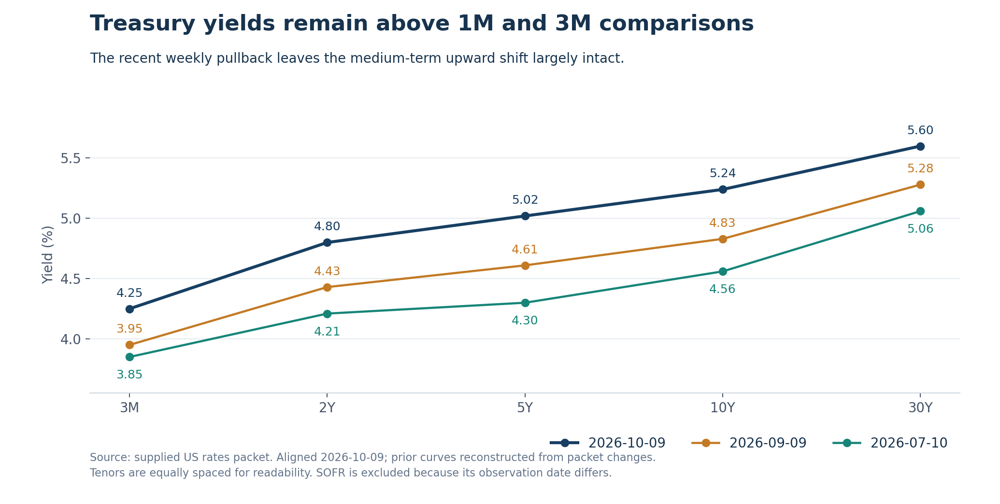
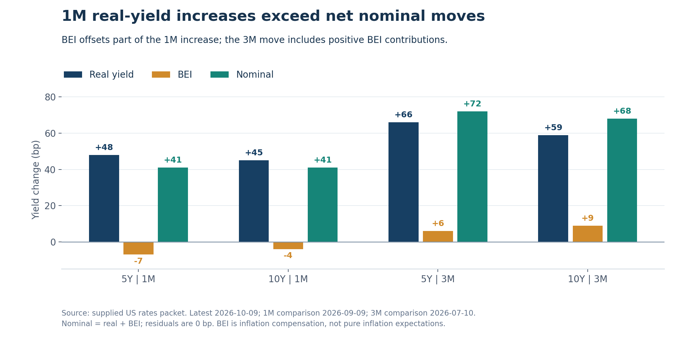

+++
title = "lc美国利率期限结构分析 2026年10月11日"
data_as_of = ["2026-10-08", "2026-10-09"]
data_as_of_note = "核心Treasury曲线、实际利率、通胀补偿与MOVE截至10月9日；SOFR实际观察日为10月8日；沿用原文各自比较窗口。"
description = "分析截至10月9日的美国国债曲线，区分通胀补偿主导的周度回落、中期实际利率上行与期限结构变化。"
series = "利率期限结构分析"
categories = ["宏观与政策", "市场结构"]
tags = ["美国国债", "收益率曲线", "实际利率", "BEI", "MOVE", "SOFR"]
date = "2026-10-11"
draft = false
featured = false
private = false
content_preservation = "verbatim"
source_sha256 = "bb39ff683d6aa95b97ac4397cf19fb1e7bf20d6320a748401747a32b6cd84b76"
+++

# lc美国利率期限结构分析 2026年10月11日

**周度回落主要来自通胀补偿下降，中期实际利率上行仍占主导**

报告日期：2026年10月11日（Asia/Singapore）。核心Treasury曲线对齐日：2026年10月9日；SOFR实际观测日：2026年10月8日。收益率水平以%表示，收益率变化、利差与曲线因子以bp表示，MOVE变化以指数点表示。1D、1W、1M、3M均沿用本期数据包的实际比较窗口。

## 1. Executive Summary

- **最新一日为中短端领跌的bear flattening，周度则是较小的回落。** 10月9日2Y、5Y、10Y收益率分别上行5bp、3bp、2bp，30Y持平；2Y/5Y/10Y三点分解为level +3.33bp、slope -3bp、curvature -1bp。一周内2Y至30Y收益率下降3—4bp，但3M上行6bp：2s10s略呈bull flattening，覆盖现金端的全曲线更接近mixed，而非一致下行。
- **一个月与三个月均由level上移主导，斜率方向因区段而异。** 两个窗口的level分别为+39.67bp和+66.33bp，2s10s分别走陡4bp和9bp；30Y-5Y却分别收窄9bp和18bp。5Y三个月上行72bp，超过2Y的59bp与30Y的54bp，中期压力仍较多集中在中间期限。
- **周度名义收益率回落主要来自BEI，而非显著的实际利率下降。** 5Y、10Y一周均下降4bp，其中real各贡献-1bp、BEI各贡献-3bp；一个月real却分别上升48bp、45bp，BEI下降7bp、4bp仅部分抵消。当前实际收益率为5Y 2.68%、10Y 2.91%，现有证据仍支持中期real-led上行的描述。
- **近期高点已有回撤，部分曲线结构及MOVE仍处于较高的短样本位置。** 5Y、10Y、30Y均低于20及60观察值高点7bp；2s5s10s fly为0bp，距两个窗口高点仅2bp，5年分位82.1%。MOVE为98.47，周度下降8.82点，但1年分位仍为94.0%，5年分位为45.0%；可称近期波动有所缓和，不能据此认定长期极端压力或全面恢复平静。

## 2. Curve Snapshot

**当前核心国债曲线仍为正斜率；最新一日的收益率反弹集中在2Y附近，而非由30Y带动。** 3M为4.25%，2Y为4.80%，随后逐步上升至30Y的5.60%。SOFR为3.87%，观测日滞后一天，单独列示，不将其与10月9日Treasury构造同步资金利差。

| 期限 | 当前收益率 | 实际观测日 | 1D | 1W | 1M | 3M |
| :-- | --: | --: | --: | --: | --: | --: |
| SOFR | 3.87% | 2026-10-08 | -1bp | 0bp | +23bp | +32bp |
| 3M | 4.25% | 2026-10-09 | +2bp | +6bp | +30bp | +40bp |
| 2Y | 4.80% | 2026-10-09 | +5bp | -3bp | +37bp | +59bp |
| 5Y | 5.02% | 2026-10-09 | +3bp | -4bp | +41bp | +72bp |
| 10Y | 5.24% | 2026-10-09 | +2bp | -4bp | +41bp | +68bp |
| 30Y | 5.60% | 2026-10-09 | 0bp | -3bp | +32bp | +54bp |

*来源：`latestCurve.points`。Treasury的1D、1W、1M、3M比较日依次为2026-10-08、2026-10-02、2026-09-09、2026-07-10；SOFR依次为2026-10-07、2026-10-01、2026-09-08、2026-07-10。这里的1M/3M变化窗口与3M期限点属于不同含义。*

最新一日，2Y上行5bp，超过5Y的3bp与10Y的2bp，30Y则持平；10Y-2Y和30Y-5Y各收窄3bp，符合中短端主导的bear flattening。最近一周的图景不同：2Y和30Y分别下降3bp，5Y和10Y分别下降4bp，属于票息期限的小幅rally；3M却上行6bp，现金端与票息期限走势分化。

一个月内五个核心Treasury期限全部上行，其中5Y和10Y均上行41bp，略高于2Y的37bp，30Y上行32bp。三个月升幅以5Y的72bp最大，10Y为68bp，2Y和30Y分别为59bp、54bp。因此，中期曲线上移并非纯平行移动：2s10s走陡与5s30s趋平同时发生，反映belly及10Y相对两侧的不同表现。

*图1：历史水平由当前收益率减去对应窗口变化复算；横轴使用等距期限标签，不代表期限长度等比例。图中不含观测日期不同的SOFR。*

近期高点并未在最新一日被重新触及。2Y为4.80%，低于20及60观察值高点4.92%共12bp；5Y、10Y、30Y分别为5.02%、5.24%、5.60%，均距两个窗口高点7bp。3M和SOFR各距自身高点3bp。相对于较早的一个月、三个月比较日，收益率仍明显较高；相对于近20个观察值，则已出现回撤。两种描述依赖不同参照窗口，不应混用。

## 3. Spreads and Butterflies

**结构上最值得关注的是2s5s10s接近局部上界，以及2s10s与5s30s的中期方向不同。** 10Y-3M和5Y-2Y的5年分位偏高，但均低于近期滚动高点；不能仅根据较高历史分位就宣称已发生突破。

| 结构 | 当前 | 1D | 1W | 1M | 3M | 5年分位 | 20观察值区间 | 60观察值区间 |
| :-- | --: | --: | --: | --: | --: | --: | --: | --: |
| 10Y-2Y | +44bp | -3bp | -1bp | +4bp | +9bp | 68.5% | 20至51bp | 20至53bp |
| 10Y-3M | +99bp | 0bp | -10bp | +11bp | +28bp | 84.6% | 79至109bp | 69至109bp |
| 30Y-5Y | +58bp | -3bp | +1bp | -9bp | -18bp | 65.3% | 41至64bp | 41至93bp |
| 5Y-2Y | +22bp | -2bp | -1bp | +4bp | +13bp | 85.9% | 7至26bp | 7至26bp |
| 2s5s10s fly | 0bp | -1bp | -1bp | +4bp | +17bp | 82.1% | -6至2bp | -17至2bp |
| 5s10s30s fly | -14bp | +1bp | -1bp | +9bp | +10bp | 63.9% | -20至-10bp | -27至-10bp |

*来源：`spreadsAndButterflies.items`。Butterfly convention为`2 * belly - short - long`。分位与区间为packet给定的历史统计；JSON中的负零`-0.0`按0bp呈现。*

10Y-2Y为44bp，一周收窄1bp、一个月扩大4bp，三个月扩大9bp，当前距离20观察值高点51bp为7bp、距离60观察值高点53bp为9bp。最新日与周度的趋平没有抹去中期走陡，但当前也未处于局部最大斜率。

10Y-3M为99bp，5年分位84.6%，较高的长期位置与短期收窄并存。一周收窄10bp，来自10Y下降4bp与3M上升6bp的共同作用，不能全部归结为长端rally。该利差距20及60观察值高点109bp仍有10bp。一个月与三个月则分别扩大11bp、28bp，现金端至10Y的中期斜率仍高于相应比较日。

30Y-5Y为58bp，一周小幅扩大1bp，一个月和三个月分别收窄9bp、18bp，显示5Y中期上行较多的特征仍在。当前距20观察值高点64bp只有6bp，但距60观察值高点93bp有35bp；短滚动窗口的相对位置不能代替更长窗口判断。5Y-2Y为22bp，5年分位85.9%，比两个滚动窗口的高点26bp低4bp；三个月扩大13bp，进一步体现5Y相对2Y的收益率上移。

**2s5s10s fly为0bp，表示5Y收益率在当前显示精度下等于2Y与10Y的简单平均值。** 这不意味着5Y处于“公允价值”。该fly的5年分位为82.1%，距20及60观察值高点+2bp仅2bp；三个月上升17bp、一个月上升4bp，显示5Y相对两翼的收益率已经上移，即yield-space意义上的相对cheapening。最新一日及一周各下降1bp，是较小的反向变化。

5s10s30s fly为-14bp，意味着10Y收益率比5Y与30Y简单平均值低7bp；一个月与三个月分别上升9bp、10bp，说明10Y相对这组两翼的收益率也较先前上移。其5年分位为63.9%，距离两个滚动窗口高点-10bp为4bp。两项fly的中期上移可以同时成立，因为其belly与两翼不同；它们均为收益率空间的算术关系，未按久期、凸性、carry或资金成本调整，不直接构成估值或交易结论。

## 4. Three-Factor Decomposition

令Δy为同一窗口内的收益率变化，单位bp，采用以下2Y/5Y/10Y desk-style分解：

- `Level = (Δy2Y + Δy5Y + Δy10Y) / 3`
- `Slope = Δy10Y - Δy2Y`
- `Curvature-Convexity = 2 × Δy5Y - Δy2Y - Δy10Y`

| 窗口 | 2Y / 5Y / 10Y变化 | Level | Slope | Curvature | 结构判断 |
| :-- | --: | --: | --: | --: | --: |
| 1D | +5 / +3 / +2bp | +3.33bp | -3bp | -1bp | 2s10s bear flattening |
| 1W | -3 / -4 / -4bp | -3.67bp | -1bp | -1bp | 2s10s轻微bull flattening；全曲线mixed |
| 1M | +37 / +41 / +41bp | +39.67bp | +4bp | +4bp | 2s10s bear steepening；5s30s趋平 |
| 3M | +59 / +72 / +68bp | +66.33bp | +9bp | +17bp | level主导；2s10s走陡，5Y相对两翼上移 |

*来源：`factorDecomposition.windows`。各项已用底层期限变化复算；level按两位小数显示。*

**日度level与slope的显示幅度接近；周度、月度与三个月均由level的显示幅度占优。** 最新一日level为+3.33bp、slope为-3bp，收益率上移与趋平同样值得关注。周度level为-3.67bp，slope和curvature都只有-1bp，说明2Y至10Y的变化更接近小幅共同下移，附带轻微趋平；但该三点指标不包含上行的3M，不能据此给整条曲线贴上统一bull标签。

一个月level为+39.67bp，slope与curvature各为+4bp，中期共同上移明显大于局部形变。三个月level进一步达到+66.33bp，curvature为+17bp，反映5Y上行72bp高于2Y和10Y两翼的平均升幅。与此同时，30Y-5Y在三个月收窄18bp，说明三点分解描述的2s10s走陡，并不能代表超长端相对belly的走势。

这是算术分解，**不是统计PCA**。不同因子的缩放不同，绝对值比较只服务于当前口径的desk描述，不能解读为风险贡献比例或方差解释度；“Curvature-Convexity”沿用字段名称，也不是债券价格对收益率的二阶敏感度测量。

## 5. Real Rates / Inflation Compensation / MOVE

**周度回落与中期上行的主导贡献不同。** 当前5Y名义收益率5.02%，由2.68%的实际收益率与2.34%的BEI组成；10Y名义收益率5.24%，对应2.91%的实际收益率与2.33%的BEI。

| 期限 | Nominal | TIPS real yield | BEI | 观测日 |
| :-- | --: | --: | --: | --: |
| 5Y | 5.02% | 2.68% | 2.34% | 2026-10-09 |
| 10Y | 5.24% | 2.91% | 2.33% | 2026-10-09 |

名义收益率来自Treasury CMT，实际收益率来自Treasury Real CMT，BEI由同日nominal减real得到。以下归因使用三条序列的同日交集，起止日期与Treasury主表的对应窗口一致。

| 期限 | 窗口 | Nominal变化 | Real贡献 | BEI贡献 | Residual |
| :-- | --: | --: | --: | --: | --: |
| 5Y | 1D | +3bp | +6bp | -3bp | 0bp |
| 5Y | 1W | -4bp | -1bp | -3bp | 0bp |
| 5Y | 1M | +41bp | +48bp | -7bp | 0bp |
| 5Y | 3M | +72bp | +66bp | +6bp | 0bp |
| 10Y | 1D | +2bp | +4bp | -2bp | 0bp |
| 10Y | 1W | -4bp | -1bp | -3bp | 0bp |
| 10Y | 1M | +41bp | +45bp | -4bp | 0bp |
| 10Y | 3M | +68bp | +59bp | +9bp | 0bp |

*来源：`realRatesInflationCompensation.latest`及`moveAttribution.items`。每组归因记录的历史共同观测数为2,133；这是包内对齐样本记录，不是本次另外取得的原始历史序列。*

一周内5Y、10Y名义收益率各下降4bp，其中real贡献-1bp、BEI贡献-3bp，回落主要反映通胀补偿下降。最新一日却出现不同组合：5Y real上升6bp、BEI下降3bp，净名义变化为+3bp；10Y real上升4bp、BEI下降2bp，净名义变化为+2bp。也就是说，BEI下降与实际利率反弹同时发生，名义利率的较小变动掩盖了两个分量的反向运动。

*图2：一个月与三个月的5Y/10Y归因，分别显示real、BEI与nominal；负BEI表示对实际利率上行的抵消，单位bp。*

一个月内5Y与10Y名义收益率均上升41bp，real贡献却分别达到+48bp和+45bp，BEI的-7bp、-4bp形成抵消。因此“实际利率主导”不仅表现为贡献较大，还表现为real升幅超过名义净升幅。三个月real贡献为+66bp、+59bp，BEI转为+6bp、+9bp，共同构成+72bp、+68bp的名义变化。BEI贡献的符号会随窗口切换，不宜把“通胀补偿下降”外推为所有期限窗口的持续趋势。

八组归因residual均为0bp，`largeResiduals`为空，未触发packet所述“超过2bp需要专门解释”的提示。由于BEI主要由同日nominal减real构造，零残差说明日期与代数关系一致，不能证明宏观因果解释正确。BEI是inflation compensation，包含风险溢价、流动性与技术因素的影响，并非纯通胀预期；real yield也不能单独区分预期实际短端利率与实际期限溢价。

**MOVE下降支持近期波动缓和的描述，但不与利率方向机械对应。** 10月9日MOVE为98.47，较前日下降2.23个指数点，一周下降8.82点；一个月和三个月仍分别高出21.73点、28.92点。其1年分位94.0%、5年分位45.0%，意味着相对近一年仍偏高，却不足以称为五年极端压力。最新一日MOVE下降与2Y/5Y/10Y收益率上升并存，本身就是波动指标与收益率方向不能混为一谈的例子。

## 6. Heatmap / Move Concentration

**最近五个观测日的显著波动在期限和日期上分散，最新一日的上行更集中于中短端与belly。** 10月5日至9日的摘要中，最大单日上行为10月8日1个月期国库券（1M tenor）上行7bp，其次为10月9日2Y上行5bp、3Y上行4bp。这里的1M指期限，不是“一个月累计变化”。

最大下行为10月6日3Y下降9bp；10月8日20Y与30Y各下降7bp、10Y下降6bp，显示此前长端也发生了明显rally。上述数值是五日窗口中列出的单日极值，不是各期限五日累计收益率变化。

| Packet区段 | 平均日变化 | 上行 / 下行 / 持平 | 观测数量 |
| :-- | --: | --: | --: |
| Front-end | +1.25bp | 4 / 2 / 2 | 8 |
| Belly | +3.00bp | 3 / 0 / 0 | 3 |
| Long-end | +1.00bp | 2 / 0 / 1 | 3 |

*来源：`heatmapSummary.latestDayBreadth`，日期2026-10-09。区段名称沿用packet；包内没有逐期限成员映射，不据此反推区段边界。*

最新一日belly三项全部上行、平均+3bp；long-end两项上行、一项持平、平均+1bp；front-end平均+1.25bp，但内部仍有两项下降和两项持平。因此这一天具有较广的上行覆盖，幅度以belly及2Y附近更突出，仍不是全部期限同步上行。核心曲线中30Y持平而2Y上行5bp，与这一非平行变化一致。

最近20观察值的平均绝对日变化以2Y的4.95bp、3Y的4.80bp居前，随后为7Y 4.40bp、5Y 4.30bp、10Y 4.20bp；20Y与30Y分别为4.05bp、3.75bp。波动较活跃的中心仍在2Y至7Y，但10Y及20Y也有一定幅度，不能简化为单一期限的局部冲击。平均绝对变化不含方向，也未经久期调整，不能直接据此排列持仓损益风险。

## 7. Trading Desk Interpretation

**当前更像中期real-led上行中的周度缓和，最新一日又出现中短端收益率反弹。** 周度5Y/10Y名义收益率下降4bp，但real仅下降1bp，说明名义回落尚未转化为明显的实际利率条件放松。月度real上升45—48bp，且当日real重新上行，使“持续宽松重定价”缺少支持。另一方面，5Y至30Y均已低于近期高点7bp、MOVE周度下降，也不支持把最新日描述为毫无缓解的持续selloff。

**Policy path是可能参与的因素，但不能从2Y或3M的变化直接反推出政策决策。** 最新一日2Y上行5bp、一周3M上行6bp，而同期票息期限收益率小幅回落，可能表明现金端与中期利率定价并未同步。数据包没有OIS、联邦基金期货或政策事件背景，SOFR又滞后一天，政策路径的具体方向及贡献**需要额外数据确认**。

**把中期上行主要归因于超长端term premium，证据仍不充分。** 月度和三个月2s10s走陡与这一解释可以相容，但同期30Y-5Y分别收窄9bp、18bp，30Y收益率升幅也低于5Y。可确认的是中间期限及实际收益率抬升，无法仅凭曲线区分预期利率路径与期限溢价。期限溢价模型、发行拍卖及投资者需求背景均未提供，term premium解释**需要额外数据确认**。

**Belly相对收益率上移有直接证据，凸性对冲机制没有得到识别。** 2s5s10s三个月上升17bp，当前为0bp并接近局部高点，反映5Y相对两翼的中期cheapening；5s10s30s月度上升9bp，反映10Y相对另一组两翼的收益率上移。这些算术结构不能证明MBS、期权或投资者对冲流正在驱动市场；相关持仓、流量及凸性暴露信息**需要额外数据确认**。

后续监测应首先聚焦5Y/10Y的real与BEI贡献是否发生持续变化，因为它决定周度名义回落能否代表实际利率条件缓和；其次观察3M与票息期限能否重新同向，以及2s5s10s是否继续贴近+2bp的本期滚动高点。10Y、30Y距近期高点的回撤是否扩大，以及MOVE能否保持周度下降，将为压力缓和的持续性提供补充证据。

## 8. What Would Change My View

以下均为后续同口径数据包可检验的研究条件；所引区间边界是本期历史参照，不是收益率目标或交易触发位。

1. **Real开始承担主要的周度下行贡献。** 若5Y/10Y名义收益率继续下降，同时real贡献由目前各-1bp转为持续、幅度更大的下降，并超过BEI的贡献，则“周度回落主要来自通胀补偿”的判断需要调整，实际利率条件缓和的证据会增强。
2. **现金端与票息期限重新同向。** 若3M也转为周度下降，2Y至30Y继续回落，且更新后的SOFR能够提供同日期资金背景，当前mixed描述可转向更广泛的rally；若3M保持上行而2Y/5Y继续反弹，则近期缓和的范围会进一步收窄。SOFR更新首先解决信息缺口，其方向不作预设。
3. **Belly fly突破或回落，改变相对压力判断。** 若2s5s10s超过本期20及60观察值高点+2bp，并在周度继续上升，5Y相对两翼上移的证据增强；若该fly持续下降、进一步回到本期20观察值低点-6bp附近，则中期belly压力应重新评估。5s10s30s能否超过本期高点-10bp，是另一项独立观察。
4. **Long-end成为明确的相对上行中心。** 若30Y重返并超过本期高点5.67%，同时30Y-5Y持续扩大、超过本期20观察值高点64bp，则需提高对超长端相对压力的关注；但确认term premium原因仍需额外数据。反之，若10Y与30Y持续远离当前高点向下回落，周度缓和的持续性会增强。
5. **MOVE与曲线走势共同确认新的波动背景。** 若MOVE周度继续下降、1年分位持续回落，同时实际收益率及长端也下降，才更支持广泛缓和；若MOVE重新上升并伴5Y/10Y实际收益率上行，则当前较小的周度回落应更审慎看待。仅MOVE变化不能确认利率方向。

## 结论

截至2026年10月9日，美国国债曲线呈现“中期实际利率上行、周度小幅回落、最新一日中短端反弹”的组合。周度5Y/10Y回落主要来自BEI下降，实际收益率仅小幅降低；月度实际利率升幅仍大于名义净升幅。下一步应重点检验real是否开始持续下行、现金端与票息期限是否重新同向，以及belly相对压力和MOVE能否共同缓和。在这些证据出现前，更稳妥的判断是高收益率环境中的有限缓和，尚不足以确认广泛的实际利率放松。
