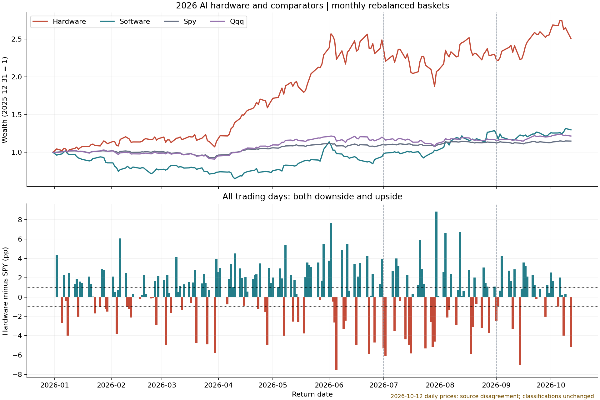
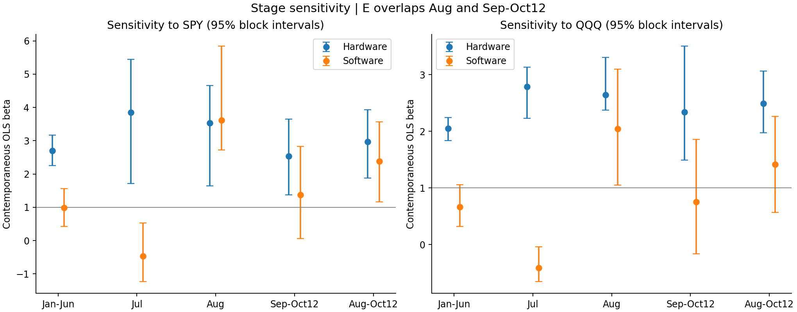
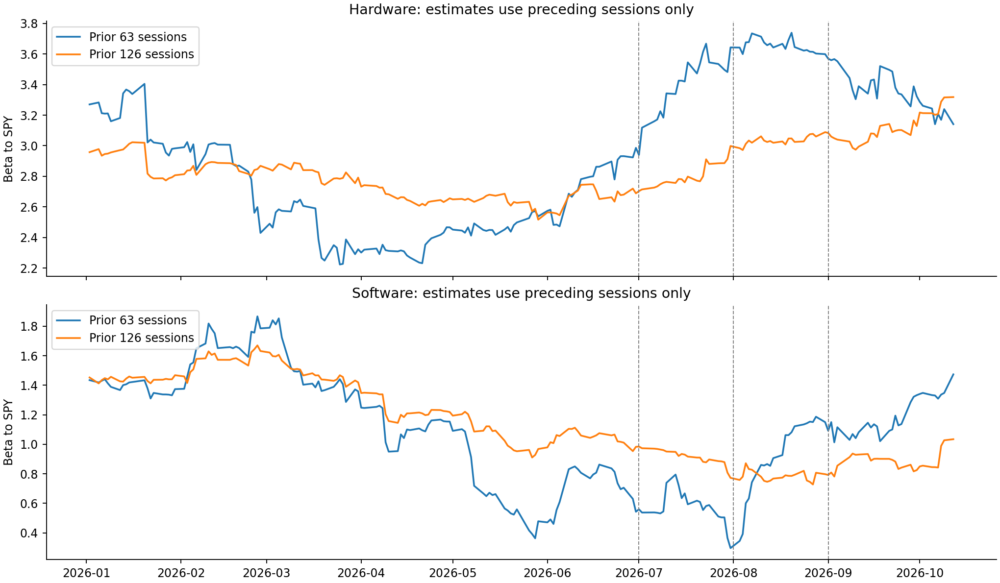
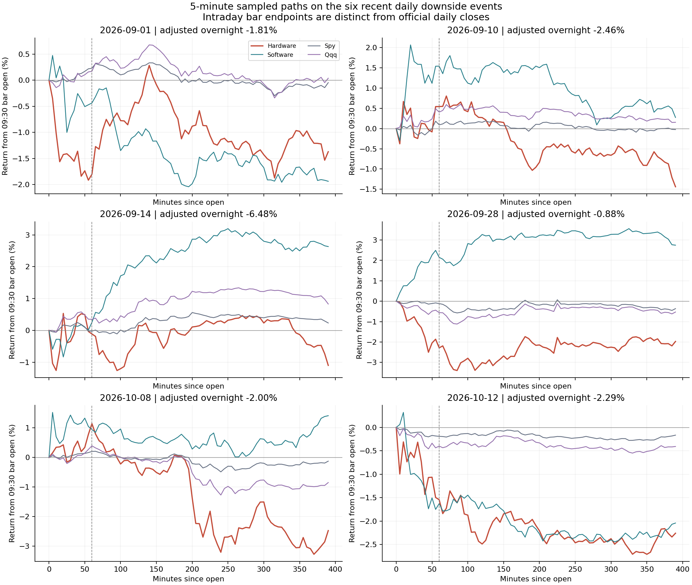
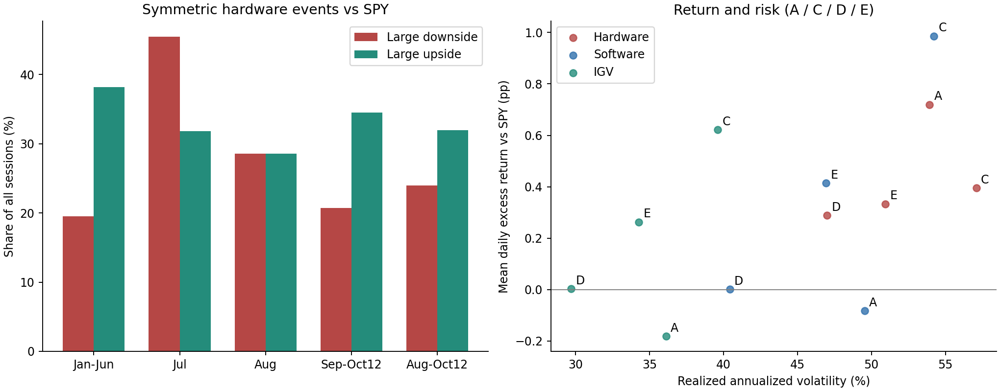

+++
title = "2026 年 AI 硬件相对弱势与软件风险收益研究"
data_as_of = "2026-10-12"
data_as_of_note = "报告日期为10月13日新加坡时间，研究区间为2026年1月2日至10月12日美东交易日；近期指9月1日至10月12日，保留最新日来源差异及DEGRADED限制。"
description = "比较2026年AI硬件的相对弱势、市场敏感度与开盘路径，检验软件风险收益改善，并保留样本、来源与统计不确定性的边界。"
series = ""
categories = ["科技产业", "市场结构", "研究方法"]
tags = ["AI", "硬件", "软件", "风险收益", "Beta", "SPY", "QQQ"]
date = "2026-10-13"
draft = false
featured = false
private = false
content_preservation = "verbatim_except_privacy_redactions"
source_sha256 = "661df313633f0ade59c2df82e413f3b70ce96121cce4c58f0d672da74c1630f7"
+++



<!-- Copyright (c) 2026, Williams.Wang. All rights reserved. Use restricted under LICENSE terms. -->
# 2026 年 AI 硬件相对弱势与软件风险收益研究

报告日期：2026-10-13，新加坡时间。研究区间：2026-01-02 至 2026-10-12，美东交易日。所有“近期”均指 9 月 1 日至 10 月 12 日；“8 月以来”指 8 月首个交易日至 10 月 12 日。

## 1 核心判断

**硬件集体大跌而大盘跌幅有限的现象真实存在，但“近期更常暴跌”与“8 月以来相对表现变弱”是两个不同命题。** 9 月以来，大幅跑输日为 6/29，比例接近上半年；把 8 月纳入后，跑输日比例由上半年的 19.51% 升至 24.00%，跑赢日比例由 38.21% 降至 32.00%。后者支持上行优势收窄的描述，变化的统计区间仍较宽，不能确认下跌概率已发生结构性上升。

**硬件更显眼的波动，一部分来自大盘变得更平静。** 8 月以来硬件自身波动略低于上半年，但与 SPY 的波动比由 3.79 倍升至 5.07 倍，相关性下降。同期市场敏感度在 7、8 月较高，9 月以来有所回落；下跌侧敏感度也没有确认上升。最差一组交易日的绝对损失未明显加深，因此“上行优势减弱、相对大盘的波动仍大”比“硬件所有风险都恶化了”更符合数据。

**软件相对自身上半年的风险收益有所改善，较一致的证据在下行风险。** 自选软件篮子和 IGV 均出现下行偏差下降、左尾损失减轻；等长 50 日比较也保留这一结果。收益优势主要集中在 8 月，9 月以来软件对 SPY 的日均超额收益接近零，对 QQQ 则为负。软件第二季度已开始修复，不能把转折完全定位在 7 月 31 日，也不能据此确认软件持续领先硬件。

**开盘时已经大跌，与开盘后快速下跌必须分开。** 近期六个日线下跌事件只有三个同时满足首小时急跌标准；9 月 14 日约 −7.50% 的全日跌幅，主要发生在隔夜。全样本的首小时检验没有显示近期急跌率上升。软件在这些硬件下跌日也并非稳定反向上涨，价格分化不足以证明资金从硬件流向软件。

上述判断适用于本研究的固定股票池。它们描述价格行为，不诊断个人记忆偏差，不构成因果关系、未来收益或交易能力的证明。

## 2 样本与判断框架

### 2.1 时间窗口如何对应研究问题

|窗口|收益发生日期|交易日数|比较用途|
|---|---|---:|---|
|上半年 A|1 月 2 日至 6 月 30 日|123|主要历史基期|
|7 月 B|7 月 1 日至 7 月 31 日|22|完整保留调整阶段|
|8 月 C|8 月 3 日至 8 月 31 日|21|单独检验修复期|
|近期 D|9 月 1 日至 10 月 12 日|29|检验近期观察|
|8 月以来 E|8 月 3 日至 10 月 12 日|50|检验调整之后的整体变化|

收益按结束日归属。E=C+D，不是独立第五阶段。7 月可以描述为表现特殊的月份，但没有被正式识别为应删除的统计异常值；它始终保留在完整样本中。上半年再拆为第一季度 61 日、第二季度 62 日，以检查基期是否稳定。

这些阶段来自已经观察到的行情，属于回顾性研究。D−A 是最初关注的比较；E−A 是观察已有结果后提出的探索性扩展。统一展示二者，不能把后者包装成独立预注册或样本外检验。

### 2.2 股票池与组合

|类别|成分|
|---|---|
|计算芯片|NVDA、AMD、AVGO|
|存储|MU、SNDK|
|网络与互连|MRVL、ALAB、CRDO、ANET、COHR、LITE|
|服务器|DELL、HPE、SMCI、CLS|
|软件|CRM、NOW、ADBE、PLTR、SNOW、DDOG、MDB、CRWD|

前四类合成核心硬件 15 股。扩展硬件另加 TSM、ASML、AMAT、LRCX、KLAC、VRT、ETN，共 22 股。MSFT、AMZN、GOOGL、ORCL 作为云平台独立计算，不混入软件主组合。

篮子在每月首个收益发生前重置等权，月内权重随收益漂移。当天收益使用先前收盘权重；日线采用拆股及分红调整后的简单总回报。累计收益按复利计算，阶段最大回撤包含起点净值及首日损失。未扣交易、融资等成本，因此是描述性研究组合。

SPY 为主市场基准，QQQ 为大型成长股环境对照，RSP 为标普 500 等权对照，IWM 为罗素 2000 小盘股对照，IGV 为软件外部参照。QQQ 跟踪纳斯达克 100，不等于纳斯达克综合指数。SPY、QQQ、RSP 含硬件公司，不能当作剔除了硬件影响的外生市场。

### 2.3 用哪些指标区分不同含义的弱势

|问题|主指标|不能混同的概念|
|---|---|---|
|硬件是否更经常独立大跌|对称的大幅跑输与跑赢事件率|普通下跌日不等于大幅跑输日|
|是否因为硬件本来就更敏感|同期 beta、上下行 beta、滞后模型残差|beta 不等于自身波动，也不是因果系数|
|整体收益分布是否更不利|超额收益、波动、下行偏差、左尾均值|跑输频率增加不必然意味着损失更深|
|是否开盘后迅速下跌|隔夜收益、首小时终点及触发路径|开盘已跌不等于首小时跌幅|
|软件是否转强|相对收益、风险、市场调整后表现及等长窗口|软件自身改善不等于稳定战胜硬件|

日线主下跌事件同时要求：硬件收益不高于 −2%，硬件减 SPY 收益不高于 −1 个百分点，且至少 60% 成分跑输 SPY。上涨事件逐项反号。另检查较宽的 1.5%/0.75 个百分点和较严的 2.5%/1.25 个百分点门槛，避免只看某个阈值。

文中区间采用阶段内循环区块 bootstrap：以 5 个连续交易日为一块，重抽 5,000 次，随机种子为 20261013；3 日和 10 日区块作对照。同日软硬件与市场收益一起抽取，保持横截面关联；不同、不重叠阶段分别抽取。95% 区间是依赖阶段内分布近似稳定的点态估计，未经多重比较校正，不能视为结构断点检验。全文 pp 指百分点；年化风险按 252 个交易日缩放。

## 3 硬件的收益分布发生了什么变化

### 3.1 先看趋势背景，再看单日冲击

|阶段累计收益|硬件|软件|SPY|QQQ|RSP|IWM|IGV|
|---|---|---|---|---|---|---|---|
|上半年|148.96%|-5.72%|10.09%|20.16%|11.98%|22.56%|-14.26%|
|7 月|-16.16%|9.47%|0.03%|-6.57%|1.05%|-3.08%|4.39%|
|8 月|10.16%|24.78%|2.68%|4.18%|2.04%|0.94%|16.28%|
|近期|9.16%|0.78%|1.60%|3.95%|-2.55%|-5.25%|1.26%|

7 月硬件累计 −16.16%，阶段最大回撤为 −24.74%；8 月累计 +10.16%，两个月合计仍约 −7.64%。因此 8 月属于部分修复，不能理解为已收复 7 月跌幅，也不能仅凭月末分段认定 7 月 31 日就是最低点。近期硬件累计仍上涨，说明阶段收益为正与多次剧烈下跌可以同时成立。

上图下半部分保留全部日期，避免仅观察负向事件。上半部分的累计涨幅说明路径背景，不单独决定某个阶段是否更脆弱，也不用于直接比较 123 日与 50 日的收益效率。

### 3.2 下行事件增多与上行优势收窄

|阶段|交易日|大幅跑输日|大幅跑赢日|跑输事件平均收益|跑赢事件平均收益|
|---|---|---|---|---|---|
|上半年|123|24/123（19.51%）|47/123（38.21%）|-4.54%|3.87%|
|7 月|22|10/22（45.45%）|7/22（31.82%）|-5.05%|4.85%|
|8 月|21|6/21（28.57%）|6/21（28.57%）|-3.68%|4.67%|
|近期|29|6/29（20.69%）|10/29（34.48%）|-4.52%|3.09%|
|8 月以来|50|12/50（24.00%）|16/50（32.00%）|-4.10%|3.68%|

8 月单独的跑输率较上半年高 9.06 个百分点，8 月以来合计高 4.49 个百分点；跑赢率分别低 9.64 与 6.21 个百分点。相反，9 月以来单独的跑输率只高 1.18 个百分点。这些描述并不矛盾：8 月对合并结果有实质影响。合并期仍是 16 个跑赢日多于 12 个跑输日，不能写成大跌事件已占多数。

|相对上半年变化|跑输率，pp [区间]|跑赢率，pp [区间]|跑输率减跑赢率，pp [区间]|
|---|---|---|---|
|8 月|+9.06 [-5.34, +23.46]|-9.64 [-24.04, +5.69]|+18.70 [-6.74, +44.48]|
|近期|+1.18 [-14.05, +17.41]|-3.73 [-24.03, +17.19]|+4.91 [-28.15, +38.41]|
|8 月以来|+4.49 [-6.84, +16.49]|-6.21 [-20.72, +8.67]|+10.70 [-11.99, +33.71]|

表中日线阶段差异统一采用同一批同步区块抽样结果，所有区间都跨零。当前可以确认样本比例的方向，尚不能确认真实发生概率显著改变；也不能反过来断言两段完全一样。在 50 日窗口内，一天就对应 2 个百分点，4.49 个百分点的观察差异仍容易受有限样本影响。“跑输率−跑赢率”的恶化同时考虑了负向与正向事件，比只数大跌日更接近收益不对称的含义。

### 3.3 频率变化是否伴随损失加深

|指标|上半年|8 月|近期|8 月以来|
|---|---|---|---|---|
|年化波动率|53.92%|57.09%|47.00%|50.94%|
|年化下行偏差|34.97%|33.82%|34.66%|34.31%|
|最差 20% 日平均收益|-4.47%|-4.16%|-4.58%|-4.41%|
|最差 20% 日平均超额收益 / SPY|-3.72%|-3.92%|-4.08%|-4.07%|
|普通下跌日比例|35.77%|38.10%|34.48%|36.00%|
|负收益平方占总收益平方|40.16%|36.06%|55.54%|45.50%|
|日均超额收益 / SPY|0.720%|0.395%|0.289%|0.333%|
|信息比率 / SPY|4.04|1.95|1.72|1.83|
|阶段最大回撤|-15.58%|-11.71%|-8.68%|-12.05%|

下行偏差以零收益为阈值，计算所有日期负收益平方的均值再开方；上涨日计零。它同时反映损失频率和幅度，不是仅在下跌日内算标准差。最差 20% 日均收益取样本中最差 20% 的概率质量，边界观测按比例计权；它是已观察左尾的平均，不是未来最大损失。

8 月以来硬件年化波动由 53.92% 降至 50.94%，下行偏差由 34.97% 降至 34.31%；绝对左尾均值约 −4.47% 至 −4.41%，跑输事件本身平均跌幅也由 −4.54% 减轻至 −4.10%。普通下跌日比例为 35.77% 至 36.00%，几乎不变。因此并未出现绝对风险全面上升。阶段最大回撤也列在表中，但窗口长度不同，不能仅凭较短窗口回撤浅就认定风险更低。

相对风险的方向略有不同：相对 SPY 的左尾均值由 −3.72% 变成 −4.07%，负收益平方占比由 40.16% 升至 45.50%。后者也会在正向冲击减少时上升，不能单独证明负向冲击加深。更清楚的变化是硬件日均超额收益从 +0.720% 降至 +0.333%，信息比率从 4.04 降至 1.83；日均超额收益变化区间仍跨零。

综合频率、幅度和风险，较准确的表述是：**硬件相对收益分布的上行优势减弱，相对大盘的负尾部略差，但未确认更高的整体波动或更深的绝对左尾。** 因而“更脆弱”可以作为需要继续验证的概括，不能用它替代各风险维度的具体证据。

### 3.4 变化是否依赖门槛或基期

核心池采用较宽、主、较严三档门槛，8 月以来减上半年的跑输率分别变化 +2.05、+4.49、+4.11 个百分点，跑赢率分别变化 −9.90、−6.21、−6.89 个百分点。扩展 22 股和四子组等权也保留同向变化。逐一剔除任一硬件股，主门槛下跑输率变化为 +0.86 至 +5.30 个百分点，跑赢率变化为 −9.77 至 −2.96 个百分点。

这增加了对方向的信心，但这些变体大量共享股票与日期，不是多份独立证据。近期六个下跌事件在逐股剔除后仍为六个；以 QQQ、RSP、IWM 为相对基准也均为六个。扩展池、子类等权、个股中位数的近期下跌事件数同样为六个，上涨事件则为七至九个。完整对照见事件稳健性与原始组合对照。删去最差一日或三日只用于影响诊断，不作为改写主结论的样本。

基期本身也并不均匀。硬件跑输率在第一、二季度分别为 19.67%、19.35%，接近；跑赢率却由 27.87% 升至 48.39%。8 月以来的 32.00% 低于第二季度，却高于第一季度。因此上行优势减弱，主要是相对于第二季度的强势。在上半年 74 个连续 50 日窗口中，8 月以来的日均超额收益只高于其中六个，而绝对波动处于中间附近。重叠窗口只用于历史范围对照，不把其排序当成统计显著性。

## 4 市场敏感度能解释多少相对弱势

### 4.1 同期 beta 升高不等于自身风险升高

对每个阶段分别估计含截距模型：

$$r_{H,t}=a+\beta r_{B,t}+\epsilon_t,\qquad \beta=\rho_{H,B}\frac{\sigma_H}{\sigma_B}.$$

beta 表示市场收益多变动一个百分点时，模型中的硬件收益平均多变动多少个百分点。beta=2.70 时，SPY 下跌一个百分点对应的市场项是 −2.70 个百分点；实际收益还包含截距与残差，因此不是承诺的跌幅。波动衡量自身起伏，相关性衡量共同变化，二者通过波动比共同决定 beta。

|阶段|beta / SPY|beta / QQQ|相关性 / SPY|波动比 H/SPY|硬件年化波动|残差年化波动 / SPY|
|---|---|---|---|---|---|---|
|上半年|2.70|2.05|0.712|3.79|53.92%|37.86%|
|7 月|3.85|2.79|0.619|6.22|75.28%|59.13%|
|8 月|3.53|2.64|0.637|5.54|57.09%|43.99%|
|近期|2.54|2.34|0.541|4.69|47.00%|39.54%|
|8 月以来|2.96|2.49|0.585|5.07|50.94%|41.32%|

相对 SPY 的敏感度在 7、8 月较高，9 月以来回到上半年附近；相对 QQQ 则仍高于上半年。因此不能概括成对所有市场持续更敏感。8 月以来减上半年的 beta 变化，相对 SPY 为 +0.26，95% 区间 [−0.89,+1.33]；相对 QQQ 为 +0.44，区间 [−0.11,+1.06]，均跨零。

大盘较平静、硬件却仍剧烈的观感，可以从波动比和相关性中得到解释。上半年至 8 月以来，SPY 年化波动由约 14.21% 降至 10.05%，降幅大于硬件；硬件与 SPY 的波动比由 3.79 升至 5.07，相关性由 0.712 降至 0.585。两者相乘，beta 只小幅升高。同时，模型解释度 R² 由约 50.71% 降至 34.19%，残差年化波动由 37.86% 升至 41.32%。

这与前一节可以统一理解：硬件的绝对波动未必增加，但面对一个更平静的大盘，其较大的独立波动更突出。相关性降低和残差增大只是共同变化结构的描述，尚不能归因为资金流出、估值受损或基本面变化。

### 4.2 市场下跌时是否放大得更多

进一步用共同截距的折线模型估计上涨侧和下跌侧斜率：

$$r_{H,t}=a+b_+\max(r_{B,t},0)+b_-\min(r_{B,t},0)+e_t.$$

|阶段|SPY 涨/跌日数|上涨侧 beta [区间]|下跌侧 beta [区间]|
|---|---|---|---|
|上半年|67/56|2.41 [1.71, 3.23]|3.01 [1.90, 4.02]|
|7 月|11/11|7.82 [5.19, 9.44]|-0.01 [-2.55, 2.42]|
|8 月|10/11|4.32 [0.48, 6.36]|1.44 [-2.54, 9.49]|
|近期|12/17|2.11 [0.02, 4.54]|3.34 [-0.21, 6.49]|
|8 月以来|22/28|3.31 [1.05, 4.89]|2.22 [-0.46, 5.60]|

8 月以来的下跌侧 beta 为 2.22，低于上半年的 3.01；差异区间为 [−3.66,+2.69]，没有确认下跌时放大更多。近期点估计 3.34 较高，但区间很宽；8 月仅 21 日，估计尤其不稳定。每侧不足六日时不估计，bootstrap 中不满足条件的重抽样会被标为无效，有效次数保存在区间表。

下跌侧 beta 是市场处于负收益区域内的斜率，不是该类日期硬件的平均跌幅。7 月下跌侧接近零，并不意味着硬件避险：损失可能体现在截距、残差以及市场上涨日的跑输。不能用这一系数推翻 7 月的实际亏损和高下跌事件率。

### 4.3 历史模型中的异常与阶段内敏感度

同期模型描述这个阶段已经发生的共同变化；若要判断“按照此前信息，这一天是否异常”，则使用当天之前 126 日拟合的模型，并用此前残差标准差标准化：

$$e_t=r_{H,t}-(\hat a_{t-1}+\hat\beta_{t-1}r_{B,t}),\qquad z_t=e_t/\hat\sigma_{e,t-1}.$$

训练参数和尺度都不使用当天及未来数据。±2 是对称研究阈值，不自动等于正态分布的尾部概率。

|阶段|日数|SPY 模型负异常|SPY 模型正异常|QQQ 模型负异常|QQQ 模型正异常|
|---|---|---|---|---|---|
|上半年|123|4|5|5|6|
|7 月|22|6|0|1|0|
|8 月|21|0|1|0|1|
|近期|29|1|0|1|0|

SPY 模型没有显示近期标准化负异常增多；7 月更突出。冻结在 6 月底的模型识别近期两个负异常日，滚动模型识别一个，说明模型是否适应新状态会影响“异常”的定义。QQQ 另作单基准对照，没有用半导体指数吸收掉要研究的硬件变化。

截至 10 月 12 日之前 126 日估计的硬件 SPY beta 约 3.32，而近期阶段内 beta 为 2.54。前者仍包含 7、8 月，并不矛盾。滚动 beta 的阶段均值不能作为阶段自身的 beta；较短窗口反应更快，也更不稳定。同期回归截距和滚动异常都不等于已经证实的可交易 alpha。

### 4.4 硬件内部存在不同路径

|子组累计收益|上半年|7 月|8 月|近期|近期年化波动|
|---|---|---|---|---|---|
|计算芯片|52.74%|-4.88%|1.32%|7.91%|32.48%|
|存储|552.58%|-37.63%|22.73%|-2.52%|59.22%|
|网络互连|145.72%|-23.41%|9.98%|6.42%|62.02%|
|服务器|83.17%|-3.01%|10.79%|20.26%|57.33%|

|子组 SPY beta|上半年|8 月|近期|8 月以来|
|---|---|---|---|---|
|计算芯片|2.37|2.37|1.96|2.12|
|存储|3.25|2.88|1.22|1.98|
|网络互连|2.73|3.95|2.60|3.18|
|服务器|2.59|4.08|3.46|3.71|

存储的调整与修复幅度较大，近期累计转负；服务器近期收益更强，8 月以来 beta 也高于其上半年水平。网络互连 beta 上升，计算芯片与存储则下降。硬件组合的变化不能概括到每一个子行业。

这些子组只用于解释。存储仅 MU、SNDK 两股，AVGO 同时有软件业务，网络互连公司商业模式也不相同；当前分类无法完全分离公司的真实经济暴露，不以小篮子结果宣称完整行业规律。

## 5 显著下跌日的广度与开盘路径

### 5.1 六个近期事件是否只是个别股票拖累

|日期|硬件|SPY|QQQ|软件篮子|IGV|个股跑输 SPY 比例|硬件首小时|
|---|---|---|---|---|---|---|---|
|2026-09-01|-3.15%|-0.69%|-1.27%|-3.65%|-3.46%|86.7%|-1.80%|
|2026-09-10|-3.88%|-0.60%|-1.06%|-0.36%|-0.62%|100.0%|0.54%|
|2026-09-14|-7.50%|-0.45%|-0.80%|5.61%|5.04%|100.0%|-0.11%|
|2026-09-28|-2.84%|-0.74%|-1.07%|-3.07%|-0.55%|86.7%|-2.29%|
|2026-10-08|-4.42%|-0.42%|-1.34%|1.77%|-0.23%|100.0%|1.14%|
|2026-10-12†|-5.33%|-0.15%|-0.93%|-1.43%|-1.15%|100.0%|-1.54%|

† 10 月 12 日保留主来源数值；完整 Yahoo 替代口径硬件约 −4.45%，仍满足相同事件标准。首小时收益以 09:30 开盘为起点，其他收益为前收盘至当日收盘。

六个事件日至少 13/15 股跑输 SPY，四个硬件子组全部跑输；前三大负贡献股占组合全部负贡献之和约 31.3%—44.9%。因此确有群体性弱势，不是单只股票把平均数拉低。但六个日期仍只算六次时间事件，不能把同时下跌的股票当成独立样本。逐日事件与贡献

9 月 14 日最接近硬件大跌、软件大涨的典型画面；9 月 1 日软件跌幅反而更大，10 月 8 日自选软件上涨但 IGV 下跌。具体事件支持“有时分化”，尚不支持稳定的反向关系。软件的整体风险收益与这类条件关系将在下一节统一比较。

### 5.2 首小时急跌与全天跑输是否同一现象

日内检验覆盖全部 195 日，没有先按收盘跌幅选日期。5 分钟 bar 使用美东常规时段，首小时终点为 10:25 开始 bar 的收盘，近似 10:30。首小时急跌同时要求组合收益 ≤−1%、相对 SPY ≤−0.5 个百分点、至少 60% 成分跑输；上涨对称。另检查前 30 分钟和首小时内每个同步采样点是否曾触发门槛。

|阶段|日数|首小时急跌|首小时急涨|首小时曾急跌|曾急跌但非收盘事件|曾急跌后收复开盘价|
|---|---|---|---|---|---|---|
|上半年|123|29（23.6%）|34（27.6%）|56（45.5%）|36|19|
|7 月|22|10（45.5%）|6（27.3%）|13（59.1%）|3|1|
|8 月|21|5（23.8%）|3（14.3%）|11（52.4%）|7|3|
|近期|29|6（20.7%）|8（27.6%）|10（34.5%）|6|1|

“终点急跌”和“曾触发急跌”不是同一集合：路径中先跌后修复，可能只进入后者。“曾急跌但非收盘事件”按日线主门槛判定；“收复开盘价”只表示相对开盘恢复，并不代表收复隔夜损失。

近期六个日线事件中，9 月 1 日、9 月 28 日、10 月 12 日也是首小时终点急跌；其余三个不是。反过来，9 月 23 日、9 月 30 日、10 月 9 日首小时急跌，却未达到收盘主事件标准。日线与开盘体验必须分别衡量。

近期减上半年的首小时急跌率为 −2.89 个百分点，95% 区间 [−19.32,+15.79]；曾触发急跌比例差为 −11.05 个百分点，区间 [−29.72,+11.27]。两者没有建立近期增加的证据，也因区间宽而不能证明风险下降。四阶段首小时计数完整保留，合并窗口的日线比例不能替代这一日内检验。

### 5.3 隔夜损失为何容易被记成开盘后下跌

9 月 14 日硬件全日约 −7.50%，拆股及分红调整后的隔夜收益约 −6.48%，开盘首小时约 −0.11%，开盘至官方日线收盘约 −1.09%。Yahoo 首小时约 0.00%，两来源均未触发首小时终点急跌。开盘时看到大跌准确地描述了价格位置，却不能推导出首小时跌了约 7%。

前收盘至收盘、隔夜和开盘至收盘满足复利分解：

$$(1+r_{CC})=(1+r_{ON})(1+r_{OC}).$$

隔夜口径含现金分红调整影响，不是未复权报价跳空。日内组合使用经过隔夜价格变化后的开盘权重，并在同一时刻聚合成分收益；没有平均个股在不同时刻达到的最低价。路径最低值只是 5 分钟收盘采样最低值，不是真实逐笔极值。

图中开盘归零、标题另列隔夜收益，虚线为首小时终点。末端为最后一根 5 分钟 bar，不能直接等同于官方日线收盘。因而路径图用来区分何时下跌，不用于从不同价格口径推算已经收复多少官方收盘损失。

## 6 软件的改善是否足以称为相对转强

### 6.1 收益与风险必须同时看

|阶段|累计收益|日均超额 / SPY|日均超额 / QQQ|年化波动|年化下行偏差|阶段最大回撤|IR / SPY|
|---|---|---|---|---|---|---|---|
|上半年|-5.72%|-0.082%|-0.158%|49.53%|33.47%|-36.21%|-0.44|
|7 月|9.47%|0.429%|0.732%|33.53%|19.91%|-8.73%|2.88|
|8 月|24.78%|0.985%|0.912%|54.22%|19.97%|-6.40%|5.20|
|近期|0.78%|0.001%|-0.080%|40.42%|26.09%|-9.64%|0.01|
|8 月以来|25.75%|0.415%|0.337%|46.94%|23.71%|-9.64%|2.45|

软件上半年累计收益为负，日均简单收益却接近零，是复利与波动损耗作用下可能出现的结果，不应把两种收益口径混用。信息比率衡量相对收益均值除以相对收益波动，按 √252 缩放；它不是假定无风险利率为零的 Sharpe，也不预测未来绩效。

8 月以来，自选软件的日均超额收益相对 SPY 由 −0.082% 升至 +0.415%，波动由 49.53% 降至 46.94%，下行偏差由 33.47% 降至 23.71%，最差 20% 日均收益由 −4.19% 改善至 −3.03%。因此改善不仅是累计涨幅较好，更体现在负向波动减少；总体波动降幅则较小。

IGV 也呈同向变化：日均超额收益由 −0.182% 升至 +0.263%，年化波动由 36.11% 降至 34.26%，下行偏差由 26.17% 降至 16.31%，左尾均值由 −3.27% 改善至 −1.97%。自选池与 IGV 存在成分重叠，这种一致性有参考价值，但不构成两个独立试验。

|8 月以来减上半年|自选软件变化 [区间]|IGV 变化 [区间]|
|---|---|---|
|日均超额收益变化，pp/日|+0.50 [-0.27, +1.30]|+0.44 [-0.10, +1.00]|
|年化波动变化，pp|-2.59 [-18.14, +11.91]|-1.85 [-12.11, +8.11]|
|年化下行偏差变化，pp|-9.75 [-20.82, +1.70]|-9.86 [-17.80, -2.06]|
|最差 20% 日均收益变化，pp|+1.16 [-0.26, +2.64]|+1.30 [+0.26, +2.32]|
|信息比率变化|+2.88 [-1.36, +7.42]|+3.63 [-0.84, +8.25]|
|SPY beta 变化|+1.40 [+0.03, +2.71]|+0.83 [-0.14, +1.85]|
|回归截距变化，pp/日|+0.38 [-0.40, +1.13]|+0.37 [-0.18, +0.91]|

自选软件的平均超额收益、信息比率、下行偏差、尾部和截距变化区间均跨零。IGV 的下行偏差及左尾改善，在 3、5、10 日区块下区间都不跨零，是相对更一致的风险改善证据；仍保留探索性、多指标比较的限制，不能直接推断未来保护能力。

### 6.2 风险改善不意味着变成低敏感度资产

软件相对 SPY 的同期 beta 从上半年的 0.98 升至 8 月以来的 2.38，上涨侧 beta 由 0.78 升至 3.06，下跌侧由 1.19 变为 0.92。点估计显示上涨时参与度增强，下行部分没有同比增加。整体 beta 变化在 5 日区块区间略高于零，换为 10 日区块则跨零，因此不能把边界结果写成稳健确认。

阶段回归截距由 −0.081%/日变为 +0.295%/日，说明市场线性项之外的平均表现有所改善，但其变化区间跨零。它没有控制完整风险因子和财报事件，不能等同于可交易 alpha。对日均收益增加约 0.501 个百分点作代数核算，约 0.376 来自截距变化、0.115 来自 beta 变化乘以上半年市场均值、0.011 来自市场均值变化乘以新 beta；这些是恒等式中的项目，不是因果贡献。均值变化分解

### 6.3 收益优势集中在 8 月 转折也早于 8 月

8 月软件相对 SPY 的日均超额收益为 +0.985%，近期只有约 +0.001%；相对 QQQ，近期为 −0.080%。近期 SPY 模型截距约 −0.020%/日，IGV 相对 SPY 的超额表现也接近零。合并期的高收益因此不能外推为 9 月以后持续领先。

向前看，软件日均收益第一季度为 −0.468%，第二季度已为 +0.460%，8 月以来为 +0.501%。相对第二季度只增加约 0.041 个百分点/日，差异区间约 [−1.09,+1.17]；市场调整后的截距甚至由 +0.329%/日小降至 +0.295%/日。下行偏差相对第二季度仍降低，但变化区间跨零。

因而更完整的阶段解释是：软件上半年内部已经由弱转强，7 月与硬件显著分化，8 月收益优势突出，近期超额收益回落，而下行风险较上半年仍偏轻。不能用单一的 7 月 31 日分界概括整个过程。

### 6.4 回撤较浅是否只是因为样本更短

123 日与 50 日的最大回撤不能直接等量比较。为此，取上半年所有 74 个连续 50 日窗口，沿用原组合权重，不在窗口起点重新选股或调仓。

|软件风险指标|8 月以来 50 日|上半年 74 个同长窗口范围|
|---|---|---|
|年化下行偏差|23.71%|28.86% 至 40.58%|
|最差 20% 日均收益|-3.03%|-5.15% 至 -3.59%|
|最大回撤|-9.64%|-30.15% 至 -13.47%|

自选软件在 8 月以来的下行偏差、左尾均值和最大回撤均好于上半年各等长窗口；IGV 的下行偏差和左尾也优于全部这些窗口。因此下行风险改善不容易只由观察期短来解释。74 个窗口大量重叠，不能视作 74 次独立检验，也不能把排名百分位当成 p 值。全部等长窗口

逐一剔除软件成分后，8 月以来相对上半年的日均超额收益改善仍为 +0.363 至 +0.615 个百分点/日，下行偏差均下降。剔除 PLTR 后仍改善约 +0.363 个百分点/日，说明并非完全由一只股票驱动；但总体波动下降并非对所有剔除版本都成立。逐股剔除结果

### 6.5 软件自身改善不等于硬件下跌时必然接棒

|阶段|硬件下跌事件数|软件绝对上涨|软件跑赢 SPY|IGV 绝对上涨|IGV 跑赢 SPY|
|---|---|---|---|---|---|
|上半年|24|10/24|14/24|10/24|13/24|
|7 月|10|9/10|9/10|8/10|8/10|
|8 月|6|4/6|4/6|2/6|3/6|
|近期|6|2/6|3/6|1/6|3/6|

近期六个硬件下跌事件中，软件只有两天绝对上涨、三天跑赢 SPY；IGV 只有一天绝对上涨、三天跑赢 SPY。软件在全部近期日期跑赢 SPY 的比例为 44.8%，在这六天为 50.0%，差距很小、条件样本也很少。

将 8 月纳入，软件在 12 个硬件下跌事件中七天跑赢 SPY，为 58.33%，恰好与上半年的 14/24 相同。7 月的条件强势最突出，但不能把当月关系当成整个后续阶段的常态。首小时口径下，近期六个急跌日软件有四天跑赢 SPY、三天绝对上涨，再次说明日内与收盘关系不同。

从全部日期的收益比较，8 月以来软件日均收益只比硬件高约 0.081 个百分点，配对 95% 区间约 [−0.844,+1.009]；相对上半年，两者收益差改善约 0.883 个百分点，区间仍跨零。软件自身分布改善，并不等于稳定战胜硬件。软硬件配对比较

右图将日均超额收益与年化波动并列，帮助区分高收益是否只是承担了更大波动。A、C、D 分别为上半年、8 月、近期，E 是 C 与 D 的合并而非下一时间段。阶段位置展示实现结果，不表示未来有效前沿或投资最优配置。软硬件反向价格变动也没有直接的持仓或订单流支持，不能解释成真实资金轮动。

## 7 数据可靠性与结论边界

### 7.1 最新日差异影响幅度判断

主日线包含 39 只证券各 406 条，覆盖 2025-03-03 至 2026-10-12，前段用于滚动估计预热；正式评价为 195 日。独立来源核对 28 只证券共 5,460 个日收益对，有 22 对相差超过 10bps，全部在 10 月 12 日。因此该日绝对收益不是两来源一致确认值，数据保持 DEGRADED，主来源没有被静默替换。

完整 Yahoo 替代序列的全部 195 日主事件分类与主来源一致。近期硬件累计收益由约 +9.16% 变为 +10.18%；8 月以来仍为 12/50 个跑输日、16/50 个跑赢日，硬件 SPY beta 约 2.94，软件约 2.37，主要方向接近。两供应商可能共享底层交易所数据，也不能视为完全独立的真值来源。

剔除 10 月 12 日后，近期跑输/跑赢为 5/28 和 10/28，8 月以来为 11/49 和 16/49；合并期相对上半年的方向保留、差距收窄。另一个重要变化是：软件与硬件的合并期日均超额收益约为 +0.449% 与 +0.446%，软件小幅领先几乎消失。软件相对自身上半年的改善仍在，但相互胜负对截止日敏感。完整来源及截止日对照

### 7.2 日内路径有独立的价格口径限制

5 分钟输入覆盖 28 只证券各 15,210 根 bar，共 425,880 根，包含全部 195 个常规交易日。日内采用拆股调整、不做分红调整；同日相对开盘收益无需跨日现金分红处理。

在 5,460 个股票日中，5 分钟开盘至末端与官方日线开盘至收盘有 271 个相差超过 10bps，最大约 1.86 个百分点。竞价和供应商口径可能有影响，但未逐笔证实原因。因此两类价格末端不能互换。

近期独立 5 分钟来源核对全部 28 只证券、812 个股票日，个股首小时收益最大差异约 2.14 个百分点，硬件组合最大差异约 0.81 个百分点。采用完整替代权重与路径后，近期首小时急跌六天、急涨八天、曾触发急跌十天，29 日终点事件分类一致。上半年至 8 月没有全量第二来源日内验证；精确路径数值仍有来源依赖。日内交叉检查与替代来源结果

### 7.3 哪些结论仍需要保留条件

当前候选名单与业务分类回看历史，存在存续及分类回看偏差；细分篮子较小，不能代表完整产业。没有重建逐股财报时点或完整风险因子，无法将观察到的残差归因于特定消息、拥挤交易或基本面变化。

多数概率和均值变化的区间较宽，阶段内波动也未必稳定。频率没有显著上升，不代表市场完全没变；几个指标方向一致，也不自动证明新的市场状态。对固定窗口、股票池、门槛及代码得到的结论，应以新日期按相同口径复核，避免不断寻找最支持既有叙事的分段。

数据检查覆盖日历、排序、缺失、重复、OHLC 关系和权重时间顺序。既有验证记录包括八项日度与开盘研究测试、六项敏感度计算测试；独立持股账本与组合收益最大差异约 4.37e−16，隔夜分解误差约 3.79e−16，深化使用的 67 个日线快照与原始哈希一致。这里保留已完成验证的记录，不把文档整合描述为重新执行行情研究。计算正确性也不能证明预测或交易价值。

## 附录 指标与复核资料

### 指标口径

设每日简单收益为 $r_t$，基准为 $r_{B,t}$，样本长度为 $n$，$s$ 为采用 $n-1$ 分母的样本标准差：

$$R=\prod_{t=1}^{n}(1+r_t)-1,\qquad \sigma_{ann}=\sqrt{252}\,s(r_t).$$

$$DD_{ann}=\sqrt{\frac{252}{n}\sum_{t=1}^{n}\min(r_t,0)^2},\qquad IR=\sqrt{252}\frac{\overline{r_t-r_{B,t}}}{s(r_t-r_{B,t})}.$$

最大回撤使用含阶段起点 $W_0=1$ 的财富序列，计算 $\min_t[W_t/\max_{0\le u\le t}W_u-1]$。不同长度的最大回撤需结合等长窗口解释。所有年化指标仅缩放已实现风险或比率，没有把短期日均收益外推为未来年收益。
