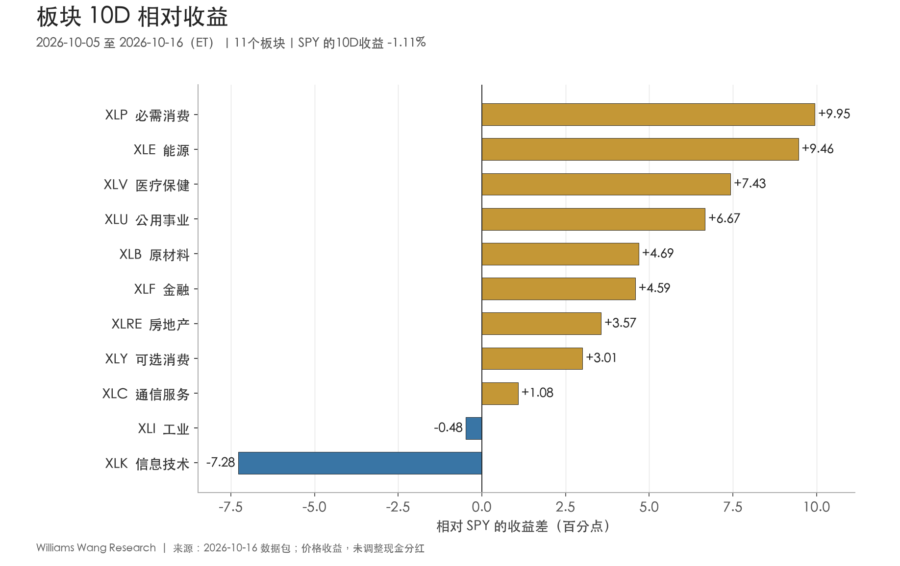
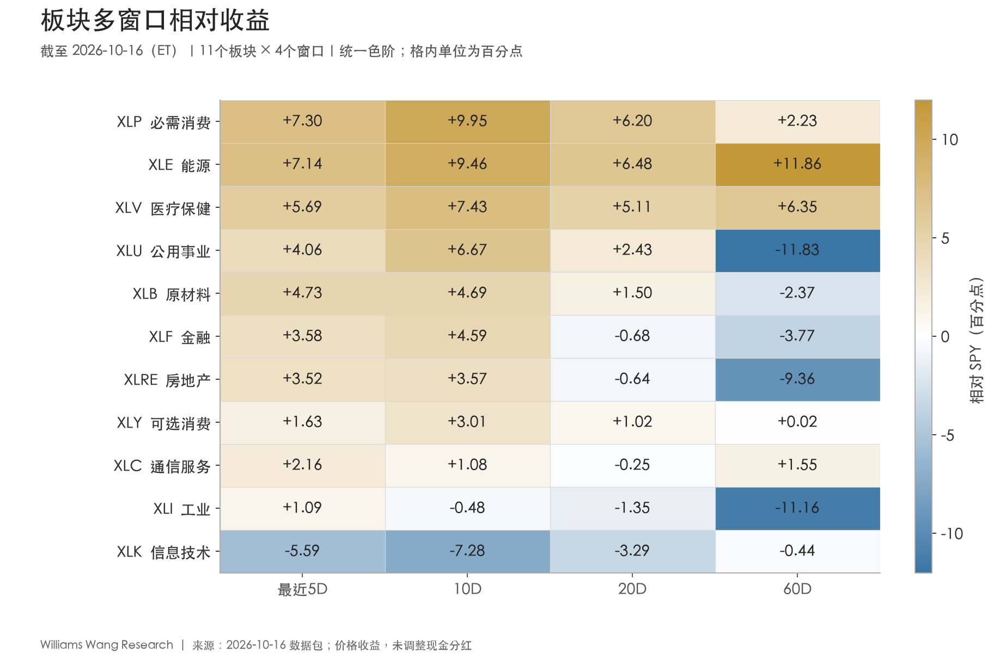
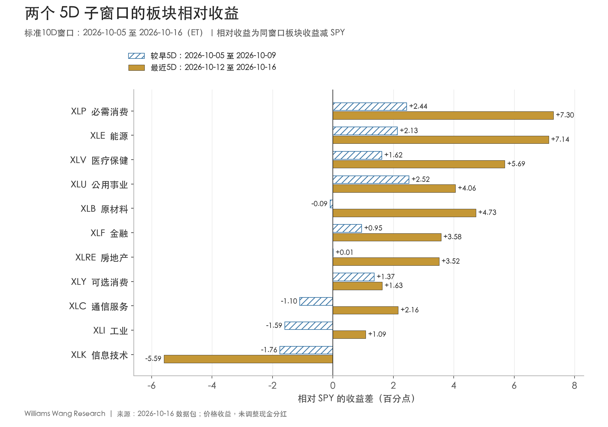

+++
title = "市场板块轮动双周分析报告｜截至 2026-10-16（ET）"
data_as_of = ["2026-10-14", "2026-10-15", "2026-10-16"]
data_as_of_note = "权益价格窗口为10月5日至16日ET；多数利率、信用利差和VIX截至10月15日，WTI现货截至14日，部分利差及通胀补偿截至16日，分别保留原文观察日。"
description = "复盘截至10月16日的板块轮动，区分防御与能源领先、科技走弱及相对广度改善与绝对上涨参与面的差异。"
series = "市场板块轮动双周复盘"
categories = ["市场结构", "宏观与政策"]
tags = ["板块轮动", "ETF", "市场广度", "SPY"]
date = "2026-10-17"
draft = false
featured = false
private = false
content_preservation = "verbatim"
source_sha256 = "d96603f9fdf1b0c515a5a7ad5546c452c8048aba3d5794b8c608461f4570210d"
+++

# 市场板块轮动双周分析报告｜截至 2026-10-16（ET）

**防御与能源领涨，科技回撤放大市场分化**

## 一、本报告期结论

**本期轮动的主线是防御与能源领先、科技和动量回撤，并伴随大盘内部的明显分化。** 必需消费 XLP、能源 XLE、医疗 XLV 的10D价格收益分别为 **+8.84%、+8.35%、+6.32%**；同期SPY下跌 **1.11%**，科技XLK下跌 **8.39%**。当前前三名与9月21日—10月2日对照期前三名没有重合，排名相关系数 **−0.582**，6个板块名次变动至少5位，领涨顺序出现实质更替。

**breadth改善与整体风险偏好承压同时存在。** 10D有9/11板块跑赢SPY、8/11板块上涨，均线上方板块也有8/11；但SPY、QQQ和IWM都下跌，RSP上涨 **1.85%**。最近5D中，跑赢SPY的板块由7个增至10个，实际上涨板块却由9个降至7个，板块平均收益从 **+1.75%** 降至 **+0.97%**。因此，不能把跑赢数量增加直接解释为市场上涨面持续扩大。

**科技的相对走弱已覆盖本包全部四个窗口。** XLK最近5D下跌 **7.84%**，落后SPY **5.59个百分点**，是唯一在5D、10D、20D、60D都落后SPY的板块。相反，XLP、XLE、XLV在四个窗口均保持正相对收益。XLY也满足四窗口为正，但其60D领先只有 **0.02个百分点**、最近5D实际下跌，确认程度明显不同。

跨资产证据更接近防御偏好：低波动和质量相对领先，长债上涨；同时小盘继续落后、HY信用利差扩大、VIX上升。油价上涨则为能源提供方向相容的背景。**这支持“防御与资源板块占优、成长风险承压”的描述，但不足以确认衰退、滞胀或特定资金流驱动。**

| ETF | 较早5D | 最近5D | 完整10D | 20D | 60D |
| --- | --- | --- | --- | --- | --- |
| SPY | +1.16% | -2.24% | -1.11% | -0.25% | +3.11% |
| QQQ | +0.25% | -5.76% | -5.52% | -1.95% | +2.32% |
| RSP | +1.56% | +0.28% | +1.85% | +0.55% | +0.81% |
| IWM | -0.86% | -3.23% | -4.06% | -4.96% | -7.58% |

表1：主要权益代理价格收益。较早5D为10月5—9日，最近5D为10月12—16日。

## 二、板块轮动证据：分清广度、基准效应与排名更替

完整10D以 **10月2日收盘** 为收益基准；最近5D以 **10月9日收盘** 为基准。排名对照期为 **9月21日—10月2日**，收益基准为9月18日。manifest的 `previous_package_end_et=2026-10-09` 只是上次出包日，不是排名对照期；相邻周报的10D窗口存在重叠，不能当作两个独立样本。

| 证据 | 本期结果 | 解释 |
| --- | --- | --- |
| 10D最高−最低板块收益 | 17.23个百分点 | XLP与XLK的横截面差距，不是可直接实现的组合收益 |
| 10D收益离散度 | 4.69个百分点 | 11板块总体标准差，ddof=0，未年化 |
| 10D绝对上涨 / 跑赢SPY | 8/11 / 9/11 | 通信下跌但仍跑赢SPY；两类广度不同 |
| 高于20日均线 | 8/11 | 10/02为1/11，10/09为6/11，10/16为8/11 |
| 20D / 60D跑赢SPY | 6/11 / 5/11 | 仍有一部分短期修复未获中期确认 |
| 排名相关系数 | −0.582 | 与非重叠10D对照期比较，未校准为预测信号 |
| Top 3 overlap | 0/3 | 本期XLP、XLE、XLV；对照期XLK、XLI、XLC |
| 名次变动绝对值≥5 | 6个板块 | XLP +7、XLU +5、XLF +5、XLC −6、XLI −8、XLK −10 |

11个板块10D简单平均收益为 **+2.77%**，中位数为 **+3.48%**，与SPY的 **−1.11%** 形成显著分歧。去掉收益最高的XLP后，其余10板块平均仍上涨 **2.16%**，说明正收益并非完全依赖单一领涨板块；但这些是板块ETF等权统计，不能替代SPY成分权重贡献，也不等于个股层面的上涨家数。

科技回撤放大了17.23个百分点的极差。剔除XLK后，其余10板块的极差降至 **10.43个百分点**，离散度降至 **3.24个百分点**，分化仍然存在。这一敏感性检验说明，既有科技的显著负向偏离，也有其他板块之间的收益差异；它不构成剔除科技后的可投资收益估计。

最近5D的相对广度尤其需要谨慎：SPY由前一段 **+1.16%** 转为 **−2.24%**，使“跑赢基准”的门槛明显降低。XLY、XLC、XLI最近5D均下跌，却分别领先SPY **1.63、2.16、1.09个百分点**。相对抗跌有信息价值，但不能与绝对上涨混用。

## 三、Leadership 与 laggards：多窗口确认并不均匀

| 名次 | 板块 | 10D收益 | 10D相对SPY | 20D相对SPY | 60D相对SPY | 对照期名次→本期 | 高于20日均线 |
| --- | --- | --- | --- | --- | --- | --- | --- |
| 1 | XLP 必需消费 | +8.84% | +9.95 | +6.20 | +2.23 | 8→1 | 是 |
| 2 | XLE 能源 | +8.35% | +9.46 | +6.48 | +11.86 | 6→2 | 是 |
| 3 | XLV 医疗保健 | +6.32% | +7.43 | +5.11 | +6.35 | 5→3 | 是 |
| 4 | XLU 公用事业 | +5.56% | +6.67 | +2.43 | -11.83 | 9→4 | 是 |
| 5 | XLB 原材料 | +3.58% | +4.69 | +1.50 | -2.37 | 7→5 | 是 |
| 6 | XLF 金融 | +3.48% | +4.59 | -0.68 | -3.77 | 11→6 | 是 |
| 7 | XLRE 房地产 | +2.46% | +3.57 | -0.64 | -9.36 | 10→7 | 是 |
| 8 | XLY 可选消费 | +1.90% | +3.01 | +1.02 | +0.02 | 4→8 | 是 |
| 9 | XLC 通信服务 | -0.03% | +1.08 | -0.25 | +1.55 | 3→9 | 否 |
| 10 | XLI 工业 | -1.59% | -0.48 | -1.35 | -11.16 | 2→10 | 否 |
| 11 | XLK 信息技术 | -8.39% | -7.28 | -3.29 | -0.44 | 1→11 | 否 |

表2：相对收益列单位为百分点。名次1表示本期10D收益最高；均线为截至10月16日的20个交易日平均收盘价。

**必需消费与医疗：防御领先获得20D、60D支持。** XLP最近5D上涨 **5.06%**，高于较早5D的 **3.60%**；XLV从 **+2.78%** 升至 **+3.45%**。两者不仅少跌，而是连续两段实际上涨。XLP的20D、60D相对收益分别为 **+6.20、+2.23个百分点**，XLV分别为 **+5.11、+6.35个百分点**。这为防御倾向提供了比单周排名更完整的证据，但仍不能推断资金净流入。

**能源：相对与绝对走势一致，中期亦领先。** XLE最近5D上涨 **4.90%**，完整10D上涨 **8.35%**，20D、60D分别领先SPY **6.48、11.86个百分点**。原油ETF和已更新的WTI现货同向上涨，与能源领先相容；但能源股票包含公司盈利、成本及估值等因素，不能将板块涨幅全部归因于油价。

**公用事业：相对优势扩张，绝对涨速却下降。** XLU最近5D上涨 **1.81%**，低于较早5D的 **3.68%**；相对SPY优势却从 **2.52** 扩至 **4.06个百分点**。其20D相对收益为 **+2.43个百分点**，60D仍为 **−11.83个百分点**。这更接近短中期修复，不能仅凭最近的跑赢幅度宣布长期趋势完成转换。

**原材料、金融与房地产：修复向更多板块扩散，但中期程度有别。** XLB最近5D上涨 **2.49%**，20D相对收益转为正值 **+1.50个百分点**，60D仍落后 **2.37个百分点**。XLF与XLRE最近5D分别上涨 **1.34%、1.27%**，都已高于20日均线，但20D相对收益仍为 **−0.68、−0.64个百分点**。均线状态和区间相对收益衡量不同内容，两者不必同步。

**可选消费：四窗口相对为正，近期绝对走势却转弱。** XLY由较早5D上涨 **2.53%** 转为最近5D下跌 **0.61%**，但SPY跌幅更大，因此仍跑赢。60D领先仅约 **0.02个百分点**，在未调整现金分红的口径下，宜视为接近持平。它不应与XLP、XLE、XLV等量齐观。

**科技：四窗口相对落后，绝对长期收益仍非负。** XLK从对照期第1降至本期第11，10D相对收益为 **−7.28个百分点**；20D、60D分别为 **−3.29、−0.44个百分点**。60D价格收益仍为 **+2.66%**，因此“相对趋势走弱”不等于“所有窗口绝对下跌”。包内没有公司贡献、盈利预期或基金流量，不能将回撤直接写成AI基本面逆转、机构清仓或已确认的去杠杆。

工业XLI完整10D下跌 **1.59%**，20D、60D继续落后；通信XLC完整10D接近持平，收益 **−0.03%**，相对SPY却为 **+1.08个百分点**。两者最近5D相对转正，主要体现抗跌，而非新一轮绝对上行。

图2：XLP、XLE、XLV的多窗口相对领先较一致；XLY的60D优势接近零。窗口相互嵌套，不是四份独立样本证据。

## 四、两个5D子窗口：相对领先扩大，绝对上涨家数减少

| 板块 | 较早5D收益 | 最近5D收益 | 较早5D相对SPY | 最近5D相对SPY |
| --- | --- | --- | --- | --- |
| XLP 必需消费 | +3.60% | +5.06% | +2.44 | +7.30 |
| XLE 能源 | +3.29% | +4.90% | +2.13 | +7.14 |
| XLV 医疗保健 | +2.78% | +3.45% | +1.62 | +5.69 |
| XLU 公用事业 | +3.68% | +1.81% | +2.52 | +4.06 |
| XLB 原材料 | +1.06% | +2.49% | -0.09 | +4.73 |
| XLF 金融 | +2.11% | +1.34% | +0.95 | +3.58 |
| XLRE 房地产 | +1.17% | +1.27% | +0.01 | +3.52 |
| XLY 可选消费 | +2.53% | -0.61% | +1.37 | +1.63 |
| XLC 通信服务 | +0.05% | -0.08% | -1.10 | +2.16 |
| XLI 工业 | -0.44% | -1.16% | -1.59 | +1.09 |
| XLK 信息技术 | -0.60% | -7.84% | -1.76 | -5.59 |

表3：两段绝对收益单位为%，相对SPY列单位为百分点。10D收益需按两段5D复合，不能把两个百分比直接相加。

XLP、XLE、XLV、XLU、XLF、XLRE、XLY连续两个5D均跑赢SPY。其中，**XLP、XLE、XLV的绝对涨幅提高，XLU与XLF涨幅放缓，XLY转跌**；XLRE仅温和提高。连续跑赢并不意味着这些板块都在加速上涨。XLRE较早5D相对优势只有0.01个百分点，也不宜把这一微小正值解读为稳健的连续领先。

本期三个“相对由负转正”板块为XLB、XLC和XLI，性质不同：XLB由 **+1.06%** 升至 **+2.49%**，同时获得绝对与相对改善；XLC由 **+0.05%** 转为 **−0.08%**，XLI由 **−0.44%** 扩至 **−1.16%**，只是跌得比SPY少。科技则由较早5D的 **−0.60%** 变为 **−7.84%**，相对落后扩大。

这一变化可以用三个数字并置：最近5D上涨家数 **9→7**，跑赢SPY家数 **7→10**，均线上方家数 **6→8**。前者显示最新一周绝对上涨参与面收缩，后两者分别受到基准下跌和此前累积上涨的影响；这些指标并不矛盾，也不能合并成一句“广度全面改善”。

最后交易日10月16日，SPY下跌 **1.38%**、QQQ下跌 **2.75%**、IWM下跌 **1.87%**，RSP也下跌 **0.63%**。11板块中6个上涨，能源 **+2.57%**、公用事业 **+1.23%**、必需消费 **+1.12%**，科技 **−3.16%**。截至窗口末端，防御与能源的相对优势仍在，但等权市场也未能完全避开当日调整。

## 五、外部上下文：通胀压力、需求数据与市场反应并不单一

以下事件均在 **10月5—16日** 公开。发布日期与数据所属月份分别说明；仅作背景，不覆盖本地收益结果，也不声称某一事件足以解释板块涨跌。

**10月6日｜8月国际贸易。** 美国商品与服务贸易逆差为 **1056亿美元**，较7月扩大 **127亿美元**；出口、进口环比分别增长 **1.4%、4.3%**。这是季调名义金额，未扣除价格变化，不能仅凭进口上升判断实际需求全面走强。[BEA / Census，2026-10-06](https://www.bea.gov/news/2026/us-international-trade-goods-and-services-august-2026)

**10月7日｜9月FOMC会议纪要。** 多数与会者在9月会议时认为年底前进一步加息可能适宜，同时强调取决于新增信息。纪要反映 **9月15—16日** 的信息集，不能当作对10月14日CPI的政策回应；10月7日为公开日，并非新的利率决定。[FOMC纪要](https://www.federalreserve.gov/monetarypolicy/fomcminutes20260916.htm)；[美联储发布说明，2026-10-07](https://www.federalreserve.gov/newsevents/pressreleases/monetary20261007a.htm)

**10月14日｜9月CPI。** 总体CPI季调环比 **+0.6%**、未季调同比 **+3.7%**；核心环比 **+0.3%**、同比 **+2.6%**。汽油价格环比上涨 **9.1%**，贡献超过一半的总体月度涨幅。能源价格压力是已发布事实，但这不等于市场已确认持续的全面通胀再加速。[BLS，2026-10-14](https://www.bls.gov/news.release/archives/cpi_10142026.htm)

**10月15日｜9月零售与餐饮销售。** 季调名义销售额环比 **+0.8%**，8月增幅修订至 **+1.3%**；数据没有扣除价格变化。剔除加油站后，9月增幅为 **0.2%**，加油站销售增长 **6.4%**。因此，头条增长不宜直接等同于实际消费需求同步扩张。[Census发布页，2026-10-15](https://www.census.gov/retail/sales.html)；[同次发布表2，第6页](https://www.census.gov/retail/marts/www/marts_current.pdf)

**10月16日｜9月工业产出。** 季调工业产出环比 **+0.7%**，其中制造业 **+0.3%**、采矿 **+0.2%**、公用事业 **+3.5%**。总量与分项共同说明数据并非全线下行，但工业产出分类不能直接映射到XLI或XLU的盈利与估值。[美联储G.17，2026-10-16](https://www.federalreserve.gov/releases/g17/20261016/g17.pdf)

**解释证据混杂。** 油价和能源CPI上涨，与能源板块领先相容；防御股、长债相对占优以及HY利差扩大，与风险偏好受压相容。但本地10Y收益率和同日通胀补偿在完整观察窗口内下降，工业产出仍增长，不能把全部数据归结为单向的“通胀交易”或“衰退交易”。缺少市场预期差、盘中报价、盈利修订与因果识别，无法量化每项事件的收益贡献。

## 六、风格与跨资产：等权胜出不代表小盘接力

| 收益差（百分点） | 最近5D | 10D | 20D | 60D |
| --- | --- | --- | --- | --- |
| SPYG−SPYV：成长−价值 | -5.36 | -5.62 | -2.28 | +1.34 |
| IWF−IWD：大盘成长−价值 | -6.11 | -7.03 | -3.38 | -1.68 |
| RSP−SPY：等权−市值加权 | +2.53 | +2.96 | +0.79 | -2.29 |
| IWM−SPY：小盘−大盘 | -0.98 | -2.94 | -4.72 | -10.69 |
| MTUM−SPY：动量 | -6.11 | -8.18 | -5.04 | -9.70 |
| QUAL−SPY：质量 | +1.26 | +1.31 | +2.46 | +1.01 |
| USMV−SPY：低波动 | +2.96 | +4.20 | +2.93 | +2.24 |
| 周期组−防御组 | -2.05 | -3.77 | -3.19 | +0.00 |
| HYG−LQD：信用价格代理 | -1.86 | -1.86 | -1.29 | -0.70 |
| TLT−IEF：久期价格代理 | +1.22 | +1.44 | -1.28 | -1.41 |

表4：均为同窗口价格收益差，单位为百分点。周期组为XLY、XLF、XLI、XLB、XLE的简单平均；防御组为XLP、XLU、XLV的简单平均。60D周期−防御差约0.002个百分点，表中四舍五入显示+0.00，按接近持平理解。

**价值、低波动和质量相对占优，成长与动量承压。** SPYG−SPYV最近5D为 **−5.36个百分点**，IWF−IWD为 **−6.11个百分点**；两者20D也已落后。MTUM最近5D、10D分别落后SPY **6.11、8.18个百分点**，且20D、60D同样为负。USMV、QUAL在四个窗口均跑赢SPY。不过，QUAL最近5D价格收益实际为 **−0.98%**，其 **+1.26个百分点** 的相对优势主要是少跌；风格跑赢同样不能自动理解为盈利。

**等权改善局限于当前比较维度，小盘继续落后。** RSP最近5D上涨 **0.28%**，领先SPY **2.53个百分点**，20D也领先 **0.79个百分点**；60D仍落后 **2.29个百分点**。IWM最近5D下跌 **3.23%**，10D下跌 **4.06%**，60D相对SPY差为 **−10.69个百分点**。这些数据与“大盘内部重排”相容，尚不支持由规模更小的企业普遍接力。

**防御组领先不依赖能源归组或单一医疗表现。** 防御组10D平均收益 **+6.91%**，周期组 **+3.14%**，相差 **3.77个百分点**；最近5D分别为 **+3.44%、+1.39%**。从周期组剔除能源后，其10D相对防御组落后扩大至 **5.07个百分点**；从防御组剔除医疗后，周期组仍落后 **4.06个百分点**。这是分组收益的敏感性比较，不是经济衰退概率。

| 资产代理 | 最近5D | 10D | 20D | 60D |
| --- | --- | --- | --- | --- |
| UUP | -0.34% | +0.07% | +2.08% | +1.26% |
| GLD | -0.84% | +0.12% | -5.02% | +2.64% |
| USO | +9.13% | +10.13% | +4.85% | +15.94% |
| DBC | +2.76% | +2.78% | +2.64% | +11.75% |

表5：美元、黄金、原油与综合商品ETF价格代理。UUP不等于广义美元汇率的完整刻画，USO和DBC包含期货曲线及展期影响，不等同现货收益。

USO最近5D上涨 **9.13%**、10D上涨 **10.13%**；DBC对应为 **+2.76%、+2.78%**，资源价格代理与能源股同向。UUP最近5D下跌 **0.34%**，GLD也下跌 **0.84%**，说明本期并非美元、黄金、国债所有常见避险代理同时上涨。黄金在10D接近持平、20D下跌 **5.02%**，不能仅凭防御股强势推导黄金同步受益。

**原油比较先统一终点。** WTI现货最后观察日在 **10月14日**，为 **101.91美元/桶**；自10月2日97.89美元/桶上涨 **4.11%**。把USO也截至10月14日，其同窗口上涨 **4.57%**；在10月9—14日这一较短共同窗口，现货与USO分别上涨 **3.22%、3.62%**，方向一致。USO完整10D的10.13%还包含现货尚未覆盖的10月15、16日，不能直接与截至14日的现货4.11%比较并归因于展期收益。这里的证据支持同向上涨，不能进一步区分供给、需求、仓位或盈利渠道。

## 七、Rates / credit / volatility：长债修复与风险承压并存

| 指标 | 10/02基准 | 最后有效值 | 观察日（ET） | 较10/02变化 | 较10/09变化 |
| --- | --- | --- | --- | --- | --- |
| 2Y国债收益率 | 4.83% | 4.77% | 2026-10-15 | -6bp | -3bp |
| 10Y国债收益率 | 5.28% | 5.10% | 2026-10-15 | -18bp | -14bp |
| 30Y国债收益率 | 5.63% | 5.43% | 2026-10-15 | -20bp | -17bp |
| 10Y−2Y利差 | 0.45% | 0.35% | 2026-10-16 | -10bp | -9bp |
| 10Y−3M利差 | 1.09% | 0.83% | 2026-10-16 | -26bp | -16bp |
| 10Y实际收益率 | 2.92% | 2.78% | 2026-10-15 | -14bp | -13bp |
| 10Y通胀补偿 | 2.36% | 2.35% | 2026-10-16 | -1bp | +2bp |
| HY OAS | 3.10% | 3.23% | 2026-10-15 | +13bp | +12bp |
| IG OAS | 0.85% | 0.84% | 2026-10-15 | -1bp | +1bp |
| VIX | 15.31点 | 16.46点 | 2026-10-15 | +1.15点 | +1.62点 |
| WTI现货 | 97.89美元/桶 | 101.91美元/桶 | 2026-10-14 | +4.02美元/桶 | +3.18美元/桶 |

表6：利率和OAS水平单位为%，变化为bp；1bp=0.01个百分点。VIX变化为指数点，WTI变化为美元/桶。“较10/09变化”按每条序列最后有效日计算，不是统一截至10月16日的5D变化。

**国债收益率下降，长端降幅更大。** 10月2—15日，2Y、10Y、30Y分别下降 **6、18、20bp**；10月9—15日分别下降 **3、14、17bp**。共同终点10月15日的10Y−2Y为 **33bp**，较10月2日45bp收窄 **12bp**，较10月9日44bp收窄 **11bp**。这在同日口径下体现收益率下行且曲线趋平。10月16日T10Y2Y单独更新到35bp，完整窗口变化为−10bp，不能与截至15日的两条收益率混算。

10月2—15日，10Y名义收益率 **−18bp ≈ 实际收益率−14bp + 通胀补偿−4bp**；10月9—15日为 **−14bp ≈ −13bp −1bp**。10月16日T10YIE为2.35%，对应完整窗口仅下降1bp、较10月9日上升2bp，但该日没有配套名义和实际收益率终值，不能直接替代共同终点分解。通胀补偿也包含通胀风险及流动性溢价，不是纯通胀预期。

TLT最近5D、10D分别上涨 **2.65%、3.23%**，IEF分别上涨 **1.43%、1.78%**，与利率下降相容。但TLT的20D、60D仍下跌 **1.49%、3.75%**，其短期反弹未完全收复中期跌幅。利率下降也没有阻止科技和小盘同期回撤，说明单一贴现率解释不足。

**信用价格与利差都显示HY相对承压。** HY OAS截至10月15日为 **323bp**，较10月2日扩大 **13bp**、较10月9日扩大 **12bp**；IG OAS为 **84bp**，对应变化为 **−1bp、+1bp**。HYG最近5D下跌 **0.43%**，LQD上涨 **1.44%**，HYG−LQD为 **−1.86个百分点**；完整10D的HYG仅 **+0.08%**，LQD为 **+1.94%**。HY相对弱与OAS扩大方向一致，但二者仍有久期、持仓及未调整分红等口径差异，不能把全部价差都解释为信用风险。

**VIX上升支持压力增加的描述，但没有10月16日终值。** 最后有效值为10月15日 **16.46**，较10月2日增加 **1.15点**，较10月9日增加 **1.62点**；10月14日曾为 **16.87**。本报告不将其标为历史高低分位，也不据此估算尾部风险概率。10月16日股票价格变化与15日VIX不能当成同日截面，期权定位及交易商行为也不在本包证据范围内。

## 八、下一报告期观察点

以下为条件跟踪清单，不构成交易或仓位建议，不为未来走势赋予未经校准的概率。

| 观察主题 | 本期锚点 | 支持当前判断延续的证据 | 需要修正判断的信号 |
| --- | --- | --- | --- |
| 防御与能源领先 | XLP、XLE、XLV四窗口相对为正 | 后续5D保持绝对上涨及相对领先，20D优势延续 | 仅靠SPY下跌维持跑赢，或绝对收益转负 |
| 科技回撤能否稳定 | XLK四窗口落后，最近5D−7.84% | 若仍落后且20D相对差扩大，当前分化延续 | 绝对价格企稳且相对差持续收敛，重新进入20日均线上方 |
| 广度改善的质量 | 均线上方8/11，但最近5D仅7个上涨 | 绝对上涨家数回升，RSP继续实际上涨 | 跑赢家数仍多但上涨家数与均线breadth下降 |
| 小盘与信用能否接力 | IWM最近5D−3.23%，HY OAS323bp | 当前防御偏好若延续，二者可能仍落后或承压 | IWM绝对与相对表现同步改善，HY利差收窄 |
| 周期与防御的差异 | 周期10D落后防御3.77个百分点 | 防御领先且非能源周期缺乏共同确认 | 工业、金融、可选消费同时改善，组间差收敛 |
| 油价与rates组合 | 同日油价上涨、长端利率下降 | 对齐新观察日后继续核对两种方向是否并存 | 油价或利率转向，使现有背景解释不再成立 |

若下一期相对广度依然良好，而绝对收益、均线参与面和信用条件同步变差，应提高对“少跌型领先”的重视。若科技稳定、小盘接力且HY利差收窄，则需要下调当前防御偏好的解释权重。两种情景都必须由新增数据确认。

## 免责声明

本报告仅用于研究、学习与信息交流，依据所列数据及截至报告观察日可获取的信息编制，不构成任何证券、基金、衍生品或其他金融产品的投资、交易、仓位或收益建议，也不构成买卖要约。数据可能存在延迟、修订、缺失或错误，分析判断具有不确定性；历史表现和描述性关系不代表未来收益，任何情景或观察条件均不构成保证。读者应结合自身情况独立判断并自行承担相关风险，必要时咨询具备资质的专业人士。投资决策及实际执行由读者自行负责。
