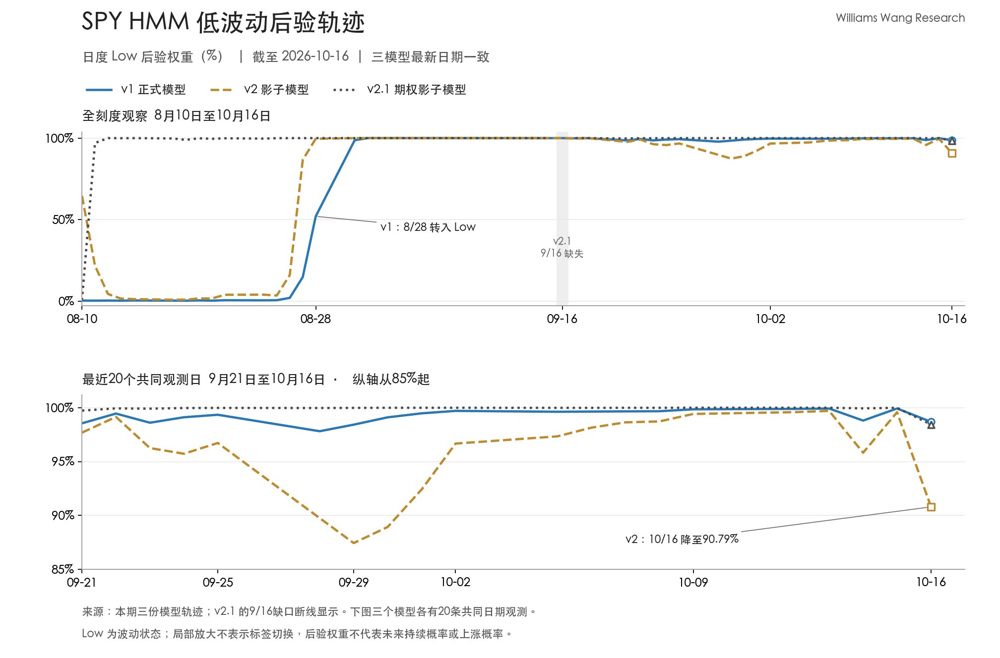

+++
title = "SPY 低波动标签延续，VIX 上升与模型后验松动｜2026年10月16日"
data_as_of = "2026-10-16"
data_as_of_note = "市场数据及三模型最新共同观察日为10月16日，10月19日发布；历史覆盖、9月16日缺口与最近20日共同样本限制保留原文。"
description = "分析SPY低波动标签延续与VIX上升并存，以及三模型最新后验松动、共同日期比较和历史覆盖限制。"
series = "SPY HMM模型分析"
categories = ["市场结构"]
tags = ["SPY", "HMM", "VIX", "波动率", "市场状态"]
date = "2026-10-19"
draft = false
featured = false
private = false
content_preservation = "verbatim"
source_sha256 = "c6457fed2bd230f26f7c71cf36ff827e2fef371168dd310a103a2e17820f4a87"
+++

# SPY 低波动标签延续，VIX 上升与模型后验松动｜2026年10月16日

**Williams Wang Research｜标普500市场观察**  

## 一、核心结论

1. **当前正式分类仍是 Low Volatility，但不宜据此把市场描述为风险没有变化。** v1 自8月28日起连续 **35个观测日**维持 Low，10月16日 Low 后验权重为 **98.69%**。同一截止日，SPY 近一周下跌 **1.97%**，VIX 上升 **5.15点至19.99**。价格走弱、期权隐含波动升温，与尚未切换的模型标签同时成立。

2. **10月16日三个模型的 Low 权重均较前一日回落，主要向 Mid 重新分配。** v1、v2、v2.1 最新 Low 权重分别为 **98.69%**、**90.79%**、**98.44%**；日度变化分别为 **-1.24、-8.80、-1.55个百分点**。v2 的松动最明显，但三者均未出现硬标签切换。这是状态判断需要继续跟踪的变化，不能直接称为已验证的领先信号。

3. **实现波动仍较温和，前瞻与回看指标给出的风险画像有所不同。** SPY 20日、60日年化实现波动率分别为 **10.46%**、**10.91%**，前者约为后者的 **95.9%**；VIX 则在一周内上升 **34.70%**。这支持同时保留“历史波动统计仍低于中期水平”和“期权隐含波动在近期明显上行”两层判断，不能据其中一项否定另一项。

4. **替代设定支持 Low 标签，却没有一致指向尾部权重变化的方向。** normal、t1d、t2d 均为 Low，Low 权重介于 **98.51%—99.55%**；相对5个观测间隔前，normal 与 t2d 的 High 权重上升，t1d 则下降。分类一致性较强，不等于所有设定都确认风险正在以相同方式增加。

5. **最新一期的共同日期比较可用，历史覆盖限制仍需保留。** 三个模型在最近20个共同观测日内均有数据，但 v2.1 更长区间中仍缺9月16日。本文不填补该日，也不把后验权重视为未来低波动持续、上涨或尾部损失的校准概率。

## 二、SPY 市场与风险画像

### 周度回撤与较长窗口正收益并存

截至10月16日，SPY 收于 **763.25美元**。近一周收益为 **-1.97%**，近一月仅为 **+0.33%**，近三个月及年初至今分别为 **+3.11%**、**+12.59%**。周度表现已经转弱，但更长窗口的累计收益仍为正；这些区间收益不能还原具体哪一天贡献了多少涨跌。

| 市场指标 | 本期数值 | 口径与解释 |
| --- | ---: | --- |
| SPY 收盘价 | 763.25美元 | 截至2026-10-16 |
| 近一周收益 | -1.97% | 采用包内周度窗口 |
| 近一月收益 | +0.33% | 月度累计回报接近持平、略为正值 |
| 近三个月收益 | +3.11% | 中期累计回报仍为正 |
| 年初至今收益 | +12.59% | 不代表年内没有回撤 |
| 20日实现波动率 | 10.46% | 年化，回看较短窗口 |
| 60日实现波动率 | 10.91% | 年化，回看较长窗口 |
| 近三个月最大回撤 | -3.06% | 窗口内最深峰谷回撤 |
| 年初至今最大回撤 | -8.88% | 年内窗口最深峰谷回撤 |
| VIX | 19.99 | 与 SPY 同为10月16日截止 |
| VIX 近一周变化 | +5.15点／+34.70% | 隐含波动指标明显上行 |
| VIX 近一月变化 | +4.55点／+29.47% | 月度区间同样录得上行 |

价格、收益、实现波动及最大回撤均来自本期市场摘要。**最大回撤不是当前距高点的跌幅。** 本期没有给出当前回撤和对应高点日期，不能将-3.06%或-8.88%写成当前持仓损失，也不能用滚动窗口最大回撤的变化单独证明市场风险改善。

### 实现波动接近中期基准，VIX 给出不同时间尺度的信息

20日实现波动率比60日低 **0.45个百分点**，约为后者的95.9%。两个相互重叠的回看窗口已比较接近，但包内没有提供它们逐日变化的序列。因此，这一截面比较不能独立证明实现波动正在加速上升或下降，也不能判断差距变化究竟由哪个窗口驱动。

VIX 根据 SPX 期权价格构建，反映未来约30天的预期波动；SPY 实现波动率描述过去价格变化的统计特征。[Cboe：VIX 定义](https://www.cboe.com/tradable-products/vix/vix-options/)

同日 VIX 比 SPY 20日实现波动率高约 **9.53个波动率点**。这个差额体现了两种指标当前水平的差异，但同时包含标的、期限、构造及风险定价口径的不同。它不是对未来实现波动的无偏预测误差，也不能直接当作可获得的波动率收益或卖出期权的依据。

**本期可以确认期权隐含波动指标升温，尚不能确认未来实际波动会按同等幅度上升。** VIX 的区间涨幅可能与多种预期、风险溢价和供求机制相容；缺少期权期限结构、偏度、逐日价格及事件证据时，无法把本次变化确定归因于某一事件或交易群体。包内也没有提供实际跨资产收益、信用利差或市场广度序列，本文不将它扩展为全市场压力已经同步确认。

## 三、HMM 信号与状态演化

### 既有 Low 持续期与最近一天的变化需要分开看

本期提供的轨迹中，v1 于8月28日进入 Low，此后35个观测日没有发生硬标签切换。最近20个观测日，即9月21日至10月16日，也全部为 Low；这支持当前模型分类具有持续性，但不能据此推算还会维持多少天。

本周的变化并非单向演进。v1 的 Low 权重从10月13日的99.93%降至14日的98.81%，15日回到99.93%，16日再次降至98.69%。因此，准确描述是**出现反复松动，且最新收盘再次偏弱**，不能写成连续数日单向恶化，也不能沿用15日的修复来概括整周。

10月12日至16日，v1 平均 Low 权重为 **99.45%**，仍高于最新值98.69%。v2 与 v2.1 的同期均值分别为 **97.10%**、**99.68%**，也高于各自的最新值。窗口均值适合描述整周状态，但本期如果只看均值，会弱化对最后一个观测日变化的认识。

### 替代设定仍为 Low，尾部权重变化并非完全一致

| v1 设定 | 截止日 | 状态 | Low 权重 | Mid 权重 | High 权重 |
| --- | --- | --- | ---: | ---: | ---: |
| normal | 2026-10-16 | Low | 98.69% | 1.30% | <0.01% |
| t1d | 2026-10-16 | Low | 99.55% | 0.45% | <0.001% |
| t2d | 2026-10-16 | Low | 98.51% | 1.47% | 0.02% |

三种设定均由 Low 明显主导，说明当前标签具有内部稳健性。但相对10月9日，normal 与 t2d 的 High 权重增加，t1d 下降，不能将三者写成对高波动风险同步上升的完整确认。表中的极小权重采用阈值或适当舍入，显示值相加可能不恰好等于100%。

包内还显示，VIX 月度变化与 v1 的 High 权重相对20个观测间隔前的变化均为正。这里的“一致”只是所述区间内变化方向一致：v1 最新 High 权重仍低于0.01%，不能据此将正式状态改写为 High。

### Low 标签尚未切换，不等于市场风险没有升温

HMM 将观测映射为模型定义的隐状态；VIX、实现波动率和价格收益则分别反映不同对象和时间尺度。它们没有必须在同一天跨过同一个阈值的要求。当前出现 VIX 明显上行、SPY 周度下跌，而 HMM 仍为 Low，在逻辑上并不矛盾。

这也不能反过来证明模型已经失效，或证明 VIX 的变化只是噪声。**是否存在识别滞后、滞后有多长，以及某个指标是否具有提前预测能力，都需要单独验证。** 目前可确认的是市场指标与模型后验同时发生变化，模型硬标签尚未切换；风险讨论应保留这两个层次。

## 四、模型分歧与不确定性

### 10月16日同向松动，v2 对 Mid 保留更多权重

| 模型 | 角色 | 最新观测日 | 状态 | Low 权重 | Mid 权重 | High 权重 |
| --- | --- | --- | --- | ---: | ---: | ---: |
| v1 | 正式分析锚 | 2026-10-16 | Low | 98.69% | 1.30% | <0.01% |
| v2 | 影子对照 | 2026-10-16 | Low | 90.79% | 9.19% | 0.02% |
| v2.1 | 期权影子对照 | 2026-10-16 | Low | 98.44% | 1.56% | <0.001% |

v2 于8月27日进入本轮 Low，至10月16日连续36个观测日维持该标签。最新 Mid 权重已达到9.19%，高于 v1 的1.30%和 v2.1 的1.56%；不过 v2 的 Low 权重仍明显占优，不能将相对权重变化直接当作状态切换。

| 共同观测日 | v1 Low 权重 | v2 Low 权重 | v2.1 Low 权重 | 当日三者标签 |
| --- | ---: | ---: | ---: | --- |
| 2026-10-09 | 99.86% | 99.43% | >99.99% | 均为 Low |
| 2026-10-13 | 99.93% | 99.71% | >99.99% | 均为 Low |
| 2026-10-14 | 98.81% | 95.82% | 99.94% | 均为 Low |
| 2026-10-15 | 99.93% | 99.59% | >99.99% | 均为 Low |
| 2026-10-16 | 98.69% | 90.79% | 98.44% | 均为 Low |

相对10月15日，v2 的 Low 权重下降 **8.80个百分点**，主要对应 Mid 权重增加；v1 与 v2.1 的 Low 权重分别下降1.24和1.55个百分点。v2 的最新值虽然高于9月29日的87.43%，但不能仅因尚未触及此前低点，就忽略本次单日变化；两次事件的市场环境和输入特征也未必相同。

v2.1 的变化同样值得保留：其 Low 权重从15日高于99.99%降至16日的98.44%，后者为其最近20个观测日的最低值。它仍支持 Low 分类，但已经不宜继续用“几乎所有权重都集中于 Low”概括最新输出。

*图：上图保留0%—100%的完整权重刻度，下图放大9月21日至10月16日的共同日期，纵轴从85%起。三种线型区分模型；v2.1 在9月16日断线显示，不插值。局部放大用于观察差异，不表示状态已经改变。*

不同模型的权重集中程度不能作为准确率排名，也不宜求平均后解释为市场概率。三者在最新一天同向松动，说明共同日期上确有需要跟踪的模型输出变化；但模型之间可能共享信息，不能当作三份彼此独立的证据，更不能仅凭这一时序判定谁先识别了风险。

### 缺口不影响最近20日对齐，但仍限制更长持续期

v2.1 的9月16日期权观测不完整，对应轨迹缺少该日记录。8月11日至10月16日之间，已有的 **47条记录**均为 Low，但不能据此声称整个期间每天都得到 Low 确认。以 v1 日期序列为参照，缺口之后可逐日核对的区段为 **9月17日至10月16日，共22个观测日**。

最近20个观测日已落在9月21日至10月16日，三个模型在这个窗口中均有20条记录，因此本期最近20日的比较不存在上述日期缺口。这个局部完整性不代表更长区间的缺失已被修复。

**免责声明：** 本文仅供一般性信息、教育及研究讨论，不构成投资、理财、交易建议或买卖证券的推荐，也不构成购买或出售任何金融工具的邀请或要约。模型状态与条件情景不保证未来结果，具体投资判断、仓位安排及执行由读者自行决定。
