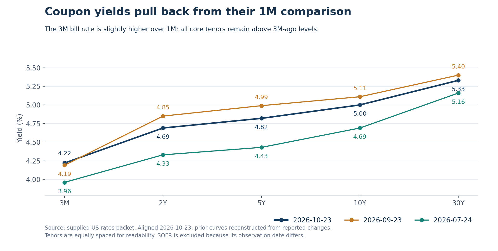
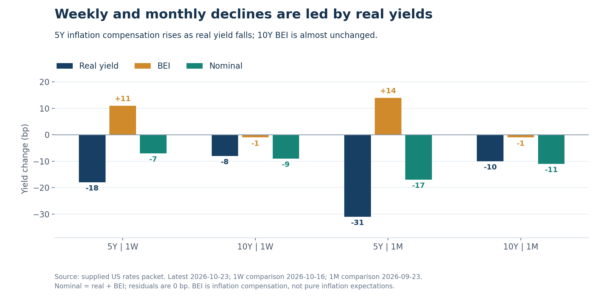

+++
title = "美国利率期限结构分析 2026年10月25日"
date = "2026-10-25"
data_as_of = ["2026-10-22", "2026-10-23"]
data_as_of_note = "Treasury、实际利率、BEI和MOVE截至10月23日，SOFR截至22日；原文保留各自历史窗口。"
description = "分析周月度实际利率推动的收益率回落、5Y通胀补偿上升及较高的近期利率波动。"
series = "利率期限结构分析"
categories = ["宏观与政策", "市场结构"]
tags = ["美国国债", "收益率曲线", "实际利率", "BEI", "MOVE", "SOFR"]
draft = false
featured = false
private = false
content_preservation = "verbatim"
source_sha256 = "1f98943f28ca2f3a9606db32e303ad5f14bf7b3bcc76117d8fbbacd985f6f7c1"
+++

# 美国利率期限结构分析 2026年10月25日

**实际利率推动周月度收益率回落，5Y通胀补偿逆向上升**

## 1. Executive Summary

- **周度为bull flattening，月度则是票息期限的bull steepening；最新一日出现平行反弹。** 2Y/5Y/10Y三点level在一周和一个月分别下降7bp、14.67bp；对应slope分别为-4bp和+5bp。10月23日2Y、5Y、10Y、30Y均上行4bp，3M持平，因此日度更准确的描述是2Y—30Y平行bear shift、现金端至长端走陡。包内`Bear Flattening`标签与显示出的日度变化不一致，不能直接沿用。
- **周月度回落由real yield下降主导，但5Y与10Y的BEI走势明显不同。** 5Y一周real下降18bp、BEI上升11bp，名义净降7bp；一个月real下降31bp、BEI上升14bp，净降17bp。10Y同期real分别下降8bp、10bp，BEI均下降1bp，名义分别下降9bp、11bp。当前5Y BEI为2.48%，高于10Y的2.34%，不能将这轮rally概括为通胀补偿普遍回落。
- **较长窗口尚未转为全面下行，归因也不能统一为real-led。** 三个月三点level仍为+35.33bp，slope为-5bp、curvature为+11bp，表现为以level上移为主的bear flattening。5Y名义上行39bp中，BEI贡献24bp、高于real的15bp；10Y名义上行31bp中，则由real的23bp占主导。
- **近期结构压缩已较明显，波动背景却未同步平静。** 10Y-2Y为31bp、5Y-2Y为13bp，两项fly分别为-5bp和-15bp，均持平于各自20观察值低点。MOVE为103.31，单日下降3.53点，但周度上升2.21点；1年分位95.2%、5年分位52.0%，说明相对近一年仍高，不能把收益率下降等同于波动压力消失。

## 2. Curve Snapshot

**当前核心曲线仍为正斜率，但周度和月度的收益率回落已经较明显。** 3M为4.22%，2Y为4.69%，之后逐步上升至30Y的5.33%。SOFR为3.90%，实际日期为10月22日，单独列示，不与10月23日Treasury构造伪同步资金利差。

| 期限 | 当前收益率 | 实际观测日 | 1D | 1W | 1M | 3M |
| :-- | --: | --: | --: | --: | --: | --: |
| SOFR | 3.90% | 2026-10-22 | +2bp | +1bp | +3bp | +26bp |
| 3M | 4.22% | 2026-10-23 | 0bp | -4bp | +3bp | +26bp |
| 2Y | 4.69% | 2026-10-23 | +4bp | -5bp | -16bp | +36bp |
| 5Y | 4.82% | 2026-10-23 | +4bp | -7bp | -17bp | +39bp |
| 10Y | 5.00% | 2026-10-23 | +4bp | -9bp | -11bp | +31bp |
| 30Y | 5.33% | 2026-10-23 | +4bp | -10bp | -7bp | +17bp |

*来源：`latestCurve.points`。Treasury的1D、1W、1M、3M比较日依次为2026-10-22、2026-10-16、2026-09-23、2026-07-24；SOFR依次为2026-10-21、2026-10-15、2026-09-22、2026-07-24。窗口名称以这些实际日期为准；3M期限点与3M变化窗口含义不同。*

最新一日，2Y至30Y四个核心票息期限全部上行4bp，因此2s10s、5s30s及两项fly均未变化；3M持平，使10Y-3M扩大4bp。按这些已披露数值，日度没有票息曲线趋平的证据。自动标签可能依赖未披露的分类细节，现有packet不足以确定其成因，本报告优先使用可复算的期限变化。

一周内五个Treasury核心期限全部下行，降幅从3M的4bp扩大至30Y的10bp，10Y下降9bp、2Y下降5bp，形成较一致的bull flattening。一个月则由2Y和5Y分别下降16bp、17bp领跑，10Y下降11bp、30Y下降7bp，票息期限呈bull steepening；3M反而上行3bp，因此整个现金端至长端仍有分化。三个月全部核心期限收益率高于比较日，5Y的39bp升幅最大，30Y为17bp，体现更长窗口的belly相对压力。

*图1：历史水平由当前收益率减去packet窗口变化复算；横轴为等距期限标签，不代表期限长度等比例。SOFR因日期不同未纳入。*

最新日的反弹尚未使票息期限远离近期低位。2Y、5Y、10Y、30Y均比10月22日的20观察值低点高4bp，而距对应窗口高点分别为23bp、27bp、31bp、34bp。它们并未处于60观察值低点：距离该窗口低点分别仍有54bp、50bp、37bp、16bp。3M位于20观察值区间4.17%—4.28%之内；SOFR的3.90%持平于自身20及60观察值高点，但它描述的是10月22日的隔夜利率状态。

## 3. Spreads and Butterflies

**近期利差与fly的压缩比长期分位所暗示的更明显，观察窗口必须分开。** 10Y-2Y、5Y-2Y及两项fly均位于20观察值低点，但其5年分位并不低；近期区间低点不能直接升级为长期极端估值。

| 结构 | 当前 | 1D | 1W | 1M | 3M | 5年分位 | 20观察值区间 | 60观察值区间 |
| :-- | --: | --: | --: | --: | --: | --: | --: | --: |
| 10Y-2Y | +31bp | 0bp | -4bp | +5bp | -5bp | 59.8% | 31至51bp | 20至53bp |
| 10Y-3M | +78bp | +4bp | -5bp | -14bp | +5bp | 80.9% | 74至109bp | 74至109bp |
| 30Y-5Y | +51bp | 0bp | -3bp | +10bp | -22bp | 61.7% | 47至64bp | 41至93bp |
| 5Y-2Y | +13bp | 0bp | -2bp | -1bp | +3bp | 71.4% | 13至26bp | 7至26bp |
| 2s5s10s fly | -5bp | 0bp | 0bp | -7bp | +11bp | 78.4% | -5至1bp | -17至2bp |
| 5s10s30s fly | -15bp | 0bp | -1bp | +2bp | +6bp | 59.3% | -15至-10bp | -27至-10bp |

*来源：`spreadsAndButterflies.items`。Butterfly convention统一为`2 * belly - short - long`。历史分位与滚动区间采用packet统计，区间单位为bp。*

10Y-2Y为31bp，持平于20观察值低点、距该窗口高点51bp为20bp；60观察值低点仍为20bp，当前比它高11bp。一周收窄4bp、三个月收窄5bp，但一个月扩大5bp，说明近期bull flattening与月度bull steepening可以同时成立，不能将某个窗口的方向延伸到所有周期。

10Y-3M为78bp，距离20及60观察值低点74bp均只有4bp，较两个窗口高点109bp低31bp；但5年分位仍为80.9%。一周收窄5bp，来自10Y下降9bp快于3M下降4bp；一个月收窄14bp，则由10Y下降11bp与3M上升3bp共同形成。最新一日扩大4bp是票息期限上行、3M持平的结果，尚不足以扭转这两个窗口的压缩。

30Y-5Y为51bp，一周收窄3bp、一个月扩大10bp、三个月收窄22bp，体现长端与belly之间的反复变化。当前距20观察值低点47bp为4bp，但高于60观察值低点41bp共10bp。5Y-2Y为13bp，持平于20观察值低点，比60观察值低点7bp仍高6bp；其5年分位为71.4%，并不支持“长期极端偏低”的描述。

**2s5s10s fly为-5bp，表示5Y收益率低于2Y与10Y简单平均值2.5bp。** 它持平于20观察值低点，较一个月前下降7bp，显示5Y在该窗口相对两翼的收益率下移，即yield-space意义上的relative richening；但三个月仍上升11bp，较长窗口的相对cheapening尚未全部逆转。5年分位78.4%与近期低点并不矛盾，两者参照的历史分布不同。

5s10s30s fly为-15bp，表示10Y收益率低于5Y与30Y简单平均值7.5bp，也持平于20观察值低点；一周下降1bp，但一个月与三个月分别上升2bp、6bp。最新一日两项fly均不变，符合2Y至30Y共同上行4bp的事实。上述rich/cheap只描述收益率空间的相对位置，没有久期、凸性、carry或资金成本调整，不能直接转化为估值判断或交易结构。

## 4. Three-Factor Decomposition

令Δy为同一窗口内的收益率变化，单位bp，采用2Y/5Y/10Y desk-style分解：

- `Level = (Δy2Y + Δy5Y + Δy10Y) / 3`
- `Slope = Δy10Y - Δy2Y`
- `Curvature-Convexity = 2 × Δy5Y - Δy2Y - Δy10Y`

| 窗口 | 2Y / 5Y / 10Y变化 | Level | Slope | Curvature | 结构判断 |
| :-- | --: | --: | --: | --: | --: |
| 1D | +4 / +4 / +4bp | +4.00bp | 0bp | 0bp | 三点平行bear shift；2Y至30Y同升4bp |
| 1W | -5 / -7 / -9bp | -7.00bp | -4bp | 0bp | level主导的bull flattening |
| 1M | -16 / -17 / -11bp | -14.67bp | +5bp | -7bp | 2s10s与5s30s bull steepening；现金端分化 |
| 3M | +36 / +39 / +31bp | +35.33bp | -5bp | +11bp | level主导的bear flattening；5Y相对两翼上移 |

*来源：`factorDecomposition.windows`，已按底层期限变化复算；level以两位小数显示。*

**按这套算术口径，四个窗口均以level的显示幅度占优，但方向与形状不同。** 最新一日level为+4bp、slope和curvature均为0bp，是三点平行上移。周度level为-7bp、slope为-4bp、curvature为0bp，三点rally伴随趋平，没有额外的5Y相对两翼弯曲变化。

一个月level为-14.67bp、slope为+5bp、curvature为-7bp，说明整体收益率回落之中，2Y降幅大于10Y，同时5Y较两翼平均降得更多。三个月level仍为+35.33bp、slope为-5bp、curvature为+11bp，与5Y上行39bp、高于2Y与10Y平均升幅一致。月度的belly相对收益率下移与三个月的相对上移是两个不同的比较结果。

该分解**不是PCA**，三个因子的尺度不同，绝对值比较只用于desk描述，不代表风险贡献比例或方差解释度。“Curvature-Convexity”沿用字段名称，不是债券价格对收益率的二阶敏感度，也不能识别凸性对冲流。对于最新一日，应明确保留“packet标签与显示数值不符”的限制，而不是为标签寻找未提供的数据解释。

## 5. Real Rates / Inflation Compensation / MOVE

**本期周月度rally的共同点是实际利率回落，主要差异在于5Y通胀补偿同时抬升。** 5Y名义收益率4.82%由2.34%的real与2.48%的BEI组成；10Y名义收益率5.00%对应2.66%的real与2.34%的BEI。

| 期限 | Nominal | TIPS real yield | BEI | 观测日 |
| :-- | --: | --: | --: | --: |
| 5Y | 4.82% | 2.34% | 2.48% | 2026-10-23 |
| 10Y | 5.00% | 2.66% | 2.34% | 2026-10-23 |

名义收益率来自Treasury CMT，实际收益率来自Treasury Real CMT，BEI由同日nominal减real得到。当前5Y BEI比10Y高14bp；这说明两个期限的通胀补偿定价存在差异，但不能直接推导为未来通胀会按某一路径变化。

| 期限 | 窗口 | Nominal变化 | Real贡献 | BEI贡献 | Residual |
| :-- | --: | --: | --: | --: | --: |
| 5Y | 1D | +4bp | +1bp | +3bp | 0bp |
| 5Y | 1W | -7bp | -18bp | +11bp | 0bp |
| 5Y | 1M | -17bp | -31bp | +14bp | 0bp |
| 5Y | 3M | +39bp | +15bp | +24bp | 0bp |
| 10Y | 1D | +4bp | +2bp | +2bp | 0bp |
| 10Y | 1W | -9bp | -8bp | -1bp | 0bp |
| 10Y | 1M | -11bp | -10bp | -1bp | 0bp |
| 10Y | 3M | +31bp | +23bp | +8bp | 0bp |

*来源：`realRatesInflationCompensation.latest`与`moveAttribution.items`。各窗口使用nominal、real、BEI同日交集，起止日期与Treasury主表一致；包内每组记录的历史共同观测数为2,142。*

5Y一周real下降18bp，BEI却上升11bp，名义收益率只下降7bp；一个月real下降31bp，BEI上升14bp，净降17bp。名义降幅因此低于实际利率降幅，不能把5Y rally解释成通胀补偿回落。10Y一周和一个月的real分别下降8bp、10bp，BEI均下降1bp，名义分别下降9bp、11bp，结构更接近real-led rally且通胀补偿基本稳定。

*图2：同日real、BEI与nominal变化并列展示，重点呈现5Y两项贡献方向相反、10Y BEI接近稳定；单位bp。*

这种分化也影响5Y与10Y之间的相对变化。一周5Y实际利率下降幅度明显大于10Y，但5Y BEI上升抵消了部分rally，使5Y名义收益率降幅反而小于10Y。只观察名义曲线，会遗漏其下方的real与BEI反向运动。

三个月的归因需要另作判断：5Y名义上行39bp，其中BEI贡献24bp、大于real的15bp；10Y名义上行31bp，则以real的23bp为主，BEI贡献8bp。因此，三个月不能统一写成“全由实际利率驱动”，也不能用5Y的BEI主导替代10Y的结果。最新一日，5Y名义上行4bp中BEI贡献3bp、real贡献1bp；10Y的4bp则由real与BEI各贡献2bp，日度反弹同样没有单一统一的贡献结构。

八组归因residual均为0bp，`largeResiduals`为空，未触发packet所述“超过2bp需专门解释”的提示。由于BEI主要由同日nominal减real构造，零残差首先确认代数与日期一致，不能验证宏观因果解释。BEI是inflation compensation，可能包含通胀风险溢价、流动性和技术因素，不是纯通胀预期；实际收益率也不能独立区分预期实际短端利率与实际期限溢价。

**MOVE没有确认一轮低波动环境下的平稳rally。** 10月23日MOVE为103.31，单日下降3.53个指数点，但一周、一个月、三个月分别上升2.21点、7.86点、26.49点。收益率在周月度回落，而MOVE高于对应比较日，说明利率方向改善不等于波动背景同步缓和。

MOVE的1年分位为95.2%，5年分位为52.0%；准确表述应是相对近一年偏高、在五年分布中接近中部，不能据此宣称长期极端压力。观测日为10月23日，来源记录为fresh；数据由Yahoo Finance的`^MOVE`经yfinance取得，只作补充波动背景。当前值由103.309998四舍五入显示，变化以指数点计，不与收益率bp互换。

## 6. Heatmap / Move Concentration

**最近五个观测日最显著的下行集中在10月22日，覆盖中短端至10Y；最新一日则出现广泛但较小的反弹。** 10月19日至23日的摘要中，3Y、5Y、7Y、10Y均在10月22日下降17bp，2Y下降16bp。窗口内列出的最大上行则发生在10月19日：7Y、10Y、20Y各上行6bp，5Y、30Y各上行5bp。这些是单日极值，不是五日累计变化，不能将极值列表当作完整日序列。

| Packet区段 | 平均日变化 | 上行 / 下行 / 持平 | 观测数量 |
| :-- | --: | --: | --: |
| Front-end | +1.25bp | 5 / 0 / 3 | 8 |
| Belly | +3.33bp | 3 / 0 / 0 | 3 |
| Long-end | +4.33bp | 3 / 0 / 0 | 3 |

*来源：`heatmapSummary.latestDayBreadth`，日期2026-10-23。区段名称沿用packet，未附逐期限成员映射，不据此反推区段边界。*

最新一日，belly与long-end均为三项全部上行，平均变化分别为+3.33bp和+4.33bp；front-end五项上行、三项持平，没有下行项。由此可确认反弹覆盖较广，幅度更偏向票息期限及长端。核心2Y至30Y均上行4bp，只回补了10月22日已列出的中间期限下跌的一部分；单日反弹并未消除周度净下行。

最近20观察值的平均绝对日变化中，2Y为4.50bp，3Y与20Y同为4.40bp，7Y为4.25bp、10Y为4.20bp、30Y为4.10bp、5Y为3.95bp。活跃度并非只集中在front-end，20Y和30Y也相当活跃；5Y虽有显著的real/BEI分化，其平均名义bp变化并不是最大。该指标不含方向，且未经过久期调整，不能直接用来排列持仓损益风险。

## 7. Trading Desk Interpretation

**当前更接近实际利率回落主导的周月度rally，伴随5Y通胀补偿上升和较高的近期波动背景。** 与仅凭名义收益率下降相比，这一判断保留了两个重要条件：实际利率确实较周度、月度比较日下降，但5Y BEI的上行抵消了部分降幅；MOVE在周月度仍较高，说明rally没有自动带来更平静的交易环境。三个月核心收益率仍全部高于比较日，最新一日又反弹4bp，尚不支持把所有窗口描述成持续宽松。

**Policy path下修是可能的解释，但包内无法将其从其他因素中识别出来。** 一个月2Y下降16bp、5Y下降17bp，3M却上行3bp，说明现金端与更长期限的定价并非同步变化。SOFR又滞后一天且处于自身滚动高点，不能将票息曲线rally直接表述为当日资金利率全面放松。缺少OIS、联邦基金期货及政策事件背景，具体政策路径与贡献**需要额外数据确认**。

**长端所需补偿下降的解释与周度走势相容，但不能直接称为已验证的term premium压缩。** 一周10Y和30Y分别下降9bp、10bp，快于2Y的5bp，2s10s与5s30s均趋平；这可能涉及预期短端利率、期限溢价或需求变化。一个月却是2Y/5Y降得更多，三个月又呈现belly更大幅度上行，跨窗口证据没有指向单一机制。期限溢价模型、拍卖与资金流资料均缺失，原因**需要额外数据确认**。

**Belly相对形变可以确认，凸性机制不能。** 2s5s10s月度下降7bp，当前持平于20观察值低点，说明5Y相对两翼的名义收益率有所下移；5Y实际利率降幅更大，同时BEI抬升，使内部结构比单一fly更复杂。数据没有MBS、期权、仓位或对冲流，不能把这一形变归因于convexity hedging；相关机制**需要额外数据确认**。

最值得继续跟踪的是5Y real与BEI的反向运动能否持续，以及10Y BEI是否仍基本稳定。这决定rally是继续由实际利率下降推动，还是逐渐被通胀补偿上升抵消。其次观察2s10s、5Y-2Y与两项fly是否进一步跌破本期20观察值低点，或随着最新日反弹而回到区间内部；最后结合MOVE，区分有方向的收益率回落与波动背景真正缓和。

## 8. What Would Change My View

以下均为后续同口径packet可以检验的研究条件。所引高低点为本期历史参照，不是收益率目标或交易触发位。

1. **Real-led rally失去持续性。** 若5Y/10Y实际收益率重新连续上升，并使周度real贡献转正，当前“实际利率推动回落”的判断需下调；若real持续下降而名义降幅缩小，则应优先检查BEI是否正在形成更大的抵消。
2. **5Y BEI上行扩散至10Y，或两者重新同向回落。** 当前5Y一周BEI上升11bp、10Y下降1bp。若10Y的周度和月度BEI也持续转为明显上行，通胀补偿重定价的范围会扩大；若5Y BEI转为下降而real保持下降，名义rally将获得更一致的分量支持。两种变化都需要重新评估当前期限分化。
3. **短期利差与fly出现有持续性的区间变化。** 若10Y-2Y、5Y-2Y及两项fly进一步低于本期20观察值低点31bp、13bp、-5bp、-15bp，且分别由对应期限差异确认，则近期压缩加深；若它们持续回升、脱离当前低位，最新日level反弹之外还会出现新的形状变化。四项指标应逐项解释，不假定必须同时发生。
4. **票息期限反弹演变为周度上行，或月度回落扩展至现金端。** 若2Y至30Y由当日共同上行4bp进一步转为周度净上行，并伴real回升，则rally延续的证据减弱；若3M也转为月度下行，票息期限继续下降，且更新后的同日期资金数据提供支持，则广泛利率放松的证据增强。
5. **MOVE与实际利率给出一致的缓和信号。** 若MOVE的周度变化由正转负、1年分位持续降低，同时实际收益率继续下行，才更支持波动与利率条件共同缓和。若MOVE继续抬升，即使名义收益率下降，也应保留高波动rally的描述；单独MOVE下降不确认利率方向。

## 结论

截至2026年10月23日，美国国债在周度和月度均出现票息期限收益率回落，实际利率下降是5Y与10Y的主要贡献，但5Y通胀补偿明显上升、10Y通胀补偿基本稳定。最新一日2Y至30Y平行反弹4bp，未改变周月度净回落，也不支持直接沿用Bear Flattening标签。下一步判断取决于实际利率下降能否持续、5Y BEI上行是否向更长期限扩散，以及MOVE是否真正转向缓和；目前更适合描述为实际利率主导、伴随期限分化和较高近期波动的rally。
