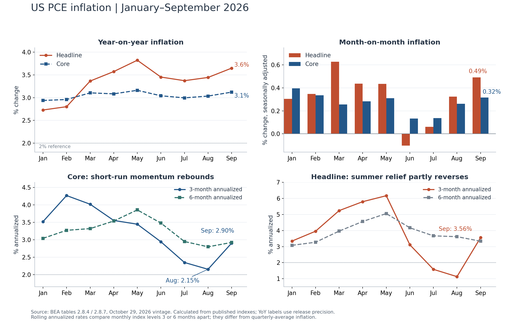
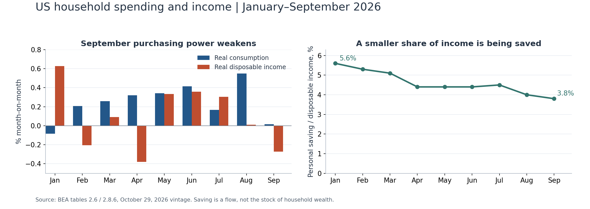

+++
title = "美国9月PCE分析：通胀再度升温，强增长下的购买力约束"
date = "2026-10-30"
data_as_of = ["2026-09-30", "2026-10-17", "2026-10-24", "2026-10-29"]
data_as_of_note = "资料截至10月29日发布及修订版本；PCE为9月、GDP为第三季度，初请截至10月24日、续请截至17日。报告明确日期为10月30日。"
draft = false
description = "比较9月PCE再度升温、第三季度内需韧性与实际购买力走弱，保留修订、频率和条件性政策判断。"
series = ""
categories = ["宏观与政策"]
tags = ["PCE", "GDP", "通胀", "失业金", "美联储"]
featured = false
private = false
content_preservation = "verbatim"
source_sha256 = "6e8501d1837095b8a8400884604dd31ba48b022b674b5af2f3a02fec87554076"
+++

# 美国9月PCE分析：通胀再度升温，强增长下的购买力约束

**研究事件：2026年10月29日美东时间发布的9月PCE、第三季度GDP初值和每周失业金申请数据。**  
**报告日期：2026年10月30日，新加坡时间。分析截止于10月29日已公布资料；月度趋势统一采用BEA于10月29日发布的修订版本。**

**核心判断：9月PCE削弱了“通胀正在稳定回到2%”的判断。总体与核心通胀同比均回升，核心短期动能也重新接近3%；第三季度内需较强、10月裁员申请较低，使美联储缺少立即转向宽松的迫切理由。但9月实际消费接近停滞、实际可支配收入下降，提示高通胀正在约束购买力。未来更值得警惕的组合，是增长逐步放缓与通胀黏滞同时存在。**

本次信息可以概括为四点：

- **通胀的边际方向转差。**9月总体PCE环比0.5%、同比3.6%；核心环比0.3%、同比3.1%。按同版指数计算，核心三个月年化由8月2.15%升至9月2.90%。
- **年内路径有明显反复。**春季总体通胀走高，6—7月缓和，8—9月再度回升；核心同比大部分时间停留在3%左右。9月核心动能仍低于年初较高水平，尚不足以认定通胀全面失控。
- **增长与就业尚有支撑。**第三季度实际GDP环比折年增长3.4%，私人国内最终需求增长4.9%；截至10月24日当周初请失业金19.4万人。不过GDP受到库存、贸易和政府支出结构的明显影响，低初请也不能直接证明招聘强劲。
- **后续消费的收入支撑减弱。**9月名义消费增长0.5%，实际消费约持平，实际可支配收入下降0.3%，储蓄率降至3.8%。季度增长表现较强，并不保证第四季度延续相同速度。

上述发布值来自[BEA个人收入与支出报告](https://www.bea.gov/news/2026/personal-income-and-outlays-september-2026)、[BEA第三季度GDP初值](https://www.bea.gov/news/2026/gdp-advance-estimate-3rd-quarter-2026)和[美国劳工部10月29日周报](https://www.dol.gov/ui/data.pdf)；短期年化为依据官方指数的计算，下文给出方法与边界。

## 一、先对齐时间与口径

| 数据 | 发布时点 | 实际覆盖期 | 主要用途 |
| --- | --- | --- | --- |
| PCE、个人收入与支出 | 10月29日08:30 EDT | 2026年9月 | 判断最新已公布的消费价格、消费量和购买力 |
| 实际GDP初值 | 同上 | 2026年第三季度，即7—9月 | 判断季度增长及需求结构 |
| 初请失业金 | 同上 | 截至10月24日当周 | 判断较新的裁员压力 |
| 续请失业金 | 同上 | 截至10月17日当周 | 补充观察领取失业保险的持续情况 |

月度PCE环比为季调后的单月变化，未年化；同比与上年同月比较。GDP的3.4%是**环比折年增速**，对应季度实际增长约0.8%。zh六个月年化属于额外计算，与月度环比及GDP报告中的季度平均价格涨幅分别列示。[BEA发布及技术说明](https://www.bea.gov/news/2026/gdp-advance-estimate-3rd-quarter-2026)

## 二、9月PCE：总体明显加快，核心仍有持续性压力

### 1. 关键数据及修订

| 指标 | 8月，上次公布 | 8月，本次修订后 | 9月 |
| --- | ---: | ---: | ---: |
| 总体PCE价格环比 | 0.3% | 0.3% | **0.5%** |
| 总体PCE价格同比 | 3.4% | 3.4% | **3.6%** |
| 核心PCE价格环比 | 0.2% | **0.3%** | **0.3%** |
| 核心PCE价格同比 | 3.0% | 3.0% | **3.1%** |
| 名义个人收入环比 | 0.2% | 0.3% | 0.2% |
| 名义可支配收入环比 | 0.3% | 0.3% | 0.2% |
| 实际可支配收入环比 | 0.0% | 0.0% | **-0.3%** |
| 名义消费支出环比 | 0.9% | 0.9% | 0.5% |
| 实际消费支出环比 | 0.6% | **0.5%** | **0.0%** |
| 个人储蓄率 | 4.1% | **4.0%** | **3.8%** |

来源：[BEA 9月发布](https://www.bea.gov/news/2026/personal-income-and-outlays-september-2026)、[BEA 8月原始发布](https://www.bea.gov/news/2026/personal-income-and-outlays-august-2026)及[同版NIPA第2部分数据表](https://apps.bea.gov/national/Release/XLS/Survey/Section2All_xls.xlsx)。公布值保留一位小数；0.0%表示舍入后接近零。

**修订改变了比较的起点。**核心环比已经连续两个月公布为0.3%，不能用旧8月的0.2%直接描述本次加速。按已公布至三位小数的指数重算，8月核心环比约0.262%，9月约0.317%，两者仍有边际加快，只是在公告精度下都显示为0.3%。总体环比则从约0.323%升至0.491%。这说明9月压力上升既体现在总体，也体现在核心的细微变化中。

同比回升也有可核对的基数逻辑：2025年9月总体与核心环比分别约0.292%和0.232%，低于2026年9月的对应涨幅。新月份替换掉较低的旧月份后，同比上升。**这里既有当期涨价动能，也有同比窗口更替；不能只看同比回升就判断冲击的持续时间。**[BEA表2.8.4](https://apps.bea.gov/national/Release/XLS/Survey/Section2All_xls.xlsx)

### 2. 从1月到9月：春季走高、夏季缓和、初秋反弹

| 月份 | 总体环比 | 总体同比 | 核心环比 | 核心同比 | 核心3个月年化 | 核心6个月年化 |
| --- | ---: | ---: | ---: | ---: | ---: | ---: |
| 1月 | 0.3% | 2.7% | 0.4% | 2.9% | 3.52% | 3.04% |
| 2月 | 0.3% | 2.8% | 0.3% | 3.0% | 4.27% | 3.27% |
| 3月 | 0.6% | 3.4% | 0.3% | 3.1% | 4.02% | 3.32% |
| 4月 | 0.4% | 3.6% | 0.3% | 3.1% | 3.55% | 3.54% |
| 5月 | 0.4% | 3.8% | 0.3% | 3.2% | 3.45% | 3.86% |
| 6月 | -0.1% | 3.5% | 0.1% | 3.0% | 2.94% | 3.48% |
| 7月 | 0.1% | 3.4% | 0.1% | 3.0% | 2.35% | 2.95% |
| 8月 | 0.3% | 3.4% | 0.3% | 3.0% | 2.15% | 2.80% |
| 9月 | 0.5% | 3.6% | 0.3% | 3.1% | 2.90% | 2.92% |

来源：[BEA表2.8.4、2.8.7](https://apps.bea.gov/national/Release/XLS/Survey/Section2All_xls.xlsx)。全部使用10月29日版本，不拼接各月首次公布值。同比与滚动年化由指数计算；环比使用官方表中公布值。年初滚动指标包含2025年末的必要月份。

**1—5月：总体通胀抬升更明显，核心保持较高增速。**总体同比由1月2.7%升至5月3.8%，3月总体环比达到0.6%。同期核心同比由2.9%升至3.2%；核心环比1月为0.4%，2—5月均为0.3%。总体与核心之间的变化幅度不同，说明食品、能源等非核心部分对总体路径具有重要影响，但这些汇总数字本身不能识别某一政策或地缘事件的因果效果。

**6—7月：降温真实存在。**总体环比分别为-0.1%、0.1%，核心连续两个月为0.1%。随后核心三个月年化降至8月约2.15%，接近与低通胀相容的速度。可是同期核心同比仍约3%，六个月年化约2.80%，说明低月度涨幅尚未持续足够长时间。

**8—9月：最新动能重新上行。**总体环比升至0.3%、0.5%；核心回到连续0.3%。9月核心三个月年化约2.90%，六个月年化约2.92%，两种窗口重新汇合在3%附近。总体三个月年化从8月约1.13%升至9月约3.56%，同时受9月较高涨幅进入、6月负涨幅退出窗口影响。

因此，年内趋势支持的是：**核心通胀从年初较快速度下降，但最近的去通胀进展出现反复；总体通胀对能源等波动项目更加敏感。**9月总体同比3.6%仍低于5月3.8%，核心三个月年化2.90%也低于2月4.27%。本次回升值得警惕，但不能据此宣称通胀已超过年内所有高点。

从累计价格水平看，2025年12月至2026年9月，总体PCE上涨约**2.96%**、核心上涨约**2.46%**；对应九个月复合年化约3.97%和3.29%。这些是已经发生的涨价及其折年表达，不是对全年结果的预测。[BEA价格指数及本报告计算](https://apps.bea.gov/national/Release/XLS/Survey/Section2All_xls.xlsx)

### 3. 季度通胀下降，为何不妨碍9月回升？

GDP报告显示，第三季度总体PCE价格环比折年增长**2.1%**，低于第二季度的5.0%；核心为**2.5%**，低于3.3%。这与9月数据没有矛盾，原因是比较窗口不同：[BEA季度发布](https://www.bea.gov/news/2026/gdp-advance-estimate-3rd-quarter-2026)

| 指标 | 比较方式 | 9月/第三季度总体 | 9月/第三季度核心 |
| --- | --- | ---: | ---: |
| 第三季度价格涨幅 | 7—9月平均价格水平，相对4—6月平均，再折年 | 2.1% | 2.5% |
| 截至9月的3个月年化 | 9月指数相对6月指数，再折年 | 3.56% | 2.90% |
| 9月单月涨幅折年 | 假设9月涨幅连续重复12个月 | 6.05% | 3.86% |

季度平均保留了夏季较低价格动能的影响，滚动三个月指标对季度末变化更敏感，单月年化又最容易放大噪声。**前瞻判断应把9月反弹视为季度末的警示，同时用后续月份检验持续性，不能直接外推单月年化值。**

## 三、分项：能源解释大部分总体加速，服务提供核心黏性

| 价格类别 | 8月环比 | 9月环比 | 9月同比 | 9月对总体环比贡献，百分点 |
| --- | ---: | ---: | ---: | ---: |
| 商品 | 0.3% | 0.8% | 3.95% | +0.25 |
| 其中：耐用品 | 0.1% | 0.2% | 2.90% | +0.03 |
| 其中：非耐用品 | 0.5% | 1.1% | 4.52% | +0.22 |
| 居家食品及饮料 | 0.0% | 0.0% | 1.49% | 0.00 |
| 汽油及其他能源商品 | 4.4% | **9.2%** | 35.45% | **+0.21** |
| 服务 | 0.3% | 0.3% | 3.51% | **+0.24** |
| 其中：住房及公用事业 | 0.1% | 0.3% | 3.33% | +0.05 |
| 其中：医疗保健 | 0.1% | 0.1% | 3.03% | +0.03 |
| 其中：交通服务 | 1.1% | **2.1%** | 9.21% | **+0.07** |
| 其中：餐饮及住宿 | 0.5% | 0.4% | 3.47% | +0.03 |
| 其中：金融服务及保险 | 0.3% | 0.4% | 4.41% | +0.03 |
| 补充：全部能源商品与服务 | 2.3% | **5.4%** | 21.28% | **+0.21** |
| 补充：非住房、非能源服务 | 0.4% | **0.4%** | 3.60% | **+0.19** |

来源：[BEA表2.8.4、2.8.7、2.8.8](https://apps.bea.gov/national/Release/XLS/Survey/Section2All_xls.xlsx)。环比及贡献采用官方值，同比根据指数计算。汇总项、子项及补充项重叠，不能全部相加；贡献是对总体PCE的百分点贡献，不是各类别在核心篮子内的贡献。独立舍入也会造成小额差异。

**能源是总体环比加快的最大可识别来源。**全部能源对总体涨幅贡献从8月约0.09个百分点升至9月0.21个百分点，增加约0.12个百分点；总体未舍入环比加快约0.17个百分点。因此，按已舍入贡献估算，能源解释了本次总体加速的约七成。9月能源本身贡献约占总体涨幅四成，其余压力不能忽略。汽油等能源商品价格上涨9.2%，实际消费量却下降0.1%，也表明这部分支出增加主要反映价格压力。[BEA价格贡献及实际消费表](https://apps.bea.gov/national/Release/XLS/Survey/Section2All_xls.xlsx)

**服务仍然维持较高动能。**9月服务对总体价格涨幅贡献约0.24个百分点，与商品贡献相近。非住房、非能源服务连续两个月公布环比0.4%；精确计算约从0.373%变为0.367%，实际略微放慢，因此不能说9月这一项目再次明显加速。但其三个月年化升至3.37%，同比约3.60%，说明最近两个月较高涨幅已对趋势形成影响。该类别与日常所称“超级核心”相近，本报告严格使用BEA的这一具体定义，不将不同排除口径混用。

**住房缓和出现反复，但医疗等分项并未同步大幅升温。**单独住房价格环比从约0.186%升至0.320%，同比约3.15%。交通服务环比2.1%较突出；相对而言，医疗保健仅为0.1%、居家食品约持平，其他服务也由8月0.9%降至0.2%。这些分化意味着，压力具有多个来源，但“所有核心类别都在全面加速”仍超出证据。

本次数据可以确认能源和服务的价格贡献，**不能单凭这些贡献认定能源成本已全面传导至服务、关税造成了某一具体涨幅，或者需求过热解释了全部通胀**。这些因果判断需要更细的成本、价格与供需证据。对政策最关键的检验，是能源波动缓解之后，核心与非住房服务能否持续降温。

## 四、PCE报告中的需求信号：支出增加，消费量几乎没有增加

9月名义消费环比约**0.506%**，总体价格约上涨**0.491%**，实际消费量仅增长约**0.015%**，公告显示为0.0%。按名义支出、价格和实际量的增长关系核对，支出增加几乎全部被价格上涨吸收。商品实际消费下降0.3%，其中耐用品下降0.8%；服务实际消费仍增长0.2%，抵消了商品端的疲弱。[BEA表2.8.1、2.8.4、2.8.5、2.8.6](https://apps.bea.gov/national/Release/XLS/Survey/Section2All_xls.xlsx)

| 购买力与消费指标 | 1月 | 7月 | 8月 | 9月 |
| --- | ---: | ---: | ---: | ---: |
| 实际可支配收入同比 | 2.04% | 1.49% | 1.33% | **0.95%** |
| 实际消费同比 | 2.03% | 2.37% | 2.69% | **2.54%** |
| 个人储蓄率 | 5.6% | 4.5% | 4.0% | **3.8%** |

来源：[BEA表2.6、2.8.6](https://apps.bea.gov/national/Release/XLS/Survey/Section2All_xls.xlsx)及指数/水平计算。

9月实际可支配收入环比下降约0.27%，8月则约持平。与此同时，实际消费同比仍快于实际收入，储蓄率从年初5.6%降至3.8%。这一组合提示：**消费增长对当期收入以外的支持更为依赖，进一步依靠降低储蓄率维持消费的空间也会受到约束。**

这里的储蓄率是当期收入中未用于支出的比例，不能等同于家庭银行存款或财富存量已经耗尽；总体数据也无法区分高收入家庭与低收入家庭的负担。现有证据支持“购买力约束增强”，尚不足以确认消费已经进入持续收缩。

## 五、GDP判断：内需较强，3.4%的增长仍需拆解

第三季度实际GDP环比折年增长3.4%，高于第二季度2.2%；实际消费增长3.8%，与第二季度相同。更能反映私人部门国内最终需求的指标——实际私人国内最终销售，即消费加私人固定投资——增长4.9%，高于第二季度4.6%。这说明增长确有内需基础。[BEA第三季度GDP初值](https://www.bea.gov/news/2026/gdp-advance-estimate-3rd-quarter-2026)

| 对实际GDP增长的贡献 | 第二季度，百分点 | 第三季度，百分点 |
| --- | ---: | ---: |
| 消费 | +2.51 | +2.52 |
| 私人固定投资 | +1.35 | +1.66 |
| 库存变动 | **-0.53** | **+1.61** |
| 净出口 | **-1.10** | **-3.32** |
| 政府消费及投资 | -0.01 | +0.90 |
| 合计，按分项舍入值相加 | 2.22 | 3.37 |
| 官方公布GDP增速 | **2.2%** | **3.4%** |

来源：[BEA表1.1.2](https://apps.bea.gov/national/Release/XLS/Survey/Section1All_xls.xlsx)。贡献为百分点，GDP增速为百分比；分项舍入差异不构成统计矛盾。

这张表对PCE前景有三层含义。

第一，**经济尚未出现足以普遍压低价格的需求塌陷。**消费贡献约2.52个百分点，非住宅固定投资增长12.7%，其中设备投资增长20.9%，给总需求提供支撑。不过BEA指出，信息处理设备增长主要涉及计算机及外围设备、且估计依赖进口资料；不能把这些支出全部视为美国本土生产，也不能直接等同于可精确计量的AI投资贡献。

第二，**季度加速有明显的波动项。**库存对增长的贡献由-0.53转为+1.61个百分点，变化约2.14个百分点，超过GDP表面加速的约1.2个百分点；同期净出口拖累扩大，抵消了一部分支持。库存贡献难以机械重复，贸易也可能逆转，所以不能将3.4%直接外推。剔除库存后的“国内产品最终销售”仅增长1.7%，而私人国内最终需求增长4.9%；前者仍受净出口影响，两者并非互相矛盾的需求衡量。

第三，**政府支出变化不能全部解读为新增财政刺激。**BEA特别说明，非国防支出变化受到战略石油储备销售减少的核算影响，相关跨项目调整本身对总GDP没有直接影响。因此，用政府分项增长简单证明财政全面扩张并不严谨。[BEA技术说明及表1.4.1](https://www.bea.gov/news/2026/gdp-advance-estimate-3rd-quarter-2026)

综合来看，GDP支持“需求仍有韧性”，却不排除9月购买力减弱在第四季度逐步体现。季度均值与季度末的月度变化，应共同用于判断后续增长。

## 六、失业金判断：裁员压力低，尚未证明招聘强劲

| 季调指标 | 最新值 | 与前周修订后数值相比 |
| --- | ---: | ---: |
| 初请失业金，截至10月24日 | **194,000人** | -1,000人 |
| 初请四周均值 | **196,750人** | -1,250人 |
| 续请失业金，截至10月17日 | **1,701,000人** | -21,000人 |
| 续请四周均值 | **1,710,000人** | +500人 |
| 受保失业率，截至10月17日 | **1.1%** | 持平 |

来源：[美国劳工部10月29日周报，第1、4页](https://www.dol.gov/ui/data.pdf)。初请与续请覆盖不同周；前周初请上修至195,000人，续请下修至1,722,000人后再计算变化。

初请四周均值低于20万人，续请当周也下降，没有显示裁员压力在近期明显扩散。这使“就业恶化迫使美联储立即宽松”的证据较弱。但续请四周均值略升、周变化很小，仍应结合后续趋势。失业保险仅覆盖合资格申领者；初请主要观察裁员，不能替代新增就业或招聘指标，1.1%的受保失业率也不能与全国失业率混同。

将其与PCE结合，更合理的判断是：就业收入目前仍有支撑，需求不会仅因一次偏弱的消费量数据就迅速塌陷；但低裁员尚不足以保证家庭实际购买力持续改善。

## 七、前瞻：去通胀的持续性不足，政策需面对增长与通胀的张力

### 1. 基准工作情景：增长逐步放缓，核心通胀在3%左右反复

这是基于当前证据的**条件性判断，不是校准过概率的预测**。私人需求和低初请提供增长支撑；实际收入疲弱、储蓄率下降和库存贡献的可重复性有限，则支持后续增速放缓的可能。价格端，能源可以快速反转，但核心、住房以及非住房服务还没有形成连续数月低涨幅。

因此，未来一至两个季度的基准观察重点是：实际消费是否从高增长转向温和增长，同时核心通胀继续在3%左右波动。若收入和就业同步恶化，这一增长判断需要下调；若能源回落且服务通胀连续缓和，通胀判断则应改善。

### 2. 年底同比会怎样：用机械情景分清“改善”与“达到目标”

以下仅固定2026年9月已公布指数和2025年12月基数，假设10—12月每个月都保持同一环比涨幅。总体、核心两列分别施加该假设，**不是对两者一定同步变化的联合预测**，也没有计入未来修订。

| 假设10—12月每月环比 | 对应持续12个月的年化速度 | 推算12月总体同比 | 推算12月核心同比 |
| --- | ---: | ---: | ---: |
| 0.15% | 1.81% | 3.42% | **2.92%** |
| 0.20% | 2.43% | 3.58% | **3.07%** |
| 0.30% | 3.66% | 3.89% | **3.38%** |
| 0.40% | 4.91% | 4.20% | **3.69%** |

来源：以[BEA表2.8.4](https://apps.bea.gov/national/Release/XLS/Survey/Section2All_xls.xlsx)指数进行的情景计算；不代表市场一致预期。

这张表说明：即使接下来核心每月降至0.15%，其年底同比仍可能接近2.9%；如果连续维持0.3%，核心年底同比反而约为3.38%。**低月度涨幅需要持续足够长时间，才能使过去一年累计涨幅明显回落。**与2%年通胀相对应的恒定月度涨幅约0.165%，0.2%长期复合仍约为2.43%，两者不完全等价。

### 3. 美联储：立即宽松的理由弱化，是否加息仍有条件

就在此次数据发布前一天，10月28日FOMC维持联邦基金利率目标区间在**3.75%—4.00%**。声明指出经济活动增长较强、通胀仍偏高；两名投票委员主张当次加息25个基点。这是已发生的政策事实，也说明此次数据应放在“暂停观察、存在加息分歧”的背景中理解。[美联储10月28日声明](https://www.federalreserve.gov/newsevents/pressreleases/monetary20261028a.htm)

本次PCE、GDP和失业金组合，对政策判断的边际含义是：**更支持保持谨慎、等待通胀持续下降的证据；若核心和服务动能延续，进一步收紧的理由会增强。**但一次PCE反弹不能确定下次会议必然加息。能源价格是否反转、真实收入和消费是否明显转弱，以及通胀预期和就业的后续变化，都会影响决策。

不能用政策利率减去过去12个月PCE就断言政策“已经过松”：前瞻实际利率取决于通胀预期，中性利率也不可直接观察。本报告没有估计这两个变量，因而不据此作确定判断。

### 4. 哪些后续证据会改变判断

| 情景 | 需要观察到的组合 | 对当前判断的影响 |
| --- | --- | --- |
| 去通胀恢复、增长温和 | 核心月度涨幅连续数月接近0.15%—0.20%，非住房服务同步缓和；实际收入恢复增长，失业金稳定 | 支持通胀逐步回落，降低进一步收紧的必要性 |
| 通胀黏性增强 | 核心持续约0.3%或以上，服务压力延续，能源仍高；私人需求和就业维持韧性 | 增加保持较紧政策或加息的理由 |
| 购买力冲击转为需求下行 | 实际收入与实际消费持续疲弱，初请和续请的数周趋势同步上升，投资或库存支持减弱 | 增长风险权重上升；若通胀仍高，政策权衡更困难 |

这里的月度范围是观察标准，不是自动触发政策的规则。下一次10月PCE与第三季度GDP第二次估计定于**11月25日08:30 EST**发布，即新加坡时间21:30；月度PCE应继续与每周失业金、就业和收入变化共同验证。[BEA下次发布时间](https://www.bea.gov/news/2026/personal-income-and-outlays-september-2026)

 
