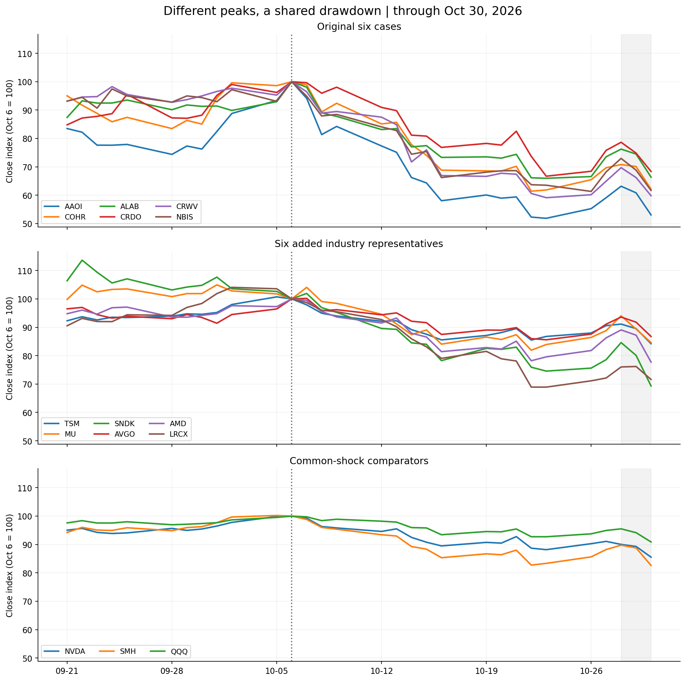
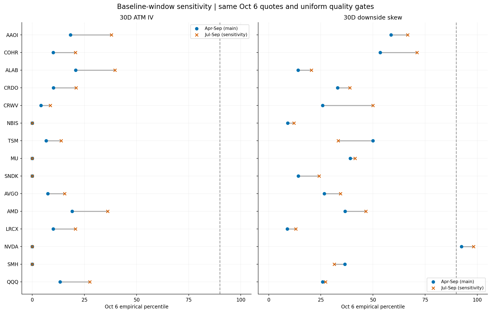
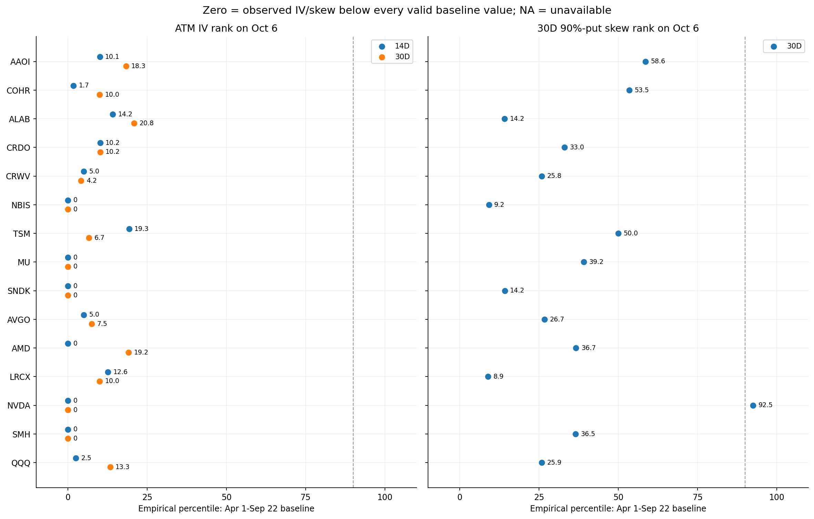
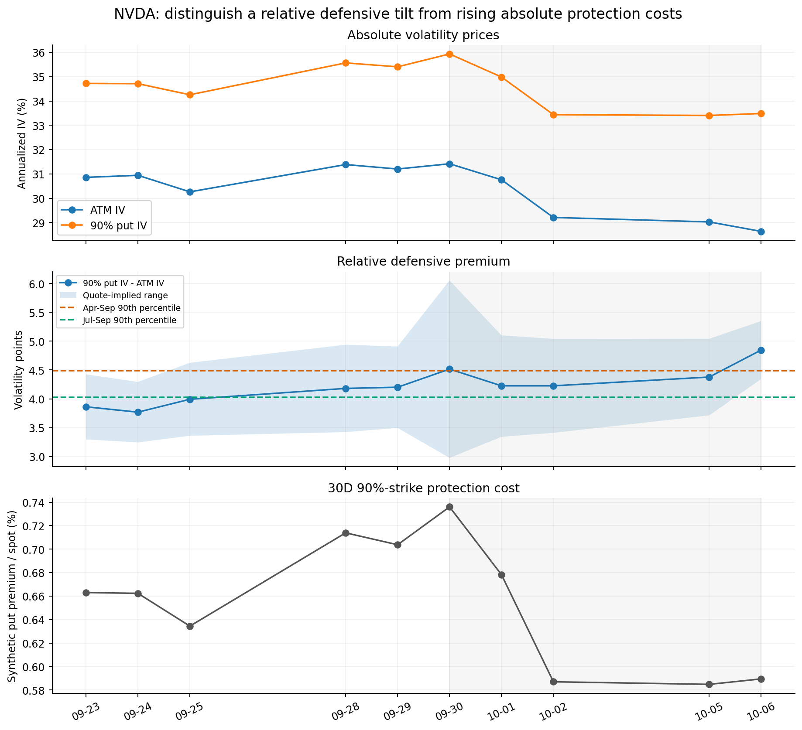
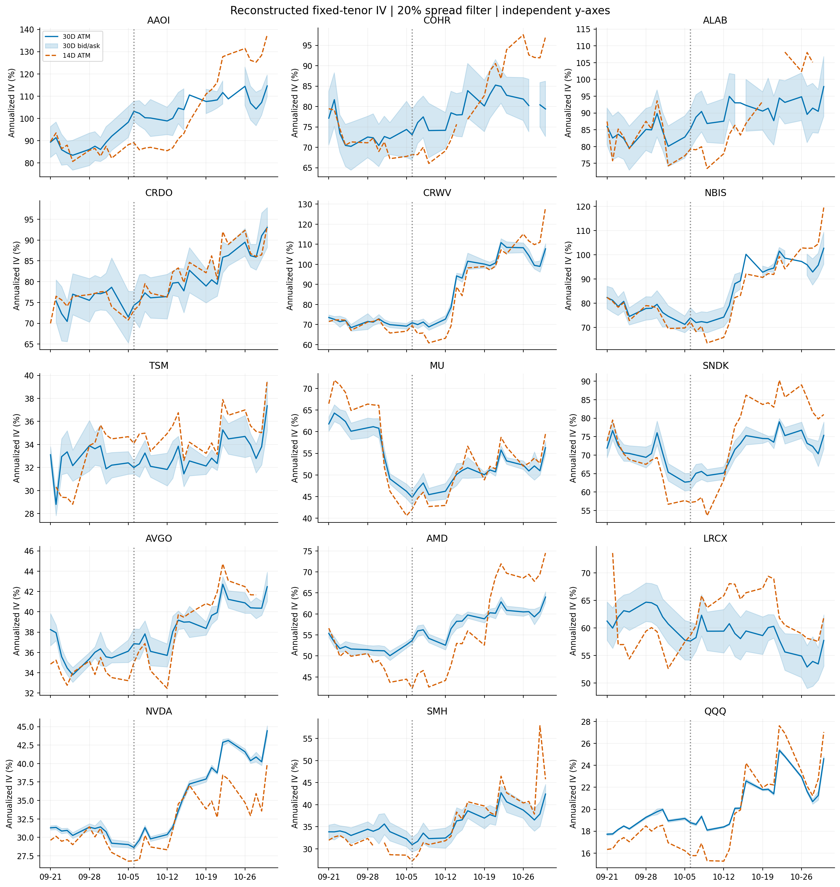
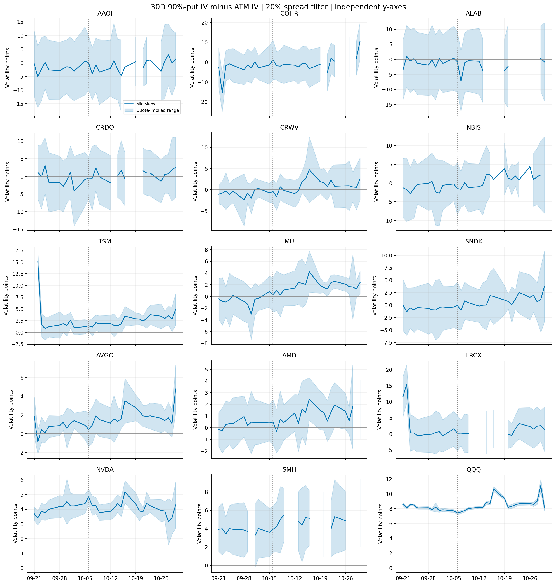
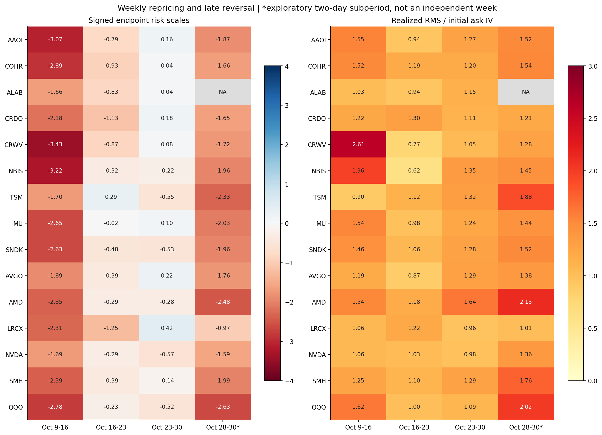
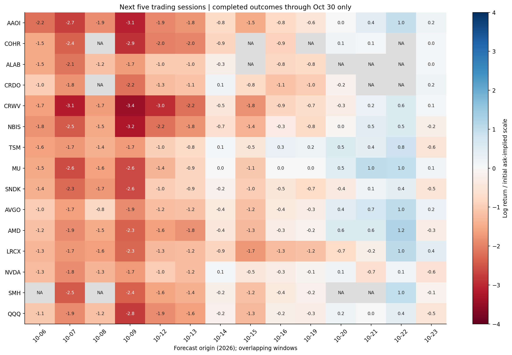

+++
title = "AI硬件回撤中的期权风险定价：局部预警、中段不足与后续分化（截至ET 2026-10-30）"
date = "2026-10-31"
data_as_of = ["2026-10-30"]
data_as_of_note = "截止2026年10月30日16:00 ET；报告日期2026年10月31日。"
draft = false
description = "区分AI硬件与NeoCloud回撤中的局部预警、中段风险尺度不足和后续分化，保留报价质量、概率及交易边界。"
series = ""
categories = ["科技产业", "衍生品"]
tags = ["AI", "期权", "IV", "Neo Cloud", "风险定价"]
featured = false
private = false
content_preservation = "verbatim_except_privacy_redactions"
source_sha256 = "b5c372a4a04ed1c69c702cb76fa60f6454827bd011945e0c7e13c69009c6be49"
+++



# AI硬件回撤中的期权风险定价：局部预警、中段不足与后续分化（截至ET 2026-10-30）

**15标的完整实验报告**  
**行情截止：2026年10月30日16:00 America/New_York（EDT，UTC−4）｜编制：2026年10月31日**  
**完整历史：2026年4月1日—10月30日｜主基准：4月1日—9月22日，120个交易日**

本报告研究两个问题：AI硬件与Neo Cloud大幅回撤前，期权是否提前发出风险提示？下跌开始后，即使期权价格和隐含波动率已经调整，是否仍反复低估后续风险？研究使用历史收盘报价重建期权指标，将事前信号、过程中的重新定价和随后实现的风险分别检验。所有收益均为美元价格收益，不含分红；“10月”均指2026年。本文可以独立阅读，无需对照此前讨论。

阅读顺序：第1—5节解释样本和事前信号，第6—8节建立比较标准，第9—13节分析下跌过程，第14—16节汇总数据边界、逐标的判断和最终结论。表内NA表示无法可靠计算，不能解释为零风险。

## 核心结论

**本节结论：证据支持“局部预警、中段风险尺度不足、后续重新定价但局部再次不足”；不支持“全板块提前预知大跌”，也不足以确认“期权在全过程持续、系统性地低估风险”。**

**结论分析。** 判断“期权是否反应过来”，必须区分三个层次：指标是否变得异常、保险价格是否上涨、上涨后的报价能否覆盖接下来的风险。三者的答案可以不同。我们观察到较明确的过程性重新定价，但这种调整并没有在所有日期、所有期限和所有股票上同步完成。

- **事前没有共同的高IV预警，局部提示仍应保留。** 10月6日，15只证券的30天平值隐含波动率均低于各自半年历史90分位，前五个收盘日也没有一只触发这一高IV阈值。NVDA的下行偏斜则处于半年92.5分位，提示下行保护相对于平值波动更贵；但它的平值IV、下行Put绝对IV和标准化保护成本同期都在下降，不能据此称期权准确预告了大跌。
- **中段的风险尺度不足最集中。** 10月9—16日，CRWV、NBIS的实际对数跌幅分别约为起点同到期期权ask IV所对应波动尺度的3.43倍、3.22倍；MU、SNDK也分别达到2.65倍、2.63倍。这说明中段的压力并不限于少数Neo Cloud案例。
- **后段存在反例，也存在新的短期压力。** 10月23—30日，原六个较大回撤案例的终点变化相对起点IV均不大，但日收益路径波动全部超过起点IV。反弹后再从10月28日出发，AMD、TSM两日下跌又分别达到2.48倍、2.33倍起点波动尺度。整周净跌幅小，不能推导出最后两天风险已被充分覆盖。
- **精确的低概率数字弱于阶段性结论。** CRWV/NBIS全期实际终点对应的风险中性概率上界，在主报价筛选下为2.08%/3.45%，严格筛选后为7.11%/12.69%。这支持尾部定价与实际结果存在张力，但不是“真实世界发生概率只有2%/3%”的估计。

背景比较进一步支持本轮风险状态的特殊性：有效滚动五日窗口中，终点跌幅超过两倍起点波动尺度的记录，由7—9月的7/716（1.0%）升至10月的24/195（12.3%）；日收益RMS超过IV的记录由32.8%升至65.1%。这些证券日记录相互相关、窗口重叠，不能视为911次独立预测试验。

因此，本文最有把握的结论是**风险定价存在阶段差异和期限差异**。本研究没有识别下跌原因，没有证明长期预测能力，也没有测算可执行交易策略的净收益。

## 1. 研究对象与下跌时间：不能把10月7日当成所有股票的共同转折点

**本节结论：扩大到15只证券有必要，它揭示了产业环节、跌幅和转折时间的差异；统一10月6日原点便于比较，但不能替代逐股时间对齐。**

**结论分析。** 最初六个较大回撤案例从10月6日至30日下跌31.6%—46.9%，容易让人形成“整个AI半导体都以同样方式下跌”的印象。加入晶圆代工、存储、计算芯片和设备后，同期跌幅扩展到13.2%—30.7%，有助于检验原结论是否只由跌幅最大的股票驱动。NVDA、SMH、QQQ提供同主题、行业组合和更广科技市场的比较，但ETF包含相关成分股，不能把它们当成独立于样本的无冲击对照组。

时间差异同样重要。SNDK在9月22日已达到本研究定义的局部收盘峰值，MU、LRCX分别在10月1日、2日见峰，AVGO则在10月7日。对SNDK来说，10月6日期权反映的是已经开始的下跌，不能称作初始转折前的预测。本文同时保留共同原点和逐股局部峰值检验，避免用统一日期掩盖这一差别。

| 分组 | 证券 | 比较作用 |
|---|---|---|
| 光通信硬件 | AAOI、COHR | 较大回撤案例，业务不等同于纯逻辑芯片 |
| AI互连 | ALAB、CRDO | 数据中心连接与互连风险 |
| Neo Cloud | CRWV、NBIS | GPU基础设施运营风险 |
| 晶圆代工 | TSM | 使用美股ADR及美国期权，属于制造环节 |
| 存储 | MU、SNDK | MU涉及DRAM/HBM及NAND；SNDK主要为NAND/Flash |
| 计算及定制芯片 | AMD、AVGO | GPU/CPU、定制加速器、网络等多业务暴露 |
| 制造设备 | LRCX | 存储及其他晶圆制造资本开支暴露 |
| 比较证券 | NVDA、SMH、QQQ | 龙头、半导体ETF、科技成长ETF |

业务分类和事件时间见来源与事件说明。股票池是在观察到本轮下跌后确定的，因此本文是事后事件研究；增加标的扩大了比较范围，并未将其变为事前冻结股票池的样本外检验。

| 证券 | 局部峰值日¹ | 10-06收盘 | 10-30收盘 | 10/6→30 | 局部峰值→30 | 10/23→30 | 10/28→30 |
| --- | --- | --- | --- | --- | --- | --- | --- |
| AAOI | 10-06 | 130.160 | 69.050 | -46.9% | -46.9% | 2.3% | -16.0% |
| CRWV | 10-06 | 91.720 | 54.870 | -40.2% | -40.2% | 1.2% | -14.2% |
| NBIS | 10-06 | 249.870 | 154.140 | -38.3% | -38.3% | -2.9% | -15.5% |
| COHR | 10-06 | 338.360 | 210.320 | -37.8% | -37.8% | 0.5% | -12.2% |
| ALAB | 10-06 | 389.800 | 258.700 | -33.6% | -33.6% | 0.6% | -13.0% |
| CRDO | 10-06 | 220.830 | 150.990 | -31.6% | -31.6% | 2.5% | -13.1% |
| SNDK | 09-22 | 1660.460 | 1150.890 | -30.7% | -39.0% | -7.0% | -18.1% |
| LRCX | 10-02 | 333.890 | 239.110 | -28.4% | -31.2% | 3.9% | -5.8% |
| AMD | 10-06 | 649.420 | 504.800 | -22.3% | -22.3% | -2.3% | -12.7% |
| SMH | 10-05 | 632.500 | 522.490 | -17.4% | -17.6% | -0.9% | -8.0% |
| TSM | 10-05 | 482.300 | 406.130 | -15.8% | -16.4% | -3.0% | -7.6% |
| MU | 10-01 | 1045.560 | 884.740 | -15.4% | -19.4% | 0.8% | -10.0% |
| NVDA | 10-06 | 239.240 | 204.640 | -14.5% | -14.5% | -3.0% | -5.0% |
| AVGO | 10-07 | 375.810 | 326.080 | -13.2% | -13.4% | 1.4% | -7.3% |
| QQQ | 10-06 | 759.660 | 690.490 | -9.1% | -9.1% | -2.0% | -4.8% |

¹局部峰值为9月21日—10月9日区间内事后识别的最高收盘价，不是全历史最高价，也不是实时可识别的卖出信号。价格单位为美元/股。本期没有实际生效的样本内拆股；MU于10月14日除息0.15美元，价格收益不加回分红。SNDK于10月29日宣布的8拆1在11月才生效，未调整本期价格。[SNDK官方说明](https://investor.sandisk.com/static-files/adc41ac6-9db7-4e6a-a29f-f73c1a0123e4)

**关键概念先读。** IV是由期权价格反推的年化波动率，包含风险溢价、供需和模型因素，不是直接的下跌预测。ATM指平值；30D指30个日历天；pp指百分点。本文偏斜为同期限90%相对行权价Put IV减ATM IV；“90%Put”意为行权价约为当时现价的90%。后文的有符号z比较终点对数收益与起点IV尺度，RMS/IV比较路径波动与该尺度，Q上界约束的是风险中性终点概率；具体公式见第7—8节。

## 2. 基准期与历史分位：延长到半年有必要，但不宜只选一个有利窗口

**本节结论：主基准采用4月1日—9月22日的120个交易日，并保留58日近期基准，是本次研究较合理的折中；更长基准有助于稳定阈值，却不能自动消除状态变化。**

**结论分析。** 58个样本的最高10%仅约6个点，财报前后的少数交易日就可能明显改变90分位阈值。延长到120日后，上尾约由12个点支撑，能减少个别事件的影响。但IV具有自相关，名义样本量翻倍不意味着独立信息翻倍；更早的高波动状态也可能降低当前指标的历史排名。因此，本研究同时展示半年和三个月结果，检验提示是否依赖基准选择。

本次没有继续扩展至一年以上。研究问题聚焦近期风险定价，更长时间可能混合业务结构、上市后流动性和波动状态变化。半年基准足以改善原来的短样本问题；如果下一步要证明跨周期预警能力，则需要更长历史、多轮事件及预先冻结的规则，单纯延长本次分位计算还不够。

| 用途 | 日期 | 名义交易日 | 解释 |
|---|---|---:|---|
| 主历史基准 | 4月1日—9月22日 | 120 | 事件观察前冻结，作为主要状态比较 |
| 近期敏感性 | 7月1日—9月22日 | 58 | 检查结论是否依赖较早波动状态 |
| 九月短基准 | 9月1日—9月22日 | 15 | 仅作局部背景，不能支撑稳定上尾阈值 |
| 背景阈值训练 | 4月1日—6月30日 | 62 | 为第6节冻结独立的90分位阈值 |
| 背景验证 | 7月1日—9月22日 | 58个价格日 | 仅计后续五日结果在9月22日前完成的原点 |

共同原点的前五日是9月30日—10月6日五个收盘，前三日是10月2日—6日三个收盘。主基准在它们之前结束。逐股峰值检验进一步保证基准结束于整个事前窗口之前：SNDK的峰值是9月22日，前五日窗口为9月16日—22日，所以其基准截至9月15日。峰值日期本身仍是事后识别的，不能据此宣称实时择时。

**读图方法。** 每行蓝点和橙色叉号都代表**同一个10月6日指标值**，分别放到半年、三个月基准中计算排名；连线表示基准变化造成的排名差异。左图为30D ATM IV，右图为30D Put偏斜。这些点不是基准区间的最高值、最低值或平均值，也不是前五日的最大分位。

例如AAOI的10月6日IV30为103.2%，在半年样本中有22/120个有效观测不高于它，经验分位为18.3%；在近期样本中为22/58，即37.9%。NVDA同日偏斜4.85pp，在两种基准中分别为111/120、57/58，即92.5和98.3分位。前者说明基准选择影响“异常程度”，后者说明NVDA局部偏斜提示在两种基准中都存在，但强弱不同。

所有分位均使用有效观测，缺失值不填0。本文同时查看多证券、多指标与多窗口，因此90分位不是经过多重检验校正的显著性水平；个别越线只称为局部提示。

## 3. 共同原点的事前信号：没有共同高IV预警，不等于市场认为没有风险

**本节结论：10月6日前缺少跨样本一致的高ATM IV异常；偏斜提示主要集中在NVDA，TSM仅有边界性、短暂异常。绝对风险水平与历史异常程度必须分开。**

**结论分析。** 15只证券在10月6日的IV30都没有达到自身半年或三个月90分位，前五日触及该高IV阈值的证券也为0/15。这个结果否定的是“事件前出现普遍的高IV异常”这一具体假设，而不是否定期权价格中已经包含波动风险。AAOI的IV30为103.2%，尽管只有半年18.3分位，其绝对波动尺度仍远高于NVDA的28.6%。市场可以一直给一只股票很高的风险价格，却未在此次转折前额外大幅提价。

指标变化也有多种解释。AAOI前五日IV30上升17.1pp，但IV14只上升约6.0pp，提示期限结构变化，不能直接等同于对次日下跌的集中预判。MU的IV30由约60.8%降至44.8%，与9月30日盘后财报跨越同一观察窗口；事件风险到期消失，会影响IV变化。没有将这些背景区分清楚，“IV下降说明没有风险”或“IV上升说明预知下跌”都过于直接。

| 证券 | 10-06 IV14 | 10-06 IV30 | 前5日IV30变化pp | 半年分位 | 三月分位 | 半年有效日 | 半年阈值超90天数 | 三月阈值超90天数 |
| --- | --- | --- | --- | --- | --- | --- | --- | --- |
| AAOI | 89.1% | 103.2% | 17.1 | 18.3 | 37.9 | 120/120 | 0/5 | 0/5 |
| COHR | 68.2% | 73.1% | 2.6 | 10.0 | 20.7 | 120/120 | 0/5 | 0/5 |
| ALAB | 79.2% | 85.3% | -4.6 | 20.8 | 39.7 | 120/120 | 0/5 | 0/5 |
| CRDO | 73.1% | 74.3% | -2.8 | 10.2 | 21.1 | 118/120 | 0/5 | 0/5 |
| CRWV | 69.5% | 70.9% | -2.0 | 4.2 | 8.6 | 120/120 | 0/5 | 0/5 |
| NBIS | 72.4% | 74.0% | -5.6 | 0.0 | 0.0 | 120/120 | 0/5 | 0/5 |
| TSM | 34.1% | 32.0% | -1.9 | 6.7 | 13.8 | 120/120 | 0/5 | 0/5 |
| MU | 42.1% | 44.8% | -16.0 | 0.0 | 0.0 | 120/120 | 0/5 | 0/5 |
| SNDK | 57.2% | 62.8% | -13.2 | 0.0 | 0.0 | 120/120 | 0/5 | 0/5 |
| AVGO | 35.0% | 36.9% | 0.5 | 7.5 | 15.5 | 120/120 | 0/5 | 0/5 |
| AMD | 42.3% | 53.7% | 2.4 | 19.2 | 36.2 | 120/120 | 0/5 | 0/5 |
| LRCX | 58.7% | 57.6% | -6.4 | 10.0 | 20.7 | 120/120 | 0/5 | 0/5 |
| NVDA | 26.8% | 28.6% | -2.8 | 0.0 | 0.0 | 120/120 | 0/5 | 0/5 |
| SMH | 27.2% | 30.9% | -3.5 | 0.0 | 0.0 | 120/120 | 0/5 | 0/5 |
| QQQ | 15.8% | 18.8% | -1.0 | 13.3 | 27.6 | 120/120 | 0/5 | 0/5 |

表中“前5日IV30变化”为9月30日与10月6日端点之差；“超90天数”为各收盘指标超过固定历史90分位阈值的次数，分母为可用观测，不是未来下跌概率。

| 证券 | 10-06偏斜pp | 半年分位 | 三月分位 | 半年90分位阈值pp | 报价推导区间pp | 前5日超半年90天数 | 半年有效日 |
| --- | --- | --- | --- | --- | --- | --- | --- |
| AAOI | -0.02 | 58.6 | 66.7 | 2.92 | [-10.00, 9.92] | 0/5 | 116/120 |
| COHR | 1.11 | 53.5 | 71.2 | 2.89 | [-8.79, 10.99] | 0/5 | 114/120 |
| ALAB | -0.85 | 14.2 | 20.5 | 4.26 | [-10.94, 9.14] | 0/5 | 106/120 |
| CRDO | -0.49 | 33.0 | 38.9 | 3.08 | [-6.47, 5.48] | 0/5 | 115/120 |
| CRWV | -0.44 | 25.8 | 50.0 | 2.50 | [-3.15, 2.27] | 0/5 | 120/120 |
| NBIS | -1.49 | 9.2 | 12.1 | 3.24 | [-8.40, 5.37] | 0/5 | 120/120 |
| TSM | 1.40 | 50.0 | 33.3 | 2.51 | [0.34, 2.42] | 1/5 | 118/120 |
| MU | 0.31 | 39.2 | 41.4 | 2.27 | [-2.69, 3.30] | 0/5 | 120/120 |
| SNDK | -0.09 | 14.2 | 24.1 | 3.30 | [-4.85, 4.67] | 0/5 | 120/120 |
| AVGO | 0.45 | 26.7 | 34.5 | 2.97 | [-1.37, 2.27] | 0/5 | 120/120 |
| AMD | 0.48 | 36.7 | 46.6 | 2.32 | [-1.45, 2.40] | 0/5 | 120/120 |
| LRCX | 0.19 | 8.9 | 13.0 | 3.12 | [-5.41, 5.76] | 0/5 | 112/120 |
| NVDA | 4.85 | 92.5 | 98.3 | 4.49 | [4.34, 5.35] | 2/5 | 120/120 |
| SMH | 3.93 | 36.5 | 31.5 | 5.70 | [1.43, 6.43] | 0/4 | 115/120 |
| QQQ | 7.39 | 25.9 | 27.3 | 9.29 | [7.20, 7.58] | 0/5 | 116/120 |

偏斜报价区间采用Put bid IV减ATM ask IV为下界、Put ask IV减ATM bid IV为上界。它是报价不确定性的区间，不是统计置信区间。AAOI、COHR等区间较宽且跨零，不能仅根据中点的小幅正负变化推断明确的方向性保护需求。

**读图方法。** 左图蓝色为14D、橙色为30D ATM IV；右图为30D、K/S=90%的Put偏斜。横轴为经验分位，定义为“历史有效值中小于等于当日值的数量÷有效样本数×100”。**0分位表示当日值低于所有有效基准观测；NA表示无法计算。** 例如NVDA的IV30为28.6%、排名为0，同时偏斜4.85pp、排名为92.5，两者完全可以同时成立。图上的0不是零IV，也不是零下跌概率。

TSM前五日偏斜在10月1日触及一次半年90分位阈值，前三日没有触发；当日偏斜约2.58pp，报价区间约0.88—4.27pp，下界低于阈值，证据较弱。其经验排名为89.8而仍越过线性插值的90分位阈值约2.51pp，是有限样本中“计数排名”和“插值阈值”的定义差异，不能把这个边界案例宣传为强烈预警。

## 4. NVDA的局部风险提示：相对防守偏斜存在，绝对保护价格并未同步上升

**本节结论：NVDA确有值得记录的局部防守提示，但它主要表现为下行翼部相对于ATM更贵，不足以证明提前预告了具体跌幅。**

**结论分析。** 10月6日NVDA偏斜为4.85pp，超过半年90分位阈值4.49pp，也超过近期阈值4.02pp。前五日越过阈值的次数，在半年基准下是2/5，在三个月基准下是5/5；前三日分别为1/3和3/3。因此，局部信号的方向较稳定，但“连续异常了多久”的判断明显依赖基准。延长基准后的正确做法是保留提示、下调其持续性强度。

更关键的是，偏斜是两个IV之差。在9月30日—10月6日，NVDA ATM IV由31.42%降至28.64%，90%Put IV由35.93%降至33.48%，只是ATM下降得更多，偏斜才从4.52pp升至4.85pp。同时标准化30D、90%Put成本从现价的0.736%降至0.589%。这说明“下行保护相对偏贵”和“购买同口径保护的绝对成本下降”可以同时发生。它更接近相对防守结构，并非恐慌式全面提价。

| NVDA指标 | 9月30日 | 10月6日 | 含义 |
|---|---:|---:|---|
| 30D ATM IV | 31.42% | 28.64% | 平值波动定价下降 |
| 30D 90%Put IV | 35.93% | 33.48% | 下行Put绝对IV也下降 |
| Put偏斜 | 4.52pp | 4.85pp | 下行翼部相对ATM溢价扩大 |
| 合成Put成本/现价 | 0.736% | 0.589% | 标准化保护成本下降 |

10月6日偏斜报价区间为4.34—5.35pp，整个区间高于近期阈值，但下界略低于半年阈值。因此“中点处于半年高分位”成立，“整个报价区间都超过半年高阈值”不成立。将报价区间写清楚，可以避免把一个窄幅越线夸大成无条件的强信号。

第6节还会检验类似高偏斜在此前是否对应下跌。只有局部异常、缺少重复验证时，应将其称为可关注的风险提示，而不能据本次事后结果反推它已经是可靠的预警器。

## 5. 逐股峰值与Put/Call交叉检验：没有发现被共同日期掩盖的普遍预警

**本节结论：按各股局部峰值重新对齐后，“没有共同高IV预警”的判断仍成立；Put/Call增加了局部线索，但没有形成跨样本一致的方向性确认。**

**结论分析。** 共同日期可能错过较早的转折，因此逐股检验是必要的。结果显示，所有15只证券在各自峰值前五个收盘中仍未触发高IV30阈值，偏斜提示仍主要是NVDA以及TSM的一次短暂越线。这降低了“没有预警只是因为日期选错”的解释力度。不过局部峰值是事后选出来的，该检验改善了事件对齐，并没有消除前视选点问题。

| 证券 | 对齐峰值日 | 基准截止 | 当日IV30分位 | 偏斜分位 | 前5日IV超90 | 前5日偏斜超90 |
| --- | --- | --- | --- | --- | --- | --- |
| AAOI | 10-06 | 09-22 | 18.3 | 58.6 | 0/5 | 0/5 |
| COHR | 10-06 | 09-22 | 10.0 | 53.5 | 0/5 | 0/5 |
| ALAB | 10-06 | 09-22 | 20.8 | 14.2 | 0/5 | 0/5 |
| CRDO | 10-06 | 09-22 | 10.2 | 33.0 | 0/5 | 0/5 |
| CRWV | 10-06 | 09-22 | 4.2 | 25.8 | 0/5 | 0/5 |
| NBIS | 10-06 | 09-22 | 0.0 | 9.2 | 0/5 | 0/5 |
| TSM | 10-05 | 09-22 | 8.3 | 39.0 | 0/5 | 1/5 |
| MU | 10-01 | 09-22 | 0.0 | 12.5 | 0/5 | 0/5 |
| SNDK | 09-22 | 09-15 | 12.2 | 2.6 | 0/5 | 0/5 |
| AVGO | 10-07 | 09-22 | 7.5 | 36.7 | 0/5 | 0/5 |
| AMD | 10-06 | 09-22 | 19.2 | 36.7 | 0/5 | 0/5 |
| LRCX | 10-02 | 09-22 | 21.7 | 0.0 | 0/5 | 0/5 |
| NVDA | 10-06 | 09-22 | 0.0 | 92.5 | 0/5 | 2/5 |
| SMH | 10-05 | 09-22 | 5.0 | 24.3 | 0/5 | 0/4 |
| QQQ | 10-06 | 09-22 | 13.3 | 25.9 | 0/5 | 0/5 |

Put/Call则提供不同侧面的信息。NVDA的10月6日成交量比为0.63，处于半年90.8分位，和其相对防守偏斜具有方向上的一致性；但OI比的历史分位只有16.7。CRWV和NBIS的成交量比分位分别为1.7和14.3，也没有呈现广泛的Put成交异常。由此可以保留NVDA的局部特征，不能推广为全行业防守资金集中入场。

| 证券 | 10-06 P/C成交量 | 半年分位 | 前5日最大成交量比 | 10-06 P/C OI | OI半年分位 |
| --- | --- | --- | --- | --- | --- |
| AAOI | 0.34 | 10.0 | 0.66 | 0.39 | 3.3 |
| COHR | 0.97 | 25.0 | 1.65 | 1.15 | 39.2 |
| ALAB | 0.82 | 56.7 | 0.93 | 0.57 | 28.3 |
| CRDO | 0.70 | 37.5 | 1.44 | 0.76 | 40.8 |
| CRWV | 0.36 | 1.7 | 0.68 | 0.69 | 29.2 |
| NBIS | 0.63 | 14.3 | 0.92 | 1.03 | 39.2 |
| TSM | 0.70 | 14.2 | 0.92 | 0.89 | 5.8 |
| MU | 0.61 | 20.8 | 0.94 | 0.96 | 44.2 |
| SNDK | 0.73 | 14.2 | 1.04 | 1.45 | 71.7 |
| AVGO | 0.33 | 2.5 | 0.81 | 0.86 | 30.8 |
| AMD | 0.81 | 50.0 | 0.97 | 0.68 | 30.8 |
| LRCX | 1.15 | 65.0 | 1.15 | 0.91 | 33.3 |
| NVDA | 0.63 | 90.8 | 0.63 | 0.59 | 16.7 |
| SMH | 2.39 | 35.8 | 3.51 | 1.95 | 22.5 |
| QQQ | 1.53 | 85.0 | 1.76 | 1.16 | 44.2 |

本表只覆盖本次抽取范围内的标准合约、行权价和期限，不代表无限制全市场链。成交量是当日累计，OI代表前一日结算持仓；Put成交可能来自买入、卖出或组合策略。没有逐笔方向和开平仓信息，成交量比不能识别“主动买保险”，OI也不能被解释为当天新增看空仓位。P/C低于1仍可能处于自身高分位，NVDA正是这种例子。

## 6. 背景验证：局部信号并未被证明可靠，但10月风险覆盖明显恶化

**本节结论：此前背景数据不足以将高IV或高偏斜确认为稳定的下跌预警器；相较7—9月，10月出现了更多大幅超出起点IV尺度的后续窗口。后者是更明确的描述性证据。**

**结论分析。** 第一项检验回答“高指标之后是否更容易跌”。用4—6月数据冻结90分位阈值，再观察7—9月的后续五日收益，高IV日后跌幅至少10%的记录为45/213（21.1%），其他日为79/582（13.6%）；高偏斜日为15/71（21.1%），其他日为104/686（15.2%）。汇总比例存在差异，但不同股票、状态和重叠窗口会影响比较，不能据此直接宣称预测有效。

将连续信号压缩成非重叠五日组后，高IV命中变为8/49（16.3%），高偏斜为3/29（10.3%），有效信号很少。NVDA在该背景规则下只有1次高偏斜信号，随后五日收益约为+2.24%；TSM的4次高偏斜信号也没有一次随后跌10%。这些反例说明，偏斜异常并不等于下跌必然发生。这里没有对非重叠信号和非重叠其他日开展完整的显著性检验，不能拿不相同的统计口径作胜率优劣判断。

| 证券 | 高IV后跌≥10%/信号日 | 其他日跌≥10%/日数 | IV非重叠命中/组 | 高偏斜后跌≥10%/信号日 | 其他日跌≥10%/日数 | 偏斜非重叠命中/组 |
| --- | --- | --- | --- | --- | --- | --- |
| AAOI | 0/0 | 15/53 | 0/0 | 1/2 | 13/47 | 1/2 |
| COHR | 5/24 | 8/29 | 0/5 | 0/3 | 12/44 | 0/2 |
| ALAB | 9/24 | 5/29 | 1/5 | 2/8 | 10/31 | 1/3 |
| CRDO | 5/12 | 14/41 | 1/3 | 1/8 | 17/42 | 0/4 |
| CRWV | 2/17 | 11/36 | 1/4 | 0/0 | 13/53 | 0/0 |
| NBIS | 8/27 | 8/26 | 2/6 | 1/4 | 15/49 | 0/3 |
| TSM | 0/13 | 1/40 | 0/3 | 0/4 | 1/49 | 0/1 |
| MU | 0/0 | 7/53 | 0/0 | 4/14 | 3/39 | 0/4 |
| SNDK | 8/24 | 4/29 | 2/5 | 6/15 | 6/38 | 1/4 |
| AVGO | 0/3 | 2/50 | 0/1 | 0/0 | 2/53 | 0/0 |
| AMD | 4/24 | 0/29 | 1/5 | 0/0 | 4/53 | 0/0 |
| LRCX | 3/25 | 3/28 | 0/5 | 0/1 | 6/48 | 0/1 |
| NVDA | 0/1 | 1/52 | 0/1 | 0/1 | 1/52 | 0/1 |
| SMH | 1/17 | 0/36 | 0/4 | 0/1 | 1/48 | 0/1 |
| QQQ | 0/2 | 0/51 | 0/2 | 0/10 | 0/40 | 0/3 |

“0/0”表示没有可评价的该类信号，不是零命中率。此处冻结的是4—6月阈值，和事前章节的4—9月阈值不同。NVDA在4—6月的偏斜90分位阈值约5.25pp，高于10月6日实际4.85pp；若机械沿用该阈值，它当日不会触发。因此不能将本节包装为对10月局部提示规则的直接样本外验证。

第二项检验回答“同一种风险尺度在10月是否更难覆盖后续结果”。在有效滚动五日窗口中，背景期z<−2为7/716，10月为24/195；RMS>IV分别为235/716和127/195。CRWV从背景0/53个z<−2窗口增加到10月4/14，NBIS从0/52增加到3/14。这与中段集中出现风险尺度不足的解释一致。

| 证券 | 背景有效5日窗 | 背景z<−2 | 背景RMS>IV | 10月有效5日窗 | 10月z<−2 | 10月RMS>IV |
| --- | --- | --- | --- | --- | --- | --- |
| AAOI | 45 | 1/45 | 17/45 | 14 | 3/14 | 10/14 |
| COHR | 31 | 1/31 | 12/31 | 10 | 3/10 | 9/10 |
| ALAB | 36 | 0/36 | 11/36 | 10 | 1/10 | 3/10 |
| CRDO | 44 | 0/44 | 13/44 | 11 | 1/11 | 7/11 |
| CRWV | 53 | 0/53 | 21/53 | 14 | 4/14 | 9/14 |
| NBIS | 52 | 0/52 | 17/52 | 14 | 3/14 | 11/14 |
| TSM | 53 | 0/53 | 7/53 | 14 | 0/14 | 6/14 |
| MU | 53 | 0/53 | 17/53 | 14 | 2/14 | 12/14 |
| SNDK | 53 | 2/53 | 24/53 | 14 | 2/14 | 9/14 |
| AVGO | 52 | 2/52 | 14/52 | 14 | 0/14 | 8/14 |
| AMD | 53 | 0/53 | 18/53 | 14 | 1/14 | 11/14 |
| LRCX | 45 | 0/45 | 13/45 | 14 | 1/14 | 6/14 |
| NVDA | 53 | 1/53 | 24/53 | 14 | 0/14 | 8/14 |
| SMH | 40 | 0/40 | 12/40 | 10 | 2/10 | 8/10 |
| QQQ | 53 | 0/53 | 15/53 | 14 | 1/14 | 10/14 |

这项比较的含义是：**在本次选定证券和可用报价内，10月实际风险更频繁地超过起点报价对应的尺度。** 它仍不能证明真实世界概率校准失效，因为IV属于定价量，且窗口重叠、证券相关、可用样本构成不同。本节没有把这些计数转换为独立试验的显著性或交易胜率。

## 7. 全期风险匹配：累计大跌明显超过起点尺度，但终点与路径必须分开

**本节结论：10月6—30日，多个标的的实际累计损失相对于起点同到期IV偏大，路径波动也高于起点IV；这支持全期定价尺度与实际结果存在张力，但不能说明每一天都持续低估。**

**结论分析。** 全期检验将10月6日已知的期权价格冻结，再与10月30日实际结果比较。它回答“如果站在起点看完整区间，实际压力有多大”，不会使用后来上升的IV去替代初始报价。CRWV实际下跌40.18%，起点对应10月30日到期的ATM ask IV约70.37%；24个日历天的波动尺度为18.04%，而对数收益为−51.38%，因此有符号z为−2.85。这里使用对数收益，不能用简单跌幅40.18%直接除以18.04%来复核。

设观察起点为t、终点为T，日历天数D，年数τ=D/365，σ为起点同到期ATM ask IV，则：

$$
z_{t,T}=\frac{\ln(S_T/S_t)}{\sigma_{t,T}^{ask}\sqrt{\tau}},\qquad
\mathrm{RMS}_{t,T}=\sqrt{\frac{\sum_{i=t+1}^{T}[\ln(S_i/S_{i-1})]^2}{\tau}}.
$$

本文主要报告z及RMS/σ。z有方向，衡量终点偏移；RMS不去均值，衡量期间每日收盘到收盘收益的平方和。二者都采用实际日历时间年化，并保留周末跨期。ask IV高于或等于对应mid IV时，采用ask会给出更宽松的风险尺度，使“超出尺度”的判断相对保守。

| 证券 | 实际收益 | 起点同到期ask IV | 有符号z | RMS/IV | Q上界10%筛选 | Q上界20%筛选 | Q上界30%筛选 |
| --- | --- | --- | --- | --- | --- | --- | --- |
| AAOI | -46.9% | 90.2% | -2.74 | 1.45 | NA | 12.17% | 5.67% |
| COHR | -37.8% | 70.7% | -2.62 | 1.52 | NA | 3.04% | 3.04% |
| ALAB | -33.6% | 85.3% | -1.88 | 1.14 | NA | 12.87% | 8.56% |
| CRDO | -31.6% | 75.8% | -1.95 | 1.37 | NA | 8.97% | 8.97% |
| CRWV | -40.2% | 70.4% | -2.85 | 1.69 | 7.11% | 2.08% | 1.95% |
| NBIS | -38.3% | 75.3% | -2.50 | 1.45 | 12.69% | 3.45% | 3.45% |
| TSM | -15.8% | 32.8% | -2.05 | 1.31 | 7.56% | 7.56% | 7.56% |
| MU | -15.4% | 46.2% | -1.41 | 1.43 | 20.50% | 19.97% | 19.97% |
| SNDK | -30.7% | 64.7% | -2.21 | 1.44 | 12.00% | 5.91% | 5.91% |
| AVGO | -13.2% | 37.0% | -1.50 | 1.26 | 17.75% | 17.75% | 17.75% |
| AMD | -22.3% | 48.1% | -2.04 | 1.57 | 10.63% | 8.17% | 8.17% |
| LRCX | -28.4% | 61.8% | -2.11 | 1.17 | 10.95% | 6.78% | 6.78% |
| NVDA | -14.5% | 28.7% | -2.12 | 1.25 | 9.86% | 9.86% | 9.86% |
| SMH | -17.4% | 31.6% | -2.36 | 1.57 | 11.97% | 6.86% | 6.66% |
| QQQ | -9.1% | 18.3% | -2.03 | 1.38 | 11.93% | 11.93% | 11.93% |

**表格口径。** 起点为10月6日，终点及到期日为10月30日。Q三列均针对“10月30日价格不高于实际终点价格”这一同一事件；10%/20%/30%表示允许的最大相对买卖价差，即(ask−bid)/mid，不是跌10%/20%/30%。主口径为20%，计算方法见第8节。

原六个较大回撤案例的|z|为1.88—2.85，RMS/IV全部大于1；制造、存储和计算环节中，TSM、SNDK、AMD、LRCX的z也约为−2.04至−2.21。因此，初始报价对应的尺度未能轻松覆盖整个后续区间，且现象不只存在于原六案例。

不过，终点与路径可以出现不同答案。价格从100涨到110再回到100，终点收益为0，但路径RMS不为0。反过来，一次持续单边变化也可能造成较大的终点偏移，却未产生同等高的每日平方和。z和RMS/IV不能互相替代，更不能把z直接当作标准正态统计量换算精确尾概率。ATM IV也不是完整行权价积分得到的无模型方差互换价格，单次RMS>IV不构成套利证明。

## 8. Put价格给出的终点Q上界：为何是上界，又为何对报价筛选敏感

**本节结论：可用Put ask对特定终点事件施加了风险中性概率上界，CRWV、NBIS的实际深跌终点在主口径下对应较小上界；但这既不是真实世界概率估计，也不是唯一精确的市场预测。**

**结论分析。** 一份Put在价格跌破行权价后支付正收益，但它可能在目标事件尚未发生时就支付，也可能在事件发生后支付远多于最低金额。仅凭期权价格，无法知道多少费用对应目标事件、多少对应其他下跌状态。因此支付关系给出的是“该事件的定价权重最多有多大”，而不是准确概率。使用American Put ask还包含买卖价差及潜在提前行权价值，使上界通常更宽松。

设目标终点价格为L，选择行权价K>L的Put。在事件S_T≤L上，Put到期支付至少K−L。在存在与报价相容的无套利定价、利率按本模型处理的条件下，欧式到期支付价值不超过同权利的美式Put价值，美式价值不超过用于保守约束的ask报价，因此：

$$
(K-L)\,Q_t(S_T\le L)\le E_t^Q[(K-S_T)^+]
\le e^{r\tau}P^{ask}_{American,t}(K,T),
$$

$$
Q_t(S_T\le L)\le\min\left(1,\;\min_{K>L}\frac{e^{r\tau}P_t^{ask}(K,T)}{K-L}\right).
$$

**CRWV的具体例子。** 10月6日现价91.72美元，10月30日实际终点54.87美元，跌40.18%。同到期、K=65的Put bid/ask为0.18/0.21美元，其相对价差15.38%，符合20%主筛选。若终点不高于54.87，Put至少支付65−54.87=10.13美元。

| 到期股价 | K=65的Put支付 | 是否落入S_T≤54.87事件 |
|---:|---:|---|
| 70.00 | 0.00 | 否 |
| 60.00 | 5.00 | 否，但Put已经支付 |
| 54.87 | 10.13 | 是，达到事件内最低支付 |
| 40.00 | 25.00 | 是，支付高于最低值 |

使用r约4.00%、τ=24/365，得到exp(rτ)×0.21/10.13≈2.08%。它是上界的直觉就在表中：60美元时没有发生目标事件，Put仍要支付；40美元时则支付更多。这些额外支付占用期权价值，所以目标事件的Q权重至多为上述比例，不能反过来认定它恰好等于2.08%。Put支付关系可参见[OIC Long Put](https://www.optionseducation.org/strategies/all-strategies/long-put)，风险中性分布与现实概率的区别可参见[英格兰银行方法说明](https://www.bankofengland.co.uk/-/media/boe/files/ccbs/resources/deriving-option-implied-probability-densities-for-foreign-exchange-markets.pdf)。

**报价筛选为什么改变答案。** 严格10%筛选会剔除上述K=65合约，CRWV最紧可用约束转为K=79、ask=1.71，对应上界7.11%；放宽到30%允许K=60、ask=0.10，上界为1.95%。NBIS主口径使用K=180、ask=0.89、实际终点154.14，得到3.45%；严格筛选后上界为12.69%。变化来自可用合约集合，而不是同一天发生了三个不同的下跌概率。

实际终点54.87等阈值是事后知道的，因此前表是“实际结果落在当时定价约束的什么位置”的回看。为减少只看实际终点的局限，另列起点即可定义的固定跌幅事件：

| 证券 | Q(到期跌≥10%)上界 | Q(跌≥20%)上界 | Q(跌≥30%)上界 | 实际终点跌幅 |
| --- | --- | --- | --- | --- |
| AAOI | 89.28% | 43.59% | 22.96% | -46.9% |
| COHR | 70.11% | 30.11% | 8.47% | -37.8% |
| ALAB | 80.31% | 37.47% | 16.06% | -33.6% |
| CRDO | 100.00% | 33.90% | 11.05% | -31.6% |
| CRWV | 67.64% | 27.90% | 7.96% | -40.2% |
| NBIS | 72.74% | 31.97% | 10.38% | -38.3% |
| TSM | 26.10% | 3.24% | 0.92% | -15.8% |
| MU | 43.69% | 9.47% | 2.55% | -15.4% |
| SNDK | 63.01% | 24.48% | 6.44% | -30.7% |
| AVGO | 32.47% | 4.09% | 0.96% | -13.2% |
| AMD | 47.58% | 11.15% | 2.99% | -22.3% |
| LRCX | 62.88% | 20.27% | 5.61% | -28.4% |
| NVDA | 22.87% | 3.98% | 1.11% | -14.5% |
| SMH | 25.71% | 5.05% | 2.49% | -17.4% |
| QQQ | 9.54% | 1.35% | 0.61% | -9.1% |

本表统一为10月6日起点、10月30日终点、20%报价筛选。这里的10%/20%/30%才是终点跌幅阈值。CRWV“跌至少30%”的Q上界为7.96%，大于“跌到实际−40.18%或更低”的2.08%，因为前一个事件覆盖更多价格状态；NBIS相应为10.38%和3.45%。QQQ实际跌9.1%，并未发生本表“终点跌至少10%”事件。

各到期日Put报价还须在bid—ask区间内存在满足单调、凸性、内在价值及斜率约束的价格形状；不通过则保留NA。这是必要的一致性检查，不是对完整风险中性密度的识别。尤其当更宽报价集合产生形状冲突时，不能用其中某个漂亮的最小上界强行得出结论。

本节结果只能表述为**报价相容的终点Q上界**，不等于现实发生频率P、不等于盘中曾经触及该价位的概率，也不等于对“低估概率”的置信区间。发生一次低Q权重事件在逻辑上并不矛盾；确认长期失准需要更多独立事件和稳定规则。

## 9. 下跌过程中的IV、偏斜与保护成本：重新定价明确，方向性反应并不一致

**本节结论：期权确实随市场压力重新定价，但ATM IV、下行偏斜和标准化Put成本并非同步、等幅上升；“已经涨价”不能代替对后续风险覆盖程度的检验。**

**结论分析。** 从10月6日至30日，CRWV的IV30由70.9%升至107.7%，增加36.8pp；NBIS由74.0%升至102.7%，增加28.7pp。NVDA由28.6%升至44.4%，虽只增加约15.8pp，相对增幅约55%。因此，期权市场并非始终没有反应。不过LRCX同期仅由57.6%变为57.7%，不同证券受起点状态和事件跨越影响，不能用一个平均涨幅概括。

最后一周的变化更能说明动态性。在10月23、28、30日均有有效IV30的14只证券中，全部表现为先下降、后回升；COHR在28日缺失。CRWV为108.5%→99.5%→107.7%，月底虽然较反弹时重新升高，却仍略低于23日。这条路径与“股价反弹、风险价格缓和、再下跌、再提价”相容，但只是同步变化证据，尚不足以识别报价究竟由何种信息或交易行为驱动。

| 证券 | 10-06 IV30 | 10-16 IV30 | 10-23 IV30 | 10-28 IV30 | 10-30 IV30 | 10-30 bid–ask IV |
| --- | --- | --- | --- | --- | --- | --- |
| AAOI | 103.2% | 110.5% | 108.8% | 104.2% | 114.6% | 109.7%–119.5% |
| COHR | 73.1% | 83.9% | 82.8% | NA | 79.4% | 72.6%–86.2% |
| ALAB | 85.3% | 92.3% | 93.2% | 91.5% | 97.9% | 89.0%–106.8% |
| CRDO | 74.3% | 82.8% | 86.3% | 85.9% | 93.0% | 88.2%–97.8% |
| CRWV | 70.9% | 101.6% | 108.5% | 99.5% | 107.7% | 105.2%–110.3% |
| NBIS | 74.0% | 100.2% | 98.6% | 92.9% | 102.7% | 96.1%–109.4% |
| TSM | 32.0% | 32.6% | 34.5% | 32.8% | 37.4% | 35.2%–39.5% |
| MU | 44.8% | 51.7% | 53.2% | 52.1% | 56.3% | 54.8%–57.8% |
| SNDK | 62.8% | 75.3% | 75.3% | 72.4% | 75.3% | 71.7%–79.0% |
| AVGO | 36.9% | 39.0% | 41.2% | 40.4% | 42.5% | 41.0%–43.9% |
| AMD | 53.7% | 59.7% | 60.8% | 59.3% | 64.0% | 62.8%–65.3% |
| LRCX | 57.6% | 59.4% | 55.6% | 53.9% | 57.7% | 53.1%–62.4% |
| NVDA | 28.6% | 37.2% | 43.1% | 40.9% | 44.4% | 43.8%–45.1% |
| SMH | 30.9% | 38.6% | 40.6% | 36.5% | 42.4% | 40.2%–44.6% |
| QQQ | 18.8% | 22.6% | 24.8% | 20.7% | 24.6% | 24.4%–24.8% |

小图纵轴各自缩放，适合看单只股票的变化，跨股水平应比较表格。COHR在10月28日的IV30为NA，是因为包围30天的有效期限为23天和79天，间隔56天超过45天上限，不能可靠插值。10月30日IV只是截止时点的报价描述，没有使用之后的结果评价其预测或覆盖能力。

**偏斜反应为何不同。** 从10月23日至30日，AVGO偏斜由1.90pp升至4.78pp，TSM由3.75pp升至4.88pp；AMD却由1.95pp降至1.53pp，MU由2.58pp降至2.37pp。后两者的ATM IV仍上升，说明总体风险价格上调不要求下行翼部相对溢价扩大。CRWV偏斜中点由0.81pp升至2.54pp，但月底报价区间为−2.43—7.52pp、跨越零，其“正偏斜”幅度不能视为稳健精确值。COHR中点达10.51pp，区间却宽达1.20—19.76pp，幅度识别也较弱。

| 证券 | 10-23 Put成本/S | 10-30 Put成本/S | 10-23偏斜pp | 10-30偏斜pp | 10-30偏斜报价区间pp |
| --- | --- | --- | --- | --- | --- |
| AAOI | 7.42% | 8.04% | 1.02 | 1.32 | [-8.42, 11.04] |
| COHR | 4.78% | 5.44% | 0.46 | 10.51 | [1.20, 19.76] |
| ALAB | NA | 6.14% | NA | -0.86 | [-13.83, 12.10] |
| CRDO | 5.17% | 6.00% | 0.91 | 2.53 | [-6.09, 11.15] |
| CRWV | 7.37% | 7.47% | 0.81 | 2.54 | [-2.43, 7.52] |
| NBIS | 6.39% | 6.93% | 0.87 | 2.15 | [-8.02, 12.32] |
| TSM | 0.89% | 1.17% | 3.75 | 4.88 | [1.49, 8.24] |
| MU | 2.25% | 2.50% | 2.58 | 2.37 | [0.43, 4.30] |
| SNDK | 4.26% | 4.38% | 2.52 | 3.74 | [-3.39, 10.86] |
| AVGO | 1.24% | 1.55% | 1.90 | 4.78 | [2.22, 7.33] |
| AMD | 2.86% | 3.11% | 1.95 | 1.53 | [-0.98, 4.04] |
| LRCX | 2.52% | 2.55% | 3.23 | 1.43 | [-5.48, 8.33] |
| NVDA | 1.55% | 1.66% | 4.24 | 4.29 | [2.71, 5.87] |
| SMH | 1.44% | 1.61% | 5.31 | 5.73 | [2.00, 9.40] |
| QQQ | 0.59% | 0.55% | 8.65 | 8.16 | [7.69, 8.62] |

**保护成本为何又是第三个问题。** 同为30天期限、行权价为当时现价90%的合成Put，其成本/现价在TSM由0.89%升至1.17%，AVGO由1.24%升至1.55%，CRWV由7.37%微升至7.47%，QQQ却由0.59%降至0.55%。这些指标比较的是每日重新设定相对行权价和期限后的保护成本，不是同一份Put的投资回报。它们有助于回答“此时重新买一份标准化保护贵了多少”，不能用来计算10月23日买入合约到30日赚了多少。

期限上的事件集中也是重要原因。TSM在10月15日美股盘前举行季度法说；LRCX在10月21日发布季度结果；SNDK在10月29日16:05 ET发布财报，发生于当日收盘报价之后。AMD在10月6日已公告11月3日盘后财报，但公告当天的精确日内可得时点未进一步确认。因此30天IV可能包含10月底以后已计划的事件，而一日期权可能集中反映某一个财报夜；不能把所有期限IV变化都解释为对本轮下跌的单一反应。官方事件时间

本节建立的是“重新定价发生了”的证据。它是否足够，必须在每个观察日起冻结报价，再与之后同期限结果比较，第10—12节完成这一检验。

## 10. 分阶段检验：中段最集中，后段不能笼统称为持续低估

**本节结论：最强的跨标的终点压力集中于10月9—16日；10月16日以后，终点压力明显缓和，但部分路径波动仍超过起点IV。全程持续低估的概括过强。**

**结论分析。** 单看10月6—30日累计结果，无法判断市场后来是否赶上风险。为此，先观察10月6—9日，再依次观察9—16日、16—23日、23—30日，每段使用自己的起点、自己的实际同到期报价。后三段相邻且不重叠，各含五个交易日、七个日历天，避免把10月6日旧报价一直沿用到月底。

初始三日中，原六案例的z约为−0.25至−1.85；TSM已经达到−2.20，是早期压力较明显的例外。MU仅跌1.6%、z为−0.37，但RMS/IV为1.49，显示终点较平稳并不意味着过程平稳。TSM窗口还跨越10月8日月度营收事件，本文没有据此识别消息因果。

| 证券 | 10/6→9收益 | 同到期ask IV | 有符号z | RMS/IV | 主Q上界 |
| --- | --- | --- | --- | --- | --- |
| AAOI | -15.8% | 102.4% | -1.85 | 1.74 | 15.96% |
| COHR | -7.6% | 82.9% | -1.05 | 1.43 | 34.22% |
| ALAB | -12.2% | 95.2% | -1.51 | 1.15 | 21.40% |
| CRDO | -1.9% | 86.6% | -0.25 | 0.56 | 100.00% |
| CRWV | -10.5% | 76.6% | -1.60 | 1.28 | 14.39% |
| NBIS | -11.5% | 80.2% | -1.68 | 1.28 | 12.88% |
| TSM | -6.0% | 31.1% | -2.20 | 1.37 | 5.66% |
| MU | -1.6% | 47.2% | -0.37 | 1.49 | 79.34% |
| SNDK | -4.7% | 58.2% | -0.92 | 1.07 | 43.25% |
| AVGO | -3.8% | 40.4% | -1.06 | 1.22 | 34.41% |
| AMD | -6.4% | 48.1% | -1.51 | 1.03 | 16.99% |
| LRCX | -4.5% | 58.3% | -0.87 | 0.59 | 47.51% |
| NVDA | -4.2% | 28.2% | -1.66 | 1.22 | 16.79% |
| SMH | -4.6% | NA | NA | NA | 43.19% |
| QQQ | -1.1% | 15.7% | -0.78 | 1.03 | 46.41% |

SMH此窗口没有有效主口径ATM支持，z和RMS/IV为NA；部分Put仍可用于Q上界，所以两类指标的缺失状态可以不同。所有Q上界均针对相应窗口的实际终点，主报价价差上限20%。

| 证券 | 10/9→16 z | RMS/IV | 10/16→23 z | RMS/IV | 10/23→30 z | RMS/IV |
| --- | --- | --- | --- | --- | --- | --- |
| AAOI | -3.07 | 1.55 | -0.79 | 0.94 | 0.16 | 1.27 |
| COHR | -2.89 | 1.52 | -0.93 | 1.19 | 0.04 | 1.20 |
| ALAB | -1.66 | 1.03 | -0.83 | 0.94 | 0.04 | 1.15 |
| CRDO | -2.18 | 1.22 | -1.13 | 1.30 | 0.18 | 1.11 |
| CRWV | -3.43 | 2.61 | -0.87 | 0.77 | 0.08 | 1.05 |
| NBIS | -3.22 | 1.96 | -0.32 | 0.62 | -0.22 | 1.35 |
| TSM | -1.70 | 0.90 | 0.29 | 1.12 | -0.55 | 1.32 |
| MU | -2.65 | 1.54 | -0.02 | 0.98 | 0.10 | 1.24 |
| SNDK | -2.63 | 1.46 | -0.48 | 1.06 | -0.53 | 1.28 |
| AVGO | -1.89 | 1.19 | -0.39 | 0.87 | 0.22 | 1.29 |
| AMD | -2.35 | 1.54 | -0.29 | 1.18 | -0.28 | 1.64 |
| LRCX | -2.31 | 1.06 | -1.25 | 1.22 | 0.42 | 0.96 |
| NVDA | -1.69 | 1.06 | -0.29 | 1.03 | -0.57 | 0.98 |
| SMH | -2.39 | 1.25 | -0.39 | 1.10 | -0.14 | 1.29 |
| QQQ | -2.78 | 1.62 | -0.23 | 1.00 | -0.52 | 1.09 |

**中段为何支持风险尺度不足。** 10月9—16日，CRWV/NBIS的z分别为−3.43/−3.22，RMS/IV为2.61/1.96；MU/SNDK的z分别为−2.65/−2.63，RMS/IV均约1.5。MU、SNDK同段实际终点的主Q上界分别约3.66%、3.48%，提供来自下行Put的补充证据。不过TSM同段RMS/IV仅0.90，说明一个较明显的方向性移动可以来自较平滑的路径，不能说所有证券的所有风险指标都不足。

**后段为何应调整措辞。** 10月16—23日，原六案例z在−1.13至−0.32之间，CRWV/NBIS的RMS/IV降至0.77/0.62；新增六只的z为−1.25至+0.29。SNDK起点同到期周ask IV从10月9日约54.0%，升至16日72.2%、23日99.4%，其后续一周z由−2.63缩至−0.48、−0.53。MU对应周ask IV约43.1%→57.6%→59.4%。报价明显调整、后续终点偏移相对缩小，是反对“始终完全没有追上风险”的证据；但SNDK最后一周还包含已计划财报，不能把升价全部归因于市场学习了此前跌幅。

10月23—30日，原六案例z仅为−0.22至+0.18，RMS/IV却全部大于1。新增AMD的RMS/IV为1.64、TSM为1.32，LRCX则为0.96，NVDA约0.98。因此只能说“部分路径波动仍超过起点尺度”，不能将所有末期波动都归类为下行风险持续低估。

QQQ中段z约−2.78，表明广义科技市场也承受压力。本文尚未做剔除共同市场因素后的残差定价检验，不能将横截面共同超出尺度解释为Neo Cloud或某一产业环节独有的信息低效。

## 11. 最后两天与最后一天：整周结果会掩盖反弹后的再次急跌

**本节结论：从10月28日重新冻结报价，AMD、TSM及QQQ等的最后两日风险仍明显超出起点尺度；但绝对跌幅最大的股票未必是相对报价最意外的股票。**

**结论分析。** CRWV由10月23日54.235美元反弹至28日63.93美元，再跌至30日54.87美元。整周收益为+1.17%，而最后两天为−14.17%。若只看23—30日终点，会看不到反弹后新的短期风险。28日与29日起点窗口因此具有解释价值；它们是在观察路径后追加的探索性诊断，不是预先登记的交易触发规则。

**10月28日收盘→30日收盘，统一使用30日到期期权：**

| 证券 | 实际收益 | 起点同到期ask IV | 有符号z | RMS/IV | Q上界10%筛选 | Q上界20%筛选 | Q上界30%筛选 |
| --- | --- | --- | --- | --- | --- | --- | --- |
| AAOI | -16.0% | 126.2% | -1.87 | 1.52 | NA | 10.09% | 10.09% |
| COHR | -12.2% | 106.3% | -1.66 | 1.54 | NA | NA | 20.74% |
| ALAB | -13.0% | NA | NA | NA | NA | NA | 26.87% |
| CRDO | -13.1% | 114.8% | -1.65 | 1.21 | NA | 28.33% | 13.32% |
| CRWV | -14.2% | 119.9% | -1.72 | 1.28 | 11.82% | 11.82% | 11.82% |
| NBIS | -15.5% | 116.0% | -1.96 | 1.45 | 7.42% | 7.42% | 7.42% |
| TSM | -7.6% | 45.8% | -2.33 | 1.88 | 22.64% | 5.19% | 5.19% |
| MU | -10.0% | 70.2% | -2.03 | 1.44 | 8.07% | 7.71% | 7.71% |
| SNDK | -18.1% | 137.5% | -1.96 | 1.52 | 7.24% | NA | NA |
| AVGO | -7.3% | 58.3% | -1.76 | 1.38 | 10.99% | 10.99% | 10.99% |
| AMD | -12.7% | 74.2% | -2.48 | 2.13 | 15.32% | 2.84% | 2.83% |
| LRCX | -5.8% | 83.0% | -0.97 | 1.01 | 41.44% | 41.44% | 41.44% |
| NVDA | -5.0% | 43.6% | -1.59 | 1.36 | 17.17% | 17.17% | 17.17% |
| SMH | -8.0% | 56.3% | -1.99 | 1.76 | 8.00% | 8.00% | 8.00% |
| QQQ | -4.8% | 25.5% | -2.63 | 2.02 | 6.00% | 6.00% | 6.00% |

AMD两日下跌12.7%，起点ask IV为74.2%，两日波动尺度为约5.49%；实际对数收益约−13.62%，所以z约−2.48，RMS/IV为2.13。TSM两日跌7.6%，ask IV只有45.8%，波动尺度约3.39%，z约−2.33，RMS/IV为1.88。CRWV虽跌14.2%，其起点ask IV已达119.9%，z约−1.72。**风险是否超出报价，必须同时看实际变化和当时已经支付的风险价格，不能只按跌幅排序。**

Q上界提供的精确强度仍不稳定。AMD主口径为2.84%，严格10%报价筛选为15.32%；TSM相应为5.19%和22.64%。因此，“这两只的短期尺度压力较明显”比“市场认为发生概率只有约3%/5%”更可靠。SNDK主口径形状检查未通过，保留NA；严格子集有7.24%的条件上界，也不能替代整个主口径缺失的判断。

**10月29日收盘→30日收盘：**

| 证券 | 实际收益 | 起点同到期ask IV | 有符号z | RMS/IV | Q上界10%筛选 | Q上界20%筛选 | Q上界30%筛选 |
| --- | --- | --- | --- | --- | --- | --- | --- |
| AAOI | -12.8% | NA | NA | NA | NA | 28.92% | 23.75% |
| COHR | -11.3% | NA | NA | NA | NA | NA | NA |
| ALAB | -10.9% | NA | NA | NA | NA | NA | NA |
| CRDO | -8.7% | 113.8% | -1.52 | 1.52 | NA | 18.87% | 17.67% |
| CRWV | -9.7% | 110.8% | -1.75 | 1.75 | 10.80% | 10.80% | 10.80% |
| NBIS | -10.4% | 103.3% | -2.03 | 2.03 | 10.13% | 6.83% | 6.83% |
| TSM | -5.9% | 45.4% | -2.58 | 2.58 | 37.95% | 6.60% | 4.28% |
| MU | -5.3% | 67.6% | -1.54 | 1.54 | 17.28% | 17.28% | 17.28% |
| SNDK | -13.5% | 187.5% | -1.47 | 1.47 | 16.90% | 16.90% | 16.90% |
| AVGO | -5.5% | 53.9% | -2.00 | 2.00 | 8.75% | 8.41% | 8.41% |
| AMD | -10.9% | NA | NA | NA | NA | NA | NA |
| LRCX | -6.0% | 81.2% | -1.46 | 1.46 | NA | 20.85% | 18.71% |
| NVDA | -4.2% | 36.4% | -2.26 | 2.26 | 21.82% | 21.82% | 21.82% |
| SMH | -7.0% | NA | NA | NA | NA | NA | NA |
| QQQ | -3.5% | NA | NA | NA | NA | NA | NA |

SNDK最后一天跌13.5%，但财报前一日到期ask IV已达187.5%，对应一天波动尺度约9.81%；实际对数收益约−14.47%，z仅约−1.47。TSM跌5.9%，z却约−2.58，NVDA跌4.2%、z约−2.26。SNDK的大绝对跌幅并非没有风险定价，短期限的高IV已经容纳了相当大的计划内事件风险；这也是必须匹配期限的原因。

有两个边界必须保留。第一，单个交易日且D=1时，RMS/IV在数学上等于|z|，表中两个相同的数不是两份独立证据。第二，AMD、SMH、QQQ在10月29日的相关短期报价组存在严重一致性异常，剔除后无法给出主口径指标；AAOI、COHR等也有短期限覆盖不足，NA不能解释为没有风险。

QQQ两日z约−2.63，进一步提示这是伴随广义市场压力的窗口，而不是仅有少数AI个股的现象。以上结论限定于已观察到的两日及一日窗口，不推断10月30日之后的走势。

## 12. 每日滚动检验：风险不足成簇出现，而非每一天同样严重

**本节结论：每天重新出发仍能观察到中段的多次后续风险超出尺度，说明结论并非只由一个周度切点制造；但后期终点压力缓和、短期覆盖不足和窗口重叠，都限制了“持续性”的强度。**

**结论分析。** 滚动检验在每个有效收盘日冻结当时IV，评价之后1、5、10个交易日的实际收益和RMS，仅保留结果在10月30日前完成的窗口。各期限的理论原点数分别为18、14、9；五日原点从10月6日至23日，终点从13日至30日。IV按对应实际日历期限匹配或在有支持的期限之间插值，不把30天IV无条件缩放为一日风险。

CRWV的五日窗口14/14有效，最小z为−3.43，9/14个窗口RMS>IV。它在10月7→14日、9→16日、12→19日的z分别约−3.15、−3.43、−2.97，说明压力覆盖一串相邻观察日，不只是一个特殊周五。但到10月16→23日，z为−0.87、RMS/IV为0.77；23→30日z约+0.08、RMS/IV约1.05。风险结构确实发生变化，不能将前半段极端值推及全程。

| 证券 | 1日有效 | 最小z | RMS>IV | 5日有效 | 最小z | RMS>IV | 10日有效 | 最小z | RMS>IV |
| --- | --- | --- | --- | --- | --- | --- | --- | --- | --- |
| AAOI | 3/18 | -1.53 | 1/3 | 14/14 | -3.07 | 10/14 | 9/9 | -2.88 | 9/9 |
| COHR | 0/18 | NA | 0/0 | 10/14 | -2.89 | 9/10 | 8/9 | -2.86 | 8/8 |
| ALAB | 1/18 | -0.25 | 0/1 | 10/14 | -2.13 | 3/10 | 9/9 | -1.92 | 3/9 |
| CRDO | 2/18 | -1.52 | 1/2 | 11/14 | -2.18 | 7/11 | 9/9 | -2.39 | 8/9 |
| CRWV | 4/18 | -1.92 | 2/4 | 14/14 | -3.43 | 9/14 | 9/9 | -3.36 | 8/9 |
| NBIS | 4/18 | -2.03 | 2/4 | 14/14 | -3.22 | 11/14 | 9/9 | -2.59 | 9/9 |
| TSM | 4/18 | -2.58 | 1/4 | 14/14 | -1.75 | 6/14 | 9/9 | -1.84 | 6/9 |
| MU | 11/18 | -1.55 | 6/11 | 14/14 | -2.65 | 12/14 | 9/9 | -1.98 | 9/9 |
| SNDK | 4/18 | -1.47 | 2/4 | 14/14 | -2.63 | 9/14 | 9/9 | -2.28 | 8/9 |
| AVGO | 11/18 | -2.00 | 4/11 | 14/14 | -1.89 | 8/14 | 9/9 | -1.67 | 9/9 |
| AMD | 10/18 | -1.84 | 2/10 | 14/14 | -2.35 | 11/14 | 9/9 | -2.20 | 9/9 |
| LRCX | 4/18 | -1.46 | 2/4 | 14/14 | -2.31 | 6/14 | 9/9 | -2.45 | 7/9 |
| NVDA | 11/18 | -2.26 | 3/11 | 14/14 | -1.84 | 8/14 | 9/9 | -1.81 | 6/9 |
| SMH | 4/18 | -1.57 | 2/4 | 10/14 | -2.46 | 8/10 | 9/9 | -2.53 | 9/9 |
| QQQ | 17/18 | -2.40 | 6/17 | 14/14 | -2.78 | 10/14 | 9/9 | -2.14 | 9/9 |

“有效”分母是理论上结果已完成的窗口数，分子是有合格IV支持的窗口数；“RMS>IV”的分母只计有效窗口。例如COHR一日有效为0/18，表示不能用本数据与插值规则评价其一日风险，不代表该股票没有期权，也不是18次预测全部成功。最小z是区间内最负终点偏移，不是平均表现。

MU的五日RMS>IV为12/14，AMD、NBIS各为11/14，显示较多窗口的实际路径波动超过起点报价尺度。但相邻五日窗口共享四个日收益，一个大跌日就可能同时影响多个窗口；它们不能被当作14次独立试验，也不能被解释为买Put交易的胜率。跨证券还共享市场冲击，因此计数应作为“压力在时间上的持续范围”来读。

**读图方法。** 每列为起点收盘日，每行一只证券，每格为该日出发、后续五个交易日的有符号z，保留一位小数。例如CRWV在10月9日列的−3.4，指10月9→16日，而不是10月9日单日跌幅或自10月6日累计跌幅。红色表示终点为负，蓝色表示为正；接近0仅代表终点回到接近起点，过程中仍可能大幅震荡。NA为无法计算。最后一列是10月23日，对应30日结束，未混入截止日之后结果。

滚动图和不重叠周度表在时间定位上相互补充：图显示压力覆盖哪些原点，周度表减少结果重叠。两者共同支持“中段集中、后段分化”，没有建立全程逐日持续低估的结论，也没有把红色深浅换算为正态尾概率。

## 13. 固定Put合约为何大幅升值：内在价值贡献不能被误当成IV预警

**本节结论：固定Put在本轮下跌中明显升值，主要可以由转为深实值后的内在价值解释；它证明既有保护产生了支付价值，不能反推市场事前准确预知跌幅。**

**结论分析。** 若每天换成“当前90%行权价、30天期限”的Put，比较的是标准化保护成本；若要观察实际持有的一份保护，则应固定合约。本节选取10月6日附近ATM、11月6日到期的Put，之后保持行权价和到期日不变。随着股票大幅下跌，它逐渐成为深实值Put，即使IV不继续上升，也会因K−S增大而涨价。

CRWV固定K=92的Put，中点从10月6日7.55美元升至30日37.20美元。月底现价54.87，内在价值已为37.13，剩余时间价值仅约0.07。它的大部分月底价值来自已经发生的跌幅。因此，“Put涨了很多”不能用于证明“当时Put价格已经表达了后来跌幅的高发生概率”，也不能替代前文对起点尾部约束的检验。

| 证券 | 行权价 | 10-06 mid | 10-23 mid | 10-28 mid | 10-30 mid | 10-30时间价值 | 异常日/有效日 |
| --- | --- | --- | --- | --- | --- | --- | --- |
| AAOI | 130.00 | 15.55 | 62.50 | 48.40 | 61.40 | 0.45 | 1/23 |
| COHR | 340.00 | 29.35 | 131.10 | 101.65 | 131.65 | 1.97 | 4/23 |
| ALAB | 390.00 | 38.97 | 134.05 | 94.80 | 130.90 | -0.40 | 1/23 |
| CRDO | 220.00 | 18.20 | 72.90 | 48.25 | 70.35 | 1.34 | 1/23 |
| CRWV | 92.00 | 7.55 | 37.67 | 28.08 | 37.20 | 0.07 | 2/23 |
| NBIS | 250.00 | 20.75 | 91.53 | 67.95 | 95.85 | -0.01 | 3/23 |
| TSM | 480.00 | 15.82 | 62.17 | 41.20 | 74.38 | 0.50 | 3/23 |
| MU | 1045.00 | 51.02 | 169.78 | 74.85 | 161.38 | 1.12 | 0/23 |
| SNDK | 1660.00 | 118.60 | 425.25 | 271.10 | 510.00 | 0.89 | 0/23 |
| AVGO | 375.00 | 14.85 | 53.10 | 25.58 | 49.08 | 0.15 | 1/23 |
| AMD | 650.00 | 40.33 | 135.03 | 79.15 | 146.28 | 1.08 | 0/23 |
| LRCX | 335.00 | 22.70 | 105.22 | 81.12 | 96.10 | 0.21 | 1/23 |
| NVDA | 240.00 | 7.92 | 29.05 | 25.30 | 35.30 | -0.06 | 3/23 |
| SMH | 632.50 | 22.10 | 104.78 | 65.53 | 108.53 | -1.48 | 6/21 |
| QQQ | 760.00 | 15.39 | 54.97 | 36.20 | 68.87 | -0.64 | 5/23 |

报价单位为美元/标的股，不含合约乘数。时间价值=mid−max(K−S,0)。异常日统计覆盖固定合约序列的9月30日—10月30日，不是只从买入观察点10月6日起算。部分深实值中点低于同步现货的内在价值，例如ALAB、NVDA、SMH，表内保留负值并标记，不将它们作为有效的负时间价值信号，也不强行反演IV。

这些是中点报价序列，不是实际成交收益。未加入买入ask、卖出bid、可成交数量、提前行权、资金占用和滑点，因此不能据此宣布某个保护策略有可实现的收益率。固定合约和恒定期限指标分别回答持有路径与风险价格的问题，两者并列才有完整解释。

## 14. 数据质量与模型边界：足以支持阶段性比较，尚不足以识别精确市场概率

**本节结论：本次输入规模、独立价格核对和报价筛选能够支持主要的描述性比较；历史IV需重建、短期限与翼部缺失、模型及数据版本假设，仍限制精确概率和交易层面的结论。**

**结论分析。** 研究共使用15只证券各148个日终切片，即2,220张期权链、2,923,832条原始合约日记录；经过报价和模型条件筛选后有1,219,991条模型报价。模型数量大并不代表独立事件数量大，也不能弥补同一危机中的相关性。2,220个证券日的现货价格已与独立来源核对，最大绝对差约0.00501美元，低于1美分，降低了以现货错位制造异常IV的风险。

历史接口返回的IV和Greeks未填充，本报告的IV全部由冻结bid/mid/ask独立反演。原始数据出现104,832条mid低于同步内在价值超过0.02美元的记录，不能全部当作可靠期权价格。另发现27个严重异常到期组，对整组应用剔除门槛后排除506条原本可进入模型的报价。两项计数对应不同筛选阶段，不能直接相减或相加来解释最终样本量。

| 证券 | 链数 | 原始合约日 | mid内在值异常 | 整组剔除模型条数 | 基准IV30 | 基准Put90 | 事件IV30 | 事件Put90 |
| --- | --- | --- | --- | --- | --- | --- | --- | --- |
| AAOI | 148 | 103082 | 1583 | 0 | 120/120 | 116/120 | 28/28 | 27/28 |
| COHR | 148 | 118434 | 2708 | 0 | 120/120 | 114/120 | 27/28 | 25/28 |
| ALAB | 148 | 127106 | 4052 | 0 | 120/120 | 106/120 | 28/28 | 20/28 |
| CRDO | 148 | 100058 | 3767 | 0 | 118/120 | 116/120 | 28/28 | 25/28 |
| CRWV | 148 | 99350 | 1665 | 0 | 120/120 | 120/120 | 28/28 | 28/28 |
| NBIS | 148 | 105134 | 2193 | 12 | 120/120 | 120/120 | 28/28 | 28/28 |
| TSM | 148 | 141416 | 4843 | 0 | 120/120 | 118/120 | 28/28 | 28/28 |
| MU | 148 | 288554 | 6048 | 0 | 120/120 | 120/120 | 28/28 | 28/28 |
| SNDK | 148 | 268348 | 1373 | 0 | 120/120 | 120/120 | 28/28 | 28/28 |
| AVGO | 148 | 197480 | 8643 | 0 | 120/120 | 120/120 | 28/28 | 28/28 |
| AMD | 148 | 224890 | 5884 | 90 | 120/120 | 120/120 | 28/28 | 27/28 |
| LRCX | 148 | 114304 | 2560 | 33 | 120/120 | 112/120 | 28/28 | 24/28 |
| NVDA | 148 | 146400 | 9343 | 0 | 120/120 | 120/120 | 28/28 | 28/28 |
| SMH | 148 | 307898 | 16107 | 288 | 120/120 | 115/120 | 28/28 | 21/28 |
| QQQ | 148 | 581378 | 34063 | 83 | 120/120 | 116/120 | 28/28 | 28/28 |

本表“基准”为4月1日—9月22日，“事件”为9月23日—10月30日的28个交易日，包含共同事前窗口；它不等同于10月6日以后18个交易日的收益区间。Put90可用不自动保证偏斜可用，偏斜还要求同日ATM支持，因此两类分母可能不同。

**主要处理口径。**

| 环节 | 采用的方法 | 对解释的影响 |
|---|---|---|
| 原始报价 | 每日16:00 ET历史链；标准合约；到期1—95天；K/S=0.5—1.25，行权价数量受限 | 不是无限制全链，更不是逐笔实时数据 |
| 单合约门槛 | bid>0、ask≥bid、mid高于内在价值；最大相对价差30%；限制近虚值侧，控制低vega | 剔除不可稳定反演的合约，缺失保留 |
| 美式IV重建 | CRR二叉树128/129步均值，分别反演bid/mid/ask | 包含模型与离散网格近似，不把供应商空IV当作零 |
| 恒定期限 | 对IV²T插值；7/14/30/60个日历天；双边同支持，不外推，跨度≤45天，拒绝负远期方差 | 不靠不受支持的期限填补缺口 |
| 主口径与敏感性 | 主表20%报价价差筛选，同时检查10%与30% | 区别结果稳健性与可用合约差异 |
| 组级异常 | K/S=0.95—1.05附近至少两条ask低于内在价值、缺口超过现价1% | 整组剔除，防止个别“可计算”合约掩盖整体错位 |
| 利率与股息 | DGS1MO/3MO至少滞后两个工作日，转连续复利；过去365日已发生现金分红/现价近似carry | 不是完整零息曲线，也不精确刻画未来离散股息 |
| Q上界 | 使用实际Put ask且askSize>0；检查报价内单调、凸性、内在价值和斜率一致性 | 不依赖正态尾部假设，但仍是有条件的上界 |

期权链和单合约历史日终数据定义见[MarketData Chain](https://www.marketdata.app/docs/api/options/chain/)与[Quotes](https://www.marketdata.app/docs/api/options/quotes/)。OI为前一日结算持仓，不能和当日累计成交量一起解释为实时资金流。FRED使用的是取得时的历史版本，未建立逐日vintage数据库；滞后处理避免直接使用当天未发布值，但不能把数据称为完整point-in-time研究。

**敏感性为何仍需保留。** 对扩展产业样本的238条代表报价，128→256步的IV最大差约0.131pp，256→512步为0.040pp；利率±100bp最大影响约0.515pp，carry±100bp约0.449pp，carry上调500bp压力情景可达2.394pp。网格误差整体较小，但这些只是选定报价的敏感性，不保证所有深虚值、短期期权都同样稳定。主口径形状检查约98.15%可行，剩余不可行组保留NA，不能为得到完整表格强制拟合。

**验证范围。** 数据研究阶段通过20项目标测试，独立核对120个具名窗口的收益、RMS与z，以及308项原始ask上界；旧九标的72个主要窗口结果保持一致。团队版沿用同一冻结数据，另做文稿数字、链接、表格、图形文件与关键算术复核，结果见交付核验。这些检查证明计算和产物相互一致，不证明因果、预测有效或可交易利润。

## 15. 逐标的综合判断：同一轮下跌中，风险提示与定价缺口并不相同

**本节结论：Neo Cloud和部分硬件案例的中段风险尺度不足最突出；存储、代工与计算样本补充了证据，也提供财报溢价、较平稳阶段和报价不足等反例。应按标的、期限、阶段分别下判断。**

**结论分析。** 仅按全期跌幅排序，会把“价格跌得多”“相对起点报价更意外”“路径波动更高”混为一谈。例如CRWV累计跌幅更大，但最后两天AMD、TSM相对于当时IV的终点压力更强；SNDK最后一天跌幅很大，却在此前已被一日期权的高财报IV部分容纳。表中保留这类反例，有助于避免按事后跌幅给期权市场统一打分。

| 标的 | 事前判断 | 过程中最有信息量的结果 | 综合解释与边界 |
|---|---|---|---|
| AAOI | IV30局部上升17.1pp，仍低于高历史阈值；偏斜报价宽 | 中段z−3.07；末周RMS/IV1.27 | 存在期限变化，缺少清晰方向性提前确认；中段和末周路径压力较大 |
| COHR | 无稳定高IV/偏斜异常 | 中段z−2.89；末周RMS/IV1.20 | 支持中段尺度不足；短期限及10月28日IV30缺失限制判断 |
| ALAB | 无共同口径高阈值预警 | 中段z−1.66；末周RMS/IV1.15 | 相对起点IV的压力小于跌幅排名所暗示；翼部和短期限缺失较多 |
| CRDO | 事前偏斜中点略负、区间跨零 | 中段z−2.18；16→23日RMS/IV1.30 | 存在中段与后续路径压力，证据强弱随指标改变 |
| CRWV | IV30低历史分位，P/C无普遍防守确认 | 中段z−3.43、RMS/IV2.61；16→23日降至0.77 | 中段证据很强，之后明显重新定价；不能称全程持续低估 |
| NBIS | IV30为基准0分位，偏斜无高位提示 | 中段z−3.22；末周RMS/IV1.35 | 与CRWV共同支持Neo Cloud中段压力，末期终点和路径分化 |
| TSM | 10月1日一次边界偏斜提示，报价区间不强 | 初始z−2.20、最后两日−2.33；中段RMS/IV0.90 | 时间局部性最重要；不支持整个中段所有风险度量均不足 |
| MU | 财报跨越事前窗口，IV明显回落 | 中段z−2.65；五日RMS>IV为12/14 | 存储样本扩展中段及路径证据，但高计数存在重叠 |
| SNDK | 局部峰值早至9月22日，无峰前高阈值预警 | 中段z−2.63；最后一天IV187.5%、z−1.47 | 早期回撤与月底财报需分开，最大单日跌幅不等于最意外 |
| AVGO | 无稳定共同口径提示 | 中段z−1.89；月底偏斜1.90→4.78pp | 有风险重定价，终点压力较温和，不能据此概括无风险 |
| AMD | 无高IV阈值预警 | 中段z−2.35；末周RMS/IV1.64；最后两日z−2.48 | 中段及末期局部压力较强；最后一日主口径因异常组不可评价 |
| LRCX | 峰值早于10月6日，峰前未触发高阈值 | 中段z−2.31；末周RMS/IV0.96 | 支持阶段变化，财报跨期影响IV，不是一路持续不足 |
| NVDA | 有局部偏斜及P/C成交量相对提示，绝对保护成本下降 | 全期z−2.12；最后一天−2.26；末周RMS/IV0.98 | 需保留局部防守结构，也需保留信号未被独立验证的边界 |
| SMH | 无共同高IV异常 | 中段z−2.39；末周RMS/IV1.29 | 支持行业组合压力，但短期异常组和成分股重叠限制独立性 |
| QQQ | 无高IV阈值预警 | 中段z−2.78；最后两日−2.63 | 广义科技市场也受冲击，不能将现象全部归于个股信息低效 |

横截面并不支持一个统一的“谁最聪明、谁最失灵”排名。比较结果受股票自身波动水平、期限供给、财报时间、报价质量和共同市场因素影响。更可靠的用法是定位哪个窗口、哪个风险指标出现张力，再追问其来源。

## 16. 最终判断与讨论：研究支持什么，下一步什么证据会改变判断

**本节结论：本次研究最值得保留的是三个分开的判断——事前局部提示有限，中段定价尺度不足较集中，后续风险覆盖并不均匀。现有证据不足以把它提升为普遍的期权预测规律或交易规则。**

**结论分析。** 对第一个研究问题，结论是“没有识别出全样本一致的事前高IV预警，但NVDA相对防守结构不能忽略”。半年与三个月基准、三日与五日窗口、共同日期与逐股峰值都支持这一层次的表述。反例是NVDA绝对保护成本下降，以及背景期类似信号未稳定对应下跌；因此不能称其准确预告了回撤。

对第二个问题，结论是“下跌开始后，中段仍反复出现超出起点尺度的后续风险；后段已有重新定价，但部分路径和短期限风险再次超出尺度”。这由同到期周度窗口、每日滚动窗口和月底一至两日诊断共同支持。反例同样明确：CRWV/NBIS在10月16—23日RMS低于起点IV，LRCX/NVDA在最后整周也未超过；SNDK财报前的一日高IV已反映很高的事件风险。这些反例使“全程持续低估”不成立为本报告的主结论。

| 结论层级 | 本报告的判断 | 还缺什么 |
|---|---|---|
| 可直接观察的事实 | 多数IV在下跌过程中上升，信号及风险压力存在明显阶段差异 | 不需要用未来数据补强这一历史描述 |
| 本事件内的解释 | 中段及部分月底短期窗口，实际风险超过起点报价对应尺度 | 需继续区分终点、路径、方向性与事件溢价 |
| 长期统计主张 | 尚未证明普遍预警能力或系统性低估 | 预先冻结股票池与规则，多轮事件，独立或聚类有效样本，严格历史可得数据 |
| 可执行策略 | 尚未测算 | 同期可成交买卖报价、仓位与退出规则、对冲及成本、样本外检验 |

