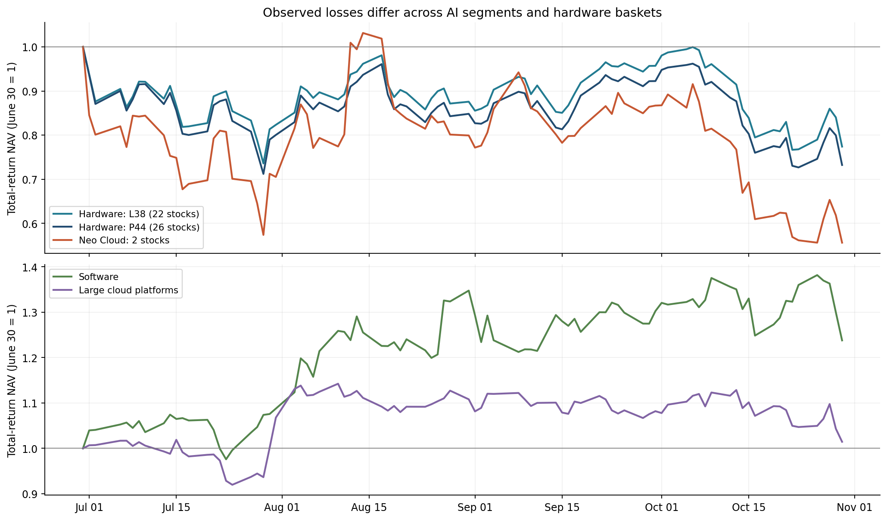
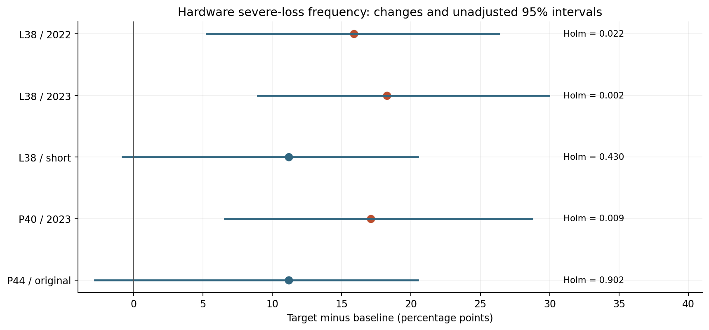
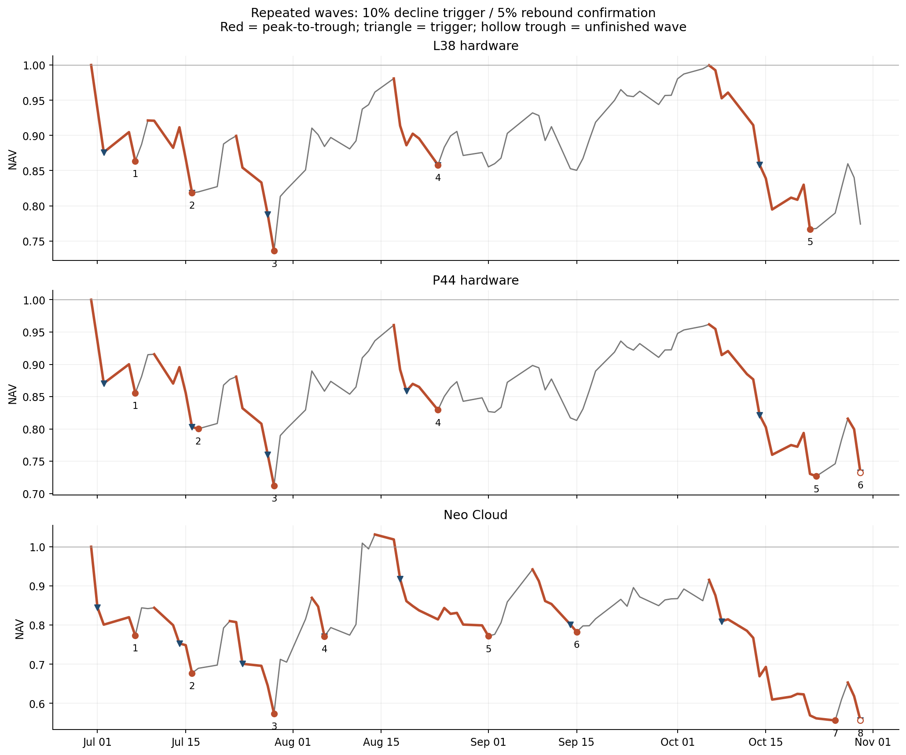
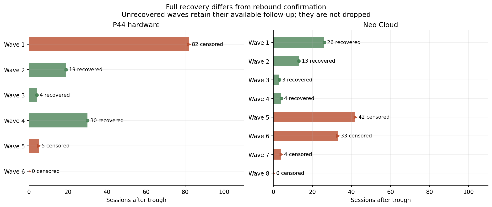
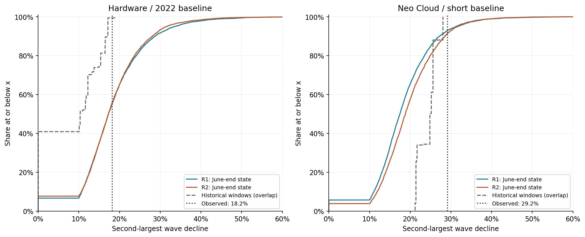
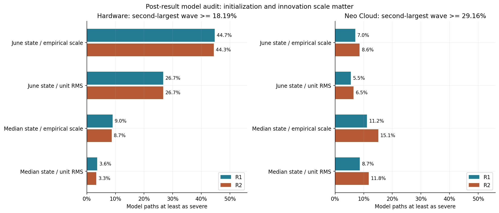

+++
title = "AI 主题股票的尾部风险与多波回撤"
date = "2026-10-31"
data_as_of = ["2026-10-30"]
data_as_of_note = "截至2026年10月30日美股常规交易收盘；报告日期2026年10月31日。"
draft = false
description = "研究AI主题股票的严重损失频率、多波回撤与共同压力，区分历史比较、风险状态条件与模型敏感性。"
series = ""
categories = ["科技产业", "市场结构", "研究方法"]
tags = ["AI", "尾部风险", "多波回撤", "Neo Cloud"]
featured = false
private = false
content_preservation = "verbatim"
source_sha256 = "37995de7773e4cbec03406fa8f9836d6c0b5d225311a188526a89345beadb25a"
+++



# AI 主题股票的尾部风险与多波回撤

**硬件严重损失更频繁，额外风险聚集机制仍待确认**

研究截止：2026 年 10 月 30 日美股常规收盘｜报告日期：2026 年 10 月 31 日

## 核心结论

2026 年 7—10 月，AI 主题股票的风险表现存在明显分化。原完整样本中的硬件篮子累计回报为 **−26.77%**，Neo Cloud 篮子为 **−44.38%**；同期软件篮子上涨 **23.80%**。这一阶段不能用“所有 AI 股票普遍进入同一种危机状态”概括。

延长历史参照后，硬件严重日损失的发生频率上升获得了更强支持。在固定的长期股票池内，以 2022 年起的历史日损失 95% 分位数为门槛，大跌日占比从 **5.05% 上升到 20.93%**，增加 **15.88 个百分点**，多重检验校正后 p 值为 **0.0216**。2023 年起的同池参照和另一组股票成分对照也支持这一方向。

多波深跌同样是真实存在的路径特征。以“从局部高点下跌 10%、从谷底反弹 5%”划分波段，长期硬件篮子有 **5 波**，原完整硬件篮子有 **6 波**，Neo Cloud 有 **8 波**。长期硬件和 Neo Cloud 的第二大波段跌幅分别达到 **18.19%** 和 **29.16%**，最短冲击触发间隔均为 **8 个交易日**。

然而，“损失严重且反复发生”与“超出已有风险尺度的额外聚集机制增强”是不同命题。六月末，长期硬件篮子的事前日波动估计已经处于其历史 **97.57 百分位**。从这一高波动状态出发，模型更容易生成多波深跌；模拟结果还对历史冲击的尺度校准明显敏感。因此，主模拟未通过异常性筛查，既不能证明市场风险正常，也不能消除模型设定的不确定性。

**本报告最有把握的判断是：目标期硬件处于较高损失压力之下，严重下跌发生得更频繁；Neo Cloud 损失更深，重复波段更多。超出波动尺度及共同市场暴露之后的额外时间聚集或跨板块传染，尚未获得稳定确认。研究提供状态诊断，不提供经过前瞻验证的冲击时点预测。**

## 1. 研究对象与比较框架：分别识别损失压力、风险尺度和额外依赖

### 研究原理

本研究把“风险聚集”拆成三个可检验层次。第一层是实际损失：跌了多少、回撤多深、是否反复下跌。第二层是风险尺度：严重日损失是否更频繁、事前波动水平是否已经偏高。第三层是额外依赖：在考虑波动水平和事件本身的发生率以后，尾部事件是否更容易接连发生、跨板块共同发生。

这种拆分影响结论。如果一组股票的正常日波动已经很高，即使标准化后的冲击没有变得更极端，实际账户损失仍可能很大。反过来，一次很深的回撤也不足以证明事件之间产生了新的传染机制。

目标观察期固定为 **2026 年 7 月 1 日至 10 月 30 日，共 86 个交易日**，以 6 月 30 日收盘作为起始净值。所有历史参照均截止于 **2026 年 6 月 30 日**。股价与组合收益采用美元计价、拆股及分红调整的日频口径。

原主池共 44 只股票，分为硬件、Neo Cloud、软件和大型云平台四类。另有 7 只扩展股票用于个股描述，不并入纯 Neo Cloud 主篮子。为延长历史，同时保留以下对照：

| 比较样本 | 成分范围 | 历史参照起点 | 共同有效历史日数 | 目标期日数 | 主要用途 |
| --- | --- | --- | ---: | ---: | --- |
| 长期池 L38，2022 基准 | 硬件 22、软件 12、云平台 4 | 2022 年初 | 1,030 | 86 | 主要长历史参照 |
| 长期池 L38，2023 基准 | 与上一行完全相同 | 2023 年初 | 800 | 86 | 检查结果是否依赖纳入 2022 年 |
| 长期池 L38，短基准 | 与上一行完全相同 | 2025 年 4 月 29 日 | 294 | 86 | 在同一股票池内隔离历史参照差异 |
| 对照池 P40，2023 基准 | 硬件 24、软件 12、云平台 4 | 2023 年初 | 800 | 86 | 检查新增两只硬件股票的影响 |
| 完整池 P44，短基准 | 硬件 26、Neo Cloud 2、软件 12、云平台 4 | 2025 年 4 月 29 日 | 294 | 86 | 保留完整成分及 Neo Cloud 比较 |

长期池因历史覆盖和证券身份可比性，排除 ALAB、SNDK、CRDO、COHR、CRWV、NBIS；P40 从 2023 年开始，纳回 CRDO、COHR。排除依据不是目标期跌幅。完整分组列于附录 B。

硬件篮子先对八个产业子组等权，再对子组内股票等权；软件采用两个子组等权，Neo Cloud 与大型云平台分别在组内等权。权重每月重置，月内随价格变化漂移。因此，本文篮子代表所定义的产业组合，既不是市值加权指数，也不是所有股票直接等权的组合。

长期数据中的未知收益不填成零；受影响月份及后续波动预热期按既定规则处理。2022 年起的收益日历有 1,125 日，扣除未知与预热后，共同有效日为 1,030 日。多日路径只使用连续完整窗口，不跨越缺口拼接真实历史净值。

### 实验结论

硬件的历史比较从 294 日扩展到 1,030 日；相同长期股票池还保留了 800 日和 294 日两个参照。**纯 Neo Cloud 的历史并没有随之延长，仍只有 294 日。**

### 结论分析

同池长短参照十分重要：如果只比较“44 股短历史”和“38 股长历史”，结果变化可能来自历史长度，也可能来自成分差异。L38 的三组比较保持目标期成分、权重和收益完全一致，能够更清楚地识别历史参照改变的影响。P40 则进一步检查成分边界。

这些对照并非彼此独立的重复实验：它们共享同一目标行情，历史也有重叠。结果方向一致可以增强解释的稳健性，但不能把几个 p 值相乘，或视为多次独立验证。与此同时，当前成分回看历史存在选样与存续偏差，不能解释为当时真实可投资行业指数的表现。

## 2. 实际损失：硬件与 Neo Cloud 承压，软件表现明显不同

### 实验原理

实际损失先按复权收益构建净值，不做波动标准化。总回报衡量起点到终点的变化；最大回撤衡量观察期内从此前最高净值到随后谷底的最大跌幅；最差 5% 日损失均值描述单日损失最重的尾部。

86 日样本的最差 5% 对应 4.3 日的概率质量，边界日按比例计入。因此，该尾部均值基于很少的交易日，适合描述本期损失，不应被当作精确、稳定的长期损失参数。

| 篮子 | 目标期总回报 | 期间最大回撤 | 最差 5% 日损失均值 | 期末相对期间高点回撤 |
| --- | ---: | ---: | ---: | ---: |
| 长期池硬件，22 股 | −22.60% | 26.42% | 7.20% | 22.60% |
| 对照池硬件，24 股 | −24.64% | 26.98% | 7.33% | 24.64% |
| 完整池硬件，26 股 | −26.77% | 28.79% | 7.59% | 26.77% |
| Neo Cloud，2 股 | −44.38% | 46.07% | 13.21% | 46.07% |
| 软件，12 股 | +23.80% | 10.41% | 4.98% | 10.41% |
| 大型云平台，4 股 | +1.46% | 11.20% | 3.97% | 11.20% |

### 图 1：相同起点下，不同 AI 板块的损失路径

**如何读图。** 横轴为日期，所有曲线均以 6 月 30 日净值等于 1 起算，实际观察截止于 10 月 30 日。上图比较长期池硬件、完整池硬件和 Neo Cloud，下图展示软件与大型云平台。净值 0.8 表示相对起点损失 20%，1.2 表示收益 20%。上下图纵轴显示范围不同，应比较净值数值，不能凭线条的屏幕斜率判断哪一组波动更大。

**图中发现。** 两条硬件曲线都经历了七月下跌、随后修复和十月再跌；长期池在十月初接近起点，完整池恢复较少。Neo Cloud 的反弹一度超过期初净值，但后续再次深跌，期末表现最弱。软件则整体上行，即使末段出现回撤，仍显著高于起点。

**图示结论。** 本期风险有明显的板块差异，也有重要的路径差异。“曾经反弹回升”不能消除随后遭遇的大幅回撤；单看期末涨跌也会遗漏期间压力。这张图支持损失与分化的描述，不识别冲击原因或板块间的传染方向。

### 实验结论

硬件在三种成分口径下均出现显著经济损失，方向不依赖某一组股票。Neo Cloud 的整体回报、最大回撤和日尾部损失均更差。软件则在经历回撤的同时实现了较高正回报，大型云平台总体接近平盘。

### 结论分析

第一，风险具有清楚的产业分布。软件的正回报表明，“AI 主题”并不是本期足够精细的风险分类。硬件、算力服务、软件应用和大型云平台的价格表现不宜合并成一个平均结论。

第二，长期池硬件损失小于完整池硬件，说明成分选择会影响损失深度；但三种口径都大幅下跌，无法仅凭移除短历史股票消除硬件整体压力。这里能够确认的是所构建篮子的稳健方向，不能由此断言每只硬件股票都同样受损。

第三，总回报与回撤不能互相替代。软件最终上涨，不意味着持有过程没有约 10% 的回撤；Neo Cloud 最大回撤大于从期初计算的跌幅，则说明期间高点与期初并不完全相同。后续统计“不显著”也不会改变这些已经发生的损失。

## 3. 事前波动：硬件在七月以前已经处于较高风险尺度

### 实验原理

为了区分“资产本来就很容易大幅波动”和“相对其风险尺度仍异常的冲击”，采用指数加权移动平均模型 EWMA 估计每日波动。令 r_t 为当天对数收益，σ_t 为当天的事前日波动估计：

\[
\hat\sigma_t^2=0.94\hat\sigma_{t-1}^2+0.06r_{t-1}^2,
\qquad z_t=\frac{r_t}{\hat\sigma_t}.
\]

初始方差用此前 20 日收益平方均值估计，日均收益近似视为零。0.94 是固定的衰减参数，没有根据目标期表现重新优化。当天波动预测只使用前一日及以前的信息；当天收益发生后，才进入下一日波动预测。

例如，昨日波动估计为 2%、昨日对数收益为 −5%，今日事前波动估计约为 2.29%。昨日大跌提高了今日的风险尺度，但不会反过来改变昨日已经确定的预测。单个日收益无法直接观测当天的潜在方差；日内实现波动属于事后测量，不能替代这一事前信息口径。

| 用于模拟 7 月 1 日的初始状态 | 日波动估计 | 对应历史日波动中位数 | 在对应历史中的位置 |
| --- | ---: | ---: | ---: |
| 长期池硬件，2022 基准 | 4.41% | 2.33% | 97.57 百分位 |
| 完整池硬件，短基准 | 4.48% | 3.02% | 93.88 百分位 |
| Neo Cloud，短基准 | 5.06% | 5.72% | 15.99 百分位 |

### 实验结论

硬件六月末的波动估计明显高于其长历史典型水平。Neo Cloud 的绝对波动更高，但六月末水平低于其自身短历史中位数。两者“波动很大”的相对历史含义不同。

### 结论分析

这一结果说明，七月以后的严重损失并非全部发生在一个事前看起来平静的环境中。至少在所用波动模型下，六月末的硬件价格已经包含较高风险尺度的信息。因此，从六月末状态出发的模拟，不应被理解成“从一个普通历史时点出发”。

标准化会改变研究问题：例如，8% 的实际损失，在 2% 与 4% 的波动背景下，分别约为四倍和两倍波动尺度。账户损失都很重，但相对异常性不同。标准化后的检验没有发现增强，不意味着实际风险没有升高。

这里也不能把历史回放提升为已验证的预警能力。EWMA 主要对已发生的收益作反应，既不定位首次结构变化日期，也没有预测具体冲击起点。本研究没有证明 0.94 对 AI 股票最优，或该波动估计已经校准到可以直接提供交易概率。

## 4. 严重日损失频率：长历史下的上升通过多重检验校正

### 实验原理

每组比较先使用自身历史期的实际日损失 95% 分位数确定固定门槛，再统计历史期和目标期超过门槛的日数。这里检验的是“超过同一个实际损失门槛是否更频繁”，与后文标准化尾事件的 10% 门槛不同。

历史期与目标期分别进行 5,000 次同步时间块重抽样，每次重新估计历史损失门槛。主设置的平均时间块为 10 日，5 日、20 日作为敏感性对照。区间与近似 p 值来自重抽样分布；同一组多项检验采用 Holm 校正，以降低反复检验带来的误报。

| 硬件比较 | 日损失门槛 | 历史发生率 | 目标期发生率 | 增幅，百分点 | 未校正 95% 区间，百分点 | Holm p |
| --- | ---: | ---: | ---: | ---: | --- | ---: |
| 长期池，2022 起 | 3.817% | 52/1,030＝5.05% | 18/86＝20.93% | +15.88 | [+5.28, +26.35] | **0.0216** |
| 长期池，2023 起 | 3.560% | 40/800＝5.00% | 20/86＝23.26% | +18.26 | [+8.97, +29.94] | **0.0018** |
| 长期池，294 日短基准 | 4.257% | 15/294＝5.10% | 14/86＝16.28% | +11.18 | [−0.80, +20.48] | 0.4301 |
| 对照池 P40，2023 起 | 3.618% | 40/800＝5.00% | 19/86＝22.09% | +17.09 | [+6.58, +28.73] | **0.0090** |
| 完整池 P44，294 日短基准 | 4.541% | 15/294＝5.10% | 14/86＝16.28% | +11.18 | [−2.78, +20.48] | 0.9022 |

### 图 2：历史参照改变后，损失频率上升的证据怎样变化

**如何读图。** 每一行是一组历史参照与股票池的组合。圆点表示“目标期发生率减历史发生率”，单位是百分点；水平线表示未经过多重校正的 95% 区间；竖直零线表示频率没有变化。右侧单独标出 Holm 校正后的 p 值，橙色圆点表示通过该校正标准。区间完全位于零线右侧，不应单独替代多重校正判断；图中 p 值仅显示三位小数，精确读数以上表为准。

**图中发现。** 五组点估计都在零线右侧，但短基准两组区间跨过零线，证据不足。长期池从 2022、2023 年开始的两组区间都明显为正，且通过校正；P40 成分对照也保持这一方向。尤其是前三行使用同一 L38 股票池，可以直接看出历史参照改变后，点估计和不确定性怎样变化。

**图示结论。** 长历史使“硬件严重损失频率上升”的证据更加清楚。改善同时包含信息量增加和历史门槛降低，不能全部归因于样本量，也不能归因于删除了部分股票。图中五行不是五次独立实验，且完整池与长期池的校正家族大小不同。

长期池和 P40 每组包含 9 项检验：3 个板块频率、3 个时间依赖指标、3 个板块配对指标。P44 保留 12 项：4 个板块频率、4 个时间指标、4 个指定配对指标。因此，不宜把不同家族的校正 p 值直接当作纯粹的样本长度比较。

同一长期池的 2022 基准在 5、10、20 日块长下，Holm p 分别为 0.0108、0.0216、0.0162；2023 基准分别为 0.0072、0.0018、0.0090。主要方向不依赖单一块长。

### 实验结论

在同一股票池、同一目标行情和同一 9 项检验家族内，294 日短基准没有通过校正，800 日与 1,030 日基准均通过。**硬件严重日损失更频繁，现已获得跨历史起点、时间块和部分成分对照一致的支持。** 长期池软件与云平台的频率则均为历史 5.05%、目标期 4.65%，没有类似上升。

### 结论分析

结果变化包含两部分。其一，更长历史提供更多信息：2022 基准有 52 个超过门槛的历史观察，而短基准只有 15 个。其二，历史风险参照发生变化：同池短基准门槛为 4.257%，长基准为 3.817%，因此目标期超过门槛的日数从 14 增为 18。显著性改善不能全部归因于样本变多；较短历史本身已经包含相对较高的风险门槛。

从这一结果可以说，目标期相对于较长历史的损失压力明显加重。不能说“未来每天有 20.93% 的概率发生严重下跌”，也不能由一个目标窗口确认永久结构变化。20.93% 是这 86 日的样本发生率，依赖明确的股票池和损失门槛。

多重校正只覆盖各自检验家族；本研究的多个窗口、多个模型并没有形成一个覆盖全部研究选择的统一 5% 误报保证。历史跨越多个市场环境，时间块方法所依赖的近似平稳和弱依赖条件也不可能被完全验证。因此，合理表述是“在本设计下获得较强支持”，而非“已经无条件证明风险永久改变”。

## 5. 时间依赖与共同下跌：尚未确认普遍增强的额外聚集

### 实验原理

先用事前波动标准化收益，再以历史标准化收益的下侧 10% 分位数定义尾事件。这个事件指“相对于波动尺度仍偏大的下行冲击”，并非股价跌幅超过 10%。

时间指标 T 比较：发生尾事件以后第 1—5 日的条件事件概率，与对应样本无条件概率之差，再对五个滞后取平均。若 T 增大，表示事件后短期再次发生的倾向相对上升。共同指标 J 则等于“两个板块同日发生事件的比例”，减去“各自事件发生率的乘积”，用于剔除单纯因为两个板块事件都变多而产生的共同发生。

这些指标衡量概率差，不衡量损失大小；也不是因果传染系数。时间检验还只覆盖 1—5 日平均依赖，无法囊括相隔数周或数月的所有聚集模式。

| 长期池、2022 基准 | 历史值 | 目标期值 | 变化，百分点 | 统计结果 |
| --- | ---: | ---: | ---: | --- |
| 硬件时间指标 T | +0.21% | −0.16% | −0.36 | Holm p＝1.000 |
| 硬件—软件共同指标 J | 3.08% | 2.08% | −1.00 | 共同事件不足 5 次 |
| 硬件—云平台共同指标 J | 3.95% | 5.39% | +1.44 | Holm p＝1.000 |
| 软件—云平台共同指标 J | 4.53% | 3.68% | −0.86 | 共同事件不足 5 次 |

长期池 9 项检验中有 5 项满足最低统计资格、4 项因事件不足而无法作正式判断。完整池 12 项中有 7 项满足资格、5 项不足。“没有通过”必须区分“有资格但不显著”和“事件太少，不能进入正式判断”。

硬件与 Neo Cloud 的共同压力仍值得关注：完整池 H—N 的 J 从 3.04% 上升到 8.40%，增加 5.36 个百分点；原始 p 约 0.0816，校正后约 0.9022。目标期 Neo Cloud 的 9 个标准化尾事件全部与硬件同日出现，但这一小样本比例不能作为未来的确定性关系。

进一步采用此前 126 日回归估计市场暴露，分别观察 SPY、QQQ 同期收益解释后的残差，并匹配相同日期。H—N 的 J 增幅从未调整的 5.62 个百分点，降至 SPY 残差的 1.35、QQQ 残差的 0.64 个百分点；匹配历史仅有 168 日。长期池硬件—云平台的结果则对市场参照更敏感：增幅从未调整的 0.98，变为 SPY 残差的 2.45、QQQ 残差的 −0.30 个百分点，目标期对应残差共同事件只有 3 次和 0 次。

### 实验结论

本期没有发现硬件、软件、云平台普遍增强的额外短期依赖。硬件与 Neo Cloud 有共同下行压力，但未通过多重校正；市场调整后的增幅减小，也提示部分共同表现与广泛市场暴露一致。

### 结论分析

严重实际损失更频繁，与标准化后短期依赖未显著增强，可以同时成立。一个简单解释是风险尺度升高，足以使普通大小的标准化冲击对应更大的实际损失，而不需要额外出现更强的事件连锁。

但这仍只是与证据一致的解释，不能据此排除其他机制。一些配对没有足够事件，另一些指标覆盖的时间尺度较短；本研究也未证明检验对所有经济上重要的增强都有足够检出能力。因此，“未确认增强”与“已证明没有增强”之间仍有明确距离。

市场残差结果进一步收窄了因果表述：同时下跌可能来自共同风险暴露，也可能存在其他联系；使用 SPY 或 QQQ 并不是对全部共同因素的完整控制。仅靠价格相关与先后顺序，无法确认 Neo Cloud 向硬件传染的方向，更无法识别融资、强平或交易动机。

## 6. 多波回撤：局部反弹能够结束一波，但不等于回本

### 实验原理

传统从高点计算的持续回撤，会把没有完全回到旧高点的多次下跌合并。为刻画“下跌—反弹—再下跌”，本研究采用双门槛规则：从局部高点累计下跌达到 10% 时触发一波，随后持续追踪谷底；从谷底反弹达到 5% 时确认这一波结束，并从确认日重新跟踪下一波高点。

10% 的分母是局部高点，5% 的分母是谷底，两者不能理解成简单相抵。以下为说明算法的假设例子，不是行情数据：

| 净值过程 | 识别结果 |
| --- | --- |
| 100 → 92 → 89 | 跌幅从 8% 扩大到 11%，第一波触发 |
| 89 → 80 | 谷底继续下移，仍属于第一波 |
| 80 → 83 | 反弹 3.75%，尚未确认结束 |
| 83 → 84 | 相对谷底 80 反弹 5%，确认第一波结束 |
| 84 → 90 → 81 | 新局部高点为 90，随后跌 10%，第二波触发 |
| 81 → 72 | 第二波当前深度达到 20%，若观察在此截止，则尚未确认结束 |

第一波 100→80 跌 20%，第二波 90→72 也跌 20%，尽管中间从未回到 100。波段触发日期当时可知，谷底需要事后反弹确认。期末仍在下跌的波段保留已观察深度，并标记未结束；实际与模拟路径采用同一规则。

### 实验结果

| 10% 下跌／5% 反弹规则 | 波数 | 最大波段跌幅 | 第二大波段跌幅 | 最短触发间隔 | 下一波前最大未恢复比例 |
| --- | ---: | ---: | ---: | ---: | ---: |
| 长期池硬件 | 5 | 23.30% | 18.19% | 8 日 | 57.70% |
| 完整池硬件 | 6 | 24.44% | 19.17% | 8 日 | 62.10% |
| Neo Cloud | 8 | 39.24% | 29.16% | 8 日 | 73.03% |

长期池硬件的五波具体为：

| 按时间顺序 | 起点高峰 | 冲击触发 | 谷底 | 反弹确认 | 波段跌幅 |
| --- | --- | --- | --- | --- | ---: |
| 第 1 波 | 6 月 30 日 | 7 月 2 日 | 7 月 7 日 | 7 月 9 日 | 13.65% |
| 第 2 波 | 7 月 9 日 | 7 月 16 日 | 7 月 16 日 | 7 月 21 日 | 11.14% |
| 第 3 波 | 7 月 23 日 | 7 月 28 日 | 7 月 29 日 | 7 月 30 日 | 18.19% |
| 第 4 波 | 8 月 17 日 | 8 月 24 日 | 8 月 24 日 | 8 月 27 日 | 12.52% |
| 第 5 波 | 10 月 6 日 | 10 月 14 日 | 10 月 22 日 | 10 月 27 日 | 23.30% |

“第二大跌幅”按深度排序，并非时间上第二波。硬件五波排序为 23.30%、18.19%、13.65%、12.52%、11.14%；所以第二大为 18.19%。它来自 7 月 23—29 日，若把六月末净值设为 100，则该波从 89.9333 跌至 73.5778。Neo Cloud 的第二大波段从 7 月 22 日的 81.0084 跌至 7 月 29 日的 57.3855，跌幅 29.16%。

采用第二大跌幅，是为了要求路径里至少有两次深跌，而不是让单次巨跌完全主导指标。“第二大跌幅达到 18.19%”等价于“至少两波各自跌幅达到 18.19%”，并不要求模拟的日期与实际相同。

### 图 3：把“下跌—反弹—再下跌”逐波标记出来

**如何读图。** 三幅图依次为长期池硬件、完整池硬件和 Neo Cloud，均以六月末净值为 1。灰线是完整路径，红线突出每一波从局部高点到谷底的路径，蓝色倒三角标出下跌达到 10% 的触发日。谷底旁数字按时间顺序编号；实心圆表示随后已有足够反弹确认波段结束，空心圆表示截止日仍未确认结束。实心圆不表示已经回本，红线段中也允许出现尚不足 5% 的小反弹。

**图中发现。** 七月在三幅图中都被拆成几波，说明大阶段内部存在足以触发重新划分的反弹。长期池硬件共有 5 波，完整池有 6 波，Neo Cloud 有 8 波；后两者在十月末还有一波未结束。长期硬件按时间顺序的第 3 波跌幅为 18.19%，在深度排序中位列第二；图中数字“3”与指标 D2 并不冲突。

**图示结论。** 多波特征来自一致规则下对实际路径的识别，能够保留传统持续回撤定义容易合并掉的重复冲击。波数仍然依赖所选尺度，图中的 5、6、8 波不应被当作与门槛无关的“真实危机次数”，也不足以单独证明自激或传染机制增强。

### 实验结论

重复冲击是可识别的实际路径特征。10%/5% 尺度下，七月内部也包含几次显著反弹和再下跌，所以局部波数多于通常所说的“七月、十月两大阶段”。

### 结论分析

规则的价值在于给真实历史与模拟路径提供一致的比较方法，而不是宣称市场存在唯一正确的波段切法。本研究另固定 15%/7.5% 和 20%/10% 两组尺度，以检查结论是否依赖某一门槛。

提高到 20%/10% 后，长期池和完整池硬件都识别为两波，Neo Cloud 仍有四波。可见，硬件的大阶段叙事与细尺度识别能够兼容；Neo Cloud 在更粗尺度上也保留了较多反复。不过，波数更多仍受资产本身高波动影响，不能直接被解释成更强的自激机制，必须与同尺度的历史和模拟结果比较。

## 7. 冲击间隔与恢复：细尺度修复不足，硬件大阶段之间仍有明显反弹

### 实验原理

最短冲击间隔，取相邻波段触发日期之间最小的交易日数。它衡量“新的下跌触发有多密集”，不等同于两个谷底的间隔，也不等同于两波之间的平静天数。长期硬件第 2、3 波分别在 7 月 16 日和 28 日触发，相隔 8 个交易日，即为其最小值。

恢复程度则相对于上一波的货币损失计算。上一波高点为 P、谷底为 L，下一波高点为 Q：

\[
R=\frac{Q-L}{P-L},\qquad U=\max(0,1-R).
\]

R 是在下一波开始前修复的原损失比例，U 是仍未修复的比例。研究在所有相邻波对中取最大的 U，衡量最严重的“尚未充分恢复就再次受冲击”。如果下一波高点超过上一波高点，R 可以超过 100%，U 记为零。只有一波或没有波段时，重复冲击统计中的 U 记为零，但不表示净值已经回本。

例如，100→80→90→72，第一波损失 20，第二波前只修复 10，因此 R＝50%、U＝50%。从 80 涨到 84 虽已反弹 5%，却仅修复原损失的 20%；从 80 完全回到 100，需要上涨 25%。

此外，完全回本单独要求净值重新达到该波高点。期末仍未回本的波段保留为“右删失”：只知道截至观察截止仍未恢复，实际恢复时间尚不可知。不能把这些波段删除后，只对已经恢复的波段平均恢复天数。

### 实验结果

在 10%/5% 尺度下，完整池硬件 6 波中有 3 波回到各自起点高峰，3 波没有；Neo Cloud 8 波中有 4 波回到、4 波没有。完整池硬件第一波谷底之后已有 82 个交易日观察，仍未回到六月末高点。10 月 30 日刚触发的末波没有后续观察，不能把“已观察零日”记作“零日恢复”。

### 图 4：哪些波段已经回本，哪些只是观察尚未结束

**如何读图。** 左图是完整池硬件，右图是 Neo Cloud，波段编号与各自的时间顺序一致。横轴从每波谷底起算，以交易日为单位。绿色条及圆点表示已经回到该波高峰，长度是实际恢复所需时间；橙色条及箭头表示截至截止日仍未回到高峰，长度只是已经观察的时间，不是最终恢复时间。标注“0 censored”表示谷底就在截止日，没有后续观察。

**图中发现。** 完整池硬件第 1 波在谷底后观察 82 日仍未回本；第 2—4 波分别用了 19、4、30 日回到各自较低的局部起点。Neo Cloud 前四波已分别恢复，但第 5—8 波仍未恢复。不同波段面对的起点高峰和可观察时长不同，不能只比较绿色条多少，或把橙色短条理解为修复更快。

**图示结论。** 局部反弹确认与完全恢复必须分开。部分波段已经回本，可以与整体净值仍然深度亏损同时发生；未恢复样本不能从恢复时间统计中删除。这张图描述恢复过程，没有对未来还需多久回本作预测。

改用更接近两大阶段的 20%/10% 尺度：

| 对象 | 波数 | 最大／第二大波段跌幅 | 最短触发间隔 | 下一波前最大未恢复比例 |
| --- | ---: | --- | ---: | ---: |
| 长期池硬件 | 2 | 26.42%／23.30% | 57 日 | 0.16% |
| 完整池硬件 | 2 | 28.79%／24.44% | 57 日 | 13.24% |
| Neo Cloud | 4 | 40.97%／32.28% | 15 日 | 58.84% |

硬件两大波的触发日都是 7 月 28 日和 10 月 16 日。它们是累计下跌达到 20% 的日期，不是开始下跌的日期。完整池硬件两波的高点起于 6 月 30 日与 10 月 6 日，谷底分别为 7 月 29 日与 10 月 23 日；长期池第二波谷底为 10 月 22 日。

### 实验结论

细尺度下存在明显的未恢复再冲击。较粗尺度上，两次硬件大跌之间又确实有相当程度的修复：完整池硬件修复上一大波损失的 **86.76%**，长期池为 **99.84%**，但都没有完全回到对应起点高峰。Neo Cloud 在粗尺度上仍出现多波和较大的恢复缺口。

### 结论分析

“反复受到冲击”不能自动推导成“两大波之间几乎没有修复”。前者由多波记录支持，后者与硬件粗尺度结果不符。对风险路径的准确描述应同时保留下跌、反弹和再下跌，避免只挑最差的几个点连接成持续恶化叙事。

另一方面，接近回本也不等于风险解除。完整池硬件与长期池的恢复程度不同，反映成分边界对损失路径的影响；Neo Cloud 的重复冲击则在更粗规则下仍然存在。对持有者而言，是否曾有几波恢复，与最终仍持有多少亏损是两个问题。局部波段恢复率不能替代期末回撤。

U 的含义也有明确边界：它反映相邻波段之间的修复不足，不是整个投资组合的累计亏损率。57.70% 或 73.03% 的“未恢复比例”不能直接读成股票又下跌了相同百分比。

## 8. 条件路径模拟：多波、短间隔和恢复不足没有通过主异常性筛查

### 实验原理

模拟要回答的是：只使用六月末以前估计的历史冲击过程，并从六月末已经知道的风险状态出发，能否生成与实际同样严重的 86 日路径？

令 T 为 6 月 30 日。从历史期提取标准化冲击 z，并固定初始波动为六月末对 7 月 1 日的预测。每个模拟日抽取一组历史冲击，再生成收益和下一日波动：

\[
r_k^*=\sigma_k^*z_{J_k},\quad J_k\le T,
\]

\[
(\sigma_{k+1}^*)^2=0.94(\sigma_k^*)^2+0.06(r_k^*)^2.
\]

这里 r* 为模拟对数收益，随后转换为简单收益并累乘净值。真实七月至十月收益不进入模拟递推，只用于计算待比较的实际指标；历史抽样索引 J 不得越过六月末。每次抽取同一历史日期的整组板块冲击，因此保留同期板块关系，模拟对象是板块篮子，不是完整个股联合价格系统。

R1 每天独立抽取历史冲击；R2 按平均长度约 10 日的片段抽样，以保留更多历史跨日排列。长期样本遇到缺口或区间末尾强制重选起点；完整短样本保留循环片段口径。每种主设置生成 5,000 条 86 日路径。

对每条路径计算三项：第二大跌幅 D2、最短触发间隔 G、相邻波对中的最大未恢复比例 U。D2、U 越大越严重，G 越小越密集。不足两波时 D2 和 U 记为零，间隔不定义；间隔尾面积使用全体路径为分母，统计“至少两波且间隔不大于实际”的比例，不能把没有两波的路径算成零间隔。

尾面积采用“达到或超过实际严重程度的路径数加一，再除以 5,001”的有限模拟修正。主家族固定为长期硬件和 Neo Cloud 各三项，共六项；以 R2 为主参照，R1 为对照，并分别对同样六项作 Holm 调整。

| 对象与事件 | 实际门槛 | R1 尾面积 | R2 尾面积 | R2 六项调整值 |
| --- | ---: | ---: | ---: | ---: |
| 长期硬件：第二大跌幅至少达到实际 | 18.19% | 44.65% | 44.33% | 1.000 |
| 长期硬件：至少两波、最短间隔不超过实际 | 8 日 | 52.27% | 55.57% | 1.000 |
| 长期硬件：最大未恢复比例至少达到实际 | 57.70% | 39.01% | 39.27% | 1.000 |
| Neo Cloud：第二大跌幅至少达到实际 | 29.16% | 7.04% | 8.56% | 0.5135 |
| Neo Cloud：至少两波、最短间隔不超过实际 | 8 日 | 47.65% | 36.59% | 1.000 |
| Neo Cloud：最大未恢复比例至少达到实际 | 73.03% | 19.68% | 15.62% | 0.7808 |

例如，硬件 R2 有 2,216 条路径的第二大跌幅不低于 18.19%，修正后为 2,217/5,001＝44.33%；Neo Cloud 对应有 427 条，修正后为 428/5,001＝8.56%。

### 实验结论

六项均未达到校正后的 5% 筛查标准。硬件的实际多波深度、短间隔和修复不足，在主条件模型下并不罕见；Neo Cloud 的第二大跌幅更接近模拟分布尾部，但也未通过标准。

### 结论分析

“44.33%”只对应一个具体事件：模型内至少有两波各自下跌达到 18.19%。它不表示有 44.33% 的路径完全复制了实际七月和十月的走势，也不表示未来实际市场发生危机的已知概率。各行统计分别比较深度、间隔、恢复，并未检验三者同时达到实际程度的联合概率。

这些尾面积是在给定生成器下的比较，生成器本身由有限历史估计，而且研究问题是在观察到目标行情后提出。因此，Holm 调整提供一致的筛查约束，却不会把模型条件概率变成无需模型假设的精确检验。一个能够经常生成巨大回撤的模型，也可能只是初始化较危险，或波动递推过度放大。

也有需要保留的局部集中线索：完整池硬件最大的标准化尾事件簇包含 4 次事件，对应 R1、R2 尾面积分别为 4.46% 和 0.48%。事件簇把相邻尾事件、或中间仅隔一个非事件日的尾事件归为一组，衡量某一小段内的最密集表现；它与平均 1—5 日依赖和第二大回撤不是同一个统计量。这一诊断提示局部密集冲击，不能被平均指标的未显著结果掩盖；但它不属于本节六项主家族，上述为未经跨指标多重校正的条件尾面积，仍不足以单独确认普遍、持续的机制变化。

因此，未通过主筛查最多说明“该模型没有把这些指标识别为足够罕见”，不能独立支持“市场状态没有恶化”。判断模型参照是否合理，需要同时看真实历史窗口和下一节之后的校准对照。

## 9. 真实历史与条件模拟：两种罕见性回答了不同问题

### 实验原理

历史窗口比较直接从六月末以前的真实篮子路径中，选取所有连续完整的 86 日窗口，逐一采用相同波段规则计算 D2。它保留真实发生过的收益次序和波动环境，不重新生成收益。

条件模拟则固定六月末的风险起点，用历史冲击库生成新的路径。前者考察“历史观察中出现过多少”，后者考察“从一个指定状态出发，在模型中多容易出现”。二者不应被当作同一个概率估计。

| 对象 | 实际第二大跌幅 | 达到实际深度的历史滚动窗口 | 历史窗口占比 | 选取不重叠窗口后 | 六月末状态下 R2 尾面积 |
| --- | ---: | ---: | ---: | ---: | ---: |
| 长期硬件 | 18.19% | 4/733 | 0.55% | 0/10 | 44.33% |
| Neo Cloud | 29.16% | 0/209 | 0.00% | 0/3 | 8.56% |

### 图 5：同一实际跌幅，在真实历史与条件模拟中处于什么位置

**如何读图。** 横轴是每条 86 日路径的第二大波段跌幅，纵轴是“第二大跌幅不超过横轴数值”的累计比例。灰色虚线来自重叠的真实历史窗口，蓝色与橙色实线分别来自 R1、R2 条件模拟；黑色竖虚线是实际观察值，左图约 18.2%，右图约 29.2%。该图是累计分布图，曲线越高，表示更多路径的跌幅低于该水平；接近或超过实际深度的尾部比例，大致等于 100% 减去竖线附近的累计比例，精确值还要按包含等号的计数及有限模拟修正计算，不能计算曲线下面积来替代。

**图中发现。** 硬件实际竖线处，真实历史曲线已经接近 100%，说明绝大多数历史窗口的第二大跌幅更浅；模拟曲线却只在约 56% 附近，留下约 44% 的更严重路径。Neo Cloud 实际值也超过全部保留历史窗口的第二大跌幅，但模拟仍有约 7%—9% 达到该深度。部分曲线在零处已有累计比例，是因为不足两波的路径按规则将 D2 记为零，并非零损失或缺失数据。

**图示结论。** “历史中少见”和“从六月末状态出发，模型并不认为特别少见”能够同时成立。差异既要求关注初始高波动状态，也要求审查模拟生成器；图本身不能判断哪一种参照就是唯一正确答案。历史窗口重叠，因此灰线的样本数不等于独立证据数量。

### 实验结论

相对于所保留的真实历史窗口，本期两次深跌的组合是稀少现象。与此同时，给定六月末状态的主模拟更容易生成类似深度。两种参照之间的差异很大，需要实质解释，不能简单选择一个数字作为最终答案。

### 结论分析

硬件差异的一个重要来源是初始条件：随机查看一个历史窗口，通常不会恰好从历史 97.57 百分位的波动状态开始；六月末条件模拟则所有路径都从同一个高波动起点出发。因而，历史占比低、条件概率高，在逻辑上能够同时成立。

不过，差异也可能反映生成器偏差，不能把全部差距归因于市场状态。历史窗口有实际发生的波动均值回归、趋势及复杂依赖，模拟只保留了部分结构；下一节将直接检查初始尺度和冲击尺度的影响。

733 个窗口高度重叠，不能视为 733 次独立机会；不重叠后只有 10 个窗口，也不足以精确估计深尾概率。Neo Cloud 更只有 3 个不重叠窗口。0/209 或 0/3 不代表真实概率为零；0.55% 也不能被直接倒算为“多少年一遇”。这些比例适合描述样本中的稀少程度，不适合包装成可靠的极端事件复现周期。

## 10. 模型校准对照：初始状态与冲击尺度显著改变尾面积

### 实验原理

为解释真实历史与主模拟的差异，增加两因素对照：一是初始波动采用六月末状态还是历史中位数，二是历史标准化冲击保留原尺度还是统一除以自身均方根。

这一检查是在看到主结果之后开展的解释性诊断。主结果、主门槛及六项家族保持不变，不能从下面四行中事后挑最小概率来宣布异常成立。

对于长期硬件，原冲击库的平均平方约为 1.143，均方根约为 1.069。将每个冲击除以 1.069 后，平均平方等于 1。此处理保持经验分布形状与冲击相对排序，但改变幅度；它没有把分布变为正态，也没有去除均值，因此不等同于零均值、单位方差标准化。

原冲击尺度会影响后续波动递推。R1 每天独立抽样时：

\[
E[(\sigma_{k+1}^*)^2\mid\sigma_k^*]
=(\sigma_k^*)^2\{0.94+0.06E[z^2]\}.
\]

代入 1.143，单日期望方差乘数约为 1.00858；经过 86 次更新，期望方差约为初值的 2.09 倍。这里说的是模型期望方差，既不是每条路径必然翻倍，也不是平均波动率必然按同样倍数变化；R2 存在时间依赖，不能直接沿用这一简单乘数推导。

### 实验结果

| 长期硬件：至少两波跌幅达到 18.19% | R1 | R2 |
| --- | ---: | ---: |
| 六月末状态＋原冲击尺度 | 44.65% | 44.33% |
| 六月末状态＋单位均方根冲击 | 26.69% | 26.69% |
| 历史中位数状态＋原冲击尺度 | 9.02% | 8.68% |
| 历史中位数状态＋单位均方根冲击 | 3.64% | 3.34% |

对照采用相同的历史抽样序列，尽量将变化归于所改变的设定。历史中位数状态是一个假设起点，并非某个真实历史日期的完整联合市场状态。

Neo Cloud 的对照方向不同：

| Neo Cloud：至少两波跌幅达到 29.16% | R1 | R2 |
| --- | ---: | ---: |
| 六月末状态＋原冲击尺度 | 7.04% | 8.56% |
| 六月末状态＋单位均方根冲击 | 5.52% | 6.46% |
| 历史中位数状态＋原冲击尺度 | 11.16% | 15.14% |
| 历史中位数状态＋单位均方根冲击 | 8.66% | 11.78% |

### 图 6：改变模拟起点与冲击尺度，罕见性判断会怎样变化

**如何读图。** 左图检验硬件至少两波各跌 18.19%，右图检验 Neo Cloud 至少两波各跌 29.16%。每幅图的四行依次改变初始状态和冲击尺度；“June state”指六月末状态，“Median state”指各自历史中位数状态，“unit RMS”指单位均方根冲击。蓝色为 R1，橙色为 R2。横轴是达到对应事件条件的模拟路径比例，条越长，表示事件在该设定下越常见，不表示实际损失更大。

**图中发现。** 硬件从六月末高波动起点改为历史中位数起点后，条形明显缩短；保持起点不变、只调整冲击尺度，也会使尾面积下降。Neo Cloud 改用历史中位数起点时，条形反而变长，因为其六月末波动低于自身中位数。图中 R1、R2 对硬件 D2 的判断接近，但这不保证其他指标也同样接近。

**图示结论。** “有多罕见”对参照状态和模型尺度有实质依赖。这个事后诊断解释了主结果为何敏感，不能用来择取最小概率宣告异常成立；左右两幅图的事件门槛不同，也不能直接比较条形长度来给两个板块排序。图中文字保留一位小数，精确结果以上方两张表为准。

### 实验结论

硬件主尾面积对初始状态和冲击尺度均有明显敏感性。在 R2 中，仅调整冲击尺度，44.33% 降为 26.69%；仅换成历史中位数起点，降为 8.68%；同时调整为 3.34%。Neo Cloud 的六月末波动低于自身历史中位数，因此换成中位数起点反而提高其尾面积。

### 结论分析

第一，硬件六月末已经偏高的风险状态，是理解后续多波深跌的重要条件。把起点换回较平常的历史状态，类似深跌明显更难出现。这与“风险尺度已升高”的描述一致，但没有独立识别导致风险升高的经济机制。

第二，原模型还存在冲击尺度对波动递推的累积影响。即使保持真实六月末高波动起点，重新统一冲击尺度也会大幅改变尾面积。这意味着原模型的“可解释”程度不能全部被当作市场事实；其中包含建模选择。单位均方根也只是对照，尚未通过独立预测校准证明优于原模型。

第三，3.34% 与 44.33% 的差别说明结论的条件依赖，不能用较小值来替代冻结的主结果，也不能用较大值证明风险正常。R1、R2 在硬件 D2 上接近，只说明这个指标在所选设定中对两种抽样方式相对不敏感；不意味着时间依赖对所有风险指标都不重要。

第四，两类资产的尾面积不能直接用于风险排名。硬件考察两波各跌至少 18.19%，Neo Cloud 考察两波各跌至少 29.16%，事件门槛本来就不同。Neo Cloud 在主模型里更接近自身尾部，与其实际损失更深可以同时成立，但两种比较仍需分开解释。

## 11. 历史重估与敏感性：Neo Cloud 概率的不确定性仍然很大

### 实验原理

主尾面积来自一份固定历史和一套固定冲击库。为判断估计对历史样本的依赖，对 2022 长基准、2023 长基准和完整短基准分别重抽历史 200 次；每次按平均 10 日时间片段形成新样本，重新计算 EWMA 过滤结果和冲击库，再对 R1、R2 各模拟 500 条 86 日路径。

每次模拟重新估计“达到实际严重程度”的概率，最终每个指标有 200 个概率估计。取这些估计的 2.5% 与 97.5% 分位数，形成下表最后一列。它表示概率估计的重估范围，不表示未来跌幅范围。

这一过程固定六月末初始状态、EWMA 衰减参数 0.94 和波段门槛。所谓重估主要作用于历史过滤与冲击库，并不包含所有模型设定的变化。每次仅 500 条路径，区间还含有限模拟误差。

| 对象与事件，主规则 10%/5% | 冻结的 R2 尾面积 | 2.5%—97.5% 重估区间 |
| --- | ---: | ---: |
| 长期硬件：第二大跌幅 ≥18.19% | 44.33% | 26.13%—50.72% |
| 长期硬件：至少两波、最短间隔 ≤8 日 | 55.57% | 37.52%—56.91% |
| 长期硬件：最大未恢复比例 ≥57.70% | 39.27% | 23.53%—46.51% |
| Neo Cloud：第二大跌幅 ≥29.16% | 8.56% | 3.59%—33.94% |
| Neo Cloud：至少两波、最短间隔 ≤8 日 | 36.59% | 33.30%—66.67% |
| Neo Cloud：最大未恢复比例 ≥73.03% | 15.62% | 4.78%—45.11% |

以 Neo Cloud 第一行为例，29.16% 始终是固定跌幅门槛；变化的是“至少两波达到该深度”的概率。3.59%—33.94% 并不是预测下一次跌幅落在这个范围，也不是一个囊括所有模型风险的真实市场概率区间。

另检查三组固定波段门槛：

| 下跌／反弹规则 | 长期硬件 D2 的 R2 尾面积 | Neo Cloud D2 的 R2 尾面积 |
| --- | ---: | ---: |
| 10%／5% | 44.33% | 8.56% |
| 15%／7.5% | 48.51% | 10.16% |
| 20%／10% | 27.55% | 6.52% |

每一行都重新划分真实和模拟波段，比较的是该规则下的实际 D2，不能理解为三行始终沿用 18.19% 和 29.16% 两个门槛。

### 实验结论

在固定六月末状态与现有生成器的条件下，硬件多波深跌未表现为稳定的极端事件。Neo Cloud 的概率区间明显更宽，说明短历史仍使概率判断不精确。改变波段尺度，也没有把结果变成一致、明确的异常结论。

### 结论分析

5,000 条模拟路径提高的是给定模型内的计算精度，不会创造新的真实市场历史。即使再增加模拟次数，也无法消除仅有 294 日 Neo Cloud 历史带来的估计问题。重估结果将“模拟很多次”与“实际证据很多”之间的差别直接呈现出来。

硬件区间较少落入很低的概率区域，说明在这一固定条件生成器内部，结论对历史重抽样相对稳定；但上一节改变初始状态和冲击尺度时，概率仍会大幅变化。历史抽样不确定性与模型设定不确定性是两种不同问题，不能因为其中一种较小就忽略另一种。

Neo Cloud 区间下端低于 5%，不能单独当作异常成立；上端较高，也不能证明风险不极端。合理判断是现有历史对其深尾概率约束较弱，8.56% 这一点估计不应被赋予过高精度。估计区间不必以冻结点估计为中心，因为原始历史与重抽样、重新过滤后的估计分布可以存在偏移。

## 12. 对市场状态的综合判断：风险压力较明确，机制与预测仍有缺口

### 证据汇总

| 研究命题 | 当前证据 | 可支持的判断 | 仍不可推导的判断 |
| --- | --- | --- | --- |
| 实际损失是否严重 | 三种硬件口径均明显下跌，Neo Cloud 回撤更深 | 硬件与 Neo Cloud 本期承受较大损失压力 | 所有 AI 股票均处于相同风险状态 |
| 严重日损失是否更频繁 | 长期同池与成分对照通过各自校正 | 硬件相对长历史的严重损失频率上升 | 未来概率固定为 20.93%，或变化永久存在 |
| 事前风险尺度是否偏高 | 硬件六月末波动估计处于历史高位 | 高风险尺度在目标期开始前已可见 | 已定位首次状态变化或具备可靠领先预测 |
| 短期额外依赖是否普遍增强 | 多项不显著，部分事件不足 | 尚未确认普遍增强；H—N 有共同压力线索 | 已证明没有增强，或已经识别因果传染 |
| 多波深跌是否罕见 | 真实历史较少见，条件模拟更常见，校准敏感 | 罕见性必须说明参照状态和模型 | 可给出无条件、精确的“多少年一遇” |
| 两波之间是否恢复 | 硬件大阶段间修复明显，细尺度仍有缺口 | 反弹与未回本可以同时存在 | 波段结束等于恢复正常 |
| 是否能够提前预警 | 本研究没有新增合格的前瞻预测验证 | 可以用于历史诊断与提出待验证假设 | 可以稳定预测下一次冲击或直接形成交易信号 |

### 综合结论

**目标期呈现出硬件损失频率升高、实际多波回撤加重，以及 Neo Cloud 更深损失与较多反复的组合。硬件的较高风险尺度在六月末已经反映于价格波动；在这一条件下，多波路径比一般历史参照更容易被模型生成。额外聚集机制是否增强，仍没有得到足够稳定、独立于参照设定的确认。**

### 结论分析

最初短基准的 12 项比较均未通过校正，不能再被概括为“风险聚集没有增强”的完整证据。长历史结果已经改变其中一个重要判断：硬件严重日损失频率的上升具有更强统计支持。相同股票池的长短参照表明，原结果同时受到历史信息量、历史风险门槛和多重比较的影响。

但也不能反过来把所有未显著结果都归因于样本不足。硬件短期时间指标的点估计并未表现为增强；一些共同指标方向不一致；新增多波统计在主条件模型下离极端尾部较远。这里确有“证据尚未显示增强”的部分，也确有“事件不足，判断能力有限”的部分，需要分别保留。

风险压力、额外依赖和可预测性构成三个证据层级。目前第一层证据最充分；第二层受事件数量、时间尺度、市场暴露与模型选择限制；第三层没有获得本轮实验的验证。把层级混在一起，会出现两种相反误读：从严重亏损直接宣布新传染机制成立，或从未通过检验直接宣布风险恢复正常。

后续研究若要提高结论可信度，应优先做两类工作：一是用多个历史起点和真正后续样本检查波动及路径生成器的概率校准；二是在固定股票池、固定门槛和预先规定的评价窗口下，继续积累尾事件。因果传染则需要额外的公告时点、融资及交易约束等证据。单纯增加模型复杂度或模拟条数，不能替代这些缺失信息。

## 附录 A. Copula 的评估：本阶段不作为核心模型

### 实验原理与结果

Copula 用于描述不同板块边际分布之外的联合依赖。本研究保留既有低维比较：在相同 GJR-t 边际模型下，对 Gaussian 与 Student-t copula 预测两个板块同时超过历史 90% 实际损失门槛的能力作比较。这里的事件与标准化尾事件不同，因此 H—N 的 11 次共同事件不能与正文的 9 次混用。

| 配对 | 目标期共同事件 | Gaussian 预期次数 | Student-t 预期次数 | Student-t 相对 Brier 评分改善 |
| --- | ---: | ---: | ---: | ---: |
| 硬件—Neo Cloud | 11 | 4.43 | 4.57 | +0.22% |
| 硬件—软件 | 3 | 3.96 | 4.24 | −0.21% |
| Neo Cloud—软件 | 3 | 2.46 | 2.90 | +0.11% |
| Neo Cloud—云平台 | 6 | 2.85 | 2.89 | +0.05% |

Brier 评分衡量概率预测与实际是否发生之间的平方误差，越低越好；正的相对改善表示 Student-t 较好，负值表示较差。改善幅度不是投资收益率。

### 实验结论与分析

没有一个配对达到事先要求的 5% 评分改善；评价期只有 86 日、共同事件仅 3—11 次，也未满足 252 日和至少 20 次共同事件的正式预测评价门槛，部分参数不稳定。因此，参数化 copula 移出核心结论，本轮长历史分析没有重新拟合该模型。

这项取舍针对当前样本和当前实现，不能推导为 copula 在金融尾部研究中普遍无效。现阶段更紧迫的问题是边际波动与路径模型的校准，以及有效尾部样本不足。经验共同事件统计和同步抽取板块冲击不依赖拟合的参数化 copula，仍可用于研究共同风险。

## 附录 B. 股票池与产业分组

以下是本研究的经济分组，不等同于统一的官方行业分类，也不表示每家公司的全部业务都直接属于 AI。

| 主类与子组 | 完整主池成分 |
| --- | --- |
| 硬件：计算芯片 | NVDA、AMD、AVGO、INTC |
| 硬件：存储芯片 | MU、SNDK |
| 硬件：磁盘存储 | WDC、STX |
| 硬件：互连与网络 | MRVL、ALAB、CRDO、ANET |
| 硬件：光通信 | COHR、LITE、AAOI |
| 硬件：制造与设备 | TSM、ASML、AMAT、LRCX、KLAC |
| 硬件：服务器与制造服务 | DELL、HPE、SMCI、CLS |
| 硬件：供电与散热基础设施 | VRT、ETN |
| Neo Cloud | CRWV、NBIS |
| 软件：应用与业务软件 | PLTR、CRM、NOW、ADBE、AI、PATH |
| 软件：数据、开发与安全 | SNOW、MDB、DDOG、NET、CRWD、PANW |
| 大型云平台 | MSFT、AMZN、GOOGL、ORCL |
| 独立扩展池，不并入上述主篮子 | IREN、HIVE、APLD、CORZ、WULF、CIFR、HUT |

### 样本结论与解释

44 股主池涵盖四类不同经济暴露，7 股扩展池保持独立。Neo Cloud 主篮子只有两家公司，代表性和个股集中度是重要限制；大型云平台也只是本研究选取的四家公司，不覆盖所有相关企业。长期池和对照池的排除规则见第一节，缺口与身份边界不会通过更名或拼接其他主体历史来消除。

## 附录 C. 关键口径与结论边界

| 容易混淆的概念 | 本报告中的准确含义 |
| --- | --- |
| 历史 95% 日损失门槛 | 用实际日损失确定严重损失的固定阈值，用于比较发生频率 |
| 标准化下侧 10% 尾事件 | 波动标准化后的历史下侧事件，用于时间与共同依赖统计 |
| 10% 下跌／5% 反弹 | 价格路径的波段划分规则，与上述分位数不是同一个概念 |
| 第二大波段跌幅 | 按深度排序的第二名，要求至少存在两波深跌 |
| 尾面积 | 给定历史冲击库、初始状态与生成规则，模拟指标至少同样严重的比例 |
| 重估区间 | 历史重抽样及重新过滤后，概率估计的分位数范围 |
| 未恢复比例 | 下一波前尚未修复的上一波损失占比，不是新一波的股价跌幅 |
| 右删失 | 截止日尚未观察到恢复，恢复时间仍未知 |
| 未通过检验 | 可能是不显著，也可能是事件不足；两者均不等于证明风险正常 |

### 方法边界与解释

日级主检验至少要求 252 个历史日、63 个目标日；时间指标要求足够的条件事件，共同指标要求至少 5 次共同事件。事件不足的项目保留在原定家族位置，不通过删去难以检验的项目放宽其他项目的校正。日级推断以现有标准化序列的时间块重抽样为主，完整短样本另保留重新过滤对照；路径概率重估则按第十一节执行。不同推断口径不应混为同一种置信保证。

研究设计在新增统计运行前确定，但研究者已经观察过目标期行情，因此不是盲预注册实验。实际价格输入及研究股票池也不是完整的历史时点可得成分数据库。上述限制影响外推强度，但不改变已描述的样本损失。

计算实现和主要结果已完成针对性测试、独立计算与图文核查。验证支持“结果符合所述计算口径”，不等于证明统计模型真实、机制具有因果性或未来预测有效。现有 HMM、极值模型、事件强度及变化点方法没有因为历史窗口延长而自动获得新的预测验证，不作为本报告核心结论的额外证据。
