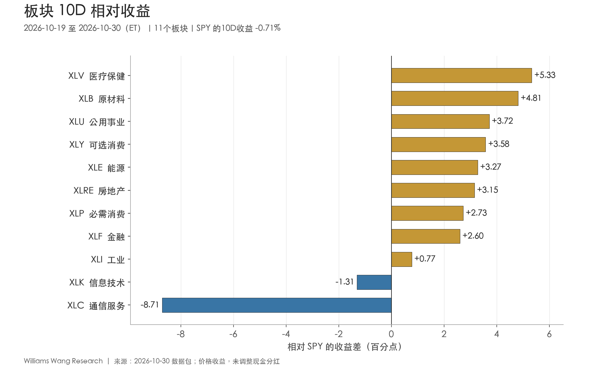
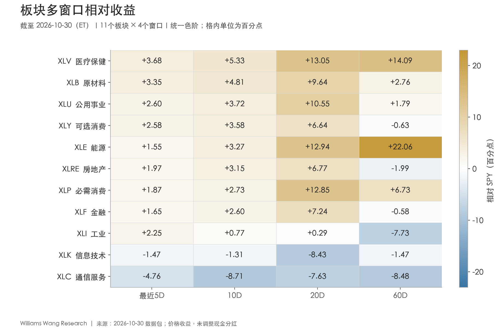
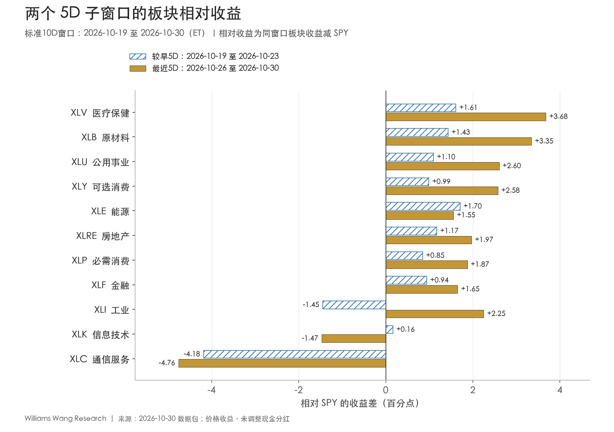

+++
title = "市场板块轮动双周分析报告｜截至 2026-10-30（ET）"
date = "2026-10-31"
data_as_of = ["2026-10-27", "2026-10-29", "2026-10-30"]
data_as_of_note = "权益观察期10月19日至30日ET；多数收益率、信用及VIX截至29日，WTI现货截至27日，部分利差和通胀补偿截至30日；分别保留原文观察日。"
draft = false
description = "比较医疗、原材料领先与成长压力，区分板块上涨面、小盘修复及期末风险数据滞后。"
series = "市场板块轮动双周复盘"
categories = ["市场结构", "宏观与政策"]
tags = ["板块轮动", "ETF", "市场广度", "SPY"]
featured = false
private = false
content_preservation = "verbatim"
source_sha256 = "a45ff9929ad4c5b253c40237e20ff8b90955177cfeb2fed0d1427bcc320ae135"
+++

# 市场板块轮动双周分析报告｜截至 2026-10-30（ET）

**医疗与原材料领涨，小盘修复，成长压力尚未解除**

报告观察期：2026年10月19—30日，共10个交易日。制作时间：2026年10月31日15:14:06（Asia/Singapore）；市场日期均按美东时间（ET）理解。所有ETF收益均为未调整现金分红的收盘到收盘价格收益。

## 一、本报告期结论

**本期呈现广泛的板块上涨，同时市值加权指数与成长代理继续承压。** 医疗XLV、原材料XLB、公用事业XLU以 **+4.62%、+4.11%、+3.01%** 的10D收益位列前三；11个板块中有 **9个上涨且跑赢SPY**。等权RSP上涨 **2.18%**，小盘IWM上涨 **3.48%**，而SPY、QQQ分别下跌 **0.71%、2.47%**。这支持市场参与面有所修复，但不代表所有风险资产同步走强。

**领涨顺序发生变化，整体排序仍保留延续性。** 与10月5—16日的非重叠对照期相比，前三名只保留医疗，必需消费由第1降至第7，能源由第2降至第5；但全体排名相关系数为 **+0.609**，仅必需消费一个板块变动达到5位。应将头部换位与全市场排名重排分开理解。

**成长压力集中在通信、科技和动量。** XLC完整10D下跌 **9.42%**，是横截面分化的主要负向离群值；XLK最近5D转跌 **2.03%**。两者在5D、10D、20D、60D全部落后SPY，成长相对价值的两组代理也在四个窗口均为负。医疗、原材料、公用事业、能源和必需消费则在四个窗口均保持正相对收益。

**风险指标的改善只得到截至10月29日的支持。** 包内美债收益率下降，HY利差较10月16日收窄5 bp，VIX由19.99降至17.20；但这些序列尚未覆盖10月30日。当天XLK、QQQ、SPY分别下跌 **4.89%、3.47%、1.77%**，因此不能用前一日的信用和波动率数据确认期末风险压力已经消退。

| ETF | 较早5D | 最近5D | 完整10D | 20D | 60D |
| --- | --- | --- | --- | --- | --- |
| SPY | -0.15% | -0.56% | -0.71% | -1.81% | -1.67% |
| QQQ | -0.51% | -1.97% | -2.47% | -7.86% | -3.38% |
| RSP | +1.36% | +0.82% | +2.18% | +4.08% | -0.12% |
| IWM | +2.15% | +1.30% | +3.48% | -0.72% | -6.34% |

表1：主要权益代理价格收益。较早5D为10月19—23日，最近5D为10月26—30日。

## 二、板块轮动证据：上涨面较广，均线广度没有继续扩张

完整10D以 **10月16日收盘** 为收益基准；最近5D以 **10月23日收盘** 为基准。排名对照期为 **10月5—16日**，基准为10月2日收盘。本次 `previous_package_end_et` 恰为10月16日，但排名比较仍按manifest的 `comparison_period` 定义，而非按相邻文件名推断。本期与该对照期不重叠。

| 证据 | 本期结果 | 解释 |
| --- | --- | --- |
| 10D最高−最低板块收益 | 14.04个百分点 | XLV与XLC的横截面差距，不是可直接实现的组合收益 |
| 10D收益离散度 | 3.76个百分点 | 11板块总体标准差，ddof=0，未年化 |
| 10D绝对上涨 / 跑赢SPY | 9/11 / 9/11 | 两组板块完全一致；科技、通信例外 |
| 高于20日均线 | 8/11 | 10/16、10/23、10/30均为8/11，没有数量扩张 |
| 20D / 60D跑赢SPY | 9/11 / 5/11 | 短中期相对领先的覆盖面高于60D |
| 排名相关系数 | +0.609 | 与10/05—10/16对照期比较 |
| Top 3 overlap | 1/3 | 本期XLV、XLB、XLU；对照期XLP、XLE、XLV |
| 名次变动绝对值≥5 | 1个板块 | 仅XLP下降6位；阈值没有历史显著性含义 |

表2：广度反映当前覆盖面，排名变化反映与对照期的相对次序差异。

11板块10D简单平均收益为 **+1.11%**，中位数为 **+2.44%**；剔除领涨的XLV，其余10板块平均仍为 **+0.75%**。正收益并非完全依赖单一领涨板块。这些是板块ETF等权统计，不是SPY的成分权重贡献，也不等于个股上涨家数或资金流量。

通信服务的下跌显著拉大分化：剔除XLC后，极差由 **14.04** 降至 **6.64个百分点**，离散度由 **3.76** 降至 **1.82个百分点**。同时剔除XLC与XLK，剩余9个上涨板块的极差仍有 **4.56个百分点**。这一敏感性分析用于识别离群值影响，不是事后选择可投资组合。

两段5D均有 **9/11板块上涨、9/11跑赢SPY**；其中8个板块在两段均上涨并跑赢，工业与科技发生替换。均线上方数量却在10月16日、23日、30日都保持 **8/11**，工业、科技、通信期末仍不高于20日均线。**上涨面已经较广，与均线广度继续扩张是两回事。**

## 三、Leadership 与 laggards：中期确认存在明显层次

| 名次 | 板块 | 10D收益 | 10D相对SPY | 20D相对SPY | 60D相对SPY | 对照期名次→本期 | 高于20日均线 |
| --- | --- | --- | --- | --- | --- | --- | --- |
| 1 | XLV 医疗保健 | +4.62% | +5.33 | +13.05 | +14.09 | 3→1 | 是 |
| 2 | XLB 原材料 | +4.11% | +4.81 | +9.64 | +2.76 | 5→2 | 是 |
| 3 | XLU 公用事业 | +3.01% | +3.72 | +10.55 | +1.79 | 4→3 | 是 |
| 4 | XLY 可选消费 | +2.87% | +3.58 | +6.64 | -0.63 | 8→4 | 是 |
| 5 | XLE 能源 | +2.57% | +3.27 | +12.94 | +22.06 | 2→5 | 是 |
| 6 | XLRE 房地产 | +2.44% | +3.15 | +6.77 | -1.99 | 7→6 | 是 |
| 7 | XLP 必需消费 | +2.02% | +2.73 | +12.85 | +6.73 | 1→7 | 是 |
| 8 | XLF 金融 | +1.89% | +2.60 | +7.24 | -0.58 | 6→8 | 是 |
| 9 | XLI 工业 | +0.06% | +0.77 | +0.29 | -7.73 | 10→9 | 否 |
| 10 | XLK 信息技术 | -2.02% | -1.31 | -8.43 | -1.47 | 11→10 | 否 |
| 11 | XLC 通信服务 | -9.42% | -8.71 | -7.63 | -8.48 | 9→11 | 否 |

表3：相对收益列单位为百分点；名次1表示本期10D价格收益最高。均线按截至10月30日的20个交易日平均收盘价计算。

**医疗：近期领先与中期表现相互支持。** XLV从较早5D的 **+1.46%** 升至最近5D的 **+3.12%**，完整10D排名由第3升至第1；20D、60D价格收益分别为 **+11.24%、+12.42%**，相对SPY分别为 **+13.05、+14.09个百分点**。领先不只是基准下跌带来的相对抗跌。

**原材料与公用事业：两段上涨，60D绝对表现仍需区分。** XLB最近5D上涨 **2.79%**，其20D、60D相对收益分别为 **+9.64、+2.76个百分点**。XLU最近5D上涨 **2.04%**，四窗口也均跑赢SPY，但60D价格收益只有 **+0.12%**，相对优势 **+1.79个百分点** 部分来自同期SPY下跌。其60D绝对上涨幅度远小于医疗，不能仅凭热力图颜色等量齐观。

**能源与必需消费：排名回落，没有同步出现价格趋势破坏。** XLE最近5D从较早的 **+1.55%** 放缓至 **+1.00%**，但60D价格收益仍达 **+20.39%**，相对SPY **+22.06个百分点**。XLP虽然从第1降至第7，本期仍上涨 **2.02%**，最近5D涨幅反而高于较早5D，20D与60D继续相对领先。排名是相对次序，不应把XLP降位直接写成资金撤离或趋势反转。

**可选消费、金融与房地产：短中期修复，60D仍落后。** XLY、XLF、XLRE的10D收益分别为 **+2.87%、+1.89%、+2.44%**，都高于20日均线；20D相对收益也为正。但60D相对SPY分别仍为 **-0.63、-0.58、-1.99个百分点**，绝对收益均为负。当前证据支持修复，不足以确认中期领先地位。

**工业：最近5D发生实际反弹，完整区间仍接近持平。** XLI由较早5D的 **-1.60%** 转为最近5D的 **+1.69%**，相对SPY从负转正；但完整10D只有 **+0.06%**。其20D虽领先SPY **+0.29个百分点**，绝对收益仍为 **-1.52%**；60D收益 **-9.40%**、期末仍低于20日均线。小幅相对领先不能替代绝对趋势确认。

**科技与通信：多窗口落后，弱势路径不同。** XLK较早5D基本持平，最近5D下跌 **2.03%**；XLC则连续两段下跌 **4.33%、5.32%**，完整10D相对SPY为 **-8.71个百分点**。科技20D价格收益 **-10.24%**，通信60D价格收益 **-10.15%**，说明弱势并非只存在于单日。包内没有成分股贡献、估值或盈利预期，不能据此判定AI产业基本面逆转、机构清仓或强制平仓。

图2：XLV、XLB、XLU、XLE、XLP四窗口相对为正；XLK、XLC四窗口相对为负。窗口相互嵌套，不能视为四份独立样本。

## 四、两个5D子窗口：多数板块收益改善，科技与通信拖累延续

| 板块 | 较早5D收益 | 最近5D收益 | 较早5D相对SPY | 最近5D相对SPY |
| --- | --- | --- | --- | --- |
| XLV 医疗保健 | +1.46% | +3.12% | +1.61 | +3.68 |
| XLB 原材料 | +1.28% | +2.79% | +1.43 | +3.35 |
| XLU 公用事业 | +0.95% | +2.04% | +1.10 | +2.60 |
| XLY 可选消费 | +0.84% | +2.02% | +0.99 | +2.58 |
| XLE 能源 | +1.55% | +1.00% | +1.70 | +1.55 |
| XLRE 房地产 | +1.02% | +1.41% | +1.17 | +1.97 |
| XLP 必需消费 | +0.70% | +1.31% | +0.85 | +1.87 |
| XLF 金融 | +0.79% | +1.09% | +0.94 | +1.65 |
| XLI 工业 | -1.60% | +1.69% | -1.45 | +2.25 |
| XLK 信息技术 | +0.01% | -2.03% | +0.16 | -1.47 |
| XLC 通信服务 | -4.33% | -5.32% | -4.18 | -4.76 |

表4：相对收益单位为百分点。两段收益复合得到完整10D收益，不能直接相加。

**8个板块持续上涨并跑赢SPY。** 它们是XLV、XLB、XLU、XLY、XLE、XLRE、XLP、XLF。除能源外，其余7个最近5D的绝对收益都高于较早5D；能源仍上涨，但幅度由 **1.55%** 降至 **1.00%**，相对优势也由 **1.70** 缩至 **1.55个百分点**。这显示连续领先内部也有节奏差异。

**工业转正、科技转负，是广度数量不变背后的结构变化。** XLI较早5D落后SPY **1.45个百分点**，最近5D领先 **2.25个百分点**；XLK则由领先 **0.16** 转为落后 **1.47个百分点**。通信两段都明显落后，相对差距从 **−4.18** 扩至 **−4.76个百分点**。

SPY两段收益由 **−0.15%** 降至 **−0.56%**，使相对比较门槛降低约 **0.41个百分点**。但板块简单平均收益同时由 **+0.24%** 升至 **+0.83%**，最近5D跑赢SPY的9个板块也全部实际上涨。因此，本次相对领先扩大含有真实的板块收益改善，不能完全归结为基准效应。

期末仍有集中回撤。10月30日只有 **6/11板块上涨**，XLK单日 **−4.89%**、动量MTUM **−4.77%**、QQQ **−3.47%**；SPY **−1.77%**，RSP **−0.79%**，IWM **−1.65%**。前两周的修复与最后一天的冲击应同时保留，周区间净收益无法刻画全部路径风险。

## 五、外部上下文：增长仍有韧性，通胀约束没有消失

以下只补充10月19—30日内发布的官方信息。市场收益与宏观时间序列仍以数据包为准；事件与价格同时发生，不构成因果识别，也未进行公司财报层面的成分贡献归因。

**10月28日，美联储维持政策利率。** FOMC以10比2维持联邦基金利率目标区间 **3.75%—4.00%**；两名反对者倾向加息25 bp。声明指出经济活动扩张、国内支出具有韧性，同时通胀仍高于目标。该信息不支持将本期长债上涨直接解释为“本次会议已转向宽松”。[美联储，2026-10-28 FOMC声明](https://www.federalreserve.gov/newsevents/pressreleases/monetary20261028a.htm)

**10月29日，三季度GDP初值显示增长保持韧性。** 实际GDP环比折年增长 **3.4%**，二季度为2.2%；私人国内最终购买者实际销售增长 **4.9%**，也是环比折年口径。BEA列示投资、消费与政府支出增加，出口下降；消费增加包括医疗服务和处方药。增长背景与小盘、原材料的价格修复并不矛盾，医疗相关支出也提供行业背景，但不能证明它们分别驱动了本期ETF涨幅。[BEA，2026-10-29 三季度GDP初值](https://www.bea.gov/news/2026/gdp-advance-estimate-3rd-quarter-2026)

**同日发布的9月PCE显示价格压力仍在。** 整体PCE价格指数环比 **+0.5%**、同比 **+3.6%**；核心PCE环比 **+0.3%**、同比 **+3.1%**。名义消费环比增长 **0.5%**，实际消费增长不足0.1%。名义支出与实际需求不能混用，月度环比和同比也不能与GDP中的季度折年通胀直接比较。[BEA，2026-10-29 个人收入与支出](https://www.bea.gov/news/2026/personal-income-and-outlays-september-2026)

**解释证据混杂。** 经济增长和私人需求仍具韧性，但周期板块等权均值依然落后防御；通胀偏高且美联储按兵不动，而包内名义与实际美债收益率均下降。市场可能同时交易不同期限的预期、行业盈利及风险溢价。本包不能识别这些渠道的贡献，因此不将本期概括为已确认的衰退交易、再通胀交易或全面风险偏好回升。

## 六、风格与跨资产背景

| 价差代理 | 最近5D | 10D | 20D | 60D |
| --- | --- | --- | --- | --- |
| 成长−价值：SPYG−SPYV | -2.04 | -4.96 | -10.49 | -6.76 |
| 大盘成长−价值：IWF−IWD | -2.15 | -4.10 | -11.03 | -5.76 |
| 等权−市值加权：RSP−SPY | +1.38 | +2.89 | +5.89 | +1.55 |
| 小盘−大盘：IWM−SPY | +1.86 | +4.19 | +1.09 | -4.67 |
| 动量−市场：MTUM−SPY | -1.29 | -2.42 | -10.31 | -6.14 |
| 质量−市场：QUAL−SPY | +0.41 | -0.36 | +0.94 | +0.57 |
| 低波动−市场：USMV−SPY | +0.54 | +2.37 | +6.61 | +4.60 |
| 周期−防御：板块等权均值差 | -0.44 | -0.92 | -4.80 | -4.36 |
| 信用ETF：HYG−LQD | +0.09 | +0.31 | -1.56 | -0.59 |
| 期限ETF：TLT−IEF | -0.17 | +1.04 | +2.54 | +0.46 |

表5：各列为同窗口价格收益差，单位为百分点；不是因子回归收益。周期组为XLY、XLF、XLI、XLB、XLE，防御组为XLP、XLU、XLV，组内采用等权平均。

**价值继续领先成长，利率下降尚未伴随成长修复。** SPYG−SPYV的10D与20D差分别为 **−4.96、−10.49个百分点**，IWF−IWD也同向为负。动量MTUM完整10D价格收益为 **-3.13%**，落后SPY **2.42个百分点**。ETF对比包含行业组成差异，不能将它们当作已隔离行业暴露的纯因子收益。

**等权与小盘修复真实存在，中期程度不同。** RSP在10D和20D分别上涨 **2.18%、4.08%**，相对SPY为 **+2.89、+5.89个百分点**；60D绝对收益仍略负 **-0.12%**。IWM两段5D均上涨，10D相对SPY达 **+4.19个百分点**，但其20D价格收益 **−0.72%**，60D **−6.34%**，60D仍落后SPY **4.67个百分点**。小盘有反弹，尚不具备完整的60D相对趋势确认。

**防御均值仍占优，医疗贡献较大。** 周期组10D平均上涨 **2.30%**，防御组上涨 **3.22%**，差值 **−0.92个百分点**。将医疗从防御组中剔除后，周期组仅落后 **0.21个百分点**；将能源从周期组剔除，差值仍约 **-0.98个百分点**。这说明防御领先并非各组分完全一致，也不宜把小幅剩余差距赋予过高含义。

质量与低波动并未同步占优：QUAL最近5D领先SPY **0.41个百分点**，但10D落后 **0.36个百分点**；USMV的10D相对收益为 **+2.37个百分点**，最近5D价格收益却接近零、略负 **-0.02%**。低波动相对领先不等于所有阶段都取得绝对上涨。

| ETF / 代理 | 最近5D | 10D | 20D | 60D |
| --- | --- | --- | --- | --- |
| UUP 美元 | +0.14% | +0.28% | +0.35% | +2.87% |
| GLD 黄金 | -2.95% | -6.70% | -6.60% | -8.70% |
| USO 原油期货 | -0.41% | +4.39% | +14.97% | +42.03% |
| DBC 广义商品期货 | -1.44% | -0.77% | +2.00% | +16.46% |

表6：美元、黄金和商品代理的价格收益。UUP不是完整的全球美元汇率指标；USO、DBC受期货结构、展期和持仓影响，不能等同于现货。

黄金GLD完整10D下跌 **6.70%**，与包内实际收益率下降并存；美元UUP上涨 **0.28%**。现有信息不足以将黄金跌幅归结为单一利率或汇率渠道。原油期货ETF USO完整10D上涨 **4.39%**、最近5D下跌 **0.41%**，广义商品DBC完整10D下跌 **0.77%**，也不支持所有商品同步上涨的表述。

**原油需要先处理时间与标的差异。** WTI现货最后观测为10月27日，较10月16日下跌 **4.47%**；USO对齐同一10月27日终点仍上涨 **1.33%**，所以完整区间的方向差异不能只用更新滞后解释。若只看10月23—27日，两者均下跌：现货 **-5.79%**、USO **-3.33%**。这些差异可能涉及期货与现货口径、持仓和定价时点，也需保留源数据进一步核对的可能；本包不能量化原因，不能据此将XLE上涨直接归因为“现货油价持续上涨”。

## 七、Rates / credit / volatility：区间改善与期末信息缺口并存

| 指标 | 10/16基准 | 最新值 | 实际观察日 | 本期变化 | 10/23后变化 |
| --- | --- | --- | --- | --- | --- |
| 2Y美债收益率 | 4.74% | 4.61% | 2026-10-29 | -13 bp | -8 bp |
| 10Y美债收益率 | 5.09% | 4.98% | 2026-10-29 | -11 bp | -2 bp |
| 30Y美债收益率 | 5.43% | 5.32% | 2026-10-29 | -11 bp | -1 bp |
| 10Y−2Y利差 | 0.35% | 0.38% | 2026-10-30 | +3 bp | +7 bp |
| 10Y−3M利差 | 0.83% | 0.78% | 2026-10-30 | -5 bp | +0 bp |
| 10Y TIPS实际收益率 | 2.74% | 2.63% | 2026-10-29 | -11 bp | -3 bp |
| 10Y通胀补偿 | 2.35% | 2.34% | 2026-10-30 | -1 bp | +0 bp |
| HY OAS | 3.31% | 3.26% | 2026-10-29 | -5 bp | -12 bp |
| IG OAS | 0.85% | 0.89% | 2026-10-29 | +4 bp | -2 bp |
| VIX | 19.99 | 17.20 | 2026-10-29 | -2.79点 | -2.25点 |
| WTI现货（美元/桶） | 108.21 | 103.37 | 2026-10-27 | -4.84美元/桶 | -6.35美元/桶 |

表7：变化均从10月16日或10月23日到各序列最新的真实观察日，不是统一截至10月30日的完整变化。1 bp＝0.01个百分点；VIX使用指数点。收益率、利差、通胀补偿均以年率百分比水平展示。

**利率方向利于久期，但最近5D长久期优势没有延续。** 截至10月29日，2Y、10Y、30Y分别较10月16日下降13、11、11 bp。10D中TLT上涨 **2.24%**、IEF上涨 **1.19%**，TLT领先 **1.04个百分点**；最近5D两者仍上涨，但TLT反而落后IEF **0.17个百分点**。ETF价格差不是纯期限溢价测量，也受票息分红与久期差异影响。

**曲线与通胀补偿必须同日对齐。** T10Y2Y单独序列截至10月30日为38 bp、较基准增加3 bp；若与截至29日的DGS2、DGS10配对，则29日10Y−2Y为37 bp、变化 **+2 bp**。同样，T10YIE在30日为2.34%，显示本期 **−1 bp**；对齐29日则为2.35%、本期 **0 bp**。在共同终点，10Y名义与实际收益率均下降11 bp，不能拼接不同日的数据后声称名义收益率下降主要来自通胀补偿下行。通胀补偿本身也不是纯通胀预期。

**信用压力有所缓和，HY与IG的完整区间方向并不一致。** 截至29日，HY OAS由331降至326 bp，而IG OAS由85升至89 bp；只看10月23日后，两者分别收窄12、2 bp。HYG−LQD的10D价格收益差为 **+0.31个百分点**，20D却为 **−1.56个百分点**。该代理同时包含久期等暴露，不能用它替代OAS判断信用改善的幅度。

**VIX缺少最后一个交易日，是本期重要限制。** 截至29日VIX为17.20，较16日下降2.79点、较23日下降2.25点。这支持“截至29日隐含波动率回落”，不支持“30日收盘风险已经解除”。包内也没有30日HY/IG利差，无法判断科技期末下跌是否已向信用扩散。

## 八、下一报告期观察点

| 观察对象 | 当前证据 | 下一期需要确认的变化 |
| --- | --- | --- |
| 医疗、原材料、公用事业 | 10D前三；两段5D均上涨并跑赢 | 是否继续兼具绝对上涨与相对领先；公用事业60D绝对涨幅仍接近零 |
| 工业与小盘 | XLI最近5D转正；IWM 10D上涨3.48% | XLI能否回到20日均线上方；IWM能否改善20D绝对收益及60D相对落后 |
| 科技、通信与动量 | XLK、XLC四窗口相对为负；10/30科技显著下跌 | 最近5D相对收益是否转正，且伴随绝对收益修复；若跌势扩散，当前广度将受挑战 |
| 市场广度 | 9/11上涨；8/11位于20日均线上方 | 上涨数量、均线数量和RSP/IWM实际收益能否同步维持或改善 |
| 利率、信用、波动率 | 收益率下降，HY收窄；VIX仅覆盖至10/29 | 补齐10/30及后续观察后，是否仍与权益走势相容；不以旧VIX给新收盘行情背书 |
| 能源与油价 | XLE保持中期领先；USO与现货完整区间方向不同 | 先核对同日期现货、期货与持仓口径，再判断能源领先是否延续 |

表8：下一报告期的研究观察清单。

以上是验证条件，不是交易信号或仓位建议。更有信息量的确认是多个独立维度同向变化；反之，如果板块上涨数量下降、均线广度收缩，且新更新的信用利差或VIX恶化，当前“板块修复与成长压力并存”的描述就需要重新评估。

## 免责声明

本报告仅用于信息交流与研究复盘，不构成任何证券、基金、衍生品或其他金融产品的投资、交易、配置或法律税务建议，也不构成买卖邀约或收益承诺。报告依据给定数据包及注明日期的公开资料撰写，可能存在数据滞后、修订、口径差异或错误；历史表现、相对强弱与统计关系不代表未来结果。读者应结合自身情况独立核实并判断，投资决策、仓位及实际执行由读者自行负责。
