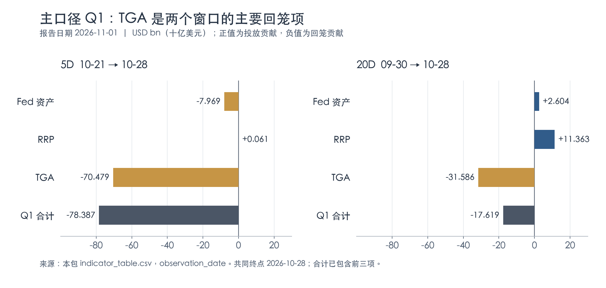
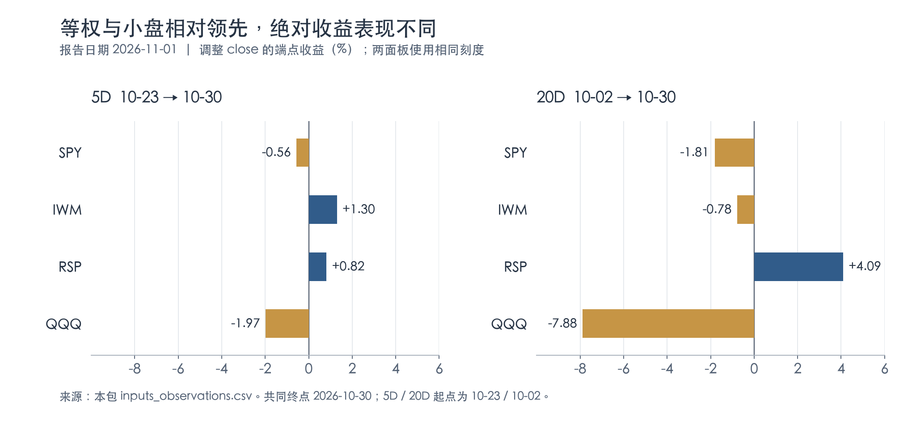

+++
title = "市场流动性综合分析报告｜2026-11-01"
date = "2026-11-01"
data_as_of = ["2026-09-01", "2026-10-23", "2026-10-28", "2026-10-29", "2026-10-30", "2026-11-01"]
data_as_of_note = "报告日期2026年11月1日。市场对齐截至10月30日；Fed资产和准备金截至28日，TGA、融资利率与OAS截至29日，RRP和市场价格截至30日；STLFSI4截至23日，AAA/BAA为9月背景，单独IORB标签11月1日并非周日交易。"
draft = false
description = "现金与担保融资趋紧，信用短窗口修复尚未覆盖周五抛压；区分观察日主口径、对齐估算与滚动窗口效应。"
series = "市场流动性综合分析报告"
categories = ["宏观与政策", "市场结构"]
tags = ["流动性", "TGA", "SOFR", "信用利差", "市场广度"]
featured = false
private = false
content_preservation = "verbatim_except_privacy_redactions"
source_sha256 = "aaa355bc33a8fb3b0d993936b99162269d56f6ef30add4cce08bef65bac67f9a"
+++



# 市场流动性综合分析报告｜2026-11-01

## 一、Executive Summary｜现金与担保融资趋紧，信用修复尚未带来全面风险偏好回升

**本期判断：宏观现金条件仍偏紧，担保融资价格已体现一定压力；信用利差出现短窗口修复，但股票内部的分化与周五放量下跌，使全面风险偏好回升仍缺乏确认。** 准备金下降与信用利差收窄可以同时发生，分别反映资金供给和信用风险定价，不能用其中一组指标替代另一组。

- **现金数量继续收缩。** 观察日主口径截至 10 月 28 日，5D Q1 为 **−78.387 USD bn**，其中 TGA 贡献 **−70.479 USD bn**；准备金同期下降 **68.837 USD bn**。20D Q1 为 **−17.619 USD bn**。延伸至 30 日的对齐估算也为负，但受旧值沿用和窗口移动影响，不能与主口径直接相减作为现金流。
- **担保融资趋紧，银行隔夜端仍稳定。** 10 月 29 日 SOFR−IORB 为 **+4 bp**，TGCR、BGCR 相对 IORB 均为 **+2 bp**，较五个对齐交易行前各上升 **4 bp**；EFFR−IORB 仍为 **−2 bp**。压力主要体现在担保融资端，现有数据不足以确认广泛融资失序。
- **信用边际修复是真实反证，但尚未覆盖周五。** 截至 10 月 29 日，HY OAS 为 **326 bp**，5D 收窄 **14 bp**，IG OAS 为 **89 bp**、同期持平。VIX 到 30 日为 **19.42**，5D 几乎未变；该日 SPY、QQQ 分别下跌 **1.77%、3.47%**，SPY 成交量接近自身二十日均量的 **1.98 倍**。不能用截至周四的信用改善确认周五风险已经消退。
- **等权和小盘继续相对领先，绝对表现仍有差异。** RSP、IWM 的 5D 收益为 **+0.82%、+1.30%**，SPY、QQQ 为 **−0.56%、−1.97%**。二十日中 RSP 上涨 **4.09%**，IWM 仍下跌 **0.78%**。中长期国债 ETF 上涨提供缓冲，但五日 TLT 略跑输 IEF，不能统一描述为长端持续领先。

报告日期为 **2026-11-01**。数据包生成时间为美东 **2026-11-01 01:06:15（UTC−04:00，以包内时间戳为准）**；最新市场对齐行为 **2026-10-30**。宏观指标各有自己的观察日。全文仅使用本次指定包，主表为 `observation_date`，补充表为 `aligned_estimate`；数值与来源路径见核验说明。

## 二、Macro Liquidity｜TGA 回升仍是主要回笼项，月末 RRP 增加也开始形成拖累

### 1. 余额与自身窗口变化

金额均为 **USD bn（十亿美元，1 USD bn＝10 亿美元）**。下表各指标独立使用自己的终点，不能直接将不同终点的变化加总。Fed 资产、准备金的 5D／20D 起点为 **10 月 21 日／9 月 30 日**；RRP 为 **10 月 23 日／10 月 2 日**；TGA 为 **10 月 22 日／10 月 1 日**，年份均为 2026。

| 指标 | 最新值 | 5D 变化 | 20D 变化 | 观察日 |
| --- | --- | --- | --- | --- |
| Fed 总资产（F1） | 6,745.635 | -7.969 | +2.604 | 2026-10-28 |
| ON RRP（F2） | 4.375 | +4.175 | +2.874 | 2026-10-30 |
| TGA（F3） | 1,040.236 | +78.477 | +146.537 | 2026-10-29 |
| 银行准备金（F5_RESERVES） | 2,893.770 | -68.837 | -54.320 | 2026-10-28 |

TGA 最新余额升至 1,040.236 USD bn，超过 1 万亿美元，五行增加 78.477 USD bn；准备金降至 2,893.770 USD bn，五行减少 68.837 USD bn，二十行也减少 54.320 USD bn。Fed 总资产五行只减少 7.969 USD bn，显示准备金变化不能仅从资产端解释，负债结构变化需要同时纳入。

RRP 到 10 月 30 日增加至 4.375 USD bn，五行增加 4.175 USD bn；其中最后一天从 0.353 增至 4.375，单日增加 4.022 USD bn。在 Q1 定义下，RRP 增加属于负贡献。它与此前低余额时的有限释放空间不同，但包内没有参与者、投标分布等证据，不能直接将月末余额增加解释为资金全面撤离风险资产，或认定由某个制度性事件触发。

### 2. Q1 主口径：五日回笼以 TGA 为主，二十日也转为负值

设 A、R、T 分别为 Fed 资产、RRP、TGA，代理定义为：

$$
Q1_N=\Delta_N A-\Delta_N R-\Delta_N T.
$$

下表采用 **2026-10-28 的共同截点**，三项贡献和合计完全同窗。正号表示此定义下的净投放贡献，负号表示净回笼贡献，单位 USD bn。

| 窗口（共同起止点） | Fed 资产贡献 | RRP 贡献 | TGA 贡献 | Q1 累计 |
| --- | --- | --- | --- | --- |
| 5D：2026-10-21 → 2026-10-28 | -7.969 | +0.061 | -70.479 | -78.387 |
| 20D：2026-09-30 → 2026-10-28 | +2.604 | +11.363 | -31.586 | -17.619 |

*图 1：仅绘制观察日主口径。两个窗口的起点不同，柱形统一从零起算；“合计”已经包含前三项，不再与贡献项相加。来源为本包主表，图表数据与生成脚本保存在 assets。*

五日 TGA 贡献 −70.479 USD bn，约占 Q1 净回笼幅度的 **89.9%**；Fed 资产贡献 −7.969，RRP 仅抵消 +0.061。其他条件不变时，财政部账户吸收现金，会减少其他部门持有的现金或准备金，对融资环境形成约束。不过本包没有税收、财政支出和国债结算的完整分解，能够定位的是 TGA 这一算术分项，不能进一步确认财政回笼的具体事件原因。

二十日窗口内，Fed 资产和 RRP 分别贡献 +2.604、+11.363 USD bn，仍不足以抵消 TGA 的 −31.586。RRP 在这一窗口是正贡献，源于 9 月 30 日较高的起始余额；这与截至 30 日的 RRP 最新余额上升并不矛盾。窗口起点不同，会改变贡献方向。

同期准备金变化为 −68.837 USD bn，与 Q1 −78.387 相差 **9.550 USD bn**。Q1 只覆盖三个分项，含混合频率处理，并不是准备金变化的会计恒等式；相同方向支持现金趋紧的判断，不能据此宣称已经解释全部准备金变化。

10 月 28 日**单日 Q1 为 +28.979 USD bn**，主要对应 TGA 当日下降 36.898 USD bn；但该日结束的 **5D 累计仍为 −78.387**。主表 `Q1_CUM_5D.delta5=−16.986`，表示五日累计较 10 月 21 日的 −61.401 进一步下降，不能把这项变化再次作为新增回笼相加。20D 累计从 10 月 21 日的 +8.288 变为 −17.619，变化为 −25.907 USD bn，同样属于滚动统计的变化。

### 3. 最新对齐估算：回笼方向一致，幅度需要排除窗口效应

补充估算计算日为 **2026-10-30**，终点实际使用 **10 月 28 日 Fed 资产、10 月 30 日 RRP、10 月 29 日 TGA**。它包含较新的日度数据，同时仍沿用周度资产与上一日 TGA，不是三个分项在 30 日均有新观察。

| 窗口（共同起止点） | Fed 资产贡献 | RRP 贡献 | TGA 贡献 | Q1 累计 |
| --- | --- | --- | --- | --- |
| 5D：2026-10-23 → 2026-10-30 | -7.969 | -4.175 | -57.747 | -69.891 |
| 20D：2026-10-02 → 2026-10-30 | +2.604 | -2.874 | -169.055 | -169.325 |

5D 估算为 −69.891 USD bn，20D 为 −169.325 USD bn，两者均指向净回笼。然而，不能将后者与 28 日主口径的 −17.619 直接比较，就说两天发生了 151.706 USD bn 的回笼。独立拆解同一对齐序列可得：

| 20D 滚动值从 10 月 28 日移动到 30 日 | 对累计变化的贡献（USD bn） |
| --- | --- |
| 新加入的 10 月 29—30 日 Q1 | -28.803 |
| 退出窗口的 10 月 1—2 日正 Q1，反号扣除 | -122.903 |
| 20D 累计变化合计 | -151.706 |

这意味着巨大变化主要来自月初正脉冲退出统计窗口。新增两日也确实在回笼，但幅度是 28.803 USD bn。主口径二十日从 9 月 30 日开始，补充估算从 10 月 2 日开始；TGA 起始余额分别为 984.046 和 871.181 USD bn，是两个二十日结果差异的重要来源。

最近五个对齐日如下，金额 USD bn；日脉冲按相邻对齐行定义。

| 对齐日 | TGA 对齐余额 | 单日 Q1 | 5D Q1 | 20D Q1 |
| --- | --- | --- | --- | --- |
| 2026-10-26 | 1,020.700 | -38.211 | -57.560 | -54.577 |
| 2026-10-27 | 1,052.530 | -31.856 | -80.911 | -98.810 |
| 2026-10-28 | 1,015.632 | +28.979 | -78.387 | -17.619 |
| 2026-10-29 | 1,040.236 | -24.781 | -86.448 | -143.936 |
| 2026-10-30 | 1,040.236 | -4.022 | -69.891 | -169.325 |

30 日单日 Q1 的 −4.022 完全来自 RRP 增加，另两腿沿用旧观察。尽管当日五日累计由 −86.448 改善为 −69.891，单日仍为回笼：旧的负脉冲退出窗口可以令滚动值回升。综合两个视图，现金偏紧的方向较一致，但精确幅度、短期加速程度对窗口和数据更新敏感。

## 三、Funding Conditions｜担保利率升至 IORB 之上，银行隔夜利差仍稳定

资金利率与成交量共同观察日为 **2026-10-29**，5D／20D 起点分别为 **10 月 22 日／10 月 1 日**。利率为 %，变化及相对 IORB 利差为 bp。利差使用同日 IORB **3.90%**。

| 资金利率 | 最新利率（%） | 5D 变化（bp） | 20D 变化（bp） | 相对 IORB（bp） |
| --- | --- | --- | --- | --- |
| SOFR | 3.94 | +4 | +7 | +4 |
| EFFR | 3.88 | 0 | 0 | -2 |
| TGCR | 3.92 | +4 | +8 | +2 |
| BGCR | 3.92 | +4 | +8 | +2 |

SOFR−IORB 从五行前的 0 bp 升至 +4 bp，TGCR、BGCR 从 −2 bp 升至 +2 bp。包内对齐历史显示，SOFR−IORB 在 26—29 日分别为 +3、+5、+4、+4 bp；正利差不是只出现于一个孤立观察日。它与准备金下降、TGA 上升的方向相容，说明担保融资的边际价格有所抬升。

EFFR 仍为 3.88%，相对 IORB 为 −2 bp，两个窗口都没有变化。因而目前更合适的判断是**担保融资端出现压力，尚未广泛扩散到银行隔夜利率**。几 bp 的利差不能独立证明市场失序；包内没有日内尾部利率、抵押品分布、交易对手可得性或融资拒绝率，无法判断压力是否集中在特定机构。

下表成交量单位 USD bn。SOFR、TGCR、BGCR 的覆盖有重叠，不能相加构造总融资量。

| 指标 | 最新值 | 5D 变化 | 20D 变化 | 观察日 |
| --- | --- | --- | --- | --- |
| SOFR 成交量 | 3,145 | +200 | +78 | 2026-10-29 |
| TGCR 成交量 | 1,212 | +20 | +34 | 2026-10-29 |
| BGCR 成交量 | 1,242 | +20 | +21 | 2026-10-29 |
| EFFR 成交量 | 117 | -2 | -3 | 2026-10-29 |
| OBFR 成交量 | 229 | -13 | -27 | 2026-10-29 |

担保利率上升时，SOFR 量五行增加 200 USD bn，TGCR 和 BGCR 各增加 20；EFFR、OBFR 量则减少 2、13 USD bn。这支持“担保市场成交活动增加，同时价格趋紧”的描述，不能单凭量价组合区分融资需求增加与供给约束，也不能据此推断资金从银行市场净迁入回购市场。

RRP 已观察到 30 日，资金利率却只到 29 日；因此本报告不能确认月末最后一个交易日的 SOFR 实际水平。单独 IORB 序列标签为 **2026-11-01**，仍为 3.90%，该周日不在交易网格内，主表没有 5D／20D 变化，不应拿它冒充周日市场交易。

## 四、Rates And Treasury Pressure｜国债利率回落，五日曲线变陡与二十日趋平并存

国债收益率截至 **2026-10-30**，5D／20D 起点为 **10 月 23 日／10 月 2 日**。T-bill−SOFR 受 SOFR 日期限制，截至 **10 月 29 日**，对应起点为 **10 月 22 日／10 月 1 日**。

| 指标（最新值单位） | 最新值 | 5D 变化¹ | 20D 变化¹ | 观察日 |
| --- | --- | --- | --- | --- |
| 3M T-bill（%） | 3.99 | -5.00 | -2.00 | 2026-10-30 |
| 2Y 国债（%） | 4.56 | -13.00 | -27.00 | 2026-10-30 |
| 10Y 国债（%） | 4.94 | -6.00 | -34.00 | 2026-10-30 |
| 10Y−2Y（bp） | 38.00 | +7.00 | -7.00 | 2026-10-30 |
| T-bill−SOFR（bp） | 6.00 | -8.00 | -7.00 | 2026-10-29 |
| 2Y 收益率 RVOL20（年化 bp） | 75.57 | -16.62 | -29.41 | 2026-10-30 |
| 10Y 收益率 RVOL20（年化 bp） | 85.89 | -3.36 | +1.19 | 2026-10-30 |

¹ 收益率和利差变化为 bp；RVOL 变化为年化 bp。

五日内，2Y 下降 13 bp，快于 10Y 的 6 bp，曲线斜率从 31 bp 扩大至 38 bp，属于**收益率下降伴随曲线变陡**。二十日内却是 10Y 下降 34 bp、快于 2Y 的 27 bp，斜率从 45 bp 缩至 38 bp，属于**收益率下降伴随曲线趋平**。两个时间尺度的形态不同，不能用一个曲线标签概括整个月。

收益率波动也有改善：2Y RVOL20 为 75.57 年化 bp，较五行前下降 16.62；10Y 为 85.89，下降 3.36。较二十行前，2Y 的实现波动降低，10Y 却仍略高 1.19 年化 bp。利率回落与短窗口波动下降为融资和估值提供一定缓冲，但包内没有预期短率、期限溢价或实际利率分解，无法把变化归因于政策转向、通胀预期或某次国债拍卖。

| ETF | 1D 收益 | 5D 收益 | 20D 收益 |
| --- | --- | --- | --- |
| TLT | +0.43% | +0.61% | +5.63% |
| IEF | +0.56% | +0.78% | +3.04% |

ETF 收益截至 10 月 30 日，1D／5D／20D 起点分别为 10 月 29 日／10 月 23 日／10 月 2 日。TLT 五日上涨 0.61%，低于 IEF 的 0.78%；二十日上涨 5.63%，高于 IEF 的 3.04%。TLT/IEF 比率为 **0.891892**，5D／20D 分别 **−0.16%／+2.51%**，Z20 为 **+0.832**。这与不同窗口的曲线形态相容，但 ETF 比率仍混合久期、凸性、票息与持仓差异，不能作为纯期限溢价测量。

10 月 30 日股票下跌，而 TLT、IEF 分别上涨 0.43%、0.56%，在这一天国债对股票风险提供了方向上的分散作用。该观察不足以保证未来股债相关性稳定。T-bill−SOFR 为 +6 bp，五行收窄 8 bp；13 周票据银行贴现率与隔夜担保利率存在期限、计息基础差异，不能将该差值直接解释为可执行套利。

## 五、Credit And Stress｜HY 利差收窄构成边际改善，周末前仍需等待更新确认

OAS 的共同终点为 **2026-10-29**，5D／20D 起点为 **10 月 22 日／10 月 1 日**。下表将包内百分率数值乘以 100 转为 bp；HY−IG 原始差值为百分率点，也转换为 bp。

| 指标 | 最新值 | 5D 变化 | 20D 变化 | 观察日 |
| --- | --- | --- | --- | --- |
| IG OAS（bp） | 89 | 0 | +3 | 2026-10-29 |
| BBB OAS（bp） | 110 | -1 | +4 | 2026-10-29 |
| HY OAS（bp） | 326 | -14 | +2 | 2026-10-29 |
| HY−IG（bp） | 237 | -14 | -1 | 2026-10-29 |

五日 HY 收窄 14 bp，而 IG 持平、BBB 收窄 1 bp，HY−IG 从 251 收窄至 237 bp。信用修复更多体现在高收益相对投资级的风险补偿下降。二十日 HY、IG、BBB 仍分别比起点高 2、3、4 bp，幅度较小；因此本期应描述为**短窗口修复、较长窗口大致横向而略偏宽**，不宜继续沿用“信用利差在所有窗口加速走阔”的叙事。

不过这段修复也不是单向延续：HY OAS 从 10 月 22 日的 340 bp 降至 28 日的 314 bp，29 日又回升到 326 bp，单日反弹 12 bp。OAS 数据没有覆盖 30 日的股票抛压，不能据截至周四的收窄宣布周五的信用风险已经稳定。

| ETF | 1D 收益 | 5D 收益 | 20D 收益 |
| --- | --- | --- | --- |
| HYG | -0.19% | +0.49% | +0.68% |
| LQD | +0.05% | +0.40% | +2.40% |

HYG、LQD 的五日收益分别为 +0.49%、+0.40%，HYG/LQD 比率为 **0.742591**，5D 上涨 **0.09%**，与 HY 的边际修复方向相容。但比率 20D 仍下跌 **1.68%**，Z20 为 **−0.943**；这一次，HYG 本身二十日也上涨 0.68%，比率下降是因为 LQD 上涨更多，而不是 HYG 在同期绝对下跌。两只基金的久期和组合不同，不能把其相对表现全部归因于信用风险。

VIX 截至 **10 月 30 日为 19.42**，较 **10 月 23 日下降 0.03 点**，较 **10 月 2 日上升 4.11 点**。周内 VIX 从 28 日的 16.91 回升到 30 日的 19.42，30 日单日上升 2.22 点，说明接近持平的五日变化掩盖了周末前的重新定价。VIX 与 OAS 分属不同资产、不同终点，不能强求完全同步，也不能把其中一个代替另一个。

STLFSI4 最新为 **−0.5837（10 月 23 日）**，较 **10 月 16 日／9 月 25 日**分别上升 **0.0497／0.2229**。它属于正常滞后的背景指标，未覆盖 26—30 日，不能用负值否认当周压力。AAA、BAA 月度收益率为 **6.03%、6.47%**，观察标签 **2026-09-01** 代表 9 月，仍只作背景，不作为 10 月底的信用动量证据。

## 六、Equity Breadth And Risk Appetite｜等权与小盘相对领先，周五放量下跌削弱反弹确认

收益均截至 **2026-10-30**。1D／5D／20D 起点为 **10 月 29 日／10 月 23 日／10 月 2 日**。计算采用本包明确请求拆股及股息调整的 close；它是供应商调整价格的端点收益，未另行独立核验所有复权处理，不将其直接写成未经核验的再投资总回报。

| ETF | 1D 收益 | 5D 收益 | 20D 收益 |
| --- | --- | --- | --- |
| SPY | -1.77% | -0.56% | -1.81% |
| IWM | -1.65% | +1.30% | -0.78% |
| RSP | -0.79% | +0.82% | +4.09% |
| QQQ | -3.47% | -1.97% | -7.88% |

*图 2：两组端点收益均使用本包调整 close。统一百分比刻度，保留零线，便于区分相对领先与绝对上涨。*

RSP 在五日和二十日都上涨，同时跑赢 SPY，等权强势有绝对收益支持。IWM 五日上涨 1.30%、二十日下跌 0.78%，两个窗口都跑赢 SPY，但其较长窗口仍未转为正收益。QQQ 五日、二十日分别下跌 1.97%、7.88%，明显弱于 SPY，成长权重股仍是股票表现中的薄弱环节。

| 相对价格指标 | 最新比率 | 5D 比率涨跌 | 20D 比率涨跌 | Z20 |
| --- | --- | --- | --- | --- |
| RSP/SPY | 0.288877 | +1.38% | +6.01% | +1.859 |
| QQQ/SPY | 0.913685 | -1.42% | -6.19% | -1.661 |

RSP/SPY 二十日比率上涨 6.01%，QQQ/SPY 下跌 6.19%，说明股票内部差异较大。不过等权 ETF 只提供广度代理，本包没有上涨家数、行业分布或个股创新高比例，无法据此确认全市场多数股票都在上涨。RSP/SPY 的 Z20 虽由五行前的约 2.049 降至 1.859，比率本身仍上涨；滚动均值和波动变化也会影响 Z 分数。

`SIZE_RET_SPREAD_20D` 当前为 **+1.0927 个百分点**，表示 IWM−SPY 的二十日日简单收益差之和，较五行前改善 **1.7913 个百分点**。以期间复合收益相减，IWM 相对 SPY 的二十日收益差为 **+1.0307 个百分点**。两种口径都支持小盘相对领先，但都不改变 IWM 自身同期仍下跌的事实；它们也不应被混为一个指标。

短期路径尤其值得关注。按本包价格反推，截至 29 日、相对 23 日，SPY 和 QQQ 原本分别上涨 **1.24%、1.55%**；30 日分别下跌 **1.77%、3.47%**，令五日结果转负。周五四只股票 ETF 全部下跌，等权与小盘的周度领先没有阻止当日同步回撤。

30 日 SPY 成交量为 **77,806,920 股**，是自身二十日均量的 **1.9832 倍**，较五行前的 **0.8234 倍**明显增加。IWM 对 SPY 的相对归一量比为 **0.5043**；乘以 SPY 自身量比，得到 IWM 自身量比约 **1.0002 倍**。因此，较低的相对量比主要表现为 SPY 放量更强，不能误读成 IWM 的成交量只剩自身正常水平的一半。

这组量价关系使周五风险重定价更值得跟踪，但成交量没有买卖净方向，不能据此确认机构净流出、强平或赎回。当前较稳妥的股票判断是：**等权和小盘相对强势延续，成长较弱；周末前共同下跌，尚未获得广泛、持续的价格确认。**

## 七、Cross-Asset Confirmation｜国债提供缓冲，黄金与能源代理未给出统一信号

以下截至 **2026-10-30**，5D／20D 起点为 **10 月 23 日／10 月 2 日**。涨跌为端点百分比变化，与 CSV 中的原始绝对 delta 区分。

| 指标 | 最新值与单位 | 5D 涨跌 | 20D 涨跌 |
| --- | --- | --- | --- |
| UUP 归一美元代理（C1） | 105.5701 index | +0.14% | +0.38% |
| GLD（C2） | 355.78 USD/share | -2.95% | -6.41% |
| USO（C3） | 168.83 USD/share | -0.41% | +14.56% |

美元代理在两个窗口都小幅走强，与现金偏紧方向相容，但不足以单独识别美元融资短缺。GLD 五日和二十日均下跌，而国债 ETF 上涨，说明本期黄金与债券的防御表现并不相同；缺少实际利率、资金流和持仓数据，不能将黄金下跌归因于某一个宏观变量。

USO 五日小幅下跌 0.41%，二十日仍上涨 14.56%。这一窗口差异意味着近期能源代理没有继续按前段幅度走强，但此前涨幅仍在；不能将其简单概括为油价持续上涨或能源压力已经解除。USO 还受期货持仓、期限结构和基金运作影响，不是 WTI 现货收益的精确替代。

C1 是 **UUP 调整 close 的归一指数**，本包以 **2024-11-11＝100**，基日 close 为 **27.4699**。它不是 ICE DXY 原始点位；不同包的归一基日可能移动，水平不能跨包直接相减。C2、C3 分别是 GLD、USO 的 **USD/share**，不是黄金美元／盎司或原油美元／桶。

综合看，较明确的缓冲来自国债利率回落和部分信用修复；较明确的约束来自现金回笼、担保融资利差上升，以及成长股偏弱。跨资产表现不足以把市场归入单一的全面避险或全面修复状态。

本报告用于信息整理与研究讨论，不构成投资建议、收益承诺或交易指令。结论受数据时滞、混合频率、代理定义和核验范围限制；投资判断、仓位管理与实际执行由读者自行决定。
