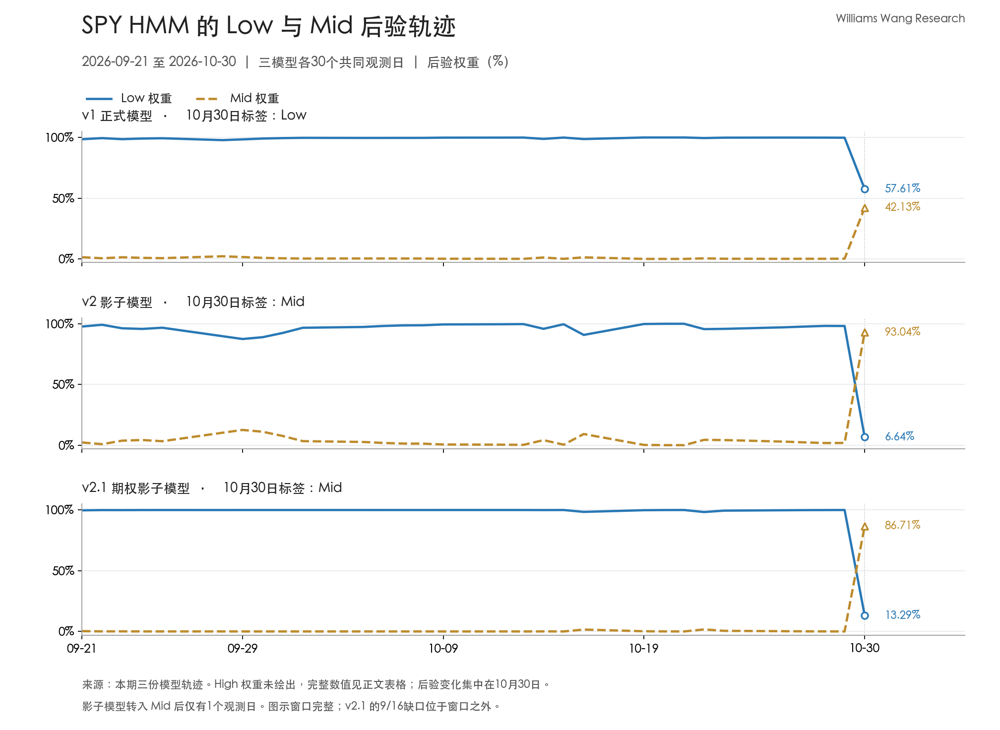

+++
title = "SPY 正式模型仍为 Low，两个影子模型转入 Mid｜2026年10月30日"
date = "2026-11-01"
data_as_of = ["2026-10-30"]
data_as_of_note = "报告及数据截止日为2026年10月30日美股收盘，整理及发布日为2026年11月1日。"
draft = false
description = "正式模型仍为Low但后验优势削弱，两个影子模型同日转入Mid；保留单日分歧及模型权重的解释边界。"
series = "SPY HMM模型分析"
categories = ["市场结构", "研究方法"]
tags = ["SPY", "HMM", "波动率", "VIX"]
featured = false
private = false
content_preservation = "verbatim"
source_sha256 = "6b9768a66973065b215ed68697aaeb8fe0611547aae31ecb59624cd96354b36d"
+++

# SPY 正式模型仍为 Low，两个影子模型转入 Mid｜2026年10月30日

**Williams Wang Research｜标普500市场观察**  
报告及数据截止日：**2026年10月30日美股收盘**；整理日期：2026年11月1日。

## 一、核心结论

1. **正式模型保留 Low 标签，但低波动状态的后验优势已明显削弱。** v1 最新 Low 权重为 **57.61%**，Mid 为 **42.13%**，两者仅相差 **15.48个百分点**。相比10月29日，Low 权重下降 **42.19个百分点**。本轮 Low 硬标签虽然已连续45个观测日未变，最新输出却已不再是权重高度集中于 Low 的情形。

2. **两个影子模型在同一天转为 Mid，形成了可比时点上的实质分歧。** 10月30日，v2 的 Mid 权重为 **93.04%**，v2.1 为 **86.71%**；正式分析仍以 v1 为锚，不能用影子模型的“多数票”替代它。但也不能只保留 v1 的 Low 标签，忽略其他模型对当前状态的不同判断。两个影子模型转入 Mid 后均只有 **1个观测日**，持续性尚待后续数据检验。

3. **市场统计支持近期波动强度高于较长窗口，价格表现也偏弱。** SPY 收于 **755.72美元**，近一周、近一月收益分别为 **-0.56%**、**-1.08%**。20日与60日年化实现波动率分别为 **11.64%**、**10.03%**，短期比中期高 **1.61个百分点**。这与模型向 Mid 重新分配权重相容，但不足以证明两者之间的具体因果关系。

4. **正式模型的替代设定标签相同，权重强度却明显不同。** normal、t1d、t2d 都给出 Low，但 Low 权重分别为 **57.61%**、**95.55%**、**80.19%**。因此，本期可以说“替代设定尚未改变正式标签”，不宜进一步声称各设定都同等强烈地确认低波动。

5. **主要变化发生在 Low 与 Mid 之间，尚无 High 主导的证据。** v1、v2 最新 High 权重分别约为 **0.26%**、**0.32%**，v2.1 低于 **0.001%**。这些是模型内部权重，不是实际尾部损失概率；Mid 也不表示价格将下跌。研究上的重点是确认此次状态分歧是否持续，而非将单日切换转成方向预测或交易指令。

## 二、SPY 市场与风险画像

### 周度与月度回报为负，近三个月累计表现接近持平

SPY 最近一周和一个月均录得负收益，近三个月收益约为 **-0.01%**，接近持平；年初至今仍上涨 **11.48%**。不同窗口反映的是累计价格表现，不能从这些汇总数值判断跌幅集中于哪一天，也不能将其直接归因于某个事件。

| 市场指标 | 本期数值 | 口径与解释 |
| --- | ---: | --- |
| SPY 收盘价 | 755.72美元 | 截至2026-10-30 |
| 近一周收益 | -0.56% | 采用包内周度窗口 |
| 近一月收益 | -1.08% | 月度累计表现偏弱 |
| 近三个月收益 | -0.01% | 舍入后数值，接近持平 |
| 年初至今收益 | +11.48% | 不代表期间没有回撤 |
| 20日实现波动率 | 11.64% | 年化，较短回看窗口 |
| 60日实现波动率 | 10.03% | 年化，较长回看窗口 |
| 近三个月最大回撤 | -3.06% | 窗口内最深峰谷回撤 |
| 年初至今最大回撤 | -8.88% | 年内窗口最深峰谷回撤 |
| VIX | 19.42 | 同为10月30日截止 |
| VIX 近一周变化 | -0.03点／-0.15% | 周度变化很小 |
| VIX 近一月变化 | +3.03点／+18.49% | 月度区间明显上行 |

上述市场指标取自本期汇总。最大回撤表示相应窗口中曾经发生的最深峰谷回撤，**不是当前价格距离高点的跌幅**。包内没有当前回撤与高点日期，不能把-3.06%或-8.88%写成当前持仓损失。

### 短期实现波动高于中期，但不能从单期截面确认上升路径

按未舍入值计算，20日实现波动率比60日高1.61个百分点，约为后者的 **116.0%**。本期截面已不符合“短期实现波动低于中期”的描述，风险观察需要承认较短窗口包含了更强的波动。

不过，20日和60日窗口相互重叠，本包也没有提供两条实现波动率的逐日轨迹。因此，不能仅凭这一比值断言“短期波动连续上升”或“上升正在加速”；当前差距可能同时受到短窗口新观测和长窗口旧观测退出的影响。模型状态也没有与某个固定实现波动率水平一一对应的通用阈值。

### VIX 月度上行、周度近乎持平，不能解释为当天突然上冲

VIX 最新为19.42，近一月增加3.03点，但近一周小幅下降0.03点。月度与周度变化方向不同，因此不能沿用“VIX 持续快速上冲”概括本期，更不能把10月30日的模型跳变直接写成“VIX 当天大涨所致”：包内没有 VIX 的完整日度路径或相应归因证据。

按 Cboe 的定义，VIX 基于 SPX 期权价格构建，反映未来约30天的预期波动；SPY 实现波动率则是对历史价格变化的统计。[Cboe：VIX 定义](https://www.cboe.com/tradable-products/vix/vix-options/)

同日 VIX 比 SPY 20日年化实现波动率高约 **7.78个波动率点**。观察日期一致，但标的、期限与构造仍不同；这一差额不能直接当作可赚取的波动率收益、期权高估证据，或未来实现波动的无偏预测误差。当前资料支持描述价格、实现波动与隐含波动各自的状态，尚不能识别期权供求、宏观事件或跨资产传导的贡献。

## 三、HMM 信号与状态演化

### v1 的 Low 标签连续45日，但最新后验已经明显不同

本期轨迹中，v1 自8月28日起连续45个观测日保持 Low。这个持续期说明最大权重状态没有切换，不能代替对最新权重分布的判断。

10月26日至29日，v1 的 Low 权重仍介于99.80%和99.92%之间；到10月30日降至57.61%，Mid 升至42.13%，High 为0.26%。由于 Low 仍是最大权重项，硬标签继续显示 Low，但 Low 对 Mid 的优势只剩15.48个百分点。**本期重要的信息是权重分布显著变宽，而不只是标签有没有改变。**

| 共同观测日 | v1 Low 权重 | v2 Low 权重 | v2.1 Low 权重 | 标签依次为 v1／v2／v2.1 |
| --- | ---: | ---: | ---: | --- |
| 2026-10-26 | 99.92% | 97.06% | 99.80% | Low／Low／Low |
| 2026-10-27 | 99.89% | 97.67% | 99.90% | Low／Low／Low |
| 2026-10-28 | 99.88% | 98.21% | 99.96% | Low／Low／Low |
| 2026-10-29 | 99.80% | 98.14% | >99.99% | Low／Low／Low |
| 2026-10-30 | 57.61% | 6.64% | 13.29% | Low／Mid／Mid |

变化主要集中于10月30日，不能描述为本周连续五天逐步走向 Mid。当前数据也没有切换后的下一日记录，尚无法区分短暂冲击后的反转与更持久的状态变化。

### 周度均值会淡化最后一天的变化

10月26日至30日，v1 的平均 Low 权重仍为 **91.42%**，显著高于最新的57.61%；v2 的周均 Low 权重为 **79.55%**，而最新值仅为6.64%；v2.1 分别为 **82.59%**和13.29%。这些均值没有算错，但主要受到前四天高 Low 权重的影响，不能用来否定最新一天已经发生的权重转移。

最近20个共同观测日，即10月5日至30日，v1 全部为 Low；v2、v2.1 则各有19日 Low、1日 Mid。因此，历史窗口仍以 Low 为主，最新状态却已经分化。两者需要同时保留，不能选取其中一个窗口替代另一个。

### 替代设定的标签一致，不能掩盖权重分歧

| v1 设定 | 截止日 | 状态 | Low 权重 | Mid 权重 | High 权重 |
| --- | --- | --- | ---: | ---: | ---: |
| normal | 2026-10-30 | Low | 57.61% | 42.13% | 0.26% |
| t1d | 2026-10-30 | Low | 95.55% | 4.45% | <0.001% |
| t2d | 2026-10-30 | Low | 80.19% | 19.56% | 0.25% |

normal 更接近 Low/Mid 边界，t1d 仍高度偏向 Low，t2d 介于两者之间。这说明“是否已经改变硬标签”在三种设定下结论一致，但“当前观测多大程度符合 Low”对设定较为敏感，不宜把本期概括为强度一致的稳健确认。

包内近期变化摘要显示，三种设定的 High 权重均有上升，但其绝对水平仍远低于 Low 或 Mid。权重从极小基数增加可能出现很大的相对倍数，因此本文主要看绝对权重及状态排序，不把倍数变化夸大为已经进入 High。

## 四、模型分歧与不确定性

### 两个影子模型已在10月30日转为 Mid

| 模型 | 分析角色 | 最新日期 | 状态 | Low 权重 | Mid 权重 | High 权重 |
| --- | --- | --- | --- | ---: | ---: | ---: |
| v1 | 正式分析锚 | 2026-10-30 | Low | 57.61% | 42.13% | 0.26% |
| v2 | 影子对照 | 2026-10-30 | Mid | 6.64% | 93.04% | 0.32% |
| v2.1 | 期权影子对照 | 2026-10-30 | Mid | 13.29% | 86.71% | <0.001% |

v2 在8月27日至10月29日连续45个观测日保持 Low，10月30日转为 Mid。v2.1 当天也由 Low 转为 Mid。两者的 Mid 权重都明显超过 Low，因此这已经是影子模型自身的标签切换，而非仅有微小概率波动。

相对10月29日，v2、v2.1 的 Low 权重分别下降 **91.50**和 **86.71个百分点**。不过，变化幅度更大不代表模型更准确；影子模型也可能共享输入信息，不能把它们视为两份相互独立的验证，更不能把两者同日切换称为稳定的领先能力。

*图：9月21日至10月30日，三个面板采用相同的日期范围与0%—100%刻度，分别展示 Low、Mid 权重。未绘出的 High 权重见表格；图内三个模型各有30条共同日期记录。影子模型转入 Mid 后仅有一个观测日。*

### 正式标签保留，低波动判断的支持力度已减弱

本期最合适的综合表述是：**正式分类仍为 Low，但已明显向 Low/Mid 边界移动；两个影子模型同日给出 Mid，短期实现波动也高于中期基准。** 这一组合削弱了“低波动仍占压倒性优势”的描述，但尚不支持宣布整个市场已经稳定进入某个新的波动状态。

v1、v2、v2.1 的后验权重是各自模型内部的相对权重，不能直接平均为“市场转入 Mid 的概率”，也不能用模型数量投票改变正式分析锚。要判断此次切换是否具有持续性或提前预测价值，需要后续共同日期、更多状态转换样本及独立验证；一个观测日不足以完成这些判断。

### 历史缺口仍存在，近期比较窗口完整

v2.1 仍缺少9月16日的期权观测，不能将该日补成 Low，也不能据当前截止日已对齐就宣称整段历史完整。本文配图的9月21日至10月30日，以及最近20个观测日窗口，均位于缺口之后，三个模型在这些共同日期上都有记录。因此，缺口限制更长历史路径的连续性表述，不妨碍本期最新日期和近期窗口的对照。

## 五、条件情景与下期观察

下一期需要检验的核心问题是：10月30日的分歧会收敛回 Low，还是正式模型也进一步转向 Mid。以下条件是研究监控框架，没有附加经校准的情景概率或交易阈值。

| 条件情景 | 可观测变化 | 对本期判断的影响 |
| --- | --- | --- |
| 权重恢复至 Low 主导 | v1 的 Low 权重明显恢复；两个影子模型回到 Low，或 Mid 权重持续下降；市场波动指标不再增强 | 有利于将10月30日视为暂时性扰动，但需要后续观测，不能预先认定已经反转 |
| 向 Mid 进一步收敛 | v1 的 Mid 超过 Low 并持续主导；影子模型维持 Mid；较短窗口实现波动仍相对较高 | 对中等波动状态的描述获得更多支持，仍不代表价格方向已确定 |
| 分歧持续 | v1 和替代设定仍偏向 Low，而两个影子模型保持 Mid | 保留正式标签，同时承认模型设定与输入所反映的状态不确定性；不进行简单多数投票 |
| 向 High 升级 | High 权重在多个观测日明显抬升，并有实际波幅、实现波动或 VIX 的进一步变化相互印证 | 需要重新评估当前主要限于 Low/Mid 的判断，不能由本期很小的 High 权重直接跳到该结论 |

监控顺序应先看最新后验与标签能否延续，再看实际价格和波动指标是否支持同一解释。既不能因 v1 尚未切换就忽略10月30日的变化，也不能因两个影子模型已经切换就预设 v1 必然跟随。

对风险预算而言，短期实现波动高于中期、正式模型的 Low 权重下降以及影子模型转入 Mid，都值得纳入压力情景。依赖近期波动估计或单一硬标签的风险判断，可能对变化反应不同；本包没有组合暴露、相关性、流动性约束和损益分布，无法据此给出具体仓位、杠杆或对冲规模。

若要解释10月30日为何发生如此集中的变化，需要补充当天原始市场路径、各输入特征及完整期权证据。本期可以确认输出如何变化，尚不能识别是哪项输入或哪一事件造成了多少变化。

**免责声明：** 本文仅供一般性信息、教育及研究讨论，不构成投资、理财、交易建议或买卖证券的推荐，也不构成购买或出售任何金融工具的邀请或要约。模型状态与条件情景不保证未来结果，具体投资判断、仓位安排及执行由读者自行决定。
