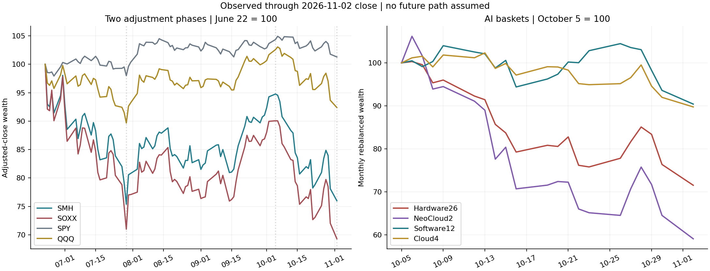
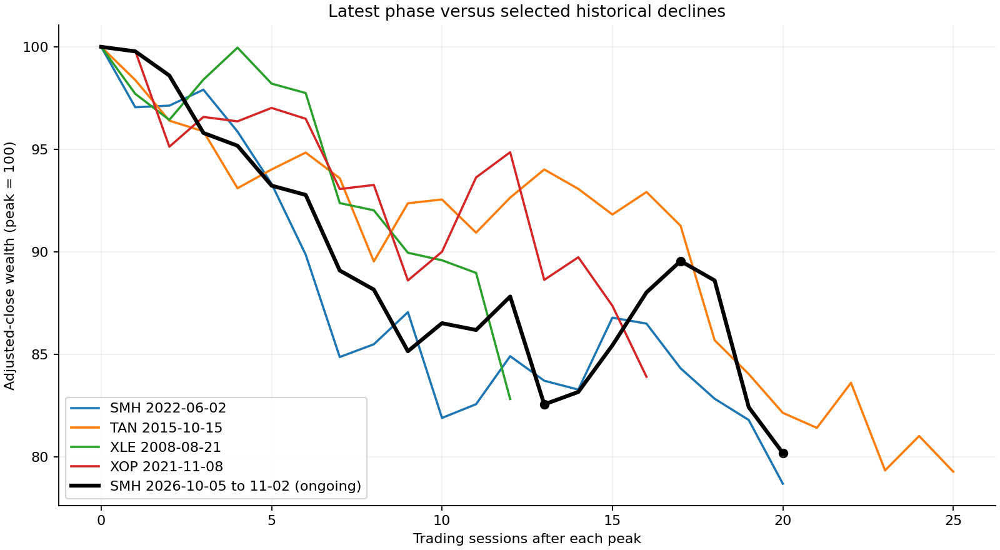
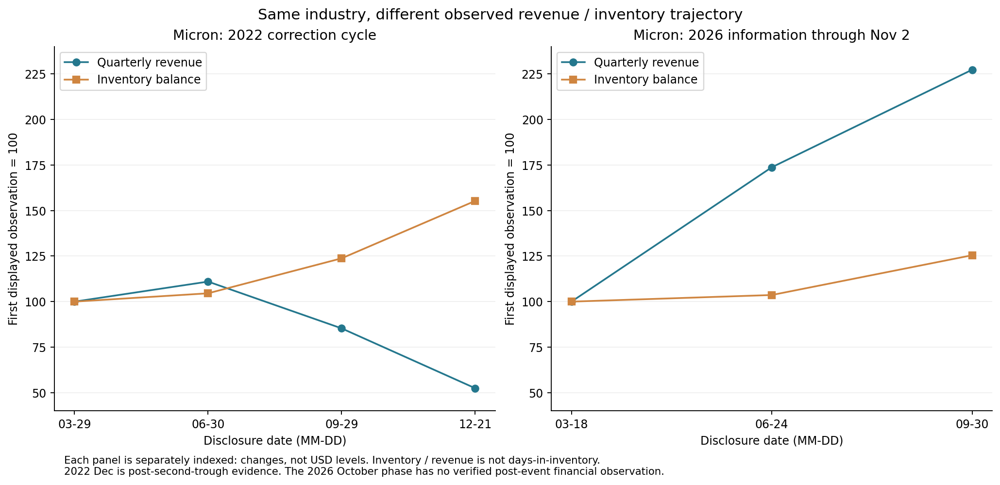
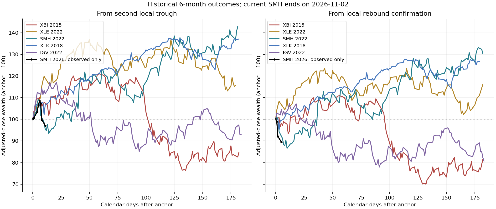
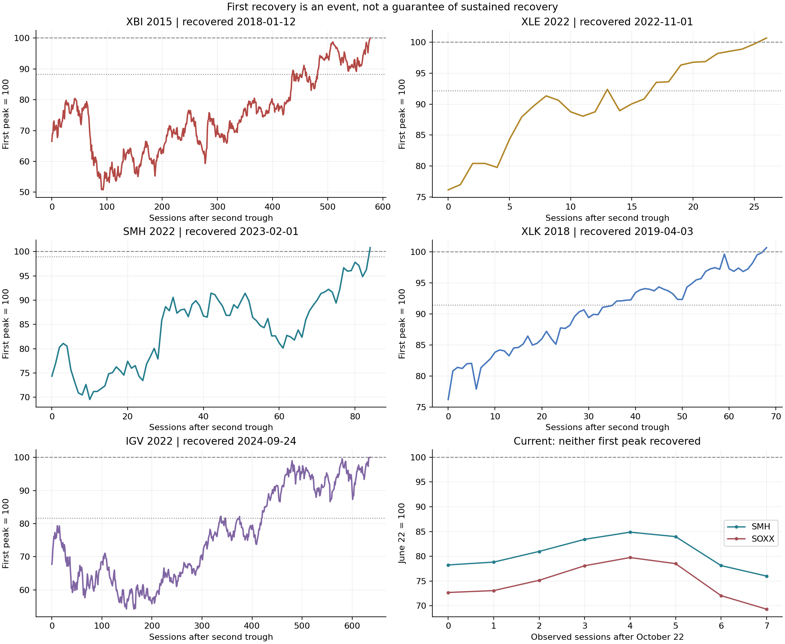
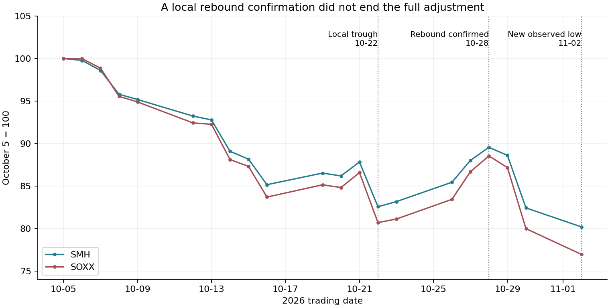
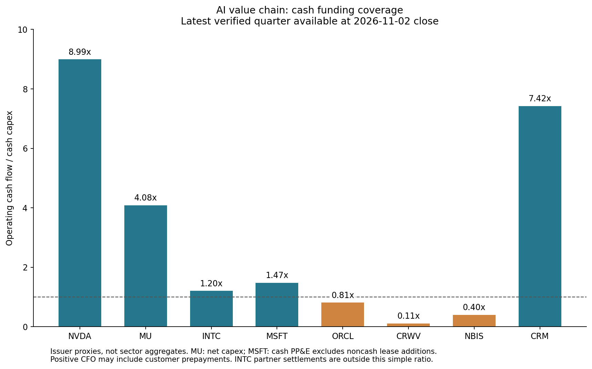

+++
title = "两次深跌之后：AI与半导体的历史参照、财务分化与修复条件"
date = "2026-11-03"
data_as_of = ["2026-10-30", "2026-11-02"]
data_as_of_note = "研究日期2026年11月3日，行情与公司信息截止11月2日美东常规收盘；VIX采用当日16:15 ET收盘。DFF、高收益OAS和美元指数截至10月30日，历史及公司财务按各自披露时点保留。"
draft = false
description = "比较AI与半导体两次深跌的历史路径、财务与融资分化，保留修复条件、47条财务披露及类比局限。"
series = ""
categories = ["科技产业", "市场结构", "研究方法"]
tags = ["AI", "半导体", "历史类比", "回撤", "现金流"]
featured = false
private = false
content_preservation = "verbatim"
source_sha256 = "a8e93a3adb064564f1697b88cc6e071aaf85bf4a2d45578beb50de23557f963d"
+++

<!-- Copyright (c) 2026, Williams.Wang. All rights reserved. Use restricted under LICENSE terms. -->
# 两次深跌之后：AI与半导体的历史参照、财务分化与修复条件

**研究日期：2026年11月3日｜行情与公司信息截止：2026年11月2日美东常规收盘。** 宏观序列按各自实际观测日期列示；VIX采用当日16:15 ET收盘值。文中“十月回调”包括延续至11月2日的下跌，不预设该日为最终底部。

**阅读口径：**除另行注明外，财务金额均为十亿美元；CFO指经营活动现金流，FCF指自由现金流，MDD指最大回撤。各公司的FCF调整口径并不完全相同。

2026年夏季与秋季，半导体和AI相关资产先后经历显著下跌。以半导体ETF SMH衡量，6月22日至7月29日回撤24.62%，10月5日至11月2日再跌19.81%；SOXX两段分别下跌29.01%和23.05%。两次高点只相隔73个交易日，第二次下跌开始时，第一次损失尚未完全修复。

历史上并不缺少类似的价格路径。真正决定这些案例有没有参考价值的，是价格背后的经营与融资条件：下跌时，订单和盈利是否转弱？账面利润能否转为现金？扩张资金来自经营、预付款还是新增融资？风险缓和之后，行业能否继续创造股东回报？

**截至11月2日，我更倾向于把本轮理解为两种压力同时存在：一部分仍保持增长的芯片供应商和大型平台正在经历重新定价；另一部分资本投入更重的算力运营环节，正在接受现金兑现和融资能力的检验。** 这还不足以把整条AI产业链归入2022年半导体那种需求、指引、库存和盈利同步转坏的周期。

相应地，上游芯片目前更适合参考2018年科技、2021年初软件的经营韧性与重新定价，以及2022年能源的强现金流缓冲；Microsoft型云平台以2018年科技为主要参照；Oracle处于成熟盈利平台与融资驱动的基础设施扩张之间；Neo Cloud则更值得借鉴2015年太阳能对融资渠道的敏感性。这些是**机制上的参照，不是回本时间表**。2022年半导体仍是最接近的价格参照，也是需要持续防范的经营恶化情形。

我对头部芯片企业最终收回销售款保持相对较高的信心。但这种信心需要放在完整的资金关系中检验：芯片货款可以正常收回，供应商也可能通过股权投资或其他安排继续支持客户。与此同时，已披露的延长账期说明，应收账款渠道也确实存在。最终收款、当期现金转换速度与整个客户生态的资金回报，是三个相关而不同的问题。

本文依次回答三个问题：本轮下跌在价格与风险上像什么；加入宏观、经营和财务证据后，哪些历史参照仍然成立；什么新证据会支持修复，什么证据会使判断转向恶化。完整的事件定义、敏感性检验、前中后财务映射和47条财务披露列于文末附录。

## 一、先把本轮下跌量清楚：幅度相近，不代表风险路径相同

### 1. 半导体、硬件、云平台的压力并不相等

下表以各资产在观察窗口内的自身高点计算回撤。不同资产的高点日期不同，不能把表中数字当作同一持有区间的横截面收益。

| 代理 | 秋季窗口内峰→截至目前最低点 | 回撤 | 交易日 | 11月2日收益 | 夏季参照窗口最大回撤 |
| --- | --- | --- | --- | --- | --- |
| 半导体 SMH | 2026-10-05 → 2026-11-02 | -19.81% | 20 | -2.71% | -24.62% |
| 半导体 SOXX | 2026-10-05 → 2026-11-02 | -23.05% | 20 | -3.79% | -29.01% |
| 大盘 SPY | 2026-10-06 → 2026-11-02 | -3.46% | 19 | -0.48% | -4.49% |
| 纳指100 QQQ | 2026-10-06 → 2026-11-02 | -10.34% | 19 | -1.36% | -11.22% |
| 软件 ETF IGV | 2026-10-09 → 2026-11-02 | -9.56% | 16 | -2.29% | -21.29% |

AI产业链另采用固定成分研究篮子：硬件26股、Neo Cloud 2股、软件12股、云平台4股，成分和权重规则见附录。它们不是现成行业指数，也不是完整市场组合。

| 代理 | 秋季窗口内峰→截至目前最低点 | 回撤 | 交易日 | 11月2日收益 | 夏季参照窗口最大回撤 |
| --- | --- | --- | --- | --- | --- |
| AI 硬件 H（26股） | 2026-10-06 → 2026-11-02 | -28.69% | 19 | -6.34% | -31.16% |
| Neo Cloud N（2股） | 2026-09-08 → 2026-11-02 | -45.95% | 39 | -8.44% | -47.90% |
| AI 软件 S（12股） | 2026-10-26 → 2026-11-02 | -13.46% | 5 | -3.41% | -22.77% |
| 云平台 C（4股） | 2026-10-13 → 2026-11-02 | -12.29% | 14 | -2.43% | -25.58% |

Neo Cloud的秋季高点在9月8日，其45.95%的回撤包含更长的下跌区间；不能简写为“十月单月跌近46%”。硬件篮子的28.69%也不能替代SMH的19.81%。软件与云平台总体跌幅较小，不代表其中每家公司承受的财务压力都小。

同一窗口更能看出行业相对压力。10月5日至11月2日，SPY下跌2.93%，QQQ下跌9.93%，SMH下跌19.81%。9个具备较长历史的大板块中，只有1个跌超5%。压力相对集中于部分成长和AI资产，尚不是所有行业同步深跌；这也不能据此推断资金流向或强制平仓规模。

### 2. 回调不能只用累计收益率定义

同样跌20%，可以是几天内集中暴跌，也可以是连续数周下行；可以随大盘一起跌，也可以明显弱于市场。本文因此同时观察损失、速度、市场相对表现和风险簇。

“尾部日”以峰值及此前252个日收益的5%分位为固定门槛；两个尾部日之间最多隔一个普通交易日，仍计入同一个簇。动态冲击则用当日对数收益除以前一日信息形成的EWMA波动预测，记录低于−2的标准化收益。前者衡量相对于事件前背景的极端损失，后者衡量相对于近期波动状态的意外冲击。

| 窗口 | 回撤 | 最差5日 | 下跌日；连续性 | 尾部日/10日最多/最大簇 | z<−2日/最大簇 | 累计损失风险尺度 | 相对SPY财富收益 |
| --- | --- | --- | --- | --- | --- | --- | --- |
| SMH 七月 | -24.62% | -14.09% | 15/26；最长5日 | 9 / 5 / 3 | 1 / 1 | 2.21 | -23.08% |
| SMH十月至11/2 | -19.81% | -10.53% | 14/20；最长9日 | 2 / 2 / 1 | 3 / 1 | 1.73 | -17.39% |
| SOXX 七月 | -29.01% | -16.29% | 16/26；最长5日 | 10 / 5 / 3 | 0 / 0 | 2.34 | -27.56% |
| SOXX十月至11/2 | -23.05% | -11.80% | 14/20；最长9日 | 2 / 2 / 1 | 3 / 1 | 1.72 | -20.72% |
| H 七月 | -31.16% | -18.78% | 14/26；最长4日 | 10 / 5 / 3 | 1 / 1 | 2.23 | -29.75% |
| H十月至11/2 | -28.69% | -17.45% | 13/19；最长5日 | 4 / 3 / 2 | 3 / 1 | 2.06 | -26.13% |

七月SMH有9个固定尾部日，最大簇包含3个尾部日；十月至11月2日只有2个，最大簇为1。但十月出现3个EWMA标准化大跌日，并经历最长九连跌。**七月更突出极端损失的集中发生，十月则兼有持续下行与反弹失败。** 仅凭累计跌幅不能区分这些路径，也不能声称十月所有风险指标都比七月极端。

### 3. 两次深跌

本文同时保留“完整阶段”和“局部波”。完整阶段从研究窗口中的高点衡量截至当前的最大损失；局部波在下跌达到门槛、随后反弹达到另一门槛后锁定。主尺度为下跌15%／反弹7.5%，另检验10%／5%及20%／10%。

在主尺度下，10月22日局部谷、10月28日反弹确认仍然成立。但之后SMH和SOXX在10月30日跌破原局部谷，11月2日继续创新低。因此，10月22日不能被当作整段调整已经结束的证据，也不能事后把已锁定的局部谷直接改名为11月2日。

| 案例 | 第一峰→谷 | 第一跌幅 | 第二峰→谷/截止 | 第二跌幅 | 触发/峰峰间隔（日） | 两波间修复比例 | 第一峰至第二谷损失 |
| --- | --- | --- | --- | --- | --- | --- | --- |
| SMH 2026（进行中） | 2026-06-22 → 2026-07-29 | -24.62% | 2026-10-05 → 2026-11-02 | -19.81% | 68/73 | 78.74% | -24.01% |
| SOXX 2026（进行中） | 2026-06-22 → 2026-07-29 | -29.01% | 2026-10-05 → 2026-11-02 | -23.05% | 72/73 | 65.73% | -30.70% |
| XBI 2015 | 2015-07-17 → 2015-08-24 | -24.13% | 2015-09-17 → 2015-09-29 | -24.70% | 29/43 | 51.41% | -33.53% |
| XLE 2022 | 2022-06-08 → 2022-07-14 | -26.04% | 2022-08-29 → 2022-09-26 | -17.35% | 68/56 | 69.85% | -23.84% |
| SMH 2022 | 2022-06-02 → 2022-07-01 | -21.31% | 2022-08-15 → 2022-09-30 | -24.89% | 57/50 | 95.14% | -25.67% |
| XLK 2018 | 2018-10-03 → 2018-11-23 | -15.61% | 2018-12-03 → 2018-12-24 | -16.66% | 22/42 | 45.23% | -23.78% |
| IGV 2022 | 2021-11-09 → 2022-01-27 | -26.25% | 2022-02-09 → 2022-03-14 | -17.05% | 46/63 | 29.96% | -32.30% |

两波间修复比例按“第二峰相对第一谷的回升／第一波损失”计算。SMH在第二次下跌前修复了第一次损失的78.74%，SOXX为65.73%；截至11月2日，相对6月第一峰分别仍低24.01%和30.70%。**第二次跌幅较小，不等于累计处境已经改善。** SOXX相对第一峰的损失已经超过七月谷底。

历史连续回调要求同一ETF相邻波段的触发日间隔、峰峰间隔均不超过84个交易日，另检验63／105日。主条件下有251条配对记录、20种ETF，但跨ETF同一危机及相邻窗口重叠较多，不能当成251个独立实验。上表五个历史案例用于比较不同机制，并非按后续收益挑出的成功或失败样本，也不声称是当前双波结构的五个最近邻。

## 二、价格筛选提供候选，宏观与财务决定类比的含义

历史候选截止2026年6月30日，避免把本轮纳入自身的类比库。主尺度共有597个已反弹确认的候选。相似度将损失、持续时间、相对SPY表现、风险四个领域等权比较；各项先转成候选库经验分位，再计算差异。距离越小表示描述特征越近，**不表示未来重演的概率越高**。

| 排名 | 代理 | 峰→谷 | 回撤 | 交易日 | 相对SPY | 尾部日/z<−2日 | 距离 |
| --- | --- | --- | --- | --- | --- | --- | --- |
| 1 | SOXX | 2022-06-02 → 2022-07-01 | -22.18% | 20 | -15.16% | 2/2 | 0.0795 |
| 2 | SMH | 2022-06-02 → 2022-07-01 | -21.31% | 20 | -14.22% | 2/2 | 0.0815 |
| 3 | TAN | 2015-10-15 → 2015-11-19 | -20.72% | 25 | -23.08% | 3/2 | 0.1065 |
| 4 | XME | 2010-01-08 → 2010-02-04 | -22.56% | 18 | -16.65% | 1/2 | 0.1078 |
| 5 | XME | 2025-10-14 → 2025-11-20 | -19.74% | 27 | -18.54% | 6/3 | 0.1088 |
| 6 | XBI | 2023-02-02 → 2023-03-22 | -20.48% | 33 | -15.80% | 1/3 | 0.1176 |
| 7 | XME | 2015-08-31 → 2015-09-28 | -19.43% | 19 | -15.73% | 2/0 | 0.1181 |
| 8 | XOP | 2022-08-29 → 2022-09-26 | -23.22% | 19 | -15.49% | 2/2 | 0.1211 |
| 9 | TAN | 2014-03-06 → 2014-04-15 | -22.69% | 28 | -21.37% | 2/2 | 0.1223 |
| 10 | KRE | 2008-02-01 → 2008-03-06 | -19.16% | 23 | -13.90% | 2/0 | 0.1255 |

排名前两位是同一次2022年6月半导体冲击。它们在20个交易日跌约21%—22%，与本轮SMH的20日、19.81%和2个固定尾部日较接近。但当时同窗口SPY下跌8.27%，9大板块有6个跌超5%；当前对应数字是2.93%和1个。价格近似掩盖了市场共同压力的差别。

排名第三的2015年太阳能，则提示融资渠道可能比行业标签更有解释力。前十其余未展开核查的候选，仅保留为数量筛选结果，不凭排名推定其驱动。本文深入比较10条单波记录与5个连续回调案例；SMH／SOXX同期记录及单波、双波之间存在重叠。

### 1. 2022年半导体：价格最像，但是已披露的财务方向却不同

2022年SMH在6月2日至7月1日下跌21.31%，随后在8月15日至9月30日再跌24.89%。第二波期间，10年美债收益率由2.79%升至3.83%；联储政策区间从6月的1.50%—1.75%升至9月的3.00%—3.25%。紧缩环境与行业需求、库存调整同时发生。[6月FOMC](https://www.federalreserve.gov/newsevents/pressreleases/monetary20220615a.htm)、[9月FOMC](https://www.federalreserve.gov/newsevents/pressreleases/monetary20220921a.htm)

Micron提供了一条清晰的财务证据链。下表金额为十亿美元，资本开支采用公司净额口径。

| 披露日期及位置 | 季度收入／净利 | CFO／净资本开支／公司FCF | 库存／债务 | 下一季收入指引中值 |
| --- | --- | --- | --- | --- |
| 2022-03-29，第一波前 | 7.786／2.263 | 3.628／2.600／1.028 | 5.383／7.076 | 8.700 |
| 2022-06-30，第一波中、第二波前 | 8.642／2.626 | 3.838／2.528／1.310 | 5.629／6.963 | 7.200 |
| 2022-09-29，第二波中 | 6.643／1.492 | 3.777／3.581／0.196 | 6.663／6.906 | 4.250 |
| 2022-12-21，第二谷后 | 4.085／−0.195 | 0.943／2.471／−1.528 | 8.359／10.265 | 3.800 |

收入仍在创新高时，6月公告的下一季指引已经转弱；9月收入下降、库存上升；12月进一步转亏，FCF转负。6月30日披露在盘后，属于第一波末段的新信息，不能解释此前整月跌幅。NVIDIA同年8月也披露Gaming收入同比下降33%、环比下降44%，而Data Center仍增长，说明即使在同一行业周期中也存在分化。[Micron 6月公告](https://www.sec.gov/Archives/edgar/data/723125/000072312522000034/a2022q3ex991-pressrelease.htm)、[9月公告](https://stage-investors.micron.com/news/press-release/2022/Micron-Technology-Inc--Reports-Results-for-the-Fourth-Quarter-and-Full-Year-of-Fiscal-2022-09-29-2022/default.aspx)、[12月公告](https://investors.micron.com/news/press-release/2022/Micron-Technology-Inc--Reports-Results-for-the-First-Quarter-of-Fiscal-2023-12-21-2022/default.aspx)、[NVIDIA当时公告](https://nvidianews.nvidia.com/news/nvidia-announces-financial-results-for-second-quarter-fiscal-2023)

本轮Micron的收入、下一季指引和现金余量目前仍向上，NVIDIA收入与营业利润也继续增长。两次都出现深跌，并不足以跨过这一基本面差异。

第二谷之后，2022年SMH也没有立即见底：10月4日确认反弹，10月7日BIS公布新出口管制，10月10日再次破底，10月14日出现更低点。此后，11月10日发布的CPI显示通胀有所缓和，紧缩路径预期改善，为修复提供条件；但联储直到2023年2月仍在加息，不能写成“降息带动反弹”。[BIS公告](https://media.bis.gov/press-release/commerce-implements-new-export-controls-advanced-computing-semiconductor-manufacturing-items-peoples)、[当时CPI](https://www.bls.gov/news.release/archives/cpi_11102022.htm)、[2023年2月FOMC](https://www.federalreserve.gov/newsevents/pressreleases/monetary20230201a.htm)

SMH于2023年2月1日恢复两个前峰，第二谷后六个月上涨42.79%，期间最大回撤14.26%。Micron在12月仍亏损，说明股价可以先于当期财务修复。NVIDIA在2023年2月22日讨论生成式AI新服务，已晚于SMH回到前高，只能作为六个月后段的产业背景，不能倒过来解释此前的恢复。[NVIDIA 2023年2月公告](https://investor.nvidia.com/news/press-release-details/2023/NVIDIA-Announces-Financial-Results-for-Fourth-Quarter-and-Fiscal-2023/default.aspx)

### 2. 2018年科技与2021年初软件：经营韧性需要折现环境配合

2018年XLK先跌15.61%，反弹后再跌16.66%。Microsoft在两波前、第一波中、第二谷后披露的季度收入为30.085、29.084、32.471，CFO为11.418、13.657、8.900，现金资本开支为3.980、3.602、3.707；现金及证券约127.7—135.9，债务约73.2—76.2。虽然季度间有季节性，业务现金创造和资产负债表缓冲均较强。2019年1月披露的季度收入同比增长12%、Azure增长76%，比单看环比更能说明经营韧性。[峰前财报](https://www.microsoft.com/en-us/investor/earnings/fy-2018-q4/press-release-webcast)、[事件中财报](https://www.microsoft.com/en-us/investor/earnings/fy-2019-q1/press-release-webcast)、[谷后财报](https://www.microsoft.com/en-us/investor/earnings/fy-2019-q2/press-release-webcast)

2019年1月30日联储转而强调耐心，并保留调整资产负债表正常化安排的灵活性。六个月内10年收益率由2.74%降至2.02%，VIX由36.07降至15.26；XLK未再跌破第二谷，68个交易日恢复第一峰。与此同时，Apple在1月2日仍下调收入指引，5月贸易关税又带来压力。这是一种“部分业务有韧性、宏观压力缓解”的组合，而非全行业盈利已经同步改善。[FOMC](https://www.federalreserve.gov/newsevents/pressreleases/monetary20190130a.htm)、[资产负债表声明](https://www.federalreserve.gov/newsevents/pressreleases/monetary20190130c.htm)、[Apple投资者信](https://www.apple.com/newsroom/2019/01/letter-from-tim-cook-to-apple-investors/)、[5月关税声明](https://ustr.gov/about-us/policy-offices/press-office/press-releases/2019/may/statement-us-trade-representative)

2021年初IGV则在15个交易日跌15.31%，同期10年收益率由1.20%升至1.59%。Salesforce事件前、中、后的收入由5.419增至5.817、5.963，现金由9.492增至11.966、15.023，债务约2.677；后两次公告仍提高收入指引。CFO的0.339、2.174、3.228包含明显季节性，净利又受投资收益影响。这更适合说明成长资产即使经营仍在扩张，也可能承受折现率和风险溢价重估。[前期财报](https://investor.salesforce.com/news/news-details/2020/Salesforce-Announces-Strong-Third-Quarter-Fiscal-2021-Results/default.aspx)、[事件中财报](https://investor.salesforce.com/news/news-details/2021/Salesforce-Announces-Strong-Fourth-Quarter-and-Full-Year-Fiscal-2021-Results--Raises-FY22-Revenue-Guidance-to-25.65-Billion-to-25.75-Billion/default.aspx)、[事件后财报](https://investor.salesforce.com/news/news-details/2021/Salesforce-Announces-Strong-First-Quarter-Fiscal-2022-Results/default.aspx)

联储当时仍维持零利率和资产购买；其事后复盘将2月25日国债市场的收益率急升、流动性恶化与7年期国债拍卖相联系。这里参考的是折现机制，并非把软件全部跌幅归给利率。当前十月长端收益率净下降、资本投入强度又更高，不能直接复制2021年初的解释。[当时货币政策报告](https://www.federalreserve.gov/monetarypolicy/files/20210219_mprfullreport.pdf)、[2021年5月发布的事件复盘](https://www.federalreserve.gov/econres/notes/feds-notes/the-treasury-market-flash-event-of-february-25-2021-20210514.html)

### 3. 2022年能源与2021年油气开采：强现金流能提供缓冲

2022年XLE两波分别下跌26.04%和17.35%，但ExxonMobil第一至第三季净利由5.480升至17.850、19.660，CFO由14.788升至19.963、24.425；现金11.074→18.861→30.407，债务47.537→46.883→45.428。第一季净利还受俄罗斯相关减值影响。现金创造增强且债务没有同步扩张，为抵御预期波动提供了实质缓冲。[第一季](https://corporate.exxonmobil.com/news/news-releases/2022/0429_exxonmobil-announces-first-quarter-2022-results)、[第二季](https://corporate.exxonmobil.com/news/news-releases/2022/0729_exxonmobil-announces-second-quarter-2022-results)、[第三季](https://corporate.exxonmobil.com/news/news-releases/2022/1028_exxonmobil-announces-third-quarter-2022-results)

XLE在第二谷后26个交易日恢复第一峰。10月5日OPEC+宣布下调产量目标，为供给预期提供支持，但它晚于10月3日的反弹确认；目标下调200万桶／日也不等于实际供给必然减少相同数量。10月28日Exxon强财报则在收复第二峰之后、第一峰之前。两者支持修复机制，不能解释全部起始涨幅。六个月内XLE最大回撤仍有17.34%，回到前高不等于风险消失。[OPEC+声明](https://www.opec.org/pr-detail/73-05-oct-2022.html)

2021年XOP在11月8日至12月1日跌16.09%。EOG第三、四季CFO由2.196升至3.166，现金资本开支由0.935升至1.057，现金4.293→5.209，债务基本稳定。Omicron在11月下旬带来需求不确定性，VIX由17.22升至31.12，但后续财务未同步崩塌。WHO信息出现于下跌后段，不能解释整段损失；2022年2月24日披露的第四季经营也不包含当天爆发的战争影响。[EOG第三季](https://investors.eogresources.com/2021-11-04-EOG-Resources-Reports-Excellent-Third-Quarter-2021-Results-Raises-Regular-Dividend-82-and-Declares-2-00-per-Share-Special-Dividend)、[第四季公司公告](https://www.prnewswire.com/news-releases/eog-resources-reports-fourth-quarter-and-full-year-2021-results-announces-2022-capital-program-declares-1-00-per-share-special-dividend-301490102.html)、[WHO声明](https://www.who.int/news-room/statements/28-11-2021-update-on-omicron)

这两例有助于理解当前高现金产生的芯片供应商为何可能承受住预期波动。但油气供给约束、商品价格与AI下游投资回报的形成机制不同，不能把能源的修复速度移植到芯片。

### 4. 2015年太阳能：融资渠道可以反过来约束业务

TAN在2015年10月15日至11月19日跌20.72%。SunEdison第二、三季收入分别为0.455和0.476，净亏0.263和0.284；前半年CFO−0.929，前九个月−1.136，对应PP&E及项目建设支出0.996和1.812。现金由1.294增至2.393，合并债务由10.722增至11.672；现金增加伴随前九个月7.288的融资现金净流入，不能解释为主营造血转强。六个月与九个月流量也不能直接环比。[第二季10-Q](https://www.sec.gov/Archives/edgar/data/945436/000094543615000216/suned-630201510q.htm)、[第三季10-Q](https://www.sec.gov/Archives/edgar/data/945436/000094543615000274/suned-930201510q.htm)

事件中公司已明确披露：TerraForm两家融资载体股价下跌、债务融资收益率上升，限制了可获得资本并提高成本，因而计划减少项目出售；保证金贷款也带来现金约束。合并现金并不等于母公司可用现金，合并债务又包含非追索项目债。与此同时，SunPower仍称电站和分布式需求强劲，联储10月仍维持0—0.25%。融资压力可以先于全行业终端需求坍塌出现。[SunPower当时公告](https://www.sec.gov/Archives/edgar/data/867773/000086777315000071/ex99_1x10282015.htm)、[当时FOMC](https://www.federalreserve.gov/newsevents/pressreleases/monetary20151028a.htm)

这一机制与部分算力运营商相关：建设付款在前，项目或服务现金回收在后，资本渠道变化会改变扩张速度。但客户预付、抵押品、债务追索、收入质量与融资来源均可能不同。本文不据此推断CoreWeave、Nebius或Oracle会复制SunEdison的信用结局，也不用后来的破产倒推事件前的全部信息。SunEdison谷后3个月内未取得可比下一份季度财务，相关字段保留缺失。

### 5. 三组反例：高利润、营收增长和短期反弹，都不保证迅速回本

**2008年能源提醒我们，历史利润可以很强，前景仍会转差。** XLE在8月21日至9月9日跌17.18%。Exxon第二、三季净利仍有11.680和14.830，CFO约13.4和14.4，第三季利润还包含资产处置收益。但当时信贷与住房环境承压，EIA已讨论需求增长放缓；10年收益率下降、VIX上升。所选下跌窗口止于9月9日，不能将后来雷曼破产作为此前已经发生的驱动。资本与勘探支出不等于可比现金资本开支，相关FCF、现金和债务缺口也不能填造。[第二季财报](https://investor.exxonmobil.com/sec-filings/all-sec-filings/content/0000034088-08-000102/r8k2q991.htm)、[第三季财报](https://investor.exxonmobil.com/company-information/press-releases/detail/985/exxon-mobil-corporation-announces-estimated-third-quarter)、[当时FOMC](https://www.federalreserve.gov/newsevents/pressreleases/monetary20080805a.htm)、[EIA当时展望](https://www.eia.gov/outlooks/steo/archives/sep08.pdf)

**2011年太阳能说明，行业政策可以压过宽松宏观。** TAN在2月18日至3月11日跌18.11%，美国仍处于零利率与QE2阶段，10年收益率还在下降。SunPower在峰前披露季度收入0.937，谷后下一季降至0.451，净亏0.002、CFO−0.175，库存由0.313增至0.487。公司5月申报把意大利3月补贴安排的不确定性与项目推迟、价格压力、库存增加联系起来；季节性与项目确认也影响收入，不能把全部降幅归于政策。这是事后确认机制的证据，不是峰值当日已经知道的完整信息。[峰前公告](https://www.sec.gov/Archives/edgar/data/867773/000114036111010514/ex99_1.htm)、[谷后10-Q](https://www.sec.gov/Archives/edgar/data/867773/000086777311000015/spwra_04032011x10-q.htm)、[当时FOMC](https://www.federalreserve.gov/newsevents/pressreleases/monetary20110126a.htm)

**2015年生物科技和2021—2022年软件说明，局部改善未必足以消除行业风险。** XBI第一波跌24.13%，第二波8个交易日全部下跌，累计24.70%。第一波中Biogen下调全年收入指引，且市场共同压力很大；第二波药价审查成为公开议题。Biogen第三季又提高指引，季度收入与净利继续增长，但这家成熟盈利公司不能代表整个XBI，更不能代表尚未盈利的研发企业。[Biogen当时披露](https://investors.biogen.com/node/16476/pdf)、[药价调查](https://www.sanders.senate.gov/press-releases/sanders-and-cummings-investigate-overnight-price-increase-of-life-saving-drug/)、[第三季公告](https://www.sec.gov/Archives/edgar/data/875045/000087504515000032/q32015pressrelease.htm)

XBI第二谷后三个月一度上涨19.45%，六个月却跌15.44%，期间最大回撤36.89%。药价与支付约束没有消失；2016年2月Gilead给出较上年偏低的销售指引，但XBI在1月已经首次破底，不能倒置时间。后来并购与研发兑现提供了修复背景，恢复第一峰仍用了577个交易日。[参议院后续调查](https://www.finance.senate.gov/ranking-members-news/wyden-grassley-sovaldi-investigation-finds-revenue-driven-pricing-strategy-behind-84-000-hepatitis-drug)、[Gilead财报](https://www.sec.gov/Archives/edgar/data/882095/000088209516000036/exhibit991earningspressrel.htm)

IGV在2021年11月至2022年3月的两波中分别跌26.25%和17.05%。Salesforce连续披露的收入仍由6.340升至7.411，但中间GAAP利润转薄甚至小幅亏损，Slack收购改变了增长和债务口径。第二谷后六个月，10年收益率从2.14%升至3.41%，客户采购更审慎、汇率亦有压力。随后盈利结构改善与政策变化才逐步支持修复；IGV恢复第一峰用了636个交易日。正收入增长或正CFO，都不足以推出短期回本。[2022年3月财报](https://investor.salesforce.com/news/news-details/2022/Salesforce-Announces-Record-Fourth-Quarter-and-Full-Year-Fiscal-2022-Results/default.aspx)、[8月经营压力](https://www.salesforce.com/news/press-releases/2022/08/24/q2-fy23-results-earnings-update/)、[2023年利润率目标](https://investor.salesforce.com/news/news-details/2023/Salesforce-Announces-Strong-Fourth-Quarter-and-Full-Fiscal-2023-Results/default.aspx)

## 三、第二次回调之后：先反弹、再破底，是历史上真实存在的路径

历史类比最容易造成的误解，是只看最终六个月收益，忽略起点如何选、途中损失有多深，以及回到哪个前高。本文从事后第二谷和反弹确认日分别计算；1、3、6个月指自然月，目标日不是交易日时取此前最近交易日。最大回撤包含起点高水位，衡量窗口内从任一高点到后续低点的损失，并非终点收益或相对起点的最低收益。

### 1. 从第二谷起算，五个案例的分化很大

| 案例／第二谷 | 计算起点 | 1个月：收益 / 最大回撤 | 3个月：收益 / 最大回撤 | 6个月：收益 / 最大回撤 |
| --- | --- | --- | --- | --- |
| XBI 2015-09-29 | 2015-09-29 | +12.15% / -7.33% | +19.45% / -10.56% | -15.44% / -36.89% |
| XLE 2022-09-26 | 2022-09-26 | +28.90% / -3.73% | +27.94% / -12.12% | +15.66% / -17.34% |
| SMH 2022-09-30 | 2022-09-30 | +4.14% / -14.26% | +10.87% / -14.26% | +42.79% / -14.26% |
| XLK 2018-12-24 | 2018-12-24 | +12.83% / -5.05% | +27.66% / -5.05% | +37.09% / -10.46% |
| IGV 2022-03-14 | 2022-03-14 | +7.04% / -8.68% | -13.24% / -26.40% | -7.10% / -27.39% |

五例一个月收益均为正，六个月却分为三涨两跌。XBI先涨近20%后大幅下行；SMH先再破底，后来强修复；XLE和XLK六个月内没有跌破第二谷；IGV则在第一次反弹后继续调整。五个经过机制筛选、且并不独立的案例，不能转换成“六个月上涨概率60%”或“再次破底概率60%”。

### 2. 等待反弹确认，结果与谷底起算明显不同

主尺度要求从局部低点反弹至少7.5%，确认通常已经晚于低点2—5个交易日，期间价格回升7.57%—10.68%。从确认日重新计算，收益普遍受到起始价格抬高影响，同时自然月终点也随之移动。

| 案例／第二谷 | 计算起点 | 1个月：收益 / 最大回撤 | 3个月：收益 / 最大回撤 | 6个月：收益 / 最大回撤 |
| --- | --- | --- | --- | --- |
| XBI 2015-09-29 | 2015-10-02 | +8.40% / -7.33% | +7.44% / -10.56% | -18.54% / -36.89% |
| XLE 2022-09-26 | 2022-10-03 | +18.70% / -3.73% | +12.06% / -12.12% | +16.16% / -17.34% |
| SMH 2022-09-30 | 2022-10-04 | -4.28% / -14.26% | +4.44% / -14.26% | +30.33% / -14.26% |
| XLK 2018-12-24 | 2018-12-31 | +6.94% / -5.05% | +19.78% / -5.05% | +26.76% / -10.46% |
| IGV 2022-03-14 | 2022-03-17 | -2.05% / -8.68% | -20.58% / -27.39% | -19.27% / -27.39% |

例如，2022年SMH的一个月收益由谷底口径的+4.14%变为−4.28%；IGV由+7.04%变为−2.05%。这不是可直接执行的策略回测：确认发生在收盘，表中从该收盘起算，没有模拟下一可交易时点、滑点或成本。它的作用是揭示事后谷底起算的乐观偏差。

### 3. 再创新低与恢复前高，必须分别回答

| 案例 | 6个月内破第二谷 | 首次跌破 | 6个月最低点相对第二谷 | 最低点日期 | 恢复第一峰前首次跌破 |
| --- | --- | --- | --- | --- | --- |
| XBI 2015-09-29 | 是 | 2016-01-11 | -23.64% | 2016-02-11 | 2016-01-11 |
| XLE 2022-09-26 | 否 | — | +0.00% | 2022-09-26 | — |
| SMH 2022-09-30 | 是 | 2022-10-10 | -6.47% | 2022-10-14 | 2022-10-10 |
| XLK 2018-12-24 | 否 | — | +0.00% | 2018-12-24 | — |
| IGV 2022-03-14 | 是 | 2022-04-26 | -14.89% | 2022-06-16 | 2022-04-26 |

XBI的六个月最低点比第二谷低23.64%，但窗口内最大回撤达36.89%，因为它先反弹再下跌。IGV六个月最低点出现在2022年6月16日；若把观察期延长到恢复第一峰，其更低点在11月4日、较第二谷低20.01%。不同观察期不能混为一个“最低点”。

| 案例 | 第二峰 | 恢复第二峰：日期与谷后耗时 | 第一峰 | 恢复第一峰：日期与谷后耗时 |
| --- | --- | --- | --- | --- |
| XBI 2015-09-29 | 2015-09-17 | 2017-06-22（436 交易日／632 自然日） | 2015-07-17 | 2018-01-12（577 交易日／836 自然日） |
| XLE 2022-09-26 | 2022-08-29 | 2022-10-13（13 交易日／17 自然日） | 2022-06-08 | 2022-11-01（26 交易日／36 自然日） |
| SMH 2022-09-30 | 2022-08-15 | 2023-02-01（84 交易日／124 自然日） | 2022-06-02 | 2023-02-01（84 交易日／124 自然日） |
| XLK 2018-12-24 | 2018-12-03 | 2019-02-15（36 交易日／53 自然日） | 2018-10-03 | 2019-04-03（68 交易日／100 自然日） |
| IGV 2022-03-14 | 2022-02-09 | 2023-07-18（337 交易日／491 自然日） | 2021-11-09 | 2024-09-24（636 交易日／925 自然日） |

XBI恢复第二峰用了436个交易日，恢复第一峰用了577日；IGV分别为337日和636日。第一次损失没有全部修复时，回到第二峰与彻底恢复前高相差很大。所有“回到前高”均按分红及拆股调整后的财富序列判断，并不等于未复权股价回到相同报价。

市场和宏观也不能用一个标签概括：XBI六个月里SPY上涨10.25%、长端收益率与VIX下降，它仍明显落后；SMH修复期间政策利率继续上升，它却上涨42.79%。行业现金流、政策约束、增长预期与风险溢价，需要结合起来判断。相对市场与宏观全表列于附录。

### 4. 本轮尚不能填入完整的1、3、6个月结果

| 代理/起点 | 截至11/2交易日数 | 实际已观察收益 | 已观察窗口最大回撤 | 1/3/6个月结果 |
| --- | --- | --- | --- | --- |
| SMH 10/22局部谷 | 7 | -2.87% | -10.46% | 全部 NA：观察不足 |
| SMH 10/28确认日 | 3 | -10.46% | -10.46% | 全部 NA：观察不足 |
| SOXX 10/22局部谷 | 7 | -4.63% | -13.08% | 全部 NA：观察不足 |
| SOXX 10/28确认日 | 3 | -13.08% | -13.08% | 全部 NA：观察不足 |

从10月22日局部谷到11月2日，仅过去7个交易日；从10月28日反弹确认起，仅过去3个交易日。SMH自确认日跌10.46%，SOXX跌13.08%，已说明一次反弹确认不能证明完整阶段结束。当前阶段的完整前瞻窗口均未成熟，必须保留空缺。

| 代理 | 相对10月5日高点 | 恢复该高点所需涨幅 | 相对6月22日高点 | 恢复该高点所需涨幅 |
| --- | --- | --- | --- | --- |
| SMH | -19.81% | +24.71% | -24.01% | +31.59% |
| SOXX | -23.05% | +29.95% | -30.70% | +44.29% |

截至11月2日，SMH回到第二峰还需上涨24.71%，回到第一峰需31.59%；SOXX分别需29.95%和44.29%。这些是恢复距离，不是目标收益预测。

## 四、把历史参照放回2026年：宏观没有单一答案，财务需要分层

### 1. 十月是高利率背景下的回调，却不是长端利率一路上升

七月SMH下跌期间，10年收益率从4.51%升至4.67%，有效联邦基金利率维持3.63%；十月起点的利率更高，但10月5日至11月2日，10年收益率反而下降40bp，2年下降25bp。VIX与信用风险溢价上升，表明风险承受意愿转弱，不能把整段下跌归结为长端利率上行。

| 指标 | 10月5日 | 截止时最新观测 | 实际观测日期 | 最新数据来源 |
| --- | --- | --- | --- | --- |
| 10年美债收益率 % | 5.31 | 4.91 | 2026-11-02 | FRED历史序列／财政部最新观测 |
| 2年美债收益率 % | 4.84 | 4.59 | 2026-11-02 | FRED历史序列／财政部最新观测 |
| 有效联邦基金利率 % | 3.88 | 3.88 | 2026-10-30 | FRED历史序列 |
| 10年盈亏平衡通胀率 % | 2.36 | 2.29 | 2026-11-02 | FRED历史序列 |
| 高收益债 OAS % | 3.12 | 3.44 | 2026-10-30 | FRED历史序列 |
| VIX 指数点 | 15.52 | 21.15 | 2026-11-02 | FRED历史序列／Cboe日收盘（16:15 ET） |
| 广义美元指数 | 121.27 | 121.67 | 2026-10-30 | FRED历史序列 |

利率采用财政部与FRED数据，VIX为Cboe日收盘；DFF、高收益债OAS和美元指数最新观测仍为10月30日，没有将旧值标成11月2日。政策利率目标区间、实际有效利率与长期国债收益率是不同变量；高收益OAS也不是Neo Cloud公司的实际借款成本。[财政部收益率](https://home.treasury.gov/resource-center/data-chart-center/interest-rates/TextView?type=daily_treasury_yield_curve&field_tdr_date_value=2026)、[Cboe VIX](https://www.cboe.com/tradable-products/vix/vix-historical-data/)、[FRED有效利率](https://fred.stlouisfed.org/series/DFF)、[高收益OAS](https://fred.stlouisfed.org/series/BAMLH0A0HYM2)

政策与实体数据同样具有两面性。联储7月29日维持3.50%—3.75%，9月16日加息至3.75%—4.00%，10月28日维持；10月14日发布的9月CPI环比0.6%、同比3.7%，核心环比0.3%、同比2.6%。11月2日公布的10月ISM制造业PMI为55.5，新订单55.5、生产59.0，价格指数75.2，显示扩张与投入价格压力并存。总量数据尚不支持“全面衰退已经发生”，也不能证明所有AI投资都能获得足够回报。[7月FOMC](https://www.federalreserve.gov/newsevents/pressreleases/monetary20260729a.htm)、[9月FOMC](https://www.federalreserve.gov/newsevents/pressreleases/monetary20260916a.htm)、[10月FOMC](https://www.federalreserve.gov/newsevents/pressreleases/monetary20261028a.htm)、[CPI发布](https://www.bls.gov/news.release/archives/cpi_10142026.htm)、[ISM当日说明](https://www.ismworld.org/supply-management-news-and-reports/news-publications/inside-supply-management-magazine/blog/2026/2026-11/ism-pmi-reports-roundup-october-2026-manufacturing/)

### 2. 七月与十月之间，经营证据发生了什么变化

财务比较必须按**披露时间**对齐，而非财期末。Microsoft 7月29日财报在盘后，不能塞进当天收盘前的七月谷底信息；十月阶段尚未结束，也没有可填写的“事件后”季报。下表列出当时已知的季度收入及公告日期，完整盈利、现金流和资产负债情况可通过同篇附录跳转查阅。金额均为十亿美元。

| 公司 | 七月波前：6/22收盘 | 七月谷时：7/29收盘 | 十月波前：10/5收盘 | 截至11/2收盘 |
| --- | --- | --- | --- | --- |
| NVDA | [营收81.615；2026-05-20披露](#fin-nvda_26q1) | [营收81.615；2026-05-20披露](#fin-nvda_26q1) | [营收96.221；2026-08-26披露](#fin-nvda_26q2) | [营收96.221；2026-08-26披露](#fin-nvda_26q2) |
| MU | [营收23.860；2026-03-18披露](#fin-mu_26q2) | [营收41.456；2026-06-24披露](#fin-mu_26q3) | [营收54.229；2026-09-30披露](#fin-mu_26q4) | [营收54.229；2026-09-30披露](#fin-mu_26q4) |
| INTC | [营收13.577；2026-04-23披露](#fin-intc_26q1) | [营收16.128；2026-07-23披露](#fin-intc_26q2) | [营收16.128；2026-07-23披露](#fin-intc_26q2) | [营收16.513；2026-10-29披露](#fin-intc_26q3) |
| MSFT | [营收82.886；2026-04-29披露](#fin-msft_26q1) | [营收82.886；2026-04-29披露](#fin-msft_26q1) | [营收90.007；2026-07-29披露](#fin-msft_26q2) | [营收92.279；2026-10-28披露](#fin-msft_26q3) |
| ORCL | [营收19.184；2026-06-10披露](#fin-orcl_26q4) | [营收19.184；2026-06-10披露](#fin-orcl_26q4) | [营收19.345；2026-09-10披露](#fin-orcl_27q1) | [营收19.345；2026-09-10披露](#fin-orcl_27q1) |
| CRWV | [营收2.078；2026-05-07披露](#fin-crwv_26q1) | [营收2.078；2026-05-07披露](#fin-crwv_26q1) | [营收2.575；2026-08-11披露](#fin-crwv_26q2) | [营收2.575；2026-08-11披露](#fin-crwv_26q2) |
| NBIS | [营收0.399；2026-05-13披露](#fin-nbis_26q1_sec) | [营收0.399；2026-05-13披露](#fin-nbis_26q1_sec) | [营收0.582；2026-08-12披露](#fin-nbis_26q2) | [营收0.582；2026-08-12披露](#fin-nbis_26q2) |
| CRM | [营收11.133；2026-05-27披露](#fin-crm_26q1) | [营收11.133；2026-05-27披露](#fin-crm_26q1) | [营收11.345；2026-08-26披露](#fin-crm_26q2) | [营收11.345；2026-08-26披露](#fin-crm_26q2) |

核心变化是分化进一步显现。NVIDIA、Micron继续扩大收入和营业成果，Microsoft增长与建设投入同时增强；Intel出现明确的PC及利润率压力；Oracle更加清楚地披露资金筹措与FCF目标。季度报表更新频率不同，也不能把“十月没有新季报”误读为“十月经营没有变化”。

最新可得季度的现金投入覆盖形成鲜明梯度：NVIDIA约9.0倍、Micron约4.1倍、Microsoft约1.5倍，Oracle约0.8倍、CoreWeave约0.1倍、Nebius约0.4倍。比率为CFO除以所列现金资本开支，仅描述该期投入覆盖；它未纳入所有非现金租赁、股权投资、采购与担保承诺，也受预付款及营运资本变化影响。

### 3. 上游芯片：保持回款信心，同时考察客户融资支持

NVIDIA在5月与8月披露的季度收入由81.615增至96.221，营业利润由53.536增至63.734，下一季收入指引由91升至108。与此同时，CFO由50.344降至24.077，应收账款由40.710升至63.059，第二季应收增加占用现金22.346。GAAP净利还分别包含15.936和7.771的股权证券净收益。因此，收入与营业利润增长是真实的披露事实，现金转换速度和非经营收益也必须单独识别。[第一季财报](https://investor.nvidia.com/news/press-release-details/2026/NVIDIA-Announces-Financial-Results-for-First-Quarter-Fiscal-2027/default.aspx)、[第二季财报](https://investor.nvidia.com/news/press-release-details/2026/NVIDIA-Announces-Financial-Results-for-Second-Quarter-Fiscal-2027/)

**我的基准判断仍是：对头部芯片企业最终回收销售款，可以保持相对较高的信心。** 即使客户存在资金缺口，也可能通过正常采购、正常结算，再配合供应商股权投资或其他融资安排来解决，未必主要表现为逾期应收。CoreWeave披露，2026年1月向NVIDIA发行股份，取得20亿美元现金投资，为这种支持方式提供了实际例子。但它不能证明这笔资金对应哪一笔芯片货款，也不足以统计哪种融资渠道更常见。[CoreWeave股权融资8-K](https://www.sec.gov/Archives/edgar/data/1769628/000176962826000044/crwv-20260123.htm)

这份信心也需要容纳反向证据：NVIDIA截至7月26日季度的10-Q明确说明，部分投资级客户的大额跨季度协议采用延长付款期限，影响应收和CFO时点；部分安排的账期可为90天至1年。文件还披露股权投资、云服务购买承诺及有条件担保。**股权支持与延长账期可以并存，约定延长账期也不等于客户逾期、违约或已形成坏账。** 因此，本文保留对最终回款的信心，同时不假设现金转换始终即时或无摩擦。[NVIDIA FY2027第二季10-Q](https://www.sec.gov/Archives/edgar/data/1045810/000104581026000075/nvda-20260726.htm)

更完整的检查应分三层：销售款是否如约收回；收回的现金有多少再投入客户生态；客户最终能否靠算力服务形成持续现金流。正常回款与资金重新投向生态可以同时成立。若资金支持增加，风险可能更多体现为投资回报、承诺履行和客户集中度，而未必先体现为坏账。担保应按触发条件、期限和最大敞口观察，不能把承诺金额直接当成当期已付现金或预计损失。

Micron提供了另一条较强的上游证据。3月、6月、9月披露的收入依次为23.860、41.456、54.229，下一季收入指引为33.5、50.0、61.5；最新CFO43.973、净资本开支10.774、公司FCF33.199，债务降至5.179。库存虽由8.267增至10.372，增幅明显低于收入扩张。库存／季度收入并非周转天数，高利润也可能反映供需紧张阶段，不能排除未来周期反转。[第二季](https://investors.micron.com/news/press-release/2026/Micron-Technology-Inc--Reports-Results-for-the-Second-Quarter-of-Fiscal-2026-03-18-2026/default.aspx)、[第三季](https://investors.micron.com/news/press-release/2026/Micron-Technology-Inc--Reports-Record-Results-for-the-Third-Quarter-of-Fiscal-2026/default.aspx)、[第四季](https://www.sec.gov/Archives/edgar/data/723125/000072312526000018/a2026q4ex991-pressrelease.htm)

Intel不能被合并进同一个强景气结论。其第二季GAAP亏损11.033含托管股份重估损失；CFO7.006减毛资本开支2.652，也不能代替公司调整后FCF−8.419，后者还计入合作方净现金流出12.216等项目。第三季净利3.320、调整后FCF1.639有所改善，但现金增长伴随23.309融资现金流入。第四季收入指引中值15.5、调整后毛利率38%，低于第三季收入16.513和44.1%的调整后毛利率；DCAI收入同比增长78%，客户端下降5%，体现AI与PC的分化。[第二季公告](https://www.intc.com/news-events/press-releases/detail/1776/intel-reports-second-quarter-2026-financial-results)、[第三季公告](https://www.intc.com/news-events/press-releases/detail/1786/intel-reports-third-quarter-2026-financial-results)

据此，上游当前更接近“经营仍强、市场重新审视持续性与资金回报”，而不是已证实的全面需求衰退。2018年科技／2021年初软件提供经营韧性参照，2022年能源提供现金缓冲参照；若后续出现持续指引下调、订单延期、库存积压与回款放慢，2022年半导体的解释权重才应上升。对最终回款有信心，并不妨碍保留这些明确的反证条件。

### 4. 云平台：Microsoft与Oracle需要分开判断

Microsoft最近三个已披露季度的CFO为46.679、55.441、58.000，现金资本开支为30.876、35.802、39.367，简式现金余量持续为正。最新现金减所列债务仍有29.028，Azure收入增长48%。这使其更接近2018年科技中有经营现金支持的平台，而非主要依赖外部融资维持扩张的企业。[三月期末财报](https://www.microsoft.com/en-us/Investor/earnings/FY-2026-Q3/press-release-webcast)、[九月期末财报](https://www.microsoft.com/en-us/Investor/earnings/FY-2027-Q1/press-release-webcast)

但当前现金资本开支约占CFO的三分之二，现金减债务低于三月期末的38.010，且现金资本开支没有包括新增非现金融资租赁。2018年平台的较低投入强度和更厚缓冲，不能无条件外推。后续关键在于云业务增量收入、利润和利用率能否跟上现金及租赁投入，而非仅看Azure增长率是否很高。

Oracle已有盈利业务，但建设和资金安排使它处于另一位置。最新单季收入19.345、净利4.760、CFO23.103，现金资本开支28.499，FCF−5.396；现金37.077、债务125.337。CFO中包含具有重大融资成分的客户预付款递延收入增加11.363，以及其他递延收入增加3.997。预收现金确实降低即时资金缺口，也对应未来交付义务，不能全部解释为可持续经营利润。[季度公告](https://investor.oracle.com/investor-news/news-details/2026/Oracle-Announces-Q1-Results-Driven-by-Triple-Digit-Growth-in-Cloud-Infrastructure-Revenues/default.aspx)

10月28日管理层提出FY2028下半年FCF转正、FY2029至少300亿美元FCF的目标，并计划FY2027—FY2030额外融资不超过200亿美元，股债各半、另计到期债务再融资；第一季已完成的200亿美元ATM股权融资也需分开。目标尚未实现，不能录入当期财务。Oracle应同时接受两种检验：成熟平台的盈利能否延续，以及基础设施扩张能否按时交付、取得预付款并把融资期限与回收期限配合起来。[投资者日材料](https://investor.oracle.com/investor-news/news-details/2026/Oracle-Investor-Day-2026-Accelerating-Value-Creation/default.aspx)

### 5. Neo Cloud与软件：收入、EBITDA和可支配现金之间还有距离

CoreWeave第二季收入2.575、净亏0.626，调整后EBITDA1.510；但CFO只有0.679，资本开支6.422，债务从第一季末24.859升至35.068，第二季净利息费用0.640。现金5.539不含受限现金1.380，债务又包含不同追索范围。约1040亿美元合同积压需要经过交付、收入确认与收款，不能直接当成现金或无条件融资能力。[第一季](https://investors.coreweave.com/news/news-details/2026/CoreWeave-Reports-Strong-First-Quarter-2026-Results/)、[第二季](https://investors.coreweave.com/news/news-details/2026/CoreWeave-Reports-Strong-Second-Quarter-2026-Results/)

Nebius第一季持续经营净利0.621含0.781股权重估收益，调整后仍亏损；第二季净亏0.190。上半年CFO4.504，其中递延收入增加4.395，相当于CFO的97.6%，说明预付款对现金流十分重要。第二季CFO2.246仍低于资本开支5.657；期末现金8.042与债务8.546接近，其杠杆状态和CoreWeave并不相同。共同问题是建设、预付、交付与融资之间的时间配合，不能把两家公司归为相同信用风险。[第一季披露](https://www.sec.gov/Archives/edgar/data/1513845/000110465926059872/tm2614392d1_ex99-1.htm)、[第二季披露](https://www.sec.gov/Archives/edgar/data/1513845/000110465926094568/tm2622968d1_ex99-1.htm)

对这两家公司，2015年太阳能提供的是融资约束的分析框架：即使终端需求存在，扩张仍可能受资本成本、可用抵押、建设进度及客户集中度限制。融资到位和订单存在也不是同一回事；真正支持修复的是交付转换、现金回收与资金缺口的共同改善。

软件则需检验内生增长与利润质量。Salesforce第一、二季CFO从6.701降至1.269，不能直接判定恶化，因为回款存在季节性；第二季CFO同比由0.740增至1.269，上半年公司FCF由6.902增至7.654。另一方面，第二季GAAP每股收益含2.43美元投资收益，营收含并购贡献，债务约39.3，回购和融资也改变了资产负债表。2021年初软件的经营韧性和2022年软件的漫长修复，都应作为对照，而不能只凭“AI软件”标签选择乐观一端。[第一季公告](https://investor.salesforce.com/news/news-details/2026/Salesforce-Delivers-Record-First-Quarter-Fiscal-2027-Results/default.aspx)、[第二季公告](https://investor.salesforce.com/news/news-details/2026/Salesforce-Delivers-Record-Second-Quarter-Fiscal-2027-Results/default.aspx)

### 6. 事件证据支持“分化与重估”，尚不能分解全部跌幅

TSMC十月披露先进制程需求强，预计全年美元收入增长约44%，同时提示消费和价格敏感终端承压；Lam当季收入创新高，下一季指引中值仍高于当季。这些是不能把全行业写成需求崩塌的反证。[TSMC法说](https://investor.tsmc.com/english/encrypt/files/encrypt_file/reports/2026-10/eba4fac72873bf546b669bd2b5d973df5c93215d/TSMC%203Q26%20Transcript.pdf)、[Lam财报](https://investor.lamresearch.com/2026-10-21-Lam-Research-Corporation-Reports-Financial-Results-for-the-Quarter-Ended-September-27,-2026)

Intel第三季公告于10月29日16:01 ET发布，其股票随后10月30日下跌28.58%、11月2日再跌8.80%。公告提供了晚段的公司特定压力证据，但不能解释此前整个十月。11月2日Marvell与Lumentum公布每股Lumentum换4.500股Marvell的全股票交易方案，预计2028年上半年完成；Marvell维持当季初步收入指引中值。两股当天分别跌12.72%和18.59%，体现市场并未仅因战略公告而上调定价，但并购与板块共振无法在这里拆分。[交易公告](https://investor.marvell.com/sec-filings/all-sec-filings/content/0001193125-26-442723/d81187d425.htm)、[盘前会议安排](https://investor.marvell.com/sec-filings/all-sec-filings/content/0001193125-26-442714/d81187d8k.htm)

Cboe在11月2日对前一周的回顾显示，其样本中大型股票反向call skew占比由10月初44%降至10%，大型科技股零售开仓put买入占比升至34%，高于24%的均值。这与看涨需求减弱、保护需求增加相容，但只是特定交易所与样本，不能当成11月2日全市场流量，也不能证明强平。[Cboe同期分析](https://www.cboe.com/insights/posts/week-of-11-2-2026-tech-rout-muted-vol-bullish-positioning-unwinds/)

目前证据支持市场正在更严格地审视增长持续性、资本投入和资金回报。本文没有统一的预期EPS、估值倍数、订单修订与持仓面板，因而“重新定价”是机制判断，不能进一步声称已量化出估值、盈利或交易行为各自造成了多少跌幅。

## 五、哪些证据支持修复，哪些信号会使判断转向恶化

历史参照最有价值的用途，是给出可被新信息推翻的判断。下表不是交易触发器，也没有把公司披露转换成收益概率；它说明下一次信息更新应检验什么。

| 环节与当前判断 | 支持后续修复的证据 | 意味着压力可能继续恶化的信号 |
| --- | --- | --- |
| **上游芯片：经营韧性与重新定价为主**；参考2018科技、2021年初软件，辅以2022能源现金缓冲 | 收入和营业盈利兑现；销售款按约收回；应收增速与收入、协议账期相匹配；库存与交付良性；客户资金支持形成可持续终端需求 | 连续下调收入／毛利指引；订单延后或取消；库存与应收持续快于业务增长；延长账期、逾期及减值增加；销售回款虽正常但生态资金支持明显扩大而终端回报未改善 |
| **Microsoft型平台：更接近2018科技** | 云增量收入及利润跟上投入；利用率改善；现金与租赁合计投入后仍有资金余量；无需显著牺牲资产负债表 | 建设投入上升而商业化／利用率落后；折旧和运营成本侵蚀利润；净现金持续收窄；为维持投入而明显扩大融资 |
| **Oracle：盈利平台与融资扩张的混合结构** | 预付款、融资和交付进度匹配；已建设资产逐步产生净现金；FCF目标按季度兑现；新增债务成本与期限可承受 | 预付款减少或后续交付成本侵蚀现金；建设超支或延期；额外融资超出计划；FCF转正时间反复后移 |
| **Neo Cloud：优先检查2015太阳能式融资敏感性** | 合同转为可交付收入和收款；融资落实且期限匹配；受限／非受限现金清楚；利息与建设付款的覆盖改善 | 合同存在但交付／收款延迟；融资成本上升、抵押或契约空间收窄；客户集中、续约与设备残值压力同时增大；可用现金无法覆盖资金缺口 |
| **软件：增长需要落实为持续利润和现金** | 内生收入与留存稳健；扣除投资收益后利润改善；同季或滚动期间CFO与FCF增长 | 采购趋缓、内生增速下降；并购掩盖增长放慢；一次性收益支撑净利；债务回购挤压业务投入空间 |

跨环节还存在一个容易忽略的区别：**云平台现金流改善的原因，决定它对芯片供应商是好消息还是压力。** 如果来自利用率、定价和终端付费提升，上下游可以共同受益；如果主要来自削减建设和设备采购，平台现金流可能改善，上游订单却可能承压。不能把同一项“FCF改善”自动解释为整条链条利好。

宏观信号也需要组合解释。长端收益率下降若伴随信用利差稳定、盈利预期稳定，较接近折现压力缓和；若伴随利差扩大、订单与收入指引下调，则可能反映增长担忧。VIX回落或一次反弹确认，都不能替代财务与融资证据。当前既没有充分证据认定系统性信用危机，也没有充分证据确认10月调整已经结束。

**我对上游芯片最终回款的相对信心，建立在经营强度、客户资金渠道和已发生的融资支持之上；对整条AI链的判断，则必须继续穿透到资金最终如何创造回报。** 如果订单、现金和客户投资回报相互验证，经营韧性的历史参照会更有解释力；如果指引、库存、回款和融资同时恶化，2022年半导体及融资受限案例的重要性就会上升。历史提供的是这些条件之间的关系，不会替今天的市场预先指定结局。

---

## 附录A：事件定义、股票池与敏感性

### A1. 样本、价格和篮子

历史请求从1998年12月16日起，按ETF实际可比历史截断，峰值前至少需要252个有效日收益。SMH从当前基金成立日2011年12月20日起计。22只研究ETF为XLK、XLF、XLE、XLY、XLP、XLI、XLB、XLU、XLV、XLRE、XLC、SMH、SOXX、IGV、XBI、KRE、XOP、XHB、TAN、XME、XRT、IYT；SPY、QQQ另作基准。[SMH基金资料](https://www.vaneck.com/us/en/investments/semiconductor-etf-smh/overview/)

价格为美元日频、拆股及分红调整的收盘总回报代理，不含交易成本。历史候选截至2026年6月30日，目标行情截至11月2日；现存ETF选择、历史指数规则和成分变动会影响代表性，不能视为无偏全市场普查。

固定成分AI篮子如下。每月首个交易日再平衡；组间等权、组内个股等权，其余交易日权重随收益漂移。

| 篮子 | 子组及成分 |
| --- | --- |
| 硬件H，26股、8个子组 | 芯片设计／制造：NVDA、AMD、AVGO、INTC；存储：MU、SNDK；硬盘：WDC、STX；互联：MRVL、ALAB、CRDO、ANET；光通信：COHR、LITE、AAOI；设备／晶圆：TSM、ASML、AMAT、LRCX、KLAC；服务器：DELL、HPE、SMCI、CLS；电力散热：VRT、ETN |
| Neo Cloud N，2股 | CRWV、NBIS |
| 软件S，12股、2个子组 | 应用：PLTR、CRM、NOW、ADBE、AI、PATH；数据／基础软件：SNOW、MDB、DDOG、NET、CRWD、PANW |
| 云平台C，4股 | MSFT、AMZN、GOOGL、ORCL |

硬件8个子组各占1/8，软件2个子组各占1/2，不能把它们理解为全体个股简单等权。固定成分与分类具有选择偏差，不能据此回推当时可投资的完整行业。财务分析中的8家当前公司是机制代理，并非上述篮子的加权财务总和。

### A2. 指标与距离

峰谷收益为调整财富序列谷／峰−1。相对SPY财富收益为 `(1+板块收益)/(1+SPY收益)−1`，不是百分点差，也不是beta调整后的alpha。另保留峰前126日beta与残差和作描述，但不作行业冲击的因果识别。

累计损失风险尺度为 `−ln(谷/峰)/(峰前126日对数收益标准差×√峰谷交易日数)`，不是正态分布尾部概率。固定尾部门槛来自峰值及此前252个日收益；EWMA使用λ=0.94和滞后波动预测，避免以当日暴跌抬高当日分母。最长连跌、下跌日比例、尾部簇与标准化冲击簇分别保留。

相似度四领域分别为：损失（峰谷损失、最差5日收益），持续时间，相对SPY，以及风险（尾部率、10日内最多尾部数、z<−2比例、累计损失风险尺度）。每项转为候选经验分位，先领域内、再领域间平均绝对差。主候选要求已反弹确认、下跌至少5个交易日。全尺度扫描共2341个波段，主尺度597个候选。

这些规则是研究约定，并非正式预注册或市场定律。当前目标是尚未结束的完整阶段，历史候选是已确认局部波，边界不完全相同；因此保留严格同规则局部波及不同尺度的比较。

| 代理 | 下跌/反弹阈值 | 7月起触发波数 | 峰→谷及深度 |
| --- | --- | --- | --- |
| SMH | 10%/5.0% | 4 | 06-22→07-07 -13.07%；07-10→07-29 -17.48%；10-05→10-22 -17.44%；10-28→11-02 -10.46%（未确认） |
| SMH | 15%/7.5% | 2 | 06-22→07-29 -24.62%；10-05→10-22 -17.44% |
| SMH | 20%/10.0% | 1 | 06-22→07-29 -24.62% |
| SOXX | 10%/5.0% | 6 | 06-22→07-07 -15.77%；07-09→07-17 -10.30%；07-22→07-29 -16.29%；08-17→09-01 -10.52%；10-05→10-22 -19.31%；10-28→11-02 -13.08%（未确认） |
| SOXX | 15%/7.5% | 2 | 06-22→07-29 -29.01%；10-05→10-22 -19.31% |
| SOXX | 20%/10.0% | 2 | 06-22→07-29 -29.01%；10-05→11-02 -23.05%（未确认） |

10%尺度会把七月、十月拆成更多子波，SOXX在夏季及9月还出现额外波段。20%尺度下SMH秋季19.81%尚未触发，而SOXX23.05%已触发。19.81%与20%之间并不存在经济意义上的安全分界。

### A3. 深入核查案例与排名敏感性

| 代理 | 峰→谷 | 回撤 | 交易日 | 11月2日主排名 | 保留目的 |
| --- | --- | --- | --- | --- | --- |
| XLE | 2008-08-21 → 2008-09-09 | -17.18% | 12 | 16 | 能源／需求预期下修 |
| TAN | 2011-02-18 → 2011-03-11 | -18.11% | 14 | 24 | 太阳能／补贴政策 |
| IGV | 2021-02-12 → 2021-03-08 | -15.31% | 15 | 55 | 软件／利率与估值 |
| XOP | 2021-11-08 → 2021-12-01 | -16.09% | 16 | 13 | 油气开采／疫情需求风险 |
| SMH | 2022-06-02 → 2022-07-01 | -21.31% | 20 | 2 | 半导体／紧缩与需求转弱 |
| SMH | 2022-08-15 → 2022-09-30 | -24.89% | 33 | 147 | 半导体／第二次冲击 |
| XBI | 2015-09-17 → 2015-09-29 | -24.70% | 8 | 289 | 生物科技／药价政策 |
| XLE | 2022-08-29 → 2022-09-26 | -17.35% | 19 | 83 | 能源／第二次冲击 |
| SOXX | 2022-06-02 → 2022-07-01 | -22.18% | 20 | 1 | 主排名首位；与 SMH 同一次行业事件 |
| TAN | 2015-10-15 → 2015-11-19 | -20.72% | 25 | 3 | 主排名第三；融资机制对照 |

| 代理/峰值 | 10/30完整阶段排名 | 11/2完整阶段排名 | 10/22局部波排名 | SOXX最新目标排名 | 去风险维度排名 |
| --- | --- | --- | --- | --- | --- |
| XLE 2008-08-21 | 3 | 16 | 1 | 95 | 54 |
| TAN 2011-02-18 | 12 | 24 | 2 | 110 | 26 |
| IGV 2021-02-12 | 15 | 55 | 12 | 151 | 106 |
| XOP 2021-11-08 | 1 | 13 | 7 | 90 | 77 |
| SMH 2022-06-02 | 4 | 2 | 19 | 4 | 12 |
| SMH 2022-08-15 | 182 | 147 | 175 | 132 | 201 |
| XBI 2015-09-17 | 348 | 289 | 229 | 130 | 193 |
| XLE 2022-08-29 | 32 | 83 | 46 | 134 | 130 |
| SOXX 2022-06-02 | 2 | 1 | 18 | 3 | 10 |
| TAN 2015-10-15 | 34 | 3 | 66 | 2 | 32 |

将截止日从10月30日移至11月2日，主排名前十仅重合3项；11月2日完整阶段与10月22日局部波前十仅重合1项。换SOXX为当前目标，前十重合6项；去除风险维度，重合5项。这说明最近邻依赖目标边界与指标权重，不能只保留一个最像的历史标签。历史案例的机制价值，也不随它是否进入最新前十而自动消失。

### A4. 前瞻收益和恢复口径

自然月主口径另以21／63／126个交易日检验。五例六个月收益方向不变；自然月与126日的最大收益差为XLE的4.29个百分点（15.66%对19.95%）。具体起止日期如下，避免将一个月默认为固定21日。

| 案例 | 起点类型 | 起点 | 1个月终点 | 3个月终点 | 6个月终点 |
| --- | --- | --- | --- | --- | --- |
| XBI 2015-09-29 | 第二谷 | 2015-09-29 | 2015-10-29 | 2015-12-29 | 2016-03-29 |
| XBI 2015-09-29 | 反弹确认 | 2015-10-02 | 2015-11-02 | 2015-12-31 | 2016-04-01 |
| XLE 2022-09-26 | 第二谷 | 2022-09-26 | 2022-10-26 | 2022-12-23 | 2023-03-24 |
| XLE 2022-09-26 | 反弹确认 | 2022-10-03 | 2022-11-03 | 2023-01-03 | 2023-04-03 |
| SMH 2022-09-30 | 第二谷 | 2022-09-30 | 2022-10-28 | 2022-12-30 | 2023-03-30 |
| SMH 2022-09-30 | 反弹确认 | 2022-10-04 | 2022-11-04 | 2023-01-04 | 2023-04-04 |
| XLK 2018-12-24 | 第二谷 | 2018-12-24 | 2019-01-24 | 2019-03-22 | 2019-06-24 |
| XLK 2018-12-24 | 反弹确认 | 2018-12-31 | 2019-01-31 | 2019-03-29 | 2019-06-28 |
| IGV 2022-03-14 | 第二谷 | 2022-03-14 | 2022-04-14 | 2022-06-14 | 2022-09-14 |
| IGV 2022-03-14 | 反弹确认 | 2022-03-17 | 2022-04-14 | 2022-06-17 | 2022-09-16 |

新低定义为后续调整收盘严格低于第二谷，既检查六个月内，也检查至恢复第一峰前。恢复第二峰／第一峰分别取首次达到对应峰值财富的交易日。确认日起算用于暴露谷底选择的后验性，不含交易执行模拟。当前窗口不足时保留缺失，不把已观察7日收益冒充1个月收益。

## 附录B：历史宏观、相对市场与修复期证据

### B1. 下跌期间的宏观端点

| 代理/峰→谷 | 10年收益率 | 有效联邦基金利率 | VIX |
| --- | --- | --- | --- |
| XLE 2008-08-21 → 2008-09-09 | 3.84% → 3.62% | 2.01% → 1.96% | 19.82 → 25.47 |
| TAN 2011-02-18 → 2011-03-11 | 3.59% → 3.40% | 0.15% → 0.13% | 16.43 → 20.08 |
| IGV 2021-02-12 → 2021-03-08 | 1.20% → 1.59% | 0.08% → 0.07% | 19.97 → 25.47 |
| XOP 2021-11-08 → 2021-12-01 | 1.51% → 1.43% | 0.08% → 0.08% | 17.22 → 31.12 |
| SMH 2022-06-02 → 2022-07-01 | 2.92% → 2.88% | 0.83% → 1.58% | 24.72 → 26.70 |
| SMH 2022-08-15 → 2022-09-30 | 2.79% → 3.83% | 2.33% → 3.08% | 19.95 → 31.62 |
| XBI 2015-09-17 → 2015-09-29 | 2.21% → 2.05% | 0.14% → 0.13% | 21.14 → 26.83 |
| XLE 2022-08-29 → 2022-09-26 | 3.12% → 3.88% | 2.33% → 3.08% | 26.21 → 32.26 |
| SOXX 2022-06-02 → 2022-07-01 | 2.92% → 2.88% | 0.83% → 1.58% | 24.72 → 26.70 |
| TAN 2015-10-15 → 2015-11-19 | 2.04% → 2.24% | 0.13% → 0.12% | 16.05 → 16.99 |
| XBI 2015-07-17 → 2015-08-24 | 2.34% → 2.01% | 0.13% → 0.15% | 11.95 → 40.74 |
| XLE 2022-06-08 → 2022-07-14 | 3.03% → 2.96% | 0.83% → 1.58% | 23.96 → 26.40 |
| XLK 2018-10-03 → 2018-11-23 | 3.15% → 3.05% | 2.18% → 2.20% | 11.61 → 21.52 |
| XLK 2018-12-03 → 2018-12-24 | 2.98% → 2.74% | 2.19% → 2.40% | 16.44 → 36.07 |
| IGV 2021-11-09 → 2022-01-27 | 1.46% → 1.81% | 0.08% → 0.08% | 17.78 → 30.49 |
| IGV 2022-02-09 → 2022-03-14 | 1.94% → 2.14% | 0.08% → 0.08% | 19.96 → 31.77 |
| SMH 2026-06-22 → 2026-07-29 | 4.51% → 4.67% | 3.63% → 3.63% | 17.28 → 20.66 |
| SMH 2026-10-05 → 2026-11-02 | 5.31% → 4.91% | 3.88% → 3.88% | 15.52 → 21.15 |

端点取当日或此前不超过7个自然日的有效观测；当前DFF末端实际为10月30日。历史FRED数据为回看版本，不能等同于每个事件当日可获得的实时修订档案。政策声明则按当时发布原文核查。数据序列：[10年收益率](https://fred.stlouisfed.org/series/DGS10)、[有效联邦基金利率](https://fred.stlouisfed.org/series/DFF)、[VIX](https://fred.stlouisfed.org/series/VIXCLS)。

### B2. 第二谷后六个月的市场与宏观

| 案例 | 谷后6个月收益 | 同期SPY | 相对SPY财富收益 |
| --- | --- | --- | --- |
| XBI 2015-09-29 | -15.44% | +10.25% | -23.31% |
| XLE 2022-09-26 | +15.66% | +9.55% | +5.58% |
| SMH 2022-09-30 | +42.79% | +13.98% | +25.28% |
| XLK 2018-12-24 | +37.09% | +26.47% | +8.40% |
| IGV 2022-03-14 | -7.10% | -4.67% | -2.55% |

| 案例／谷后6个月 | 10年期美债 | 有效联邦基金利率 | VIX |
| --- | --- | --- | --- |
| XBI 2015-09-29 | 2.05% → 1.81% | 0.13% → 0.37% | 26.83 → 13.82 |
| XLE 2022-09-26 | 3.88% → 3.38% | 3.08% → 4.83% | 32.26 → 21.74 |
| SMH 2022-09-30 | 3.83% → 3.55% | 3.08% → 4.83% | 31.62 → 19.02 |
| XLK 2018-12-24 | 2.74% → 2.02% | 2.40% → 2.38% | 36.07 → 15.26 |
| IGV 2022-03-14 | 2.14% → 3.41% | 0.08% → 2.33% | 31.77 → 26.16 |

XBI的相对SPY财富收益−23.31%，说明整体市场修复不足以消除行业风险；IGV的绝对下跌则同时包含较强市场共同压力。这些相对收益没有作完整因子调整，不能称为已识别的alpha。

### B3. 补充政策时序与更长修复期

XBI第二波期间，2015年9月联储仍维持0—0.25%，并关注全球经济金融风险；12月首次加息至0.25%—0.50%，2016年1月又提示增长放缓。药价审查也在延续：参议院于2016年1月继续征求Sovaldi调查的政策反馈。市场环境、行业定价与支付约束共同构成背景，不能只用其中一项解释其后弱势。[9月FOMC](https://www.federalreserve.gov/newsevents/pressreleases/monetary20150917a.htm)、[12月FOMC](https://www.federalreserve.gov/newsevents/pressreleases/monetary20151216a.htm)、[次年1月FOMC](https://www.federalreserve.gov/newsevents/pressreleases/monetary20160127a.htm)、[药价调查后续](https://www.finance.senate.gov/ranking-members-news/wyden-grassley-request-comment-on-sovaldi-report)

XLE的后续需求风险可参考EIA于2023年4月11日讨论的银行业问题与石油需求影响，但该文晚于六个月终点，不能作为3月之前已经发布的预测。[EIA报告](https://www.eia.gov/outlooks/steo/archives/apr23.pdf)

XBI的更长修复期中，2016年8月Pfizer宣布约140亿美元收购Medivation；FDA事后统计2017年新药批准46项、2016年22项。这些提供并购与研发兑现的背景，但全年批准数属于事后汇总，不能当成当年年中已知的全年结果，也不能量化其对ETF反弹的贡献。[Pfizer公告](https://www.pfizer.com/news/press-release/press-release-detail/pfizer-acquire-medivation)、[FDA统计](https://www.fda.gov/about-fda/histories-fda-regulated-products/summary-nda-approvals-receipts-1938-present)

IGV长期恢复过程中，Salesforce于2023年3月给出约27%的下一财年non-GAAP营业利润率目标，高于刚结束财年的22.5%；2024年9月18日联储降息50bp，早于9月24日恢复第一峰。盈利结构和政策变化是相容的支持证据，不能把两年多的恢复归因于单一公司或最后一次降息。[Salesforce指引](https://investor.salesforce.com/news/news-details/2023/Salesforce-Announces-Strong-Fourth-Quarter-and-Full-Fiscal-2023-Results/default.aspx)、[FOMC](https://www.federalreserve.gov/newsevents/pressreleases/monetary20240918a.htm)

## 附录C：事件前、中、后的财务对齐与本轮完整比较

### C1. 时点、单位与可比口径

“事件前”取峰值日收盘前已发布且已核验的最近季度资料；“事件中”取谷底或观察截止日收盘前最新资料。期间没有新公告就沿用，不制造三个不同快照。双波另保留第一谷和第二峰时点。“事件后”取谷后3个自然月内核验到的下一份季度披露，属于后验解释；本轮十月未结束，事件后为空。

未核实到分钟的公告，保守按发布日末处理，同日收盘前可得性可能被低估。Microsoft 7月29日为盘后披露；Intel 7月23日、10月29日为16:01 ET。财期末、公告日、信息可用时点分别保留。

金额统一为**十亿美元**，底层数据以百万美元记录。营收和净利为单季；CFO、资本开支注明覆盖3／6／9／12个月，存量现金与债务为期末值。简式现金余量=CFO−同期间所列现金资本开支；它不一定等于公司调整后FCF。现金投入覆盖=CFO／现金资本开支，不是偿债评级；现金减债务也不等于扣除了租赁、投资承诺和全部项目义务的净金融资产。

本轮Oracle FY2026第四季收入与净利为单季，而CFO和资本开支为全年；SunEdison为半年／九个月累计流量；Biogen部分为半年流量。不能用这些累计CFO除以单季收入，也不把一季现金流直接年化。受限现金不冒充可随时支配现金，投资收益不冒充经营盈利。

### C2. 历史事件的前、中、后映射

| 事件／首峰 | 公司代理 | 事件前 | 事件中截至谷 | 事件后核验到的下一季报 |
| --- | --- | --- | --- | --- |
| XLE 2008-08-21 | XOM | [营收138.072；2008-07-31披露](#fin-xom_08q2) | [营收138.072；2008-07-31披露](#fin-xom_08q2)（沿用） | [营收137.737；2008-10-30披露](#fin-xom_08q3) |
| TAN 2011-02-18 | SPWR | [营收0.937；2011-02-17披露](#fin-spwr_10q4) | [营收0.937；2011-02-17披露](#fin-spwr_10q4)（沿用） | [营收0.451；2011-05-12披露](#fin-spwr_11q1) |
| IGV 2021-02-12 | CRM | [营收5.419；2020-12-01披露](#fin-crm_21q3) | [营收5.817；2021-02-25披露](#fin-crm_21q4) | [营收5.963；2021-05-27披露](#fin-crm_22q1) |
| XOP 2021-11-08 | EOG | [营收4.765；2021-11-04披露](#fin-eog_21q3) | [营收4.765；2021-11-04披露](#fin-eog_21q3)（沿用） | [营收6.044；2022-02-24披露](#fin-eog_21q4) |
| SMH 2022-06-02 | MU | [营收7.786；2022-03-29披露](#fin-mu_22q2) | [营收8.642；2022-06-30披露](#fin-mu_22q3_ir) | [营收6.643；2022-09-29披露](#fin-mu_22q4) |
| SMH 2022-08-15 | MU | [营收8.642；2022-06-30披露](#fin-mu_22q3_ir) | [营收6.643；2022-09-29披露](#fin-mu_22q4) | [营收4.085；2022-12-21披露](#fin-mu_23q1) |
| XBI 2015-09-17 | BIIB | [营收2.592；2015-07-24披露](#fin-biib_15q2) | [营收2.592；2015-07-24披露](#fin-biib_15q2)（沿用） | [营收2.778；2015-10-21披露](#fin-biib_15q3) |
| XLE 2022-08-29 | XOM | [营收115.681；2022-07-29披露](#fin-xom_22q2) | [营收115.681；2022-07-29披露](#fin-xom_22q2)（沿用） | [营收112.070；2022-10-28披露](#fin-xom_22q3) |
| SOXX 2022-06-02 | MU | [营收7.786；2022-03-29披露](#fin-mu_22q2) | [营收8.642；2022-06-30披露](#fin-mu_22q3_ir) | [营收6.643；2022-09-29披露](#fin-mu_22q4) |
| TAN 2015-10-15 | SUNE | [营收0.455；2015-08-06披露](#fin-sune_15q2) | [营收0.476；2015-11-09披露](#fin-sune_15q3) | NA：3个月内未取得 |
| XBI 双波 2015-07-17 | BIIB | [营收2.555；2015-04-24披露](#fin-biib_15q1_sec) | [营收2.592；2015-07-24披露](#fin-biib_15q2) | [营收2.778；2015-10-21披露](#fin-biib_15q3) |
| XLE 双波 2022-06-08 | XOM | [营收90.500；2022-04-29披露](#fin-xom_22q1) | [营收115.681；2022-07-29披露](#fin-xom_22q2) | [营收112.070；2022-10-28披露](#fin-xom_22q3) |
| SMH 双波 2022-06-02 | MU | [营收7.786；2022-03-29披露](#fin-mu_22q2) | [营收6.643；2022-09-29披露](#fin-mu_22q4) | [营收4.085；2022-12-21披露](#fin-mu_23q1) |
| XLK 双波 2018-10-03 | MSFT | [营收30.085；2018-07-19披露](#fin-msft_18q4) | [营收29.084；2018-10-24披露](#fin-msft_19q1) | [营收32.471；2019-01-30披露](#fin-msft_19q2) |
| IGV 双波 2021-11-09 | CRM | [营收6.340；2021-08-25披露](#fin-crm_22q2_ir) | [营收7.326；2022-03-01披露](#fin-crm_22q4) | [营收7.411；2022-05-31披露](#fin-crm_23q1) |

### C3. 连续两波之间的财务桥接

| 双波案例 | 首波前 | 首谷时 | 第二峰时 | 第二谷时 | 第二谷后 |
| --- | --- | --- | --- | --- | --- |
| XBI 双波 2015-07-17 | [营收2.555；2015-04-24披露](#fin-biib_15q1_sec) | [营收2.592；2015-07-24披露](#fin-biib_15q2) | [营收2.592；2015-07-24披露](#fin-biib_15q2) | [营收2.592；2015-07-24披露](#fin-biib_15q2) | [营收2.778；2015-10-21披露](#fin-biib_15q3) |
| XLE 双波 2022-06-08 | [营收90.500；2022-04-29披露](#fin-xom_22q1) | [营收90.500；2022-04-29披露](#fin-xom_22q1) | [营收115.681；2022-07-29披露](#fin-xom_22q2) | [营收115.681；2022-07-29披露](#fin-xom_22q2) | [营收112.070；2022-10-28披露](#fin-xom_22q3) |
| SMH 双波 2022-06-02 | [营收7.786；2022-03-29披露](#fin-mu_22q2) | [营收8.642；2022-06-30披露](#fin-mu_22q3_ir) | [营收8.642；2022-06-30披露](#fin-mu_22q3_ir) | [营收6.643；2022-09-29披露](#fin-mu_22q4) | [营收4.085；2022-12-21披露](#fin-mu_23q1) |
| XLK 双波 2018-10-03 | [营收30.085；2018-07-19披露](#fin-msft_18q4) | [营收29.084；2018-10-24披露](#fin-msft_19q1) | [营收29.084；2018-10-24披露](#fin-msft_19q1) | [营收29.084；2018-10-24披露](#fin-msft_19q1) | [营收32.471；2019-01-30披露](#fin-msft_19q2) |
| IGV 双波 2021-11-09 | [营收6.340；2021-08-25披露](#fin-crm_22q2_ir) | [营收6.863；2021-11-30披露](#fin-crm_22q3) | [营收6.863；2021-11-30披露](#fin-crm_22q3) | [营收7.326；2022-03-01披露](#fin-crm_22q4) | [营收7.411；2022-05-31披露](#fin-crm_23q1) |

### C4. 七月谷后、十月截止时的可得性

| 公司 | 七月谷后核验到的下一份季报 | 十月事件后 |
| --- | --- | --- |
| NVDA | [营收96.221；2026-08-26披露](#fin-nvda_26q2) | NA：截至11/2阶段未结束 |
| MU | [营收54.229；2026-09-30披露](#fin-mu_26q4) | NA：截至11/2阶段未结束 |
| INTC | [营收16.513；2026-10-29披露](#fin-intc_26q3) | NA：截至11/2阶段未结束 |
| MSFT | [营收90.007；2026-07-29披露](#fin-msft_26q2) | NA：截至11/2阶段未结束 |
| ORCL | [营收19.345；2026-09-10披露](#fin-orcl_27q1) | NA：截至11/2阶段未结束 |
| CRWV | [营收2.575；2026-08-11披露](#fin-crwv_26q2) | NA：截至11/2阶段未结束 |
| NBIS | [营收0.582；2026-08-12披露](#fin-nbis_26q2) | NA：截至11/2阶段未结束 |
| CRM | [营收11.345；2026-08-26披露](#fin-crm_26q2) | NA：截至11/2阶段未结束 |

### C5. 本轮19条披露：盈利与现金投入

| 公司 | 披露日／财期末 | 营收 | GAAP净利 | CFO | 现金资本开支 | 简式现金余量 | 现金流期间 |
| --- | --- | --- | --- | --- | --- | --- | --- |
| CRM | 2026-05-27／2026-04-30 | 11.133 | 2.107 | 6.701 | 0.145 | 6.556 | 3个月 |
| CRM | 2026-08-26／2026-07-31 | 11.345 | 3.526 | 1.269 | 0.171 | 1.098 | 3个月 |
| CRWV | 2026-05-07／2026-03-31 | 2.078 | -0.740 | 2.984 | 7.695 | -4.711 | 3个月 |
| CRWV | 2026-08-11／2026-06-30 | 2.575 | -0.626 | 0.679 | 6.422 | -5.743 | 3个月 |
| INTC | 2026-04-23／2026-03-28 | 13.577 | -3.728 | 1.096 | 4.963 | -3.867 | 3个月 |
| INTC | 2026-07-23／2026-06-27 | 16.128 | -11.033 | 7.006 | 2.652 | 4.354 | 3个月 |
| INTC | 2026-10-29／2026-09-26 | 16.513 | 3.320 | 5.082 | 4.219 | 0.863 | 3个月 |
| MSFT | 2026-04-29／2026-03-31 | 82.886 | 31.778 | 46.679 | 30.876 | 15.803 | 3个月 |
| MSFT | 2026-07-29／2026-06-30 | 90.007 | 35.766 | 55.441 | 35.802 | 19.639 | 3个月 |
| MSFT | 2026-10-28／2026-09-30 | 92.279 | 36.629 | 58.000 | 39.367 | 18.633 | 3个月 |
| MU | 2026-03-18／2026-02-26 | 23.860 | 13.785 | 11.903 | 5.004 | 6.899 | 3个月 |
| MU | 2026-06-24／2026-05-28 | 41.456 | 28.243 | 25.388 | 7.084 | 18.304 | 3个月 |
| MU | 2026-09-30／2026-09-03 | 54.229 | 37.701 | 43.973 | 10.774 | 33.199 | 3个月 |
| NBIS | 2026-05-13／2026-03-31 | 0.399 | 0.621 | 2.258 | 2.473 | -0.215 | 3个月 |
| NBIS | 2026-08-12／2026-06-30 | 0.582 | -0.190 | 2.246 | 5.657 | -3.411 | 3个月 |
| NVDA | 2026-05-20／2026-04-26 | 81.615 | 58.321 | 50.344 | 1.757 | 48.587 | 3个月 |
| NVDA | 2026-08-26／2026-07-26 | 96.221 | 59.688 | 24.077 | 2.677 | 21.400 | 3个月 |
| ORCL | 2026-06-10／2026-05-31 | 19.184 | 4.304 | 31.977 | 55.663 | -23.686 | 12个月 |
| ORCL | 2026-09-10／2026-08-31 | 19.345 | 4.760 | 23.103 | 28.499 | -5.396 | 3个月 |

### C6. 本轮19条披露：现金、债务与覆盖

| 公司 | 财期末 | 现金与有价证券 | 有息债务 | 现金减债务 | CFO／现金资本开支 |
| --- | --- | --- | --- | --- | --- |
| CRM | 2026-04-30 | 11.837 | 39.280 | -27.443 | 46.21x |
| CRM | 2026-07-31 | 11.403 | 39.288 | -27.885 | 7.42x |
| CRWV | 2026-03-31 | 2.266 | 24.859 | -22.593 | 0.39x |
| CRWV | 2026-06-30 | 5.539 | 35.068 | -29.529 | 0.11x |
| INTC | 2026-03-28 | 32.789 | 45.031 | -12.242 | 0.22x |
| INTC | 2026-06-27 | 29.727 | 50.537 | -20.810 | 2.64x |
| INTC | 2026-09-26 | 54.005 | 50.134 | 3.871 | 1.20x |
| MSFT | 2026-03-31 | 78.272 | 40.262 | 38.010 | 1.51x |
| MSFT | 2026-06-30 | 76.843 | 40.294 | 36.549 | 1.55x |
| MSFT | 2026-09-30 | 64.509 | 35.481 | 29.028 | 1.47x |
| MU | 2026-02-26 | 16.627 | 10.142 | 6.485 | 2.38x |
| MU | 2026-05-28 | 30.128 | 5.722 | 24.406 | 3.58x |
| MU | 2026-09-03 | 73.453 | 5.179 | 68.274 | 4.08x |
| NBIS | 2026-03-31 | 9.298 | 8.450 | 0.848 | 0.91x |
| NBIS | 2026-06-30 | 8.042 | 8.546 | -0.504 | 0.40x |
| NVDA | 2026-04-26 | 50.335 | 8.470 | 41.865 | 28.65x |
| NVDA | 2026-07-26 | 56.586 | 33.366 | 23.220 | 8.99x |
| ORCL | 2026-05-31 | 31.894 | 129.541 | -97.647 | 0.57x |
| ORCL | 2026-08-31 | 37.077 | 125.337 | -88.260 | 0.81x |

## 附录D：47条财务披露及原始来源

以下明细覆盖13家公司。它们是所选事件的公司层面证据，不是历史ETF加权财务；Biogen对XBI未盈利研发公司的代表性尤其有限。NA表示未取得或未核实，不等于零。表中“简式余量”与“公司FCF”分别列示，细微差异还可能来自四舍五入。

### Biogen（BIIB）：2015-04-24披露

财期末：2015-03-31；现金流覆盖3个月。金额：十亿美元。

| 季度收入 | 季度GAAP净利 | CFO | 现金资本开支 | 简式余量 | 公司FCF | 现金／证券 | 有息债务 |
| --- | --- | --- | --- | --- | --- | --- | --- |
| 2.555 | 0.823 | NA | NA | NA | NA | 3.529 | 0.584 |

现金含长短期有价证券；所采用的公告未提供现金流量表。

信息可用时点：2015-04-24 23:59:59 ET；未逐份核实分钟；按发布日末保守处理。来源：[SEC原始文件](https://www.sec.gov/Archives/edgar/data/875045/000087504515000012/q12015pressrelease.htm)。

### Biogen（BIIB）：2015-07-24披露

财期末：2015-06-30；现金流覆盖6个月。金额：十亿美元。

| 季度收入 | 季度GAAP净利 | CFO | 现金资本开支 | 简式余量 | 公司FCF | 现金／证券 | 有息债务 |
| --- | --- | --- | --- | --- | --- | --- | --- |
| 2.592 | 0.927 | 1.780 | 0.228 | 1.553 | NA | 4.470 | NA |

现金流为上半年累计；季度收入增长7%，全年收入增长指引降至6%—8%；完整债务未核实。

信息可用时点：2015-07-24 23:59:59 ET；未逐份核实分钟；按发布日末保守处理。来源：[公司财务原文1](https://investors.biogen.com/news-releases/news-release-details/biogen-second-quarter-2015-revenues-increase-7-26-billion)、[SEC原始文件2](https://www.sec.gov/Archives/edgar/data/875045/000087504515000024/biib-2015630x10q.htm)。

### Biogen（BIIB）：2015-10-21披露

财期末：2015-09-30；现金流覆盖3个月。金额：十亿美元。

| 季度收入 | 季度GAAP净利 | CFO | 现金资本开支 | 简式余量 | 公司FCF | 现金／证券 | 有息债务 |
| --- | --- | --- | --- | --- | --- | --- | --- |
| 2.778 | 0.966 | NA | NA | NA | NA | 7.790 | 6.534 |

债务及融资安排明显增加，现金增长不能全部解释为经营改善；收入增长11%，全年增长指引8%—9%。

信息可用时点：2015-10-21 23:59:59 ET；未逐份核实分钟；按发布日末保守处理。来源：[SEC原始文件](https://www.sec.gov/Archives/edgar/data/875045/000087504515000032/q32015pressrelease.htm)。

### Salesforce（CRM）：2020-12-01披露

财期末：2020-10-31；现金流覆盖3个月。金额：十亿美元。

| 季度收入 | 季度GAAP净利 | CFO | 现金资本开支 | 简式余量 | 公司FCF | 现金／证券 | 有息债务 |
| --- | --- | --- | --- | --- | --- | --- | --- |
| 5.419 | 1.081 | 0.339 | 0.124 | 0.215 | 0.215 | 9.492 | 2.676 |

净利含战略投资浮盈；季节性回款影响现金流，不能单独外推季度。

信息可用时点：2020-12-01 23:59:59 ET；未逐份核实分钟；按发布日末保守处理。来源：[公司财务原文](https://investor.salesforce.com/news/news-details/2020/Salesforce-Announces-Strong-Third-Quarter-Fiscal-2021-Results/default.aspx)。

### Salesforce（CRM）：2021-02-25披露

财期末：2021-01-31；现金流覆盖3个月。金额：十亿美元。

| 季度收入 | 季度GAAP净利 | CFO | 现金资本开支 | 简式余量 | 公司FCF | 现金／证券 | 有息债务 |
| --- | --- | --- | --- | --- | --- | --- | --- |
| 5.817 | 0.267 | 2.174 | 0.149 | 2.025 | 2.025 | 11.966 | 2.677 |

事件中收入增长20%，FY2022收入指引上调；净利同比／环比受投资及税项影响。

补充指标：收入同比：20%。

信息可用时点：2021-02-25 23:59:59 ET；未逐份核实分钟；按发布日末保守处理。来源：[公司财务原文](https://investor.salesforce.com/news/news-details/2021/Salesforce-Announces-Strong-Fourth-Quarter-and-Full-Year-Fiscal-2021-Results--Raises-FY22-Revenue-Guidance-to-25.65-Billion-to-25.75-Billion/default.aspx)。

### Salesforce（CRM）：2021-05-27披露

财期末：2021-04-30；现金流覆盖3个月。金额：十亿美元。

| 季度收入 | 季度GAAP净利 | CFO | 现金资本开支 | 简式余量 | 公司FCF | 现金／证券 | 有息债务 |
| --- | --- | --- | --- | --- | --- | --- | --- |
| 5.963 | 0.469 | 3.228 | 0.171 | 3.057 | 3.057 | 15.023 | 2.676 |

事件后收入增长23%，上调指引；Slack收购尚未完成，不能忽略待付对价。

补充指标：收入同比：23%。

信息可用时点：2021-05-27 23:59:59 ET；未逐份核实分钟；按发布日末保守处理。来源：[公司财务原文](https://investor.salesforce.com/news/news-details/2021/Salesforce-Announces-Strong-First-Quarter-Fiscal-2022-Results/default.aspx)。

### Salesforce（CRM）：2021-08-25披露

财期末：2021-07-31；现金流覆盖3个月。金额：十亿美元。

| 季度收入 | 季度GAAP净利 | CFO | 现金资本开支 | 简式余量 | 公司FCF | 现金／证券 | 有息债务 |
| --- | --- | --- | --- | --- | --- | --- | --- |
| 6.340 | 0.535 | 0.386 | 0.213 | 0.173 | 0.173 | 9.650 | 11.931 |

7月完成Slack收购；债务含流动1.342、非流动10.589。收购及融资影响需要与内生增长区分。

补充指标：收入同比：23%。

信息可用时点：2021-08-25 23:59:59 ET；未逐份核实分钟；按发布日末保守处理。来源：[公司财务原文](https://investor.salesforce.com/news/news-details/2021/Salesforce-Announces-Strong-Second-Quarter-Fiscal-2022-Results/default.aspx)。

### Salesforce（CRM）：2021-11-30披露

财期末：2021-10-31；现金流覆盖3个月。金额：十亿美元。

| 季度收入 | 季度GAAP净利 | CFO | 现金资本开支 | 简式余量 | 公司FCF | 现金／证券 | 有息债务 |
| --- | --- | --- | --- | --- | --- | --- | --- |
| 6.863 | 0.468 | 0.404 | 0.166 | 0.238 | 0.238 | 9.391 | 10.611 |

第一波中收入增长27%，提高全年收入及现金流指引，含Slack贡献。

补充指标：收入同比：27%。

信息可用时点：2021-11-30 23:59:59 ET；未逐份核实分钟；按发布日末保守处理。来源：[公司财务原文](https://investor.salesforce.com/news/news-details/2021/Salesforce-Announces-Strong-Third-Quarter-Fiscal-2022-Results/default.aspx)。

### Salesforce（CRM）：2022-03-01披露

财期末：2022-01-31；现金流覆盖3个月。金额：十亿美元。

| 季度收入 | 季度GAAP净利 | CFO | 现金资本开支 | 简式余量 | 公司FCF | 现金／证券 | 有息债务 |
| --- | --- | --- | --- | --- | --- | --- | --- |
| 7.326 | -0.028 | 1.982 | 0.167 | 1.815 | 1.815 | 10.537 | NA |

完整债务账面值未核实；另披露本金10.686，不能用本金替代同口径账面值。

补充指标：债务本金（非账面值）：10.686；收入同比：26%。

信息可用时点：2022-03-01 23:59:59 ET；未逐份核实分钟；按发布日末保守处理。来源：[公司财务原文](https://investor.salesforce.com/news/news-details/2022/Salesforce-Announces-Record-Fourth-Quarter-and-Full-Year-Fiscal-2022-Results/default.aspx)。

### Salesforce（CRM）：2022-05-31披露

财期末：2022-04-30；现金流覆盖3个月。金额：十亿美元。

| 季度收入 | 季度GAAP净利 | CFO | 现金资本开支 | 简式余量 | 公司FCF | 现金／证券 | 有息债务 |
| --- | --- | --- | --- | --- | --- | --- | --- |
| 7.411 | 0.028 | 3.676 | 0.179 | 3.497 | 3.497 | 13.503 | 10.597 |

有息债务含流动1.002、非流动9.595；全年收入指引31.700—31.800，需保留汇率及并购影响。

补充指标：非流动债务：9.595；收入同比：24%。

信息可用时点：2022-05-31 23:59:59 ET；未逐份核实分钟；按发布日末保守处理。来源：[公司财务原文](https://investor.salesforce.com/news/news-details/2022/Salesforce-Announces-Strong-First-Quarter-Fiscal-2023-Results/default.aspx)。

### Salesforce（CRM）：2026-05-27披露

财期末：2026-04-30；现金流覆盖3个月。金额：十亿美元。

| 季度收入 | 季度GAAP净利 | CFO | 现金资本开支 | 简式余量 | 公司FCF | 现金／证券 | 有息债务 |
| --- | --- | --- | --- | --- | --- | --- | --- |
| 11.133 | 2.107 | 6.701 | 0.145 | 6.556 | 6.556 | 11.837 | 39.280 |

Informatica并购贡献收入；大额回购及融资改变债务水平；第一季回款季节性较强。

补充指标：收入同比：13%。

信息可用时点：2026-05-27 23:59:59 ET；未逐份核实分钟；按发布日末保守处理。来源：[公司财务原文](https://investor.salesforce.com/news/news-details/2026/Salesforce-Delivers-Record-First-Quarter-Fiscal-2027-Results/default.aspx)。

### Salesforce（CRM）：2026-08-26披露

财期末：2026-07-31；现金流覆盖3个月。金额：十亿美元。

| 季度收入 | 季度GAAP净利 | CFO | 现金资本开支 | 简式余量 | 公司FCF | 现金／证券 | 有息债务 |
| --- | --- | --- | --- | --- | --- | --- | --- |
| 11.345 | 3.526 | 1.269 | 0.171 | 1.098 | 1.098 | 11.403 | 39.288 |

GAAP每股收益中投资收益贡献2.43美元；收入增长含并购。第二季回款存在季节性，不能直接与第一季比较认定恶化。

补充指标：收入同比：10.8343%。

信息可用时点：2026-08-26 23:59:59 ET；未逐份核实分钟；按发布日末保守处理。来源：[公司财务原文](https://investor.salesforce.com/news/news-details/2026/Salesforce-Delivers-Record-Second-Quarter-Fiscal-2027-Results/default.aspx)。

### CoreWeave（CRWV）：2026-05-07披露

财期末：2026-03-31；现金流覆盖3个月。金额：十亿美元。

| 季度收入 | 季度GAAP净利 | CFO | 现金资本开支 | 简式余量 | 公司FCF | 现金／证券 | 有息债务 |
| --- | --- | --- | --- | --- | --- | --- | --- |
| 2.078 | -0.740 | 2.984 | 7.695 | -4.711 | NA | 2.266 | 24.859 |

现金排除受限现金1.076；正CFO包含应收释放1.042及递延收入增加0.575；债务不含租赁。

补充指标：所列利息费用：0.536；经营租赁：10.050；融资租赁：0.238；收入同比：111.609%。

信息可用时点：2026-05-07 23:59:59 ET；未逐份核实分钟；按发布日末保守处理。来源：[公司财务原文](https://investors.coreweave.com/news/news-details/2026/CoreWeave-Reports-Strong-First-Quarter-2026-Results/)。

### CoreWeave（CRWV）：2026-08-11披露

财期末：2026-06-30；现金流覆盖3个月。金额：十亿美元。

| 季度收入 | 季度GAAP净利 | CFO | 现金资本开支 | 简式余量 | 公司FCF | 现金／证券 | 有息债务 |
| --- | --- | --- | --- | --- | --- | --- | --- |
| 2.575 | -0.626 | 0.679 | 6.422 | -5.743 | NA | 5.539 | 35.068 |

债务含追索及非追索债，不含租赁；现金排除受限现金1.380。净利息费用0.640、调整后EBITDA1.510，后者不等于偿债现金。

补充指标：所列利息费用：0.640；经营租赁：16.319；融资租赁：0.221；收入同比：112.459%。

信息可用时点：2026-08-11 23:59:59 ET；未逐份核实分钟；按发布日末保守处理。来源：[公司财务原文](https://investors.coreweave.com/news/news-details/2026/CoreWeave-Reports-Strong-Second-Quarter-2026-Results/)。

### EOG Resources（EOG）：2021-11-04披露

财期末：2021-09-30；现金流覆盖3个月。金额：十亿美元。

| 季度收入 | 季度GAAP净利 | CFO | 现金资本开支 | 简式余量 | 公司FCF | 现金／证券 | 有息债务 |
| --- | --- | --- | --- | --- | --- | --- | --- |
| 4.765 | 1.095 | 2.196 | 0.935 | 1.261 | 1.361 | 4.293 | 5.117 |

资本开支及FCF为公司口径；公司FCF使用discretionary cash flow，非简单CFO减资本开支。

信息可用时点：2021-11-04 23:59:59 ET；未逐份核实分钟；按发布日末保守处理。来源：[公司财务原文](https://investors.eogresources.com/2021-11-04-EOG-Resources-Reports-Excellent-Third-Quarter-2021-Results-Raises-Regular-Dividend-82-and-Declares-2-00-per-Share-Special-Dividend)。

### EOG Resources（EOG）：2022-02-24披露

财期末：2021-12-31；现金流覆盖3个月。金额：十亿美元。

| 季度收入 | 季度GAAP净利 | CFO | 现金资本开支 | 简式余量 | 公司FCF | 现金／证券 | 有息债务 |
| --- | --- | --- | --- | --- | --- | --- | --- |
| 6.044 | 1.985 | 3.166 | 1.057 | 2.109 | 2.049 | 5.209 | 5.109 |

事件后经营现金流和盈利继续提高；公告与俄乌战争爆发同日，第四季财务不包含战争冲击。

信息可用时点：2022-02-24 23:59:59 ET；未逐份核实分钟；按发布日末保守处理。来源：[公司财务原文](https://www.prnewswire.com/news-releases/eog-resources-reports-fourth-quarter-and-full-year-2021-results-announces-2022-capital-program-declares-1-00-per-share-special-dividend-301490102.html)。

### Intel（INTC）：2026-04-23披露

财期末：2026-03-28；现金流覆盖3个月。金额：十亿美元。

| 季度收入 | 季度GAAP净利 | CFO | 现金资本开支 | 简式余量 | 公司FCF | 现金／证券 | 有息债务 |
| --- | --- | --- | --- | --- | --- | --- | --- |
| 13.577 | -3.728 | 1.096 | 4.963 | -3.867 | -2.016 | 32.789 | 45.031 |

净利归属Intel；Mobileye减值及重组影响GAAP。资本开支为毛额，公司FCF另计政府补助、合作方出资及融资租赁付款。

补充指标：收入同比：7%。

信息可用时点：2026-04-23 23:59:59 ET；未逐份核实分钟；按发布日末保守处理。来源：[公司财务原文](https://www.intc.com/news-events/press-releases/detail/1767/intel-reports-first-quarter-2026-financial-results)。

### Intel（INTC）：2026-07-23披露

财期末：2026-06-27；现金流覆盖3个月。金额：十亿美元。

| 季度收入 | 季度GAAP净利 | CFO | 现金资本开支 | 简式余量 | 公司FCF | 现金／证券 | 有息债务 |
| --- | --- | --- | --- | --- | --- | --- | --- |
| 16.128 | -11.033 | 7.006 | 2.652 | 4.354 | -8.419 | 29.727 | 50.537 |

GAAP亏损含托管股份重估损失；调整后FCF含合作方净现金流出12.216，不能全部解释为主营亏损。

补充指标：收入同比：25%。

信息可用时点：2026-07-23 16:01:00 ET；公告标注16:01 EDT。来源：[公司财务原文](https://www.intc.com/news-events/press-releases/detail/1776/intel-reports-second-quarter-2026-financial-results)。

### Intel（INTC）：2026-10-29披露

财期末：2026-09-26；现金流覆盖3个月。金额：十亿美元。

| 季度收入 | 季度GAAP净利 | CFO | 现金资本开支 | 简式余量 | 公司FCF | 现金／证券 | 有息债务 |
| --- | --- | --- | --- | --- | --- | --- | --- |
| 16.513 | 3.320 | 5.082 | 4.219 | 0.863 | 1.639 | 54.005 | 50.134 |

下一季收入指引中值15.500、non-GAAP毛利率38%；本季融资现金净流入23.309，现金增加不能全部归于利润。

补充指标：下一季收入指引中值：15.500；收入同比：21%。

信息可用时点：2026-10-29 16:01:00 ET；公告标注16:01 EDT。来源：[公司财务原文](https://www.intc.com/news-events/press-releases/detail/1786/intel-reports-third-quarter-2026-financial-results)。

### Microsoft（MSFT）：2018-07-19披露

财期末：2018-06-30；现金流覆盖3个月。金额：十亿美元。

| 季度收入 | 季度GAAP净利 | CFO | 现金资本开支 | 简式余量 | 公司FCF | 现金／证券 | 有息债务 |
| --- | --- | --- | --- | --- | --- | --- | --- |
| 30.085 | 8.873 | 11.418 | 3.980 | 7.438 | NA | 133.768 | 76.240 |

按当时披露口径，不以后来的分部重分类重写历史。

补充指标：收入同比：17%。

信息可用时点：2018-07-19 23:59:59 ET；未逐份核实分钟；按发布日末保守处理。来源：[公司财务原文](https://www.microsoft.com/en-us/investor/earnings/fy-2018-q4/press-release-webcast)。

### Microsoft（MSFT）：2018-10-24披露

财期末：2018-09-30；现金流覆盖3个月。金额：十亿美元。

| 季度收入 | 季度GAAP净利 | CFO | 现金资本开支 | 简式余量 | 公司FCF | 现金／证券 | 有息债务 |
| --- | --- | --- | --- | --- | --- | --- | --- |
| 29.084 | 8.824 | 13.657 | 3.602 | 10.055 | NA | 135.880 | 76.230 |

第一波中收入增长19%，Azure保持高增长；第二波前及谷时沿用同一季报。

补充指标：收入同比：19%。

信息可用时点：2018-10-24 23:59:59 ET；未逐份核实分钟；按发布日末保守处理。来源：[公司财务原文](https://www.microsoft.com/en-us/investor/earnings/fy-2019-q1/press-release-webcast)。

### Microsoft（MSFT）：2019-01-30披露

财期末：2018-12-31；现金流覆盖3个月。金额：十亿美元。

| 季度收入 | 季度GAAP净利 | CFO | 现金资本开支 | 简式余量 | 公司FCF | 现金／证券 | 有息债务 |
| --- | --- | --- | --- | --- | --- | --- | --- |
| 32.471 | 8.420 | 8.900 | 3.707 | 5.193 | NA | 127.662 | 73.169 |

事件后收入增长12%、Azure增长76%；前期税改扭曲GAAP净利同比，不将其当作核心业务增速。

补充指标：收入同比：12%。

信息可用时点：2019-01-30 23:59:59 ET；未逐份核实分钟；按发布日末保守处理。来源：[公司财务原文](https://www.microsoft.com/en-us/investor/earnings/fy-2019-q2/press-release-webcast)。

### Microsoft（MSFT）：2026-04-29披露

财期末：2026-03-31；现金流覆盖3个月。金额：十亿美元。

| 季度收入 | 季度GAAP净利 | CFO | 现金资本开支 | 简式余量 | 公司FCF | 现金／证券 | 有息债务 |
| --- | --- | --- | --- | --- | --- | --- | --- |
| 82.886 | 31.778 | 46.679 | 30.876 | 15.803 | NA | 78.272 | 40.262 |

资本开支为现金PP&E，不含新增非现金融资租赁，因而不是全口径数据中心投入。

补充指标：收入同比：18%。

信息可用时点：2026-04-29 23:59:59 ET；未逐份核实分钟；按发布日末保守处理。来源：[公司财务原文](https://www.microsoft.com/en-us/Investor/earnings/FY-2026-Q3/press-release-webcast)。

### Microsoft（MSFT）：2026-07-29披露

财期末：2026-06-30；现金流覆盖3个月。金额：十亿美元。

| 季度收入 | 季度GAAP净利 | CFO | 现金资本开支 | 简式余量 | 公司FCF | 现金／证券 | 有息债务 |
| --- | --- | --- | --- | --- | --- | --- | --- |
| 90.007 | 35.766 | 55.441 | 35.802 | 19.639 | NA | 76.843 | 40.294 |

7月29日收盘后披露，不能计入当天收盘前的已知财务。

补充指标：收入同比：18%。

信息可用时点：2026-07-29 17:30:00 ET；17:30 ET电话会；作为已公开上界，公告更早但收盘后。来源：[公司财务原文](https://www.microsoft.com/en-us/investor/earnings/fy-2026-q4/press-release-webcast)。

### Microsoft（MSFT）：2026-10-28披露

财期末：2026-09-30；现金流覆盖3个月。金额：十亿美元。

| 季度收入 | 季度GAAP净利 | CFO | 现金资本开支 | 简式余量 | 公司FCF | 现金／证券 | 有息债务 |
| --- | --- | --- | --- | --- | --- | --- | --- |
| 92.279 | 36.629 | 58.000 | 39.367 | 18.633 | NA | 64.509 | 35.481 |

GAAP净利含OpenAI投资影响；剔除该影响后为36.422。Azure增长48%；现金PP&E不含新增非现金融资租赁。

补充指标：收入同比：19%。

信息可用时点：2026-10-28 23:59:59 ET；未逐份核实分钟；按发布日末保守处理。来源：[公司财务原文](https://www.microsoft.com/en-us/Investor/earnings/FY-2027-Q1/press-release-webcast)。

### Micron（MU）：2022-03-29披露

财期末：2022-03-03；现金流覆盖3个月。金额：十亿美元。

| 季度收入 | 季度GAAP净利 | CFO | 现金资本开支 | 简式余量 | 公司FCF | 现金／证券 | 有息债务 |
| --- | --- | --- | --- | --- | --- | --- | --- |
| 7.786 | 2.263 | 3.628 | 2.600 | 1.028 | 1.028 | 11.839 | 7.076 |

现金排除受限现金；下一季收入指引中值8.700。

补充指标：库存：5.383；下一季收入指引中值：8.700。

信息可用时点：2022-03-29 23:59:59 ET；未逐份核实分钟；按发布日末保守处理。来源：[公司财务原文](https://investors.micron.com/news/press-release/2022/Micron-Technology-Inc--Reports-Results-for-the-Second-Quarter-of-Fiscal-2022-03-29-2022/default.aspx)。

### Micron（MU）：2022-06-30披露

财期末：2022-06-02；现金流覆盖3个月。金额：十亿美元。

| 季度收入 | 季度GAAP净利 | CFO | 现金资本开支 | 简式余量 | 公司FCF | 现金／证券 | 有息债务 |
| --- | --- | --- | --- | --- | --- | --- | --- |
| 8.642 | 2.626 | 3.838 | 2.528 | 1.310 | 1.310 | 11.873 | 6.963 |

当季收入创新高，但下一季收入指引中值降至7.200，需求转弱。

补充指标：库存：5.629；下一季收入指引中值：7.200。

信息可用时点：2022-06-30 23:59:59 ET；未逐份核实分钟；按发布日末保守处理。来源：[公司财务原文](https://investors.micron.com/news/press-release/2022/Micron-Technology-Inc--Reports-Results-for-the-Third-Quarter-of-Fiscal-2022-06-30-2022/default.aspx)。

### Micron（MU）：2022-09-29披露

财期末：2022-09-01；现金流覆盖3个月。金额：十亿美元。

| 季度收入 | 季度GAAP净利 | CFO | 现金资本开支 | 简式余量 | 公司FCF | 现金／证券 | 有息债务 |
| --- | --- | --- | --- | --- | --- | --- | --- |
| 6.643 | 1.492 | 3.777 | 3.581 | 0.196 | 0.196 | 10.978 | 6.906 |

下一季收入指引中值4.250，库存增至6.663。

补充指标：库存：6.663；下一季收入指引中值：4.250。

信息可用时点：2022-09-29 23:59:59 ET；未逐份核实分钟；按发布日末保守处理。来源：[公司财务原文](https://stage-investors.micron.com/news/press-release/2022/Micron-Technology-Inc--Reports-Results-for-the-Fourth-Quarter-and-Full-Year-of-Fiscal-2022-09-29-2022/default.aspx)。

### Micron（MU）：2022-12-21披露

财期末：2022-12-01；现金流覆盖3个月。金额：十亿美元。

| 季度收入 | 季度GAAP净利 | CFO | 现金资本开支 | 简式余量 | 公司FCF | 现金／证券 | 有息债务 |
| --- | --- | --- | --- | --- | --- | --- | --- |
| 4.085 | -0.195 | 0.943 | 2.471 | -1.528 | -1.528 | 12.007 | 10.265 |

第二谷后首份季报仍亏损、FCF为负、库存增加；价格先于财务修复，不等于当期经营已经转好。

补充指标：库存：8.359；下一季收入指引中值：3.800。

信息可用时点：2022-12-21 23:59:59 ET；未逐份核实分钟；按发布日末保守处理。来源：[公司财务原文](https://investors.micron.com/news/press-release/2022/Micron-Technology-Inc--Reports-Results-for-the-First-Quarter-of-Fiscal-2023-12-21-2022/default.aspx)。

### Micron（MU）：2026-03-18披露

财期末：2026-02-26；现金流覆盖3个月。金额：十亿美元。

| 季度收入 | 季度GAAP净利 | CFO | 现金资本开支 | 简式余量 | 公司FCF | 现金／证券 | 有息债务 |
| --- | --- | --- | --- | --- | --- | --- | --- |
| 23.860 | 13.785 | 11.903 | 5.004 | 6.899 | 6.899 | 16.627 | 10.142 |

采用公司净资本开支，已扣资产处置／政府补助；现金含长短期有价投资，不含受限现金。

补充指标：库存：8.267；下一季收入指引中值：33.500；收入同比：196.287%。

信息可用时点：2026-03-18 23:59:59 ET；未逐份核实分钟；按发布日末保守处理。来源：[公司财务原文](https://investors.micron.com/news/press-release/2026/Micron-Technology-Inc--Reports-Results-for-the-Second-Quarter-of-Fiscal-2026-03-18-2026/default.aspx)。

### Micron（MU）：2026-06-24披露

财期末：2026-05-28；现金流覆盖3个月。金额：十亿美元。

| 季度收入 | 季度GAAP净利 | CFO | 现金资本开支 | 简式余量 | 公司FCF | 现金／证券 | 有息债务 |
| --- | --- | --- | --- | --- | --- | --- | --- |
| 41.456 | 28.243 | 25.388 | 7.084 | 18.304 | 18.304 | 30.128 | 5.722 |

七月阶段内披露，存储定价及需求较强，不能仅由ETF下跌反推公司收入收缩。

补充指标：库存：8.567；下一季收入指引中值：50.000；收入同比：345.716%。

信息可用时点：2026-06-24 23:59:59 ET；未逐份核实分钟；按发布日末保守处理。来源：[公司财务原文](https://investors.micron.com/news/press-release/2026/Micron-Technology-Inc--Reports-Record-Results-for-the-Third-Quarter-of-Fiscal-2026/default.aspx)。

### Micron（MU）：2026-09-30披露

财期末：2026-09-03；现金流覆盖3个月。金额：十亿美元。

| 季度收入 | 季度GAAP净利 | CFO | 现金资本开支 | 简式余量 | 公司FCF | 现金／证券 | 有息债务 |
| --- | --- | --- | --- | --- | --- | --- | --- |
| 54.229 | 37.701 | 43.973 | 10.774 | 33.199 | 33.199 | 73.453 | 5.179 |

现金及证券为38.364＋5.070＋30.019，排除受限现金0.027。

补充指标：库存：10.372；下一季收入指引中值：61.500；收入同比：379.266%。

信息可用时点：2026-09-30 23:59:59 ET；未逐份核实分钟；按发布日末保守处理。来源：[SEC原始文件](https://www.sec.gov/Archives/edgar/data/723125/000072312526000018/a2026q4ex991-pressrelease.htm)。

### Nebius（NBIS）：2026-05-13披露

财期末：2026-03-31；现金流覆盖3个月。金额：十亿美元。

| 季度收入 | 季度GAAP净利 | CFO | 现金资本开支 | 简式余量 | 公司FCF | 现金／证券 | 有息债务 |
| --- | --- | --- | --- | --- | --- | --- | --- |
| 0.399 | 0.621 | 2.258 | 2.473 | -0.215 | NA | 9.298 | 8.450 |

持续经营GAAP利润含股权重估收益0.7806，调整后净亏0.1003。CFO含递延收入增加3.198；现金排除受限现金0.3287。

补充指标：收入同比：684%。

信息可用时点：2026-05-13 23:59:59 ET；未逐份核实分钟；按发布日末保守处理。来源：[SEC原始文件](https://www.sec.gov/Archives/edgar/data/1513845/000110465926059872/tm2614392d1_ex99-1.htm)。

### Nebius（NBIS）：2026-08-12披露

财期末：2026-06-30；现金流覆盖3个月。金额：十亿美元。

| 季度收入 | 季度GAAP净利 | CFO | 现金资本开支 | 简式余量 | 公司FCF | 现金／证券 | 有息债务 |
| --- | --- | --- | --- | --- | --- | --- | --- |
| 0.582 | -0.190 | 2.246 | 5.657 | -3.411 | NA | 8.042 | 8.546 |

调整后EBITDA0.2362、调整后净亏0.0332；季度CFO含递延收入增加1.197。上半年递延收入增加4.395，相当于CFO4.5041的97.6%；现金排除受限现金1.056。

补充指标：收入同比：454%。

信息可用时点：2026-08-12 23:59:59 ET；未逐份核实分钟；按发布日末保守处理。来源：[SEC原始文件](https://www.sec.gov/Archives/edgar/data/1513845/000110465926094568/tm2622968d1_ex99-1.htm)。

### NVIDIA（NVDA）：2026-05-20披露

财期末：2026-04-26；现金流覆盖3个月。金额：十亿美元。

| 季度收入 | 季度GAAP净利 | CFO | 现金资本开支 | 简式余量 | 公司FCF | 现金／证券 | 有息债务 |
| --- | --- | --- | --- | --- | --- | --- | --- |
| 81.615 | 58.321 | 50.344 | 1.757 | 48.587 | 48.554 | 50.335 | 8.470 |

现金含现金及有价债务证券、排除股权投资。GAAP净利含股权证券净收益15.936；公司FCF另扣设备／无形资产本金0.033。

补充指标：营业利润：53.536；库存：25.797；应收账款：40.710；下一季收入指引中值：91.000；收入同比：85%。

信息可用时点：2026-05-20 23:59:59 ET；未逐份核实分钟；按发布日末保守处理。来源：[公司财务原文](https://investor.nvidia.com/news/press-release-details/2026/NVIDIA-Announces-Financial-Results-for-First-Quarter-Fiscal-2027/default.aspx)。

### NVIDIA（NVDA）：2026-08-26披露

财期末：2026-07-26；现金流覆盖3个月。金额：十亿美元。

| 季度收入 | 季度GAAP净利 | CFO | 现金资本开支 | 简式余量 | 公司FCF | 现金／证券 | 有息债务 |
| --- | --- | --- | --- | --- | --- | --- | --- |
| 96.221 | 59.688 | 24.077 | 2.677 | 21.400 | 21.341 | 56.586 | 33.366 |

现金排除股权投资；净利含股权证券净收益7.771；公司FCF另扣本金0.059。应收增加占用现金22.346，不能将GAAP净利全部视为核心经营所得。

补充指标：营业利润：63.734；库存：31.575；应收账款：63.059；下一季收入指引中值：108.000；收入同比：106%。

信息可用时点：2026-08-26 23:59:59 ET；未逐份核实分钟；按发布日末保守处理。来源：[公司财务原文](https://investor.nvidia.com/news/press-release-details/2026/NVIDIA-Announces-Financial-Results-for-Second-Quarter-Fiscal-2027/)。

### Oracle（ORCL）：2026-06-10披露

财期末：2026-05-31；现金流覆盖12个月。金额：十亿美元。

| 季度收入 | 季度GAAP净利 | CFO | 现金资本开支 | 简式余量 | 公司FCF | 现金／证券 | 有息债务 |
| --- | --- | --- | --- | --- | --- | --- | --- |
| 19.184 | 4.304 | 31.977 | 55.663 | -23.686 | -23.686 | 31.894 | 129.541 |

收入与净利为单季，CFO／资本开支／FCF为FY2026全年，不能计算跨期间现金转换率。归普通股净利为4.223。

补充指标：收入同比：21%。

信息可用时点：2026-06-10 23:59:59 ET；未逐份核实分钟；按发布日末保守处理。来源：[公司财务原文](https://investor.oracle.com/investor-news/news-details/2026/Oracle-Announces-Record-Q4-and-FY-2026-Results-Driven-by-Cloud-Infrastructure--Cloud-Applications/)。

### Oracle（ORCL）：2026-09-10披露

财期末：2026-08-31；现金流覆盖3个月。金额：十亿美元。

| 季度收入 | 季度GAAP净利 | CFO | 现金资本开支 | 简式余量 | 公司FCF | 现金／证券 | 有息债务 |
| --- | --- | --- | --- | --- | --- | --- | --- |
| 19.345 | 4.760 | 23.103 | 28.499 | -5.396 | -5.396 | 37.077 | 125.337 |

CFO含具有重大融资成分的预付款递延收入增加11.363及其他递延收入增加3.997；10月28日融资和FCF路径为管理层目标。

补充指标：收入同比：30%。

信息可用时点：2026-09-10 23:59:59 ET；未逐份核实分钟；按发布日末保守处理。来源：[公司财务原文](https://investor.oracle.com/investor-news/news-details/2026/Oracle-Announces-Q1-Results-Driven-by-Triple-Digit-Growth-in-Cloud-Infrastructure-Revenues/default.aspx)。

### SunPower（SPWR）：2011-02-17披露

财期末：2011-01-02；现金流覆盖3个月。金额：十亿美元。

| 季度收入 | 季度GAAP净利 | CFO | 现金资本开支 | 简式余量 | 公司FCF | 现金／证券 | 有息债务 |
| --- | --- | --- | --- | --- | --- | --- | --- |
| 0.937 | NA | NA | NA | NA | NA | 0.644 | NA |

GAAP EPS为1.44美元，毛利率25.4%；净利总额、现金流及完整债务未核实。公告广义现金0.9004含受限现金0.256299；表内现金为0.605420＋0.038720。

补充指标：GAAP每股收益（美元）：1.44；GAAP毛利率：25.4%。

信息可用时点：2011-02-17 23:59:59 ET；未逐份核实分钟；按发布日末保守处理。来源：[SEC原始文件](https://www.sec.gov/Archives/edgar/data/867773/000114036111010514/ex99_1.htm)。

### SunPower（SPWR）：2011-05-12披露

财期末：2011-04-03；现金流覆盖3个月。金额：十亿美元。

| 季度收入 | 季度GAAP净利 | CFO | 现金资本开支 | 简式余量 | 公司FCF | 现金／证券 | 有息债务 |
| --- | --- | --- | --- | --- | --- | --- | --- |
| 0.451 | -0.002 | -0.175 | 0.045 | -0.219 | NA | 0.410 | 0.855 |

谷后披露用于确认财务和机制。库存0.487448，较年初0.313398增55.5%；公司将意大利FIT不确定性与延期及库存联系起来，季节性和项目确认也影响收入。

补充指标：库存：0.487。

信息可用时点：2011-05-12 23:59:59 ET；未逐份核实分钟；按发布日末保守处理。来源：[SEC原始文件](https://www.sec.gov/Archives/edgar/data/867773/000086777311000015/spwra_04032011x10-q.htm)。

### SunEdison（SUNE）：2015-08-06披露

财期末：2015-06-30；现金流覆盖6个月。金额：十亿美元。

| 季度收入 | 季度GAAP净利 | CFO | 现金资本开支 | 简式余量 | 公司FCF | 现金／证券 | 有息债务 |
| --- | --- | --- | --- | --- | --- | --- | --- |
| 0.455 | -0.263 | -0.929 | 0.996 | -1.925 | NA | 1.294 | 10.722 |

现金流覆盖前6个月；资本开支含PP&E0.127及建设0.869。合并现金不等于母公司可自由支配现金；债务含非追索项目债。

信息可用时点：2015-08-06 23:59:59 ET；未逐份核实分钟；按发布日末保守处理。来源：[SEC原始文件](https://www.sec.gov/Archives/edgar/data/945436/000094543615000216/suned-630201510q.htm)。

### SunEdison（SUNE）：2015-11-09披露

财期末：2015-09-30；现金流覆盖9个月。金额：十亿美元。

| 季度收入 | 季度GAAP净利 | CFO | 现金资本开支 | 简式余量 | 公司FCF | 现金／证券 | 有息债务 |
| --- | --- | --- | --- | --- | --- | --- | --- |
| 0.476 | -0.284 | -1.136 | 1.812 | -2.948 | NA | 2.393 | 11.672 |

现金流覆盖前9个月；资本开支含PP&E0.193及建设1.619。合并融资现金净流入7.288支撑现金，不代表经营自我供血改善。

信息可用时点：2015-11-09 23:59:59 ET；未逐份核实分钟；按发布日末保守处理。来源：[SEC原始文件](https://www.sec.gov/Archives/edgar/data/945436/000094543615000274/suned-930201510q.htm)。

### ExxonMobil（XOM）：2008-07-31披露

财期末：2008-06-30；现金流覆盖3个月。金额：十亿美元。

| 季度收入 | 季度GAAP净利 | CFO | 现金资本开支 | 简式余量 | 公司FCF | 现金／证券 | 有息债务 |
| --- | --- | --- | --- | --- | --- | --- | --- |
| 138.072 | 11.680 | 13.400 | NA | NA | NA | NA | NA |

收入含其他收益；CFO原公告取整至0.1。资本及勘探支出6.970不等于现金PP&E；现金与债务未核实。

补充指标：资本及勘探支出：6.970。

信息可用时点：2008-07-31 23:59:59 ET；未逐份核实分钟；按发布日末保守处理。来源：[公司财务原文](https://investor.exxonmobil.com/sec-filings/all-sec-filings/content/0000034088-08-000102/r8k2q991.htm)。

### ExxonMobil（XOM）：2008-10-30披露

财期末：2008-09-30；现金流覆盖3个月。金额：十亿美元。

| 季度收入 | 季度GAAP净利 | CFO | 现金资本开支 | 简式余量 | 公司FCF | 现金／证券 | 有息债务 |
| --- | --- | --- | --- | --- | --- | --- | --- |
| 137.737 | 14.830 | 14.400 | NA | NA | NA | NA | NA |

收入含其他收益，CFO原公告取整至0.1；净利含资产处置收益。10月30日属于雷曼事件之后的信息，不能回填8—9月当时认知。

补充指标：资本及勘探支出：6.853。

信息可用时点：2008-10-30 23:59:59 ET；未逐份核实分钟；按发布日末保守处理。来源：[公司财务原文](https://investor.exxonmobil.com/company-information/press-releases/detail/985/exxon-mobil-corporation-announces-estimated-third-quarter)。

### ExxonMobil（XOM）：2022-04-29披露

财期末：2022-03-31；现金流覆盖3个月。金额：十亿美元。

| 季度收入 | 季度GAAP净利 | CFO | 现金资本开支 | 简式余量 | 公司FCF | 现金／证券 | 有息债务 |
| --- | --- | --- | --- | --- | --- | --- | --- |
| 90.500 | 5.480 | 14.788 | 3.911 | 10.877 | NA | 11.074 | 47.537 |

收入含其他收益；净利含俄罗斯相关减值。债务含票据／贷款4.886及长期债务42.651。

补充指标：非流动债务：42.651。

信息可用时点：2022-04-29 23:59:59 ET；未逐份核实分钟；按发布日末保守处理。来源：[公司财务原文](https://corporate.exxonmobil.com/news/news-releases/2022/0429_exxonmobil-announces-first-quarter-2022-results)。

### ExxonMobil（XOM）：2022-07-29披露

财期末：2022-06-30；现金流覆盖3个月。金额：十亿美元。

| 季度收入 | 季度GAAP净利 | CFO | 现金资本开支 | 简式余量 | 公司FCF | 现金／证券 | 有息债务 |
| --- | --- | --- | --- | --- | --- | --- | --- |
| 115.681 | 17.850 | 19.963 | 3.837 | 16.126 | NA | 18.861 | 46.883 |

收入含其他收益；公司FCF计入资产处置及其他投资流，不等于CFO减现金PP&E。

信息可用时点：2022-07-29 23:59:59 ET；未逐份核实分钟；按发布日末保守处理。来源：[公司财务原文](https://corporate.exxonmobil.com/news/news-releases/2022/0729_exxonmobil-announces-second-quarter-2022-results)。

### ExxonMobil（XOM）：2022-10-28披露

财期末：2022-09-30；现金流覆盖3个月。金额：十亿美元。

| 季度收入 | 季度GAAP净利 | CFO | 现金资本开支 | 简式余量 | 公司FCF | 现金／证券 | 有息债务 |
| --- | --- | --- | --- | --- | --- | --- | --- |
| 112.070 | 19.660 | 24.425 | 4.876 | 19.549 | NA | 30.407 | 45.428 |

现金排除受限现金0.057；天然气价格、产量及成本控制抵消部分原油与炼化利润率走弱。

信息可用时点：2022-10-28 23:59:59 ET；未逐份核实分钟；按发布日末保守处理。来源：[公司财务原文](https://corporate.exxonmobil.com/news/news-releases/2022/1028_exxonmobil-announces-third-quarter-2022-results)。

## 附录E：证据覆盖与判断边界

| 公司 | 快照数 | 收入可得 | 净利可得 | CFO可得 | 资本开支可得 | 现金可得 | 债务可得 |
| --- | --- | --- | --- | --- | --- | --- | --- |
| BIIB | 3 | 3 | 3 | 1 | 1 | 3 | 2 |
| CRM | 9 | 9 | 9 | 9 | 9 | 9 | 8 |
| CRWV | 2 | 2 | 2 | 2 | 2 | 2 | 2 |
| EOG | 2 | 2 | 2 | 2 | 2 | 2 | 2 |
| INTC | 3 | 3 | 3 | 3 | 3 | 3 | 3 |
| MSFT | 6 | 6 | 6 | 6 | 6 | 6 | 6 |
| MU | 7 | 7 | 7 | 7 | 7 | 7 | 7 |
| NBIS | 2 | 2 | 2 | 2 | 2 | 2 | 2 |
| NVDA | 2 | 2 | 2 | 2 | 2 | 2 | 2 |
| ORCL | 2 | 2 | 2 | 2 | 2 | 2 | 2 |
| SPWR | 2 | 2 | 1 | 1 | 1 | 2 | 1 |
| SUNE | 2 | 2 | 2 | 2 | 2 | 2 | 2 |
| XOM | 5 | 5 | 5 | 5 | 3 | 3 | 3 |

47条财务快照逐条对应48项一手资料，另使用Oracle投资者日、CoreWeave股权融资8-K与NVIDIA季度10-Q补充融资和现金流解释。主要缺口是：2008年Exxon可比现金资本开支、现金与债务；SunPower峰前净利总额、现金流与债务；Biogen部分季度现金流及第二季完整债务；Salesforce FY2022第四季完整债务。SunEdison事件后缺少指定窗口的可比季度披露；当前十月的事件后则尚未发生，两种缺失原因不同。

行情使用Yahoo调整收盘历史，宏观使用FRED及财政部、Cboe官方观测。68条近期价格序列覆盖至11月2日；新增窗口与原历史重叠日收益的最大差异约1.17bp。历史价格保持冻结后衔接新增收益，避免分红复权更新悄然改变旧结果。历史全样本仍有5个绝对单日变动超过20%的记录未完成逐日第二来源核验，极端事件排序需保留这一数据限制。财务依据公司公告、SEC申报及相关正式发布渠道；部分页面仅取得原始文件的检索摘录，未把无法完整下载等同于无信息或数据为零。

本文没有复原逐日历史成分与退市全样本，没有统一的历史分析师预期、估值倍数、贷款契约与订单修订面板，也没有对消息或财务变量作因果识别。相似度是描述性匹配，财务是机制比较，五例后续表现不是预测训练样本；上述内容不构成已经校准的收益概率或交易策略。

截至2026年11月2日，本轮第二阶段仍在发展。所有结论都受这个时点约束：后续信息可以提高经营韧性类比的解释力，也可以使需求与融资恶化类比更有分量。本文用于研究与交流，不构成针对个人的投资建议。
