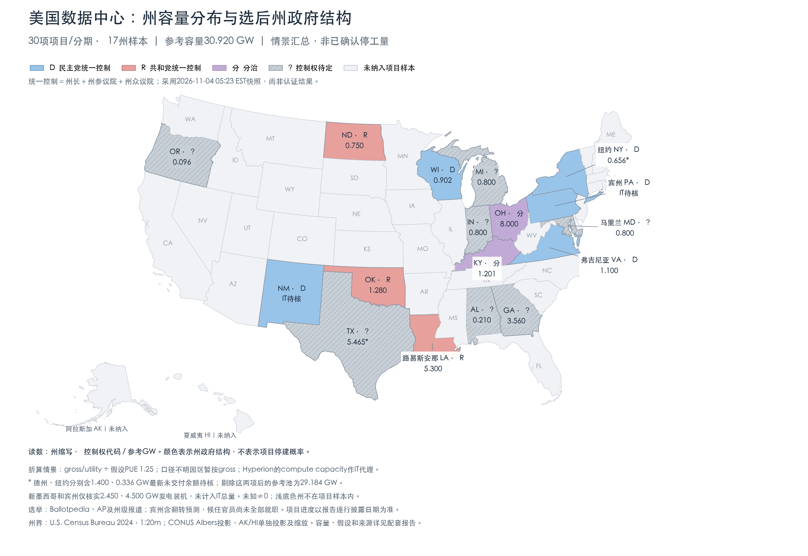

+++
title = "美国未投产数据中心：项目、容量与2026中期选举政策暴露"
date = "2026-11-04"
data_as_of = ["2026-11-04"]
data_as_of_note = "研究截止2026年11月4日05:23 EST／18:23新加坡时间（10:23 UTC）；选举为媒体判定或初步计票，项目进度按各自来源披露日，未声称全量实时更新。"
draft = false
description = "整理17州30条未投产项目与分期记录，区分容量口径、建设阶段和选举新增政策压力，保留情景折算及许可适用性限制。"
series = ""
categories = ["科技产业", "宏观与政策"]
tags = ["数据中心", "AI", "中期选举", "电力", "政策风险"]
featured = false
private = false
content_preservation = "verbatim_except_privacy_redactions"
source_sha256 = "242d462853ac9df138699ab04b141be8f999091ea015d0989711acadf5ea5bdd"
original_source_sha256 = "8f352b5179bc427d6599c66cfb8dff13c5671f41bd4b76d11c24de095c7f69ce"
authorized_content_edit = "用户授权仅将各州阶段容量占比表的分隔行从8格改为7格；全部数据和文字保留。"
+++

# 美国未投产数据中心：项目、容量与2026中期选举政策暴露

研究截止：2026年11月4日05:23 EST／18:23新加坡时间（10:23 UTC）。选举为媒体判定或初步计票，尚非正式认证；各项目进度按表中披露日期，并非所有项目都有11月4日实时更新。

本次结构更新：增加17州总量、各阶段容量/占比和美国地图；原30项清单及政策分析保留。项目事实与选举信息沿用上述截止及各行来源日期，新增折算为分析情景，不声称完成全量实时刷新。

本次建立了 **30条项目/分期记录，覆盖17州**，优先覆盖GW级园区、AI训练/云基础设施以及暂停政策敏感地区。它是可复核的重点项目清单，**不是全美未建成数据中心全量普查**。数据等级为G2：多数容量来自开发商、客户、SEC申报或政府文件；全国完整覆盖、最新剩余容量及逐项目许可适用性仍有缺口。对全国究竟会推迟多少算力，目前仅达到G1，不能给一个伪精确百分比。

主要判断是：德州、佐治亚、威斯康星、密歇根、新墨西哥的新增政策压力应优先跟踪；俄亥俄规划规模很大，但共和党保住两院，且两党州长候选人本就都支持限制。纽约、俄勒冈已经在选前推出暂停措施，其项目风险不能全部记为本次选举新增冲击。路易斯安那、北达科他、肯塔基等州的本轮州政权变化较小，但仍可能遇到供电、施工和融资约束。

**怎样读容量。** 1 GW＝1,000 MW。IT MW是服务器、存储、网络等计算设备的额定供电容量；gross/utility MW包括冷却等设施负载，或者只是供电协议/申请规模；发电机组MW又是另一种口径。逐项目清单保留原始定义；新增州汇总另列明确标注假设的参考IT情景，不替换公司披露值。园区终局规模、当期在建分期、已经租出的容量和真正交付并收租的容量也分别保留。MW衡量电力规模，不能直接变成GPU数量、FLOPS或半导体收入。

<!-- STATE_SUMMARY_START -->
**新增：按州汇总与各阶段占比。** 下表把原清单30条记录全部对应到17州。这里的A叫作**参考观察容量**：表示需要逐项目检查政策适用性的规划规模，包含本轮变化较小的对照州，**不表示这些容量已经受阻，也不表示全美未建成数据中心总量**。单纯按党籍不能计算停工量。

为得到可相加的参考总数，采用一套明确的**情景口径**：直接披露的IT容量原值保留；gross/utility容量除以假设PUE＝1.25；IT/gross不明的园区容量在本情景中暂按gross处理；Hyperion的公司“compute capacity”暂作IT代理。PUE在这里用于设计负荷的简化折算，不是核验过的项目工程参数，也不是实测全年能耗比。**这些折算数都不是公司披露的IT值。** 已知投产部分剔除，发电装机完全不折算；最新余额未知的1.736 GW单列，不假设其全部仍未交付。原始口径、假设和分期映射保存在逐分期底表。

| 州 | 项目数 | 参考总量A（GW） | 其中明确披露未交付IT（GW） | A中余额待核包络（GW） | 关键口径/缺口 |
| --- | ---: | ---: | ---: | ---: | --- |
| 俄亥俄 OH | 2 | 8.000 | 8.000 | 0.000 | 另有Lordstown容量未知；3.750为扩展选择权 |
| 德州 TX | 7 | 5.465* | 1.065 | 1.400 | 含Frontier 1.400余额包络；Milam等按情景折算 |
| 路易斯安那 LA | 2 | 5.300 | 0.300 | 0.000 | 5.000 GW compute capacity代理＋0.300 IT |
| 佐治亚 GA | 2 | 3.560 | — | 0.000 | 4.450 GW供电申请/服务规模÷1.25 |
| 俄克拉何马 OK | 1 | 1.280 | — | 0.000 | 1.600 GW gross÷1.25；远期 |
| 肯塔基 KY | 2 | 1.201 | 1.201 | 0.000 | 0.401已签租约开发＋0.800远期 |
| 弗吉尼亚 VA | 1 | 1.100 | 1.100 | 0.000 | 1.1+ GW按1.100计；逐期未核实 |
| 威斯康星 WI | 1 | 0.902 | 0.902 | 0.000 | 直接IT口径；四栋合计，分期交付 |
| 密歇根 MI | 1 | 0.800 | — | 0.000 | 1.000 GW园区口径未知；按gross假设折算 |
| 马里兰 MD | 1 | 0.800 | 0.800 | 0.000 | 约2030远期规划 |
| 印第安纳 IN | 1 | 0.800 | — | 0.000 | 1.000 GW园区口径未知；按gross假设折算 |
| 北达科他 ND | 3 | 0.750 | 0.750 | 0.000 | 已扣PF1投产0.250；PF2仍有0.100未租 |
| 纽约 NY | 2 | 0.656* | 0.320 | 0.336 | 含Lake Mariner 0.336余额包络 |
| 阿拉巴马 AL | 1 | 0.210 | 0.210 | 0.000 | 直接IT，单栋已签约 |
| 俄勒冈 OR | 1 | 0.096 | — | 0.000 | 120+ MW aggregate power按120÷1.25 |
| 新墨西哥 NM | 1 | 待核 | — | — | IT未知；2.450 GW发电装机不纳入 |
| 宾夕法尼亚 PA | 1 | 待核 | — | — | IT未知；4.500 GW发电装机不纳入 |
| **本样本合计** | **30** | **30.920*** | **14.648** | **1.736** | 27个项目有参考量；3个容量未知/仅有发电数据 |

“—”表示没有该口径的可靠值，不是没有项目。`*`表示参考总量包含最新余额待核的项目包络：德州1.400 GW，纽约0.336 GW。若暂时剔除这两项，参考池为**29.184 GW**；仍然含折算和远期规划，不能改称已确认未建IT。弗吉尼亚、俄勒冈的“+”按已披露基数计入，因此30.920 GW也不是全样本严格上限。

这个30.920 GW的计算桥为：**14.648 GW明确披露的未交付IT＋1.736 GW待扣最新交付的IT包络＋5.000 GW compute代理＋6.536 GW已知gross折算＋3.000 GW口径不明园区的情景折算**。最后两项分别来自8.170 GW已知gross及3.750 GW口径不明容量。若只把假设PUE改为1.15—1.40，其他条件不变，参考总量为**29.898—31.749 GW**；这是参数敏感性，不是置信区间，也没有覆盖项目取消、漏项、交付及口径认定的不确定性。

**各州A由哪些阶段构成。** 下表单元格为“**参考GW / 占本州A的比例**”，同一分期只进入一列。阶段按本报告可核实信息分类，不把2028年计划自动算在建，也不把已启动园区的全部终局规模自动算成在建。未量化的项目不进入占比分母；四舍五入可能使显示比例略偏离100%。

| 州 | 参考总量A（GW） | 在建/交付准备 | 审批、开发/待建 | 远期/选择权 | 已启动、分期规模未知 | 最新余额待核 | 
| --- | ---: | ---: | ---: | ---: | ---: | ---: |
| 俄亥俄 OH | 8.000 | 0 / 0% | 4.250 / 53.1% | 3.750 / 46.9% | 0 / 0% | 0 / 0% |
| 德州 TX | 5.465* | 0.932 / 17.1% | 0.133 / 2.4% | 0.480 / 8.8% | 2.520 / 46.1% | 1.400 / 25.6% |
| 路易斯安那 LA | 5.300 | 0.300 / 5.7% | 0 / 0% | 0 / 0% | 5.000 / 94.3% | 0 / 0% |
| 佐治亚 GA | 3.560 | 0 / 0% | 3.560 / 100.0% | 0 / 0% | 0 / 0% | 0 / 0% |
| 俄克拉何马 OK | 1.280 | 0 / 0% | 0 / 0% | 1.280 / 100.0% | 0 / 0% | 0 / 0% |
| 肯塔基 KY | 1.201 | 0 / 0% | 0.401 / 33.4% | 0.800 / 66.6% | 0 / 0% | 0 / 0% |
| 弗吉尼亚 VA | 1.100 | 0 / 0% | 1.100 / 100.0% | 0 / 0% | 0 / 0% | 0 / 0% |
| 威斯康星 WI | 0.902 | 0.902 / 100.0% | 0 / 0% | 0 / 0% | 0 / 0% | 0 / 0% |
| 密歇根 MI | 0.800 | 0 / 0% | 0 / 0% | 0 / 0% | 0.800 / 100.0% | 0 / 0% |
| 马里兰 MD | 0.800 | 0 / 0% | 0 / 0% | 0.800 / 100.0% | 0 / 0% | 0 / 0% |
| 印第安纳 IN | 0.800 | 0 / 0% | 0 / 0% | 0 / 0% | 0.800 / 100.0% | 0 / 0% |
| 北达科他 ND | 0.750 | 0.750 / 100.0% | 0 / 0% | 0 / 0% | 0 / 0% | 0 / 0% |
| 纽约 NY | 0.656* | 0 / 0% | 0 / 0% | 0.320 / 48.8% | 0 / 0% | 0.336 / 51.2% |
| 阿拉巴马 AL | 0.210 | 0.210 / 100.0% | 0 / 0% | 0 / 0% | 0 / 0% | 0 / 0% |
| 俄勒冈 OR | 0.096 | 0 / 0% | 0 / 0% | 0 / 0% | 0.096 / 100.0% | 0 / 0% |
| 新墨西哥 NM | 待核 | — | — | — | — | — |
| 宾夕法尼亚 PA | 待核 | — | — | — | — | — |
| **本样本合计** | **30.920*** | 3.094 / 10.0% | 9.444 / 30.5% | 7.430 / 24.0% | 9.216 / 29.8% | 1.736 / 5.6% |

以德州为例，A＝**5.465 GW**，其中可分配至在建/交付准备的是**0.932 GW、17.1%**（微软Abilene 0.672＋Helios二期0.260）；Helios三期待建**0.133 GW、2.4%**；Sweetwater 2远期折算**0.480 GW、8.8%**；Milam、Sweetwater 1及Meta El Paso共**2.520 GW、46.1%**属于已启动但逐期MW不明；Frontier的**1.400 GW、25.6%**需要先核实最新交付余额。这是资料可分配程度的分组，**不能反过来推断德州实际只有17.1%的项目容量处于施工中**。

已知分期能够进一步拆分时，底表保留分期：Pike拆为初始4.250 GW与扩展选择权3.750 GW；Helios拆为二期0.260 GW与三期0.133 GW。Camellia虽然有五期、Lighthouse虽然有四栋，但未取得逐期/逐栋MW时不平均分配；Umatilla首厅9 MW/2027、次厅9 MW/2028保留在项目清单，不能拿它们与口径不同的120 MW园区供电规模直接相减。

**新增：美国地图——项目参考容量与州政府控制结构。** 数字与上表A一致，单位GW。蓝色表示州长、州参议院和州众议院由民主党统一控制；红色表示共和党统一控制；紫色表示分治；灰色表示完整控制权仍未判定。其余未列项目的州使用浅底色，不能解读为零容量或某一党控制。地图采用原报告的**2026年11月4日05:23 EST选举快照**，媒体判定和领先尚非认证，候任官员尚未全部就职；宾州蓝色含来源所述的参院翻转预测。

地图上的颜色是州政府结构，**不是项目停建概率**。例如俄亥俄为民主党州长、共和党两院的分治；德州州长已判为D，但两院未完全确认，因此不能直接把整个州涂成“民主党完全控制”。纽约、俄勒冈的既有暂停措施也不能全部算作本次选举新增风险。州级颜色不代替县市许可、法院、监管委员会或联邦土地权限。

图形采用[美国人口普查局州界数据](https://www.census.gov/geographies/mapping-files/time-series/geo/cartographic-boundary.html)及真实地图投影；阿拉斯加、夏威夷为单独插图。地图为静态报告图片，完整数据可在州汇总表、州×阶段表及原30项项目清单中复核。
<!-- STATE_SUMMARY_END -->

**整体分布可以确认到哪一步。**

Cleanview在10月7日的同一数据库快照中，记录俄亥俄21.9 GW、佐治亚15.1 GW尚未开工，合计37.0 GW；其选前十个竞争性州长选举州共67.4 GW。该十州样本当时没有把德州列入，因为其竞争性筛选不同。这是供应商按项目公告整理的远期管线，不是本次清单的分母。[Cleanview原文](https://newsletter.cleanview.co/p/voters-will-soon-decide-the-fate)

本次项目表显示，德州覆盖多个已签客户、在建或已接电但未完成机房的站点；俄亥俄、佐治亚的大体量集中在远期园区；威斯康星、密歇根、新墨西哥则有少数单体大型园区，个案审批对相关客户影响可能很集中。对未列入的亚利桑那、内华达、犹他、伊利诺伊、密西西比等市场，不能理解为没有项目或没有政策风险。公开免费资料不足以对全部市场做同口径完整清点，故本报告的州汇总只比较所列样本，不构成全美完整州排名或总受影响百分比。

| 州 | 州长：选后结果/倾向 | 州参议院 | 州众议院 | 本次政策变化及来源 |
| --- | --- | --- | --- | --- |
| 德州 TX | Gina Hinojosa，D胜选（R→D） | 待定（选前R） | 待定（选前R） | 高；暂停可能延长、条件可能入法；[E02](https://www.ncsl.org/about-state-legislatures/state-partisan-composition) [E03](https://www.texastribune.org/2026/11/04/texas-democrats-blue-wave-no-spaces-short/) |
| 俄亥俄 OH | Amy Acton，D胜选（R→D） | R保住 | R保住 | 中；州长与两院分治；[E01](https://ballotpedia.org/Election_results,_2026:_State_legislatures) [E13](https://apnews.com/article/f126e12e05b579a327b98481c0ae2226) |
| 佐治亚 GA | Keisha Lance Bottoms，D胜选（R→D） | 待定（选前R） | 待定（选前R；D宣称领先） | 高；政策方向改变较明确；[E02](https://www.ncsl.org/about-state-legislatures/state-partisan-composition) [E04](https://georgiarecorder.com/2026/11/04/democrats-flip-statewide-offices-up-and-down-the-ballot-in-georgia-state-house-is-in-play/) |
| 威斯康星 WI | David Crowley，D胜选（D延续） | D翻转 | D翻转 | 高；州长与两院可共同改规则；[E01](https://ballotpedia.org/Election_results,_2026:_State_legislatures) [E05](https://apnews.com/article/00855223d7e445e0a51574b1851bb013) |
| 密歇根 MI | Jocelyn Benson，D胜选（D延续） | 待定（选前D） | 待定（选前R） | 中高；同党交接也可能转严；[E02](https://www.ncsl.org/about-state-legislatures/state-partisan-composition) [E06](https://apnews.com/article/c8ea22ca8b2240799135fc3afb16fb76) |
| 新墨西哥 NM | Deb Haaland，D胜选（D延续） | D延续（本次不常规改选） | D保住 | 高；候任州长承诺上任暂停；[E01](https://ballotpedia.org/Election_results,_2026:_State_legislatures) [E02](https://www.ncsl.org/about-state-legislatures/state-partisan-composition) [E07](https://apnews.com/article/3b68b7cd07d54ad1b6f9f24895e5488d) |
| 路易斯安那 LA | 现任R；本次不改选 | R延续（无常规改选） | R延续（无常规改选） | 低；本轮不改变州行政立法结构；[E02](https://www.ncsl.org/about-state-legislatures/state-partisan-composition) |
| 北达科他 ND | 现任R；本次不改选 | R保住 | R保住 | 低；[E01](https://ballotpedia.org/Election_results,_2026:_State_legislatures) [E02](https://www.ncsl.org/about-state-legislatures/state-partisan-composition) |
| 阿拉巴马 AL | Thomas/Tommy Tuberville，R胜选 | 待定（选前R） | R保住 | 低至待定；[E01](https://ballotpedia.org/Election_results,_2026:_State_legislatures) [E02](https://www.ncsl.org/about-state-legislatures/state-partisan-composition) [E08](https://apnews.com/article/9bbb2fe6fcd04a8ba49f5c071fc2771a) |
| 弗吉尼亚 VA | Abigail Spanberger，D在任；本次不改选 | D延续（无常规改选） | D延续（无常规改选） | 低；已有监管风险较高；[E02](https://www.ncsl.org/about-state-legislatures/state-partisan-composition) [E12](https://virginiamercury.com/2026/03/14/the-10-most-important-things-that-happened-in-virginias-2026-legislative-session/) |
| 纽约 NY | Kathy Hochul，D连任 | D保住 | D保住 | 低；既有暂停影响较大；[E01](https://ballotpedia.org/Election_results,_2026:_State_legislatures) [E13](https://apnews.com/article/f126e12e05b579a327b98481c0ae2226) |
| 俄勒冈 OR | Tina Kotek，D领先、预计连任 | D明显领先；未当作认证结果 | D明显领先；未当作认证结果 | 低；既有暂停影响较大；[E02](https://www.ncsl.org/about-state-legislatures/state-partisan-composition) [E10](https://www.opb.org/article/2026/11/03/oregon-democrats-appear-on-track-to-expand-supermajority/) |
| 宾夕法尼亚 PA | Josh Shapiro，D连任 | D翻转预测（Ballotpedia引State Navigate） | D保住预测（引NYT） | 中；立法配合增强，州长路线延续；[E01](https://ballotpedia.org/Election_results,_2026:_State_legislatures) [E13](https://apnews.com/article/f126e12e05b579a327b98481c0ae2226) |
| 肯塔基 KY | 现任D；本次不改选 | R保住 | R保住 | 低；[E01](https://ballotpedia.org/Election_results,_2026:_State_legislatures) [E02](https://www.ncsl.org/about-state-legislatures/state-partisan-composition) |
| 马里兰 MD | Wes Moore，D连任 | 待定（选前D） | 待定（选前D） | 待定；远期项目先看许可；[E02](https://www.ncsl.org/about-state-legislatures/state-partisan-composition) [E13](https://apnews.com/article/f126e12e05b579a327b98481c0ae2226) |
| 俄克拉何马 OK | Mike Mazzei，R胜选 | R保住 | R保住 | 低至待定；[E01](https://ballotpedia.org/Election_results,_2026:_State_legislatures) [E02](https://www.ncsl.org/about-state-legislatures/state-partisan-composition) [E09](https://apnews.com/article/97095aae4a924371b113e64bc7d868e6) |
| 印第安纳 IN | 现任R；本次不改选 | R保住 | R多数倾向；已失超级多数，最终席次待定 | 低至中；[E01](https://ballotpedia.org/Election_results,_2026:_State_legislatures) [E02](https://www.ncsl.org/about-state-legislatures/state-partisan-composition) [E11](https://www.wfyi.org/statewide/2026-11-04/democrats-break-indiana-house-supermajority) |

D＝民主党，R＝共和党。表内“待定”表示本次检索未获得足够可靠的两院控制权判定，并不代表两党概率各半。州参议院/众议院与联邦参议院/众议院不同；副州长或联邦参议员当选也不能替代州议会控制权。Ballotpedia页面抓取版本截至11月4日02:22 ET；对宾州参院保留其预测来源，不能与正式认证混同。德州、佐治亚、密歇根及若干其他州尚有结果缺口。候任州长多数须至2027年1月上任，竞选承诺不会在11月4日自动成为有效的停工命令。

**逐项目清单。** “选举增量”衡量这次选举带来的新增政策压力；“开发/交付风险”还包括原有许可、电网、施工、融资条件。二者是研究者的条件性判断，不是统计校准的概率，更不代表已停工。

| 项目ID／州／位置 | 项目及主要参与方 | 容量口径 | 建设阶段与交付安排 | 政策判断与来源 |
| --- | --- | --- | --- | --- |
| TX01 德州／Abilene／Taylor County | Abilene 新微软园区；Crusoe；Microsoft | 672 MW IT；900 MW园区供电/电厂 | 场地准备和建设；独立于原1.2GW园区；首栋预计2027年中通电 | 选举增量：中高；开发/交付风险：中高。[S01](https://www.crusoe.ai/resources/newsroom/crusoe-announces-new-900-mw-ai-factory-campus-in-abilene-texas-to-support-microsoft-ai-infrastructure) |
| TX02 德州／Shackelford County | Frontier；Vantage；终端客户未在本次一手材料中核实 | 1,400 MW IT最终园区 | 已开工；首栋原定2026下半年；最新已交付MW未确认；首栋2026H2；全园区日期未核实 | 选举增量：中高；开发/交付风险：中高。[S02](https://vantage-dc.com/data-center-locations/north-america/shackelford-county-tx) |
| TX03 德州／Milam County | Milam；SB Energy；OpenAI | 最新项目表约750 MW；1月租约公告1,200 MW，范围差异未解释 | 一期施工；一期预计2027年运行 | 选举增量：中高；开发/交付风险：中高。[S03](https://sbenergy.com/digital-infrastructure/) [S04](https://milamdc.com/) [S05](https://openai.com/index/stargate-sb-energy-partnership/) |
| TX04 德州／Dickens County | Helios I 后续二、三期；Galaxy；CoreWeave | 未交付393 MW IT＝526−133；对应约600 MW gross | 二期已融资并在建；三期为后续租约分期；二期260MW首租金预计2027Q2；剩余133MW时间单列待更新 | 选举增量：中；开发/交付风险：中。[S06](https://investor.galaxy.com/static-files/040b6ab8-8c2b-42d9-8355-c073517953e1) |
| TX05 德州／Sweetwater／Nolan County | Sweetwater 1；IREN | 1,400 MW gross供电规划 | 变电站已通电；数据中心按期建设，不能把通电当作全部机房完工；初始AI分期2027；后续2028起，具体分期MW未核实 | 选举增量：中高；开发/交付风险：中高。[S07](https://www.sec.gov/Archives/edgar/data/1878848/000187884826000052/iren-20260630.htm) [S08](https://iren.gcs-web.com/static-files/60dded6a-e6fc-47ee-a4ec-86f68512701e) |
| TX06 德州／Sweetwater／Nolan County | Sweetwater 2；IREN | 600 MW gross供电规划 | 开发建设阶段；与Sweetwater 1独立站点；远期扩建自2028起；历史电网目标不等于机房交付 | 选举增量：高于成熟在建分期；开发/交付风险：高。[S07](https://www.sec.gov/Archives/edgar/data/1878848/000187884826000052/iren-20260630.htm) [S08](https://iren.gcs-web.com/static-files/60dded6a-e6fc-47ee-a4ec-86f68512701e) |
| TX07 德州／El Paso | Meta El Paso；Meta | 1,000 MW园区容量；公告未明确IT/gross | 2025年开工；2026年3月扩大至1GW；本次一手材料未核实分期投产日 | 选举增量：中高；开发/交付风险：中高。[S09](https://about.fb.com/news/2025/10/metas-new-ai-optimized-data-center-el-paso/amp/) |
| OH01 俄亥俄／Pike County／原Portsmouth场地 | PORTS-Pike Technology Campus；SB Energy、NVIDIA、OpenAI | 8,000 MW IT；初始4,250，另3,750为NVIDIA扩展选择；配套至少10GW发电 | 规划、供能与审批推进；10月7日数据库列未开工；2028起分期；非2027全部交付 | 选举增量：中；远期关注高；开发/交付风险：高。[S10](https://sbenergy.com/nvidia-ai-compute-ports-pike-ohio/) [S11](https://newsletter.cleanview.co/p/voters-will-soon-decide-the-fate) |
| OH02 俄亥俄／Lordstown | Stargate Lordstown；SoftBank／OpenAI | 单站MW未可靠披露 | 2025公告提及开工；2026实时完工量未确认；原计划2026运行，未核实实际交付 | 选举增量：待定；开发/交付风险：待定。[S12](https://www.datacenterdynamics.com/en/news/openai-announces-five-more-us-stargate-data-centers-with-oracle-and-softbank/) |
| GA01 佐治亚／Effingham County／Savannah Gateway Industrial Hub | Project Camellia；OpenAI；Georgia Power | 3,200 MW电力服务规模 | 设计、地方/州审查；县政府明确审查尚未结束；2028—2032供电；五期开发 | 选举增量：高；开发/交付风险：高。[S13](https://openai.com/index/building-ai-infrastructure-with-the-effingham-county-community/) [S14](https://www.effinghamcounty.org/902/Project-Camellia-OpenAI-Data-Center) |
| GA02 佐治亚／Irwin County／Ocilla周边 | Project Arrowhead；项目申请主体；最终运营商未核实 | 1,250 MW峰值电力需求 | DRI申请/规划；未将媒体所谓已批准当作全套最终许可；具体分期及可靠交付时间未核实 | 选举增量：高；开发/交付风险：高。[S15](https://www.wwals.net/pictures/2026-04-24--dri-irwin-county-project-arrowhead/Project-Arrowhead-Data-Center-Irwin-Co.-DRI-04242026-USE-0003.pdf) |
| WI01 威斯康星／Port Washington | Lighthouse；Vantage；Oracle／OpenAI相关Stargate建设 | 902 MW IT；四栋 | 在建；园区整体未完工；园区计划2028完成 | 选举增量：高；开发/交付风险：中高。[S16](https://vantage-dc.com/data-center-locations/north-america/port-washington-wisconsin) |
| MI01 密歇根／Saline Township／Washtenaw County | The Barn／Saline；Related、Oracle、OpenAI、Walbridge | 1,000 MW园区；一手公告未明确IT/gross | 融资已落实；2026年6月开工；本次所读开工公告未给完整分期日历 | 选举增量：中高；开发/交付风险：中高。[S17](https://openai.com/index/stargate-michigan-data-center/) [S18](https://www.related.com/press-releases/2026-04-24/related-digital-announces-financing-16-billion-oracle-data-center-project) |
| NM01 新墨西哥／Doña Ana County／Santa Teresa | Project Jupiter；Oracle、BorderPlex、STACK；OpenAI相关 | 已核实2,450 MW燃料电池发电装机；IT容量未核实 | 机房在建；供电微电网独立审批；未核实可靠的最新投产日期 | 选举增量：高；开发/交付风险：高。[S19](https://www.oracle.com/news/announcement/oracle-borderplex-and-bloom-energy-to-power-project-jupiter-with-fuel-cell-technology-2026-04-27/) [S20](https://www.oracle.com/news/announcement/project-jupiter-statement-on-construction-permitting-2026-09-14/) |
| LA01 路易斯安那／Richland Parish | Hyperion；Meta；Blue Owl；Entergy | 5,000 MW compute capacity最终规划 | 大型施工中；7月宣布扩容；多年分期；本次一手披露不足以确认5GW逐期日历 | 选举增量：低；开发/交付风险：中高。[S21](https://about.fb.com/news/2026/07/teachers-local-businesses-win-as-meta-expands-louisiana-data-center/) [S22](https://www.opportunitylouisiana.gov/news/meta-commits-more-than-50-billion-for-north-louisiana-project-becoming-one-of-the-largest-data-centers-in-history) |
| LA02 路易斯安那／Alexandria地区；以最新地块文件为准 | Delta Forge 1；Applied Digital；高信用评级hyperscaler未公开名称 | 300 MW IT；约430 MW utility | 已签租约，在建；初始2027年中；分期至2028 | 选举增量：低；开发/交付风险：中。[S23](https://ir.applieddigital.com/news-events/press-releases/detail/163/applied-digital-reports-fiscal-first-quarter-2027-results) [S25](https://ir.applieddigital.com/_assets/_97e25cf70d4bdefd3f4b6efdc9f2cc9b/appliedblockchaininc/db/2905/27266/pdf/APLD_INV_InvestorPresentation_Final_04.24.26.pdf) [S27](https://ir.applieddigital.com/news-events/press-releases/detail/144/applied-digital-breaks-ground-on-delta-forge-1-a-430-mw-ai) |
| ND01 北达科他／Ellendale | Polaris Forge 1 第三栋HPC；Applied Digital；CoreWeave | 剩余150 MW IT＝400−250 | 前两栋250MW已投产；第三栋在建；剩余楼栋原计划2027 | 选举增量：低；开发/交付风险：中。[S23](https://ir.applieddigital.com/news-events/press-releases/detail/163/applied-digital-reports-fiscal-first-quarter-2027-results) [S25](https://ir.applieddigital.com/_assets/_97e25cf70d4bdefd3f4b6efdc9f2cc9b/appliedblockchaininc/db/2905/27266/pdf/APLD_INV_InvestorPresentation_Final_04.24.26.pdf) |
| ND02 北达科他／Harwood | Polaris Forge 2；Applied Digital；investment-grade hyperscaler | 300 MW IT建设规模；已租约200 MW | 在建；10月公告尚待首批交付；首批50MW计划2026年底；其余分期 | 选举增量：低；开发/交付风险：中。[S23](https://ir.applieddigital.com/news-events/press-releases/detail/163/applied-digital-reports-fiscal-first-quarter-2027-results) [S25](https://ir.applieddigital.com/_assets/_97e25cf70d4bdefd3f4b6efdc9f2cc9b/appliedblockchaininc/db/2905/27266/pdf/APLD_INV_InvestorPresentation_Final_04.24.26.pdf) |
| ND03 北达科他／Center／Oliver County | Polaris Forge 3；Applied Digital；tier-one hyperscaler | 300 MW IT；约430 MW utility | 租约已签、在建；具体分期日历本次未核实 | 选举增量：低；开发/交付风险：中。[S23](https://ir.applieddigital.com/news-events/press-releases/detail/163/applied-digital-reports-fiscal-first-quarter-2027-results) [S26](https://ir.applieddigital.com/news-events/press-releases/detail/152/applied-digital-reaches-significant-milestone-surpassing-1) |
| AL01 阿拉巴马／Alabama；市县未在所读一手材料明确 | Delta Forge 2；Applied Digital；tier-one hyperscaler | 210 MW IT | 单栋在建，全部已签租约；计划2027年全部Ready for Service | 选举增量：低至待定；开发/交付风险：中。[S23](https://ir.applieddigital.com/news-events/press-releases/detail/163/applied-digital-reports-fiscal-first-quarter-2027-results) [S24](https://ir.applieddigital.com/sec-filings/all-sec-filings/content/0001144879-26-000059/apld-20260831.htm) |
| VA01 弗吉尼亚／Louisa County | Louisa County／Shannon Hill；EdgeCore | 至少1,100 MW IT最终规划 | 土地开发与规划；全园区分期在建程度未核实；本次未核实可靠分期交付日 | 选举增量：低（本次选举增量）；开发/交付风险：高（远期开发）。[S28](https://edgecore.com/locations/louisa-county-data-center) |
| NY01 纽约／Barker／Somerset，Niagara County | Lake Mariner CB-4／CB-5；TeraWulf；Fluidstack／Google信用支持 | 8月披露336 MW IT在建；11月剩余量未确认 | CB-4首厅调试，CB-5施工；可能已有后续交付；CB-4 2026H2；CB-5 2027初开始 | 选举增量：低（规则选前已公布）；开发/交付风险：中高，取决于已取得许可。[S29](https://investors.terawulf.com/news-events/press-releases/detail/144/terawulf-reports-second-quarter-2026-results) |
| NY02 纽约／Lansing／Tompkins County | Lake Hawkeye；TeraWulf | 约320 MW IT；约400 MW gross | 租地与远期开发，需许可及建设；约2029 | 选举增量：低（既有政策延续）；开发/交付风险：高。[S30](https://investors.terawulf.com/sec-filings/all-sec-filings/content/0001083301-26-000162/terawulfq22026investorpr.htm) |
| OR01 俄勒冈／Umatilla | SDC Umatilla；Sabey | 120+ MW aggregate power最终园区；首厅9 MW | 外壳2026交付，数据厅逐步建设；首厅9MW于2027；第二厅9MW于2028 | 选举增量：低（10月已暂停）；开发/交付风险：中高，取决于剩余许可。[S32](https://sabeydatacenters.com/locations/sdc-umatilla) |
| PA01 宾夕法尼亚／Indiana County（注意并非印第安纳州） | Homer City Energy Campus；Homer City Redevelopment；Kiewit；未来机房客户本表不推断 | 4,500 MW为发电规模；机房IT容量未核实 | 能源园区开发；不能等同数据厅施工进度；原电厂计划2027开始供电；机房日历未核实 | 选举增量：中；开发/交付风险：高。[S33](https://www.homercityredevelopment.com/post/former-homer-city-pa-coal-plant-officially-reopens-as-state-of-the-art-natural-gas-facility) |
| KY01 肯塔基／Hawesville | Justified Data Campus；TeraWulf；Anthropic | 401 MW IT租约；约480 MW gross | 站点转换和开发，已签客户租约；2027H2首批；2028初全部401MW | 选举增量：低；开发/交付风险：中。[S31](https://investors.terawulf.com/news-events/press-releases/detail/142/terawulf-announces-anthropic-lease-at-justified-data-campus-and-sale-of-majority-interest-in-abernathy-joint-venture-to-fluidstack) [S29](https://investors.terawulf.com/news-events/press-releases/detail/144/terawulf-reports-second-quarter-2026-results) |
| KY02 肯塔基／Grayson／Eastern Kentucky | Muskie Data Campus；TeraWulf | 约800 MW规划IT；最多1,000 MW电力服务 | 场地取得、电力协议、远期开发；首电2028Q4；IT计划分期2028—2030 | 选举增量：低；开发/交付风险：高（远期开发）。[S29](https://investors.terawulf.com/news-events/press-releases/detail/144/terawulf-reports-second-quarter-2026-results) [S30](https://investors.terawulf.com/sec-filings/all-sec-filings/content/0001083301-26-000162/terawulfq22026investorpr.htm) |
| MD01 马里兰／Charles County／Morgantown旧电站 | Chesapeake Data & Energy；TeraWulf | 约800 MW规划IT；目标最多1,000 MW gross | 收购/改造开发；8月披露仍有交易及开发条件；约2030开始机房运营 | 选举增量：待定；主要为远期风险；开发/交付风险：高。[S29](https://investors.terawulf.com/news-events/press-releases/detail/144/terawulf-reports-second-quarter-2026-results) [S30](https://investors.terawulf.com/sec-filings/all-sec-filings/content/0001083301-26-000162/terawulfq22026investorpr.htm) |
| OK01 俄克拉何马／Kiowa，Oklahoma；县级地块需后续核实 | Kiowa；IREN | 1,600 MW gross规划 | 开发管线；不等于已施工1.6GW机房；2028及以后规划 | 选举增量：低至待定；开发/交付风险：高（远期开发）。[S07](https://www.sec.gov/Archives/edgar/data/1878848/000187884826000052/iren-20260630.htm) [S08](https://iren.gcs-web.com/static-files/60dded6a-e6fc-47ee-a4ec-86f68512701e) |
| IN01 印第安纳／Lebanon／Boone County | Meta Lebanon；Meta | 1,000 MW园区容量；公告未明确IT/gross | 2026年2月开工；所读一手公告未给出完整投产日历 | 选举增量：低至中；开发/交付风险：中。[S34](https://about.fb.com/news/2026/02/metas-new-data-center-lebanon-indiana-marks-milestone-ai-investment/amp/) |

**各州政策怎样落到项目上。**

- **德州：** 选前Abbott已暂停部分审批；不能把全部限制归因于民主党胜选 [P01](https://ginafortexas.com/priority/data-centers/) [P02](https://gov.texas.gov/news/post/governor-abbott-directs-tceq-to-halt-data-center-permits)
- **俄亥俄：** 两党候选人均曾支持暂停；州长不能单方面通过税法；Pike另涉联邦土地与能源项目 [P03](https://actonforgovernor.com/dr-amy-acton-announces-support-for-conditional-moratorium-on-data-centers/) [S11](https://newsletter.cleanview.co/p/voters-will-soon-decide-the-fate)
- **佐治亚：** 承诺暂停新建；州议会、独立选举的PSC及地方审批仍各有作用 [P04](https://www.keishaforgovernor.com/news/on-wrbl-bottoms-highlights-her-plan-to-pause-construction-on-data-centers-as-jackson-profits)
- **威斯康星：** 竞选强调地方选择、100%可再生能源、全额承担基础设施成本及工会要求；具体适用既有项目范围未确定 [P05](https://www.crowleyforwi.com/data-centers)
- **密歇根：** Benson承诺条件满足前暂停；Whitmer曾支持Saline，不能按党籍自动判断项目待遇 [P06](https://www.jocelynbenson.com/issues/data-centers)
- **新墨西哥：** 存量施工许可与待批微电网许可必须分开；新规能否覆盖在建项目仍待文本 [P07](https://sourcenm.com/2026/09/17/new-mexico-dem-governor-nominee-haaland-announces-data-center-moratorium-executive-order-if-elected/)
- **路易斯安那：** 州政府支持Hyperion；公用事业、排放、供气与融资约束仍在 [S22](https://www.opportunitylouisiana.gov/news/meta-commits-more-than-50-billion-for-north-louisiana-project-becoming-one-of-the-largest-data-centers-in-history)
- **北达科他：** 已在建、已有租约有助确定性；电力和施工风险仍需独立判断 [S23](https://ir.applieddigital.com/news-events/press-releases/detail/163/applied-digital-reports-fiscal-first-quarter-2027-results)
- **阿拉巴马：** 本次未核实州级暂停新建的政策转向；参院结果未作确定断言
- **弗吉尼亚：** 2026中期选举不重新选出本州州长和两院；地方许可与电网约束早已存在
- **纽约：** 7月已经暂停部分尚未完成受理条件的州环境酌情许可，不能视为所有在建工程停工 [P08](https://www.governor.ny.gov/news/first-statewide-moratorium-new-hyperscale-data-centers-launched-governor-kathy-hochul)
- **俄勒冈：** 10月9日DEQ许可暂停已覆盖新建和扩建，期限至2027年7月1日；具体项目是否需剩余许可决定实际影响 [P09](https://www.opb.org/pdf/100926_GovernorLettertoDEQDataCenterPermitting_1791931532928.pdf)
- **宾夕法尼亚：** 8月GRID行政要求已执行；新税制/补贴变化仍取决于立法，不等于全面禁建 [P10](https://dced.pa.gov/business-assistance/data-center-resources/grid-requirements/)
- **肯塔基：** 分治格局延续；本次未核实新增州级暂停，个别项目仍有审批与交付约束
- **马里兰：** 不将选前两院D直接写成选后已确认；Chesapeake本身约2030年的远期计划
- **俄克拉何马：** 仍由R主导不代表项目自动获批；本次未核实新增普遍暂停
- **印第安纳：** 共和党立法优势缩小，但不能据此推导既有Meta项目停建

判断工程是否受影响，至少需要对应同一地块、同一分期的剩余审批：地方土地使用与建筑许可、州空气/水许可、公用事业电价与费用分担、输电/电网连接、天然气供应或现场发电。已经签电力合同不等于所有许可齐全；机房已封顶也不等于电源已获批。Jupiter尤其体现这一点：Oracle自己将建筑施工与相邻微电网审批区分说明。本报告没有把9月中旬的司法暂停状态当作11月初仍在持续的事实。[Oracle说明](https://www.oracle.com/news/announcement/project-jupiter-statement-on-construction-permitting-2026-09-14/)

**可以怎样量化观察池。**

| 口径 | 可复核规模 | 能说明什么 |
| --- | ---: | --- |
| Abilene微软新园区 | 672 MW IT | 两栋各336MW；与原Stargate园区独立 |
| Helios I未交付二、三期 | 393 MW IT | 526MW租约减去已交付133MW |
| Lighthouse | 902 MW IT | 尚未完成的四栋园区，计划2028完成 |
| 上述三项合计 | **1,967 MW＝1.967 GW IT** | 值得优先检查2027—2028交付和新规适用性的项目规模；不表示全部会延误 |
| Frontier | 最高1,400 MW IT园区包络，最新余额缺失 | 需先扣除若有的2026H2交付；未加入1.967GW |
| Lake Mariner CB-4/5 | 8月披露336 MW IT在建 | 2026H2可能有交付；未加入1.967GW |
| Pike | 8,000 MW IT终局；初始4,250 MW | 2028起远期规划；未加入近期观察池 |
| Camellia | 3,200 MW电力服务；2028—2032 | 可见审批暴露大，不能和IT MW直接混加 |
| 俄亥俄＋佐治亚同供应商未开工管线 | 37.0 GW（10月7日） | 反映远期政策涉及面，不能解释为近期设备订单减量 |

这三个IT项目的合计计算为 **672＋(526−133)＋902＝1,967 MW**。三个项目的所有分期并不会同日投入运营，Lighthouse延伸到2028；因此“近期观察池”指近期值得监测的项目，不是未来1—3个月将投产1.967GW。相关公司尚未披露新州政府已使上述全部容量停工。

作为对照，Applied Digital北达科他三个项目在10月披露状态下，尚在建设的IT容量约 **150＋300＋300＝750 MW**；其中PF2只有200MW租约，因此对应已出租的剩余量为 **150＋200＋300＝650 MW**。Delta Forge 1和2合计 **510 MW IT**；肯塔基Justified有 **401 MW IT**的Anthropic租约。它们本轮州政权变化较小，可作为低“选举增量”对照，不能据此推断资金成本、供电和工程风险很低。

**几个会显著改变估算的核验点。**

1. **Pike的10GW与8GW：** 最新合作公告把至少10GW发电对应8GW IT，8GW又包含4.25GW初始和3.75GW扩展选择。园区、发电和分期不能重复相加。Pike涉及联邦土地和能源安排，新州长的控制力也不能等同于普通地方绿地项目。[S10](https://sbenergy.com/nvidia-ai-compute-ports-pike-ohio/)
2. **Milam的750MW与1,200MW：** SB Energy当前项目表约750MW，OpenAI1月租约公告称1.2GW，当前项目官网称一期2027运营。公开材料尚未解释是否为范围、分期或供电口径变化，本报告保留差异，不用1.2GW当作当前明确剩余IT。[S03](https://sbenergy.com/digital-infrastructure/) [S04](https://milamdc.com/) [S05](https://openai.com/index/stargate-sb-energy-partnership/)
3. **Sabey Umatilla的120MW与9MW：** 120+MW是园区aggregate power，首厅计划2027只有9MW，第二厅2028再9MW。用120MW判断当年采购受损会大幅夸大近端暴露。[S32](https://sabeydatacenters.com/locations/sdc-umatilla)
4. **Jupiter和Homer City：** 本次明确核实的2.45GW、4.5GW都是供电/发电口径，未将其填入机房IT总数。[S19](https://www.oracle.com/news/announcement/oracle-borderplex-and-bloom-energy-to-power-project-jupiter-with-fuel-cell-technology-2026-04-27/) [S33](https://www.homercityredevelopment.com/post/former-homer-city-pa-coal-plant-officially-reopens-as-state-of-the-art-natural-gas-facility)
5. **Arrowhead的申请量纲：** DRI附件明确峰值1,250MW，但其“每日用电”也写作MW，量纲存在错误。仅采用峰值负荷，不采用每日用电数字；DRI申请也不等于全部许可完成。[S15](https://www.wwals.net/pictures/2026-04-24--dri-irwin-county-project-arrowhead/Project-Arrowhead-Data-Center-Irwin-Co.-DRI-04242026-USE-0003.pdf)
6. **旧园区的重复计算：** 原Abilene 1.2GW园区、IREN Childress已交付Horizon1、Meta已运行站点没有全额加入本表。原Abilene扩建的11月准确未交付余额未核实，保留为覆盖缺口；微软新园区672MW IT单列。Helios一期和Polaris Forge 1已投产部分已明确剔除。OH1/New Albany的192MW存在运营/在建状态冲突，也未列入确定未建容量。

**对投资研究的含义。**

在建且已租出的分期若被推迟，首先可能影响园区开发商/NeoCloud的租金起算、资本化利息、偿债覆盖与追加权益融资；随后才视客户设备到货安排，传导至GPU订单。远期未获批项目若缩减，更多改变2028年以后的资本开支和增长预期。客户也可能转移到其他州、延用现有园区或更换供电方案，单项目延期不能直接等量外推为全美半导体需求消失。

本次最需要跟踪的事件是：新州长提出的行政令正文、是否豁免已开工/已签电力合同的分期、项目逐项许可的新决定、开发商是否修改Ready for Service及起租日期、融资提款或设备收货是否真正改变。只有这几项出现明确证据，才适合把“可能暴露的项目MW”进一步缩窄为“预计延期的MW”。本报告不依据州党籍给每个项目套一个任意停工概率。

**资料范围与复核文件。**

| 来源ID | 材料及日期 | 性质 |
| --- | --- | --- |
| S01 | [Crusoe：微软 Abilene 新园区](https://www.crusoe.ai/resources/newsroom/crusoe-announces-new-900-mw-ai-factory-campus-in-abilene-texas-to-support-microsoft-ai-infrastructure)；2026-03-27 | 公司公告 |
| S02 | [Vantage：Frontier 园区](https://vantage-dc.com/data-center-locations/north-america/shackelford-county-tx)；页面于2026-11-04检索 | 公司项目页；搜索索引可读，直接打开403 |
| S03 | [SB Energy 数据中心项目表](https://sbenergy.com/digital-infrastructure/)；页面于2026-11-04检索 | 公司项目页 |
| S04 | [Milam 项目官网](https://milamdc.com/)；页面于2026-11-04检索 | 项目官网 |
| S05 | [OpenAI 与 SB Energy 合作](https://openai.com/index/stargate-sb-energy-partnership/)；2026-01-09 | 公司公告 |
| S06 | [Galaxy 第三季度材料与 Helios 分期](https://investor.galaxy.com/static-files/040b6ab8-8c2b-42d9-8355-c073517953e1)；2026-10-27 | 8-K，物理页5、24–28 |
| S07 | [IREN FY2026 10-K](https://www.sec.gov/Archives/edgar/data/1878848/000187884826000052/iren-20260630.htm)；财年截至2026-06-30；8月交付信息已披露 | SEC申报 |
| S08 | [IREN 业务更新及 Q3 FY2026](https://iren.gcs-web.com/static-files/60dded6a-e6fc-47ee-a4ec-86f68512701e)；2026-05-07 | 公司公告 |
| S09 | [Meta El Paso 扩建更新](https://about.fb.com/news/2025/10/metas-new-ai-optimized-data-center-el-paso/amp/)；2026-03-26更新 | 公司公告 |
| S10 | [PORTS-Pike：NVIDIA、SB Energy、OpenAI](https://sbenergy.com/nvidia-ai-compute-ports-pike-ohio/)；2026-08-17 | 公司公告 |
| S11 | [Cleanview：州长选举与未开工项目](https://newsletter.cleanview.co/p/voters-will-soon-decide-the-fate)；2026-10-07 | 独立数据库研究；原始统计口径未统一为IT |
| S12 | [OpenAI Stargate 五个新站点](https://www.datacenterdynamics.com/en/news/openai-announces-five-more-us-stargate-data-centers-with-oracle-and-softbank/)；2025-09-23 | 行业报道；Lordstown不披露单站MW |
| S13 | [OpenAI：Camellia 项目](https://openai.com/index/building-ai-infrastructure-with-the-effingham-county-community/)；2026-07-22 | 公司公告 |
| S14 | [Effingham County：Camellia 审查和分期](https://www.effinghamcounty.org/902/Project-Camellia-OpenAI-Data-Center)；页面于2026-11-04检索 | 县政府项目文件库 |
| S15 | [Arrowhead DRI 电力需求附件](https://www.wwals.net/pictures/2026-04-24--dri-irwin-county-project-arrowhead/Project-Arrowhead-Data-Center-Irwin-Co.-DRI-04242026-USE-0003.pdf)；2026-04-24 | 申请文件镜像；不等于最终许可 |
| S16 | [Vantage Lighthouse 项目页](https://vantage-dc.com/data-center-locations/north-america/port-washington-wisconsin)；页面于2026-11-04检索 | 公司项目页；搜索索引可读，直接打开403 |
| S17 | [OpenAI：Saline The Barn 开工](https://openai.com/index/stargate-michigan-data-center/)；2026-06-01 | 公司公告 |
| S18 | [Related：Saline 融资落实](https://www.related.com/press-releases/2026-04-24/related-digital-announces-financing-16-billion-oracle-data-center-project)；2026-04-24 | 公司公告 |
| S19 | [Oracle：Jupiter 供电方案](https://www.oracle.com/news/announcement/oracle-borderplex-and-bloom-energy-to-power-project-jupiter-with-fuel-cell-technology-2026-04-27/)；2026-04-27 | 公司公告；2.45GW为发电装机 |
| S20 | [Oracle：Jupiter 建筑与微电网分开审批](https://www.oracle.com/news/announcement/project-jupiter-statement-on-construction-permitting-2026-09-14/)；2026-09-14 | 公司立场；不将9月司法状态当作11月当前状态 |
| S21 | [Meta：Hyperion 扩至5GW](https://about.fb.com/news/2026/07/teachers-local-businesses-win-as-meta-expands-louisiana-data-center/)；2026-07-13 | 公司公告，compute capacity原口径 |
| S22 | [Louisiana：Hyperion 施工及电力投资](https://www.opportunitylouisiana.gov/news/meta-commits-more-than-50-billion-for-north-louisiana-project-becoming-one-of-the-largest-data-centers-in-history)；2026-07-13 | 州经济发展机构 |
| S23 | [Applied Digital Q1 FY2027](https://ir.applieddigital.com/news-events/press-releases/detail/163/applied-digital-reports-fiscal-first-quarter-2027-results)；2026-10-07 | 公司披露，含10月1日投产进度 |
| S24 | [Applied Digital Q1 FY2027 10-Q](https://ir.applieddigital.com/sec-filings/all-sec-filings/content/0001144879-26-000059/apld-20260831.htm)；截至2026-08-31；2026-10披露 | 公司申报 |
| S25 | [Applied Digital 投资者材料](https://ir.applieddigital.com/_assets/_97e25cf70d4bdefd3f4b6efdc9f2cc9b/appliedblockchaininc/db/2905/27266/pdf/APLD_INV_InvestorPresentation_Final_04.24.26.pdf)；2026-04-24 | 公司材料；容量与10月进度交叉使用 |
| S26 | [Applied Digital：Polaris Forge 3](https://ir.applieddigital.com/news-events/press-releases/detail/152/applied-digital-reaches-significant-milestone-surpassing-1)；2026-05（合同2026-05-20；不据索引估计公告日） | 公司公告；发布日期以网页为准 |
| S27 | [Applied Digital：Delta Forge 1](https://ir.applieddigital.com/news-events/press-releases/detail/144/applied-digital-breaks-ground-on-delta-forge-1-a-430-mw-ai)；2026-02 | 公司公告 |
| S28 | [EdgeCore Louisa County](https://edgecore.com/locations/louisa-county-data-center)；页面于2026-11-04检索 | 公司项目页；1.1+GW IT为最终规划 |
| S29 | [TeraWulf 第二季度业绩](https://investors.terawulf.com/news-events/press-releases/detail/144/terawulf-reports-second-quarter-2026-results)；2026-08-05 | 公司披露；Lake Mariner进度非11月实时 |
| S30 | [TeraWulf 第二季度投资者材料](https://investors.terawulf.com/sec-filings/all-sec-filings/content/0001083301-26-000162/terawulfq22026investorpr.htm)；2026-08-05 | 公司材料；规划IT容量 |
| S31 | [TeraWulf：Justified 与 Anthropic 租约](https://investors.terawulf.com/news-events/press-releases/detail/142/terawulf-announces-anthropic-lease-at-justified-data-campus-and-sale-of-majority-interest-in-abernathy-joint-venture-to-fluidstack)；2026-07 | 公司公告 |
| S32 | [Sabey SDC Umatilla](https://sabeydatacenters.com/locations/sdc-umatilla)；页面于2026-11-04检索 | 公司项目页 |
| S33 | [Homer City 能源园区](https://www.homercityredevelopment.com/post/former-homer-city-pa-coal-plant-officially-reopens-as-state-of-the-art-natural-gas-facility)；2025-04 | 开发商公告；4.5GW为发电 |
| S34 | [Meta Lebanon 开工](https://about.fb.com/news/2026/02/metas-new-data-center-lebanon-indiana-marks-milestone-ai-investment/amp/)；2026-02 | 公司公告 |
| E01 | [州议会选举进度](https://ballotpedia.org/Election_results,_2026:_State_legislatures)；2026-11-04 02:22 ET版本 | 汇总媒体预测；非官方认证 |
| E02 | [NCSL 选前州政党结构](https://www.ncsl.org/about-state-legislatures/state-partisan-composition)；2026-10-06 | 仅用于选前或本次不改选职位 |
| E03 | [Texas 州级选举](https://www.texastribune.org/2026/11/04/texas-democrats-blue-wave-no-spaces-short/)；2026-11-04 01:59 CT | 州长已判定；议会未确定 |
| E04 | [Georgia 州级选举](https://georgiarecorder.com/2026/11/04/democrats-flip-statewide-offices-up-and-down-the-ballot-in-georgia-state-house-is-in-play/)；2026-11-04 02:20 ET | 两院控制权未最终确定 |
| E05 | [Wisconsin 州长胜选](https://apnews.com/article/00855223d7e445e0a51574b1851bb013)；2026-11-04 | AP预测 |
| E06 | [Michigan 州长胜选](https://apnews.com/article/c8ea22ca8b2240799135fc3afb16fb76)；2026-11-04 | AP预测 |
| E07 | [New Mexico 州长胜选](https://apnews.com/article/3b68b7cd07d54ad1b6f9f24895e5488d)；2026-11-04 | AP预测 |
| E08 | [Alabama 州长胜选](https://apnews.com/article/9bbb2fe6fcd04a8ba49f5c071fc2771a)；2026-11-04 | AP预测 |
| E09 | [Oklahoma 州长胜选](https://apnews.com/article/97095aae4a924371b113e64bc7d868e6)；2026-11-04 | AP预测 |
| E10 | [Oregon 两院领先格局](https://www.opb.org/article/2026/11/03/oregon-democrats-appear-on-track-to-expand-supermajority/)；2026-11-04 | 初步领先，非认证 |
| E11 | [Indiana 两院选举](https://www.wfyi.org/statewide/2026-11-04/democrats-break-indiana-house-supermajority)；2026-11-04 | 众院R多数倾向，已失超级多数；参院R |
| E12 | [Virginia 本届州政府](https://virginiamercury.com/2026/03/14/the-10-most-important-things-that-happened-in-virginias-2026-legislative-session/)；2026-03-14 | 本次不进行州长和两院常规改选 |
| E13 | [2026 州长选举概况](https://apnews.com/article/f126e12e05b579a327b98481c0ae2226)；2026-11-04检索 | AP；用于Acton、Shapiro、Hochul、Moore结果 |
| P01 | [Hinojosa 数据中心纲领](https://ginafortexas.com/priority/data-centers/)；2026-11-04检索 | 竞选承诺，未等于生效新规 |
| P02 | [Abbott 指示暂停TCEQ许可](https://gov.texas.gov/news/post/governor-abbott-directs-tceq-to-halt-data-center-permits)；2026-09-21 | 现行行政指示；执行及个案例外需核验 |
| P03 | [Acton 有条件暂停主张](https://actonforgovernor.com/dr-amy-acton-announces-support-for-conditional-moratorium-on-data-centers/)；2026-07-27 | 竞选承诺 |
| P04 | [Bottoms 暂停新建主张](https://www.keishaforgovernor.com/news/on-wrbl-bottoms-highlights-her-plan-to-pause-construction-on-data-centers-as-jackson-profits)；2026-08-31 | 竞选承诺 |
| P05 | [Crowley 数据中心纲领](https://www.crowleyforwi.com/data-centers)；2026-11-04检索 | 地方选择、可再生能源、成本和劳工条件 |
| P06 | [Benson 数据中心纲领](https://www.jocelynbenson.com/issues/data-centers)；2026-11-04检索 | 条件满足前暂停 |
| P07 | [Haaland 上任暂停承诺](https://sourcenm.com/2026/09/17/new-mexico-dem-governor-nominee-haaland-announces-data-center-moratorium-executive-order-if-elected/)；2026-09-17 | 新闻报道；直接打开403，搜索索引可读 |
| P08 | [纽约州许可暂停](https://www.governor.ny.gov/news/first-statewide-moratorium-new-hyperscale-data-centers-launched-governor-kathy-hochul)；2026-07-14 | 州政府公告 |
| P09 | [俄勒冈州DEQ暂停信](https://www.opb.org/pdf/100926_GovernorLettertoDEQDataCenterPermitting_1791931532928.pdf)；2026-10-09 | 州长原始信件镜像 |
| P10 | [宾州GRID已执行标准](https://dced.pa.gov/business-assistance/data-center-resources/grid-requirements/)；2026-08-18 | 州政府生效行政要求 |
| G01 | [Census 2024州界，1:20m](https://www2.census.gov/geo/tiger/GENZ2024/shp/cb_2024_us_state_20m.zip)；2026-11-04取得 | 仅用于地图几何；不用于容量或选举事实 |
