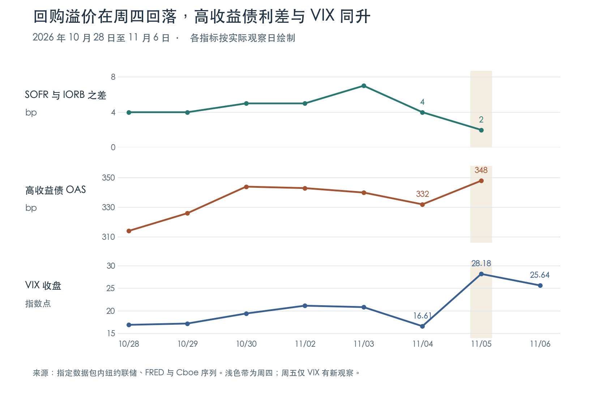

+++
title = "市场流动性综合分析报告｜2026-11-07"
date = "2026-11-07"
data_as_of = ["2026-11-04", "2026-11-05", "2026-11-06", "2026-11-07"]
data_as_of_note = "按美东11月7日归档；Fed资产与准备金截至11月4日，隔夜融资和信用利差截至5日，市场收盘截至6日，IORB更新至7日；共同截点与周五沿用估算分别保留。"
draft = false
description = "TGA释放短期现金、准备金回升和回购溢价收窄，但二十日流动性代理仍负，信用与股票压力尚未同步缓和。"
series = "市场流动性综合分析报告"
categories = ["宏观与政策", "市场结构"]
tags = ["流动性", "TGA", "SOFR", "信用利差"]
featured = false
private = false
content_preservation = "verbatim"
source_sha256 = "8f6f9b0f2b67d66c94550bfb55ada695ac505636f1f31c3c6c1506e39251ebad"
+++

# 市场流动性综合分析报告｜2026-11-07

**财政部账户释放短期现金，信用与股票承受的压力仍在。**

本期按美东日期 2026 年 11 月 7 日归档，数据包于当日 20:33 生成。Fed 资产与准备金截至 11 月 4 日，隔夜融资和信用利差截至 5 日，市场收盘截至 6 日。下文金额以十亿美元（USD bn）计，1 bp 为 0.01 个百分点。5D、20D 指包内纽约交易日网格上的五行、二十行变化，各组的实际起止日期随表列示。

## 一、核心判断

**本周出现了两种不同的改善：银行准备金回升，隔夜回购相对准备金利率的溢价收窄。两者都未扩展为广泛的风险偏好修复。** 截至 11 月 4 日，五日净流动性代理 Q1 为 **+81.845**，其中财政部账户余额下降贡献 **+79.384**，约占净额的 97%；准备金实增 **36.318**。拉长至二十日，Q1 仍为 **−47.767**，准备金仍比起点低 **99.571**。短期现金改善由财政部账户变动主导，持续性要看后续余额。

信用和股票给出了同方向的反证。11 月 5 日，担保隔夜融资利率（SOFR）相对准备金利率（IORB）的溢价降至 **+2 bp**，高收益债期权调整利差（HY OAS）却升至 **348 bp**，五日走阔 **22 bp**。同日，标普 500 期权隐含波动率指数（VIX）从 **16.61** 跳至 **28.18**，标普 500 ETF（SPY）下跌 **4.41%**。周五 SPY 反弹 **0.31%**、VIX 回落至 **25.64**；五日累计 SPY 仍下跌 **2.70%**。隔夜资金价格回落与投资者提高风险补偿要求，可以发生在同一周。

判断能否进一步转向宽松，要看两步能否接上：先看下一次同截点准备金能否续升、二十日 Q1 的负值能否收敛，再看高收益债利差能否回落，同时等权和小盘股票由相对抗跌转为绝对上涨。

## 二、宏观流动性｜五日投放主要来自财政部账户

Q1 是本项目定义的净流动性脉冲代理。以同一窗口内的余额变动计算，**Q1＝Fed 总资产变化 − 隔夜逆回购（ON RRP）余额变化 − 美国财政部一般账户（TGA）余额变化**。TGA 下降时，财政部在 Fed 的存款减少，在此定义下产生正贡献。银行实际持有的准备金另有独立的周度观测，可用来检验方向和量级。

**各项余额。** 不同来源的最新日期不同。以下是各项自身的变化，表内金额均为十亿美元。

| 指标 | 观察日 | 最新余额 | 5D 变化（起点） | 20D 变化（起点） |
| --- | --- | ---: | ---: | ---: |
| Fed 总资产 | 11-04 | 6,748.145 | +2.510（10-28） | +0.585（10-07） |
| 银行准备金 | 11-04 | 2,930.088 | +36.318（10-28） | −99.571（10-07） |
| ON RRP | 11-06 | 0.150 | −4.225（10-30） | −0.150（10-09） |
| TGA | 11-05 | 922.752 | −117.484（10-29） | +35.283（10-08） |

**观察日主口径。** 为消除上表的日期差，将 Fed 资产、RRP、TGA 三项截到共同终点 **11 月 4 日**。下表已经按 Q1 公式赋予各项贡献正负号。

| 共同窗口 | Fed 资产贡献 | RRP 贡献 | TGA 贡献 | Q1 合计 |
| --- | ---: | ---: | ---: | ---: |
| 单日，11-03 → 11-04 | +2.510 | +0.202 | +1.960 | **+4.672** |
| 5D，10-28 → 11-04 | +2.510 | −0.049 | +79.384 | **+81.845** |
| 20D，10-07 → 11-04 | +0.585 | +2.113 | −50.465 | **−47.767** |

10 月 28 日，尾随五日 Q1 为 −78.387。到 11 月 4 日，这个滚动读数提高 **160.232**，新窗口内实际计入的净额为 **+81.845**。其中，10 月 30 日 TGA 单日下降 88.643，同日 RRP 增加 4.022，合成单日脉冲 +84.621。这一天就足以解释五日窗口为何转正，也说明应关注这笔较大变动何时移出窗口。二十日 TGA 仍比 10 月 7 日高 50.465，其回笼作用超过了 Fed 资产和 RRP 的正贡献。

准备金在同一五日窗口增加 36.318，比 Q1 少 45.527；二十日准备金下降 99.571，降幅大于 Q1 所示的 47.767。三项代理与准备金的短、中期方向一致，幅度差异则提醒读者，Fed 还有其他资产负债项目，本包的三项分解不足以把差额逐笔归因。

**周五对齐估算。** 下表单独使用 11 月 6 日对齐视图。终点的 Fed 资产沿用 4 日，TGA 沿用 5 日，只有 RRP 更新到 6 日。周五 RRP 从 0.125 回升至 0.150。

| 估算窗口 | Fed 资产贡献 | RRP 贡献 | TGA 贡献 | Q1 合计 |
| --- | ---: | ---: | ---: | ---: |
| 单日，11-05 → 11-06 | 0.000 | −0.025 | 0.000 | **−0.025** |
| 5D，10-30 → 11-06 | +2.510 | +4.225 | +28.841 | **+35.576** |
| 20D，10-09 → 11-06 | +0.585 | +0.150 | −50.226 | **−49.491** |

两种截点都指向五日为正、二十日为负。只看同一条对齐历史，周四至周五的五日滚动值从 +120.222 降至 +35.576。降幅 84.646 恰好由移出窗口的 10 月 30 日脉冲 +84.621，以及新进入的周五脉冲 −0.025 解释。把这次滚动降幅解读为周五回笼了 84.646，会严重高估当天实际观察到的变化。

## 三、融资条件｜回购溢价回落，银行间隔夜利率平稳

截至 11 月 5 日，SOFR 为 **3.92%**，高出同日 IORB（3.90%）**2 bp**。三方一般抵押回购利率（TGCR）与广义一般抵押回购利率（BGCR）均回到 IORB 水平。有效联邦基金利率（EFFR）保持在 IORB 下方 2 bp。**五日内担保融资溢价收窄，无担保的联邦基金利率没有相应抬升。** 二十日比较中三种回购溢价仍各上升 5 bp，改善集中在较近窗口。

| 11-05 观察 | 利率 | 相对 IORB | 利差变化 5D / 20D | 成交额（十亿美元） | 成交额变化 5D / 20D |
| --- | ---: | ---: | ---: | ---: | ---: |
| SOFR | 3.92% | +2 bp | −2 / +5 bp | 3,256 | +111 / +293 |
| TGCR | 3.90% | 0 bp | −2 / +5 bp | 1,240 | +28 / +51 |
| BGCR | 3.90% | 0 bp | −2 / +5 bp | 1,279 | +37 / +51 |
| EFFR | 3.88% | −2 bp | 0 / 0 bp | 111 | −6 / −6 |
| OBFR（隔夜银行融资成交额） | — | — | — | 232 | +3 / −9 |

5D 起点为 10 月 29 日，20D 起点为 10 月 8 日。11 月 3 日 SOFR 一度高出 IORB **7 bp**，4 日收至 **4 bp**，5 日降至 **2 bp**。在 SOFR 五日成交额增加的同时，融资价格相对管理利率回落，较符合短期回购压力缓解。各项回购成交范围有重叠，不宜相加；成交额也无法识别每家机构取得资金的难易。包内 IORB 更新至周六 7 日，周四的利差使用周四两条实际观察。

## 四、利率与美债｜中长端收益率下行，曲线趋平

| 指标 | 11-06 水平 | 5D 变化（自 10-30） | 20D 变化（自 10-09） |
| --- | ---: | ---: | ---: |
| 13 周国库券银行贴现率 | 4.01% | +2 bp | −5 bp |
| 2 年期国债收益率 | 4.51% | −5 bp | −29 bp |
| 10 年期国债收益率 | 4.86% | −8 bp | −38 bp |
| 10 年减 2 年期限利差 | +35 bp | −3 bp | −9 bp |
| 2 年收益率 20 日实现波动率 | 85.95 年化 bp | +10.38 年化 bp | −13.69 年化 bp |
| 10 年收益率 20 日实现波动率 | 86.63 年化 bp | +0.74 年化 bp | +2.09 年化 bp |

二年、十年收益率在两个窗口都下降，十年期降得更多，形成这两个期限之间的**牛市趋平**。13 周国库券贴现率五日反升，短券与中长债的方向有别。周四的 13 周券贴现率与 SOFR 同日之差为 **+8 bp**，较 10 月 29 日高 2 bp、较 10 月 8 日低 10 bp。这个比较同时包含期限与计息基础差异，不能据此估计无风险套利收益。

国债 ETF 提供了价格端的印证。长期国债 TLT 和中期国债 IEF 的五日调整收盘收益分别为 **+0.52%、+0.45%**，二十日为 **+5.49%、+3.10%**。TLT/IEF 比率五日仅升 0.07%，其较明显的领先发生在二十日窗口。与此同时，两年期收益率的二十日实现波动率较五行前升高 10.38 年化 bp。债券价格上涨并未消除利率波动；仅据名义曲线也无法把这次下行分解为政策利率预期、期限溢价或避险需求。

## 五、信用与市场压力｜本周分化最明显的一天是周四

| 期权调整利差（OAS） | 11-05 | 5D 变化（自 10-29） | 20D 变化（自 10-08） |
| --- | ---: | ---: | ---: |
| 投资级（IG） | 93 bp | +4 bp | +11 bp |
| BBB 级 | 116 bp | +6 bp | +14 bp |
| 高收益（HY） | 348 bp | +22 bp | +33 bp |
| HY 减 IG | 255 bp | +18 bp | +22 bp |

OAS 衡量经嵌入期权调整后的信用利差。多个评级的利差同时扩大，增幅在高收益债最明显。仅从 11 月 4 日到 5 日，HY OAS 就从 **332 升至 348 bp**，解释了五日净扩张 22 bp 中的 16 bp。同日回购溢价下降，VIX 却上升 **11.57 点**。这一组合显示信用补偿增加、股指期权计入的预期波动上升，缺乏把这次波动归因于隔夜市场普遍缺钱的证据。

周五的 VIX 收在 25.64，较周四低 2.54 点，仍较 10 月 30 日高 **6.22 点**、较 10 月 9 日高 **10.80 点**。信用 ETF 显示了相对价格的变化：截至周五，高收益债 HYG 五日上涨 **0.26%**，投资级债 LQD 上涨 **0.64%**；HYG/LQD 比率五日下降 **0.37%**，二十日下降 **1.90%**，最新二十日 Z 值为 **−1.23**。国债收益率下降时，两类债券都可能录得正收益；高收益债相对落后与 OAS 走阔相容。两只 ETF 的久期和成分不同，周五的 ETF 收盘也不能补出当天的现券 OAS。

## 六、股票广度与风险偏好｜等权相对抗跌，周五反弹集中在其他组合

| ETF | 11-06 调整收盘（美元/份） | 周五单日 | 5D（10-30 → 11-06） | 20D（10-09 → 11-06） |
| --- | ---: | ---: | ---: | ---: |
| RSP，标普 500 等权 | 216.05 | −0.38% | −1.04% | +1.41% |
| IWM，罗素 2000 小盘 | 273.67 | +0.99% | −2.03% | −1.89% |
| SPY，标普 500 市值加权 | 735.29 | +0.31% | −2.70% | −5.56% |
| QQQ，纳斯达克 100 | 656.10 | +1.40% | −4.98% | −12.67% |

**五日内四只 ETF 全部下跌，等权和小盘的领先体现在跌幅较小。** 二十日中，只有 RSP 的绝对收益转正。RSP/SPY 比率五日、二十日分别上升 **1.71%、7.38%**，二十日 Z 值为 **+1.51**；QQQ/SPY 分别下降 **2.34%、7.53%**，Z 值为 **−1.70**。这反映等权组合相对于大盘市值权重的韧性。包内没有逐股涨跌家数，无法据此判断多数股票上涨。

周四 SPY 下跌 **4.41%**、QQQ 下跌 **6.49%**。周五 QQQ 反弹幅度在四者中最大，RSP 仍下跌。由此区分两个信号：短线反弹首先出现在此前跌幅最大的组合，而五日、二十日相对强弱仍偏向等权。包内规模指标把 IWM 与 SPY 的每日简单收益差加总，二十日结果为 **+3.86 个百分点**；若比较同期各自端点复合收益，IWM 领先 **3.67 个百分点**。两个数字回答不同的计算问题。

周五 SPY 成交 **58,978,894 股**，为自身二十日均量的 **1.25 倍**，低于 10 月 30 日的 **1.98 倍**。IWM 的相对量能指数为 **0.807**，即 IWM 自身量比除以 SPY 自身量比；还原后，IWM 成交约为自身均量的 **1.01 倍**。小盘的五日相对抗跌没有伴随比大盘更强的标准化成交量。成交量本身不提供净申购或投资者净买入的信息。

## 七、跨资产确认｜国债形成缓冲，黄金与原油取决于观察窗口

| 代理 | 11-06 收盘或归一值 | 5D 回报（自 10-30） | 20D 回报（自 10-09） |
| --- | ---: | ---: | ---: |
| UUP 美元代理（归一指数） | 105.193 | +0.45% | +0.38% |
| GLD 黄金 ETF（美元/份） | 372.52 | +4.71% | −3.14% |
| USO 原油 ETF（美元/份） | 148.41 | −12.10% | +0.14% |

五日内美元代理与黄金 ETF 同涨，国债 ETF 同样获得正收益，股票普跌，组合表现与防御性资产相对受益相容。原油 ETF 同期跌幅超过 12%，但二十日端点几乎持平；黄金的五日涨幅也尚未填平二十日跌幅。把这几项资产归为持续一个月的单一避险交易，会遗漏两个窗口之间的方向变化。本包没有持仓、申赎或供需数据来识别价格变化的动机。

UUP 以 2024 年 11 月 18 日调整收盘 **27.6919** 为基数 100，当期 105.193 是本包的美元代理指数。GLD、USO 使用 ETF 每份收盘价。尤其是 USO，其基金价格还受期货期限结构影响，表中跌幅不能直接换算为每桶现货原油的跌幅。

## 八、证据边界与下一期观察

| 待验证判断 | 下一次观察什么 | 哪种结果会改变判断 |
| --- | --- | --- |
| 短期现金改善主要来自 TGA，持续性待定 | 下一共同截点的三项 Q1 贡献、实际准备金，分别看 5D 与 20D | 若 TGA 趋稳后准备金仍增加、20D Q1 也转正，改善基础扩大；若 TGA 回补、5D Q1 与准备金转负，则本周释放更接近一次性波动。 |
| 融资缓解暂时停留在隔夜端 | 同日 SOFR、TGCR、BGCR 对 IORB 的利差及成交额，同时看 EFFR | 若担保溢价再度扩大并延续、EFFR 也相对 IORB 向上，融资压力扩散的证据增强；若各端维持平稳而信用利差继续走阔，压力仍主要体现在信用定价。 |
| 股票和信用尚未同步修复 | 下一笔实际 HY、IG OAS，VIX 收盘，以及 RSP、IWM 的绝对回报 | HY 与 IG 利差差距收窄、VIX 持续回落且等权与小盘共同上涨，才支持修复范围扩大。若仅 QQQ 反弹而 HY OAS 继续扩大，证据仍指向局部反弹。 |

---

本文所载观点与意见仅代表作者个人立场，仅供一般性的信息与教育参考之用，不构成任何形式的投资建议、理财建议、交易建议或买卖证券的推荐。读者不应将本文的任何内容视为购买或出售任何金融工具的邀请或要约。
