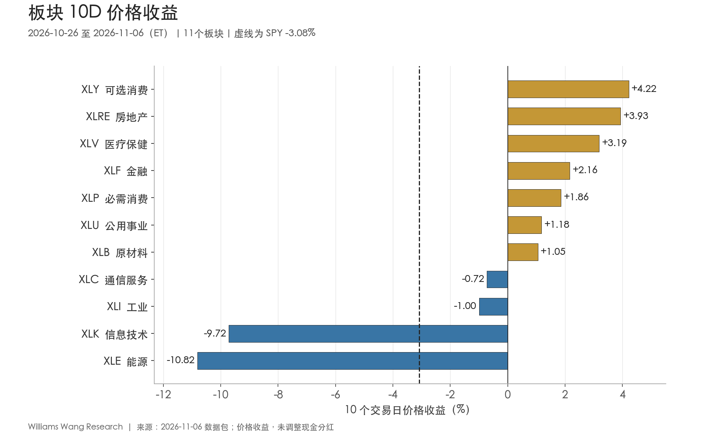
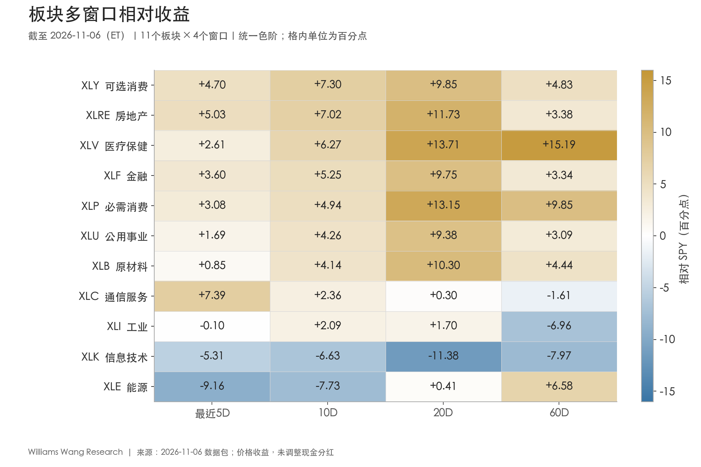
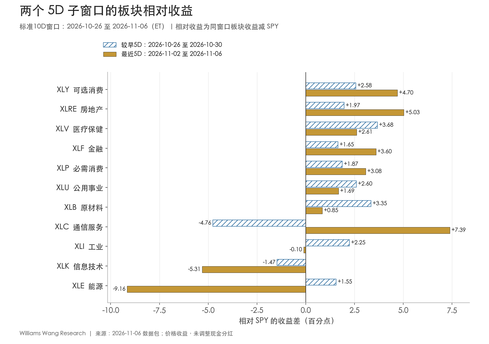

+++
title = "市场板块轮动双周分析报告｜截至 2026-11-06（ET）"
date = "2026-11-07"
data_as_of = ["2026-11-03", "2026-11-05", "2026-11-06"]
data_as_of_note = "权益观察期10月26日至11月6日ET；多数收益率、信用与VIX截至11月5日，WTI现货截至11月3日，部分利差及通胀补偿截至11月6日；分别保留实际观察日。"
draft = false
description = "可选消费与房地产领涨，能源由首位跌至末位；科技持续落后，第二周上涨广度收窄，并保留ETF拆股口径限制。"
series = "市场板块轮动双周复盘"
categories = ["市场结构", "宏观与政策"]
tags = ["板块轮动", "SPY", "ETF", "市场广度"]
featured = false
private = false
content_preservation = "verbatim"
source_sha256 = "543a20a22ecf44ec8f2f0c300dc7f00a7e9d71a5b951c1337c3ad0494832b327"
+++

# 市场板块轮动双周分析报告｜截至 2026-11-06（ET）

**可选消费与房地产领涨，能源从首位跌至末位**

观察期为 2026 年 10 月 26 日至 11 月 6 日，共 10 个交易日。市场日期均为美东时间。制作时间为 2026 年 11 月 7 日 11:58:20（新加坡）。

## 一、本期市场判断

**可选消费与房地产连续两周上涨。** 可选消费（XLY）上涨 **4.22%**，房地产（XLRE）上涨 **3.93%**，医疗（XLV）上涨 **3.19%**。同期 SPY 下跌 **3.08%**，QQQ 下跌 **6.66%**。能源（XLE）下跌 **10.82%**，由对照期第 1 降至第 11。科技（XLK）下跌 **9.72%**，在 5、10、20 和 60 个交易日的窗口内均落后 SPY。

**相对领先仍广，实际上涨面在第二周收窄。** 完整 10 日有 9 个板块跑赢 SPY，其中 7 个上涨，通信和工业均下跌。进入最近 5 日，上涨板块由 9 个降至 6 个，板块平均收益从 **+0.83%** 降至 **−1.23%**。11 月 5 日，11 个板块全部收跌，SPY 单日下跌 **4.41%**。当日 VIX 收在 **28.18**，较 10 月 30 日上升 **8.76 点**。11 月 6 日 SPY 反弹 0.48%，包内 VIX 与信用利差截至 5 日，周五反弹时的风险定价仍待确认。

| 指数代理 | 10/26—10/30 | 11/02—11/06 | 完整10D | 20D | 60D |
| --- | ---: | ---: | ---: | ---: | ---: |
| SPY | -0.56% | -2.54% | -3.08% | -5.40% | -5.32% |
| QQQ | -1.97% | -4.78% | -6.66% | -12.48% | -10.19% |
| RSP | +0.82% | -1.04% | -0.23% | +1.40% | -3.01% |
| IWM | +1.30% | -2.00% | -0.73% | -1.86% | -9.80% |

## 二、参与广度与排名更替

本期收益以 **10 月 23 日收盘** 为基准。排名与紧邻的 **10 月 12—23 日** 比较，对照期以 10 月 9 日收盘为基准。上份报告截止于 10 月 30 日，与本期重叠 10 月 26—30 日这五个交易日。下表的两段 5D 均来自本期数据包。

| 区间 | 上涨板块 | 跑赢SPY | 期末高于20日均线 | 板块等权平均收益 | SPY收益 |
| --- | ---: | ---: | ---: | ---: | ---: |
| 对照10D（10/12—10/23） | 8/11 | 8/11 | 8/11 | +1.23% | -2.39% |
| 本期10D（10/26—11/06） | 7/11 | 9/11 | 7/11 | -0.42% | -3.08% |
| 较早5D（10/26—10/30） | 9/11 | 9/11 | 8/11 | +0.83% | -0.56% |
| 最近5D（11/02—11/06） | 6/11 | 8/11 | 7/11 | -1.23% | -2.54% |

板块收益中位数为 **+1.18%**，平均值为 **−0.42%**。最高与最低收益相差 **15.04 个百分点**，横截面标准差为 **4.91 个百分点**。剔除能源和科技后，余下 9 个板块平均上涨 **1.76%**，极差收窄至 **5.21 个百分点**，标准差降至 **1.75 个百分点**。这两个板块对等权均值和离散度的影响很大。估计它们对 SPY 跌幅的贡献还需要指数权重及成分股收益。

本期与对照期的排名相关系数为 **+0.10**，两期前三名仅医疗重合。可选消费由第 8 升至第 1，能源由第 1 降至第 11，其余九个板块的名次变动均小于五位。较长窗口的广度还受基准影响，20D 有 **10/11** 跑赢 SPY，实际上涨 **7/11**。60D 有 **8/11** 跑赢 SPY，实际上涨的仅医疗、必需消费和能源三个板块。

## 三、领涨与落后板块

下表按本期价格收益排序。相对收益为板块减 SPY，单位为百分点。均线状态取 11 月 6 日收盘。

| 板块 | 对照期→本期名次 | 10D价格收益 | 10D相对 | 20D相对 | 60D相对 | 高于20日均线 |
| --- | ---: | ---: | ---: | ---: | ---: | --- |
| XLY 可选消费 | 8→1 | +4.22% | +7.30 | +9.85 | +4.83 | 是 |
| XLRE 房地产 | 6→2 | +3.93% | +7.02 | +11.73 | +3.38 | 是 |
| XLV 医疗保健 | 3→3 | +3.19% | +6.27 | +13.71 | +15.19 | 是 |
| XLF 金融 | 7→4 | +2.16% | +5.25 | +9.75 | +3.34 | 是 |
| XLP 必需消费 | 2→5 | +1.86% | +4.94 | +13.15 | +9.85 | 是 |
| XLU 公用事业 | 5→6 | +1.18% | +4.26 | +9.38 | +3.09 | 是 |
| XLB 原材料 | 4→7 | +1.05% | +4.14 | +10.30 | +4.44 | 是 |
| XLC 通信服务 | 10→8 | -0.72% | +2.36 | +0.30 | -1.61 | 否 |
| XLI 工业 | 9→9 | -1.00% | +2.09 | +1.70 | -6.96 | 否 |
| XLK 信息技术 | 11→10 | -9.72% | -6.63 | -11.38 | -7.97 | 否 |
| XLE 能源 | 1→11 | -10.82% | -7.73 | +0.41 | +6.58 | 否 |

**可选消费与房地产的领先来自实际上涨。** XLY 两段 5D 分别上涨 **2.02%** 和 **2.16%**，XLRE 的涨幅从 **1.41%** 扩至 **2.49%**。两者 20D 价格收益也分别为 **+4.45%** 和 **+6.33%**。拉长至 60D，XLY 仍下跌 **0.49%**，XLRE 下跌 **1.94%**。两者过去两周的上行已有 20D 数据呼应，60D 的领先则包含大盘跌幅较深的影响。

**医疗保留前三位置，但近期涨幅几乎全部来自第一周。** XLV 在前 5 日上涨 **3.12%**，后 5 日仅上涨 **0.07%**。它在 60D 仍上涨 **9.87%**，领先 SPY **15.19 个百分点**。金融与必需消费也连续两周上涨。公用事业和原材料的完整 10D 收益为正，最近 5D 已转跌。四个窗口均跑赢 SPY 的七个板块中，有五个在最新一周实际上涨。

**能源发生短期逆转，科技弱势持续更久。** XLE 从对照期上涨 **6.53%** 转为本期下跌 **10.82%**，但 60D 仍上涨 **1.26%**。XLK 在对照期已经下跌 **7.82%**，本期跌幅扩大，20D 累计下跌 **16.78%**，60D 下跌 **13.29%**。两者本期跌幅相近，前期走势及反转所需的确认条件不同。

## 四、两个五日窗口中的变化

| 板块 | 前5D收益 | 后5D收益 | 前5D相对SPY（百分点） | 后5D相对SPY（百分点） |
| --- | ---: | ---: | ---: | ---: |
| XLY 可选消费 | +2.02% | +2.16% | +2.58 | +4.70 |
| XLRE 房地产 | +1.41% | +2.49% | +1.97 | +5.03 |
| XLV 医疗保健 | +3.12% | +0.07% | +3.68 | +2.61 |
| XLF 金融 | +1.09% | +1.06% | +1.65 | +3.60 |
| XLP 必需消费 | +1.31% | +0.54% | +1.87 | +3.08 |
| XLU 公用事业 | +2.04% | -0.85% | +2.60 | +1.69 |
| XLB 原材料 | +2.79% | -1.69% | +3.35 | +0.85 |
| XLC 通信服务 | -5.32% | +4.85% | -4.76 | +7.39 |
| XLI 工业 | +1.69% | -2.64% | +2.25 | -0.10 |
| XLK 信息技术 | -2.03% | -7.85% | -1.47 | -5.31 |
| XLE 能源 | +1.00% | -11.70% | +1.55 | -9.16 |

**通信的反弹幅度最大。** XLC 从前 5 日下跌 **5.32%** 转为后 5 日上涨 **4.85%**，同期相对表现从落后 SPY **4.76 个百分点** 转为领先 **7.39 个百分点**。按两周收益复合计算，完整区间仍下跌 **0.72%**，期末收盘仍低于 20 日均线。能源转向相反方向，前 5 日上涨 **1.00%**，后 5 日下跌 **11.70%**。工业也由涨转跌，最近 5 日落后 SPY 仅 **0.10 个百分点**，在未调整现金分红的口径下应视作接近基准。

最近 5 日有八个板块跑赢 SPY，其中公用事业下跌 **0.85%**、原材料下跌 **1.69%**，均小于 SPY 的 **2.54%** 跌幅。金融的两段绝对涨幅接近（**1.09%、1.06%**），相对优势却由 **1.65** 扩至 **3.60 个百分点**。这部分扩大主要来自基准转弱。11 月 6 日 QQQ 反弹 **1.62%**、科技反弹 **1.87%**，等权 RSP 当日仍下跌 **0.39%**，周五恢复的范围有限。

## 五、报告期内的外部背景

**10 月 28—29 日。** 美联储以 10 比 2 维持联邦基金利率目标区间 **3.75%—4.00%**，两名反对者主张加息 25 bp。次日 BEA 公布三季度实际 GDP 初值，环比折年增长 **3.4%**，二季度为 **2.2%**。这两项消息属于本期第一周，提供政策及经济增长背景。[美联储 10 月 28 日声明](https://www.federalreserve.gov/newsevents/pressreleases/monetary20261028a.htm) · [BEA 三季度 GDP 初值](https://www.bea.gov/news/2026/gdp-advance-estimate-3rd-quarter-2026)

**11 月 1 日。** 参与会议的七个 OPEC+ 国家决定，12 月沿用 9 月的规定产量。随后一个交易日，USO 下跌 **7.08%**、XLE 下跌 **3.96%**。公告描述的是产量目标，实际供给、运输和需求的变化仍需单独核实，现有材料无法把两只 ETF 的跌幅分配给某一项消息。[OPEC 11 月 1 日会议公告](https://www.opec.org/pr-detail/2033620-1-november-2026.html)

**11 月 6 日。** BLS 于美东 8:30 公布 10 月非农就业增加 **16.5 万人**，失业率为 **4.1%**，医疗行业增加 **4.2 万人**。发布时间晚于 11 月 5 日的权益回撤与 VIX 观察值。就业增长仍具韧性，市场同期出现信用利差走阔和成长股回撤，对于单一宏观驱动的解释证据混杂。[BLS 10 月就业报告原文](https://www.bls.gov/news.release/archives/empsit_11062026.htm)

## 六、风格、商品与两只 ETF 的拆股影响

各项均为同窗口的价格收益差，单位为百分点。周期组等权包括可选消费、金融、工业、原材料、能源，防御组等权包括必需消费、公用事业、医疗。

| 风格或资产对 | 最近5D | 10D | 20D | 60D |
| --- | ---: | ---: | ---: | ---: |
| 成长−价值（SPYG−SPYV） | -1.67 | -3.65 | -11.57 | -7.79 |
| 大盘成长−价值（IWF−IWD） | -4.63 | -6.70 | -14.29 | -10.70 |
| 等权−市值加权（RSP−SPY） | +1.50 | +2.85 | +6.80 | +2.31 |
| 小盘−大盘（IWM−SPY） | +0.54 | +2.36 | +3.54 | -4.49 |
| 低波动−市场（USMV−SPY） | +0.89 | +1.41 | +6.10 | +5.18 |
| 周期组−防御组 | -2.48 | -2.95 | -5.68 | -6.93 |
| 高收益债−投资级债（HYG−LQD） | -0.55 | -0.46 | -2.11 | -1.35 |
| 长债−中期美债（TLT−IEF） | -0.11 | -0.27 | +2.20 | +0.64 |

成长在两套比较中均落后价值。10D 的 SPYG−SPYV 为 **−3.65 个百分点**，IWF−IWD 为 **−6.70 个百分点**。等权和小盘跑赢市值加权指数，但 RSP 与 IWM 的 10D 价格收益分别为 **−0.23%、−0.73%**，四个主要权益代理期末均低于各自 20 日均线。低波动 USMV 本期下跌 **1.67%**，其领先 SPY 的 **1.41 个百分点** 体现了较小的跌幅。

能源对周期组影响尤大。周期组 10D 平均下跌 **0.88%**，防御组平均上涨 **2.07%**，差距 **2.95 个百分点**。剔除能源后，其余四个周期板块的均值仅落后防御组 **0.47 个百分点**。可选消费领涨与周期组整体落后可以同时出现。

### 动量与质量的价格单位

包内 MTUM 收盘价从 10 月 30 日的 **284.10 美元** 变为 11 月 2 日的 **68.785 美元**，QUAL 从 **222.49** 变为 **55.5025 美元**。原始日收益相应为 **−75.79%** 和 **−75.05%**。iShares 10 月 5 日提交的补充说明确认两者均为 **1 股拆为 4 股**，11 月 3 日为登记日，11 月 4 日收盘后实施，11 月 5 日按拆股后份额交易。包内价格单位的断点出现在 11 月 2 日，比公告生效日早三个日历日。[iShares 提交至 SEC 的拆股说明](https://www.sec.gov/Archives/edgar/data/1100663/000119312526414100/R2.htm)

下表并列包内原始相对收益和**按份额统一后的端点估算**，单位为百分点。各窗口起点均早于 11 月 2 日，终点均为 11 月 6 日。估算公式为 `4 × 期末收盘价 / 期初收盘价 − 1 − 同期SPY收益`，假设两个端点分别采用拆股前、拆股后的份额单位。

| 窗口 | MTUM原始相对 | MTUM端点估算 | QUAL原始相对 | QUAL端点估算 |
| --- | ---: | ---: | ---: | ---: |
| 5D | -74.82 | -6.89 | -72.75 | +1.37 |
| 10D | -74.69 | -8.02 | -72.25 | +1.76 |
| 20D | -74.50 | -14.19 | -70.40 | +2.21 |
| 60D | -74.33 | -13.26 | -70.49 | +2.10 |

统一端点份额后，MTUM 的 10D 价格收益约 **−11.10%**，仍落后 SPY **8.02 个百分点**。QUAL 的 10D 价格收益约 **−1.32%**，相对表现转为领先 **1.76 个百分点**。跨断点的均线、回撤、波动率及逐日路径需要连续同口径行情方能验证。这两只 ETF 仅用于风格观察，11 个板块的名次、广度及三张图均独立于它们。

### 商品与美元

| 价格收益 | 最近5D | 10D | 20D | 60D |
| --- | ---: | ---: | ---: | ---: |
| UUP 美元 | -0.18% | -0.05% | -0.25% | +2.72% |
| GLD 黄金 | +4.94% | +1.84% | -2.91% | -6.41% |
| USO 原油期货 | -12.21% | -12.57% | +0.01% | +18.54% |
| DBC 广义商品期货 | -7.77% | -9.09% | -5.95% | +4.10% |

油价与能源股票在共同窗口内均下行。以 10 月 23 日为基准、统一截到 11 月 3 日，WTI 现货由 **109.72** 降至 **99.64 美元/桶**，跌 **9.19%**，同期 USO 跌 **6.70%**。其中 10 月 30 日至 11 月 3 日，现货和 USO 分别跌 **7.36%**、**6.31%**。USO 的完整 10D 跌幅扩大到 **12.57%**，现货后续读数尚缺。期货持仓、展期与定价时点会影响两者差值。黄金 GLD 最近 5 日上涨 **4.94%**，同期广义商品 DBC 下跌 **7.77%**，商品内部方向分化。

## 七、利率、信用与波动率

各行使用实际最新观察日。收益率及利差的水平列以 % 表示，变化列中 1 bp 等于 0.01 个百分点。VIX 的变化以指数点表示，WTI 以美元/桶表示。

| 指标 | 10/23基准 | 最新值 | 实际观察日 | 自10/23变化 | 自10/30变化 |
| --- | ---: | ---: | --- | ---: | ---: |
| 2年期美债收益率 | 4.69% | 4.46% | 2026-11-05 | -23 bp | -10 bp |
| 10年期美债收益率 | 5.00% | 4.84% | 2026-11-05 | -16 bp | -10 bp |
| 30年期美债收益率 | 5.33% | 5.25% | 2026-11-05 | -8 bp | -6 bp |
| 10Y−2Y | 0.31% | 0.35% | 2026-11-06 | +4 bp | -3 bp |
| 10Y−3M | 0.78% | 0.67% | 2026-11-06 | -11 bp | -11 bp |
| 10年期实际收益率 | 2.66% | 2.60% | 2026-11-05 | -6 bp | +0 bp |
| 10年期通胀补偿 | 2.34% | 2.23% | 2026-11-06 | -11 bp | -11 bp |
| 高收益债 OAS | 3.38% | 3.48% | 2026-11-05 | +10 bp | +4 bp |
| 投资级债 OAS | 0.91% | 0.93% | 2026-11-05 | +2 bp | -1 bp |
| VIX | 19.45 | 28.18 | 2026-11-05 | +8.73点 | +8.76点 |
| WTI 现货（美元/桶） | 109.72 | 99.64 | 2026-11-03 | -10.08美元/桶 | -7.92美元/桶 |

截至 11 月 5 日，2 年、10 年、30 年期美债收益率较基准日分别下降 **23、16、8 bp**。同日对齐后，10Y−2Y 从 **31 bp** 扩至 **38 bp**，10 年期实际收益率下降 **6 bp**，通胀补偿下降 **10 bp**。11 月 6 日单独更新的 10Y−2Y 为 **35 bp**，10 年期通胀补偿为 **2.23%**。债券 ETF 方面，中期美债 IEF 的 10D 价格收益为 **+0.90%**，长债 TLT 为 **+0.63%**，曲线各期限变动幅度不同。

截至 11 月 5 日，高收益债 OAS 从 **338** 升至 **348 bp**，投资级 OAS 从 **91** 升至 **93 bp**。同期 VIX 从 **19.45** 升至 **28.18**。高收益债 ETF 相对投资级债 ETF 在最近 5 日落后 **0.55 个百分点**，与高收益信用利差走阔方向一致。ETF 价差同时包含利率与久期敞口，信用风险变化的幅度以 OAS 为准。

## 八、下期观察点

- **领涨能否延续。** XLY、XLRE 已连续两段上涨。下一期同时比较其绝对收益、相对 SPY 收益及 60D 价格收益，观察短期领涨能否填补较长窗口的跌幅。医疗则看最近 5D 近乎持平后，能否恢复绝对上涨。
- **能源与科技的弱势是否扩散。** 检查 XLE 能否在油价趋稳时缩小相对跌幅，以及 XLK 反弹能否延续为正的 5D 相对收益。同时跟踪剔除两者后的板块均值，区分跌势集中与其余板块同步走弱。
- **广度能否跟上指数反弹。** 以最近 5D 的 6 个上涨板块和期末 7 个均线上方板块为起点，同时观察 RSP 的绝对收益和新发布的信用利差、VIX。若指数回升而这些指标继续恶化，反弹的参与范围仍然有限。

## 免责声明

本报告仅供研究与信息交流，不构成投资建议、交易指令或收益承诺。数据可能存在滞后、修订与复权口径差异。历史价格表现及相对强弱无法保证未来结果。读者应结合自身情况独立核实资料并承担投资决策风险。
