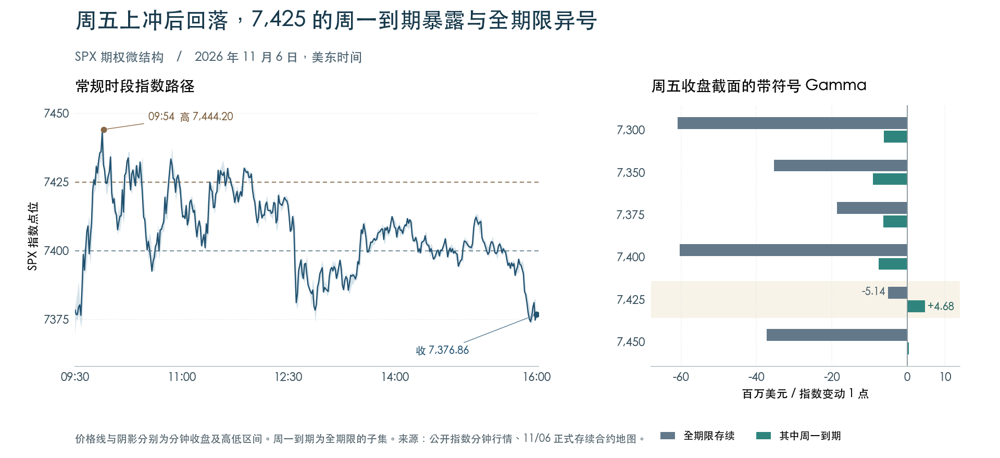

+++
title = "SPX期权持仓与Greeks结构分析-261106"
date = "2026-11-07"
data_as_of = ["2026-11-05", "2026-11-06"]
data_as_of_note = "D为11月6日、P为11月5日，目标日N为11月9日；融资利率截至11月5日，H.8最近周截至10月28日；16:00行情标记与盘后提取时点分别保留。"
draft = false
description = "周五反弹未守住7400，同合约负Gamma代理加深；周一观察7350–7400及7425承接，保留短端曲面与报价限制。"
series = "SPX期权分析报告"
categories = ["衍生品", "市场结构"]
tags = ["SPX", "XSP", "Greeks", "GEX", "期权"]
featured = false
private = false
content_preservation = "verbatim_except_privacy_redactions"
source_sha256 = "1f0a4e54396e23e9de2930562b3603944cb43da7a3459d0d127ff09774d56c5f"
+++

# SPX期权持仓与Greeks结构分析-261106

## 1. 一句话结论

周五反弹未守住 7,400，同一批周一仍存续的合约负 Gamma 暴露继续加深，周一先看 **7,350–7,400**，若收复上界并在 **7,425** 获得承接，下侧延续的解释就要撤回。

**盘后研究 B 级｜持仓结构可复核，方向未定、方向置信度低｜XSP 有条件情景估值｜目标日执行另行复核。**

## 2. T+1 Action Summary

| 项目 | 11 月 9 日观察与失效条件 |
| --- | --- |
| Base stance | 若开在 7,350–7,400，围绕 7,375 先观察。离开核心并有新的近端证据时切换分支。 |
| Earliest evaluation | 周一盘前核对 08:40 讨论，现金开盘后重定位。若价格或 IV 在 10:00 数据前后明显移动，等新报价。 |
| Base activation | 若上试 7,400 失败、仍在 7,350 之上且近端负值保留，可比较看跌买入价差与单买。收复 7,400 或越过下界后重选。 |
| Downside branch | 若失守 7,350 且回测未收复，依次复核 7,325、7,300，按新锚研究看跌买方。重回核心时撤回延续假设。 |
| Upside branch | 若收复 7,400，先看 7,425 的正负分歧，获得承接再看 7,450。比较看涨买方，跌回 7,400 内取消。 |
| Otherwise | 若跳空跨过首个复核区、收益率或 IV 受新消息改写，重建期限和报价。缺少可靠更新时只观察。 |

## 3. Executive Summary

- **上侧触及与守住是两件事。** 周五 09:37 的分钟线首次跨过 7,400，09:45 跨过 7,425，09:54 见 7,444.20，收盘回落至 7,376.86。前报的上侧第一复核位确实经过，第二个 7,450 未到。 [分钟行情](https://query1.finance.yahoo.com/v8/finance/chart/%5EGSPC?period1=1793975400&period2=1793998980&interval=1m&includePrePost=false&events=history)

- **剔除周五到期层后，负暴露加深。** 相同 14,574 个合约的 signed GEX 从 −60.045 变为 −68.816 B USD/1%（B 为十亿美元）。若直接相减两天各自的存续图，会把大额周五负值的退出算成改善。

- **7,425 是上侧最值得分期限看的一点。** 周一到期在此为 +4.68 M USD/点，全期限合计却为 −5.14 M。下侧 7,350、7,300 在两种口径都为负。观察顺序有差别，涨跌概率仍未知。

- **周二 CPI 前的保护价格不能靠一条近端曲线判断。** 固定 14D 和 30D ATM 分别回落 3.04 和 2.07 个波动率百分点（vp）。周一至周四四个实际候选期限的 SPXW 局部报价拟合均未过门槛。 [BLS 发布日历](https://www.bls.gov/schedule/2026/11_sched.htm)

- **涨回核心不等于 Gamma 已转正。** 冻结 OI 是保持最近可得合约持仓数量与符号约定不变，改变价格、时间及 IV，重估存续合约的 Gamma 暴露。45 个指定格点全部为负。周一中午、IV 不变时，标的 −1% 与 +1% 对应 −89.748 和 −65.689 B。

- **只保留一张下侧条件研究卡。** 周一中午若 XSP 较周五锚下跌 0.5%、IV 不变，周一 740/735P 价差的假设净损益为 +191 美元，740P 单买为 +35 美元。若跌幅达到 1%，单买约 +403 美元，超过价差的 +257 美元。两项均假设付出周五的参考支出。

## 4. What Changed vs. T-1 and Prior Playbook Review

| 实质变化 / 口径 | 11/05 | 11/06 | 变化的含义 |
| --- | --- | --- | --- |
| 指数与 VIX | 链内 7,353.63，VIX 28.18 | 链内 7,376.50，VIX 25.64 | 现货回升 22.87 点（0.31%），VIX 回落 2.54 点。 |
| 相同 14,574 个合约的 signed GEX | −60.045 B | −68.816 B | 变化 −8.771 B。其中 PM −4.433 B、AM −4.338 B。共同合约 gross 由 224.306 升至 246.534 B。 |
| 同一 11/09 PM 到期层 | OI 169,233 张，gross 5.219 B，signed −4.302 B | OI 229,668 张，gross 9.372 B，signed −4.476 B | gross 增加 4.153 B，带符号合计只再负约 0.174 B。两侧总量与方向净额变化幅度不同。 |
| 滚动 1–60 日 DEX | −753.807 B USD | −654.701 B USD | 负值收窄 99.106 B。该桶每日重选，含到期与估值变化，口径不同于共同合约 Gamma。 |
| 固定 14D / 30D ATM | 24.72% / 21.50% | 21.67% / 19.43% | 两期限各降 3.04、2.07 vp。14D 相对 30D 的溢价从 3.22 缩至 2.24 vp。 |
| 全采集链的 put/call | OI 比 1.430，成交量比 1.269 | OI 比 1.436，成交量比 1.213 | 成交由 772.9 万降至 545.6 万张，下降 29.4%。成交量、存量与仓位方向分别解读。 |

**两张存续图为何给出相反印象。** 周四的 −74.291 B 包含周五到期层 −14.247 B，移去后，共同合约起点为 −60.045 B。相同合约再变动 −8.771 B，得到周五存续图的 −68.816 B。因此两个总数相减为 +5.476 B。另有 1,880 个仅在本次对齐集合中新出现的合约，报告 OI 合计为零。即使固定合约，spot、IV、时间、OI 与供应商 Greeks 的变化仍不能归因为净开仓。

**收盘结果。** 前报以 7,300–7,400 为核心，站上 7,400 后先看 7,425、再看 7,450。周五常规开盘 7,377.65、收盘 7,376.86，均在旧核心内，收盘较周四上涨 23.13 点。链内锚 7,376.50 用于本次结构计算。 前一交易日报告 · [美联社收盘核对](https://apnews.com/article/wall-street-stocks-dow-nasdaq-806f71d95105bc7efbc760b194dd8cad)

**盘中路径。** 09:30 的分钟低点 7,369.55 为全日最低。09:37 首次跨过 7,400，该分钟收于 7,398.74。09:45 首次跨过 7,425，09:54 见全日高点。此后首次收回 7,400 下方的分钟为 10:34（7,396.96），15:35 仍曾触及 7,400.02。7,450、7,350 和 7,300 全天均未触及。核对了 390 根连续 1 分钟线与 78 根 5 分钟线，16:00 为单独收盘标记。历史接口未给出逐笔及最初实时发布版本。 [1 分钟](https://query1.finance.yahoo.com/v8/finance/chart/%5EGSPC?period1=1793975400&period2=1793998980&interval=1m&includePrePost=false&events=history) · [5 分钟](https://query1.finance.yahoo.com/v8/finance/chart/%5EGSPC?period1=1793975400&period2=1793998980&interval=5m&includePrePost=false&events=history)

**交易层。** 价格记录支持“上侧第一节点被测试，收盘又回到区间”。本次没有相应时刻的独立期权结构确认、可成交组合报价和成交记录，前报固定参考腿的完整触发与实际盈亏均无法核实。

左图为指数历史分钟行情，右图为周五 16:00 期权截面。右图用于准备周一观察，盘中各时刻的期权暴露另需当时报价。

## 5. T 日盘面、字段时点与 Event-Risk Overlay

| 数据钟 / 字段 | 观测事实 | 影响 |
| --- | --- | --- |
| SPX 标的与正式 IV | 两日链内标记及 IV 模型估值均为各自 16:00，间隔 24 小时。 | D 链内值 7,376.50，常规收盘 7,376.86。包内 FRED 收盘参考停在 11/05 的 7,353.73。 |
| 提取与研究截止 | SPX 快照 11/06 22:52:00.580332，XSP 快照及截止 22:54:29.687036。 | 分  |
| XSP 价格 | XSP 自身标的 737.69，300 条缓存单腿均标为 16:00。 | SPX 链内锚除以十为 737.65，仅供位置换算。期权估值用 XSP 自身的报价、标的与远期。 |
| OI 与 Greeks | OI 生效持仓日期未独立确认。各腿 Greeks 无逐项独立时间戳。 | 采用供应商当时返回值。同步标记、盘后持仓终值与可同时成交属于不同问题。 |
| 波动与利率 | VIX 28.18→25.64。2Y 4.46%→4.51%，10Y 4.84%→4.86%。 | 2s10s 从 38 收窄至 35 bp。11/05 的 EFFR 3.88%、SOFR 3.92% 仅作滞后背景。 |
| 已实现波动率 | 链内标的日对数收益，年化 RV5 32.90%→32.80%，RV10 25.51%→25.73%。 | 按总体标准差乘 √252。两日各有 20 个价格观测，RV20 缺失。SPY 跨资产基线也未提供。 |

| 信息阶段 / ET | 已知事实或排期 | 为何跟踪 |
| --- | --- | --- |
| 收盘前 · 11/06 08:30 | 10 月就业报告。非农新增 16.5 万，失业率 4.1%。 | 影响利率与股票折现率的共同背景。 [来源](https://www.bls.gov/news.release/archives/empsit_11062026.htm) |
| 收盘前 · 11/06 10:00 | 密歇根消费者调查初值。11 月信心指数 51.0，10 月终值 48.0。一年通胀预期 4.7%→4.3%，长期 3.5%→3.4%。 | 初值发布于当日早盘高点之后，通胀预期影响短率定价。 [来源](https://www.sca.isr.umich.edu/) |
| 收盘前 · 11/06 15:00 | G.19 消费信贷。9 月消费信贷按季调年率增长 6.4%。 | 给出滞后的家庭借贷背景。 [来源](https://www.federalreserve.gov/releases/g19/20261106/) |
| 收盘后至截止 · 11/06 16:15 | H.8 银行资产负债表。美联储发布周报，本次所列最近周截至 10/28。 | 可用于银行信贷背景，时间上晚于 SPX 与 XSP 快照的行情标记。 [来源](https://www.federalreserve.gov/releases/h8/20261106/) |
| 排期 · 周一盘前 · 11/09 08:40 | Bowman 讨论社区银行。主题为社区银行。 | 仅当出现货币政策或金融条件消息时重看短率与股指。 [来源](https://www.federalreserve.gov/newsevents/2026-november.htm) |
| 排期 · 周一盘中 · 11/09 10:00 | 美国批发贸易。纽约联储日历列于 10:00 ET。 | 与第一个 XSP 模型时点重合，发布前后的报价值要区分。 [来源](https://www.newyorkfed.org/research/calendars/i-nov26.html) |
| 排期 · 周一盘中 · 11/09 11:00 | 纽约联储消费者预期调查。消费者通胀预期等调查指标待发布。 | 与密歇根调查分别解读，若短端利率和 IV 改变则重估。 [来源](https://www.newyorkfed.org/research/calendars/i-nov26.html) |
| 排期 · 周一盘中 · 11/09 13:00 | 580 亿美元三年期美债拍卖。财政部 11/04 公布发行规模和拍卖时刻。 | 处于中午和 15:00 两个模型时点之间，留意收益率变化。 [来源](https://home.treasury.gov/news/press-releases/sb0678) |
| 排期 · 周二盘前 · 11/10 08:30 | 10 月 CPI。11/09 收盘之后，11/10–12 的候选合约尚未到期。 | 周一日内退出的 1–3DTE 合约仍含 CPI 前时间价值。 [来源](https://www.bls.gov/schedule/2026/11_sched.htm) |
| 排期 · 周五盘前 · 11/13 08:30 | 10 月 PPI。约 7D 的 11/13 期限还覆盖周五 PPI。 | 用于解释期限含有哪些日程。 [来源](https://www.bls.gov/schedule/2026/11_sched.htm) |

密歇根初值的访谈止于 11/02，早于选举结果。周一 Bowman 讨论的既定主题是社区银行。批发贸易、消费者预期及美债拍卖的结果均在本期截止之后，周末临时消息需在开盘前另核。11/20 月度和 12/18 季度到期日来自包内期权日历。 [联储发布时间表](https://www.federalreserve.gov/newsevents/2026-november.htm) · [纽约联储日历](https://www.newyorkfed.org/research/calendars/i-nov26.html)

## 6. Decision Rationale — Analytical Bridge

### 1. 周五指数收红，存续合约的负 Gamma 代理继续加深。

**证据。** 同合约 −60.045→−68.816 B，两类结算都变得更负。直接比较两张到期范围不同的地图，表面变化却为 +5.476 B。 **机制与假设。** 若 dealer 仓位与 call 正、put 负的代理一致，动态中性对冲可能放大两个方向的行情。

**周一含义。** 周一若离开 7,350–7,400，优先检查脱离方向的速度与承接。核心内反复不构成卖波动率理由。 **反证。** 新的同口径存续或周一层暴露显著转弱、变号，且价格重新回到核心，则撤回延续观察。 **置信度。** 合约变化可复核，路径机制中等，方向低。

### 2. 7,425 的周一到期暴露与全期限合计符号相反。

**证据。** 7,400 全期限 / 周一层 signed 为 −60.31 / −7.51 M USD/点。到 7,425 变为 −5.14 / +4.68。周五曾越过 7,425，最终跌回 7,400 下方。 **机制与假设。** 不同期限可能有相反的边际对冲需求，近端缓冲足以改变观察顺序，无法由该符号推知实际交易。

**周一含义。** 上穿 7,400 后先在 7,425 检查周一层与价格，持续站稳才看 7,450。 **反证。** 7,425 的正贡献消失、价格在其上获得承接时，取消缓冲假设。重新跌回 7,400 内则上侧延续失效。 **置信度。** 节点中高，阻滞效果低。

### 3. 在本次冻结情景中，相同幅度的下跌对应更深的负 Gamma 暴露，波动率回落本身也能加深负值。

**证据。** 周一中午 IV 不变，标的 −1% / 不动 / +1% 分别为 −89.748 / −84.727 / −65.689 B。不动时 IV 下移 2 vp 为 −94.460 B。 **机制与假设。** 固定 OI 后，行权价相对现货的位置、剩余时间和 IV 改变 Gamma。Vanna 的正号还意味着降 IV 会使模型 DEX 更负。

**周一含义。** 7,350 失守先看 7,325、7,300。若指数在区内、只有 IV 回落，不把 Gamma 的加深解释成下跌已经启动。 **反证。** 新 OI 或非平行 smile 变化使局部变号，或失守后迅速收回 7,350，重估。 **置信度。** 指定条件下的模型读数可复核，情景出现概率未知。

### 4. 中段 IV 回落比近端相对定价更容易被证实。

**证据。** 14D 与 30D 固定 ATM 回落。约 14D/30D 的滚动 25Δ put 相对中心溢价收窄 1.04/0.84 vp。周一与周二期限报价拟合率只有 18.78%/21.54%。 **机制与假设。** 周末时间与周二 CPI 的暴露不同，近端拟合又不足，不能把两日到期差拆成独立的 CPI 方差。

**周一含义。** 比较日内方向表达优先用 XSP 各自的腿价、相同冲击与退出时点。按照 CPI 溢价卖日历的研究依据不足。 **反证。** 若新报价改善、短端四个到期有可靠的局部形状与跨期价差，可重新研究相对价值。 **置信度。** 中段水平中等，短端相对价值低。

## 7. Conflicting Evidence, Confidence and What Changes the View

| 支持证据 | 削弱或限制证据 | 对判断的处理 |
| --- | --- | --- |
| 同合约负 Gamma 加深。 | 指数和 DEX 回升，VIX 下行。 | 保留双侧反馈假设，方向未定。指数和 DEX 的改善削弱单向看跌。 |
| 7,400、7,450 的全期限净值为负。 | 7,425 周一层为正，周五上冲在盘中回撤。 | 7,425 作为上侧第一复核点，周一层与全期限需分别复算。 |
| 冻结模型的 45 个格点都为负。 | 冻结 OI 覆盖 97.50%，没有重建未来仓位，曲线只作平行冲击。 | 读出局部敏感性，保留周末跳空和盘中新增合约的反例。 |
| PM 全局通过正式审计，XSP 有真实单腿和独立情景。 | 所有目标候选到期的 SPXW 局部拟合都低于 55%。 | 近端 smile 只作诊断。XSP 情景用自身报价，保留定价误差及组合成交约束。 |

结构事实由相同合约复算。路径判断属于有机制依据、尚无样本外验证的推断（mechanism_only / not_tested）。若价格与周一层符号共同改变，应重审方向假设。若结构仍在、远期或腿价已变，只需重新选腿估值。若结构和候选仍适用、但组合报价或风险额度未落实，则只能保留研究。

## 8. IV Term Structure, Skew and Surface

### 实际到期 ATM 与固定期限 ATM

下表均为 SPXW PM。ATM 取包内远期对数 moneyness 为零处的局部总方差插值。P、D 水平为年化 IV，历史差值为 D−P，单位为波动率百分点（vp）。实际到期表优先使用共同日期。

| 同一实际到期 / 事件与结算 | P→D τ（日） | P ATM | D ATM | Δ（vp） | 共同到期 / 方法与用途 |
| --- | --- | --- | --- | --- | --- |
| 11/09 · 周一结算，早于 CPI | 4 → 3 | 26.08% | 17.68% | −8.40 | 约束拟合 · 仅诊断 |
| 11/10 · 周二 CPI 日结算 | 5 → 4 | 27.00% | 21.02% | −5.98 | 约束拟合 · 仅诊断 |
| 11/11 · 含周二 CPI | 6 → 5 | 27.02% | 22.32% | −4.70 | 约束拟合 · 仅诊断 |
| 11/12 · 含周二 CPI | 7 → 6 | 27.19% | 22.68% | −4.51 | 约束拟合 · 仅诊断 |
| 11/13 · 周五 PPI 日 | 8 → 7 | 27.30% | 23.00% | −4.30 | 约束拟合 · 仅诊断 |
| 11/19 · 前日约 14D 槽 | 14 → 13 | 24.72% | 21.58% | −3.13 | 约束拟合 · 条件描述 |
| 11/20 · 月度 PM，另有 AM | 15 → 14 | 24.57% | 21.67% | −2.90 | 修复拟合 · 条件描述 |
| 12/04 · 前日约 30D 槽 | 29 → 28 | 21.71% | 19.77% | −1.94 | 约束拟合 · 条件描述 |
| 12/07 · 本日约 30D 槽 | 32 → 31 | 21.12% | 19.27% | −1.84 | 修复拟合 · 条件描述 |
| 12/18 · 季度 PM，另有 AM | 43 → 42 | 20.85% | 19.51% | −1.34 | 约束拟合 · 条件描述 |
| 12/31 · 年末 PM | 56 → 55 | 19.96% | 18.83% | −1.14 | 约束拟合 · 条件描述 |

| 固定 τ / D 期限背景 | P 来源到期 / 权重 | D 来源到期 / 权重 | P ATM → D ATM | Δ（vp）/ 两日权限 |
| --- | --- | --- | --- | --- |
| 3D · 周一结算 | 11/06 / 11/09（1/4d，w=0.667） | 11/09（3d，直接） | 27.50% → 17.68% | −9.82 · 仅诊断 |
| 7D · 11/10 CPI、11/13 PPI | 11/12（7d，直接） | 11/13（7d，直接） | 27.19% → 23.00% | −4.19 · 仅诊断 |
| 14D · 月度 PM | 11/19（14d，直接） | 11/20（14d，直接） | 24.72% → 21.67% | −3.04 · 条件描述 |
| 30D · 月度背景 | 12/04 / 12/07（29/32d，w=0.333） | 12/04 / 12/07（28/31d，w=0.667） | 21.50% → 19.43% | −2.07 · 条件描述 |
| 45D · 含季度 PM | 12/18 / 12/31（43/56d，w=0.154） | 12/18 / 12/31（42/55d，w=0.231） | 20.68% → 19.32% | −1.37 · 条件描述 |

固定期限直接引用包内 ATM。夹在两实际到期之间时，w 为上端权重，按总方差插值，无翼部外推。周五固定 3D 正好落在周一到期，前日固定 3D 由含非农的 11/06 与 11/09 混合而来。两点相差 −9.82 vp 只能作诊断。11/27 正式 IV 节点用 16:00，交易所节后常规收盘为 13:00，相差 0.125 日。两日五个固定期限的插值端点均未用 11/27。冻结模型对该到期采用早收市日历，但若沿用该节点远期，其年化 carry 仍继承 IV 的 τ。 [Cboe 交易时间](https://www.cboe.com/about/hours/us-options/)

### 选定期限 smile · 期限背景

水平行的五个 IV 节点为 %，下侧倾斜和 BF25 为 vp。变化行七列均为 vp。Downside skew25 = 25Δ put IV − ATM，BF25 =（25Δ put IV + 25Δ call IV）/ 2 − ATM。翼按观测支持范围内的固定远期 Delta 插值。差值和两项形状指标采用 packet 节点的报告层算术。

| 期限 / 用途 / 行类型 | 到期 / τ（日） | 10Δ put | 25Δ put | ATM | 25Δ call | 10Δ call | Downside skew25 | BF25 | 比较基础 / 方法 / 局部用途 |
| --- | --- | --- | --- | --- | --- | --- | --- | --- | --- |
| 近 7D · P 水平 | 11/12 / 7.0 | 40.14% | 32.46% | 27.19% | 23.32% | 21.11% | 5.27 | 0.70 | 约束拟合 · 条件描述 |
| 近 7D · D 水平 | 11/13 / 7.0 | 32.78% | 27.01% | 23.00% | 19.80% | 17.59% | 4.01 | 0.41 | 约束拟合 · 仅诊断 |
| 近 7D · Δ D−P | 11/12 → 11/13 | −7.36 | −5.45 | −4.19 | −3.52 | −3.51 | −1.25 | −0.29 | 滚动槽固 Δ · 仅诊断 |
| 近 14D · P 水平 | 11/19 / 14.0 | 39.37% | 30.65% | 24.72% | 20.15% | 17.81% | 5.93 | 0.68 | 修复拟合 · 条件描述 |
| 近 14D · D 水平 | 11/20 / 14.0 | 33.76% | 26.56% | 21.67% | 18.09% | 16.15% | 4.89 | 0.66 | 修复拟合 · 条件描述 |
| 近 14D · Δ D−P | 11/19 → 11/20 | −5.61 | −4.09 | −3.04 | −2.06 | −1.66 | −1.04 | −0.03 | 滚动槽固 Δ · 条件描述 |
| 近 30D · P 水平 | 12/04 / 29.0 | 36.42% | 27.69% | 21.71% | 17.37% | 15.31% | 5.99 | 0.83 | 约束拟合 · 条件描述 |
| 近 30D · D 水平 | 12/07 / 31.0 | 31.90% | 24.42% | 19.27% | 15.70% | 14.02% | 5.15 | 0.79 | 修复拟合 · 条件描述 |
| 近 30D · Δ D−P | 12/04 → 12/07 | −4.52 | −3.27 | −2.43 | −1.67 | −1.29 | −0.84 | −0.04 | 滚动槽固 Δ · 条件描述 |

按与 7、14、30 日最接近的包内实际 τ 选槽。三个 D 期限在 P 只有共同实际到期 ATM，缺相应固定 Δ 翼，因此同到期 ATM 已在上表保留，smile 另按同一合同滚动 11/12→11/13、11/19→11/20、12/04→12/07。固定期限 ATM 自身不提供固定期限的五节点 smile。

### 候选自身期限 · 采用同一实际到期

| 期限 / 用途 / 行类型 | 到期 / τ（日） | 10Δ put | 25Δ put | ATM | 25Δ call | 10Δ call | Downside skew25 | BF25 | 比较基础 / 方法 / 局部用途 |
| --- | --- | --- | --- | --- | --- | --- | --- | --- | --- |
| 11/09 候选 · P 水平 | 11/09 / 4.0 | 36.90% | 29.93% | 26.08% | 23.39% | 21.98% | 3.85 | 0.58 | 约束拟合 · 仅诊断 |
| 11/09 候选 · D 水平 | 11/09 / 3.0 | 23.48% | 20.37% | 17.68% | 15.65% | 14.33% | 2.69 | 0.33 | 约束拟合 · 仅诊断 |
| 11/09 候选 · Δ D−P | 11/09 → 11/09 | −13.42 | −9.56 | −8.40 | −7.74 | −7.64 | −1.16 | −0.26 | 同到期固 Δ · 仅诊断 |
| 11/10 候选 · P 水平 | 11/10 / 5.0 | P 未出翼 | P 未出翼 | 27.00% | P 未出翼 | P 未出翼 | P 缺 25Δ put | P 缺两翼 | 约束拟合 · 仅诊断 |
| 11/10 候选 · D 水平 | 11/10 / 4.0 | 28.96% | 24.31% | 21.02% | 18.61% | 16.89% | 3.29 | 0.44 | 约束拟合 · 仅诊断 |
| 11/10 候选 · Δ D−P | 11/10 → 11/10 | P 未出翼 | P 未出翼 | −5.98 | P 未出翼 | P 未出翼 | P 缺 25Δ put | P 缺两翼 | 同到期仅 ATM · 仅诊断 |
| 11/11 候选 · P 水平 | 11/11 / 6.0 | P 未出翼 | P 未出翼 | 27.02% | P 未出翼 | P 未出翼 | P 缺 25Δ put | P 缺两翼 | 约束拟合 · 条件描述 |
| 11/11 候选 · D 水平 | 11/11 / 5.0 | 32.15% | 26.22% | 22.32% | 19.41% | 17.38% | 3.90 | 0.50 | 约束拟合 · 仅诊断 |
| 11/11 候选 · Δ D−P | 11/11 → 11/11 | P 未出翼 | P 未出翼 | −4.70 | P 未出翼 | P 未出翼 | P 缺 25Δ put | P 缺两翼 | 同到期仅 ATM · 仅诊断 |
| 11/12 候选 · P 水平 | 11/12 / 7.0 | 40.14% | 32.46% | 27.19% | 23.32% | 21.11% | 5.27 | 0.70 | 约束拟合 · 条件描述 |
| 11/12 候选 · D 水平 | 11/12 / 6.0 | 32.27% | 26.65% | 22.68% | 19.66% | 17.45% | 3.96 | 0.47 | 约束拟合 · 仅诊断 |
| 11/12 候选 · Δ D−P | 11/12 → 11/12 | −7.87 | −5.81 | −4.51 | −3.66 | −3.66 | −1.30 | −0.23 | 同到期固 Δ · 仅诊断 |

11/09 与 11/12 均有两日相同实际到期节点。11/12 从 P 的期限背景变为 D 的候选用途，实际合约、节点定义仍相同。11/10、11/11 的前日包仅给同到期 ATM，翼部、倾斜和 BF25 的变化均不可比。上表“仅诊断”的差值只作模型算术，不作市场形状变化判断。

**水平。** 两日可作条件描述的 11/20 同到期 ATM 下降 2.90 vp，12/07 下降 1.84 vp。滚动 14D 与 30D 槽的 ATM 则分别下降 3.04、2.43 vp。周一至周五的 D 截面从 17.68% 排到 23.00%，期限跨越周末、CPI 和 PPI，且这五个点均受局部拟合限制。

**倾斜。** 约 14D 槽 25Δ put 下降 4.09 vp，25Δ call 下降 2.06 vp，put−ATM 收窄 1.04 vp。约 30D 槽相应收窄 0.84 vp，下侧保护仍有正 IV 溢价。7D 及四个候选期限不能据上述诊断数值确认相同的市场变化。

**曲率。** 约 14D 与 30D 槽 BF25 分别仅减 0.03、0.04 vp。小差值未经误差校准，经济意义未证实。BF25 衡量双翼 IV 相对中心的平均差，与蝶式组合价格、利润和胜率无直接换算。

**老化、滚动与策略用途。** 同到期 11/09 的 τ 从 4 天减至 3 天，25Δ put 对应行权价从约 7,200 移至 7,294。相同 Delta 会随现货、远期和时间移动，滚动槽还更换了实际到期。中段结果支持分翼、分期限研究。短端事件溢价、两翼便宜或昂贵以及 XSP 是否有成交优势，均超出可说明的范围。

## 9. Key Expiry / Strike / Dealer Node

**先确定分母。** 采集上限为 60 个日历日，实际到期 11/06–12/31。周五原始链 17,162 行、OI 14,135,340 张。常规过滤后 13,950 行、OI 8,453,280 张，占原始 OI 的 59.80%。周一存续地图从原始链按最后可交易时刻晚于周一开盘另行筛选，覆盖 16,454 个合约、OI 13,174,390 张、8,227 个到期×家族×结算×行权价节点，合格 Gamma 覆盖该存续样本 OI 的 100%。PM 按到期日、AM 按项目前一交易日最后交易的约定。

全存续 gross 为 **246.534 B USD/1%**，signed 为 **−68.816 B**。行权价 约 7,155.2–7,597.8（现货 ±3%）只覆盖 38.67% 的存续 gross。旧 selected gamma 表仅列四个到期、K/S 0.6–1.4。仅取合并行并移除 11/06 后，11/09、11/20、12/18 三个选定到期的窗口合计 176.045 B，占完整存续 gross 的 71.41%。表中的 11/06 gross 34.052 B 已到期。

| 到期 / 范围 | 报告 OI（张） | gross（B/1%） | signed（B/1%） | 占存续 gross |
| --- | --- | --- | --- | --- |
| 11/06 周五 PM · 已移除 | 960,950 | 34.052 | −20.490 | 已剔除 |
| 11/09 · 周一 0DTE PM | 229,668 | 9.372 | −4.476 | 3.80% |
| 11/10 · 周二 CPI 日 PM | 121,714 | 5.478 | −3.394 | 2.22% |
| 11/11 · 周三 PM | 142,815 | 6.178 | −5.186 | 2.51% |
| 11/12 · 周四 PM | 94,087 | 3.016 | −1.669 | 1.22% |
| 11/13 · 周五 PPI 日 PM | 496,852 | 10.343 | −5.735 | 4.20% |
| 11/20 · 月度合计 | 2,545,730 | 49.262 | −23.111 | 19.98% |
| 11/20 · 其中 SPX AM | 2,081,409 | 40.163 | −17.086 | 16.29% |
| 11/20 · 其中 SPXW PM | 464,321 | 9.099 | −6.025 | 3.69% |
| 12/18 · 季度合计 | 6,767,042 | 117.411 | −11.818 | 47.62% |
| 12/18 · 其中 SPX AM | 6,439,244 | 112.810 | −9.355 | 45.76% |
| 12/18 · 其中 SPXW PM | 327,798 | 4.600 | −2.463 | 1.87% |
| 全部存续 · AM | 8,520,653 | 152.974 | −26.441 | 62.05% |
| 全部存续 · PM | 4,653,737 | 93.560 | −42.375 | 37.95% |
| 全部存续 · 去重 | 13,174,390 | 246.534 | −68.816 | 100.00% |

11/20 和 12/18 的合计与下列“其中”行重叠。12/18 单一到期就占存续 gross 的 47.62%，主要集中在 AM。周一到期贡献 3.80%，对局部行权价仍可能很重要。不同结算下的期权不能当作同一份库存。

### 局部行权价 · M USD/点

| SPX 行权价 | 全部 gross | 全部 signed | 周一 gross | 周一 signed | 结构含义 |
| --- | --- | --- | --- | --- | --- |
| 7,300 | 77.76 | −60.84 | 6.24 | −6.16 | 下侧第二复核，全期限净负集中 |
| 7,325 | 21.27 | −11.59 | 0.91 | −0.81 | 失守下界后先看 |
| 7,350 | 64.03 | −35.38 | 15.87 | −9.10 | 下界，周一层净负较大 |
| 7,375 | 24.97 | −18.61 | 8.10 | −6.36 | 靠近链内锚 |
| 7,400 | 115.11 | −60.31 | 8.68 | −7.51 | 上界，两层同负 |
| 7,425 | 26.61 | −5.14 | 8.28 | +4.68 | 周一为正、合计仍负 |
| 7,450 | 71.64 | −37.31 | 4.24 | +0.38 | 上行第二复核 |
| 7,500 | 136.98 | −55.43 | 5.30 | +1.90 | 远一档，两种口径仍异号 |

局部表把所有存续合约按 strike 合并。“周一”是同一行全期限总量的子集。按单一到期家族看，11/20 的 7,500 为最突出的负节点（约 −27.5 M USD/点），11/09 的 7,425 为正节点（约 +4.7 M）。gross 是绝对暴露，signed 采用 call 正、put 负的库存代理。长 put 的数学 Gamma 为正。1% 口径约等于每点数值乘 73.765，两个单位不可直接相加。

### Delta、Vanna、Charm 与 Volga

| DTE 桶 / 比较范围 | gross GEX（B/1%） | DEX（B USD） | Vanna ΔDEX（B） | Charm ΔDEX（B） | Volga ΔVEX（B） |
| --- | --- | --- | --- | --- | --- |
| ALL_EXCL_0DTE | 246.534 | −654.701 | +19.881 | +1.020 | +22.732 |
| D30±3 | 3.424 | −18.171 | −0.323 | +0.870 | +0.363 |
| D7±2 | 19.538 | −101.524 | +0.363 | +0.057 | +0.370 |
| LE3D | 43.425 | −127.738 | +0.042 | +1.952 | +0.077 |

DEX 采用供应商 Delta×现货×乘数×OI，put 的 Delta 已带负号。Vanna 和 Volga 分别是 IV 上下各 0.5 vp 后的模型 DEX 差与 VEX 差，按模型原生 Vega 标尺计算。Charm 在 spot/IV 固定下，从本交易日推至下一交易日参考时刻（PM 16:00、AM 17:00），含周末。高阶指标排除当日到期。正 Vanna 意味着 IV 上移使 DEX 比下移更正，正 Charm 是时间推进后的模型增量。1–60D Vanna 为正、30D 附近却为负，不能用一个全链数值代替选定期限的反应。不同指标的名义量也不能累加成对冲流。

LE3D 包含 11/06 已到期及 11/09 两层，gross 43.425 B 中 34.052 B 已退出。它的桶 ATM 为 5.58%，不同于正式 11/09 ATM 的 17.68%。D7±2、D30±3 是滚动切片，与 1–60D 重叠。

### 冻结 OI · 同一组 15,119 个合约

冻结网格使用同一组可承受全部指定冲击的合约，覆盖存续合格 OI 的 97.50%。13,112 个合约采用同范围远期 carry，2,007 个用利率回退。用每份合约的供应商 IV、固定 carry、sticky-strike 的平行 IV 冲击作 Black-76 重估。下表均为周一 12:00 ET 的 signed GEX，单位 B USD/1%。

| SPX 较周五链内锚 | 情景 SPX | IV −2 vp | IV 不变 | IV +2 vp |
| --- | --- | --- | --- | --- |
| −1.0% | 7,302.73 | −97.055 | −89.748 | −82.351 |
| −0.5% | 7,339.62 | −96.667 | −88.304 | −80.081 |
| +0.0% | 7,376.50 | −94.460 | −84.727 | −75.529 |
| +0.5% | 7,413.38 | −85.892 | −75.571 | −66.185 |
| +1.0% | 7,450.27 | −76.824 | −65.689 | −55.951 |

标的不动、IV 不变时，10:00、12:00、15:00 分别为 −84.015、−84.727、−85.405 B。全部 45 个格点为 −99.364 至 −55.830 B，给定冲击中没有符号反转，也不足以推出精确 Gamma flip。冻结网格与供应商现时地图的样本、Greeks 和时钟不同。它给出静态仓位假设下的敏感度，无法给出概率、实际盈亏或对冲交易额。

## 10. Next-Day Observation Map and Research Grade

| 场景 / 开盘位置 | 周五 EOD 依据 | 观察条件 | 研究含义 | 首个复核区 / 时间 | 失效或重建条件 |
| --- | --- | --- | --- | --- | --- |
| 核心内开盘 | 7,375 接近链内锚，7,350 和 7,400 两层同负。 | 在 7,350–7,400 内往返，边界尚无新结构配合。 | 先观察。回到核心后的失败测试比单次触价信息更多。 | 7,375，随后看被测试的一侧 | 价格持续离开且近端地图或报价同步更新。 |
| 下界失守 | 7,350 全期限与周一层同负，7,300 有更集中的全期限负值。 | 跌出 7,350，回测未收复且下方结构仍为负。 | 在新价位重选看跌买方。原 740/735P 在该界以下已处实值区。 | 7,325 → 7,300 | 收复 7,350 并承接，或开盘已越 7,300。 |
| 上侧修复 | 7,400 周一层偏负，7,425 周一层转正而全期限仍略负。 | 收复 7,400 后延续。观察 7,425 是否获得承接。 | 先比较 call 单买与有上限的价差，越过第一节点后重估剩余空间。 | 7,425 → 7,450，延伸看 7,500 | 回到 7,400 内、近端正贡献增强并价格停滞，或跳过首个节点。 |
| 周末跳空 | 周五行情标记与周一开盘相隔一个周末。 | 开盘已越 7,425 或 7,325，或直接越过短腿。 | 以新标的、到期、远期和价格重新选腿，撤下旧卡。 | 距新现货最近的下一处真实节点 | 旧锚及其假设支出作废。等待新链和报价。 |
| 事件 / IV 重定价 | 周一数据、拍卖与周二盘前 CPI 连续。 | 短率、近端 IV 或期限斜率在公告后明显变化。 | 分别重估周一结算与含 CPI 的合约，区分纯价格移动。 | 08:40、10:00、11:00、13:00 对应的实际信息 | 曲面时钟错开、报价展宽或无法确认新远期时暂停比较。 |

地图同时需要常规指数行情、周一到期及全期限的同口径节点、事件原文与带时间戳的 XSP 单腿。现金指数单次触及仅验证价格经过。核心上下界来自局部持仓及现货位置，没有对应统计置信区间。

**盘后研究 B 级。** 周一至周四四个实际候选到期的局部报价拟合率仅 18.78%、21.54%、30.52%、29.55%，均未达 55%。无法可靠比较周一时间损耗与周二 CPI 前保护的相对贵贱，也不能归因短端 skew/BF 变化。替代做法是保留诊断数值，用中段可描述的 ATM、倾斜及真实 XSP 单腿同条件网格研究收益形状。不同到期的结构优先级仍不能从短端相对价值决定。实际账户额度、周一报价和周末消息另待核实，不参与本次评级。

## 11. XSP Strategy Research and Scenario Valuation

### 策略家族筛选

| 情景 | 家族 | 结构适配 | IV / 期限依赖 | 定价覆盖 | 处理与理由 |
| --- | --- | --- | --- | --- | --- |
| 核心内上试失败、向下侧移动 | 买入看跌价差 | 下侧负值集中，卖低行权价可降低支出。 | 保护被封顶，比较同一到期/同一时点。 | 有双腿与网格 | 保留一张条件卡。越过 735 短腿后剩余空间变小，直接下跳应重选。 |
| 收复 7,400 | 买入看涨价差 | 可能到达 7,425 的局部正节点。 | 窄宽和五点宽在温和/强反弹下不同。 | 有双腿与网格 | 保留家族。轻度反弹未必覆盖参考成本，等待越过节点后重新选腿。 |
| 突破或跳空后仍有较长延伸 | 单买 put / call | 保留凸性，逆向或停滞时损耗权利金。 | 较高时间价值和 IV 敏感性，周末至周一尤甚。 | 有单腿与网格 | 作为对照。深度顺向移动可超越垂直价差，温和移动支出偏高。 |
| 中枢附近停留 | 有限风险铁蝶 | 需要回到中心且时间收益足以补偿尾部。 | 依赖中心和翼差、同时成交及实际退出。 | 无四腿组合估值 | 不优先。负代理及近期穿越核心的价格路径未建立钉住条件。 |
| 区间稳定 | 铁鹰 | 需要两侧边界在整个持有时间较可靠。 | 两翼偏度、事件跳空与收取信用均关键。 | 无四腿组合估值 | 不优先。核心是节点间距，尚无区间胜率和可核实组合信用。 |
| 单侧缓慢移向中心腿 | 断翼蝶式 | 收益集中在有限区域，对越界路径敏感。 | 不等宽两翼、偏度和退出时机共同影响。 | 无三行权价组合网格 | 暂无法估值。7,425 不同期限相抵，无法据此精确选择蝶身。 |
| 双向大幅变动 | 跨式 / 宽跨式 | 负代理允许两侧放大，但仍须超过双边总支出。 | 绝对 IV、事件消退与持有时间重要。 | 有部分单腿，无联合组合估值 | 暂无法排序。没有价格移动分布或可核实的组合损益优势。 |
| 周二 CPI 前期限结构 | 日历 / 对角 | 周一到期与含 CPI 的后腿面对不同事件。 | 强依赖期限、局部 skew、非平行冲击和跨腿成交。 | 无跨期限联合估值 | 仅跟踪。周一日内默认持有，短端局部诊断不足以确认相对价值。 |

### 真实报价、参考支出与模型边界

11/06 16:00 标记的 XSP 缓存链含 300 条单腿、6 个到期、实际 strike 728–752。周一按剩余日历天数分为 0DTE（11/09）和 1–3DTE（11/10、11、12）。期限窗内 200 条完成校准，100 条因日期不在窗口排除。程序在给定结构位附近、其次在现货附近挑代表，单一家族/到期最多两个，垂直宽度为 2 或 5 点，共 32 个候选。单腿相对点差上限 50%、腿间时间差上限 60 秒。早期筛选表另有 120 个价差、200 美元参考风险筛选，两套选样与预算口径分开。

真实腿价来自 XSP 报价表。合成 ask = 买腿 ask − 卖腿 bid，合成 bid = 买腿 bid − 卖腿 ask。研究以 ask 作参考支出，未观测可同时成交的组合报价。按 1 组、乘数 100、每合约往返 3 美元及每腿退出摩擦 0.02 点。单腿费用 3 美元、双腿 6 美元。300 美元仅为包内预算假设，16 个候选在内、16 个超过。

模型按各自单腿 mid，在年化利率 4.5% 和 XSP 自身到期远期下反解 IV，再用欧式 Black-76 在周一 10:00、12:00、15:00 重估。周一到期的 XSP 远期为 738.3455，较现货 737.69 高 0.6555 点，来自近 ATM 三对有 OI 的看涨/看跌中价隐含远期的中位数。周五标记距到期 3 天，固定 carry、现货不动推至周一中午，模型远期为 737.7264，约回落 0.6191 点。周一 SPX 远期为 7,384.25，来自另一套报价。情景含 carry 和周末老化，也假设各腿 IV 平行移动，缺少真实盘口与曲面动态。

上游 32 个候选各 45 格，均标记通过其 10⁻⁸ 点数值容差。本报告逐格施加严格的非负与折现宽度边界。两张周一看涨价差在 **15:00、标的 −1%、IV −2 vp** 的价值各为 **−5.37×10⁻¹⁶ 点**。保留原始数值，剔除这两个格点，其损益和零盈亏边界不用于比较。其余 1,438 格可研究。两张涉及的候选各保留 44 格，其余各 45 格。该浮点尾差不影响下列对照或保留卡。

### 同一退出情景下的候选比较

第一张表各列都以周一中午、IV 不变为条件。同一列的标的涨跌均相对周五 XSP 737.69。每格为按周五参考支出构建、计入往返费用和退出摩擦的一组假设净损益（美元），支出以 XSP 点计。

| 11/09 到期 / 候选 ID | 支出 / 最大损失 $ | −1% | −0.5% | 不动 | +0.5% | +1% |
| --- | --- | --- | --- | --- | --- | --- |
| 740P · `XSP261109P00740000` | 5.57 / 560 | +403 | +35 | −306 | −512 | −559 |
| 740/738P · `XSP261109P00740000__XSP261109P00738000` | 1.23 / 129 | +67 | +59 | −0 | −97 | −129 |
| 740/735P · `XSP261109P00740000__XSP261109P00735000` | 2.27 / 233 | +257 | +191 | −7 | −188 | −233 |
| 740C · `XSP261109C00740000` | 3.85 / 388 | −388 | −388 | −361 | −198 | +123 |
| 740/742C · `XSP261109C00740000__XSP261109C00742000` | 1.11 / 117 | −117 | −117 | −98 | −7 | +67 |
| 740/745C · `XSP261109C00740000__XSP261109C00745000` | 2.23 / 229 | −229 | −229 | −204 | −50 | +176 |

同在周一中午、下跌 0.5%，五点宽看跌价差优于两点宽与单买的假设损益。跌到 −1% 时，单买开始体现没有短腿封顶的价值。上侧 +0.5% 时，740/742C 与 740/745C 的参考损益仍为 −7 和 −50 美元。到 +1% 时，五点宽变为 +176 美元，高于窄价差的 +67 美元。收复 7,400 后距 7,425 尚短，固定一张上侧卡缺乏依据。

| 同一 11/09 合约 | 标的移动 | 10:00 / IV 0 | 12:00 / IV −2 vp | 12:00 / IV 0 | 12:00 / IV +2 vp | 15:00 / IV 0 |
| --- | --- | --- | --- | --- | --- | --- |
| 740P | −0.5% | +37 | +35 | +35 | +37 | +37 |
| 740/738P | −0.5% | +52 | +62 | +59 | +56 | +67 |
| 740/735P | −0.5% | +169 | +202 | +191 | +181 | +242 |
| 740C | +0.5% | −176 | −209 | −198 | −187 | −241 |
| 740/742C | +0.5% | −8 | −5 | −7 | −8 | +1 |
| 740/745C | +0.5% | −37 | −56 | −50 | −43 | −84 |

例如下跌 0.5% 时，五点宽 put 的两个 IV 冲击对应约 +202 和 +181 美元，两点宽在同组情景的差异更小。场景之间的几美元差额未必能覆盖真实组合报价不确定性。单买和价差对时间的反应也随价内外程度改变。

| 实际 PM 到期 / 周一剩余日 | 同腿型 740/735P 候选 ID | 支出 / 最大损失 $ | 12:00 跌0.5% / IV−2 vp | 12:00 跌0.5% / IV 0 | 12:00 不动 / IV 0 | 12:00 涨0.5% / IV 0 | 15:00 跌0.5% / IV 0 |
| --- | --- | --- | --- | --- | --- | --- | --- |
| 11/09 · 0DTE | `XSP261109P00740000__XSP261109P00735000` | 2.27 / 233 | +202 | +191 | −7 | −188 | +242 |
| 11/10 · 1DTE | `XSP261110P00740000__XSP261110P00735000` | 2.30 / 236 | +74 | +67 | −16 | −95 | +72 |
| 11/11 · 2DTE | `XSP261111P00740000__XSP261111P00735000` | 2.31 / 237 | +39 | +34 | −25 | −80 | +37 |
| 11/12 · 3DTE | `XSP261112P00740000__XSP261112P00735000` | 2.34 / 240 | +16 | +13 | −35 | −79 | +14 |

跨期表固定腿型、标的冲击、日内退出时点和费用，仅改变到期日。周一中午下跌 0.5% 时，0DTE 至 3DTE 的参考损益依次约 +191、+67、+34、+13 美元。反向上涨 0.5% 时，周一到期的损失也最大。周二至周四合约在周一退出时仍有 CPI 前时间价值。周一到期则在数据前结算。该对比只说明期限如何改变给定情景的结果，没有给不同终点赋予概率。

### 保留一张周五参考卡 · 区间内上试失败后的下侧分支

**11/09 到期，周一 0DTE，买 740P / 卖 735P。** `XSP261109P00740000__XSP261109P00735000`。当周一上试 7,400 失败、仍在 7,350 以上，且周一局部净负值仍在时，用这张卡比较向下移动的支出与封顶代价。Base 仍为核心内观察。上侧保留买方家族，无固定参考卡。

| 11/06 16:00 XSP 自身单腿 | bid / ask（点） | mid / 模型 IV |
| --- | --- | --- |
| XSP261109P00740000 | 5.18 / 5.57 | 5.375 / 16.84% |
| XSP261109P00735000 | 3.30 / 3.46 | 3.380 / 18.29% |

合成 bid/ask 为 1.72 / 2.27 点。按参考支出 2.27 点、往返费用 6 美元，研究一组的最大损失为 **233 美元**，到期最大利润 **267 美元**，到期盈亏平衡 **737.67**。几何来自 5 点宽度，100×2.27+6 = 233，100×(5−2.27)−6 = 267，740−2.27−0.06 = 737.67。周一盘中采用剩余时间与模型退出估值。

| 退出 ET | spot / IV 冲击 | 情景 XSP | 模型退出价值（点） | EOD 参考净损益（$） | 该情景零盈亏支出（点） |
| --- | --- | --- | --- | --- | --- |
| 12:00 | −1.0% / +0 vp | 730.31 | 4.937 | +256.72 | 4.837 |
| 12:00 | −0.5% / +0 vp | 734.00 | 4.283 | +191.35 | 4.183 |
| 12:00 | −0.5% / −2 vp | 734.00 | 4.394 | +202.38 | 4.294 |
| 12:00 | +0.0% / +0 vp | 737.69 | 2.298 | −7.15 | 2.198 |
| 12:00 | +0.5% / +0 vp | 741.38 | 0.489 | −188.10 | 0.389 |
| 15:00 | −0.5% / +0 vp | 734.00 | 4.791 | +242.12 | 4.691 |

例如周一中午跌 0.5%，模型退出价值 4.283 点，扣每腿 0.02 点退出摩擦及 6 美元费用后，该情景零盈亏支出边界为 4.183 点。只有该特定退出情景才对应这个边界，无法把它作为周一限价。若周一直接低开至 7,350 下方，两腿按 SPX/10 的位置换算均已在价内一侧，剩余收益空间须按新支出重估。收复 7,400、短端符号或远期显著改变、单腿报价失去同时性，也应撤下旧卡。

## 12. Base / Risk / Observe-Only Scenarios

| 分支 | 如何使用周五研究 | 何时撤回或重建 |
| --- | --- | --- |
| Base · 核心内观察 | 围绕 7,375，先辨识 7,350 与 7,400 的测试能否持续。只有上试失败但尚留有下行空间，才参考看跌价差卡。 | 离开核心并有独立更新时结束区间观察。单次触及不改变倾向。 |
| Risk · 向下延续 | 7,350 走失后看 7,325、7,300，比较按新位置选择的 put 单买或价差。 | 收复下界并获承接时撤回。跳过首个节点时按新锚重建。 |
| Risk · 向上修复 | 7,400 上方重点看 7,425 的期限分歧。能在其上承接才复核 7,450。 | 回落核心或周一层正贡献明显增强且价格停滞时，取消上行延续假设。 |
| Observe only | 事件改变远期、短端 IV 或点差时等待相应新报价。账户许可与盘口无法核实时，保留观察。 | 报价恢复后重做估值。若结构也改变，先重建研究论点。 |
