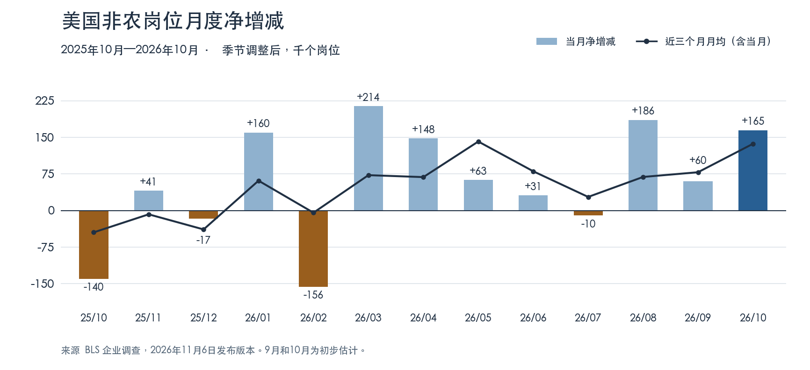
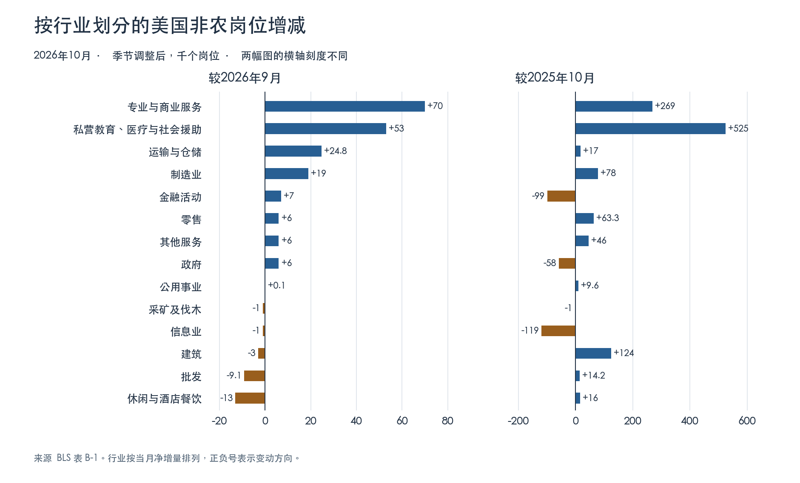

+++
title = "美国 2026 年 10 月非农就业报告"
date = "2026-11-07"
data_as_of = ["2026-11-06"]
data_as_of_note = "采用11月6日发布版本的10月就业数据及当日已公布信息；初领截至10月31日、持续申领截至10月24日，JOLTS为9月；历史月份与发布时点分别保留。"
draft = false
description = "10月非农新增16.5万，8、9月合计上修8.4万；岗位增长集中、经济原因兼职增加，结合工资和工时观察未来一至三个月就业。"
series = ""
categories = ["宏观与政策"]
tags = ["美国就业", "非农", "失业率", "工资", "美联储"]
featured = false
private = false
content_preservation = "verbatim_except_privacy_redactions"
source_sha256 = "e068f765b47a3d7fb2228a405e15bd42a093371e880e5bd95262dac104c66411"
+++

# 美国 2026 年 10 月非农就业报告

**美国劳工统计局（BLS）于 2026 年 11 月 6 日星期五 08:30 美东标准时间（EST）发布，折合新加坡时间当晚 21:30。** 本文以 11 月 6 日美东当日已公布的信息为限，采用当日版本的季调数据。原始报告编号 USDL-26-1632，共 39 页，含两张汇总表、家庭调查 A-1 至 A-16、企业调查 B-1 至 B-9 和技术说明。本地完整 PDF · [BLS 日期归档](https://www.bls.gov/news.release/archives/empsit_11062026.htm)

**美国雇主增加岗位的速度，比 9 月初值显示的更快。** 10 月非农净增 **16.5 万个岗位**，比路透调查预期的 6.5 万多出 10 万。8、9 月又合计上修 8.4 万，修订后 8—10 月月均新增 **13.7 万**，明显高于此前 5—7 月的 2.8 万。改善主要来自私人部门，尤其是专业与商业服务。另一方面，三个行业贡献了 10 月净增的 **82.7%**，全美因经济原因做兼职的人数上升 **33.9 万**。未来一至三个月，我倾向于就业继续净增长，对每月都能重复 16.5 万的判断则较为谨慎。[BLS 当期报告](https://www.bls.gov/news.release/archives/empsit_11062026.pdf) · [路透经济学家调查](https://www.investing.com/news/economic-indicators/us-job-growth-beats-expectations-in-october-unemployment-rate-falls-to-41-5008194)

## 一、岗位存量、同比与环比

10 月非农岗位总数为 **1.59293 亿个**。与 9 月相比，增加 16.5 万、增长 **0.104%**。与 2025 年 10 月相比，增加 **88.5 万**、增长 **0.559%**。私人部门一年增加 94.3 万个岗位，政府同期减少 5.8 万个。下表的水平和增减均以**千个岗位**计，百分比按各部门自己的期初岗位数计算。私人部门包含商品生产和私人服务业。

| 部门 | 2025年10月水平 | 2026年9月水平 | 2026年10月水平 | 10月环比增减 | 环比增幅 | 10月同比增减 | 同比增幅 |
| --- | ---: | ---: | ---: | ---: | ---: | ---: | ---: |
| 非农合计 | 158,408 | 159,128 | 159,293 | +165 | +0.10% | +885 | +0.56% |
| 私人部门 | 135,018 | 135,802 | 135,961 | +159 | +0.12% | +943 | +0.70% |
| 商品生产 | 21,452 | 21,638 | 21,653 | +15 | +0.07% | +201 | +0.94% |
| 私人服务业 | 113,566 | 114,164 | 114,308 | +144 | +0.13% | +742 | +0.65% |
| 政府 | 23,390 | 23,326 | 23,332 | +6 | +0.03% | −58 | −0.25% |

**同比增量为什么在一个月内从 58.0 万跃升至 88.5 万？** 以 9 月为终点的过去十二个月净增 58.0 万，改用 10 月为终点，窗口纳入今年 10 月的 **+16.5 万**，同时移出去年的 **−14.0 万**，合计多出 **30.5 万**。去年 10 月政府岗位减少 15.3 万，私人岗位仍增加 1.3 万。BLS 记录，当时部分接受延迟离职安排的联邦雇员退出工资名册，停摆期间暂时休假、随后获得补发工资的雇员仍计为在岗。去年的特殊基数放大了今年同比的跳升。[本期汇总表 B 与表 B-1](https://www.bls.gov/news.release/archives/empsit_11062026.pdf#page=5) · [BLS 对 2025 年联邦用工的说明](https://www.bls.gov/opub/ted/2026/federal-employment-reached-lowest-level-since-2014.htm)

**趋势取决于窗口。** 8—10 月月均新增 13.70 万，5—10 月月均 8.25 万，2025 年 11 月至 2026 年 10 月月均 7.375 万。BLS 新闻稿所说的“此前十二个月月均 4.8 万”截至 2026 年 **9 月**，尚未包含本次 10 月。2026 年前十个月累计净增 **86.1 万**，月均 8.61 万。未经季调的 10 月岗位比 9 月多 102.3 万，包含秋季惯常用工变化，因此正文使用季调后的 16.5 万衡量月度动能。[表 B-1](https://www.bls.gov/news.release/archives/empsit_11062026.pdf#page=28) · 逐月数据与滚动均值

## 二、修订改变了对夏末招聘的判断

单位为千个岗位。前值取自 10 月 2 日公布的 9 月报告，本次值取自 11 月 6 日报告。每格比较的是**同一个月**的两次估计。

| 部门 | 8月前值 → 本次 | 9月前值 → 本次 | 两月合计修订 |
| --- | ---: | ---: | ---: |
| 非农合计 | +133 → +186 | +29 → +60 | +84 |
| 私人部门 | +89 → +142 | +46 → +78 | +85 |
| 其中，商品生产 | +34 → +40 | +18 → +27 | +15 |
| 其中，私人服务业 | +55 → +102 | +28 → +51 | +70 |
| 政府 | +44 → +44 | −17 → −18 | −1 |

上修集中在专业与商业服务。两个月原来分别减少 0.5 万和 0.9 万个岗位，此次改为分别增加 3.0 万和 0.8 万，两月合计上修 **5.2 万**。私人行业扩散指数的 9 月读数也从首发的 49.0 修订至 **54.2**，由低于 50 转为高于 50。10 月是在已经扩张的基础上加速。迟报样本和季节因子重估均会改变历史估计，8.4 万属于历史修订，不能计入 10 月新增。[10 月 2 日原版汇总表 B](https://www.bls.gov/news.release/archives/empsit_10022026.pdf#page=5) · [11 月 6 日汇总表 B](https://www.bls.gov/news.release/archives/empsit_11062026.pdf#page=5) · 23 项修订对照

## 三、哪些行业在增加岗位

以下 14 个行业互不重叠。两个月的环比均取本次发布版本。增减单位为**千个岗位**，小数反映官方公布精度，分项舍入后合计可能与总数略有差异。

| 行业 | 9月环比增减 | 10月环比增减 | 10月环比增幅 | 10月同比增减 | 10月同比增幅 |
| --- | ---: | ---: | ---: | ---: | ---: |
| 专业与商业服务 | +8 | +70 | +0.31% | +269 | +1.20% |
| 私营教育与医疗服务（含社会援助） | +21 | +53 | +0.19% | +525 | +1.91% |
| 运输与仓储 | +7.4 | +24.8 | +0.38% | +17 | +0.26% |
| 制造业 | +13 | +19 | +0.15% | +78 | +0.62% |
| 金融活动 | −14 | +7 | +0.08% | −99 | −1.08% |
| 零售 | +12.7 | +6 | +0.04% | +63.3 | +0.41% |
| 其他服务 | +5 | +6 | +0.10% | +46 | +0.77% |
| 政府 | −18 | +6 | +0.03% | −58 | −0.25% |
| 公用事业 | +0.4 | +0.1 | +0.02% | +9.6 | +1.59% |
| 采矿及伐木 | −2 | −1 | −0.17% | −1 | −0.17% |
| 信息业 | −11 | −1 | −0.04% | −119 | −4.17% |
| 建筑 | +16 | −3 | −0.04% | +124 | +1.50% |
| 批发 | +8.1 | −9.1 | −0.15% | +14.2 | +0.23% |
| 休闲与酒店餐饮 | +13 | −13 | −0.08% | +16 | +0.09% |

**增聘行业变多，主要增量仍集中。** 私人部门 250 个细行业的扩散指数从 **54.2 升至 57.6**，仍低于 8 月的 59.4。制造业 72 个细行业从 **51.4 升至 62.5**。指数等于增聘行业占比加上持平行业占比的一半，50 表示增聘和减聘行业数相等。按岗位数量算，专业与商业服务、医疗、运输仓储三个互不重叠的行业分别增加 **7.00 万、4.16 万、2.48 万**，合计 13.64 万。三行业以外的非农净增从 9 月的 **2.67 万**微升至 **2.86 万**。全美月度新增比 9 月多出 10.5 万，其中 **10.31 万**来自这三个行业增量的变化。[汇总表 B](https://www.bls.gov/news.release/archives/empsit_11062026.pdf#page=5) · [表 B-1](https://www.bls.gov/news.release/archives/empsit_11062026.pdf#page=28)

### 细分行业揭示的分歧

下表按与本月变化的关系选列。部分行存在上下级关系，例如医院属于医疗，咨询属于专业、科学及技术服务。完整附表保留表 B-1 的全部 **174 行**，含中英文名称、原始季调与未季调水平、环比与同比。完整行业数据 CSV

| 行业 | 9月环比增减 | 10月环比增减 | 10月环比增幅 | 10月同比增减 | 10月同比增幅 |
| --- | ---: | ---: | ---: | ---: | ---: |
| 专业、科学及技术服务 | +4.6 | +32.9 | +0.30% | +127.2 | +1.18% |
| 管理、科学及技术咨询 | −3.6 | +17.3 | +0.92% | +45.7 | +2.46% |
| 临时用工服务 | −5.6 | +18.6 | +0.74% | +74.2 | +3.03% |
| 医疗 | +17.9 | +41.6 | +0.22% | +376.6 | +2.07% |
| 医院 | +13.6 | +16 | +0.28% | +125.8 | +2.21% |
| 居家医疗 | −3.2 | +10.5 | +0.55% | +80.1 | +4.39% |
| 社会援助 | +1.9 | +13.5 | +0.25% | +142.2 | +2.70% |
| 私营教育 | +0.9 | −2 | −0.05% | +6.1 | +0.15% |
| 快递与信使 | −0.1 | +17.4 | +1.60% | +10.1 | +0.92% |
| 仓储 | −0.2 | −0.3 | −0.02% | −0.7 | −0.04% |
| 耐用品制造 | +9 | +25 | +0.32% | +123 | +1.58% |
| 非耐用品制造 | +4 | −6 | −0.13% | −45 | −0.94% |
| 住宅专业工程承包商 | −2 | −15.2 | −0.65% | −35.8 | −1.51% |
| 非住宅专业工程承包商 | +12.5 | +7.9 | +0.27% | +101.1 | +3.55% |
| 餐饮与酒吧 | +11 | −7.2 | −0.06% | +57.2 | +0.46% |

- **企业服务的好转超出临时用工。** 专业、科学及技术服务增 3.29 万，其中管理、科学及技术咨询增 1.73 万。行政支持及废物管理与修复服务增 2.81 万，其中临时用工增 1.86 万。公司及企业管理另增 0.87 万。临时用工适合观察雇主是否愿意先以灵活方式增员，其后最值得核对的是咨询和其他专业服务能否同步延续。[表 B-1，第 30 页](https://www.bls.gov/news.release/archives/empsit_11062026.pdf#page=30)
- **医疗提供了更持久的支撑。** 医院增 1.60 万，居家医疗增 1.05 万。医疗与社会援助合计同比增 **51.88 万**，占全美年度净增的 **58.6%**。加上专业与商业服务的 26.9 万，两类合计占年度净增的 **89.0%**。这也解释了为何全国岗位仍扩张，信息业和金融业的岗位却均低于一年前。[表 B-1，第 29—31 页](https://www.bls.gov/news.release/archives/empsit_11062026.pdf#page=29)
- **运输增员集中在快递。** 快递与信使增加 1.74 万，约占运输仓储净增的 **70%**。航空运输增 0.35 万，仓储减少 0.03 万，卡车运输持平。按表 B-2、B-4，运输仓储平均周工时从 38.0 降至 37.8 小时，总工时指数也环比下降 0.2%。岗位和总工时在当月给出了不同方向的信号，节日前后尤其值得复核。[表 B-1](https://www.bls.gov/news.release/archives/empsit_11062026.pdf#page=29) · [表 B-2 至 B-4](https://www.bls.gov/news.release/archives/empsit_11062026.pdf#page=32)
- **商品部门内部也在分化。** 耐用品制造增 2.5 万，非耐用品减 0.6 万。计算机及电子产品制造增 0.67 万，其中半导体及其他电子元件增 0.33 万。建筑业同比仍增 12.4 万，10 月却减 0.3 万。住宅专业工程承包商减 1.52 万，非住宅专业工程承包商增 0.79 万。这些行业数据可以定位用工变化，进一步归因到具体项目或 AI 投资仍缺少项目层证据。[表 B-1，第 28 页](https://www.bls.gov/news.release/archives/empsit_11062026.pdf#page=28)

政府净增 0.6 万，分布为联邦 −0.1 万、州政府 +0.8 万、地方政府 −0.1 万。年度则是联邦 −7.1 万、州政府 −1.4 万、地方政府 +2.7 万，联邦减员幅度超过政府整体净减的 5.8 万，地方增员抵消了一部分。[表 B-1，第 31 页](https://www.bls.gov/news.release/archives/empsit_11062026.pdf#page=31)

## 四、失业率微降，用工不足却增加

家庭调查按**人**计数。10 月就业人数增 46.3 万，劳动力增 42.1 万，失业人数减 4.1 万。参与率与就业人口比同时提高，失业率下行没有伴随劳动力整体退出。用已公布的千人水平反算，失业人数占劳动力的比例由约 **4.175% 降至 4.141%**，差约 **−0.034 个百分点**。发布精度为一位小数，显示为 4.2% → 4.1%。BLS 将此描述为变化很小。[汇总表 A](https://www.bls.gov/news.release/archives/empsit_11062026.pdf#page=4)

| 家庭调查指标 | 9月 | 10月 | 环比变化 |
| --- | ---: | ---: | ---: |
| 劳动力（万人） | 17,026.2 | 17,068.3 | +42.1 |
| 就业人数（万人） | 16,315.2 | 16,361.5 | +46.3 |
| 失业人数（万人） | 710.9 | 706.8 | −4.1 |
| 劳动参与率 | 61.8% | 61.9% | +0.1 个百分点 |
| 就业人口比 | 59.2% | 59.3% | +0.1 个百分点 |
| 官方失业率 U-3 | 4.2% | 4.1% | −0.1 个百分点 |
| 广义劳动力未充分利用率 U-6 | 7.6% | 7.9% | +0.3 个百分点 |
| 因经济原因兼职（万人） | 450.1 | 484.0 | +33.9 |
| 其中，工作不足或经营状况不佳（万人） | 289.6 | 325.2 | +35.6 |
| 边缘依附劳动力（万人） | 146.8 | 163.9 | +17.1 |
| 长期失业，至少 27 周（万人） | 194.4 | 196.3 | +1.9 |
| 长期失业者占全部失业者 | 27.1% | 27.6% | +0.5 个百分点 |
| 失业时长中位数（周） | 11.5 | 11.9 | +0.4 |

U-6 将经济原因兼职者和边缘依附劳动力计入。前一类人虽有工作，却希望全职工作。后一类人想工作且可以工作，过去一年找过工作，但过去四周没有积极求职。10 月经济原因兼职的增加主要发生在“工作不足或经营状况不佳”一项，另一项“只能找到兼职”从 126.7 万微降至 126.5 万。两项分别季调，变动不会精确相加。现有数据支持“部分在岗者得到的工时不足”，尚难从一个月的变化推断普遍裁员。[表 A-8](https://www.bls.gov/news.release/archives/empsit_11062026.pdf#page=19) · [表 A-12](https://www.bls.gov/news.release/archives/empsit_11062026.pdf#page=23) · [表 A-15](https://www.bls.gov/news.release/archives/empsit_11062026.pdf#page=26)

**家庭调查缺少 10 月同比。** 2025 年 10 月停摆期间没有采集 CPS，BLS 明确不再追补。当年的 CES 企业数据后来随 11 月数据发布，前文的岗位和工资同比因此仍可计算。作为相邻月份的年度参照，**仅比较 9 月对 9 月**，2025 → 2026 年官方失业率为 4.4% → 4.2%，参与率为 62.5% → 61.8%，就业人口比为 59.7% → 59.2%。这些是公布口径，跨年还涉及人口控制数更新，不能填入 10 月同比一栏。[BLS 停摆说明](https://www.bls.gov/bls/2025-lapse-revised-release-dates.htm) · BLS 月度历史数据

## 五、工资、工时与名义劳动收入

10 月私人非农平均时薪增 **0.14 美元**至 **38.00 美元**。按公布水平复算，环比 **+0.37%**，高于修订后的 9 月 **+0.26%**。10 月同比为 **+3.12%**，与同版 9 月的 **+3.16%** 接近。BLS 新闻稿按一位小数公布 10 月时薪环比 **+0.4%**、同比 **+3.1%**。以 7—10 月两端时薪计算，最近三个月折年增速为 **3.88%**，高于截至 9 月的 **2.90%**。月度工资动能回升，年度增速仍在 3.1% 附近。[当期表 B-3](https://www.bls.gov/news.release/archives/empsit_11062026.pdf#page=33) · 逐月时薪

| 私人部门指标 | 2025年10月 | 2026年9月 | 2026年10月 | 10月环比 | 10月同比 |
| --- | ---: | ---: | ---: | ---: | ---: |
| 全体雇员平均时薪（美元） | 36.85 | 37.86 | 38.00 | +0.37% | +3.12% |
| 全体雇员平均周工时（小时） | 34.2 | 34.4 | 34.4 | 0.0 小时 | +0.2 小时 |
| 全体雇员平均周薪（美元） | 1,260.27 | 1,302.38 | 1,307.20 | +0.37% | +3.72% |
| 总周工时指数（2007=100） | 115.9 | 117.3 | 117.4 | +0.1% | +1.29% |
| 总周薪资指数（2007=100） | 204.2 | 212.3 | 213.3 | +0.5% | +4.46% |
| 生产及非管理岗位雇员平均时薪（美元） | 31.70 | 32.63 | 32.75 | +0.37% | +3.31% |
| 同组平均周工时（小时） | 33.7 | 33.9 | 33.8 | −0.1 小时 | +0.1 小时 |
| 同组平均周薪（美元） | 1,068.29 | 1,106.16 | 1,106.95 | +0.07% | +3.62% |

全体雇员周薪同比增幅高于时薪，原因是平均工时也高于去年。对生产及非管理岗位雇员，10 月周工时缩短，几乎抵消了时薪上涨对当月周薪的帮助。总周薪资指数包含就业、工时和工资三项，环比 +0.5% 表明私人部门**名义**劳动收入总量仍有支撑。行业构成变化也会影响平均时薪，个人加薪幅度、实际购买力都需要各自的数据。10 月 CPI 尚未发布，且 BLS 已说明多数价格序列缺少 2025 年 10 月基数。[表 B-2 至 B-4](https://www.bls.gov/news.release/archives/empsit_11062026.pdf#page=32) · [表 B-7、B-8](https://www.bls.gov/news.release/archives/empsit_11062026.pdf#page=37) · 19 个行业口径的工资与工时明细 · [BLS 对 10 月 CPI 同比可得性的说明](https://www.bls.gov/cpi/additional-resources/2025-federal-government-shutdown-impact-cpi-faq.htm)

## 六、未来一至三个月的判断

**基准判断是就业继续温和扩张，增速仍会波动。** 本次同时上修 8、9 月的岗位增量，私人行业扩散指数高于 50，专业服务及临时用工也恢复增员。能否延续近期每月十多万的速度，主要取决于专业服务能否保持增员、快递旺季过后其他行业能否接力，以及经济原因兼职能否回落。

**用行业贡献测算增长对三个行业的敏感度。** 假设下个月其余行业仍合计净增 2.86 万。若专业与商业服务、医疗、运输仓储重复 10 月表现（合计 +13.64 万），总数为 **+16.50 万**。若三者回到 9 月的合计 +3.33 万，总数降至 **+6.19 万**。两种假设下其余行业表现完全相同，总数相差 10.31 万个岗位。这是条件算例，未赋予情景概率。[计算依据为当期表 B-1](https://www.bls.gov/news.release/archives/empsit_11062026.pdf#page=28)

| 待验证的方向 | 接下来一至三个月观察什么 | 对判断的影响 |
| --- | --- | --- |
| 招聘扩张延续 | 私人行业扩散指数持续高于 50，专业服务与制造继续增聘，三个主力行业以外的月净增明显高于 10 月的 2.86 万 | 增长来源更分散，近期三个月月均 13.7 万更有机会维持 |
| 岗位增长但工时承压 | 总岗位仍增加，私人周工时继续在 34.4 小时附近，经济原因兼职维持在 484 万附近或继续上升 | 继续用周薪和总工时跟踪收入，单看新增岗位可能高估居民感受到的改善 |
| 劳动力需求转弱 | 9、10 月估计下修，新公布的月份也偏弱，临时用工掉头，私人扩散指数跌破 50，并伴随初领四周均值及持续申领同步上行 | 由少数行业回落扩展到招聘和留用，基准判断需下调 |

**初领失业金仍低，持续申领小幅回升。** 截至 10 月 31 日当周，初领失业金 **18.9 万**，四周均值 **19.475 万**，较前一周修订均值低 0.225 万。截至 10 月 24 日，持续申领 **171.8 万**，一周增加 2.3 万。11 月 3 日发布的 **9 月** JOLTS 记录职位空缺 **752.3 万**、实际雇用 **540.2 万**、裁员及解雇 **164.1 万**，BLS 判断三项月度变化均不大。初领、持续申领和 JOLTS 覆盖的日期和人群不同，合看尚未出现广泛裁员的迹象。要验证 10 月企业实际雇用了多少人，还要等该月 JOLTS。[美国劳工部 11 月 5 日周报](https://oui.doleta.gov/press/2026/110526.pdf) · 本地原件 · [BLS 9 月 JOLTS](https://www.bls.gov/news.release/archives/jolts_11032026.htm)

**美联储短期少了一项因就业转弱而放松的理由，进一步收紧仍取决于通胀。** 10 月 28 日 FOMC 将政策利率维持在 **3.75%—4.00%**，两名反对者主张加息 25 个基点。9 月总体及核心 PCE 物价指数同比分别上涨 **3.6% 和 3.1%**。另一方面，11 月 5 日发布的三季度初值显示，非农商业部门生产率环比折年增 **3.6%**，单位劳动成本环比折年降 **0.7%**、同比增 **2.4%**。这组季度数据说明，生产率增长可以抵消部分薪酬增幅，单月时薪上涨对单位成本和物价的传导仍需验证。如果后续核心通胀月率持续偏强，同时招聘继续扩散，维持限制性利率或进一步收紧的理由才会增强。[FOMC 10 月声明](https://www.federalreserve.gov/newsevents/pressreleases/monetary20261028a.htm) · [BEA 9 月 PCE](https://www.bea.gov/news/2026/personal-income-and-outlays-september-2026) · [BLS 三季度生产率与单位劳动成本](https://www.bls.gov/news.release/archives/prod2_11052026.htm)

接下来三个验证时点均为美东时间。**11 月 10 日 08:30** 看 10 月 CPI 的环比和可得分项，**12 月 1 日 10:00** 看 10 月 JOLTS 能否确认实际雇用增强，**12 月 4 日 08:30** 看 11 月非农及 9、10 月修订。三项都排在 **12 月 8—9 日 FOMC 会议**之前。[CPI 日程](https://www.bls.gov/schedule/news_release/cpi.htm) · [JOLTS 发布说明](https://www.bls.gov/news.release/archives/jolts_11032026.htm) · [非农日程](https://www.bls.gov/schedule/news_release/empsit.htm) · [FOMC 日程](https://www.federalreserve.gov/monetarypolicy/fomccalendars.htm)
