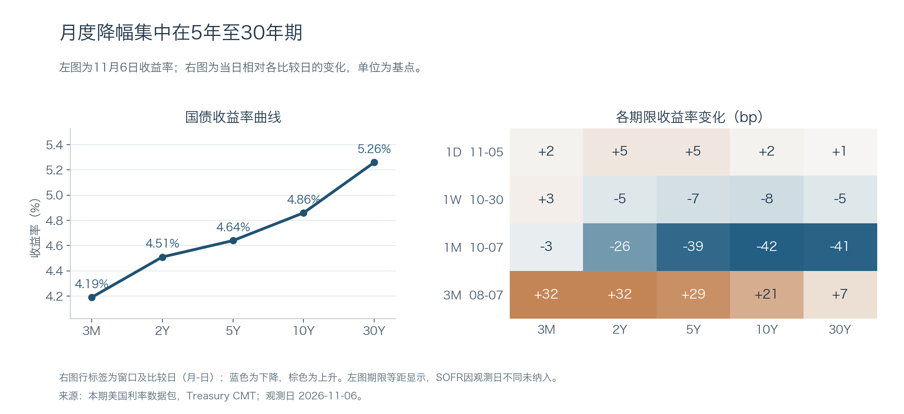
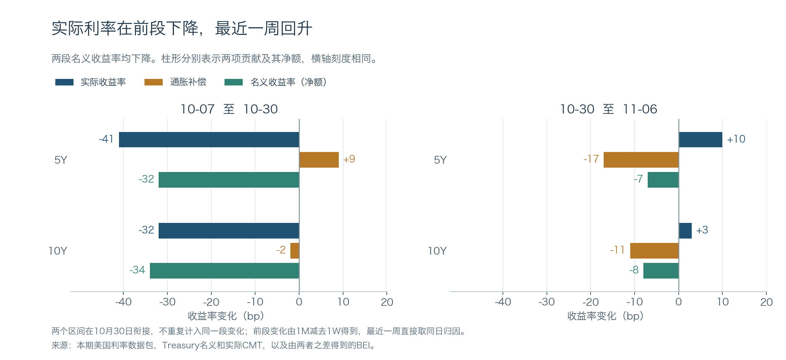

+++
title = "美国利率期限结构分析｜2026年11月8日"
date = "2026-11-08"
data_as_of = ["2026-11-05", "2026-11-06"]
data_as_of_note = "报告日期11月8日新加坡；国债曲线、Treasury实际收益率、BEI与MOVE截至11月6日，SOFR和备用FRED实际收益率截至11月5日；日周月及三个月比较窗口分别保留。"
draft = false
description = "月度美债收益率下降以实际利率回落为主；最近一周通胀补偿下降抵消实际利率反弹，结合曲线与蝶式辨析期限差异。"
series = "利率期限结构分析"
categories = ["宏观与政策", "市场结构"]
tags = ["美债", "收益率曲线", "实际利率", "通胀补偿", "MOVE"]
featured = false
private = false
content_preservation = "verbatim"
source_sha256 = "98884f3f8d8762a8b18740842d81ab3020fc24d745d40a35b8006972216e4750"
+++

# 美国利率期限结构分析｜2026年11月8日

**美债收益率月度下行以实际利率回落为主；最近一周，通胀补偿下降抵消了实际利率反弹。**

报告日期：2026年11月8日（新加坡）。美国国债曲线观测日：2026年11月6日；SOFR观测日：11月5日。收益率水平以百分比表示，变化和利差以基点（bp）表示；MOVE变化另以指数点计。下文的1D、1W、1M、3M分别指数据包指定的日、周、月及三个月比较窗口。

## 1. Executive Summary｜核心判断

- **最近一周，债券价格上涨，但5年和10年实际利率都上升。** 5年名义收益率下降7bp，由实际收益率上升10bp、通胀补偿（BEI）下降17bp合成；10年名义收益率下降8bp，对应实际收益率上升3bp、BEI下降11bp。以10月7日为起点，5年、10年名义收益率分别下降39和42bp，其中实际利率下降分别贡献31和29bp，是月度降幅的主要部分。
- **2年到10年这段曲线在四个窗口均趋平，但收益率方向不同。** 11月6日，2年上行5bp、10年上行2bp，是熊市趋平（bear flattening）；一周及一个月内，10年降幅大于2年，是牛市趋平（bull flattening）。按2Y/5Y/10Y三点分解，四个窗口均以收益率水平（level）变动的绝对值最大。三个月level仍上移27.33bp，较10月7日的收益率降幅仅覆盖这三个月中的最后一个月。
- **压缩最明显的是3个月至10年的利差。** 10Y−3M为67bp，一个月收窄39bp，已持平于最近20和60个观察值的低点，尽管它在5年样本中仍处于77.0%分位。5s10s30s蝶式为−18bp，也在20观察值低点：10年收益率比5年与30年两翼的均值低9bp。
- **波动随周月度行情回落，但历史尺度影响判断。** 11月6日MOVE为92.77，周降7.43点、月降9.79点；仍在1年84.0%分位，却只在5年35.5%分位。短期波动压力较比较日缓和，不宜称为五年极端水平。
- **核心国债曲线对齐审计通过（OK），总体新鲜度为 `fresh_vs_basic_business_day`。** 五个必需期限均在11月6日。SOFR和备用的FRED实际收益率序列仅到11月5日、滞后1天；本期实际利率及BEI采用11月6日Treasury同日数据。提示词指定的来源质量字段缺失，但包内保留了逐项来源记录，详见第9节。

## 2. Curve Snapshot｜曲线快照

| 期限 | 收益率 | 实际观测日 | 1D（bp） | 1W（bp） | 1M（bp） | 3M（bp） |
|:--|--:|:--:|--:|--:|--:|--:|
| SOFR | 3.92% | 2026-11-05 | -2 | -2 | +2 | +30 |
| 3M | 4.19% | 2026-11-06 | +2 | +3 | -3 | +32 |
| 2Y | 4.51% | 2026-11-06 | +5 | -5 | -26 | +32 |
| 5Y | 4.64% | 2026-11-06 | +5 | -7 | -39 | +29 |
| 10Y | 4.86% | 2026-11-06 | +2 | -8 | -42 | +21 |
| 30Y | 5.26% | 2026-11-06 | +1 | -5 | -41 | +7 |

*来源：包内 `latestCurve.points`。按1D、1W、1M、3M顺序，国债比较日为2026-11-05、10-30、10-07、08-07；SOFR自己的比较日为11-04、10-29、10-06、08-07。SOFR单列，不与次日国债构造同步利差。*

11月6日，五个核心国债期限收益率全部上行，但2年、5年升幅最大，30年仅升1bp。放在一周内看，3个月收益率升3bp，而2年至30年各降5—8bp；其中10年降得最多，30年与2年同降5bp。因此，周度2s10s确实趋平，2s30s却没有变化，不能用一个斜率概括整条曲线。

*图1：左侧为同日国债收益率，期限等距展示；右侧为各期限相对指定比较日的变动。*

一个月内，5年、10年和30年收益率分别下降39、42和41bp，3个月仅下降3bp；三个月内则全部上行，以3个月和2年的32bp升幅最大，30年仅升7bp。最新一日的反弹幅度也不大：10年和30年收益率分别只比11月5日的20观察值低点高2bp和1bp，2年、5年分别高5bp。月度长端收益率下行仍清晰可见，单日反弹尚不足以确认方向改变。

## 3. Spreads and Butterflies｜利差与蝶式

| 结构 | 当前（bp） | 1D | 1W | 1M | 3M | 5年分位 | 20观察值低 / 高 | 60观察值低 / 高 |
|:--|--:|--:|--:|--:|--:|--:|:--:|:--:|
| 10Y−2Y | 35 | -3 | -3 | -16 | -11 | 63.4% | 29 / 44 | 20 / 53 |
| 10Y−3M | 67 | 0 | -11 | -39 | -11 | 77.0% | 67 / 99 | 67 / 109 |
| 30Y−5Y | 62 | -4 | +2 | -2 | -22 | 68.6% | 47 / 66 | 41 / 93 |
| 5Y−2Y | 13 | 0 | -2 | -13 | -3 | 71.9% | 11 / 22 | 7 / 26 |
| 2s5s10s fly | -9 | +3 | -1 | -10 | +5 | 75.3% | -12 / 0 | -16 / 2 |
| 5s10s30s fly | -18 | -2 | -4 | -4 | +6 | 45.6% | -18 / -11 | -27 / -10 |

*来源：`spreadsAndButterflies.items`。除分位外单位均为bp；窗口列为结构的变化，不是结构水平。蝶式统一采用 `2 * belly - short - long`。*

**2s10s的趋平主要发生在2年至5年段。** 一个月10Y−2Y收窄16bp，其中5Y−2Y收窄13bp，余下5年至10年段收窄3bp。当前10Y−2Y为35bp，仍高于20观察值低点6bp；5Y−2Y为13bp，距相应低点仅2bp。10Y−3M则已处于20及60观察值低点：其周度收窄11bp，既有10年下行8bp，也有3个月上行3bp。较高的5年分位与近期低点可以并存，两者比较的不是同一段历史。

**5年至30年段并未全程随2s10s收窄。** 30Y−5Y周度扩大2bp，因为5年比30年多降2bp；最新一日则收窄4bp，因为5年反弹5bp、30年只反弹1bp。当前62bp，距20观察值高点66bp仅4bp，但距60观察值高点93bp仍有31bp。近期这段曲线相对较陡，并不意味着已接近较长期区间的上界。

**蝶式区分了局部收益率位置和它的变化方向。** 2s5s10s为−9bp，即5年收益率比2年、10年均值低4.5bp。它一个月下降10bp，但最新一日回升3bp，表示5年的相对走强已有部分回吐。5s10s30s为−18bp，周度、月度均下降4bp，11月6日到达20观察值低点；它在5年样本中为45.6%分位，尚无长期极端的证据。这些是收益率空间的等权比较，未做久期、凸性或融资调整。

## 4. Three-Factor Decomposition｜水平、斜率与曲率

令Δy为某期限在同一窗口的收益率变化，单位为bp。这里的level是2Y、5Y、10Y变化的均值；slope是 `Δy10Y − Δy2Y`；curvature是 `2 × Δy5Y − Δy2Y − Δy10Y`，等于2s5s10s蝶式的变化。

| 窗口 | Δ2Y / Δ5Y / Δ10Y（bp） | Level（bp） | Slope（bp） | Curvature（bp） | 2s10s形态 |
|:--|:--:|--:|--:|--:|:--|
| 1D | +5 / +5 / +2 | +4.00 | -3 | +3 | 熊市趋平 |
| 1W | -5 / -7 / -8 | -6.67 | -3 | -1 | 牛市趋平 |
| 1M | -26 / -39 / -42 | -35.67 | -16 | -10 | 牛市趋平，5年相对两翼走强 |
| 3M | +32 / +29 / +21 | +27.33 | -11 | +5 | 熊市趋平，中短端升幅更大 |

*来源：`factorDecomposition.windows`；已由对应期限变动复算。*

**日度和周度的slope同为−3bp，市场方向却相反。** 日度是2年收益率涨得更多，周度是10年收益率降得更多。月度除了level大幅下降，slope与curvature也分别下降16bp、10bp；这段行情包含了5年相对两翼的收益率下移，并非单纯平行移动。三个月level仍为正、curvature转为+5bp，说明以8月7日为起点，5年相对两翼的收益率仍略有上移。

这是基于三个期限的交易台算术分解，**不是PCA**。三个量缩放不同，比较显示幅度是为了描述形状，不能据此计算方差解释度或风险贡献；字段名中的“Convexity”也不代表测量了实际债券凸性或对冲流量。

## 5. Real Rates / Inflation Compensation / MOVE｜名义利率的构成

| 到期年限 | 名义国债收益率 | TIPS实际收益率 | 通胀补偿 BEI | 观测日 |
|:--|--:|--:|--:|:--:|
| 5年 | 4.64% | 2.35% | 2.29% | 2026-11-06 |
| 10年 | 4.86% | 2.63% | 2.23% | 2026-11-06 |

**同日归因（bp）**：每一行的名义、实际和BEI使用同样的起止日期。名义收益率变化等于实际收益率变化、BEI变化及残差之和。

| 窗口 | 5Y名义 | 5Y实际 | 5Y BEI | 10Y名义 | 10Y实际 | 10Y BEI |
|:--|--:|--:|--:|--:|--:|--:|
| 1D | +5 | +2 | +3 | +2 | +3 | -1 |
| 1W | -7 | +10 | -17 | -8 | +3 | -11 |
| 1M | -39 | -31 | -8 | -42 | -29 | -13 |
| 3M | +29 | +22 | +7 | +21 | +23 | -2 |

*来源：`realRatesInflationCompensation.latest`及`moveAttribution.items`。名义和实际收益率分别取Treasury CMT与Real CMT，当前BEI由两者同日相减。两个期限共八组归因的残差均为0bp，未触及包内2bp残差提示阈值。零残差验证的是算术与日期一致性，不识别经济原因。*

**两个区间的名义收益率都净下降，推动下降的分量在最近一周发生了变化。** 10月7日至30日，5年实际收益率下降41bp，BEI上升9bp，名义净降32bp；10年实际收益率下降32bp，BEI下降2bp，名义净降34bp。10月30日至11月6日，5年、10年实际收益率分别回升10bp和3bp，但BEI分别下降17bp和11bp，足以使两者的名义收益率继续下行。以5年为例，整月实际利率仍下降31bp，完全可以与最近一周上升10bp同时成立。

*图2：前段为同一终点下的1M变化减1W变化，后段为1W变化，两段可相加还原1M。图中比较的是区间端点，不假定利率在10月30日当天转向。*

三个月内，5年和10年实际收益率仍分别上升22bp和23bp，是两个期限名义上行的主要分量；5年BEI贡献+7bp，10年BEI贡献−2bp。最新一日又有所不同：5年上行5bp中BEI占3bp；10年上行2bp则是实际利率上升3bp被BEI下降1bp部分抵消。BEI包含通胀风险溢价、流动性等因素，其下降本身不能证明市场对未来通胀的纯预期下调了相同幅度。

**MOVE显示短期波动回落，但没有给出收益率方向。** 11月6日MOVE为92.77，1D、1W、1M分别下降5.15、7.43、9.79个指数点，3M仍上升20.74点。最新一日美债收益率上行、MOVE继续下降；拉长到一个月，两者均下降。1年84.0%与5年35.5%的分位说明，近期降温与“相对近一年仍偏高”并不矛盾。MOVE来自Yahoo Finance的 `^MOVE`（经yfinance获取），只作波动背景，非Treasury或FRED官方曲线数据。

## 6. Heatmap / Move Concentration｜波动集中在哪里

11月2日至6日，最大单日下行出现在11月5日：2年降12bp，1年及3年各降11bp，5年降10bp。最大上行是次日3年升6bp；当天1年、2年、5年各升5bp，11月2日3个月也曾升5bp。以2年和5年为例，最新反弹幅度均小于前一日跌幅。这些是单个观测日的变化，不是整周累计值。

| 11月6日分区 | 平均变化（bp） | 上行 / 下行 / 持平 | 观测数 |
|:--|--:|:--:|--:|
| 短端 | +2.25 | 5 / 1 / 2 | 8 |
| 中段 | +5.00 | 3 / 0 / 0 | 3 |
| 长端 | +1.67 | 3 / 0 / 0 | 3 |

*来源：`heatmapSummary`。分区沿用包内定义，未附逐期限成员映射。*

**反弹覆盖较广，强度集中在中段。** 中段与长端的三个观测都上行，但中段平均升5bp，明显高于长端的1.67bp；短端内部仍有下行和持平，不能说全曲线同步上升。过去20个观察值中，5年与7年的平均绝对日变化并列最大，均为4.45bp，其次是3年的4.40bp；2年和10年均为4.30bp，30年为3.80bp。这项统计描述收益率波动幅度，不是久期调整后的盈亏风险。

## 7. Trading Desk Interpretation｜应如何解读

**本期最有辨识度的信号，是实际利率与名义利率在最近一周走向相反。** 月度数据支持5年、10年实际利率条件较10月7日放松；周度数据却显示这种放松没有继续。5年实际收益率回升10bp、名义收益率仍降7bp，提供了最清楚的例子。周度3个月国债收益率还上升3bp，因此从“国债上涨”直接推到“各期限融资条件同步宽松”，超出了数据支持的范围。

**对政策路径与期限溢价，只能提出候选解释。** 2年一个月下降26bp，与未来短端利率定价下移相容；但10年下降42bp，近一周5年BEI变动又比同期名义变动大得多，单一政策路径解释无法由这些价格确认。10Y−3M月度收窄39bp、10年与30年收益率接近近期低位，也与长端所需补偿下降相容；不过30Y−5Y月度仅收窄2bp、周度反而扩大2bp，没有所有长端结构同向变化的证据。区分预期短端路径、期限溢价和供求影响，**需要额外数据确认**，尤其是OIS或政策利率期货、期限溢价估计及发行拍卖资料。

**中段相对定价的证据比凸性对冲机制的证据更强。** 月度2s5s10s下降10bp，5年、7年在20观察值日变动排名居首；这说明中段相对价格与波动都值得跟踪。包内没有MBS凸性敞口、利率期权仓位或对冲流，不能从蝶式变化推出某类机构正在对冲。下一次更新应先看5年实际收益率与BEI是否仍反向变化，再看10Y−3M能否离开67bp的局部低点；前者决定名义下行的构成，后者说明现金端与长端的分化是否延续。

## 8. What Would Change My View｜改变判断的条件

1. **周度实际利率重新下降。** 若5年和10年实际收益率转为周降，并贡献名义降幅的大部分，周度判断将由“通胀补偿压缩”转为“实际利率再度回落”。反过来，若实际利率继续上升而BEI止跌，就要观察名义收益率能否维持下行。
2. **10Y−3M离开本期67bp的双窗口低点。** 若利差继续收窄，且主要来自10年下行而3个月持平，长端主导的判断会加强；若利差扩大，须先辨别是3个月回落还是10年反弹，二者对现金端条件的含义不同。
3. **局部曲率反转。** 若5s10s30s从−18bp的20观察值低点持续回升，且2s5s10s的周度变化也转正，则月度中间期限相对走强的证据减弱。只出现一次类似11月6日的局部反弹，还不足以改变月度判断。
4. **波动与长端走势重新背离。** 若MOVE周度转升、10年与30年仍继续下行，当前“收益率下降且波动缓和”的组合将不再适用；若两者的收益率和MOVE都持续回升，则需重新评估这次日度反弹是否已扩展到更长窗口。

## 结论

截至11月6日，10年美债收益率一个月累计下降42bp，其中最近一周下降8bp。整月降幅中有29bp来自实际收益率下降。最近一周，实际收益率反而回升3bp，通胀补偿下降11bp才使名义收益率继续走低。下一期若通胀补偿止跌，10年名义收益率要继续下行，就需要实际收益率重新下降。
