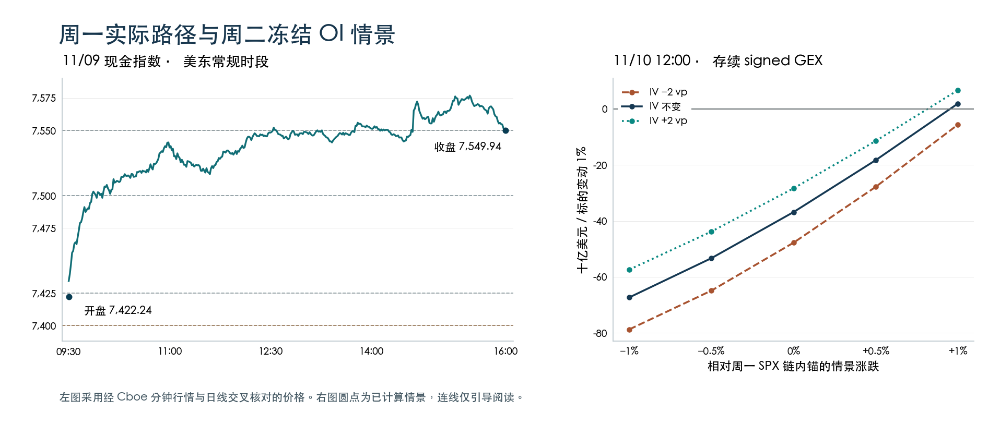

+++
title = "SPX期权持仓与Greeks结构分析-261109"
date = "2026-11-10"
data_as_of = ["2026-11-06", "2026-11-09"]
data_as_of_note = "D为11月9日、P为11月6日，目标日为11月10日；XSP单腿采用11月9日16:00缓存快照；CPI及目标日其他信息按原文已知排期保留。"
draft = false
description = "剔除周一到期正Gamma后，周二存续净Gamma仍负；CPI后围绕7550复核两侧承接，保留短端曲面限制与条件情景估值。"
series = "SPX期权分析报告"
categories = ["衍生品", "市场结构"]
tags = ["SPX", "XSP", "Greeks", "GEX", "期权"]
featured = false
private = false
content_preservation = "verbatim"
source_sha256 = "b507ef5fa96633e2580fd7070c25f863f69a3c9a778938ada31e15fc9ee9f4ec"
+++

# SPX期权持仓与Greeks结构分析-261109

## 1. 一句话结论

剔除周一到期的正 Gamma 后，周二存续净 Gamma 为 **−28.710 B USD/1%**，CPI 后先以收盘位附近的 **7,550** 观察哪一侧获得承接，若开盘已越过 **7,500 或 7,600**，或上行时净 Gamma 转正，就重估该方向的延续条件。

**盘后研究 B 级｜结构事实置信较高，方向未定、方向置信低｜XSP 有条件情景估值｜目标日执行另行复核。**

净 Gamma（signed GEX）采用本项目的库存代理，call 记正、put 记负。B USD/1% 表示标的变动 1% 对应的十亿美元 Gamma 暴露。

## 2. T+1 Action Summary

| 项目 | 11 月 10 日观察与失效条件 |
| --- | --- |
| Base stance | CPI 后若仍在 7,500–7,600，先围绕 7,550 观察。跳出区间就重画节点。 |
| Earliest evaluation | 08:30 数据发布后先看利率与远期，现金开盘再核对 SPX、XSP 及同期限报价。报价未对齐则等待。 |
| Base activation | 若 7,550 附近回测能显示一侧承接，再看 7,525 或 7,575。反复穿越轴心时只观察。 |
| Downside branch | 若 7,550 回试失败、7,525 下方延续，复核 7,500 和看跌买方家族。收复轴心则撤回，越过下界则重选腿。 |
| Upside branch | 若 7,550 上方获承接并穿过 7,575，复核 7,600 和看涨买方家族。回落轴心则撤回，越过上界则重选腿。 |
| Otherwise | 若跳空、事件或 IV 让旧节点与支出失去参照，等新快照重估。缺报价或账户条件时只做跟踪。 |

## 3. Executive Summary

- **周一向上跳过了前报的核心。** 7,422.24 开盘即处于旧上界 7,400 之上，首分钟经过 7,425，09:51 已经过 7,500。高见 7,577.39，收在 7,550 附近。前报看跌参考腿的条件未出现。

- **正负号取决于是否保留已到期合约。** 周一到期层 signed 为 +61.890 B，叠加后全链为 +33.180 B。周二存续部分为 −28.710 B。与周五相同的 15,880 个合约净负值收窄 35.670 B，PM 与 AM 都有贡献。

- **7,550 上下的暴露不同。** 轴心的周二到期层为 +1.89 M USD/点，全期限合计为 −4.09 M。下方 7,500 与上方 7,600 的全期限合计分别为 −65.16、−36.94 M。7,525 和 7,575 用于观察价格怎样靠近这两个外侧节点。

- **涨幅相同，IV 路径可以改写符号。** 保持最近可得的各合约 OI 数量及 signed 约定不变，改变价格、时间和 IV，重估存续合约的 Gamma 暴露。周二中午若标的涨 1%，IV 不变时为 +1.900 B，IV 下降 2 个波动率百分点时为 −5.631 B。网格未给发生概率。

- **CPI 在开盘前发布。** 11/10–13 四个候选到期的 SPXW PM 局部拟合均不足以判断事件保护的相对价格。约 14D 与 30D 槽的 ATM 与下行倾斜可以作有条件的背景比较。 [BLS 发布日历](https://www.bls.gov/schedule/2026/11_sched.htm)

- **XSP 只保留两侧条件参考。** 若从轴心出发，周二午间标的向相应方向移动 0.5%、IV 不变，两组五点宽价差按周一参考支出的假设净损益分别为看跌 +137 美元、看涨 +100 美元。移动扩大至 1%，单买在对应方向均超过价差。

## 4. What Changed vs. T-1 and Prior Playbook Review

| 实质变化 / 口径 | 11/06 | 11/09 | 含义 |
| --- | --- | --- | --- |
| 指数 / VIX | 7,376.86 / 25.64 | 7,549.94 / 19.92 | SPX +173.08 点（+2.35%），VIX −5.72 点。两日 VIX 数据源有切换。 |
| 共同 15,880 个合约的 signed GEX | −64.339 B | −28.670 B | 增加 35.670 B，PM 贡献 +23.866 B，AM +11.804 B。共同 gross 从 237.162 增至 324.389 B。 |
| 同一周二到期 PM 层 | OI 121,714 张，gross 5.478 B，signed −3.394 B | OI 149,090 张，gross 8.899 B，signed −0.662 B | 每一侧的总暴露增加，净负值向零收敛。结算还剩一个日历日。 |
| 滚动 1–60 日 DEX | −654.701 B USD | +122.248 B USD | 增加约 776.949 B。标的、Delta、OI 和桶成员都在变，不能据此还原净买入。 |
| 固定 14D / 30D ATM | 21.67% / 19.43% | 15.60% / 15.37% | 各降 6.07 / 4.06 vp。14D 相对 30D 的溢价由约 2.24 vp 缩至 0.23 vp。 |
| 全采集链 put/call | OI 1.436，成交量 1.213 | OI 1.412，成交量 1.105 | 期权总成交由 5,455,865 增至 5,854,037 张，约 +7.30%。不能识别买卖方向。 |

两张每日存续地图从 −68.816 B 到 −28.710 B，表面上增加 40.106 B。拆开看，周五地图中的 11/09 到期层当时为 −4.476 B，移除它贡献 +4.476 B。共同合约贡献 +35.670 B，周一新增至比较范围的 658 个合约合计贡献 −0.040 B，合计 4,483 张 OI，均落在新纳入的 2027/01/08 到期。共同合约的变化混合现货、IV、时间、报告 OI 与模型影响。

### 前报复盘 · 收盘、路径与交易分开

**收盘结果。** 周五收 7,376.86，前报把 7,350–7,400 作为核心，7,425 作为上侧复核点。周一开盘 7,422.24，较前收高 45.38 点，最低价也为 7,422.24，收盘较前收涨 173.08 点。上侧分支中的 7,450 与更远的 7,500 均被经过。 [美联社收盘统计](https://apnews.com/article/f7ec9680fc858e3c2505913e7b3a54e2) · [SPX 日线](https://query1.finance.yahoo.com/v8/finance/chart/%5EGSPC?period1=1794196800&period2=1794270000&interval=1d)

**盘中路径。** 分钟线按起始时刻列示。09:30 首根区间覆盖 7,425，09:33 经过 7,450，09:40 经过 7,475，09:51 经过 7,500，10:47 经过 7,525，12:32 经过 7,550，15:15 到 7,575 并触及日高 7,577.39。7,400 是开盘跳过的价位，盘中没有回测。 [Cboe SPX 分钟行情](https://cdn.cboe.com/api/global/delayed_quotes/charts/intraday/_SPX.json)

Yahoo 的 11:19、11:21 两根分钟线把低点记成上周五收盘 7,376.86。对齐分钟结束与开始时刻后，389 根重叠记录中 386 根的 OHLC 在 0.001 点内一致。Cboe 对这两分钟给出的低点为 7,524.87、7,522.30，相邻的 11:20 也有小幅差异。日线与 Cboe 均支持 7,422.24 的全日低点。复盘采用重叠时段的 Cboe 价格，最后一个交易分钟和收盘标记用 Yahoo 补足。两源为事后核对的周一历史价格。 [Yahoo 分钟原始序列](https://query1.finance.yahoo.com/v8/finance/chart/%5EGSPC?period1=1794234600&period2=1794258180&interval=1m&includePrePost=false&events=history)

## 5. T 日盘面、字段时点与 Event-Risk Overlay

| 阶段 / 日期与 ET | 已知事实或排期 | 相关通道 / 来源 |
| --- | --- | --- |
| D 收盘前 · 11/09 08:40 | Bowman 参加社区银行讨论。主题为社区银行。 | 作为政策沟通背景。 [来源](https://www.federalreserve.gov/newsevents/2026-november.htm) |
| D 收盘前 · 11/09 10:00 | 9 月批发贸易。名义季调销售 8,401 亿美元，环比 +2.8%。期末库存 10,131 亿美元，环比 +0.7%。 | 同时观察需求与库存，区分价格因素。 [来源](https://www.census.gov/wholesale/current/index.html) |
| D 收盘前 · 11/09 11:00 | 纽约联储 10 月消费者预期调查。未来 1、3、5 年通胀预期中位数分别为 3.9%、3.3%、3.0%，均与上月持平。 | 与周二实际 CPI 分开观察。 [来源](https://www.newyorkfed.org/newsevents/news/research/2026/20261109) |
| D 收盘前 · 11/09 13:00 | 3 年期美债拍卖。发行 580 亿美元，最高中标收益率 4.627%，投标倍数 2.53。 | 提供供给与收益率背景。 [来源](https://www.treasurydirect.gov/TA_WS/securities/91282CRW3/11/16/2026?format=json) |
| D 收盘后至截止 · 11/09 16:22 | 美联社盘后收盘统计。标普 500 收 7,549.94，涨 173.08 点。 | 核对现金指数及上侧路径的终点。 [来源](https://apnews.com/article/f7ec9680fc858e3c2505913e7b3a54e2) |
| 已知排期 · 11/10 04:00 | Waller 谈经济前景。伦敦活动，美东 04:00。 | 留意盘前利率与指数期货。 [来源](https://www.federalreserve.gov/newsevents/2026-november.htm) |
| 已知排期 · 11/10 08:30 | 10 月 CPI 与实际收入。BLS 排定 08:30 发布，早于美股现金开盘。 | 决定旧观察区和 XSP 两侧支出是否仍有意义。 [来源](https://www.bls.gov/schedule/2026/11_sched.htm) |
| 已知排期 · 11/10 11:00 | 纽约联储家庭债务与信贷。季度家庭债务与信贷报告排在盘中。 | 关注消费信贷与利率反应。 [来源](https://www.newyorkfed.org/research/calendars/i-nov26.html) |
| 已知排期 · 11/10 13:00 | 10 年期美债拍卖。计划发行 420 亿美元，竞标截止 13:00。 | 午后重新观察长端收益率与指数。 [来源](https://home.treasury.gov/news/press-releases/sb0678) |
| 已知排期 · 11/10 15:30 | Bowman 谈经济前景。盘中 15:30 及收盘后 18:30 均有同主题安排。 | 前一场接近 0DTE 结算，后一场仅涉及存续到期。 [来源](https://www.federalreserve.gov/newsevents/2026-november.htm) |
| 已知排期 · 11/13 08:30 | 10 月 PPI。周五 08:30 排定发布。 | 周二退出时，周五到期合约仍保留这段事件时间价值。 [来源](https://www.bls.gov/schedule/2026/11_sched.htm) |

周一 13:00 是 3 年券竞标截止，结果随后公布。没有可比的发行前收益率，未判断拍卖尾差。周二 CPI 为首要重估窗口，其实际读数、讲话内容及 10 年券拍卖结果均留待目标日。

## 6. Decision Rationale — Analytical Bridge

### 1 · 删除周一到期层，会翻转收盘结构的符号。

**证据。** 11/09 PM signed +61.890 B，周二仍存续的部分为 −28.710 B。按相同合约与周五比较，负值收窄 35.670 B。 **机制与假设。** 按 call 正、put 负的库存代理，若 dealer 按假定方向动态对冲，余下负暴露可能放大双向波动。

**周二含义。** 即使指数大涨收盘，也先观察 CPI 后价格脱离 7,550 的哪一侧。 **反证。** 最新同口径结构变正并与价格稳定相符时，撤回负 Gamma 放大波动的假设。 **置信度。** 存续加总可复核。真实持仓与对冲路径缺少直接观测。

### 2 · 7,550 适合重新判断方向，两侧的集中节点在 7,500 与 7,600。

**证据。** 7,550 全期限 / 周二 signed 为 −4.09 / +1.89 M USD/点，7,500 为 −65.16 / −2.01，7,600 为 −36.94 / −0.26。 **机制与假设。** 近端与其他期限在轴心符号相反。两侧的高 gross 意味着价格移动会使较多暴露需要重估。

**周二含义。** 先看 7,525 或 7,575 的回测，再核对外侧 7,500 或 7,600 是否仍有同向节点。 **反证。** 价格跳过观察区或更新后的节点迁移，旧价位失去参考意义。 **置信度。** 节点数值中高，承接或阻滞机制低。

### 3 · 上行情景下，净 Gamma 能否翻正取决于 IV。

**证据。** 周二中午，标的 +1%、IV 不变时为 +1.900 B，IV −2 vp 时为 −5.631 B。标的 −1%、IV 不变时为 −67.278 B。 **机制与假设。** 冻结数量后，标的位置、剩余时间和 IV 改变每份合约的 Gamma。

**周二含义。** 7,600 上方继续上行时，查短端 IV 与 7,625 附近的新暴露，再判断能否沿用放大假设。 **反证。** 若 CPI 让 IV、远期或持仓超出网格，撤回网格外推。 **置信度。** 对给定网格的数值置信较高，对路径概率无估计。

### 4 · 短端有 CPI 日历暴露，但难以判断保护或双翼是否便宜。

**证据。** 周二同到期 ATM 18.94%，固定 7D ATM 15.45%。四个候选期限拟合仅 22.22%–53.67%，11/11 右翼 call 价格局部反向抬升。 **机制与假设。** 短时事件、周末老化与滚动都影响曲线。XSP 独立单腿仍可研究给定终点的损益。

**周二含义。** 保留双向有界支出的备选，温和移动与尾部移动分开比较，暂缓跨期和短波动率定价。 **反证。** 只有可比、足够支持的双翼报价及事件后远期被验证，才升级相对价值研究。 **置信度。** 事件排期高，短端相对定价低。

## 7. Conflicting Evidence, Confidence and What Changes the View

| 支持证据 | 削弱或冲突证据 | 对研究的实际影响 |
| --- | --- | --- |
| 现金收涨 2.35%，VIX 下降 5.72 点。 | 链内 5 日 / 10 日已实现波动率反升，次日盘前还有 CPI。 | 收涨是已发生的事实，押注波动持续收缩的证据不足。 |
| 共同合约负 Gamma 明显收窄。 | 周一正暴露已经到期，剩余 signed 仍负。 | 降低对同等幅度机械放大的预期，保留双向脱离。 |
| 7,550 的周二层为正，全期限为负。 | 周二层仅占存续 gross 的约 2.74%，两侧的大节点也可能迁移。 | 把轴心作为复核点。若两侧报价与新结构支持相反方向，撤掉原方向分支。 |
| XSP 两个五点宽价差均有自身报价与有界损益。 | CPI 可使开盘越过短腿，远期、点差或 skew 变动都会改变成本。 | 即使结构论点仍在也要重新选腿估值。盘口或账户条件缺失时仅记录研究。 |

方向先验为未定（undetermined）。存续、到期和给定模型情景可复算，库存代理仍依赖假设。路径只有机制依据（mechanism_only），独立样本外路径与收益验证尚未进行（not_tested）。新结构可推翻原论点，新支出可使某个候选失去吸引力，账户与盘口只影响实际执行。

## 8. IV Term Structure, Skew and Surface

P 的 PM 曲面通过完整正式审计。D 的主范围为 **partial / deterministic_expiry_proxy**。30 个正期限中采用约束拟合 17 个、修复 8 个、旧法回退 5 个，回退比例 16.67% 超过 10% 门槛。总体报价拟合 74.41%，耦合后 65.27%，观测支持占 79.79%。拟合 call 价格关于行权价的单调性、凸性与密度非负通过率均为 93.33%，日历与 Lee 翼部检查均为 100%。SPX AM 只有两个正期限，正式 AM 曲面不可用。持仓图仍可使用该组供应商 Greeks。

| 实际 PM 到期 | P 局部报价拟合 | D 局部报价拟合 | D 采用方法 | 局部用途 / 诊断 |
| --- | --- | --- | --- | --- |
| 11/10 | 21.54% | 53.67% | 约束拟合 | 仅诊断。正式形状通过，观测网格单调性标记未过 |
| 11/11 | 30.52% | 24.12% | 旧法回退 | 仅诊断。正式及观测单调、凸性、密度均未过 |
| 11/12 | 29.55% | 22.22% | 约束拟合 | 仅诊断。正式形状通过，报价拟合不足 |
| 11/13 | 48.36% | 40.57% | 修复拟合 | 仅诊断。修复后形状通过，报价拟合不足 |
| 11/16 | 60.59% | 15.13% | 约束拟合 | 仅诊断。约 7D，即使约束拟合仍仅诊断 |
| 11/17 | 66.09% | 32.22% | 旧法回退 | 仅诊断。正式及观测形状未过，右翼有局部反向 |
| 11/23 | 92.24% | 93.55% | 修复拟合 | 条件描述。约 14D，局部可条件描述 |
| 12/09 | 91.18% | 75.36% | 约束拟合 | 条件描述。约 30D，局部可条件描述 |

局部门槛为 55%。11/11 右翼拟合 call 价格从 K≈8,021 到 8,102 反而升 1.289 点，11/17 在 K≈8,186 到 8,268 间升 0.053 点。两段均在观测行权价范围内。11/10 的附加标记没有对应的正式网格违规区间。上述四个候选期限的相邻报价区间必要条件未检出冲突，无法据此归责数据源或认定可交易套利。

### 实际到期 ATM 与包内固定期限 ATM

SPXW PM 的 ATM 定义为远期对数 moneyness 为零处的局部拟合总方差节点。P、D 为年化 IV，Δ 为未舍入 D−P，单位是波动率百分点（vp）。实际到期表优先保留两日共同日期。

| 相同实际 PM 到期 / 所含事件 | P→D τ（日） | P ATM | D ATM | Δ（vp） | 同到期方法 P→D / 较严用途 |
| --- | --- | --- | --- | --- | --- |
| 11/10 · CPI 日结算 | 4 → 1 | 21.02% | 18.94% | −2.08 | 约束拟合 → 约束拟合 · 仅诊断 |
| 11/11 · 含 CPI | 5 → 2 | 22.32% | 18.79% | −3.53 | 约束拟合 → 旧法回退 · 仅诊断 |
| 11/12 · 含 CPI | 6 → 3 | 22.68% | 18.05% | −4.64 | 约束拟合 → 约束拟合 · 仅诊断 |
| 11/13 · 周五 PPI 日 | 7 → 4 | 23.00% | 17.97% | −5.03 | 约束拟合 → 修复拟合 · 仅诊断 |
| 11/16 · D 约 7D | 10 → 7 | 20.86% | 15.45% | −5.42 | 约束拟合 → 约束拟合 · 仅诊断 |
| 11/20 · 月度 PM，P 约 14D | 14 → 11 | 21.67% | 16.66% | −5.01 | 修复拟合 → 约束拟合 · 条件描述 |
| 11/23 · D 约 14D | 17 → 14 | 20.50% | 15.60% | −4.90 | 约束拟合 → 修复拟合 · 条件描述 |
| 12/07 · P 约 30D | 31 → 28 | 19.27% | 15.04% | −4.23 | 修复拟合 → 约束拟合 · 条件描述 |
| 12/09 · D 约 30D | 33 → 30 | 19.47% | 15.37% | −4.10 | 约束拟合 → 约束拟合 · 条件描述 |
| 12/18 · 季度 PM | 42 → 39 | 19.51% | 15.69% | −3.81 | 约束拟合 → 约束拟合 · 条件描述 |
| 12/31 · 年末 PM | 55 → 52 | 18.83% | 15.38% | −3.45 | 约束拟合 → 约束拟合 · 条件描述 |

| 固定 τ / 结算与事件 | P 来源到期与权重 | D 来源到期与权重 | P ATM → D ATM | Δ（vp）/ 较严用途 |
| --- | --- | --- | --- | --- |
| 3D · P 无 CPI，D 含 CPI | 11/09（3d，直接） | 11/12（3d，直接） | 17.68% → 18.05% | +0.36 · 仅诊断 |
| 7D · D 含 CPI、PPI | 11/13（7d，直接） | 11/16（7d，直接） | 23.00% → 15.45% | −7.55 · 仅诊断 |
| 14D · 越过月度 PM | 11/20（14d，直接） | 11/23（14d，直接） | 21.67% → 15.60% | −6.07 · 条件描述 |
| 30D · 中期背景 | 12/04 / 12/07（28/31d，w=0.667） | 12/09（30d，直接） | 19.43% → 15.37% | −4.06 · 条件描述 |
| 45D · 跨季度 PM | 12/18 / 12/31（42/55d，w=0.231） | 12/18 / 12/31（39/52d，w=0.462） | 19.32% → 15.52% | −3.79 · 条件描述 |

固定期限引用包内 ATM，在两端点间按总方差插值，w 是上端权重。固定 3D 的到期由 11/09 换成 11/12，跨入 CPI 窗口，所以诊断值略升 0.36 vp，与同一实际 11/10 到期下降 2.08 vp 可以同时出现。11/27 的正式 IV 节点用 16:00，交易日历早收市为 13:00。它没有进入以上五个期限的任一端点，也不属于四个候选期限。冻结网格对该到期用日历时钟，若该节点提供远期，carry 年化仍沿用正式 IV 的 τ。 [Cboe 交易时间](https://www.cboe.com/about/hours/us-options/)

### 选定期限 smile · 期限背景

水平行的五个 IV 节点单位为 %，最后两项为 vp。变化行的七个数字均为 vp。Downside skew25 = 25Δ put IV − ATM。BF25 =（25Δ put IV + 25Δ call IV）/ 2 − ATM。两项及跨日差值均为 packet 节点的报告层算术。翼部用包内固定远期 Delta 在已有支持范围内的局部节点。

| 期限 / 用途 / 行类型 | 到期 / τ（日） | 10Δ put | 25Δ put | ATM | 25Δ call | 10Δ call | Downside skew25 | BF25 | 比较基础 / 方法 / 局部用途 |
| --- | --- | --- | --- | --- | --- | --- | --- | --- | --- |
| 近 7D · P 水平 | 11/13 / 7.0 | 32.78% | 27.01% | 23.00% | 19.80% | 17.59% | 4.01 | 0.41 | 约束拟合 · 仅诊断 |
| 近 7D · D 水平 | 11/16 / 7.0 | 21.98% | 18.24% | 15.45% | 13.53% | 12.60% | 2.79 | 0.44 | 约束拟合 · 仅诊断 |
| 近 7D · Δ D−P | 11/13 → 11/16 | −10.80 | −8.78 | −7.55 | −6.27 | −4.99 | −1.22 | +0.03 | 滚动槽固 Δ · 仅诊断 |
| 近 14D · P 水平 | 11/20 / 14.0 | 33.76% | 26.56% | 21.67% | 18.09% | 16.15% | 4.89 | 0.66 | 修复拟合 · 条件描述 |
| 近 14D · D 水平 | 11/23 / 14.0 | 22.94% | 18.68% | 15.60% | 13.51% | 12.62% | 3.08 | 0.49 | 修复拟合 · 条件描述 |
| 近 14D · Δ D−P | 11/20 → 11/23 | −10.82 | −7.88 | −6.07 | −4.58 | −3.52 | −1.81 | −0.16 | 滚动槽固 Δ · 条件描述 |
| 近 30D · P 水平 | 12/07 / 31.0 | 31.90% | 24.42% | 19.27% | 15.70% | 14.02% | 5.15 | 0.79 | 修复拟合 · 条件描述 |
| 近 30D · D 水平 | 12/09 / 30.0 | 24.24% | 18.95% | 15.37% | 13.19% | 12.43% | 3.58 | 0.70 | 约束拟合 · 条件描述 |
| 近 30D · Δ D−P | 12/07 → 12/09 | −7.66 | −5.47 | −3.91 | −2.51 | −1.59 | −1.56 | −0.08 | 滚动槽固 Δ · 条件描述 |

三个槽均按同一规则取最接近 7、14、30 日的实际期限，依次滚动 11/13→11/16、11/20→11/23、12/07→12/09。D 这三个实际到期在 P 有 ATM、没有相应固定 Delta 双翼，故共同到期 ATM 已单列，smile 则按滚动槽比较。固定期限包只提供 ATM，未自行插补固定期限的翼。

### 候选自身期限 · 同一实际到期

| 期限 / 用途 / 行类型 | 到期 / τ（日） | 10Δ put | 25Δ put | ATM | 25Δ call | 10Δ call | Downside skew25 | BF25 | 比较基础 / 方法 / 局部用途 |
| --- | --- | --- | --- | --- | --- | --- | --- | --- | --- |
| 11/10 候选 · P 水平 | 11/10 / 4.0 | 28.96% | 24.31% | 21.02% | 18.61% | 16.89% | 3.29 | 0.44 | 约束拟合 · 仅诊断 |
| 11/10 候选 · D 水平 | 11/10 / 1.0 | 24.04% | 21.26% | 18.94% | 17.51% | 16.39% | 2.32 | 0.44 | 约束拟合 · 仅诊断 |
| 11/10 候选 · Δ D−P | 11/10 → 11/10 | −4.92 | −3.05 | −2.08 | −1.10 | −0.50 | −0.97 | +0.0023 | 同到期固 Δ · 仅诊断 |
| 11/11 候选 · P 水平 | 11/11 / 5.0 | 32.15% | 26.22% | 22.32% | 19.41% | 17.38% | 3.90 | 0.50 | 约束拟合 · 仅诊断 |
| 11/11 候选 · D 水平 | 11/11 / 2.0 | 25.29% | 21.63% | 18.79% | 16.90% | 15.84% | 2.84 | 0.48 | 旧法回退 · 仅诊断 |
| 11/11 候选 · Δ D−P | 11/11 → 11/11 | −6.85 | −4.58 | −3.53 | −2.52 | −1.53 | −1.05 | −0.02 | 同到期固 Δ · 仅诊断 |
| 11/12 候选 · P 水平 | 11/12 / 6.0 | 32.27% | 26.65% | 22.68% | 19.66% | 17.45% | 3.96 | 0.47 | 约束拟合 · 仅诊断 |
| 11/12 候选 · D 水平 | 11/12 / 3.0 | 24.77% | 21.04% | 18.05% | 15.93% | 14.82% | 2.99 | 0.44 | 约束拟合 · 仅诊断 |
| 11/12 候选 · Δ D−P | 11/12 → 11/12 | −7.50 | −5.61 | −4.64 | −3.73 | −2.63 | −0.97 | −0.03 | 同到期固 Δ · 仅诊断 |
| 11/13 候选 · P 水平 | 11/13 / 7.0 | 32.78% | 27.01% | 23.00% | 19.80% | 17.59% | 4.01 | 0.41 | 约束拟合 · 仅诊断 |
| 11/13 候选 · D 水平 | 11/13 / 4.0 | 24.51% | 20.89% | 17.97% | 15.90% | 14.72% | 2.92 | 0.43 | 修复拟合 · 仅诊断 |
| 11/13 候选 · Δ D−P | 11/13 → 11/13 | −8.27 | −6.12 | −5.03 | −3.90 | −2.88 | −1.09 | +0.02 | 同到期固 Δ · 仅诊断 |

四个候选期限均有同到期、同 Delta 历史节点。11/13 的 P 节点属于期限背景，本期归入候选，日期和定义相同。四个 Δ 行均为**仅诊断，不作市场形状变化判断**。11/10 BF25 的差为 +0.0023 vp，按两位小数展示会接近零。

**水平。** 同到期 11/23、12/09 的 ATM 分别下降 4.90、4.10 vp，滚动 14D、30D 槽分别下降 6.07、3.91 vp。固定 30D ATM 下降 4.06 vp，前日有插值，口径又有不同。11/10 的 18.94% 高于固定 7D 的 15.45%，两点均只作诊断，事件日历能说明 CPI 在期限内，无法从这道差值拆出 CPI 方差。

**倾斜。** 约 14D 槽 25Δ put 下降 7.88 vp，25Δ call 下降 4.58 vp，put 相对 ATM 的溢价收窄 1.81 vp。约 30D 槽的相应溢价收窄 1.56 vp。7D 槽与候选短期限的数值变化可核对，局部权限不足以同样解释。

**曲率。** 约 14D、30D 的 BF25 各降 0.16、0.08 vp。该指标概括两翼平均 IV 相对 ATM 的弯曲程度。变动的经济意义未经误差校准，不能换算为蝶式组合盈利。

**老化与策略。** 同到期 11/10 的剩余期限从 4 日降至 1 日，25Δ put 对应行权价从约 7,262 移至 7,498。两日时钟相隔周末 72 小时，固定 Delta 的合约位置、现货和远期都变了。中段只支持对模型截面的条件描述，短端限制保留到策略筛选。XSP 的情景估值另用自身真实单腿。

## 9. Key Expiry / Strike / Dealer Node

采集窗口为 60 个日历日，实际到期 11/09–2027/01/08。原始链 17,112 行、报告 OI 13,869,325 张。常规过滤后为 13,900 行、8,044,381 张，占原始 OI 的 58.00%。下一交易日地图另从原始链筛选开盘时仍可交易的合约，得到 **16,538 个合约、13,401,906 张 OI、8,269 个到期×家族×结算×行权价节点**。合格 Gamma 覆盖这一存续样本 OI 的 100%。范围限已采集的合约。PM 按到期日，AM 按项目前一交易日最后交易的约定。

11/09 PM 到期层 gross 121.621 B、signed +61.890 B。包含它时合格全链 gross 446.124 B、signed +33.180 B。剔除后存续 gross **324.503 B**、signed **−28.710 B**。±3% 展示窗 7,323.51–7,776.51 仅覆盖存续 gross 的 59.84%。旧 selected gamma 表按 K/S 0.6–1.4 记录四个到期，仅取合并行并剔除周一后，周二、11/20、12/18 三个选定到期合计 221.735 B，占全存续 gross 68.33%。

| 到期 / 范围 | 报告 OI（张） | gross（B/1%） | signed（B/1%） | 占存续 gross |
| --- | --- | --- | --- | --- |
| 11/09 · 周一 PM 已到期 | 467,419 | 121.621 | +61.890 | 已移除 |
| 11/10 · 周二 0DTE / CPI PM | 149,090 | 8.899 | −0.662 | 2.74% |
| 11/11 · 周三 PM | 178,075 | 11.902 | −5.308 | 3.67% |
| 11/12 · 周四 PM | 107,868 | 5.884 | −0.819 | 1.81% |
| 11/13 · 周五 PPI PM | 593,231 | 17.759 | −2.145 | 5.47% |
| 11/20 · 月度合计 | 2,592,898 | 63.619 | −16.989 | 19.61% |
| 11/20 · 其中 SPX AM | 2,086,613 | 51.724 | −13.055 | 15.94% |
| 11/20 · 其中 SPXW PM | 506,285 | 11.895 | −3.934 | 3.67% |
| 12/18 · 季度合计 | 6,908,630 | 149.217 | −3.072 | 45.98% |
| 12/18 · 其中 SPX AM | 6,571,342 | 144.253 | −1.581 | 44.45% |
| 12/18 · 其中 SPXW PM | 337,288 | 4.963 | −1.491 | 1.53% |
| 全部存续 · AM | 8,657,955 | 195.977 | −14.637 | 60.39% |
| 全部存续 · PM | 4,743,951 | 128.526 | −14.073 | 39.61% |
| 全部存续 · 去重 | 13,401,906 | 324.503 | −28.710 | 100.00% |

11/10 单日仅占存续 gross 的 2.74%。12/18 达 149.217 B，约占 45.98%，该日 signed 从周五 −11.818 B 收窄至 −3.072 B。11/20 与 12/18 的 AM、PM 是表中合计的构成项，不能再与合计相加。

### 局部行权价 · M USD/点

| SPX strike | 全期限 gross | 全期限 signed | 周二 gross | 周二 signed | 研究用途 |
| --- | --- | --- | --- | --- | --- |
| 7,450 | 81.55 | −33.74 | 4.07 | −1.80 | 下侧较远复核 |
| 7,475 | 40.63 | −21.04 | 4.29 | +1.08 | 跌破 7,500 后先看 |
| 7,500 | 171.98 | −65.16 | 7.09 | −2.01 | 下侧外部节点 |
| 7,525 | 25.89 | −8.82 | 2.76 | +0.46 | 下侧内区 |
| 7,550 | 83.40 | −4.09 | 6.94 | +1.89 | 轴心，两种期限范围异号 |
| 7,575 | 33.34 | −13.92 | 2.64 | −0.38 | 上侧内区 |
| 7,600 | 187.23 | −36.94 | 4.23 | −0.26 | 上侧外部节点 |
| 7,625 | 35.76 | −7.22 | 2.51 | −0.99 | 继续上行时核对 IV |
| 7,650 | 142.85 | +2.98 | 2.30 | +0.34 | 更高一档，两层净值转正 |
| 7,700 | 263.43 | +21.64 | 0.42 | +0.42 | 远端正暴露参考 |

以单一到期家族拆开，11/20 AM 的 7,500 为 −30.95 M USD/点，11/11 PM 的 7,510、7,520 分别为 −19.20、−21.02 M。周二层是全期限表的子集。gross 取绝对暴露，signed 用项目的 call 正、put 负库存代理。长 put 本身的数学 Gamma 为正。以周一链内锚计算，每 1% 约为 75.50 个指数点，两个单位须换算后比较。

### Delta 与高阶敏感度

| 日历 DTE 桶 | gross GEX（B/1%） | DEX（B USD） | Vanna ΔDEX（B） | Charm ΔDEX（B） | Volga ΔVEX（B） |
| --- | --- | --- | --- | --- | --- |
| ALL_EXCL_0DTE | 324.503 | +122.248 | +18.118 | +3.894 | +24.335 |
| D30±3 | 1.948 | −3.980 | −0.336 | +0.194 | +0.300 |
| D7±2 | 10.931 | −19.709 | +0.351 | −0.189 | +0.207 |
| LE3D | 148.307 | −12.777 | −0.179 | +3.505 | +0.132 |

DEX 使用供应商 Delta×现货×乘数×OI，保留 put Delta 本来就有的负号。项目以 IV 上下各 0.5 vp 后的模型 DEX 差、VEX 差分别度量 Vanna、Volga，VEX 沿用模型 Vega 的标尺。Charm 固定现货、IV 和数量，把时间推进一个交易日至参考时刻（PM 16:00、AM 17:00）。高阶指标排除当日到期。

1–60D 的正 Vanna 表示 IV 上移时模型 DEX 较高，正 Charm 表示时间推进后模型 DEX 增加。7D 附近 Charm 为负，30D 附近 Vanna 为负，不能用全链值代替特定期限。LE3D 含 11/09–12，gross 148.307 B 中有 121.621 B 已于 11/09 到期。滚动桶彼此重叠。

### 冻结 OI · 同一组存续合约在给定冲击下的反应

固定最近可得的 OI 数量和符号约定，以同一组 15,377 个可承受全部给定冲击的合约做 Black-76 重估，覆盖合格存续 OI 的 97.80%。13,427 个采用同范围远期的 carry，1,950 个以利率回退。每份合约取供应商 IV，固定行权价，平行移动 IV。下表是周二中午的模型 signed GEX，单位 B USD/1%。

| SPX 较周一链内锚 | 情景 SPX | IV −2 vp | IV 不变 | IV +2 vp |
| --- | --- | --- | --- | --- |
| −1.0% | 7,474.51 | −78.704 | −67.278 | −57.348 |
| −0.5% | 7,512.26 | −64.857 | −53.272 | −43.751 |
| +0.0% | 7,550.01 | −47.753 | −36.817 | −28.329 |
| +0.5% | 7,587.76 | −27.826 | −18.284 | −11.429 |
| +1.0% | 7,625.51 | −5.631 | +1.900 | +6.689 |

标的不动、IV 不变时，10:00、12:00、15:00 分别为 −36.751、−36.817、−36.748 B。45 格中 39 负、6 正。6 个正值都发生在标的 +1%（约 7,625.51）、IV 不变或 +2 vp 的组合。同样涨幅但 IV −2 vp 时三个时点仍为负。 网格极值为 −78.704 至 +6.889 B。周五的 45 格均负，两日的冻结样本和估值基准不同。稀疏格点无法确定精确 Gamma flip，格点频数也没有概率含义。供应商地图与冻结模型绝对值的差额不能解释为资金、盈亏或真实对冲量。

## 10. Next-Day Observation Map and Research Grade

| 场景 / 开盘位置 | 周一 EOD 依据 | 观察条件 | 研究含义 | 首个复核区 / 时间 | 失效或重建条件 |
| --- | --- | --- | --- | --- | --- |
| 核心内 · 围绕 7,550 | 7,550 周二层正、全期限负 | CPI 后开盘仍在 7,500–7,600，回到轴心附近 | 观察向哪侧回测，未分出方向时保留现金观察 | 轴心 7,550，内侧 7,525 / 7,575 | 开盘或更新的节点已脱离该带，撤回核心假设。 |
| 向下离开轴心 | 7,500 全期限 signed −65.16 M/点 | 回试 7,550 未收复，7,525 下方仍有延续 | 短腿尚有距离时比较买入看跌价差与单买 | 7,525 → 7,500，跌破后 7,475 / 7,450 | 收复轴心或局部结构转为缓冲，取消向下论点。 |
| 向上离开轴心 | 7,600 全期限 signed −36.94 M/点，远端网格可变号 | 维持在 7,550 上方并获得承接，穿过 7,575 | 短腿尚有距离时比较看涨价差与单买 | 7,575 → 7,600，再看 7,625 / 7,650 | 回落轴心或新 IV / Gamma 转为抑制且价格停滞，撤回延续。 |
| 跳空越过外侧 | CPI 在现金开盘前，0DTE 短腿映射为 7,500 / 7,600 | 开盘已在相应外侧或两腿价值接近价差宽度 | 撤下原参考腿，按新价格、节点、远期和宽度重新选择 | 下侧先看 7,475，上侧先看 7,625 | 重新回到旧核心，也需复核新曲线与成本。 |
| 事件或 IV 改变 | 08:30 CPI，盘中信贷、10 年券拍卖及讲话 | 收益率、近端 IV 或远期变动令原模型不适用 | 停止用周一支出排名，等可核对的单腿与新局部数据 | 08:30 后现金开盘，盘中 11:00 / 13:00 / 15:30 | 实际曲线与报价可用后重做期限比较。 |

7,500–7,600 取自收盘附近的存续行权价集中区，7,550 是收到的现货与两种期限符号相反的位置。这组价格没有统计置信区间。触及只验证价格经过，承接及放大假设还需要事件后的现货、利率与期权结构。

**盘后研究 B 级。** 11/10–13 四个 SPXW PM 候选到期的局部报价拟合均低于 55%，11/11 还未通过价格形状检验。因此无法确认 CPI 事件溢价、保护翼的相对贵贱或跨期价差优势。本次采用的替代办法是用较可信的 14D、30D 槽描述背景，再以 XSP 自身报价和多组价格、时间、IV 冲击比较到期几何。这仍不能拆出事件方差或判断两翼的交易价值。评级针对周一收盘后已可识别的短端质量缺口。

## 11. XSP Strategy Research and Scenario Valuation

### 策略家族筛选

| 情景 | 家族 | 结构适配 | IV / 期限依据 | 定价覆盖 | 状态与原因 |
| --- | --- | --- | --- | --- | --- |
| 向下 | 买入看跌垂直价差 | 以卖出较低 strike 的 put 降低支出 | 需同期限两腿及下侧剩余空间 | 真实腿、合成价、45 格/候选 | 条件保留。温和回落更省支出，超过短腿后收益封顶。 |
| 向上 | 买入看涨垂直价差 | 以卖出较高 strike 的 call 限定成本 | 需确认上侧短腿尚未被跳过 | 真实腿、合成价、45 格/候选 | 条件保留。中等涨幅可比较，到上侧深处让渡尾部。 |
| 双向尾部 | 单买 put 或 call | 单腿避免短腿限制 | 对 IV 下移、时间损耗更敏感 | 真实腿与模型网格 | 保留作对照。较大单向移动能改变相对排序，方向本身未获验证。 |
| 轴心停留 | 限定风险铁蝶 | 最大利润依赖靠近中心结算 | 四腿报价与近端曲率 | 无四腿联合估值 | 暂不优先。轴心停留与定价余量均缺支持。 |
| 区间 | 铁鹰 | 两侧短腿需要边界较稳定 | 双翼 skew、事件后实际点差 | 无四腿网格 | 暂不优先。CPI 跳空或外侧延续会破坏区间前提。 |
| 单侧缓行 | 断翼蝶式 | 依赖价格在特定短腿附近停留 | 不对称翼部与三档组合成本 | 无组合网格 | 保留结构概念。现有资料不足以判断该落点与价格补偿。 |
| 大幅双向 | 跨式 / 勒式买方 | 需实际移动覆盖两侧支出 | 事件前后波动率重定价显著 | 无该组合的完整网格 | 暂缓定价。缺联合估值及事件幅度分布。 |
| 期限相对价值 | 日历 / 对角价差 | 日内需同时判断近远腿重估 | 短端拟合不足，周五另含 PPI | 无跨期组合网格 | 无法定量排序。日内退出没有多日收敛依据。 |

### 周一真实单腿、合成报价与模型边界

XSP 11/09 16:00 缓存快照含 6 个到期、行权价 728–772、540 条单腿。以周二剩余日历天数筛选 0DTE（11/10）及 1–3DTE（11/11–13）。180 条在期限窗外，两条单腿报价的中价（mid）超出欧式价格边界，358 条完成校准。模型按指定结构位、其次按离现货远近选代表，同一到期每个家族最多两个，垂直宽 2 或 5 点。单腿相对点差上限 50%，腿间报价时差上限 60 秒。另份早期筛选表有 120 个价差，采用 200 美元的独立参考上限。

单腿 bid/ask 取自 XSP 自身报价。合成 ask = 买腿 ask − 卖腿 bid，合成 bid = 买腿 bid − 卖腿 ask。支出按 ask，一组乘数 100，每合约往返费用 3 美元，每腿模型退出摩擦 0.02 点。32 个代表中有 19 个在包内 300 美元的假设预算内，13 个超出。以上均为周一参考，无同时成交或实际账户预算记录。

模型在 4.5% 年化利率与 XSP 自身平价远期下，按各腿 mid 反解 IV，用欧式 Black-76 在固定行权价平行移动 IV，分别在周二 10:00、12:00、15:00 重估。周二到期的远期 755.4351 来自最靠近现货且两侧有 OI 的三对 call/put 中价所隐含远期的中位数，较 XSP 754.98 高 0.4551 点。周一距到期仅一天，折算年化 carry 为 21.99%。固定该 carry 且现货不动时，周二中午远期为 755.0558，较周一回落 0.3792 点。对应 SPX 远期为 7,554.10，两者用各自的市场与结算标尺。

32 个代表各有 45 格（5 种标的变动 × 3 种 IV 冲击 × 3 个退出时点），逐候选的 scenario_quality 均为 all_grid_points_valid。逐格检查后，全部 1,440 格可用于本次比较，垂直价差均满足非负和折现宽度上限。前述两条是校准前排除的单腿。模型未涵盖实际 CPI 跳空后非平行的 skew 变化、盘口恶化或超出 ±1% 的路径。

### 局部候选 · 相同价格、时间与 IV 冲击

下表各列均为周二 12:00、IV 不变、标的相对周一 XSP 754.98 变动时的**单组假设净损益（美元）**。使用周一参考支出，计入费用和退出摩擦。各组合风险金额不同，表中比较的是每组美元结果。

| 周二 0DTE / 参考候选 ID | 支出（点）/ 最大损失（$） | −1% | −0.5% | 不动 | +0.5% | +1% |
| --- | --- | --- | --- | --- | --- | --- |
| 755P · `XSP261110P00755000` | 2.85 / 288 | +460 | +99 | −170 | −274 | −288 |
| 755/753P · `XSP261110P00755000__XSP261110P00753000` | 0.85 / 91 | +100 | +62 | −26 | −84 | −91 |
| 755/750P · `XSP261110P00755000__XSP261110P00750000` | 1.61 / 167 | +285 | +137 | −61 | −156 | −167 |
| 755C · `XSP261110C00755000` | 3.25 / 328 | −328 | −313 | −205 | +69 | +431 |
| 755/757C · `XSP261110C00755000__XSP261110C00757000` | 1.13 / 119 | −119 | −109 | −43 | +44 | +74 |
| 755/760C · `XSP261110C00755000__XSP261110C00760000` | 2.25 / 231 | −231 | −218 | −114 | +100 | +238 |

下跌 0.5% 时，五点宽 755/750P 约 +137 美元，单买 755P 约 +99，两点宽约 +62。跌至 −1% 时，单买约 +460，超过五点宽的 +285。上侧同样出现交换，+0.5% 时五点宽约 +100，单买约 +69，窄价差约 +44。+1% 时单买约 +431、五点宽约 +238。 任一端点的结果都没有对应发生概率。

| 同一实际到期、同一移动 | 标的冲击 | 10:00 / IV 0 | 12:00 / IV −2 vp | 12:00 / IV 0 | 12:00 / IV +2 vp | 15:00 / IV 0 |
| --- | --- | --- | --- | --- | --- | --- |
| 755P | −0.5% | +111 | +93 | +99 | +105 | +88 |
| 755/753P | −0.5% | +51 | +68 | +62 | +58 | +95 |
| 755/750P | −0.5% | +122 | +143 | +137 | +132 | +184 |
| 755C | +0.5% | +87 | +63 | +69 | +75 | +48 |
| 755/757C | +0.5% | +36 | +49 | +44 | +39 | +69 |
| 755/760C | +0.5% | +93 | +107 | +100 | +95 | +128 |

表中每个时点分别重估。对已处于价内的垂直价差，IV 下移或时间流逝可使价值更接近当时内在值。单买和价差在同一方向下对 IV 的反应可能不同。实际 CPI 后的开仓基准与周一不同，微小差距不足以排序。

| 到期 / 周二剩余日 / 腿型 | 候选 ID | 支出 / 最大损失 $ | 顺向 0.5% / IV−2 | 顺向 / IV 0 | 不动 / IV 0 | 反向 0.5% / IV 0 | 15:00 顺向 / IV 0 |
| --- | --- | --- | --- | --- | --- | --- | --- |
| 11/10 · 0DTE · 755/750P | `XSP261110P00755000__XSP261110P00750000` | 1.61 / 167 | +143 | +137 | −61 | −156 | +184 |
| 11/10 · 0DTE · 755/760C | `XSP261110C00755000__XSP261110C00760000` | 2.25 / 231 | +107 | +100 | −114 | −218 | +128 |
| 11/11 · 1DTE · 755/750P | `XSP261111P00755000__XSP261111P00750000` | 1.66 / 172 | +75 | +72 | −17 | −89 | +76 |
| 11/11 · 1DTE · 755/760C | `XSP261111C00755000__XSP261111C00760000` | 2.47 / 253 | +59 | +54 | −44 | −134 | +54 |
| 11/12 · 2DTE · 755/750P | `XSP261112P00755000__XSP261112P00750000` | 1.72 / 178 | +55 | +53 | −14 | −72 | +55 |
| 11/12 · 2DTE · 755/760C | `XSP261112C00755000__XSP261112C00760000` | 2.59 / 265 | +45 | +41 | −33 | −105 | +41 |
| 11/13 · 3DTE · 755/750P | `XSP261113P00755000__XSP261113P00750000` | 1.75 / 181 | +44 | +42 | −14 | −63 | +44 |
| 11/13 · 3DTE · 755/760C | `XSP261113C00755000__XSP261113C00760000` | 2.71 / 277 | +33 | +30 | −31 | −92 | +29 |

跨期限对照默认周二中午退出，末列另列 15:00。顺向指 put 标的跌、call 标的涨，IV 冲击单位为 vp。相同 0.5% 顺向移动、IV 不变，周二至周五到期看跌价差分别约 +137、+72、+53、+42 美元，看涨价差约 +100、+54、+41、+30 美元。方向相反或不动时，0DTE 的损耗更集中。四个到期从周一看都含 CPI，若周二数据公布后研究新仓，11/13 合约仍含周五 PPI。多日期限全部按周二日内退出比较。

### 两张周一参考卡 · CPI 后轴心两侧择一复核

**下侧 · 755/750P，11/10 PM 到期，周二 0DTE。** `XSP261110P00755000__XSP261110P00750000`。7,550 回试失败且向 7,525 延续、尚未到 7,500 时，核对低支出能否补偿短腿封顶。

| 11/09 16:00 XSP 单腿报价 | bid / ask（点） | mid（点）/ 模型 IV |
| --- | --- | --- |
| XSP261110P00755000 | 2.73 / 2.85 | 2.790 / 19.04% |
| XSP261110P00750000 | 1.24 / 1.32 | 1.280 / 21.07% |

合成 bid / ask 为 **1.41 / 1.61 点**。按参考支出 1.61 点及 6 美元往返费用，一组最大损失 **167 美元**，到期最大利润 **333 美元**，到期盈亏平衡 **753.33**。结算价在 750 或更低时达到到期利润上限，755 或更高时损失参考支出与费用。

| 退出 ET | 标的 / IV 冲击 | 情景 XSP | 距到期（小时） | 模型退出价值（点） | EOD 参考净损益（$） | 单情景零盈亏支出（点） |
| --- | --- | --- | --- | --- | --- | --- |
| 12:00 | −1.0% / +0 vp | 747.43 | 4 | 4.557 | +284.70 | 4.457 |
| 12:00 | −0.5% / +0 vp | 751.21 | 4 | 3.083 | +137.27 | 2.983 |
| 12:00 | −0.5% / −2 vp | 751.21 | 4 | 3.144 | +143.44 | 3.044 |
| 12:00 | +0.0% / +0 vp | 754.98 | 4 | 1.097 | −61.33 | 0.997 |
| 12:00 | +0.5% / +0 vp | 758.75 | 4 | 0.153 | −155.72 | 0.053 |
| 15:00 | −0.5% / +0 vp | 751.21 | 1 | 3.548 | +183.77 | 3.448 |

**上侧 · 755/760C，11/10 PM 到期，周二 0DTE。** `XSP261110C00755000__XSP261110C00760000`。7,550 获承接且继续经过 7,575、尚未到 7,600 时，核对有限上行空间与实际支出。

| 11/09 16:00 XSP 单腿报价 | bid / ask（点） | mid（点）/ 模型 IV |
| --- | --- | --- |
| XSP261110C00755000 | 3.20 / 3.25 | 3.225 / 19.04% |
| XSP261110C00760000 | 1.00 / 1.10 | 1.050 / 17.39% |

合成 bid / ask 为 **2.10 / 2.25 点**。按参考支出 2.25 点及 6 美元往返费用，一组最大损失 **231 美元**，到期最大利润 **269 美元**，到期盈亏平衡 **757.31**。结算价在 760 或更高时达到到期利润上限，755 或更低时损失参考支出与费用。

| 退出 ET | 标的 / IV 冲击 | 情景 XSP | 距到期（小时） | 模型退出价值（点） | EOD 参考净损益（$） | 单情景零盈亏支出（点） |
| --- | --- | --- | --- | --- | --- | --- |
| 12:00 | +1.0% / +0 vp | 762.53 | 4 | 4.734 | +238.38 | 4.634 |
| 12:00 | +0.5% / +0 vp | 758.75 | 4 | 3.352 | +100.25 | 3.252 |
| 12:00 | +0.5% / −2 vp | 758.75 | 4 | 3.416 | +106.55 | 3.316 |
| 12:00 | +0.0% / +0 vp | 754.98 | 4 | 1.209 | −114.11 | 1.109 |
| 12:00 | −0.5% / +0 vp | 751.21 | 4 | 0.166 | −218.36 | 0.066 |
| 15:00 | +0.5% / +0 vp | 758.75 | 1 | 3.628 | +127.77 | 3.528 |

例如周二中午、标的跌 0.5%、IV 不变，755/750P 模型退出价值 3.083 点。扣两腿退出摩擦 0.04 点及费用折合 0.06 点，单情景零盈亏支出为 2.983 点。同样向上移动时，755/760C 对应 3.352 和 3.252 点。通式为 max（模型价值 − 退出摩擦，0）再减去费用折合点数。边界只对给定的假设退出情景成立。

两张卡对应互斥的方向条件。开盘已经越过相应短腿、实际远期或 IV 改写两腿相对成本、盘口无法同步、或轴心测试反向，应撤下对应卡。尾部幅度扩大时可重新比较单买。当前网格没有产生胜率、预期收益或赢家。

## 12. Base / Risk / Observe-Only Scenarios

| 分支 | 怎样使用周一研究 | 取消条件 |
| --- | --- | --- |
| Base · 轴心观察 | CPI 后若开盘仍在 7,500–7,600，先观察围绕 7,550 的回测。内侧两档辨认方向。 | 价格在轴心往返且新节点未给出方向时，两个候选均搁置。 |
| Risk · 向下延续 | 回试轴心失败，先看 7,525、7,500，再看 7,475。跌破外侧时重新选择 put 参考腿。 | 重新站回轴心、相应负节点消退或新报价丧失支出空间。 |
| Risk · 向上延续 | 轴心上方获承接，先看 7,575、7,600，再核对 7,625 附近 IV 与净 Gamma。 | 回落轴心、上侧发生净正且价格停滞，或报价已包含大部分价差宽度。 |
| Observe only · 事件或跳空 | 若开盘已越过节点，先更新结构和远期。没有合格候选、无法核对成交条件时保留观察。 | 若结构判断本身失效，从新锚重建。单个候选撤销不会自动激活反向候选。 |

 
