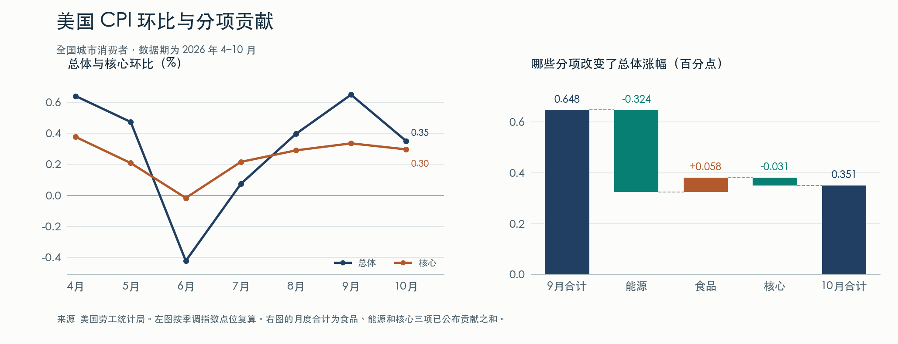

+++
title = "美国 2026 年 10 月 CPI 分析报告"
date = "2026-11-10"
data_as_of = ["2026-11-09", "2026-11-10"]
data_as_of_note = "采用11月10日08:30 ET发布的10月CPI；除当期CPI外，前瞻指标均截至美东11月9日及此前已公布信息，保留各指标原文日期。"
draft = false
description = "总体CPI月率降至0.4%，汽油解释几乎全部净降幅；核心连续第三个月上涨0.3%，结合住房、服务和二手车分析后续通胀。"
series = ""
categories = ["宏观与政策"]
tags = ["美国", "CPI", "通胀", "美联储", "能源", "住房"]
featured = false
private = false
content_preservation = "verbatim_except_privacy_redactions"
source_sha256 = "41304d48578f55bca853328d9fbc5f8dbba04f48649d3a5a326a21e8e8f82acd"
+++

# 美国 2026 年 10 月 CPI 分析报告

**10 月美国总体 CPI 环比上涨 0.4%，低于 9 月的 0.6%。汽油涨势消退解释了几乎全部净降幅。核心 CPI 连续第三个月上涨 0.3%，住房、餐饮和部分服务仍在涨价。** 二手车下跌还掩盖了其他核心商品的升温。展望 11 月，油价给总体 CPI 留出了进一步回落的空间，核心 CPI 要持续降至 0.2% 附近，则需要看到租金和更多服务分项放缓。[BLS 10 月完整发布](https://www.bls.gov/news.release/cpi.htm)

美国劳工统计局（BLS）于美东时间 **2026 年 11 月 10 日 08:30** 发布本期数据，新加坡及北京时间为同日 21:30。研究对象为美国城市消费者价格指数（CPI-U）全国城市均值。10 月官方总项与核心同比均缺少 2025 年 10 月基期，本报告直接比较 2026 年 9 月和 10 月，并用可复算的三个月、六个月年化增速观察趋势。本期 38 页 PDF 存档 · [BLS 对基期缺失的说明](https://www.bls.gov/cpi/additional-resources/2025-federal-government-shutdown-impact-cpi-faq.htm)

## 一、能源对总体 CPI 的拉动减少了 0.324 个百分点

按 BLS 当天的季调指数点位复算，总体环比从 **0.6485% 降至 0.3503%**，回落约 0.298 个百分点。两个月的读数恰好靠近一位小数的舍入分界，直接拿公布值 0.6% 和 0.4% 相减，会低估这次放缓。核心环比则从 0.3348% 微降至 0.2963%，两个数按一位小数显示都为 0.3%。TD Economics 在 11 月 6 日列出的公布前总体环比共识为 0.3%，因此 10 月既比 9 月温和，也比这份预期表高 0.1 个百分点。BLS 季调指数点位 · [TD Economics 公布前预期表](https://economics.td.com/domains/economics.td.com/documents/reports/bottom-line/tables/2026-11-06/upcoming.htm)

| 互不重叠的三大分项 | 9 月环比 | 10 月环比 | 9 月对总体贡献（百分点） | 10 月对总体贡献（百分点） | 贡献变化（百分点） |
|---|---:|---:|---:|---:|---:|
| 食品 | 0.0% | +0.5% | +0.006 | +0.064 | **+0.058** |
| 能源 | +5.2% | +0.7% | +0.377 | +0.053 | **−0.324** |
| 核心（扣除食品和能源） | +0.3% | +0.3% | +0.265 | +0.234 | **−0.031** |
| 已公布贡献合计 |  |  | **+0.648** | **+0.351** | **−0.297** |

汽油一项的贡献从 **+0.337 降至 +0.042 个百分点**，减少 0.295 个百分点。食品贡献回升，抵消了部分能源降温。核心在 10 月贡献了总涨幅的约 **三分之二**，其中住房服务一项就贡献 **0.108 个百分点，约占总涨幅的 31%**。占比以三项已公布贡献之和为分母，住房和汽油已分别计入核心和能源。[BLS 10 月表 6](https://www.bls.gov/news.release/cpi.t06.htm) · [BLS 9 月正式稿及表 6](https://www.bls.gov/news.release/archives/cpi_10142026.htm)

## 二、哪些价格在涨，哪些在跌

以下分项表取自 BLS 表 2、3、6。环比以百分比表示，贡献以**对总体 CPI 的百分点**表示。主列沿用 BLS 季调口径，带 **†** 的项目由 BLS 直接使用未季调变动。父项、子项和交叉汇总可分别比较，逐行加总会重复计算。本期完整分项附表

### 食品涨价同时出现在超市和餐馆

| 分项 | 9 月权重 | 9 月环比 | 10 月环比 | 10 月对总体贡献（百分点） |
| --- | ---: | ---: | ---: | ---: |
| 居家食品 | 8.162% | −0.1% | +0.4% | +0.036 |
| 谷物与烘焙食品 | 1.016% | +0.1% | 0.0% | 0.000 |
| 肉、禽、鱼与蛋 | 1.940% | −0.5% | +0.5% | +0.010 |
| 乳品及相关制品 † | 0.730% | −0.9% | +0.6% | +0.005 |
| 水果与蔬菜 | 1.276% | +0.5% | +0.6% | +0.008 |
| 非酒精饮料与冲泡原料 | 0.990% | +0.9% | −0.3% | −0.003 |
| 其他居家食品 | 2.208% | −0.2% | +0.7% | +0.016 |
| 外出就餐 † | 5.285% | +0.2% | +0.5% | +0.027 |
| 全服务餐饮 † | 2.347% | +0.3% | +0.7% | +0.015 |
| 有限服务餐饮（含快餐） † | 2.637% | +0.2% | +0.4% | +0.012 |

六类居家食品中，**四类上涨、一类持平、一类下跌**。鲜菜上涨 2.2%，其中生菜涨 7.9%，鲜果却跌 0.4%。牛肉与小牛肉涨 0.9%，咖啡跌 3.6%。单看生菜容易高估其影响，其 9 月权重仅 0.040%，对总指数的贡献为 0.003 个百分点。全服务餐饮和有限服务餐饮则同时加速，分别贡献 0.015 和 0.012 个百分点。若要判断本月食品反弹能否延续，餐饮下一两个月的表现比单一鲜菜品种更有辨识度。[BLS 10 月表 2、6](https://www.bls.gov/news.release/cpi.htm)

### 汽油仍拉高季调 CPI，电力涨幅扩大

| 分项 | 9 月权重 | 9 月环比 | 10 月环比 | 10 月对总体贡献（百分点） |
| --- | ---: | ---: | ---: | ---: |
| 汽油（所有品级） | 4.080% | +9.1% | +1.0% | +0.042 |
| 燃料油 | 0.131% | +15.3% | +2.0% | +0.003 |
| 电力 | 2.513% | +0.2% | +0.9% | +0.023 |
| 管道天然气 | 0.732% | −0.3% | −0.8% | −0.006 |

消费者在加油站看到的方向与季调数字不同。**汽油未季调环比下降 0.7%，季调后上涨 1.0%**，意味着实际跌幅小于季节调整所对应的通常降幅。电力贡献从 0.006 增至 0.023 个百分点，管道天然气贡献 −0.006 个百分点。能源涨幅从 5.2% 降到 0.7% 的同时，家庭面对的不同能源账单仍向不同方向变动。[BLS 10 月正文及表 6](https://www.bls.gov/news.release/cpi.htm)

### 住房贡献回落，住宿涨幅放慢最明显

| 分项 | 9 月权重 | 9 月环比 | 10 月环比 | 10 月对总体贡献（百分点） |
| --- | ---: | ---: | ---: | ---: |
| 住房服务（Shelter） | 35.238% | +0.4% | +0.3% | +0.108 |
| 主要居所实际租金 | 7.707% | +0.2% | +0.2% | +0.016 |
| 业主等价租金（OER，全部住宅） | 25.853% | +0.3% | +0.3% | +0.083 |
| 离家住宿 | 1.392% | +2.0% | +0.6% | +0.009 |

住房服务对总体的贡献从 **0.138 降至 0.108 个百分点**。其中离家住宿的贡献从 0.028 降至 0.009，解释了住房贡献降幅的约六成。两项大权重租金的公布涨幅与 9 月相同，按点位细看，主要居所实际租金从 0.247% 降至 0.202%，业主等价租金（OER）从 0.3498% 降至 0.3194%。OER 占总篮子的 25.853%，衡量业主自住房可提供的租住服务价值，房价和按揭利率不能直接代入。同一出租单元通常每六个月采价一次，新租约的变化需要时间才能进入存量租金指数。[BLS 住房采价方法](https://www.bls.gov/cpi/factsheets/owners-equivalent-rent-and-rent.htm) · 季调指数点位

### 二手车压低核心商品，剔除后涨幅反而扩大

| 分项 | 9 月权重 | 9 月环比 | 10 月环比 | 10 月对总体贡献（百分点） |
| --- | ---: | ---: | ---: | ---: |
| 核心商品（扣除食品和能源商品） | 18.807% | +0.3% | +0.2% | +0.030 |
| 核心商品扣除二手车 | 16.137% | +0.2% | +0.4% | +0.062 |
| 二手轿车与卡车 | 2.670% | +0.7% | −1.2% | −0.032 |
| 新车 | 3.729% | +0.2% | +0.2% | +0.006 |
| 家居陈设与用品 | 3.294% | −0.2% | +0.7% | +0.024 |
| 家具与寝具 † | 0.833% | −0.8% | +1.2% | +0.010 |
| 家用电器 | 0.197% | −0.7% | +1.3% | +0.002 |
| 服装（含鞋类） | 2.489% | +0.3% | +0.1% | +0.002 |
| 信息技术商品 | 0.752% | +0.9% | +0.4% | +0.003 |
| 医疗商品 † | 1.378% | −0.7% | +0.5% | +0.007 |

二手车从上涨 0.7% 转为下跌 1.2%，对总体的贡献从 +0.018 转为 −0.032 个百分点。**剔除二手车的核心商品环比却从 0.2% 升至 0.4%，贡献从 0.030 增至 0.062 个百分点。** 家居陈设与用品由跌转涨，服装和信息技术商品则放慢。若二手车下月仅仅停止降价，在其他分项相同的静态比较中，总体 CPI 就会少掉约 0.03 个百分点的拖累。[BLS 10 月表 2、3、6](https://www.bls.gov/news.release/cpi.htm)

### 交通、娱乐服务走强，医疗内部涨跌分明

| 分项 | 9 月权重 | 9 月环比 | 10 月环比 | 10 月对总体贡献（百分点） |
| --- | ---: | ---: | ---: | ---: |
| 非能源服务 | 60.098% | +0.4% | +0.3% | +0.205 |
| 交通服务 | 6.256% | +0.6% | +0.8% | +0.053 |
| 机动车保险 | 2.510% | +0.1% | +0.7% | +0.018 |
| 机动车保养与维修 † | 1.065% | +0.7% | +0.6% | +0.007 |
| 机票 | 1.055% | +1.2% | +0.4% | +0.004 |
| 汽车短租 | 0.153% | +5.4% | −5.7% | −0.009 |
| 娱乐服务 | 3.127% | +0.3% | +0.9% | +0.028 |
| 医疗服务 | 6.813% | +0.3% | +0.3% | +0.021 |
| 医院服务 † | 2.163% | +0.7% | +0.8% | +0.017 |
| 医生服务 † | 1.648% | 0.0% | +0.4% | +0.007 |
| 医疗保险 † | 0.811% | −0.2% | −1.8% | −0.015 |

交通服务环比从 0.6% 升至 0.8%，但机票涨幅从 1.2% 降至 0.4%，汽车短租从上涨 5.4% 转为下跌 5.7%。机动车保险加速至 0.7%，对总体的贡献增加了 0.016 个百分点。娱乐服务环比升至 0.9%，其中入场券涨 1.2%（未季调）。教育大类的涨幅从 0.6% 降至 0.3%，通信大类续跌 0.1%。[BLS 10 月表 2、3、6](https://www.bls.gov/news.release/cpi.htm)

医疗服务总体上涨 0.3%。医院与医生服务分别上涨 0.8% 和 0.4%，医疗保险价格指数下跌 1.8%，对总体的拖累为 0.015 个百分点。BLS 用保费扣除赔付后的留存收益等资料衡量保险服务价格，相关收益数据在 4 月和 10 月更新。家庭实际缴纳的保费有不同的统计口径，不能从这个 −1.8% 直接推算。[BLS 医疗价格编制方法](https://www.bls.gov/cpi/factsheets/medical-care.htm)

从八大消费用途看，10 月全部录得正环比，其中娱乐涨 0.8%，食品与饮料涨 0.4%，住房、交通运输和医疗各涨 0.3%，其他商品与服务涨 0.2%，服装以及教育与通信各涨 0.1%。这里的住房大类（Housing）还涵盖家庭能源等开支，范围大于上文用于分析租住成本的住房服务（Shelter）。更贴近基础通胀的检验是，**扣除食品、能源和住房后的 CPI 仍上涨 0.3%，与 8、9 月相同。进一步剔除二手车，10 月则上涨 0.4%。** 这说明二手车以外仍有价格压力，同时没有证据表明所有核心项目都在加速。[BLS 表 1、3、6](https://www.bls.gov/news.release/cpi.htm)

## 三、单月降温，近三个月的涨价速度仍快

下表用 BLS 季调指数点位计算。三个月年化取窗口终点与三个月前点位之比的四次方，六个月年化取六个月点位之比的平方，再减一。两个窗口均避开 2025 年 10 月缺口。年化数反映最近一段时间的速度，不能用作当月同比或未来一年的预测。BLS 季调指数复核数据

| 项目 | 截至 9 月的三个月年化 | 截至 10 月的三个月年化 | 截至 9 月的六个月年化 | 截至 10 月的六个月年化 |
| --- | ---: | ---: | ---: | ---: |
| 总体 CPI | 4.56% | 5.72% | 3.67% | 3.07% |
| 核心 CPI | 3.41% | 3.75% | 2.85% | 2.69% |
| 核心 CPI 扣除住房服务 | 3.57% | 3.62% | 2.15% | 2.35% |
| 住房服务 | 3.22% | 3.90% | 3.73% | 3.11% |
| 非能源服务 | 3.76% | 4.22% | 3.56% | 3.23% |

总体的三个月窗口从 7–9 月移到 8–10 月，退出的 7 月环比只有 0.074%，新加入的 10 月为 0.350%，所以即使 10 月比 9 月降温，三个月年化仍从 4.56% 升至 5.72%。核心也一样，7 月的 0.215% 被 10 月的 0.296% 替换。六个月核心年化从 2.85% 降至 2.69%，而三个月为 3.75%。两个窗口共同表明，最近一个季度的涨价快于过去半年的平均，10 月这一份数据尚不足以确立新的上升或下降趋势。[BLS 总体与核心 CPI 序列](https://www.bls.gov/cpi/data.htm)

## 四、11 月至年末的通胀前瞻

**基准判断是，11 月总体环比有机会低于 10 月，核心环比仍以约 0.3% 作为观察基准。** 能源已有当月价格线索。住房、餐饮、车险等服务的惯性，以及 10 月二手车拖累能否重现，决定核心能否连续回到 0.2% 附近。除本次 CPI 外，前瞻指标均采用美东 11 月 9 日及此前已公布的数据。

- **汽油已经回落，季调幅度仍待确认。** EIA 全国普通汽油 10 月四个周度观测均值为每加仑 4.310 美元，11 月 2 日为 4.153 美元。AAA 的独立统计也显示，全国普通汽油价格从 11 月 5 日约 4.10 美元降至 11 月 9 日约 4.01 美元。两组数据都显示油价走低，11 月的观测仍限于上旬。BLS 使用全品级汽油和自己的季节调整，电力也可能继续抵消部分降价。[EIA 周度历史](https://www.eia.gov/dnav/pet/hist/LeafHandler.ashx?n=PET&s=EMM_EPMR_PTE_NUS_DPG&f=W) · [AAA 11 月 5 日周报](https://newsroom.aaa.com/2026/11/national-average-falls-12-cents-in-one-week/) · [AAA 全国日价](https://gasprices.aaa.com/?region=US)
- **租金有滞后，住房降温的力度仍待验证。** Zillow 11 月 5 日公布的 10 月挂牌租金指数（ZORI）同比上涨 2.9%，年涨幅连续第七个月扩大。ZORI 衡量市场挂牌租金，有独立的去年基期。它提示新租约可能给未来数月的存量租金提供支撑，不能据此推算 BLS 的 10 月住房同比。若实际租金和 OER 在接下来两三期双双接近或低于 0.2% 环比，核心回落的证据会更充分。[Zillow 10 月市场报告](https://www.zillow.com/research/october-2026-market-report/) · [BLS 住房方法](https://www.bls.gov/cpi/factsheets/owners-equivalent-rent-and-rent.htm)
- **二手车批发和零售的季调价格走势分化。** Cox Automotive 在 11 月 6 日公布，10 月 Manheim 批发指数经车型结构、里程和季节调整后环比上涨 0.5%，未调整批发价则下降 2.3%。批发拍卖与 CPI 零售成交的样本和传导时间不同。若 CPI 二手车跌幅收窄，而剔除二手车的商品仍涨 0.3%–0.4%，核心 CPI 将较难明显走低。反之，若家居用品降温、交通与娱乐服务也回落，核心放缓便有更多来源。[Cox Automotive 10 月批发指数](https://www.coxautoinc.com/insights/manheim-used-vehicle-value-index-october-2026-trends/)

**11 月总体 CPI 的条件测算。** 固定食品环比为 +0.3%，用 BLS 公布的 9 月相对重要性作一阶近似，食品、能源、核心权重分别约 13.447%、7.649%、78.905%。横向改变能源，纵向改变核心。下表格内为对应的总体环比，各条件均为研究假设。[BLS 权重和分项口径](https://www.bls.gov/news.release/cpi.htm)

| 核心环比假设 | 能源 −1.0% | 能源持平 | 能源 +1.0% |
| --- | ---: | ---: | ---: |
| 核心 +0.2% | +0.12% | +0.20% | +0.27% |
| 核心 +0.3% | +0.20% | +0.28% | +0.35% |
| 核心 +0.4% | +0.28% | +0.36% | +0.43% |

若核心维持 +0.3%，能源环比介于 −1.0% 与持平之间，总体对应约 **+0.20% 至 +0.28%**。如果能源转涨 1.0%，即便核心没有升温，总体也可达到约 +0.35%。区间只体现这些输入的算术结果，实际 11 月权重、季调和采价均可能不同。

**政策日历也影响解读。** 美联储在 10 月 28 日维持联邦基金利率目标区间 3.75%–4.00%，其长期 2% 通胀目标采用 PCE 价格指数。按已公布日程，10 月 PPI 将于 **11 月 13 日**公布，10 月 PCE 将于 **11 月 25 日**公布，均在 **12 月 8–9 日 FOMC 会议**之前。**11 月 CPI 要到 12 月 10 日才公布**，会晚于本次利率决定。眼下应特别关注核心 PCE 能否印证 CPI 中的服务压力，以及此前油价下行有没有传到更广的消费篮子。10 月 CPI 本身不足以确定 12 月利率方向。[FOMC 10 月声明](https://www.federalreserve.gov/newsevents/pressreleases/monetary20261028a.htm) · [美联储通胀目标口径](https://www.federalreserve.gov/faqs/economy_14400.htm) · [BEA 发布安排](https://www.bea.gov/news/2026/personal-income-and-outlays-september-2026) · [BLS 发布日历](https://www.bls.gov/schedule/2026/home.htm) · [美联储 12 月日历](https://www.federalreserve.gov/newsevents/2026-december.htm)
