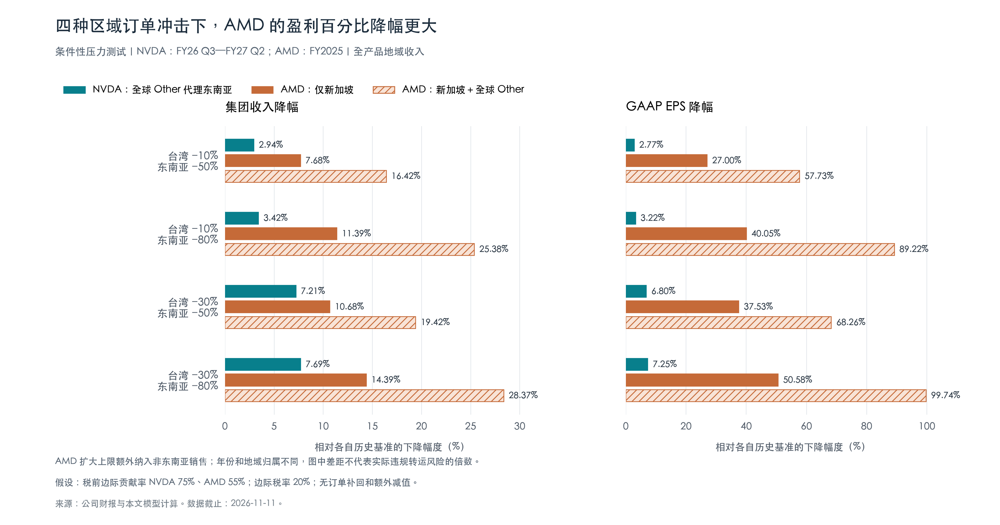

+++
title = "区域订单收缩的盈利敏感度：NVDA 与 AMD"
date = "2026-11-11"
data_as_of = ["2026-11-11"]
data_as_of_note = "资料截止11月11日；NVDA使用FY26Q3至FY27Q2，AMD地区模型使用FY2025、最新业务规模另列四季，Alphabet使用2025Q4至2026Q3；均为历史静态条件压力情景。"
draft = false
description = "比较台湾及东南亚代理范围订单收缩的收入与盈利敏感度，区分地域披露、美元损失与百分比压力，并补充Alphabet全亚太情景。"
series = ""
categories = ["公司研究", "科技产业"]
tags = ["NVDA", "AMD", "Alphabet", "区域收入", "压力测试"]
featured = false
private = false
content_preservation = "verbatim_except_privacy_redactions"
source_sha256 = "93f9125d2ddb6c5286d08a14ff371b0471fa3dbeef7c89a5a22a79f47bd16466"
+++

# 区域订单收缩的盈利敏感度：NVDA 与 AMD

*兼论 Alphabet（Google）的收入结构与亚太压力情景｜数据截止：2026 年 11 月 11 日*

在明确的财报范围和利润假设下，AMD 的 GAAP 盈利百分比对区域订单损失更敏感。对“台湾收入减少 10%／30%、东南亚代理范围减少 50%／80%”的四种组合，NVDA 的集团收入降幅为 **2.94%—7.69%**，EPS 降幅为 **2.77%—7.25%**；AMD 仅计台湾与已单列的新加坡，收入降幅为 **7.68%—14.39%**，EPS 降幅为 **27.00%—50.58%**。AMD 的 EPS 百分比降幅相当于同组合 NVDA 的 **5.52—12.44 倍**。这些差距由各自的地区收入构成、利润基数和模型参数共同产生，尚不能用于排列两家公司实际受到违规转运事件影响的程度。

NVDA 在上述组合中损失的美元收入及净利润更大，但占集团体量的比例更小。单独看财报中归属于全球 Other 的收入，其最近四季仅占集团收入约 **1.60%**；加入台湾后，联合受测范围扩大至 **22.98%**。这一变化表明，是否纳入台湾客户会显著改变压力结果。台湾收入包含面向全球市场的供应链采购，不能按地区名称直接认定最终用途。

Alphabet 的业务结构和地域披露更宽。公司未单列东南亚或台湾的 GPU／TPU 收入；可复核的集团亚太收入占最近四季收入 **16.14%**，同时涵盖广告、云及其他业务。全亚太收入减少 50%／80% 的模型，对应 EPS 下降 **5.17%／8.27%**，适合作为补充性的广域压力情景，不宜纳入 NVDA 与 AMD 的同口径硬件销售排名。

本文评估地区订单收缩对历史收入、利润与 EPS 的影响。所有损失比例均为条件性情景参数，不代表已识别的违规销售份额、事件概率或未来业绩预测。台湾与东南亚在模型中分别设定损失率，财报原有地域分类保持不变。

**三家公司能够直接披露的，是相关业务收入，而非可完全横比的纯 GPU 收入。**NVDA 的数据中心业务涵盖计算与网络产品；AMD 数据中心分部同时包括 Instinct GPU 和 EPYC CPU；Google Cloud 同时覆盖云基础设施、应用与 TPU 系统销售。芯片厂商出售硬件与云厂商出租算力处于不同环节，同一设备可以先后为两家公司贡献收入。[NVDA 财报][nvq2]、[AMD 财报][amdq3]、[Alphabet 财报][gq2]

**表 1｜最近四个已披露季度的相关业务规模。金额为亿美元。**

| 公司 | 业务展示期间 | 集团收入 | 相关业务收入 | 占集团收入 | 可比性限制 |
|---|---|---:|---:|---:|---|
| NVDA | FY26 Q3—FY27 Q2，末季截至 2026-07-26 | 3,029.69 | 数据中心 2,777.98 | 91.69% | 含网络及其他计算产品，非纯 GPU |
| AMD | 2025 Q4—2026 Q3，末季截至 2026-09-26 | 454.36 | 数据中心 264.19 | 58.15% | 同时包含 GPU 与服务器 CPU |
| Alphabet | 2025 Q4—2026 Q3，末季截至 2026-09-30 | 4,710.98 | Google Cloud 931.69 | 19.78% | 含通用云、Workspace、TPU 系统等 |

资料来源：各公司季度报告及业绩公告；逐季数值和来源见文后表 7。四季占比按收入加总后计算。**AMD 上表的 454.36 亿美元用于展示最新业务规模；其地区压力模型使用能够与国家地区收入匹配的 FY2025 总收入 346.39 亿美元。两项基数不混用。**

**地域收入、货物交付和最终部署回答的是不同问题。**NVDA 自 FY26 Q3 起按直接客户总部归属收入；AMD 按直接购买客户的开票地址；Alphabet 按客户地址披露集团区域收入。总部位于新加坡的最终客户若向台湾服务器厂商采购，NVDA 对直接客户的收入可能归在台湾。因此，财报的东南亚类别不能约束所有最终部署到东南亚的设备，也不能完整识别途经当地的销售。[NVDA 地域附注][nvq2]、[AMD 地域附注][amdfy25]、[Alphabet 地域附注][gq3]

同一公司不同地域口径的差异具有实质影响。NVDA FY2025 原开票口径的新加坡收入为 **236.84 亿美元、占 18.15%**；公司同时说明，实际发往新加坡的货物对应收入不足集团的 2%。后来按总部口径重列同一财年，包含东南亚在内的全球 Other 为 **43.67 亿美元、占 3.35%**。这些比例对应不同分类，不能拼接为地区收入增长率。[FY2025 原年报][nvold]、[FY2026 年报重列数据][nvannual]

**表 2｜压力测试采用的地域范围。金额为亿美元。**

| 公司／模型范围 | 期间及归属依据 | 台湾收入 | 东南亚代理收入 | 联合范围占集团收入 |
|---|---|---:|---:|---:|
| NVDA | FY26 Q3—FY27 Q2；直接客户总部 | 647.86 | 全球 Other 全部计入：48.42 | 22.98% |
| AMD：新加坡子集 | FY2025；客户开票地址 | 51.86 | 已单列新加坡：42.84 | 27.34% |
| AMD：扩大上限 | 同一 FY2025、同一归属依据 | 51.86 | 新加坡＋全部 Other：103.39 | 44.82% |
| Alphabet：全亚太 | 2025 Q4—2026 Q3；客户地址 | 未单列 | 全 APAC：760.38，已包括台湾 | 16.14%（全亚太） |

资料来源：[NVDA FY26 Q3][nvq3]、[FY26 年报][nvannual]、[FY27 Q1][nvq1]、[FY27 Q2][nvq2]；[AMD 年报][amdfy25]；[Alphabet 四季度公告][gq4]、[2026 Q1][gq1]、[Q2][gq2]、[Q3][gq3]。NVDA FY26 Q4 的地区收入由全年减前九个月得到。各季数据分别加总，与累计报表可能存在百万美元级四舍五入差异。

AMD 的新加坡部分提供已披露子集，全部 Other 提供其余东南亚收入的会计上端；扩大上限同时纳入非东南亚销售。只有在统一利润率等模型条件下，这两个范围才能构成本文的损失区间；它们不构成统计置信区间。Alphabet 的全亚太范围更广，还包括日本、印度、澳大利亚等市场，不能与两家芯片公司的东南亚代理范围等同。

NVDA 年报估计，FY2026 台湾总部客户的数据中心收入中，**76% 对应美国和欧洲终端客户**。这为分地区设置不同压力率提供了业务背景，但该比例仅覆盖相应财年和数据中心业务，不能机械外推为最新四季全产品收入的硬性上限；剩余部分也不能直接归为违规转运。[NVDA 年报注释][nvannual]

**模型将收入损失与利润损失分开计算。**对台湾收入设损失率 t，对东南亚代理收入设损失率 s；主情景采用 t＝10%、30%，s＝50%、80%。两地同时减少 50%、80% 的较重情景另作参照。损失率按收入金额定义，未作芯片数量或型号占比假设。

**表 3｜财务基准与利润参数。金额为亿美元，EPS 为美元／股。**

| 项目 | NVDA | AMD | Alphabet |
|---|---:|---:|---:|
| 压力模型期间 | FY26 Q3—FY27 Q2 | FY2025，截至 2025-12-27 | 2025 Q4—2026 Q3 |
| 集团收入 | 3,029.69 | 346.39 | 4,710.98 |
| 营业利润 | 1,975.79 | 36.94 | 1,569.76 |
| GAAP 净利润 | 1,928.79 | 43.35 | 2,356.94 |
| EPS 基准 | 四季合计 7.91 | 年度 2.65 | 四季合计 19.16 |
| 假设税前边际贡献率 | 75% | 55% | 40% |
| 假设边际税率 | 20% | 20% | 20% |
| 每减少 1 美元收入对应的净利润减少 | 0.60 美元 | 0.44 美元 | 0.32 美元 |

财务基准取自各期利润表和 EPS 附注。[NVDA FY26 Q3][nvq3]、[FY26 Q4][nvq4]、[FY27 Q1][nvq1]、[FY27 Q2][nvq2]；[AMD 年报][amdfy25]；[Alphabet Q4][gq4]、[Q1][gq1]、[Q2][gq2]、[Q3][gq3]。边际贡献率和税率均为研究假设，未披露为相应地区的实际利润率或实际税率。

计算关系为：

- 收入减少＝台湾收入 × t＋东南亚代理收入 × s。
- 营业利润减少＝收入减少 × 税前边际贡献率。
- 净利润减少＝营业利润减少 ×（1－边际税率）。
- EPS 减少按对应期间的普通股利润与股数计算；四季模型先逐季计算再汇总。

模型保留固定研发、管理费用和其他损益基准，假设受影响订单收入全部消失、没有其他客户补单，也没有额外库存减值或处罚。若订单可以转由其他客户承接，收入净损失会缩小；若发生库存减值、采购承诺损失或更广泛限制，冲击可能扩大。税收利益按能够确认处理，若不能确认，净利润会更低。财报中的地区销售份额与最终无法补回的收入损失份额并不必然相同。

**在四种主要组合中，AMD 的百分比压力更大，NVDA 的美元损失更大。**图 1 和表 4 使用相同数据。NVDA 的 Other 与 AMD 的开票收入口径差异直接保留，未将其解释为真实终端需求的同口径比较。

*图 1｜柱长表示相对各自历史基准的下降幅度。浅色斜线为 AMD 扩大上限，额外包含非东南亚销售。来源：公司财报与本文模型计算。*

**表 4｜NVDA 与 AMD 四种组合的收入、净利润及 EPS 影响。**收入和净利润列为减少金额，单位亿美元；括号内为相对各自基准的降幅。末列比较 EPS 百分比降幅，而非每股美元数值。

| 台湾／东南亚收入减少 | 公司及范围 | 收入减少（降幅） | 净利润减少（降幅） | EPS：基准 → 情景（降幅） | EPS 降幅 ÷ NVDA |
|---|---|---:|---:|---:|---:|
| 10%／50% | NVDA | 89.00（2.94%） | 53.40（2.77%） | 7.91 → 7.69（2.77%） | 1.00 倍 |
| 10%／50% | AMD：新加坡子集 | 26.61（7.68%） | 11.71（27.00%） | 2.65 → 1.93（27.00%） | 9.75 倍 |
| 10%／50% | AMD：扩大上限 | 56.88（16.42%） | 25.03（57.73%） | 2.65 → 1.12（57.73%） | 20.85 倍 |
| 10%／80% | NVDA | 103.52（3.42%） | 62.11（3.22%） | 7.91 → 7.66（3.22%） | 1.00 倍 |
| 10%／80% | AMD：新加坡子集 | 39.46（11.39%） | 17.36（40.05%） | 2.65 → 1.59（40.05%） | 12.44 倍 |
| 10%／80% | AMD：扩大上限 | 87.90（25.38%） | 38.68（89.22%） | 2.65 → 0.29（89.22%） | 27.70 倍 |
| 30%／50% | NVDA | 218.57（7.21%） | 131.14（6.80%） | 7.91 → 7.37（6.80%） | 1.00 倍 |
| 30%／50% | AMD：新加坡子集 | 36.98（10.68%） | 16.27（37.53%） | 2.65 → 1.66（37.53%） | 5.52 倍 |
| 30%／50% | AMD：扩大上限 | 67.25（19.42%） | 29.59（68.26%） | 2.65 → 0.84（68.26%） | 10.04 倍 |
| 30%／80% | NVDA | 233.09（7.69%） | 139.86（7.25%） | 7.91 → 7.34（7.25%） | 1.00 倍 |
| 30%／80% | AMD：新加坡子集 | 49.83（14.39%） | 21.93（50.58%） | 2.65 → 1.31（50.58%） | 6.97 倍 |
| 30%／80% | AMD：扩大上限 | 98.27（28.37%） | 43.24（99.74%） | 2.65 → 0.01（99.74%） | 13.75 倍 |

AMD 扩大上限在“台湾减少 30%、东南亚代理范围减少 80%”时，净利润仅剩约 **1,112 万美元**，EPS 约 **0.00685 美元**，表中四舍五入为 0.01。持续经营已转亏，EPS 按基本股数排除潜在普通股的反稀释影响。NVDA 的四季股数不同，净利润与 EPS 降幅也存在微小差别。

只计 AMD 新加坡子集时，四种组合的收入百分比降幅为 NVDA 的 **1.48—3.33 倍**，净利润与 EPS 百分比降幅约为 **5.52—12.44 倍**；AMD 净利润降幅比 NVDA 多 **24.24—43.33 个百分点**。扩大到全部 Other 后，收入降幅倍率为 **2.69—7.43 倍**，净利润与 EPS 降幅倍率约为 **10.04—27.70 倍**。扩大上限对未知地域的归属假设很强，不应作为实际损失预测。

差距同时来自收入构成和利润分母。当前历史基数对应 NVDA GAAP 净利率约 **63.66%**、AMD 约 **12.51%**。结合表 3 的边际贡献率，集团收入每减少 1%，净利润分别约减少 **0.94% 和 3.52%**。这些倍率是当期利润基数和参数共同产生的结果，包含各自的非经营损益、摊销和税项影响；没有归一化为同一财年、同一正常化经营利润率或未来预期 EPS。

以“台湾 10%／东南亚 80%”为例，NVDA 净利润减少 **62.11 亿美元、占基准 3.22%**；AMD 新加坡子集减少 **17.36 亿美元、占基准 40.05%**。两者的美元金额排序和百分比排序不同。对投资研究而言，需要分别判断潜在损失规模及其占企业盈利能力的比重。

**东南亚单独承压时，NVDA 已披露总部范围内的影响相对有限。**将全球 Other 全部作为东南亚代理收入，区域收入减少 50%／80%，NVDA 集团收入下降 **0.80%／1.28%**，EPS 下降 **0.75%／1.20%**。这个结果仅适用于该直接客户集合，不能外推为东南亚所有装机、所有最终客户采购或所有转运链条的上限。

**表 5｜不计台湾的地区压力情景。金额为亿美元，EPS 为美元／股。**

| 公司及受测范围 | 区域收入减少 | 集团收入减少（降幅） | 净利润减少（降幅） | EPS：基准 → 情景 |
|---|---:|---:|---:|---:|
| NVDA：全球 Other | 50% | 24.21（0.80%） | 14.53（0.75%） | 7.91 → 7.85 |
| NVDA：全球 Other | 80% | 38.74（1.28%） | 23.24（1.20%） | 7.91 → 7.82 |
| AMD：仅新加坡 | 50% | 21.42（6.18%） | 9.42（21.74%） | 2.65 → 2.07 |
| AMD：仅新加坡 | 80% | 34.27（9.89%） | 15.08（34.79%） | 2.65 → 1.73 |
| AMD：新加坡＋全球 Other | 50% | 51.70（14.92%） | 22.75（52.47%） | 2.65 → 1.26 |
| AMD：新加坡＋全球 Other | 80% | 82.71（23.88%） | 36.39（83.95%） | 2.65 → 0.43 |

表 5 的 AMD 年份、地区归属和产品结构与 NVDA 不同。即使模型显示 AMD 盈利百分比更敏感，也仍需终端客户、渠道订单和具体产品数据，才能判断现实事件下的相对风险。

**台湾也受到大幅冲击时，压力规模明显扩大。**以下同时对台湾与东南亚代理收入施加 50%／80% 损失，作为主要四种组合之外的较重参照。它们覆盖大量正常供应链收入，不代表违规转运的实际比例。

**表 6｜两地同时收缩的较重情景。金额为亿美元，EPS 为美元／股。**

| 公司及受测范围 | 两地共同减少 | 集团收入降幅 | 净利润降幅 | 情景净利润 | 情景 EPS |
|---|---:|---:|---:|---:|---:|
| NVDA：台湾＋Other | 50% | 11.49% | 10.83% | 1,719.91 | 7.05 |
| NVDA：台湾＋Other | 80% | 18.39% | 17.33% | 1,594.58 | 6.54 |
| AMD：台湾＋新加坡 | 50% | 13.67% | 48.06% | 22.52 | 1.38 |
| AMD：台湾＋新加坡 | 80% | 21.87% | 76.90% | 10.02 | 0.61 |
| AMD：台湾＋新加坡＋Other | 50% | 22.41% | 78.79% | 9.20 | 0.56 |
| AMD：台湾＋新加坡＋Other | 80% | 35.86% | 126.06% | -11.30 | -0.70 |

AMD 在部分情景下营业利润先于净利润转负；正净利润依赖模型保留的其他损益和税项。表中亏损情景按持续经营亏损规则处理 EPS 股数，净利润降幅超过 100% 表示由盈转亏。

**Alphabet 的可用数据只能支持更宽的补充测试。**公司最近四季集团收入为 **4,710.98 亿美元**，Google Cloud 收入 **931.69 亿美元**，集团亚太收入 **760.38 亿美元**。Cloud 收入与集团 APAC 收入属于不同切分维度，不能将两者相乘来推算亚太 GPU／TPU 销售。[Alphabet Q4][gq4]、[Q1][gq1]、[Q2][gq2]、[Q3][gq3]

Google 自研 TPU 属于专用 AI 加速器；自用、出租算力和对外销售系统具有不同收入含义。公司自 2026 Q2 开始确认交付到客户基础设施的 TPU 系统销售，但没有单列其金额。系统交易还可包括软件、安装、支持与延保，因此 Google Cloud 不能直接等同于芯片销售收入。[Alphabet 收入确认说明][gq2]

把全亚太业务收入作为受测范围，采用 40% 税前边际贡献率、20% 边际税率，结果如下。全 APAC 已包括台湾，加入台湾概念不会再次增加这一收入池。

| 全亚太收入减少 | 集团收入减少（降幅） | 净利润减少（降幅） | 情景净利润 | EPS：基准 → 情景（降幅） |
|---:|---:|---:|---:|---:|
| 50% | 380.19（8.07%） | 121.66（5.16%） | 2,235.28 | 19.16 → 18.17（5.17%） |
| 80% | 608.30（12.91%） | 194.66（8.26%） | 2,162.28 | 19.16 → 17.58（8.27%） |

两档情景对应的营业利润降幅为 **9.69%／15.50%**，高于净利润降幅 **5.16%／8.26%**。Alphabet 的基准净利润包含较大的投资估值等非经营损益，EPS 百分比不能单独代表经常性经营盈利弹性。EPS 同时考虑优先股股利和转换影响，故其降幅与集团净利润降幅略有差别。[Alphabet EPS 及其他损益附注][gq2]、[Q3 财报][gq3]

这组测试的价值在于提供全亚太业务收缩的量级参照；它不能量化特定 GPU 转运渠道，也不能与 NVDA、AMD 的地域销售代理直接排序。

**判断仍取决于几个尚未披露的变量。**一是实际受影响订单在直接客户、开票客户与最终客户之间的映射；二是当地收入中 GPU、CPU、网络及其他产品的构成；三是终止订单能否由其他客户承接；四是受损业务的真实边际利润率及额外减值。地区名称和历史收入比例无法替代这些证据。对台湾采用 10%／30%、对东南亚采用 50%／80%，能够检验不同程度的冲击，但尚未被校准为事件发生概率或真实违规销售份额。

利润参数同样会影响结果。以 AMD“台湾 30%／新加坡 80%”为例，税前边际贡献率取 45%、55%、65%，净利润降幅分别为 **41.38%、50.58%、59.77%**；它们是参数敏感性，不是置信区间。NVDA 若原有成本完全不能减少，即税前利润损失等于收入损失，两地同时减少 50%／80% 对应净利润降幅约 **14.44%／23.10%**，高于基准模型的 **10.83%／17.33%**。这些差异说明边际成本处理对盈利结果具有实质影响。

**表 7｜业务收入逐季资料。金额为亿美元，括号为占同期集团收入的比例。**NVDA 的主要指标为数据中心，补充指标为 Graphics 分部；AMD 的主要指标为数据中心，补充指标为 Gaming；Alphabet 的主要指标为 Google Cloud。不同披露维度可能重叠，不将各列相加为“GPU 总收入”。

| 公司 | 财季／期末 | 集团总收入 | 相关分部收入（占集团） | 补充观察指标（占集团） |
|---|---|---:|---:|---:|
| 英伟达 | FY26 Q3／2025-10-26 | 570.06 | 512.15（89.84%） | 60.98（10.70%） |
| 英伟达 | FY26 Q4／2026-01-25 | 681.27 | 623.14（91.47%） | 64.76（9.51%） |
| 英伟达 | FY27 Q1／2026-04-26 | 816.15 | 752.46（92.20%） | 70.65（8.66%） |
| 英伟达 | FY27 Q2／2026-07-26 | 962.21 | 890.23（92.52%） | 79.22（8.23%） |
| **英伟达** | **四季合计** | **3,029.69** | **2,777.98（91.69%）** | 275.61（9.10%） |
| AMD | 2025 Q4／2025-12-27 | 102.70 | 53.80（52.39%） | 8.43（8.21%） |
| AMD | 2026 Q1／2026-03-28 | 102.53 | 57.75（56.32%） | 7.20（7.02%） |
| AMD | 2026 Q2／2026-06-27 | 115.36 | 67.18（58.24%） | 7.79（6.75%） |
| AMD | 2026 Q3／2026-09-26 | 133.77 | 85.46（63.89%） | 7.73（5.78%） |
| **AMD** | **四季合计** | **454.36** | **264.19（58.15%）** | 31.15（6.86%） |
| Alphabet | 2025 Q4／2025-12-31 | 1,138.29 | 176.64（15.52%） | TPU 系统销售未单列 |
| Alphabet | 2026 Q1／2026-03-31 | 1,098.96 | 200.28（18.22%） | TPU 系统销售未单列 |
| Alphabet | 2026 Q2／2026-06-30 | 1,197.96 | 247.68（20.68%） | TPU 系统销售未单列 |
| Alphabet | 2026 Q3／2026-09-30 | 1,275.77 | 307.09（24.07%） | TPU 系统销售未单列 |
| **Alphabet** | **四季合计** | **4,710.98** | **931.69（19.78%）** | — |

NVDA 数据来自 [FY26 Q3][nvq3]、[FY26 Q4 财务说明][nvcfo]、[FY27 Q1][nvq1]、[FY27 Q2][nvq2]；AMD 数据来自 [2025 Q4][amdq4]、[2026 Q1][amdq1]、[Q2][amdq2]、[Q3][amdq3]；Alphabet 数据来自 [2025 Q4][gq4]、[2026 Q1][gq1]、[Q2][gq2]、[Q3][gq3]。NVDA Graphics 与市场平台、AMD Gaming 与 Radeon GPU 并非同义项。三家公司均没有提供可以据此完整拆分的季度纯 GPU／TPU 收入。

**数据与计算说明。**财务和地域数据取自公司原始财报，季度占比由同季收入计算，跨季占比由合计收入计算。本文不把尚未披露的产品或地区收入填为零。财报事实的证据充分度为 G3；对实际区域 GPU 订单损失的推断为 G2，限制在于地域与产品拆分缺失、年份不同及模型参数未经地区利润率验证。这里的等级描述证据可用范围，不表示情景发生概率。

NVDA 四季 EPS 使用各季净利润及稀释股数分别计算后汇总；AMD 持续经营亏损时改用基本股数，保留终止经营损益基准；Alphabet 逐季处理优先股股利与转换。上述处理使净利润和 EPS 的百分比变化可能略有不同。表内金额、占比和 EPS 独立四舍五入，个别加总可能存在末位差异。

本报告的关键结论限于财报范围内的历史静态压力。对当前实际事件或未来盈利作判断，仍需将已识别订单、最终用途、销售替代能力和当期财务基准对应起来。

随附数据：四种组合详细结果、敏感度差距、地区代理情景、重压及亚太情景、逐季业务收入与来源、财务基数与假设。

[nvq3]: https://www.sec.gov/Archives/edgar/data/1045810/000104581025000230/nvda-20251026.htm
[nvannual]: https://www.sec.gov/Archives/edgar/data/1045810/000104581026000021/nvda-20260125.htm
[nvq4]: https://investor.nvidia.com/news/press-release-details/2026/NVIDIA-Announces-Financial-Results-for-Fourth-Quarter-and-Fiscal-2026/default.aspx
[nvcfo]: https://s201.q4cdn.com/141608511/files/doc_financials/2026/Q426/Q4FY26-CFO-Commentary.pdf#page=2
[nvq1]: https://www.sec.gov/Archives/edgar/data/1045810/000104581026000052/nvda-20260426.htm
[nvq2]: https://www.sec.gov/Archives/edgar/data/1045810/000104581026000075/nvda-20260726.htm
[nvold]: https://www.sec.gov/Archives/edgar/data/1045810/000104581025000023/nvda-20250126.htm
[amdfy25]: https://www.sec.gov/Archives/edgar/data/2488/000000248826000018/amd-20251227.htm
[amdq4]: https://www.sec.gov/Archives/edgar/data/2488/000000248826000014/q42025991.htm
[amdq1]: https://ir.amd.com/financial-information/sec-filings/content/0000002488-26-000076/amd-20260328.htm
[amdq2]: https://www.sec.gov/Archives/edgar/data/2488/000000248826000123/amd-20260627.htm
[amdq3]: https://ir.amd.com/financial-information/sec-filings/content/0000002488-26-000191/amd-20260926.htm
[gq4]: https://www.sec.gov/Archives/edgar/data/1652044/000165204426000012/googexhibit991q42025.htm
[gq1]: https://www.sec.gov/Archives/edgar/data/1652044/000165204426000048/goog-20260331.htm
[gq2]: https://www.sec.gov/Archives/edgar/data/1652044/000165204426000071/goog-20260630.htm
[gq3]: https://www.sec.gov/Archives/edgar/data/1652044/000165204426000084/goog-20260930.htm
