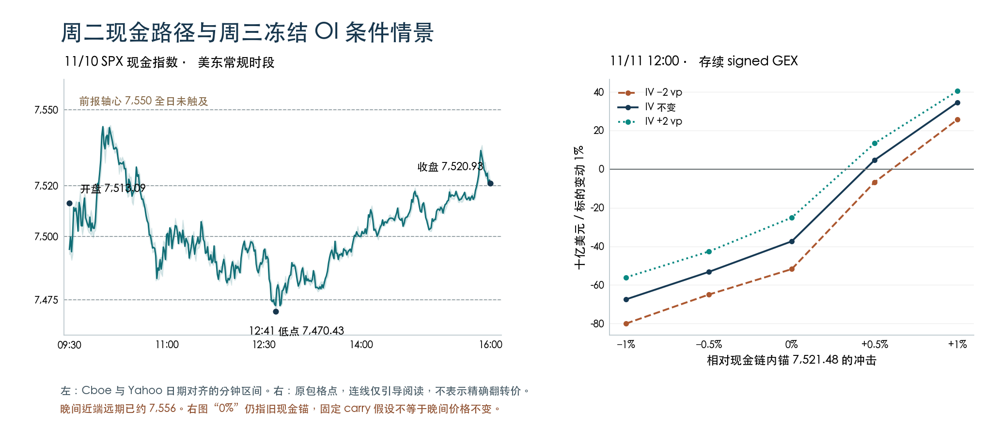

+++
title = "SPX期权持仓与Greeks结构分析-261110"
date = "2026-11-11"
data_as_of = ["2026-11-09", "2026-11-10"]
data_as_of_note = "D为11月10日、P为11月9日，目标日为11月11日；现金收盘锚、晚间IV与20:44:21 XSP缓存报价分别保留，假期及PPI信息按原文截止与排期处理。"
draft = false
description = "周三存续净Gamma代理加深，现金锚与晚间远期已偏离；按开盘重定位7500–7550观察带，保留情景估值、零张固定腿优先卡。"
series = "SPX期权分析报告"
categories = ["衍生品", "市场结构"]
tags = ["SPX", "XSP", "Greeks", "GEX", "期权"]
featured = false
private = false
content_preservation = "verbatim"
source_sha256 = "39324b8a221bcc5c278ea667ce145edbc2de8b811fd34b6284430f38f72c0c88"
+++

# SPX期权持仓与Greeks结构分析-261110

## 1. 一句话结论

周三存续净 Gamma 代理加深至 **−40.520 B USD/1%**，先按实际开盘位置区分 **7,500–7,550** 内的承接与上侧修复；晚间近端远期已约 **7,556**，若价格延续这一位置或局部 Gamma 转正，就不能沿用从现金收盘 7,521 出发的下行判断与固定腿。

**盘后研究 B 级｜结构数值可复核，方向未定、方向置信低｜XSP 有条件情景估值，零张固定腿优先卡｜目标日执行另行复核。**

signed GEX 是本项目按 call 正、put 负构造的库存代理，并非直接观测的 dealer 持仓。B USD/1% 表示十亿美元/标的变动 1% 的 Gamma 暴露，不是资金流或盈亏。

## 2. T+1 Action Summary

| 项目 | 11 月 11 日观察与失效条件 |
| --- | --- |
| Base stance | 若周三仍在 7,500–7,550，先观察 7,510–7,520 与 7,550。若延续晚间位置高开，则从上侧重新定位。 |
| Earliest evaluation | 现金开盘后对齐 SPX、XSP、实际腿与远期，再评估买方家族。假期旧美债数据不能作为当日确认，数据钟不一致则等待。 |
| Base activation | 若带内回测显示一侧承接，沿该侧复核邻近节点。反复穿越 7,510–7,520 而无方向时只观察。 |
| Downside branch | 若失去 7,500 且回升未收复 7,520，复核 7,475 / 7,450 与看跌单买、买入价差。收复或结构转缓冲则撤回。 |
| Upside branch | 若 7,550 上方获承接，复核 7,575 / 7,600 与看涨买方家族。失去承接则撤回；短腿已被越过或 Gamma 变号就重选。 |
| Otherwise | 若 gap、新消息或 IV 变化让旧锚失效，重建情景和选腿。本期无固定腿优先卡，缺有效报价时仅跟踪。 |

## 3. Executive Summary

- **周二价格走弱，但没有经过前报轴心。** 7,513.09 开盘，首分钟就经过 7,500；早盘最高 7,543.92，未到 7,550。午后先触及 7,475，再从 7,470.43 低点回到 7,520.93 收盘。价格路径不等于旧卡完整触发。

- **存续净负值扩大主要来自共同 PM 合约。** 相同 15,964 个合约的 signed 从 −28.048 B 到 −40.520 B，PM 变化 −13.556 B、AM +1.084 B。11/10 已到期的 −17.354 B 另行移除。

- **近端负节点集中在 7,510–7,520。** 周三到期层在两个节点的 signed 为 −42.38、−53.97 M USD/点，7,550 却为 +6.59 M。上方符号与下方不同，不能把整条路径概括成同一种反馈。

- **晚间价格已经偏离现金锚。** XSP 自身平价远期 755.63，对应的包内现金锚是 752.11。同期 ES 的上涨支持盘后价格变化的解释。模型“现货不动”到中午会让远期下降约 2.79 点，因此其 call 损失不能全部称为时间损耗。

- **CPI 已公布，假期影响的是可用的确认来源。** 总体/核心环比分别 +0.4%/+0.3%。周三美元固定收益市场按 SIFMA 建议休市，股票期权照常交易；旧现金债券数据不能当作周三即时确认。 [BLS CPI](https://www.bls.gov/news.release/archives/cpi_11102026.htm) · [SIFMA 假期公告](https://www.sifma.org/news/press-releases/sifma-fixed-income-market-close-recommendation-in-the-u-s-the-u-k-and-japan-for-the-u-s-veterans-day-holiday-2026) · [Cboe 日历](https://www.cboe.com/about/hours/us-options/)

- **保留模型权衡，暂不保留固定腿优先级。** 三个候选到期的 SPXW PM 局部 IV 都仅供诊断。XSP 的 24 个代表、1,080 格情景通过数值与价差边界检查，但当前参考腿和现金锚不足以确定周三应优先研究哪一组。

## 4. What Changed vs. T-1 and Prior Playbook Review

| 实质变化 / 口径 | 11/09 | 11/10 | 含义 |
| --- | --- | --- | --- |
| 现金收盘 / VIX | 7,549.94 / 19.92 | 7,520.93 / 19.46 | SPX −29.01 点（−0.38%），VIX −0.46。下跌与波动率回落同时发生。 |
| 共同 15,964 个合约 signed GEX | −28.048 B | −40.520 B | 净负值扩大 12.471 B。PM 贡献 −13.556 B，AM +1.084 B。共同 gross 增加 6.870 B。 |
| 同一 11/11 PM 到期层 | OI 178,075，gross 11.902 B，signed −5.308 B | OI 223,569，gross 16.799 B，signed −9.099 B | 数量与供应商敏感度共同变化，不能把差额解释为净卖出。 |
| 滚动 1–60D DEX | +122.248 B USD | −98.434 B USD | 变化 −220.681 B，混合价格、Delta、报告 OI 和桶成员效应。 |
| 约 14D / 30D 槽 ATM | 15.60% / 15.37% | 14.74% / 14.87% | 滚动槽各降 0.86 / 0.50 vp。D 实际 τ 为 13.8043 / 29.8043 日，时钟晚了 4 小时 41 分。 |
| 全采集链 put/call | OI 1.412，成交量 1.105 | OI 1.399，成交量 1.126 | 总成交由 5,854,037 降至 4,702,744 张（−19.67%）。没有买卖发起方或开平仓识别。 |

两张每日存续地图为 −28.710 B → −40.520 B，差额 −11.810 B。按可比范围拆开：移除周一地图中的 11/10 到期层贡献 +0.662 B，共同合约贡献 −12.471 B，新进入范围的 326 个合约 OI 均为零，贡献为零。该分解解释范围差异；共同部分仍混合价格、IV、老化、报告 OI 和供应商模型变化，不能解释成已识别的净流出。

### 前报复盘 · 三个层次

**收盘结果。** 前报观察带为 7,500–7,600，轴心为 7,550。周二开盘比周一收盘低 36.85 点，位于旧带下部；收盘仍在旧带内，比周一低 29.01 点（−0.38%）。全日高低为 7,543.92 / 7,470.43。 [SPX 历史日线](https://query1.finance.yahoo.com/v8/finance/chart/%5EGSPC?period1=1794286800&period2=1794373200&interval=1d)

**盘中路径。** 分钟线按起始时刻列示：09:30 首根区间覆盖 7,510 和 7,500，10:08 达到日高，12:37 首次覆盖 7,475，12:41 达到日低，13:54 再经过 7,500，最终收于 7,520.93。7,550、7,575、7,600 均未触及。旧下侧观察方向得到了价格层面的部分印证，但“先回试轴心失败”的完整路径没有出现。 [Cboe 分钟行情](https://cdn.cboe.com/api/global/delayed_quotes/charts/intraday/_SPX.json) · [Yahoo 分钟历史](https://query1.finance.yahoo.com/v8/finance/chart/%5EGSPC?period1=1794321000&period2=1794344580&interval=1m&includePrePost=false&events=history)

两源对齐后有 389 根重叠分钟，其中 387 根 OHLC 在 0.001 点内一致；11:36、11:37 的开盘字段不同，没有改变上述极值、收盘或关键触及顺序。重叠处采用 Cboe，其余保留带日期的 Yahoo 历史记录。Cboe 事后接口的 previous close 已滚动到本日收盘，前收仍取已核实的 11/09 收盘，不使用该滚动字段。

**交易记录。** 前报 755/750P 的下侧短腿映射到 7,500，周二首分钟已经过该位置，应重新选腿。前报 755/760C 所需的上侧条件没有出现。缺少对应实时结构、组合盘口和账户成交，无法确认实际入场或盈亏。前报当前本地文本有编辑差异，已核对其结论、六行摘要、观察地图和候选条件与当时留存版本一致。

## 5. T 日盘面、字段时点与 Event-Risk Overlay

**晚间锚差的交叉核对。** ES 连续期货 15:59 分钟收 7,544.75，20:41 分钟收 7,578.75，变化 +34.00 点。把这个变化加到现金收盘得到约 7,554.93，接近 SPX 近端远期 7,555.80；20:44 分钟收 7,579.00，对应约 7,555.18，也接近 XSP 远期乘十的 7,556.25。这支持“现金锚停留在收盘、晚间期权已重定价”的解释。ES 到期不同且为分钟取样，不能用它精确校准同到期远期，也未据此重建期权模型。 [截止前 ES 分钟历史](https://query1.finance.yahoo.com/v8/finance/chart/ES%3DF?period1=1794344280&period2=1794362358&interval=1m&includePrePost=true)

| 阶段 / 日期与 ET | 已知事实或排期 | 风险通道 / 来源 |
| --- | --- | --- |
| 收盘前 · 11/10 04:00 | Waller 政策讲话。在 CPI 公布前表示，若核心环比仍约 0.3% 或更高，12 月应考虑加息 50 bp。 | 利率路径与估值折现。 [来源](https://www.federalreserve.gov/newsevents/speech/waller20261110a.htm) |
| 收盘前 · 11/10 08:30 | 10 月 CPI。总体季调环比 +0.4%，核心 +0.3%。住房 +0.3%，食品 +0.5%，能源 +0.7%。 | 通胀与政策路径重估。 [来源](https://www.bls.gov/news.release/archives/cpi_11102026.htm) |
| 收盘前 · 11/10 11:00 | 纽约联储三季度家庭债务。总债务 19.105 万亿美元，环比增 1.8%。处于逾期的余额占比由 4.7% 升至 5.0%。 | 消费与信用背景。 [来源](https://www.newyorkfed.org/newsevents/news/research/2026/20261110) |
| 收盘前 · 11/10 13:00 | 10 年期美债拍卖。规模 420 亿美元，最高得标收益率 5.020%，投标倍数 2.46。 | 期限利率与风险资产折现。 [来源](https://www.treasurydirect.gov/TA_WS/securities/91282CRX1/11/16/2026?format=json) |
| 收盘前 · 11/10 15:30 | Bowman 政策讲话。强调通胀持续性，也关注金融条件和能源、AI 投资变化对政策的影响。 | 同日政策观点的条件差异。 [来源](https://www.federalreserve.gov/newsevents/speech/bowman20261110a.htm) |
| 盘后至截止 · 11/10 16:05 | CoreWeave 三季度业绩。季度营收 36.61 亿美元、GAAP 净亏损 7.09 亿美元，全年资本支出指引 370–390 亿美元。 | AI 相关风险偏好与融资负担。 [来源](https://www.sec.gov/Archives/edgar/data/1769628/000176962826000461/coreweave3q26earningspress.htm) |
| 下一交易日 · 11/11 全天 | 退伍军人节的市场时钟。SIFMA 建议美国、英国、日本的美元固定收益市场全天休市；股票期权按交易所日历正常开市。 | 可用的跨资产确认来源减少。 [来源](https://www.sifma.org/news/press-releases/sifma-fixed-income-market-close-recommendation-in-the-u-s-the-u-k-and-japan-for-the-u-s-veterans-day-holiday-2026) |
| 下一交易日 · 11/11 全天 | 假期统计发布顺延。美联储日历注明假期通常在当日发布的统计顺延至 11/12。 | 避免把未更新的利率与货币市场序列当成当日变化。 [来源](https://www.federalreserve.gov/newsevents/2026-november.htm) |
| 较远候选期限 · 11/13 08:30 | 10 月 PPI 排期。周五到期含 08:30 PPI 发布窗口；本次默认持有期仍为周三日内。 | 跨期限 IV 与剩余事件风险。 [来源](https://www.bls.gov/schedule/2026/11_sched.htm) |

Waller 讲话在 CPI 之前，其条件性表述与实际核心 0.3% 相符，但不能推成已确定的 FOMC 加息决定。10 年券拍卖 13:00 截标，官方结果更新时间为 13:03:35；没有同步 WI，未判断尾差。CoreWeave 业绩的 SEC 接收时间为 16:05:53，属于 cutoff 前的盘后信息。 [SEC 发布时间凭据](https://www.sec.gov/Archives/edgar/data/1769628/000176962826000461/0001769628-26-000461-index.htm)

纽约联储 11:00 为预定发布时刻，其当日原文未标精确发布时间。周三应优先使用正在交易的股指、期权及按合约日历核实的期货；现金债券假期并不等于所有期货休市。周五 PPI 结果仍未知。上述官方事件与历史价格在成稿时核实，只使用 cutoff 前内容；没有逐秒网页历史快照，不宣称穷尽临时新闻。

## 6. Decision Rationale — Analytical Bridge

### 1 · 近端负暴露加深，但不能单凭它决定周三方向。

**证据。** 存续 signed −40.520 B。共同 PM 净负变化 −13.556 B，被 AM 的 +1.084 B 部分抵消。11/11 层为 −9.099 B。 **机制与假设。** 在 call 正、put 负的库存代理及相应动态对冲假设下，负 Gamma 可以放大两个方向的价格变化。OI 与 Greeks 没有直接观测真实 dealer 仓位。

**周三含义。** 先在新开盘位置辨认向下延续或向上承接，方向未确认时不由负号选择看跌。 **反证。** 更新后的同口径局部暴露转为缓冲且价格停留，或采集外持仓改变净符号。 **置信度。** 加总与共同样本事实较高，反馈机制低至中，收益优势未验证。

### 2 · 现金收盘附近的密集节点，与晚间定价位置已经分开。

**证据。** 现金收 7,520.93，近端 SPX 远期约 7,555.80。晚间 ES 较现金收盘时段约涨 34 点，支持其中含盘后价格变化。7,510 / 7,520 的周三 signed 分别为 −42.38 / −53.97 M USD/点。 **机制与假设。** 不同数据钟会使同一个“平值”参考失去当时的价格位置。7500–7550 是持仓观察带，不能假设周三一定从 7520 起步。

**周三含义。** 若开盘仍在带内，先看 7,510–7,520 与 7,550 的接触顺序；若已高于 7,550，则先观察上侧回测和 7,575，不沿用从旧收盘出发的腿。 **反证。** 盘前新价格回到原带，或对齐后的远期与节点迁移推翻旧位置。 **置信度。** 各自价格与时点可复核，ES 不同到期和分钟取样限制精确基差归因。

### 3 · 上行约半个百分点即可在部分模型格点翻正，IV 路径仍关键。

**证据。** 周三中午，较链内锚 +0.5% 即 7,559.09：IV −2 / 0 / +2 vp 时 signed 分别为 −6.759 / +4.713 / +13.399 B；不动且 IV 不变为 −37.356 B。 **机制与假设。** 冻结 OI 后，价格位置、时间及 IV 改变每份合约敏感度。模型固定初始 carry，因此现金锚与晚间远期的差会随剩余时间缩小。

**周三含义。** 若从晚间位置进入 7,550 上方，先复核新结构，不把整条上行路径都视作负 Gamma 放大。不能把该格点解释成从晚间再涨 0.5%。 **反证。** 真实远期、IV 非平行变化或持仓超出该网格，旧条件失效。 **置信度。** 给定模型计算可复核，边界只到稀疏格点，既无精确 flip 也无发生概率。

### 4 · 中段 IV 可作背景描述，近端保护与跨期相对价值仍缺证据。

**证据。** 三个候选到期局部拟合 53.29%、43.67%、34.85%，低于 55%；11/13 还存在右翼 call 价格局部反向。约 14D、30D 槽可作较严格的双日条件描述。 **机制与假设。** CPI 已公布、PPI 尚在周五，老化、滚动和盘后重新定价叠加。参数可计算不意味着事件方差或保护翼贵贱可识别。

**周三含义。** 保留单买与买入价差的收益形状比较，暂不建立卖波动率或跨期相对价值优先级。 **反证。** 同期限报价支持、两翼质量和对齐后的估值误差有足够证据时，再升级相对价值研究。 **置信度。** 事件与局部诊断较高，短端形状和相对价值低。

## 7. Conflicting Evidence, Confidence and What Changes the View

| 支持证据 | 削弱或冲突证据 | 处理方式 |
| --- | --- | --- |
| 现金下跌、存续净负值扩大，2Y / 10Y 收益率上升。 | VIX 回落，晚间期货向上，周三并非一定延续周二现金弱势。 | 方向保持未定。更新价格可以推翻向下分支。 |
| 7,510 / 7,520 周三负节点集中。 | 周三 7,550 为正，且初始晚间远期已经靠近 7,556。 | 从实际开盘位置重画分支，低位节点不充当预定必达目标。 |
| 冻结模型多数格点为负。 | +0.5% 一部分格点为正，carry 的起点包含现金与晚间价格错位。 | 只读给定冲击敏感性，不用格点频数构造概率或方向。 |
| 中段 ATM 与 downside skew25 数值下降。 | 近端局部拟合仍不足，45D 插值又受早收市时钟影响。 | 分别限制用途，不把全局 partial 泛化成全部不可用。 |
| XSP 真实腿及 1,080 个模型格点均可核对。 | 现金锚不动会使近端模型远期到中午下降 2.79 点，改变 call/put 的比较含义。 | 模型有条件可用，固定腿零张优先卡。报价重新估值与方向失效分别判断。 |

方向先验为未定（undetermined）。事实加总可复核，路径判断只有机制依据（mechanism_only），尚无独立样本外预测或收益验证（not_tested）。新价格和结构可推翻方向论点；新支出或短腿位置会使候选需要重估；实际账户与盘口决定能否执行。这三件事分别处理。

## 8. IV Term Structure, Skew and Surface

**两日主曲面均为 partial。** D 来源层级为 deterministic_expiry_proxy。30 个正期限采用约束拟合 14 个、修复 11 个、旧法回退 5 个，回退比例 16.67% 超过 10% 门槛。总体报价拟合 80.75%，耦合后 77.03%，观测支持 87.10%；拟合 call 价格关于 strike 的单调性通过率 93.33%，凸性与密度非负各 96.67%，日历及 Lee 翼部各 100%。这些是模型诊断比例，不是预测准确率。AM 只有两个正期限，正式 AM 曲面不足，持仓图中的 AM 供应商 Greeks 仍另行保留。

| PM 实际到期 | P 局部拟合 | D 局部拟合 | D 方法 | D 局部用途与诊断 |
| --- | --- | --- | --- | --- |
| 11/11 | 24.12% | 53.29% | 约束拟合 | 仅诊断。正式及观测形状通过，报价拟合仍不足 |
| 11/12 | 22.22% | 43.67% | 约束拟合 | 仅诊断。正式及观测形状通过，报价拟合不足 |
| 11/13 | 40.57% | 34.85% | 旧法回退 | 仅诊断。正式单调/凸性/密度均未过，观测单调性也未过 |
| 11/16 | 15.13% | 20.59% | 旧法回退 | 仅诊断。正式单调性未过，观测三项均未过 |
| 11/17 | 32.22% | 40.17% | 修复拟合 | 仅诊断。D 近 7D，形状通过但报价拟合不足 |
| 11/24 | 77.52% | 64.95% | 修复拟合 | 条件描述。D 近 14D，局部条件描述 |
| 12/10 | 75.65% | 88.72% | 约束拟合 | 条件描述。D 近 30D，局部条件描述 |

局部门槛为 55%。11/13 右翼 K≈8,269→8,353 的拟合 call 价格反升 0.1885 点；11/16 的 K≈8,352→8,436 反升 0.0046 点，后续相邻段也有违反。违规位于观测 strike 范围。各候选期限的相邻报价区间必要条件未检出冲突，仍不能证明完整可行性、实际套利或供应商责任。三个短期限均仅作诊断。

### 相同实际到期 ATM

ATM 定义为远期对数 moneyness k=0 的局部拟合总方差节点。以下均为 SPXW PM，正常到期按 16:00 处理。P→D τ 使用真实估值时点，单位为日；IV 为年化百分比，Δ 为未舍入 D−P 的波动率百分点（vp），basis 为 same_expiry_atm。

| 共同到期 / 事件与结算 | P→D τ（日） | P ATM | D ATM | Δ（vp） | 方法 P→D / 两日较严用途 |
| --- | --- | --- | --- | --- | --- |
| 11/11 · 周三结算 | 2.0000 → 0.8043 | 18.79% | 16.81% | −1.98 | 旧法回退 → 约束拟合 · 仅诊断 |
| 11/12 · 周四结算 | 3.0000 → 1.8043 | 18.05% | 17.01% | −1.03 | 约束拟合 → 约束拟合 · 仅诊断 |
| 11/13 · 周五含 PPI | 4.0000 → 2.8043 | 17.97% | 17.95% | −0.02 | 修复拟合 → 旧法回退 · 仅诊断 |
| 11/16 · P 近 7D | 7.0000 → 5.8043 | 15.45% | 14.33% | −1.11 | 约束拟合 → 旧法回退 · 仅诊断 |
| 11/17 · D 近 7D | 8.0000 → 6.8043 | 15.62% | 14.41% | −1.21 | 旧法回退 → 修复拟合 · 仅诊断 |
| 11/20 · 月度 PM | 11.0000 → 9.8043 | 16.66% | 15.71% | −0.95 | 约束拟合 → 约束拟合 · 条件描述 |
| 11/23 · P 近 14D | 14.0000 → 12.8043 | 15.60% | 14.61% | −1.00 | 修复拟合 → 修复拟合 · 条件描述 |
| 11/24 · D 近 14D | 15.0000 → 13.8043 | 15.70% | 14.74% | −0.96 | 约束拟合 → 修复拟合 · 条件描述 |
| 12/09 · P 近 30D | 30.0000 → 28.8043 | 15.37% | 14.62% | −0.75 | 约束拟合 → 约束拟合 · 条件描述 |
| 12/10 · D 近 30D | 31.0000 → 29.8043 | 15.63% | 14.87% | −0.77 | 旧法回退 → 约束拟合 · 条件描述 |
| 12/18 · 季度 PM | 39.0000 → 37.8043 | 15.69% | 15.00% | −0.69 | 约束拟合 → 约束拟合 · 条件描述 |
| 12/31 · 年末 PM | 52.0000 → 50.8043 | 15.38% | 14.76% | −0.62 | 约束拟合 → 约束拟合 · 条件描述 |

### 包内固定期限 ATM

| 目标期限 / 事件 | P 来源到期 / 实际 τ / 权重 | D 来源到期 / 实际 τ / 权重 | P→D ATM | Δ（vp）/ 用途 |
| --- | --- | --- | --- | --- |
| 3D · D 含 PPI | 11/12（τ=3.0000，原生近邻，w=0） | 11/13（τ=2.8043，原生近邻，w=0） | 18.05% → 17.95% | −0.10 · 仅诊断 |
| 7D · 跨周五 PPI | 11/16（τ=7.0000，原生近邻，w=0） | 11/17（τ=6.8043，原生近邻，w=0） | 15.45% → 14.41% | −1.04 · 仅诊断 |
| 14D · 跨月度 PM | 11/23（τ=14.0000，原生近邻，w=0） | 11/24（τ=13.8043，原生近邻，w=0） | 15.60% → 14.74% | −0.86 · 条件描述 |
| 30D · 中期背景 | 12/09（τ=30.0000，原生近邻，w=0） | 12/10（τ=29.8043，原生近邻，w=0） | 15.37% → 14.87% | −0.50 · 条件描述 |
| 45D · D 跨早收市 | 12/18 / 12/31（τ=39.0000/52.0000，w=0.4615） | 12/24 / 12/31（τ=43.8043/50.8043，w=0.1708） | 15.52% → 14.87% | −0.66 · 时钟不符，仅诊断 |

basis 为 fixed_tenor_atm，但包的原生规则会在目标 τ 的 0.25 日内直接采用近邻节点。故 D 的“3D、7D、14D、30D”实际为 2.8043、6.8043、13.8043、29.8043 日，不能描述成精确恒定期限重定价。45D 才在两个到期的总方差间插值，w 为上端权重。P、D 的来源到期和权重均已列出，未在报告层补造节点。

**45D 单独降级。** D 的下端点为 12/24，packet 用 16:00 结算时钟，交易日历早收市为 13:00，相差 0.125 日；本期保留其原始数值作诊断，不据此判断跨季度相对价格。11/27 也有同类时钟差异，但没有进入上述五个期限的端点。冻结模型使用交易日历时钟，若从这些正式节点取得 carry，源 τ 的差异仍须保留。 [Cboe 交易日历](https://www.cboe.com/about/hours/us-options/)

### Selected-expiry smile · 期限背景

水平行前五列为 IV（%），skew25、BF25 为 vp；Δ 行七列均为 vp。Downside skew25 = 25Δ put IV − ATM；BF25 =（25Δ put IV + 25Δ call IV）/2 − ATM。两项及其变化来自 packet 节点的报告层算术。固定 Delta 的 strike 会随价格和期限移动。

| 期限 / 用途 / 行类型 | 到期日 / τ（日） | 10Δ put | 25Δ put | ATM | 25Δ call | 10Δ call | Downside skew25 | BF25 | 比较基础 / 方法 / 较严用途 |
| --- | --- | --- | --- | --- | --- | --- | --- | --- | --- |
| 近 7D · P 水平 | 11/16 / 7.0000 | 21.98% | 18.24% | 15.45% | 13.53% | 12.60% | 2.79 | 0.44 | 约束拟合 · 仅诊断 |
| 近 7D · D 水平 | 11/17 / 6.8043 | 19.04% | 16.49% | 14.41% | 12.94% | 12.04% | 2.08 | 0.31 | 修复拟合 · 仅诊断 |
| 近 7D · Δ D−P | 11/16 → 11/17 | −2.93 | −1.74 | −1.04 | −0.59 | −0.56 | −0.71 | −0.13 | 滚动槽固 Δ · 仅诊断 |
| 近 14D · P 水平 | 11/23 / 14.0000 | 22.94% | 18.68% | 15.60% | 13.51% | 12.62% | 3.08 | 0.49 | 修复拟合 · 条件描述 |
| 近 14D · D 水平 | 11/24 / 13.8043 | 21.24% | 17.47% | 14.74% | 12.84% | 11.83% | 2.73 | 0.42 | 修复拟合 · 条件描述 |
| 近 14D · Δ D−P | 11/23 → 11/24 | −1.70 | −1.21 | −0.86 | −0.67 | −0.80 | −0.35 | −0.08 | 滚动槽固 Δ · 条件描述 |
| 近 30D · P 水平 | 12/09 / 30.0000 | 24.24% | 18.95% | 15.37% | 13.19% | 12.43% | 3.58 | 0.70 | 约束拟合 · 条件描述 |
| 近 30D · D 水平 | 12/10 / 29.8043 | 23.14% | 18.21% | 14.87% | 12.81% | 11.98% | 3.34 | 0.64 | 约束拟合 · 条件描述 |
| 近 30D · Δ D−P | 12/09 → 12/10 | −1.10 | −0.74 | −0.50 | −0.38 | −0.45 | −0.24 | −0.07 | 滚动槽固 Δ · 条件描述 |

P 的期限槽依次为 11/16、11/23、12/09，D 为 11/17、11/24、12/10。D 三个实际到期在 P 有 ATM，但没有原生选定的 Delta 双翼，所以共同到期 ATM 单列，smile 按兼容的滚动槽规则比较；不能称为同合约或纯市场重定价。包只提供固定期限 ATM，未自行插值固定期限双翼。

### 候选自身期限 · 相同实际到期

| 期限 / 用途 / 行类型 | 到期日 / τ（日） | 10Δ put | 25Δ put | ATM | 25Δ call | 10Δ call | Downside skew25 | BF25 | 比较基础 / 方法 / 较严用途 |
| --- | --- | --- | --- | --- | --- | --- | --- | --- | --- |
| 11/11 候选 · P 水平 | 11/11 / 2.0000 | 25.29% | 21.63% | 18.79% | 16.90% | 15.84% | 2.84 | 0.48 | 旧法回退 · 仅诊断 |
| 11/11 候选 · D 水平 | 11/11 / 0.8043 | 20.28% | 18.45% | 16.81% | 15.96% | 15.25% | 1.64 | 0.40 | 约束拟合 · 仅诊断 |
| 11/11 候选 · Δ D−P | 11/11 → 11/11 | −5.02 | −3.18 | −1.98 | −0.93 | −0.59 | −1.20 | −0.08 | 同到期固 Δ · 仅诊断 |
| 11/12 候选 · P 水平 | 11/12 / 3.0000 | 24.77% | 21.04% | 18.05% | 15.93% | 14.82% | 2.99 | 0.44 | 约束拟合 · 仅诊断 |
| 11/12 候选 · D 水平 | 11/12 / 1.8043 | 20.80% | 18.79% | 17.01% | 15.41% | 14.32% | 1.78 | 0.09 | 约束拟合 · 仅诊断 |
| 11/12 候选 · Δ D−P | 11/12 → 11/12 | −3.97 | −2.25 | −1.03 | −0.52 | −0.50 | −1.21 | −0.35 | 同到期固 Δ · 仅诊断 |
| 11/13 候选 · P 水平 | 11/13 / 4.0000 | 24.51% | 20.89% | 17.97% | 15.90% | 14.72% | 2.92 | 0.43 | 修复拟合 · 仅诊断 |
| 11/13 候选 · D 水平 | 11/13 / 2.8043 | 22.37% | 19.86% | 17.95% | 16.61% | 15.94% | 1.92 | 0.29 | 旧法回退 · 仅诊断 |
| 11/13 候选 · Δ D−P | 11/13 → 11/13 | −2.15 | −1.03 | −0.02 | +0.71 | +1.22 | −1.01 | −0.14 | 同到期固 Δ · 仅诊断 |

11/11、11/12、11/13 对周三分别为 0、1、2 个日历 DTE，三者都有原生的同到期历史节点。三组变化行均为**仅诊断，不作市场形状变化判断**。11/14 为周六，没有 3DTE 候选，未用其他到期替代。

**水平。** 可作条件描述的同到期 11/24、12/10 ATM 分别下降 0.96、0.77 vp；滚动 14D、30D 槽分别下降 0.86、0.50 vp，口径不同。候选 11/11 ATM 从 18.79% 到 16.81%，变化 −1.98 vp，只保留诊断算术。不能把短端较高的数值全部归为 PPI 溢价。

**倾斜。** 约 14D、30D 槽的 downside skew25 各下降 0.35、0.24 vp，put25 相对 ATM 的模型溢价收窄。近 7D 与三个候选期限权限不足，不能同样解释为实际保护需求减弱。

**曲率。** 约 14D、30D 槽 BF25 各下降 0.08、0.07 vp。BF 概括双翼平均相对 ATM 的弯曲，不是蝶式组合价格；没有误差校准，微小差值的经济意义未证实。

**老化、滚动与时钟。** 同一 11/11 到期从 2.0000 日减至 0.8043 日，25Δ put 对应 strike 从约 7,474 移至 7,512。两次估值相隔 28 小时 41 分 45 秒，包含 CPI 公布、现金时段和盘后价格变化。固定 Delta 与 ATM 位置、期限和远期同时变化，以上差值不是孤立的冲击归因。

**策略含义。** 中段可提供条件背景，近端不能支持“保护便宜”“蝶式有优势”或“PPI 方差已分离”。XSP 真实单腿可独立支持给定模型情景，不因此证明整张 SPX 或 XSP 曲面无套利。

## 9. Key Expiry / Strike / Dealer Node

**分母。** 本包采集未来 60 个日历日，原始 16,864 个合约、OI 13,904,513；常规过滤保留 13,652 个、OI 8,087,124（原始的 58.16%）。下一日全存续地图另按合格原始链构建：16,290 个合约、8,145 个到期/家族/strike 节点，OI 13,562,835，合格存续 OI 覆盖 100%。gross **322.474 B**，signed **−40.520 B**。完整性限于本次采集，不代表所有上市期限。

以链内锚 ±3% 展示的 7,295.84–7,747.12，只占存续 gross 的 62.26%。旧 selected gamma 表仅选 11/10、11/11、11/20、12/18；剔除已到期层后 gross 为 226.757 B，约占全存续 70.32%，不能用它替代全部地图或把覆盖差称为节点迁移。

**到期移除。** 11/10 PM 的 574 个合约、341,678 张 OI，gross 23.559 B、signed −17.354 B 已不进入周三图。含该层的原始链 signed 为 −57.874 B，删除后仍为负，不能把 −57.874 B 直接当作周三暴露。

| 到期 / 家族 | 相对周三日历 DTE | OI（张） | gross（B/1%） | signed（B/1%） | gross / 全存续 |
| --- | --- | --- | --- | --- | --- |
| 11/11 SPXW PM | 0 | 223,569 | 16.799 | −9.099 | 5.21% |
| 11/12 SPXW PM | 1 | 135,831 | 6.644 | −0.565 | 2.06% |
| 11/13 SPXW PM | 2 | 632,247 | 19.037 | −4.105 | 5.90% |
| 11/20 SPX AM | 9 | 2,081,060 | 50.550 | −12.754 | 15.68% |
| 11/20 SPXW PM | 9 | 506,421 | 12.530 | −4.950 | 3.89% |
| 12/18 SPX AM | 37 | 6,629,272 | 141.539 | −0.799 | 43.89% |
| 12/18 SPXW PM | 37 | 344,397 | 5.338 | −1.804 | 1.66% |
| 12/31 SPXW PM | 50 | 1,207,946 | 21.366 | +7.473 | 6.63% |

11/11 单层占存续 gross 5.21%。11/20 AM 与 PM 合计 gross 63.081 B、signed −17.704 B；12/18 合计 gross 146.877 B、signed −2.602 B，OI 6,973,669。后者周一已有 gross 149.217 B，并非本日新增的季度层。上表先按家族拆分，同日期 combined 值不再重复相加。

### 全期限与周三到期的局部节点

| Strike | 全期限 gross | 全期限 signed | 周三 gross | 周三 signed | 观察意义（单位均 M USD/点） |
| --- | --- | --- | --- | --- | --- |
| 7,450 | 103.06 | −60.93 | 8.61 | −6.16 | 下侧更远复核 |
| 7,475 | 51.51 | −36.38 | 2.69 | −1.59 | 周二低点附近 |
| 7,500 | 230.81 | −123.94 | 14.36 | −10.74 | 下侧边界 |
| 7,510 | 77.28 | −67.08 | 46.36 | −42.38 | 周三负暴露密集 |
| 7,520 | 93.25 | −76.32 | 56.07 | −53.97 | 现金收盘附近，周三负暴露最大节点 |
| 7,525 | 40.19 | −21.70 | 6.98 | −4.81 | 带内位置复核 |
| 7,540 | 19.53 | −9.09 | 0.54 | +0.54 | 上侧中继 |
| 7,550 | 109.13 | −29.77 | 6.59 | +6.59 | 周三为正、全期限为负 |
| 7,575 | 41.08 | −14.79 | 1.13 | +1.13 | 高开后的上侧复核 |
| 7,600 | 205.77 | −54.17 | 1.98 | +1.98 | 较远上侧大 gross |
| 7,625 | 33.96 | +1.67 | 1.73 | +1.73 | 更高开盘时重定位 |
| 7,650 | 127.57 | +0.61 | 1.04 | +1.04 | 全期限净值接近零 |
| 7,700 | 223.96 | +35.30 | 0.41 | +0.41 | 更远正暴露集中 |

单一到期家族的最大负节点包括 11/11 PM 7,520（−53.97 M/点）、11/20 AM 7,500（−52.31 M/点）及 11/11 PM 7,510（−42.38 M/点）。周三层是全期限子集，不能再加回全期限。长 put 的数学 Gamma 本身为正，负号来自库存代理约定。以本期链内锚，1% 约为 75.21 个指数点，USD/点与 USD/1% 应先换算再比较。

### Delta 与高阶敏感度

| 日历 DTE 桶 | gross GEX（B/1%） | DEX（B USD） | Vanna ΔDEX（B） | Charm ΔDEX（B） | Volga ΔVEX（B） |
| --- | --- | --- | --- | --- | --- |
| ALL_EXCL_0DTE | 322.474 | −98.434 | +11.807 | −2.598 | +22.781 |
| D30±3 | 2.562 | −3.963 | −0.303 | +0.132 | +0.325 |
| D7±2 | 17.787 | −38.654 | +0.111 | −1.114 | +0.290 |
| LE3D | 66.039 | −47.790 | −0.386 | +1.702 | +0.257 |

DEX 是供应商 Delta×现货×乘数×OI，保留 put Delta 的负号。项目以 IV 上下各 0.5 vp 后的模型 DEX 差、VEX 差度量 Vanna、Volga；VEX 沿用项目 Vega 标尺。Charm 固定价格、IV、数量，把交易日参考时刻推进一个交易日。高阶估值使用 PM 16:00、AM 17:00 的参考时钟，不是本期晚间 IV 时钟，且排除当日到期。

1–60D 正 Vanna 表示 IV 上移时模型 DEX 较高，负 Charm 表示按项目时钟推进后模型 DEX 较低，均不是将发生的买卖流。近 7D 的 Charm 为负，近 30D 的 Vanna 为负，与全链不同。LE3D 包含 11/10–13，gross 66.039 B 中 23.559 B 已在周二到期；桶相互重叠，桶内 ATM 汇总也不能代替正式 IV 节点。

### 冻结 OI 条件情景

保持最近可得的各合约 OI 数量及 signed 约定不变，改变价格、时间和 IV，重估存续合约的 Gamma 暴露。同一组 14,056 个合约参与全部冲击，覆盖合格存续 OI 的 94.20%；其中 12,169 个采用同范围远期 carry，1,887 个以利率回退。每份合约使用供应商 IV、固定 strike 和平行 IV 冲击，并非从不合格曲面补翼。下表为周三 12:00，单位 B USD/1%。

| 相对现金链内锚 | 情景 SPX | IV −2 vp | IV 不变 | IV +2 vp |
| --- | --- | --- | --- | --- |
| −1.0% | 7,446.27 | −79.942 | −67.405 | −56.029 |
| −0.5% | 7,483.87 | −64.922 | −53.173 | −42.630 |
| +0.0% | 7,521.48 | −51.737 | −37.356 | −25.085 |
| +0.5% | 7,559.09 | −6.759 | +4.713 | +13.399 |
| +1.0% | 7,596.69 | +25.673 | +34.541 | +40.462 |

现货不动、IV 不变时，10:00 / 12:00 / 15:00 分别为 −34.331 B / −37.356 B / −46.626 B。全部 45 格有 30 负、15 正，极值 −83.194 至 +40.564 B。中午 +0.5% 时随 IV 从 −2 到 +2 vp 可变号，+1% 时三个 IV 格点均正。格点数量没有概率意义，连线不能给出精确 Gamma flip。

**锚的限制同样适用于本表。** +0.5% 对应 7,559.09，已接近本期晚间近端远期 7,555.80。SPX 该期限由现金锚折算的年化 log carry 约 206.61%，包含时点差的可能性很大，不能当作融资利率。网格保留固定 carry，故“0%”不等于晚间市场横盘。原供应商地图与冻结模型的差额还混合覆盖、模型和时钟差异，不能当作真实对冲量。

## 10. Next-Day Observation Map and Research Grade

| 场景 / 开盘位置 | EOD 依据 | 观察条件 | 研究含义 | 首个复核区 / 来源 | 失效 / 重建条件 |
| --- | --- | --- | --- | --- | --- |
| 核心内 · 7,500–7,550 | 7,510 / 7,520 周三负暴露密集，7,550 周三正、全期限负 | 开盘在带内，观察 7,510–7,520 回测是否承接及能否靠近 7,550 | 先辨认方向，再比较买方家族。来回穿越时只观察 | 7,510–7,520；上侧 7,540 / 7,550，下侧 7,500 | 价格已脱离该带或更新的节点迁移，重建地图。 |
| 下侧延续 | 7,500 全期限 signed −123.94 M/点，7,475 / 7,450 也为负 | 回升无法收复 7,520，失去 7,500 后仍有延续，近端结构未转缓冲 | 重新定位看跌单买与 debit vertical，比较尾部空间与封顶代价 | 7,500 → 7,475 / 7,450；使用新现货和期权快照 | 收复 7,520 或同口径负暴露减弱并伴随价格稳定，撤回延续假设。 |
| 上侧修复 | 7,550 周三 signed +6.59 M/点；+0.5% 模型格点可变号 | 重新获得 7,550 上方承接，且新结构仍允许向 7,575 / 7,600 推进 | 比较看涨买方家族，但先检查短腿是否已被越过、局部 Gamma 是否转正 | 7,550 → 7,575 / 7,600；同时核对 IV 与同到期远期 | 跌回 7,550 下方并失去承接，或新正 Gamma 与价格停滞削弱延续。 |
| gap 已越节点 | 晚间远期已约 7,556，旧现金锚仍为 7,521 | 开盘直接越过 7,550 / 7,600，或落在 7,500 下方 | 按实际位置重新选腿。越过首个复核点时不追原参考卡 | 上侧 7,575 或 7,625；下侧 7,475，由实际开盘决定 | 回到旧带也需重新核对报价、远期和节点，不自动恢复旧卡。 |
| 事件 / IV / 假期环境改变 | CPI 已知，周三现金债券假期，周五 PPI 未知 | 新消息或非平行 IV 变化破坏前日模型；旧现金债券数据无法确认 | 用正在交易的股指、期权及适用期货核对，不把停更利率当成稳定 | 新信息发布后可获得的有效数据；不机械指定入场分钟 | 新时点、有效报价与局部模型一致后才能重做候选比较。 |

7,500–7,550 来自现金收盘附近的存续行权价分布，内部 7,510–7,520 对应周三负暴露集中；它是条件观察带，没有统计置信区间。晚间定价已在其上缘外，周三实际开盘可能直接从上侧分支开始。价格触及只能证明经过，仍须对齐实际价格、同期限报价和更新的局部结构。

**盘后研究 B 级。** 本期有两个已经存在于截止时点的实质研究缺口：

| 缺口 | 影响的判断 | 本次替代办法 | 剩余影响 |
| --- | --- | --- | --- |
| 11/11–13 三个候选期限的 SPXW PM 局部拟合均低于 55%，11/13 正式形状也未过。 | 近端保护翼、事件溢价及跨期相对价值判断缺少合格依据。 | 保留 14D、30D 的条件描述，并用 XSP 自身真实单腿、费用和给定模型冲击研究收益形状。 | 替代分析不能识别 PPI 方差、双翼贵贱或交易优势。 |
| 晚间近端远期与现金锚相差约 0.46%，模型把该差额折成固定 carry。 | “现货不动”和固定参考腿的距离不能直接代表晚间市场横盘，依赖它们的次日候选优先级不稳健。 | 用截止前 ES 历史变动交叉核对，保留原网格并明确其现金锚和远期衰减假设。 | 不同期限期货只能支持锚差的解释，未重建同步现货锚下的模型；本期不保留固定腿优先卡。 |

45D 的早收市时钟差异另按节点降级，不扩大到 14D、30D。方向未定、没有固定腿优先卡、周三报价尚未产生以及账户预算未提供，均不是本次 B 级的单独理由。

## 11. XSP Strategy Research and Scenario Valuation

### Strategy-Family Screening Summary

| 情景 | 家族 | 结构适配 | IV / 期限依据 | 定价覆盖 | 状态与原因 |
| --- | --- | --- | --- | --- | --- |
| 向下 | 买入看跌垂直价差 | 有限下跌空间下，以卖出低 strike put 降低支出 | 需要正确起点、短腿位置及同期限两翼 | 真实腿与每候选 45 格 | 保留家族、撤下固定腿优先级。本包只返回两点宽 put 代表，不能推断五点宽较差或不可用。 |
| 向上 | 买入看涨垂直价差 | 较单买封顶、支出较低 | 752/754C 两腿均低于晚间近端远期 | 两点与五点宽有同情景估值 | 保留家族、重新定位。先判断上侧短腿有无剩余空间，再研究实际成本。 |
| 双向尾部 | 单买 put / call | 没有价差短腿限制，尾部比较必要 | 时间与 IV 变化敏感，现金锚要明示 | 真实单腿和模型网格 | 保留对照。较大单向冲击能改变模型排序，没有确定的方向概率。 |
| 中心停留 | 限定风险铁蝶 | 需价格停留与中心报价补偿 | 四腿与近端曲率，均需联合验证 | 无四腿联合网格 | 不优先。当前没有稳定中心停留或卖凸性补偿的足够证据。 |
| 双侧区间 | 铁鹰 | 需要两侧边界较稳定 | 近端两翼与实际点差 | 无四腿联合网格 | 不优先。负库存代理、晚间锚变化和短端质量不支持现成区间卖方论点。 |
| 单侧缓行 | 断翼蝶式 | 依赖特定落点和非对称收益 | 三档/多腿价格与翼部相对价值 | 没有组合网格 | 只能定性评估。没有定量结果不能据此称其经济上差。 |
| 大幅双向 | 跨式 / 勒式买方 | 需移动足以覆盖双边成本 | 方向未知不等于买两侧有优势 | 有部分单腿，未构建组合网格 | 暂缓定价。缺完整组合估值及移动分布，不能以最高单腿损益相加。 |
| 跨期相对价值 | 日历 / 对角价差 | 需要近远腿日内重估依据 | 近端诊断限制、周五 PPI、远期时钟 | 没有跨期联合网格 | 无法定量排序。没有多日收敛证据，不把周三日内计划延长为隔夜。 |

### EOD Quote and Model Boundaries

XSP 缓存快照 20:44:21 的真实单腿覆盖 6 个到期、strike 748–782，共 420 条。按周三剩余 0–3 个日历 DTE 研究，其中 210 条在期限窗外，33 条因单腿相对点差超过 50% 排除，177 条完成校准。候选实际覆盖 11/11–13，每到期、每家族最多两个代表，共 24 个，并非穷尽全部行权价的最优解。另一份早期筛选表的 120 组价差使用独立的 200 美元参考上限，不混入本次情景模型。

选择规则先按指定结构位、再按离现金锚远近取代表，允许宽 2 或 5 点，腿间报价时差上限 60 秒。本包各腿时间相同。**同一 752 多头 put 的五点宽价差需要 747P，该 strike 在采集下界之外**，751 多头对应的 746P 也未采集；因此只比较实际返回的两点宽 put，不能把未覆盖的五点宽解释为较差。call 同多头 752 有两点与五点宽，可以直接比较宽度。

真实单腿 bid/ask 与合成组合分开：合成 ask=买腿 ask−卖腿 bid，合成 bid=买腿 bid−卖腿 ask。参考支出取 ask，乘数 100，每合约往返费用 3 美元，模型退出摩擦每腿 0.02 点。24 个代表中 14 个在包内 300 美元假设预算内、10 个超过；该预算不是用户实际授权，所有比较默认一组、周三日内退出。

模型以 4.5% 年化利率和 XSP 自身 put-call 平价远期，从实际单腿 mid 反解 IV，使用欧式 Black-76、sticky-strike 与平行 IV 冲击。近端三组平价点 K=751/752/753 的中价远期中位数为 755.6254，752 组按 bid/ask 给出的条件区间约 755.5504–755.7004。752P 自身 mid 反解 IV 为 18.36%，供应商 IV 为 8.76%；两者采用不同估值基础，未拿供应商 IV 冒充本模型 IV，也未拿 SPX ATM 代替 XSP 腿。

相对 XSP 现金锚 752.11、剩余 0.8025 日，上述远期折算年化 log carry 为 212.08%。固定它且令现金锚不动时，周三中午远期仅 752.8387，比初始 755.6254 低 2.7867 点。**这不是纯时间损耗试验。** 晚间 ES 的变动支持其中包含盘后价格变化，因此不能把 call / put 在“0%”列的差异解释成方向优势。每个格点都保留原包假设，没有另做曲面拟合或改变 carry。

24 个代表各有 45 格（5 个价格冲击×3 个 IV 冲击×3 个退出时点）。各候选均为 all_grid_points_valid，报告另逐格核对全部 1,080 格，垂直价差均非负且未超过折现宽度。这里的有效只表示声明假设下计算和边界成立，不证明锚的经济解释、完整无套利曲面或交易收益有效。

### 用于下表的真实单腿 · 11/11 到期，20:44:21 报价

| 真实单腿 symbol | bid / ask（点） | mid（点） | 自身 mid 反解 IV |
| --- | --- | --- | --- |
| XSP261111P00752000 | 1.14 / 1.20 | 1.170 | 18.36% |
| XSP261111P00750000 | 0.72 / 0.79 | 0.755 | 19.02% |
| XSP261111P00751000 | 0.88 / 0.95 | 0.915 | 18.44% |
| XSP261111P00749000 | 0.58 / 0.64 | 0.610 | 19.45% |
| XSP261111C00752000 | 4.75 / 4.84 | 4.795 | 18.36% |
| XSP261111C00754000 | 3.27 / 3.41 | 3.340 | 17.30% |
| XSP261111C00757000 | 1.60 / 1.70 | 1.650 | 16.06% |

例如 752/750P 合成 bid/ask 为 0.35/0.48 点，752/757C 为 3.05/3.24 点。它们由上述单腿相减，不是实际组合盘口。

### Local Candidate Comparison · 相同情景

以下均为 **EOD 参考支出下的假设 P&L（美元/组）**，计入费用及退出摩擦；默认 11/11 12:00、IV 不变。列标题的涨跌均相对旧现金锚 752.11，五个终点依次为 744.5889、748.3495、752.1100、755.8706、759.6311。每组风险不同，未按相同账户风险归一，也没有发生概率。

| 周三 0DTE 代表 / 候选 ID | 参考支出（点）/ 最大损失（$） | −1% | −0.5% | 0% | +0.5% | +1% |
| --- | --- | --- | --- | --- | --- | --- |
| 752P · `XSP261111P00752000` | 1.20 / 123 | +545 | +192 | −44 | −117 | −123 |
| 752/750P · `XSP261111P00752000__XSP261111P00750000` | 0.48 / 54 | +135 | +86 | −7 | −52 | −54 |
| 751/749P · `XSP261111P00751000__XSP261111P00749000` | 0.37 / 43 | +138 | +71 | −15 | −43 | −43 |
| 752C · `XSP261111C00752000` | 4.84 / 487 | −487 | −464 | −325 | −21 | +348 |
| 752/754C · `XSP261111C00752000__XSP261111C00754000` | 1.57 / 163 | −163 | −146 | −65 | +14 | +32 |
| 752/757C · `XSP261111C00752000__XSP261111C00757000` | 3.24 / 330 | −330 | −309 | −176 | +49 | +154 |

在同一现金锚 −0.5% 格点，752P 约 +192 美元，752/750P 约 +86；前者支出和最大风险较高，后者尾部被封顶。在 +0.5% 格点，752/757C 约 +49、752/754C 约 +14，而单买 752C 约 −21；到 +1% 时单买约 +348，超过五点宽约 +154。这里体现声明模型下的幅度权衡，不能据此排序次日方向。两组两点宽 put 的微小差别还受 strike、支出及报价差异影响，不构成胜出证明。

| 同一代表 / 现金锚冲击 | 10:00，IV不变 | 12:00，IV不变 | 15:00，IV不变 | 12:00，IV−2 vp | 12:00，IV+2 vp |
| --- | --- | --- | --- | --- | --- |
| 752P · −0.5% | +182 | +192 | +222 | +185 | +201 |
| 752/750P · −0.5% | +70 | +86 | +129 | +91 | +82 |
| 751/749P · −0.5% | +58 | +71 | +114 | +74 | +69 |
| 752C · +0.5% | +22 | −21 | −84 | −24 | −17 |
| 752/754C · +0.5% | +11 | +14 | +29 | +19 | +10 |
| 752/757C · +0.5% | +52 | +49 | +54 | +58 | +41 |

相同 +0.5% 终点下，单买 752C 随退出由 10:00 延至 15:00，从约 +22 变为 −84 美元；同样推迟、但下侧两点宽 752/750P 在 −0.5% 终点由约 +70 变为 +129。进入价差封顶区域、剩余时间和固定 carry 同时作用，不能统称为 Theta 有利或不利。IV 下移两点也会改变单买与价差的差距。反向移动、现金锚不动的损失已在上一表同时列示。

### 相同冲击下比较 0DTE 与 1–2DTE

| 实际到期 / 周三 DTE | 代表 / 候选 ID | 支出（点）/ 最大风险（$） | 周三中午剩余 τ（日） | 同向 ±0.5% / P&L | 不动 P&L | 同向、IV−2 vp P&L |
| --- | --- | --- | --- | --- | --- | --- |
| 11/11 / 0DTE | 752P · `XSP261111P00752000` | 1.20 / 123 | 0.1667 | −0.5% / +192 | −44 | +185 |
| 11/11 / 0DTE | 752/750P · `XSP261111P00752000__XSP261111P00750000` | 0.48 / 54 | 0.1667 | −0.5% / +86 | −7 | +91 |
| 11/11 / 0DTE | 752C · `XSP261111C00752000` | 4.84 / 487 | 0.1667 | +0.5% / −21 | −325 | −24 |
| 11/11 / 0DTE | 752/757C · `XSP261111C00752000__XSP261111C00757000` | 3.24 / 330 | 0.1667 | +0.5% / +49 | −176 | +58 |
| 11/12 / 1DTE | 752P · `XSP261112P00752000` | 2.28 / 231 | 1.1667 | −0.5% / +143 | −35 | +110 |
| 11/12 / 1DTE | 752/750P · `XSP261112P00752000__XSP261112P00750000` | 0.62 / 68 | 1.1667 | −0.5% / +22 | −15 | +22 |
| 11/12 / 1DTE | 752C · `XSP261112C00752000` | 5.97 / 600 | 1.1667 | +0.5% / +107 | −162 | +83 |
| 11/12 / 1DTE | 752/757C · `XSP261112C00752000__XSP261112C00757000` | 3.18 / 324 | 1.1667 | +0.5% / +38 | −57 | +48 |
| 11/13 / 2DTE | 752P · `XSP261113P00752000` | 3.09 / 312 | 2.1667 | −0.5% / +140 | −31 | +94 |
| 11/13 / 2DTE | 752/750P · `XSP261113P00752000__XSP261113P00750000` | 0.65 / 71 | 2.1667 | −0.5% / +13 | −14 | +13 |
| 11/13 / 2DTE | 752C · `XSP261113C00752000` | 6.91 / 694 | 2.1667 | +0.5% / +141 | −116 | +105 |
| 11/13 / 2DTE | 752/757C · `XSP261113C00752000__XSP261113C00757000` | 3.09 / 315 | 2.1667 | +0.5% / +35 | −34 | +44 |

三天的行权价和未来价格冲击一致，剩余 τ 为 0.1667、1.1667、2.1667 日。更远到期有更多时间价值与不同 carry，成本也改变；周五仍含未发布的 PPI，不能只按中午美元损益或“多买一天时间”排名。默认仍是周三日内退出。

### 模型价值、零盈亏支出与到期几何

| 原表参考候选 | 中午现金锚冲击 | 模型退出值（点） | 单情景零盈亏支出（点） | 假设 P&L（$） | 最大损失（$） | 到期最大利润（$） | 到期盈亏平衡 XSP |
| --- | --- | --- | --- | --- | --- | --- | --- |
| 752/750P · 11/11 | −0.5% | 1.4398 | 1.3398 | +85.98 | 54 | 146 | 751.46 |
| 752/757C · 11/11 | +0.5% | 3.8298 | 3.7298 | +48.98 | 330 | 170 | 755.30 |

零盈亏支出 = 模型退出值 − 每腿退出摩擦合计 − 往返费用/100，只对该单一情景成立，不是次日合理买价或实盘限价。宽 W、支出 d 的一组垂直价差，最大损失为 100d+6，到期最大利润为 100(W−d)−6；put 平衡点为高 strike−d−0.06，call 为低 strike+d+0.06。到期几何没有把中午提前退出当作结算，网格极值也不等于最大风险或 VaR。

### Base Candidate / Risk Contingency

**本期保留 0 张固定腿优先研究卡。** 理由是晚间锚差已改变参考腿的价格位置，而且近端 SPXW PM 质量不足以补足相对价值判断。现有 24 组仍作为报价、收益形状和给定模型比较材料，pricing research status 为 model_scenarios_available，但仅限上述现金锚与固定 carry 假设，winner 保持空值。

下侧保留单买 put 与看跌 debit vertical 家族：按新 XSP 价格和实际下侧节点定位多腿，先检查采集下界、短腿剩余空间与费用。上侧保留单买 call 与看涨 debit vertical：若实际位置已高于原 754 短腿，重新选腿，再比较有限上行与尾部移动。结构条件失效就取消对应方向；只是报价或成本变化时重估候选，不把它误当作方向已经反转。

## 12. Base / Risk / Observe-Only Scenarios

| 分支 | 保留的研究与观察 | 取消 / 重建条件 |
| --- | --- | --- |
| Base · 开盘重新定位 | 若回到 7,500–7,550，观察 7,510–7,520 与上界之间哪侧获得承接。没有方向前只保留买方家族概念。 | 来回穿越无方向，继续观察；原带被跳过则按实际开盘位置重建。 |
| Downside · 失去下界 | 7,500 下方延续、回升不能收复 7,520 时，观察 7,475 / 7,450，再比较重新选定的 put 或价差。 | 收复内部密集区，或新结构与价格显示缓冲，撤回延续假设。 |
| Risk · 晚间上侧修复延续 | 若实际价格在 7,550 上方，先复核 7,575 / 7,600、近端 IV 和 Gamma，再研究 call 买方家族。 | 失去 7,550 承接，或新正 Gamma 与停滞改变路径，取消追随原延续。 |
| Observe-only | 方向未分、锚和报价未对齐、事件超出网格，或实际条件不足时记录变化。 | 有新证据后重新研究。区间论点失效不自动反手。 |