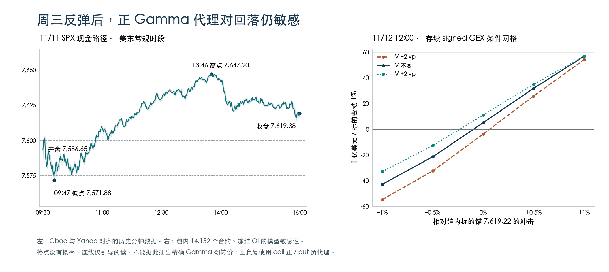

+++
title = "SPX期权持仓与Greeks结构分析-261111"
date = "2026-11-12"
data_as_of = ["2026-11-10", "2026-11-11"]
data_as_of_note = "D为11月11日、P为11月10日，目标日为11月12日；现金收盘、20:04:37 IV与20:07:12 XSP报价分别保留，次日事件与周五PPI按原文排期处理。"
draft = false
description = "反弹后下一日存续signed GEX转正但仍易变号；观察7600–7625承接与上侧恢复，保留两张条件研究卡及近端曲面限制。"
series = "SPX期权分析报告"
categories = ["衍生品", "市场结构"]
tags = ["SPX", "XSP", "Greeks", "GEX", "期权"]
featured = false
private = false
content_preservation = "verbatim"
source_sha256 = "11bc239a4308a30539230fa211eef7a3b827313b5b7218c4c8c519345c3dd146"
+++

# SPX期权持仓与Greeks结构分析-261111

## 1. 一句话结论

周三反弹后，下一日存续 signed GEX 转为 **+7.225 B USD/1%**，周四先观察 **7,600–7,625** 的承接与上侧恢复；但价格回落 0.5% 或原锚下 IV 降低 2 vp 就能使冻结 OI 模型转负，因此尚不能把这次转正当成稳定区间。

**盘后研究 B 级｜方向均衡、方向置信低｜XSP 有条件情景估值，保留两张条件研究卡｜目标日执行另行复核。**

## 2. T+1 Action Summary

| 项目 | 11 月 12 日观察与失效条件 |
| --- | --- |
| Base stance | 若仍在 7,600–7,625，则先观察承接与上侧恢复；净正总值不足以直接卖区间，离开核心后重定位。 |
| Earliest evaluation | 先核对 08:30 初请及实际开盘位置；10:00、12:00、13:00 有新信息时重评，原价格/IV 条件改变即失效。 |
| Base activation | 若 7,600 承接、重新取得 7,625 且位移延续，则研究 call debit；重新失守 7,600 或已越首区时取消旧候选。 |
| Downside branch | 若失守 7,600 且反抽不能恢复，则观察 7,580–7,575、研究 put debit；收复核心或已越首区时重估。 |
| Upside branch | 若继续越过 7,640–7,650，则复核 7,675 / 7,700；不沿用已封顶或位置失真的旧价差，回落核心则取消延伸判断。 |
| Otherwise | 若核心内来回、没有扩张或报价/IV 改变，则保留观察；不把等待变成卖波动或自动反手。 |

## 3. Executive Summary

- **周三已跳出前报核心带。** 现金指数开于 7,586.65，最低 7,571.88，最高 7,647.20，收于 7,619.38，较周二 +1.31%。前报 7,500–7,550 全日没有进入；旧节点应随实际位置重新安排。

- **转正有明确的范围分解。** 两张每日存续图从 −40.520 B 到 +7.225 B；其中移除旧图 11/11 到期层带来 +9.099 B，共同 15,716 个合约变化 +38.646 B。共同变化仍不是净开仓或净流入。

- **净正值不厚，期限也不一致。** 当前 PM +16.296 B、AM −9.072 B；12/31 PM 单层 +13.166 B，剔除这层后的其他期限合计仍为 −5.941 B。7,600 全期限节点偏负，7,625、7,650 偏正，不能只看总和。

- **冻结模型显示下侧更需复核。** 周四中午、IV 不变时，原锚 +5.236 B，−0.5% 为 −21.278 B，+0.5% 为 +32.054 B。这是给定假设下的敏感性，不是三种走势的概率。

- **IV 回落与近端质量限制同时存在。** VIX 从 19.46 降到 17.49；14D/30D 滚动 ATM 下降 1.502/1.105 vp，可作条件描述。11/12、11/13 的 SPXW PM smile 则继续仅供诊断，不能据此宣布 put 翼便宜或卖波动有利。

- **事件与时间决定策略比较的用途。** 周四 08:30 初请、10:00 住房数据/讲话、12:00 EIA、13:00 长债拍卖均需重新观察；Cisco 在周四盘后、PPI 在周五早晨。16 个真实 XSP 候选的 720 格条件估值已核对，但两张研究卡都只是 D 日参考腿。 [初请排期](https://oui.doleta.gov/unemploy/archive.asp) · [财政部](https://home.treasury.gov/news/press-releases/sb0678) · [Cisco 公告](https://newsroom.cisco.com/c/r/newsroom/en/us/a/y2026/m11/cisco-schedules-conference-call-for-q1-fiscal-year-2027-financial-results.html) · [BLS 日历](https://www.bls.gov/schedule/2026/11_sched.htm)

## 4. What Changed vs. T-1 and Prior Playbook Review

| 实质变化 / 口径 | 11/10 | 11/11 | 研究含义 |
| --- | --- | --- | --- |
| 现金 SPX / VIX | 7,520.93 / 19.46 | 7,619.38 / 17.49 | SPX +98.45 点、+1.31%；VIX −1.97 点。修复发生，但不能由 VIX 回落推断次日低波动。 |
| 共同合约 signed GEX | −31.421 B USD/1% | +7.225 B USD/1% | 同一 15,716 个合约变化 +38.646 B；PM +34.165 B，AM +4.481 B。 |
| 各日下一日存续 / 到期移除 | −40.520 B；含 11/11 层 −9.099 B | +7.225 B；不含 11/11 | 地图差 +47.744 B = 移除旧到期层 +9.099 B + 共同合约 +38.646 B；新出现 162 个合约 OI 为零。 |
| D7±2 gross GEX | 17.787 B USD/1% | 100.883 B USD/1% | 11/20 月度层进入 5–9 日桶，单该日期贡献 74.475 B；大增首先含桶成员变化。 |
| 总成交 / OI PCR | 4,702,744 / 1.3994 | 5,871,933 / 1.3983 | 成交量 +24.86%，成交 PCR 1.1263→1.0819；OI PCR 几乎不变。 |
| 同 11/12 到期 XSP 的 F−S | +3.5556 点（+0.4727%） | +0.1149 点（+0.0151%） | 本期报价平价远期靠近标的锚；模型不动情景到中午的远期变化缩为 −0.0918 点。 |

全链报告 OI 从 13,904,513 到 14,013,071，增加 108,558（0.78%），远小于 signed 暴露变化的尺度；这不构成把变动归因某一因子的实验。共同 cohort 的变化仍混合 spot、IV、时间、报告 OI 和供应商模型。11/11 到期层在 **周二** 快照为 −9.099 B，在 **周三** 快照却为 +18.623 B；做两张“下一日地图”的范围分解必须使用前者，后者则应从周四地图中移除。

### 前报复盘：收盘结果、价格路径与交易记录

**收盘结果。** 前报核心观察带为 7,500–7,550，上侧依次关注 7,575 / 7,600。周三开盘较前收高 65.72 点（0.87%），已越过旧带和首个上侧节点；收盘较前收高 98.45 点（1.31%）。全日低点也高于 7,550，不能把当天描述为“从旧核心带内完成确认后上涨”。 [带日期的 SPX 日线](https://query1.finance.yahoo.com/v8/finance/chart/%5EGSPC?period1=1794373200&period2=1794459600&interval=1d)

**盘中路径。** 分钟线按起始时刻列示：09:31 首次经过 7,600；随后回落，09:46 经过 7,575、09:47 达到 7,571.88 低点；午前回升，11:53 首次经过 7,620，12:00 首次经过 7,625，13:46 达到 7,647.20 日高，随后回落至 7,619.38。7,650 未触及。开盘就已越过部分旧节点，价格路径支持“先重定位”的要求，不能把每次触及直接算成策略触发。 [Cboe 分钟行情](https://cdn.cboe.com/api/global/delayed_quotes/charts/intraday/_SPX.json) · [Yahoo 分钟历史](https://query1.finance.yahoo.com/v8/finance/chart/%5EGSPC?period1=1794407400&period2=1794430980&interval=1m&includePrePost=false&events=history)

已取得 390 根常规分钟区间及单独的 16:00 收盘标记，并与 5 分钟数据聚合核对；Cboe 与 Yahoo 有 389 根可对齐分钟，OHLC 全部在 0.001 点内一致。重叠处采用 Cboe，其余使用带日期的 Yahoo 历史记录。这是事后价格复核，不是当时全市场状态的录像。

**交易记录。** 前报没有保留固定腿优先卡，本期也没有用户成交、当时局部结构及组合盘口，故不补造实际入场或盈亏。前报关键结论、六行摘要、观察地图和候选条件已与当时留存版本核对一致。

## 5. T 日盘面、字段时点与 Event-Risk Overlay

链内标的历史序列的 RV5 为 36.90%（前日 37.51%），RV10 为 28.99%（前日 28.10%）；按对数收益、总体标准差、252 日年化复算 RV5 一致。序列仅 20 个价格点，20 日收益窗口不足，RV20 保持不可用。它不是同步现金收盘序列，不能将 RV 高于近端模型 IV 直接判成可交易的波动率折价；SPY 跨资产模块仍因基线缺失不可用。

### 截至 cutoff 的事件边界

| 实际日期 / ET 时间 | 已核实日程或信息 | 对期限与观察的含义 | 来源 |
| --- | --- | --- | --- |
| 11/11 常规时段 | 现金指数反弹；固定收益假期背景 | 价格事实已发生；不能把反弹单因归给期权对冲 | [Cboe](https://cdn.cboe.com/api/global/delayed_quotes/charts/intraday/_SPX.json) / [SIFMA](https://www.sifma.org/news/press-releases/sifma-fixed-income-market-close-recommendation-in-the-u-s-the-u-k-and-japan-for-the-u-s-veterans-day-holiday-2026) |
| 11/11 收盘后至 cutoff | 本包晚间 SPX/XSP 报价、平价远期与结构 | 未采用 11/12 结果；未声称穷尽全部盘后消息 | 指定 formal 包 |
| 11/12 08:30 | 首次申领失业救济 | 先看开盘位置；结果和市场解读均未知 | [DOL/ETA 排期](https://oui.doleta.gov/unemploy/archive.asp) |
| 11/12 10:00 | 10 月成屋销售；Barr 讨论人工智能与不平等 | 增长/政策评论风险；讲话主题本身不等于利率指引 | [NAR](https://www.nar.realtor/research-and-statistics/housing-statistics/existing-home-sales) / [Fed](https://www.federalreserve.gov/newsevents/2026-november.htm) |
| 11/12 12:00 | EIA 周度石油库存，假期顺延 | 能源和通胀预期通道；中午模型格点不是事件后的真实价格 | [EIA 日历](https://www.eia.gov/petroleum/supply/weekly/schedule.php) |
| 11/12 13:00 | 250 亿美元 30Y 国债拍卖，11/16 结算 | 长端利率与权益久期；不预填中标收益率或需求强弱 | [11/04 财政部公告](https://home.treasury.gov/news/press-releases/sb0678) |
| 11/12 收市后；16:30 电话会 | Cisco FY2027 Q1 财报 | 11/12 PM 到期在事件前；11/13 到期包含该结果窗口。16:30 是电话会时间 | [11/03 公司公告](https://newsroom.cisco.com/c/r/newsroom/en/us/a/y2026/m11/cisco-schedules-conference-call-for-q1-fiscal-year-2027-financial-results.html) |
| 11/12 18:30 | Williams 参加 UC Berkeley Alumni Salon，有主持问答 | 盘后风险；官方正文为 18:30 EST，不能当作日内已发表观点 | [纽约联储日历](https://www.newyorkfed.org/press) |
| 11/13 08:30 | 10 月 PPI | 周五到期期权含此窗口，周四日内退出时仍含剩余事件溢价 | [BLS 日历](https://www.bls.gov/schedule/2026/11_sched.htm) |

已优先核实官方公告及日历。财政部、Cisco 与 SIFMA 有早于 cutoff 的公告日期；其他动态排期缺少精确首次发布时间或 cutoff 网页存档，内部记录保留 known_at=null 及依据，不伪造分钟级“当时可知”时间。这限制严格点时新闻回测，不等于已知日程不存在。

## 6. Decision Rationale — Analytical Bridge

### Thesis 1 · 反弹改善了存续代理，但净正值来自期限之间抵消。

**Claim / Evidence：** 共同 PM +34.165 B；当前 PM +16.296 B、AM −9.072 B，合计 +7.225 B；12/31 PM 单层 +13.166 B。

**Mechanism / Assumptions：** 仅在 call 正、put 负库存假设成立时，正值可对应逆向对冲；远期与近端并不承担相同的日内风险。 代理约定和快照持仓仍有解释力。

**Next-session implication：** 先研究 7,600–7,625 一带能否承接，再看 7,640–7,650；不能从总值正号直接建立卖波动区间。

**Falsifier / Confidence：** 7,600 失守且反抽无法恢复，或近端更新后由正转负。 状态数值高；dealer 机制与方向低；不是真实库存识别。

### Thesis 2 · 小幅回撤就足以破坏当前微正状态。

**Claim / Evidence：** 周四中午原锚/IV 不变 +5.236 B，−0.5% 为 −21.278 B，+0.5% 为 +32.054 B；原锚且 IV −2 vp 为 −3.525 B。

**Mechanism / Assumptions：** 冻结数量而重估 Greeks 后，合约相对价内外位置和波动率改变净暴露。 同一 14,152 合约、96.41% 合格 OI 样本。

**Next-session implication：** 下侧首查 7,600、7,580–7,575；上侧观察 7,625、7,640–7,650，分别重估 debit payoff。

**Falsifier / Confidence：** 目标日 OI/IV/spot/carry 与固定样本假设显著不同，或实时局部结构相反。 网格关系可复核；发生概率未知；无精确 Gamma flip；不是概率或流量。

### Thesis 3 · 较长局部期限支持波动率回落的描述，近端候选尚不支持翼部相对价值判断。

**Claim / Evidence：** 14D/30D 滚动 ATM −1.502/−1.105 vp，skew25 −0.234/−0.310 vp；11/12、11/13 两日权限都仅诊断。

**Mechanism / Assumptions：** 期限与 smile 的变化同时含老化、滚动和不同晚间时钟；近端拟合失败会污染偏度解释。 相同配置、方法、scope、delta 定义。

**Next-session implication：** XSP 只用自身真实单腿报价与条件模型比较时间损耗和宽度，不以 SPX skew 判便宜。

**Falsifier / Confidence：** 更可靠局部报价与重审结果改变近端权限或 XSP 自身平价关系。 14D/30D 条件描述；近端诊断；未证明统计显著或收益优势。

### Thesis 4 · 周四日内研究与周五到期期权的剩余事件风险必须分开。

**Claim / Evidence：** 周四有 08:30 初请、10:00 数据/讲话、12:00 油库存、13:00 长债拍卖；盘后 Cisco、Williams，周五 08:30 PPI。

**Mechanism / Assumptions：** 周五期权在周四退出时仍含尚未实现事件的时间价值；0DTE 更依赖当日及时位移。 默认 N 日内研究、无隔夜仓位假设。

**Next-session implication：** 时间拖延时比较 1DTE；未见扩张时保留观察，不因有事件就单买波动。

**Falsifier / Confidence：** 日程变更、风险已重新定价或持有计划变化。 排期可核；方向与事件方差未识别；平行 IV 冲击未刻画事件跳跃。

## 7. Conflicting Evidence, Confidence and What Changes the View

| 证据冲突 | 支持什么 / 削弱什么 | 处理与改变判断的条件 |
| --- | --- | --- |
| 价格反弹、VIX 下降；近端局部拟合不足 | 支持已发生的修复，不能支持近端翼部相对价值或卖波动优势 | 价格路径可用；近端 IV 只作诊断，XSP 单独核对报价和条件模型。 |
| 存续合计 +7.225 B；AM −9.072 B，12/31 PM +13.166 B | 总和变正，期限之间仍有抵消 | 拆开周四/周五、AM/PM 和远端；目标日近端结构变化才有针对性地改变地图。 |
| 冻结原锚 +5.236 B；−0.5% 转为 −21.278 B | 当前正值并非宽幅稳定的缓冲 | 失守 7,600 后先查 7,580–7,575；不得把总正值当确定支撑。 |
| 7,650 正节点与日高邻近；价格未触及 7,650 | 可能在该区减速，也可能被新信息越过 | 只能作为复核区；突破、回落分别重估，不能预设必被压制。 |
| XSP 全部模型格点数值有效；近端 SPX 曲面不合格 | 支持给定假设的局部收益几何比较 | 不能由此升级 SPX source tier，不能把数值有效当成可成交或预测有效。 |
| 周五期权更有时间；周五还含更多事件 | 能缓和时间消耗，也会增加剩余 IV 风险 | 按同一周四退出时点比较，不以到期最大利润替代周四价值。 |

事实可复核程度较高；机制推断依赖库存代理和冻结样本，方向置信低；尚无独立样本外预测或收益验证（mechanism_only / not_tested）。**方向论点失效**、**候选因价格或 IV 改变需重估**、**执行报价不满足**是三件不同的事。后两者不自动证明反向走势。

## 8. IV Term Structure, Skew and Surface

### 质量、来源与可比性

本期有 29 个正剩余期限 PM 到期：18 个约束拟合、8 个修复拟合、3 个旧法回退。旧法占比 **10.34%**，略高于 **10%** 门槛，是本期全局 partial 的声明原因。它是方法选择比例，不是坏报价比例。整体价格拟合覆盖 **80.74%**、耦合后 **77.66%**；拟合 call 关于 strike 的单调性、凸性及非负密度通过率均 **93.10%**，calendar/Lee 检查均 100%；最大密度归一化误差 0.01418。观测支持占比 **87.40%**，支持分数不是胜率或误差置信区间。AM 曲面样本不足，不影响对已有 AM vendor Gamma 的独立汇总。

| 到期 / PM | 选中方法 | 局部价格拟合 | 正式单调 / 凸 / 密度 | 观测格点附加检查 | 本期用途 |
| --- | --- | --- | --- | --- | --- |
| 11/12 | 约束 | 49.06% | 过 / 过 / 过 | 未过 / 过 / 过 | 仅诊断 |
| 11/13 | 旧法回退 | 41.24% | 未过 / 未过 / 未过 | 未过 / 过 / 过 | 仅诊断 |
| 11/18 | 修复 | 32.48% | 过 / 过 / 过 | 过 / 过 / 过 | 仅诊断 |
| 11/25 | 修复 | 94.81% | 过 / 过 / 过 | 过 / 过 / 过 | 条件描述 |
| 12/11 | 约束 | 92.90% | 过 / 过 / 过 | 过 / 过 / 过 | 条件描述 |

11/12 虽通过正式形状检查，局部价格拟合仅 49.06%，且观测格点的 call 单调性未过；11/13 局部拟合 41.24%，旧法全局形状三项未过。11/13 在已观测 strike 范围内还记录了约 8,093→8,174 等高执行价段的拟合 call 价格反增。11/17 同样存在旧法形状失败；近 7D 的 11/18 虽形状通过，拟合仅 32.48%。这些失败限制对应期限的偏度/曲率解释，不代表所有期限无效。清洗报价区间的必要邻接条件未检出矛盾，也不证明完整可行、可交易套利或供应商有错。

### ATM：共同实际到期优先

| 实际到期 | τ：P→D（日） | P ATM | D ATM | Δ D−P | basis / 权限 | method / local quality | 事件 / 结算 |
| --- | --- | --- | --- | --- | --- | --- | --- |
| 11/12 | 1.8043→0.8301 | 17.013% | 15.153% | −1.859 vp | 同到期 ATM；仅诊断 | 约束 / 拟合 43.67% / 仅诊断 → 约束 / 拟合 49.06% / 仅诊断 | 周四 PM；含日内数据/拍卖 |
| 11/13 | 2.8043→1.8301 | 17.947% | 15.994% | −1.953 vp | 同到期 ATM；仅诊断 | 旧法回退 / 拟合 34.85% / 仅诊断 → 旧法回退 / 拟合 41.24% / 仅诊断 | 周五 PM；含周四盘后与 PPI |
| 11/16 | 5.8043→4.8301 | 14.332% | 11.679% | −2.653 vp | 同到期 ATM；仅诊断 | 旧法回退 / 拟合 20.59% / 仅诊断 → 约束 / 拟合 24.56% / 仅诊断 | 跨周末至周一 PM |
| 11/18 | 7.8043→6.8301 | 15.306% | 13.480% | −1.826 vp | 同到期 ATM；仅诊断 | 修复 / 拟合 80.59% / 条件描述 → 修复 / 拟合 32.48% / 仅诊断 | 周三 PM |
| 11/25 | 14.8043→13.8301 | 14.809% | 13.240% | −1.569 vp | 同到期 ATM；条件描述 | 修复 / 拟合 97.21% / 条件描述 → 修复 / 拟合 94.81% / 条件描述 | 感恩节前周三 PM |
| 12/11 | 30.8043→29.8301 | 14.947% | 13.762% | −1.185 vp | 同到期 ATM；条件描述 | 约束 / 拟合 90.71% / 条件描述 → 约束 / 拟合 92.90% / 条件描述 | 周五 PM |

ATM 为包内 forward-ATM：k=ln(K/F)=0，使用上游在 k 方向的总方差线性插值（linear_total_variance_in_k_at_zero）；报告没有重做插值。Smile 使用不作权利金调整的 forward delta。共同实际到期变化为 same_expiry_atm。两日估值分别为 11/10 20:41:45 与 11/11 20:04:37，相隔 **23 小时 22 分 52 秒（0.974213 日）**。差值包含老化、市场重定价和模型变化，不能称同步收盘的纯市场冲击。

### 包内固定期限 ATM：保留原生 τ 与 bracket

| 目标期限 | P 来源 / 实际 τ / 权重 | D 来源 / 实际 τ / 权重 | ATM：P→D | Δ D−P | method / quality |
| --- | --- | --- | --- | --- | --- |
| 3D | 11/13 / τ 2.8043 / 原生近邻 | 11/13–11/16 / τ 1.8301–4.8301 / w=0.3900 | 17.947% → 13.447% | −4.500 vp | fixed_tenor_atm；仅诊断，局部质量不足 |
| 7D | 11/17 / τ 6.8043 / 原生近邻 | 11/18 / τ 6.8301 / 原生近邻 | 14.409% → 13.480% | −0.929 vp | fixed_tenor_atm；仅诊断，局部质量不足 |
| 14D | 11/24 / τ 13.8043 / 原生近邻 | 11/25 / τ 13.8301 / 原生近邻 | 14.741% → 13.240% | −1.502 vp | fixed_tenor_atm；条件描述 |
| 30D | 12/10 / τ 29.8043 / 原生近邻 | 12/11 / τ 29.8301 / 原生近邻 | 14.867% → 13.762% | −1.105 vp | fixed_tenor_atm；条件描述 |
| 45D | 12/24–12/31 / τ 43.8043–50.8043 / w=0.1708 | 12/24–12/31 / τ 42.8301–49.8301 / w=0.3100 | 14.868% → 13.753% | −1.115 vp | fixed_tenor_atm；仅诊断，时钟不一致 |

原生 observed 节点采用距目标期限不超过 0.25 日的实际到期 τ，并非强制改成整日；interpolated 节点才按包内总方差插值使用目标 τ，w 为上端期限权重。3D 从周五原生近邻换成周五—周一 bracket，同时跨过周末，其 −4.500 vp 不可直接称事件风险消失。7D 也仅诊断。45D 两日均涉及 12/24，包内到期时钟为 16:00 ET，已核实交易日历为 13:00 ET，差 0.125 日；11/27 也有同类问题。原包数值未改，相关期限降为诊断；本期 11/12 与 11/13 候选不受这项提前收市问题影响。

### Selected-expiry smile：P 水平、D 水平及变化

| 期限/用途/行类型 | 到期日 / τ（日） | 10Δ put | 25Δ put | ATM | 25Δ call | 10Δ call | Downside skew25 | BF25 | 比较基础 / method / quality |
| --- | --- | --- | --- | --- | --- | --- | --- | --- | --- |
| 7D 背景 / P 水平 | 11/17 / 6.8043 | 19.042% | 16.494% | 14.409% | 12.941% | 12.041% | 2.085 vp | 0.308 vp | 修复 / 拟合 40.17% / 仅诊断 |
| 7D 背景 / D 水平 | 11/18 / 6.8301 | 18.486% | 15.609% | 13.480% | 12.011% | 11.130% | 2.129 vp | 0.330 vp | 修复 / 拟合 32.48% / 仅诊断 |
| 7D 背景 / Δ D−P | 11/17→11/18 | −0.556 vp | −0.884 vp | −0.929 vp | −0.930 vp | −0.911 vp | +0.044 vp | +0.021 vp | rolling_tenor_slot_fixed_delta；仅诊断，不作市场形状变化判断 |
| 14D 背景 / P 水平 | 11/24 / 13.8043 | 21.240% | 17.472% | 14.741% | 12.844% | 11.827% | 2.731 vp | 0.417 vp | 修复 / 拟合 64.95% / 条件描述 |
| 14D 背景 / D 水平 | 11/25 / 13.8301 | 19.373% | 15.736% | 13.240% | 11.608% | 10.817% | 2.497 vp | 0.433 vp | 修复 / 拟合 94.81% / 条件描述 |
| 14D 背景 / Δ D−P | 11/24→11/25 | −1.867 vp | −1.736 vp | −1.502 vp | −1.236 vp | −1.010 vp | −0.234 vp | +0.016 vp | rolling_tenor_slot_fixed_delta；条件描述，非相对价值结论 |
| 30D 背景 / P 水平 | 12/10 / 29.8043 | 23.137% | 18.208% | 14.867% | 12.806% | 11.978% | 3.341 vp | 0.639 vp | 约束 / 拟合 88.72% / 条件描述 |
| 30D 背景 / D 水平 | 12/11 / 29.8301 | 21.437% | 16.793% | 13.762% | 12.055% | 11.421% | 3.031 vp | 0.662 vp | 约束 / 拟合 92.90% / 条件描述 |
| 30D 背景 / Δ D−P | 12/10→12/11 | −1.700 vp | −1.415 vp | −1.105 vp | −0.751 vp | −0.557 vp | −0.310 vp | +0.022 vp | rolling_tenor_slot_fixed_delta；条件描述，非相对价值结论 |

三个背景槽位的两日实际到期均不同；两包未同时输出这些实际到期的完整 delta-smile，故按相同选择规则匹配约 7/14/30D 槽位，使用 rolling_tenor_slot_fixed_delta。实际 τ 约从 6.8043/13.8043/29.8043 到 6.8301/13.8301/29.8301 日，不能称同合约变化。已有同到期 ATM 则保留在上表，不为了配 smile 而删除。

### 候选自身到期 smile：与期限背景分开

| 期限/用途/行类型 | 到期日 / τ（日） | 10Δ put | 25Δ put | ATM | 25Δ call | 10Δ call | Downside skew25 | BF25 | 比较基础 / method / quality |
| --- | --- | --- | --- | --- | --- | --- | --- | --- | --- |
| 11/12 候选 / P 水平 | 11/12 / 1.8043 | 20.796% | 18.791% | 17.013% | 15.415% | 14.322% | 1.778 vp | 0.090 vp | 约束 / 拟合 43.67% / 仅诊断 |
| 11/12 候选 / D 水平 | 11/12 / 0.8301 | 20.103% | 17.498% | 15.153% | 13.795% | 12.696% | 2.344 vp | 0.493 vp | 约束 / 拟合 49.06% / 仅诊断 |
| 11/12 候选 / Δ D−P | 11/12→11/12 | −0.694 vp | −1.293 vp | −1.859 vp | −1.619 vp | −1.626 vp | +0.566 vp | +0.403 vp | same_expiry_fixed_delta；仅诊断，不作市场形状变化判断 |
| 11/13 候选 / P 水平 | 11/13 / 2.8043 | 22.370% | 19.863% | 17.947% | 16.615% | 15.938% | 1.916 vp | 0.292 vp | 旧法回退 / 拟合 34.85% / 仅诊断 |
| 11/13 候选 / D 水平 | 11/13 / 1.8301 | 21.146% | 18.173% | 15.994% | 14.563% | 13.760% | 2.179 vp | 0.375 vp | 旧法回退 / 拟合 41.24% / 仅诊断 |
| 11/13 候选 / Δ D−P | 11/13→11/13 | −1.224 vp | −1.690 vp | −1.953 vp | −2.052 vp | −2.178 vp | +0.263 vp | +0.082 vp | same_expiry_fixed_delta；仅诊断，不作市场形状变化判断 |

候选 11/12 与 11/13 两日都有五个原生节点，故用 same_expiry_fixed_delta，不借其他期限填翼；二者均采用两日较严格的“仅诊断”权限。固定 delta 不代表固定 strike。所有表中 skew25 = put25−ATM，BF25 = (put25+call25)/2−ATM，及其跨日差值均是 **来自 packet 节点的报告层算术**；BF25 是 smile 曲率概括指标，不是蝶式组合价格或利润。

**水平：** 14D/30D 背景 ATM 分别下降 1.502/1.105 vp，允许在滚动限制下描述波动水平回落。近端 ATM 数值也下降，但局部诊断权限不支持升级为可靠市场定价变化。**倾斜：** 14D/30D 的 downside skew25 分别下降 0.234/0.310 vp，体现 put25 相对 ATM 的模型溢价缩小；7D 的 +0.044 vp 与候选期限的 +0.566/+0.263 vp 只作诊断。**曲率：** 14D/30D BF25 仅增加 0.016/0.022 vp，是很小的模型数值差异，经济意义未证实；没有误差校准，不能宣称显著，也不能声称已证明处于误差范围。

**老化、滚动与用途：** 共同到期也包含 τ 缩短，背景表还包含到期滚动和不同晚间时钟。事件窗口可帮助解释期限差异，但未分离出纯事件方差。结果支持在同情景下比较 XSP 支出、时间消耗与截断尾部的代价，不能用近端 skew/BF 直接判断便宜、昂贵或收益优势。

## 9. Key Expiry / Strike / Dealer Node

本次采集期限设为 **60 个日历日**，原始链 16,452 行、OI 14,013,071，实际最远至 2027/01/08。旧过滤层 13,240 行、OI 8,172,798，仅占原始 OI **58.32%**，不拿它代表完整链。下一日存续地图有 **15,878 个合约、7,939 个到期×家族×strike 节点**，存续 OI 13,644,515；合格样本内 OI 覆盖 100%、合格 Gamma 汇总覆盖 100%，完整性只相对于已采集的快照，不是全部上市期限。

存续 gross **381.542 B USD/1%**，signed **+7.225 B USD/1%**。展示窗口为链内 spot ±3%，即 7,390.64–7,847.80，覆盖全存续 gross 的 **68.28%**；其余在窗口外。旧 selected gamma 表剔除当日到期后只含 11/12、11/20、12/18，gross 为 **261.438 B**，约占全存续 **68.52%**；选中表和展示窗口是两种分母，不可相加或把覆盖差异当迁移。

| 到期 / 家族 | gross B USD/1% | signed B USD/1% | 占全存续 gross |
| --- | --- | --- | --- |
| 11/11 PM（已到期，排除） | 31.719 | +18.623 | 不进入周四分母 |
| 11/12 PM / SPXW | 11.861 | +2.804 | 3.11% |
| 11/13 PM / SPXW | 26.616 | +4.914 | 6.98% |
| 11/20 AM / SPX | 59.863 | −7.813 | 15.69% |
| 11/20 PM / SPXW | 14.611 | −1.894 | 3.83% |
| 12/18 AM / SPX | 169.248 | −1.258 | 44.36% |
| 12/18 PM / SPXW | 5.854 | −0.842 | 1.53% |
| 12/31 PM / SPXW | 26.874 | +13.166 | 7.04% |

AM 与 PM 分行后不可再叠加 same_date_combined。11/12 和 11/13 两个 PM 层合计 gross 38.477 B、signed +7.718 B，约占存续 gross 10.08%；12/18 AM+PM 合计 gross 175.102 B、占 45.89%，它仍是暴露体量最大的日期，但其 net 仅 −2.101 B，不能由体量最大推导当天方向。AM 是否仍可交易遵循项目“到期前一交易日 17:00 最后可交易”的约定，未将其当成 PM 结算。

### 关键 strike：总期限与周四子集拆开

| SPX strike | 全存续 gross / B | 全存续 signed / B | 11/12 PM gross / B | 11/12 PM signed / B |
| --- | --- | --- | --- | --- |
| 7,500 | 13.664 | −4.444 | 0.148 | −0.033 |
| 7,550 | 7.997 | −0.819 | 0.318 | +0.046 |
| 7,575 | 3.662 | −0.210 | 0.179 | +0.002 |
| 7,580 | 2.522 | −0.791 | 0.277 | +0.127 |
| 7,600 | 18.428 | −2.339 | 1.557 | −0.212 |
| 7,620 | 1.994 | +0.327 | 0.413 | +0.325 |
| 7,625 | 4.588 | +0.424 | 0.465 | +0.015 |
| 7,640 | 2.877 | +0.534 | 0.703 | +0.601 |
| 7,650 | 15.494 | +1.637 | 0.924 | +0.090 |
| 7,675 | 5.192 | +0.670 | 0.222 | +0.084 |
| 7,700 | 27.343 | +3.440 | 0.416 | +0.114 |

本表全部是 B USD/1%。7,640 的周四子集 signed **+0.601 B**，全期限合计 **+0.534 B**；7,650 的全期限 **+1.637 B** 又主要受周五等其他期限影响。7,600 全期限 **−2.339 B**，其中周四只有 **−0.212 B**，因此不同持有期限不能共用一张不分层的“墙”。

尤其不能沿用旧 selected 表的 **7,620 巨大 call 墙**：该位置 selected gross 24.696 B 中，**23.638 B 来自 11/11 已到期层**，约 95.71%；剔除后，全期限存续 gross 只有 1.994 B、signed +0.327 B，周四子集 gross 0.413 B。保留这个节点用于定位可以，称其为周四同等强度的价格磁铁则不成立。

### 冻结 OI：在同一个模型样本内看敏感性

冻结 OI 指：**保持最近可得的各合约 OI 数量及 signed 约定不变，改变价格、时间和 IV，重估存续合约的 Gamma 暴露。** 最近可得 OI 不等于已确认的周三最终 OI；冻结的也不是 IV 或 Greeks。本包采用 Black-76、sticky-strike、平行 IV 冲击和固定 carry，14,152 个共同有效合约覆盖合格 OI **96.41%**，其中 12,324 个使用同 scope 远期，1,828 个为利率回退。

| 周四 12:00 spot 冲击 | 对应 SPX 模型标的 | IV −2 vp / signed B | IV 不变 / signed B | IV +2 vp / signed B |
| --- | --- | --- | --- | --- |
| −1.0% | 7,543.03 | −54.658 | −42.780 | −32.825 |
| −0.5% | 7,581.12 | −32.375 | −21.278 | −12.621 |
| +0.0% | 7,619.22 | −3.525 | +5.236 | +11.304 |
| +0.5% | 7,657.32 | +26.073 | +32.054 | +35.172 |
| +1.0% | 7,695.41 | +54.405 | +57.058 | +57.016 |

原锚且 IV 不变时，模型总值从 10:00 的 +4.993 B，到 12:00 的 +5.236 B、15:00 的 +5.750 B；中午 PM 为 +15.331 B、AM −10.094 B。原锚下仅改变 IV，符号也可从 −3.525 B 到 +11.304 B。下跌 0.5% 的三个 IV 格点都为负，上涨 0.5% 的三个格点都为正，说明对价格位置敏感；没有给这些格点赋概率，也不在格点间插出精确 Gamma flip。供应商地图的 +7.225 B 与模型 +5.236 B 使用不同估值时点、模型与覆盖，不能相减解释成资金流。

### DEX、Vanna、Charm 与 Volga：不同敏感度的交叉检查

| 口径 | gross GEX / B USD/1% | DEX / B USD | Vanna 的 DEX 差 / B USD | Charm 的 DEX 差 / B USD | Volga 的 Vega 暴露差 / B |
| --- | --- | --- | --- | --- | --- |
| ALL_EXCL_0DTE | 381.542 | +482.640 | +16.110 | +1.481 | +25.257 |
| D30±3 | 2.764 | +0.300 | −0.405 | +0.219 | +0.344 |
| D7±2 | 100.883 | +13.286 | +0.448 | +1.713 | +2.407 |
| LE3D | 70.196 | +48.207 | +0.049 | +0.785 | +0.195 |

DEX 按供应商数学 delta×spot×100×OI 汇总，put 的 delta 自带负号，不额外套用 signed Gamma 的 put 负号。全存续 DEX 从前日 −98.434 B 到 +482.640 B，既受相对价内外位置变化也受样本和 OI 影响，不能称新增 581.074 B 买盘。

本项目高阶字段是有限差分敏感度：Vanna 为 IV 从 σ−0.5 vp 到 σ+0.5 vp 的 DEX 差；Charm 为固定 spot/IV 等假设下、下一交易日参考时刻的 DEX 减当前 DEX；Volga 为同一 IV 区间的 Vega 美元暴露差，底层 Vega 按每 1.00 IV 的导数单位计量。它们不是三笔可相加的现金流，也不是上调 1 vp 的期权盈亏。全存续 Vanna 正值与 D30 桶负值并存，说明期限响应不同；全存续 Charm +1.481 B 不证明 dealer 明天必买入。

D7±2 桶本期纳入 11/20（月度到期由 DTE10 滚至 DTE9），gross 的大增首先包含成员变化；LE3D 的 70.196 B 含已到期 11/11 的 31.719 B，不能整桶当作周四存续。桶 ATM/skew 是既有聚合口径，不替代第 8 节正式 forward-ATM / fixed-delta 节点。

## 10. Next-Day Observation Map and Research Grade

下列区域来自存续节点位置与周三实际价格路径，是观察地图，不是统计置信区间或保证支撑/压力；Base 表示先研究哪条路径，不代表最高概率。

| 场景 / 开盘位置 | EOD 依据 | 观察条件 | 研究含义 | 首个复核区 | 失效 / 重建条件 |
| --- | --- | --- | --- | --- | --- |
| 开在 7,600–7,625 内 | 现金收盘 7,619.38；下负上正节点相邻 | 观察 7,600 承接与 7,625 的重新取得；只触及不算确认 | 等待方向信息；有持续位移再比较 debit 家族 | 上 7,625 / 下 7,600 | 跌离或跳过两端；原核心判断停止 |
| 下破 7,600 后延续 | 7,600 全期限 −2.339 B；−0.5% 冻结模型转负 | 反抽不能恢复 7,600，且负侧结构未被新快照推翻 | 研究 put debit 与单买 put 的成本/尾部差异 | 7,580–7,575，再 7,550 | 收复 7,600 并恢复核心；已跌过首区则重选腿 |
| 恢复 7,625 并向上 | 7,640 周四子集正节点、7,650 全期限 +1.637 B | 上移能延续，回落不重新失守核心；事件后重新核对 | 研究 call debit；正 Gamma 也可能使上行减速 | 7,640–7,650，再 7,675 | 回落到 7,600 下侧；或已越 7,650 后仍照抄旧腿 |
| 开盘已越 7,650 或低于 7,575 | 前日已有显著 gap 跳过旧地图；短腿位置会改变 | 先定位实际价格，核对剩余可研究距离 | 取消固定参考腿，重新选择 strike、期限及风险 | 上 7,675 / 7,700；下 7,550 / 7,500 | 未获更新报价和结构时保留观察 |
| 08:30 / 10:00 / 12:00 / 13:00 信息改变价格或 IV | 初请、住房、央行讲话、EIA、长债拍卖 | 结果公布后对照利率、价格、IV；不提前填入结果 | 重新估值；必要时切换到更长到期研究，但不自动持隔夜 | 实际所在节点及已有候选的长短腿 | 消息方向与原论点相反、偏度扭转或超出模型网格 |
| 下午仍在核心内、没有扩张 | 0DTE 中午到下午不动损失加大 | 价格没有完成研究所需位移 | 暂不保留 0DTE 方向优先；比较周五时间缓冲或观察 | 7,600 / 7,625 与实际剩余时长 | 出现新的方向位移须另立论点，不能以亏损倒推方向 |

每条路径需使用实际 SPX 价格、更新局部结构、XSP 报价及官方事件信息；本报告没有确认任何目标日实时条件。未设未经校准的固定等待分钟数或“两根五分钟线”硬门槛。

**研究等级：B。** 基础 formal、完整存续地图、同 cohort、事件排期、XSP 局部情景及主要反证已完成；影响本期结论的实质缺口如下。

| 缺口 | 影响的判断 | 替代办法 | 剩余影响 |
| --- | --- | --- | --- |
| 11/12 与 11/13 的 SPXW PM 局部拟合/形状不足；近 7D 也仅诊断 | 近端偏度、曲率、0DTE/1DTE 相对定价与事件方差无法作可靠市场解释 | 保留原节点诊断算术；14D/30D 作条件描述，XSP 用自身报价模型比较 | 不能据此给近端便宜/昂贵判断或经验证的优先收益排序 |
| 11/27 与 12/24 正式 IV 仍用 16:00，交易日历为 13:00 | 45D 的 12/24 插值端点、对应到期时间解释 | 不改 packet，不重拟合；标注受影响行仅诊断 | 时间差 0.125 日未在报告层修复；不影响本期 11/12、11/13 正常 PM 到期时钟 |

B 的主要依据是候选附近期限的局部 IV 质量不足，导致近端市场形状与相对定价解释无法闭合；45D 时钟差异另作限定。方向不明确、没有经验证的 alpha、未来盘口未产生、实际账户预算未知，都没有被单独当作降级理由。两张条件研究卡保留的是可复核的局部比较，不改变这项质量限制。

## 11. XSP Strategy Research and Scenario Valuation

### Strategy-Family Screening Summary

| 情景 | 家族 | 结构适配 | IV / 期限依据 | 定价覆盖 | 状态 / 原因 |
| --- | --- | --- | --- | --- | --- |
| 下侧延续 | 看跌 debit vertical | 条件保留 | 2 点宽节省成本，5 点宽保留下行距离；近端 SPX skew 仅诊断 | 真实 XSP + 2/5 点模型 | 条件研究；对应失守 7,600 后的有限下行；短腿会封顶 |
| 上侧延续 | 看涨 debit vertical | 条件保留 | 0DTE 要求较快位移；1DTE 缓冲时间但含后续事件 | 真实 XSP + 2/5 点模型 | 条件研究；对应收复 7,625 后观察 7,640–7,650 |
| 较大单向扩张 | 单买 call / put | 保留作对照 | 更高支出与时间/IV 敏感度 | 真实单腿与模型 | 对照而非首选；±1% 格点尾部弹性更高，但不动与反向损失更大 |
| 固定中心收敛 | Defined-risk iron butterfly | 不优先 | 缺乏稳定 pin 与可靠近端翼定价 | 无本家族组合网格 | 适配分析；未估值；净正总值不足以证明收敛中心 |
| 双侧有限区间 | Iron condor | 不优先 | 事件和回落会改变 signed 符号 | 无本家族网格 | 适配分析；未估值；不能把节点带当概率区间 |
| 偏向有限移动 | Broken-wing butterfly | 暂不保留 | 尤其依赖 strike/翼报价一致性 | 无组合估值 | 无法完成定价比较；尾侧风险与中间节点收益尚无可比组合成本 |
| 双向大波动 | Straddle / strangle | 不优先 | 要覆盖双边时间成本；事件存在不等于移动超支出 | 有单腿参考，无正式双边候选网格 | 适配分析；未估值；没有事件方差或盈亏平衡突破优势证据 |
| 期限价值变化 | Calendar / diagonal | 暂不保留 | 不同到期含 Cisco/PPI；非纯时间价差 | 无跨期组合模型 | 无法完成定价比较；默认只研究周四日内，缺少期限收敛和 skew 动态依据 |

### Local Candidate Comparison

| 简称 | 到期 / 目标日 DTE | 参考腿（买前卖后） | 合成 bid / ask 点 | 含费最大损失 $ | 到期最大利润 $ | 含费到期平衡 |
| --- | --- | --- | --- | --- | --- | --- |
| 0DC单买 | 11/12 PM / 0D | 762C | 2.08 / 2.20 | 223.00 | 无上限 | 764.23 |
| 0DCW2 | 11/12 PM / 0D | 762/764C | 0.79 / 1.05 | 111.00 | 89.00 | 763.11 |
| 0DCW5 | 11/12 PM / 0D | 762/767C | 1.61 / 1.81 | 187.00 | 313.00 | 763.87 |
| 0DP单买 | 11/12 PM / 0D | 762P | 2.07 / 2.25 | 228.00 | 75,972.00 | 759.72 |
| 0DPW2 | 11/12 PM / 0D | 762/760P | 0.56 / 0.91 | 97.00 | 103.00 | 761.03 |
| 0DPW5 | 11/12 PM / 0D | 762/757P | 1.25 / 1.58 | 164.00 | 336.00 | 760.36 |
| 1DC单买 | 11/13 PM / 1D | 762C | 3.19 / 3.35 | 338.00 | 无上限 | 765.38 |
| 1DCW2 | 11/13 PM / 1D | 762/764C | 0.88 / 1.21 | 127.00 | 73.00 | 763.27 |
| 1DCW5 | 11/13 PM / 1D | 762/767C | 1.92 / 2.28 | 234.00 | 266.00 | 764.34 |
| 1DP单买 | 11/13 PM / 1D | 762P | 3.00 / 3.17 | 320.00 | 75,880.00 | 758.80 |
| 1DPW2 | 11/13 PM / 1D | 762/760P | 0.59 / 0.96 | 102.00 | 98.00 | 760.98 |
| 1DPW5 | 11/13 PM / 1D | 762/757P | 1.38 / 1.70 | 176.00 | 324.00 | 760.24 |

0DC单买、0DP单买的候选 ID 分别为 XSP261112C00762000、XSP261112P00762000；0DCW2 为 XSP261112C00762000__XSP261112C00764000，0DPW2 为 XSP261112P00762000__XSP261112P00760000。5 点宽 ID 完整列于研究卡；1D 行的对应 ID 将日期改为 261113，其他腿相同。其余四个 760 单买候选保留在原始候选清单，未伪装成已穷尽全部报价。

到期几何已含费用：双腿最大损失 = 100d+C，最大利润 = 100(W−d)−C；call 平衡为低 strike+d+C/100，put 为高 strike−d−C/100。单买 put 的表列最大利润是标的跌至零的理论端点，不是现实目标。周五期权在周四退出尚未到期，不能用该列替代周四模型价值。0D 单买 762C/P 的最大损失 223/228 美元，1D 为 338/320 美元，后者超过 300 美元研究假设，只能说明对这个假设预算不适配。

以下 **PnL 均为假设在 D 日参考 ask 支出下构建、未来按模型退出并扣除费用摩擦的一组美元比较值**，没有假设真实成交、隔夜持仓或目标日同价入场。正负移动均相对各自 XSP 标的锚 761.94：±0.5% 对应 758.1303 / 765.7497。

### 同一情景的 看涨侧 比较：0DTE

| 周四时点 / spot 冲击 / IV 冲击 | 0DC单买 | 0DCW2 | 0DCW5 |
| --- | --- | --- | --- |
| 10:00 / +0.0% / +0 vp | −110.21 | −39.25 | −79.93 |
| 12:00 / +0.0% / +0 vp | −132.07 | −45.84 | −99.06 |
| 15:00 / +0.0% / +0 vp | −180.28 | −71.99 | −146.28 |
| 12:00 / +0.0% / −2 vp | −145.06 | −50.58 | −111.33 |
| 12:00 / −0.5% / +0 vp | −219.79 | −110.19 | −185.79 |
| 12:00 / −0.5% / −2 vp | −222.63 | −111.00 | −187.00 |
| 12:00 / +0.5% / +0 vp | +158.03 | +61.41 | +150.35 |
| 12:00 / +0.5% / −2 vp | +154.96 | +67.60 | +158.28 |
| 12:00 / −1.0% / +0 vp | −223.00 | −111.00 | −187.00 |
| 12:00 / +1.0% / +0 vp | +533.31 | +84.44 | +294.75 |

### 同一情景的 看跌侧 比较：0DTE

| 周四时点 / spot 冲击 / IV 冲击 | 0DP单买 | 0DPW2 | 0DPW5 |
| --- | --- | --- | --- |
| 10:00 / +0.0% / +0 vp | −108.56 | −31.35 | −58.00 |
| 12:00 / +0.0% / +0 vp | −130.03 | −34.70 | −72.41 |
| 15:00 / +0.0% / +0 vp | −178.18 | −52.99 | −116.19 |
| 12:00 / +0.0% / −2 vp | −143.02 | −38.33 | −83.15 |
| 12:00 / −0.5% / +0 vp | +160.81 | +68.98 | +159.26 |
| 12:00 / −0.5% / −2 vp | +157.65 | +75.49 | +167.83 |
| 12:00 / +0.5% / +0 vp | −223.26 | −95.46 | −161.33 |
| 12:00 / +0.5% / −2 vp | −226.66 | −97.00 | −164.00 |
| 12:00 / −1.0% / +0 vp | +535.69 | +97.76 | +306.42 |
| 12:00 / +1.0% / +0 vp | −228.00 | −97.00 | −164.00 |

**顺向与宽度。** 中午上涨 0.5%、IV 不变，单买 call / 2 点宽 / 5 点宽分别 +158.03 / +61.41 / +150.35 美元；下跌 0.5% 的 put 对应 +160.81 / +68.98 / +159.26。单买与 5 点宽的差距仅 7.68 / 1.55 美元，相对本期 bid/ask 与组合摩擦不足以形成可信排序。达到 ±1% 的延伸时，单买保留更多尾部，vertical 则封顶；同时单买的最大损失也更高。

**不动、反向和 IV。** 原锚下从 10:00 拖到 15:00，0DCW5 假设损失由 −79.93 扩大至 −146.28 美元，0DPW5 由 −58.00 到 −116.19；反向 0.5% 时分别接近最大损失。相同顺向 0.5% 下，IV −2 vp 会降低单买价值，却可抬高已较价内的 vertical 净值：call 单买从 +158.03 降为 +154.96，5 点宽从 +150.35 升为 +158.28。这个数值上的排序反转来自两腿相对响应，不能概括成“IV 下降总利好价差”；微小差异仍不足以排序。

### 同为周四退出：0DTE 与 1DTE

| 家族；每格为 0D / 1D PnL $ | 12:00 不动 / IV=0 | 15:00 不动 / IV=0 | 12:00 顺向 0.5% / IV=0 | 同移动 / IV −2 vp |
| --- | --- | --- | --- | --- |
| C单买 | −132.07 / −81.56 | −180.28 / −96.41 | +158.03 / +156.26 | +154.96 / +128.60 |
| CW2 | −45.84 / −32.37 | −71.99 / −33.84 | +61.41 / +14.02 | +67.60 / +18.93 |
| CW5 | −99.06 / −48.40 | −146.28 / −53.75 | +150.35 / +70.37 | +158.28 / +76.63 |
| P单买 | −130.03 / −72.88 | −178.18 / −86.00 | +160.81 / +158.71 | +157.65 / +130.51 |
| PW2 | −34.70 / −28.03 | −52.99 / −28.08 | +68.98 / +18.32 | +75.49 / +23.07 |
| PW5 | −72.41 / −29.76 | −116.19 / −31.36 | +159.26 / +77.41 | +167.83 / +82.74 |

周四 12:00 时，0DTE 剩余 0.1667 日、1DTE 剩余 1.1667 日；15:00 分别剩余 0.0417 与 1.0417 日。周五期权提供更多时间缓冲，例如 5 点宽 call/put 在中午不动的假设损失为 −48.40 / −29.76 美元，少于 0D 的 −99.06 / −72.41；代价是相同及时移动下，短时间内的价差兑现更慢，且剩余报价仍包含盘后公司事件和周五 PPI。它不自动优于周四到期，也不意味着计划隔夜持有。

### Base Candidate / Risk Contingency：两张条件研究卡

**Base 条件：上侧恢复：762/767C，11/12 PM、目标日 0DTE。**

候选 ID：XSP261112C00762000__XSP261112C00767000。买腿 XSP261112C00762000，bid/ask 2.08/2.20；卖腿 XSP261112C00767000，bid/ask 0.39/0.47。来源均为本包 11/11 20:07:12 的 XSP 单腿报价。

**保留理由与适用区：** 5 点宽保留 7,640–7,650 一带的上行研究空间；不能从 +0.5% 格点微小差额证明胜过单买。 开盘仍围绕 7,600–7,625；恢复 7,625 后，首查 7,640–7,650。

**参考支出与到期几何：** 合成 ask 1.81 点，支出 181 美元，往返假设费用 6 美元，一组最大损失 187 美元；到期最大利润 313 美元，含费到期平衡 763.87。实际周四入场价变化时，这些数值必须重算。

| 未来条件 | 模型退出价值 / 点 | EOD 支出下假设 PnL / $ | 单情景零盈亏支出边界 / 点 |
| --- | --- | --- | --- |
| 12:00 / +0.5% / +0 vp | 3.4135 | +150.35 | 3.3135 |
| 12:00 / +0.5% / −2 vp | 3.4928 | +158.28 | 3.3928 |
| 12:00 / +0.0% / +0 vp | 0.9194 | −99.06 | 0.8194 |
| 15:00 / +0.0% / +0 vp | 0.4472 | −146.28 | 0.3472 |
| 12:00 / −0.5% / +0 vp | 0.0521 | −185.79 | −0.0479 |

“零盈亏支出边界”只是在该单一情景下，以模型退出价值扣除摩擦、再扣往返费用后可覆盖的支出；负值表示连零支出也不能覆盖该假设费用，不是可发出的负支出订单，也不是“明天合理买价”。

**改变排序 / 取消条件：** 位移较小或拖延时 2 点宽/1DTE 可能更合适；极端延伸时单买保留更多尾部。需同情景同费用比较。 失守 7,600，或开盘已越 7,650/短腿附近，或重大事件/IV/费用改变时取消原固定腿并重新估值。D 日固定参考腿；XSP 自身 mid 反解 IV + Black-76 条件模型，不构成完整无套利曲面、目标日入场价或隔夜持仓。

**Risk 条件：下侧延续：762/757P，11/12 PM、目标日 0DTE。**

候选 ID：XSP261112P00762000__XSP261112P00757000。买腿 XSP261112P00762000，bid/ask 2.07/2.25；卖腿 XSP261112P00757000，bid/ask 0.67/0.82。来源均为本包 11/11 20:07:12 的 XSP 单腿报价。

**保留理由与适用区：** 5 点宽保留从 7,600 到 7,580–7,575 的观察距离；比单买封顶、比 2 点宽承担更多支出。 失守 7,600 且不能恢复，首查 7,580–7,575。

**参考支出与到期几何：** 合成 ask 1.58 点，支出 158 美元，往返假设费用 6 美元，一组最大损失 164 美元；到期最大利润 336 美元，含费到期平衡 760.36。实际周四入场价变化时，这些数值必须重算。

| 未来条件 | 模型退出价值 / 点 | EOD 支出下假设 PnL / $ | 单情景零盈亏支出边界 / 点 |
| --- | --- | --- | --- |
| 12:00 / −0.5% / +0 vp | 3.2726 | +159.26 | 3.1726 |
| 12:00 / −0.5% / −2 vp | 3.3583 | +167.83 | 3.2583 |
| 12:00 / +0.0% / +0 vp | 0.9559 | −72.41 | 0.8559 |
| 15:00 / +0.0% / +0 vp | 0.5181 | −116.19 | 0.4181 |
| 12:00 / +0.5% / +0 vp | 0.0667 | −161.33 | −0.0333 |

“零盈亏支出边界”只是在该单一情景下，以模型退出价值扣除摩擦、再扣往返费用后可覆盖的支出；负值表示连零支出也不能覆盖该假设费用，不是可发出的负支出订单，也不是“明天合理买价”。

**改变排序 / 取消条件：** 位移较小或拖延时 2 点宽/1DTE 可能更合适；极端延伸时单买保留更多尾部。需同情景同费用比较。 恢复 7,600，或开盘已低于 7,575/接近短腿，或新结构不再支持下侧时取消原固定腿并重新估值。D 日固定参考腿；XSP 自身 mid 反解 IV + Black-76 条件模型，不构成完整无套利曲面、目标日入场价或隔夜持仓。

这两张卡互为不同价格路径下的研究对象，不同时建立仓位，不构成有胜率排序的 winner。对照模型网格没有概率，因此没有计算期望收益、胜率、网格盈利比例或目标收益。

## 12. Base / Risk / Observe-Only Scenarios

| 分支 | 研究优先顺序 | 取消条件 |
| --- | --- | --- |
| Base：核心承接后上侧恢复 | 7,600–7,625 内先定位；恢复 7,625 后查 7,640–7,650，条件研究 call debit 与单买对照 | 失守 7,600；开盘已越首区；事件或 IV 改变使原腿不再贴合。 |
| Risk：失守核心后下侧延续 | 7,600 不能收复时查 7,580–7,575；条件研究 put debit，较大尾部再与单买比较 | 恢复核心；已低于首区或短腿附近；更新结构与假设相反。 |
| Observe-only：无扩张或资料改变 | 核心内来回时，时间消耗不足以支持强行保留 0DTE 方向；需要时比较 1DTE 的时间缓冲 | 只有新的独立方向/报价证据才重开研究；不能因区间判断失败就自动反手。 |

“没有当前值得优先的候选”“候选需要重新核价”“原结构方向假设被推翻”分别处理。两张参考卡的存在不消除任何一项取消条件；正常未来未知也不倒推盘后研究失败。

 
