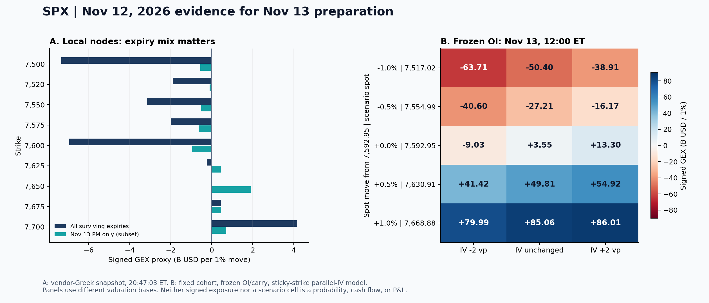

+++
title = "SPX期权持仓与Greeks结构分析-261112"
date = "2026-11-13"
data_as_of = ["2026-11-11", "2026-11-12"]
data_as_of_note = "D为11月12日、P为11月11日，目标日11月13日；月度Q估值为11月12日16:00 ET，历史兼容补充报价于12日晚间取得；保留各来源时钟与代理锚，不纳入目标日结果。"
draft = false
description = "存续signed Gamma转为小幅净负，PPI后重定位7575–7605；结合期限节点、冻结OI和月度Q背景，保留均衡方向及近端IV限制。"
series = "SPX期权分析报告"
categories = ["衍生品", "市场结构"]
tags = ["SPX", "Greeks", "GEX", "期权", "风险分布"]
featured = false
private = false
content_preservation = "verbatim_except_privacy_redactions"
source_sha256 = "cae09c4555b4877d3ba3ffdb06847842cdcec0ce06940e3a31ba58cf65db24f8"
+++

# SPX期权持仓与Greeks结构分析-261112

## 1. 一句话结论

存续 signed Gamma 代理转为小幅净负、7,600 附近负节点加重，11/13 应先在 **PPI 后重定位 7,575–7,605**，再分别观察下侧 7,550 / 7,520–7,500 与上侧 7,625 / 7,645–7,650；最大反证是目标日到期层仍略正，且价格上移或 IV 改变足以使冻结 OI 模型转正，故目前方向仍均衡、不能据负号直接看空。

**盘后研究 B 级｜结构事实可复核，机制置信中低、方向置信低且保持均衡｜具体合约估值未纳入本次盘后研究｜目标日执行另行复核。** B 的实质原因是近端 IV 质量和部分假日到期时钟限制；详见第 10 节。XSP 主动关闭、没有固定腿卡和未来报价尚未产生均不是降级理由。

## 2. T+1 Action Summary

| 项目 | 11 月 13 日条件准备 |
| --- | --- |
| Base stance | 若 PPI 后仍在 7,575–7,605 工作核心内，则先观察 7,600 的恢复或失守；离开核心且不能回归时，停止沿用核心内判断。 |
| Earliest evaluation | 先核对 11/13 08:30 ET PPI，再按实际常规开盘位置和更新报价评估；若开盘已越首个复核区，重建观察顺序。 |
| Base activation | 若 7,575–7,600 能承接、重新取得 7,605 并向 7,625 延伸，则比较看涨单买与看涨借记价差；重返 7,575 下方取消该恢复分支。 |
| Downside branch | 若跌离 7,575 且反抽不能恢复，则先看 7,550，再看 7,520–7,500，比较看跌单买与看跌借记价差；收复工作核心或已越首区时重评。 |
| Upside branch | 若恢复 7,625，则复核 7,645–7,650，再看 7,675 / 7,700；上侧正节点可能减速，重新失守 7,600 时取消延伸判断。 |
| Otherwise | 若核心内反复、事件反应相互抵消，或更新 IV / 结构不能支持位移，则以观察为主；新信息出现后重新立论，不自动卖区间或反手。 |

## 3. Executive Summary

- **共同合约的代理由正转负，主要变化来自 PM。** 同一组 15,318 个存续合约，signed GEX 从 +4.421 降至 −6.842 B USD/1%，变化 −11.262 B；其中 PM 变化 −16.129 B，AM 变化 +4.867 B。这是敏感度状态变化，不是净卖出资金。
- **总值很容易被期限抵消掩盖。** 存续 gross GEX 为 350.816 B，signed 为 −6.842 B；11/13 PM 单层仍为 +0.190 B，11/20 AM+PM 为 −10.233 B，12/31 PM 则为 +10.947 B。不能用总值给所有到期贴同一方向标签。
- **观察中心回到 7,600 的争夺。** 当前代理锚 7,592.95，低于前报 7,600–7,625 核心下沿；完整存续图中 7,600 signed 为 −6.949 B、7,575 为 −1.989 B。7,650 在目标日子集为正，但全存续聚合接近零，不能称为确定性上方屏障。
- **条件模型支持“两侧反馈不同”，尚未支持路径概率。** 11/13 中午、IV 不变时，以当前锚价估值的模型 signed GEX 为 +3.552 B；价格 −0.5% 时为 −27.214 B，+0.5% 时为 +49.809 B。保持锚价、IV −2 vp 则变为 −9.029 B，说明事件后的 IV 回落也必须重新估值。
- **波动率证据有用，但近端存在实质缺口。** 包内 VIX 为 18.70，较 P 日升 1.21 点；同 12/11 到期 ATM +0.200 vp、downside skew25 +0.213 vp，可作模型描述。11/13 与近 7D smile 仅诊断；11/27 和 12/24 的提前收市与包内 16:00 到期钟不符，相关期限只保留原值和限制。
- **月度尾部与次日方向分开。** 12/10 到期 Q 下中央 90% 终值区间为 7,016.30–8,010.79；相对 7,592.95 锚跌逾 5% 的 Q 概率为 9.50%，滚动槽位较前日增加 0.77 个百分点。它不是现实跌幅概率或盘中触及概率，不能用来给次日情景加权。
- **事件后再比较收益结构。** 11/13 08:30 ET 的 10 月 PPI 已由 BLS 日历核实；保留上下两个条件分支，比较单买与借记价差的成本、封顶和时间消耗。当前没有独立的卖区间优先项。[BLS 11 月日历](https://www.bls.gov/schedule/2026/11_sched.htm)

## 4. What Changed vs. T-1 and Prior Playbook Review

以下 P→D 均指 **11/11→11/12**，不包含目标日结果。GEX 单位为 B USD/1%，即十亿美元 / 标的变动 1% 的暴露口径；它不是盈亏、实际交易额或资金流。

| 实质变化 / 可比基础 | P 日 | D 日 | 含义与限制 |
| --- | --- | --- | --- |
| 同源标的代理 / VIX | 7,619.22 / 17.49 | 7,592.95 / 18.70 | 代理下跌 26.27 点（−0.345%）；VIX +1.21 点。D 日现金官方收盘在包中未更新，不混用来源 |
| 共同存续 cohort signed GEX | +4.421 B | −6.842 B | 同 15,318 合约变化 −11.262 B；PM −16.129 B、AM +4.867 B |
| 11/13 PM 结构 | 选定窗口 gross 最大节点 7,650 | 选定窗口 gross 最大节点 7,600 | 同到期、同窗口 gross −1.028 B、signed −4.725 B；只用于该子集变化，不混作全图迁移 |
| 总 OI / 成交量 | 14,013,071 / 5,871,933 | 14,154,346 / 4,822,660 | 供应商报告 OI +1.01%；成交量 −17.87%；OI PCR 1.3983→1.4060 |
| 同 12/11 到期 smile | ATM 13.762%；skew25 3.031 vp | ATM 13.963%；skew25 3.244 vp | ATM +0.200 vp；skew25 +0.213 vp；BF25 +0.036 vp，经济意义未校准 |
| 月度 Q 滚动 28D 槽位 | 12/09 到期，锚 7,619.38 | 12/10 到期，锚 7,592.95 | 标准差 4.398%→4.776%；跌逾 5% 的 Q 概率 8.73%→9.50%，非同合约纯重定价 |

**前报复盘只做到有证据的一层。** 11/11 留存报告把 7,600–7,625 作为工作核心，下侧先复核 7,580–7,575。当前 7,592.95 代理终点低于核心下沿 7.05 点，但仍高于 7,580；因此旧的“核心已承接”条件不能直接延续。没有本期经对齐的完整标的分时、当时局部结构与用户成交记录，不能据终点断言下侧分支盘中完成确认、触及目标或获得收益。前报 +7.225 B 是当时下一日存续总图，包含 11/12 到期层；本节 P 日 +4.421 B 是对齐到 **11/13 开盘仍存续的共同 cohort**，两个分母不同。前报观察地图

### Q：已观察报价变化的分项解释

这是 P→D 同一 SPXW PM 合约、起点 7–60 DTE 的中间价归因，排除 AM / 0DTE。全样本 8,627 对；研究子样本 5,135 对。每个数是**一份多头合约的平均指数点贡献**，美元换算为点数 ×100；没有 OI 或持仓权重。全样本、研究子样本和 call/put 组重叠，不相加。

| 平均贡献 / 指数点 | 全样本 | 研究子样本 | 研究 call | 研究 put |
| --- | --- | --- | --- | --- |
| 样本数 | 8627 | 5135 | 1838 | 3297 |
| Delta / 远期变动 | +0.926 | +0.042 | +2.151 | -1.134 |
| Gamma | +0.008 | +0.011 | +0.015 | +0.009 |
| Theta / 时间 | -1.429 | -1.729 | -1.846 | -1.664 |
| Vega / IV | +1.564 | +2.015 | +1.288 | +2.420 |
| Vanna | -0.012 | -0.017 | -0.004 | -0.024 |
| Volga | +0.067 | +0.039 | +0.005 | +0.058 |
| Discount | +0.010 | +0.002 | +0.002 | +0.001 |
| 残差 | -0.084 | -0.104 | -0.070 | -0.123 |
| 实际报价变化 | +1.051 | +0.259 | +1.541 | -0.456 |

研究子样本中，**Vega +2.015 点与 Theta −1.729 点相抵，Delta 平均仅 +0.042 点**；按平均绝对贡献，Vega 2.138、Theta 1.729、Delta 1.498 点，说明 IV 重定价和时间消耗是这一子样本的重要分项。全样本则以 Delta 的平均绝对贡献 2.471 点最大，不能将子样本结论推广为全市场唯一驱动。完整展开 RMSE 为 0.142 点；研究子样本加入高阶项后的 RMSE 0.140 点，反而高于只加 Vega 时的 0.120 点，高阶展开并非逐组必然改善。

**必须保留的口径差异：** call 的 Delta 贡献为正、put 为负，而标的代理终点下跌。已核对本实现的 Delta 项使用“各到期平价远期差 × 起点 forward Delta × 折现”，不是“现金 SPX 日收益 × spot Delta”。汇总未给出逐到期远期与现金代理的完整桥接，故这里解释模型报价分项，不将其改写成现货涨跌的因果归因。残差也没有被识别为跳跃收益。框架来自 Carr–Wu 的论文，属于特定估值诊断，拟合贴合不证明未来预测或交易收益。 

## 5. T 日盘面、字段时点与 Event-Risk Overlay

### 截止前信息与目标日日程

| 信息层 / ET 时间 | 截止时可采用的事实 | 对本报告的含义与限制 | 一手来源 |
| --- | --- | --- | --- |
| D 收盘前，11/12 08:30 | 截至 11/07 当周初请 20.0 万；前周修订后 19.1 万；四周均值 19.525 万持平 | 就业信息已发布；不能单因解释 SPX 或 IV 当日变动 | [DOL 当期周报](https://www.dol.gov/ui/data.pdf) |
| D 收盘后，11/12 财报 / 16:30 电话会 | Cisco 已在 11/03 预告 FY2027 Q1 于本日盘后发布、16:30 ET 电话会 | AI / 科技情绪事件窗口已知；结果网页存在日期文本冲突且完整正文获取失败，本次不采用财报数字或盘后价格反应 | [Cisco 预告](https://newsroom.cisco.com/c/r/newsroom/en/us/a/y2026/m11/cisco-schedules-conference-call-for-q1-fiscal-year-2027-financial-results.html) |
| D 收盘后，11/12 18:30 | Williams 的 UC Berkeley Alumni Salon 讨论在官方日历中列明；未取得可核实的当晚完整发言文本 | 只记录日程，不推定鹰鸽立场，不声称盘后没有重大消息 | [纽约联储日程](https://www.newyorkfed.org/press) |
| N 盘前，11/13 08:30 | 10 月 PPI，结果在本次 cutoff 时未知 | 首要重定位窗口；方向取决于实际发布、预期差及利率 / 股价反应，不预设利好利空 | [BLS 日历](https://www.bls.gov/schedule/2026/11_sched.htm) |
| N 日内，11/13 10:50 | Bowman，主题为监管与监督 | 关注实际发言；主题不等于既定利率指引 | [Fed 11 月日历](https://www.federalreserve.gov/newsevents/2026-november.htm) |
| N 收盘后，11/13 19:00 | Jefferson，生产率与宏观活动主题 | 11/13 PM 到期已结束；较晚到期期权仍带有该窗口，但不因此建议隔夜 | [Fed 11 月日历](https://www.federalreserve.gov/newsevents/2026-november.htm) |
| 后续期限，11/18 14:00 | 10 月 FOMC 会议纪要发布日程 | 11/18 PM 及更晚到期包含该窗口；纪要内容在本次 cutoff 时未知 | [Fed 11 月日历](https://www.federalreserve.gov/newsevents/2026-november.htm) |
| 后续到期背景，11/20；11/27 / 12/24 | 11/20 月度到期；后两日为提前收市 | 宏观事件不能由“OpEx 较远”排除；假日时钟问题详见第 8 节 | 包内到期日历；[Cboe 假日表](https://www.cboe.com/about/hours/us-options) |

BLS 月度页面标注 11/03 更新，早于 cutoff。其余动态日历缺少逐条首次发布时间或当时网页存档；新闻核验限于上述事项，未完成所有讲话、财报和拍卖结果的穷尽归因。使用已公布的日程，不引入 cutoff 后的事件结果，也不将未核实消息当成“没有消息”。

## 6. Decision Rationale — Analytical Bridge

### Thesis 1 · 净负代理增加敏感性，尚不足以建立单边先验

**Claim / Evidence：** 共同存续 signed GEX +4.421→−6.842 B，当前 PM −2.637 B、AM −4.205 B；但 11/13 PM 本身仍 +0.190 B，12/31 PM +10.947 B。

**Mechanism / Assumptions：** call 正、put 负是库存代理约定；只有该约定与实际库存关系近似成立时，负值才可能对应更强顺势反馈。长 put 的数学 Gamma 本身仍为正。

**Next-session implication：** 以 7,600 附近是否恢复及更新近端图为条件，保留两侧分支；不直接建立卖区间或必跌判断。

**Falsifier / Confidence：** 事件后价格、IV 和近端节点改变可推翻当前敏感性描述；状态数值可复核，dealer 行为未识别，方向置信低。

### Thesis 2 · 节点的期限构成比单个总数更能改变观察顺序

**Claim / Evidence：** 全存续 7,600 为 −6.949 B，7,500 为 −7.324 B；11/13 PM 的 7,650 为 +1.914 B，但全存续该点约 −0.015 B。7,625 同样是目标日偏正、聚合略负。

**Mechanism / Assumptions：** 近到期与较长期限可互相抵消；某一 PM 层的正号不等于全市场正号，更不等于确定阻力。

**Next-session implication：** 下侧先 7,575 / 7,550 再 7,520–7,500；上侧先 7,605 / 7,625 再 7,645–7,650。工作核心是节点组织方式，不是统计区间。

**Falsifier / Confidence：** gap 已越节点或更新 OI / Greeks 改变其构成，则重建地图；节点位置可信度高于方向或吸附机制。

### Thesis 3 · PPI 后的价格与 IV 必须一起重估

**Claim / Evidence：** 固定 cohort 在中午、IV 不变时，−0.5% / 原锚 / +0.5% 对应 −27.214 / +3.552 / +49.809 B；原锚 IV 降 2 vp 则为 −9.029 B。

**Mechanism / Assumptions：** 保持最近可得的各合约 OI 数量及 signed 约定不变，改变价格、时间和 IV，重估存续合约的 Gamma 暴露。冻结的是数量与样本，不是 Greeks；模型使用固定 carry、sticky-strike 与平行 IV 冲击。

**Next-session implication：** 上侧修复与下侧延续需要不同的空间和收益封顶安排；事件后 IV 回落不能被机械视作稳定结构。第 9 节给出同模型网格。

**Falsifier / Confidence：** 新持仓、偏度扭转、跳空或时钟修正均超出原假设；机制敏感性可复核，情景概率未估计，也不插出精确 Gamma flip。

### Thesis 4 · IV 需求增加的描述，不能代替近端相对定价证据

**Claim / Evidence：** VIX +1.21 点、同 12/11 ATM +0.200 vp；研究子样本 Vega +2.015 点抵消大部分时间消耗。11/13 smile 与 7D 槽位却仅诊断。

**Mechanism / Assumptions：** 报价中的波动率重定价会影响单买成本；较晚到期与借记价差可改变 Vega、Theta 和收益封顶，但是否更划算取决于实际报价。

**Next-session implication：** 事件后在相同到期、相同退出时点下比较单买与价差；当前不推荐依据近端 skew / BF 差值排序，不由 RV 高于 IV 宣称长波动有优势。

**Falsifier / Confidence：** 新报价不支持可用空间、事件后波动率明显压缩或局部质量继续失败时，放弃原比较；可描述数值，收益优势未验证。

### Thesis 5 · 月度分布用于尾部背景，不能给次日下方向加一票

**Claim / Evidence：** Q 的跌逾 5% 概率 9.50%、跌逾 10% 概率 2.88%；与此同时终值低于现指锚的 Q 质量从 38.49% 降至 36.62%。更深尾部权重增加与中央部分变化可以同时发生。

**Mechanism / Assumptions：** 月度 Q 是风险定价的终值分布，使用独立收盘报价、平滑及尾部外推；它与 IV / ABR 共用 SPX 期权市场信息。不同文件和时间不产生独立预测证据。

**Next-session implication：** 尾部存在使有限损失结构值得比较，但既不给下侧情景概率，也不自动排除上侧修复；ABR 不用于提高看多置信度。

**Falsifier / Confidence：** 同口径分布、carry 或尾部质量改变会影响尾部背景；实际价格路径必须另看，现实概率未被本包验证。

## 7. Conflicting Evidence, Confidence and What Changes the View

| 命题 | 支持 / 表面冲突 | 处理方式 | 真正改变判断的证据 |
| --- | --- | --- | --- |
| 全存续净负是否意味着目标日单边下跌 | 全图 −6.842 B；11/13 PM +0.190 B；较远 12/31 PM +10.947 B | 同一快照、期限不同；保留期限分解，方向均衡。属于不同期限构成，不能“多数投票” | 更新近端节点、价格能否回到核心；不能只看总值正负 |
| vendor 图为负，冻结模型原锚却为正 | vendor −6.842 B；中午同锚模型 +3.552 B | 估值钟、参与样本和模型不同，绝对值不做流量差分；仅在同模型网格内比较 | 同一 cohort / 模型 / 时钟下的新估值 |
| 现金代理下跌，CW call Delta 却为正 | 现指代理 −0.345%；call Delta +2.151 点 | CW 使用平价远期变化；仅解释其模型报价。未取得完整远期—现金桥接，不作现货因果归因 | 逐到期远期、同步标的与报价的桥接记录 |
| 14D 滚动 ATM 降，固定 14D 数值升 | smile 槽位 −0.095 vp；固定 14D +0.094 vp；同 11/25 ATM +0.416 vp | 到期滚动 / 插值对象不同；且 11/27 假日钟待修。保留各自数值，不构造统一方向 | 修正到期钟的同口径输出及相同实际到期比较 |
| 月度尾部更重是否推翻短线修复 | 月度深左尾增加；次日上侧仍有条件修复分支 | 期限、measure 和终值 / 路径不同，可同时成立 | 目标日实际事件反应；不能用月度终值概率给次日格点加权 |
| Q、IV、ABR 看似多重确认 | 同属 SPX 期权市场，ABR 直接由 Q 加假设得到 | 标记同源依赖；Q 与 ABR 差异先解释恢复公式，禁止平均概率 | 独立市场 / 历史样本外证据；本包未提供预测校准 |

**置信度拆分：** 文件身份、算术与当前节点事实有程序核验；dealer 反馈和价格路径仅有机制依据。`path_confidence_basis=mechanism_only`、`empirical_validation_status=not_tested` 意为“尚未证明预测或收益优势”，不是准确率。方向论点被反证、候选需重新估值，以及实际盘口条件不满足，是三种不同的停止原因。

## 8. IV Term Structure, Skew and Surface

### ATM 实际到期：优先同到期比较

P、D 水平为年化 IV；Δ 为 **D−P，单位 vp（波动率百分点）**。下表 τ 是输入模型的日历日，非剩余交易小时。

| 实际到期 | τ：P→D（日） | P ATM | D ATM | Δ（vp） | 事件 / 结算 | basis / method / quality |
| --- | --- | --- | --- | --- | --- | --- |
| 2026-11-13 | 1.830 → 0.801 | 15.994% | 17.280% | +1.287 | PPI / 目标日 PM | same_expiry_atm；仅诊断；报价拟合不足 |
| 2026-11-16 | 4.830 → 3.801 | 11.679% | 12.035% | +0.356 | 跨周末 / PM | same_expiry_atm；P 仅诊断，历史从严 |
| 2026-11-18 | 6.830 → 5.801 | 13.480% | 14.368% | +0.888 | 包含已知 11/18 纪要窗口 / PM | same_expiry_atm；两日相关节点仅诊断 |
| 2026-11-19 | 7.830 → 6.801 | 13.743% | 14.548% | +0.805 | 近 7D / PM | same_expiry_atm；D 形状与拟合失败，仅诊断 |
| 2026-11-25 | 13.830 → 12.801 | 13.240% | 13.656% | +0.416 | 感恩节前 / PM | same_expiry_atm；局部描述；repair |
| 2026-11-27 | 15.830 → 14.801 | 12.804% | 13.144% | +0.340 | 提前收市 / PM | same_expiry_atm；模型原值；假日钟待修 |
| 2026-12-11 | 29.830 → 28.801 | 13.762% | 13.963% | +0.200 | 较长期限 / PM | same_expiry_atm；局部描述；constrained |

### 固定期限背景：保留原生 bracket 和权重

以下是管线固定期限槽位，不等同于前表的同实际到期。权重指上端到期的总方差插值权重；“单点”表示包内 observed 槽位规则，并非恰好 τ=目标日数。权限保留为诊断，不以高节点支撑分数升级。

| 槽位 / τ目标 | P 来源 / τ / 权重 | D 来源 / τ / 权重 | P→D ATM | Δ（vp） | 事件 / PM 结算 | method / quality |
| --- | --- | --- | --- | --- | --- | --- |
| 3D | 11-13 / 11-16，τ 1.830/4.830，w=0.3900 | 11-13 / 11-16，τ 0.801/3.801，w=0.7331 | 13.447% → 12.481% | -0.966 | 含 PPI / 周末 | fixed_tenor_atm；local fitted / 总方差插值；仅诊断 |
| 7D | 11-18 单点，τ 6.830，w=0 | 11-19 单点，τ 6.801，w=0 | 13.480% → 14.548% | +1.068 | 近周 PM | fixed_tenor_atm；local fitted / 总方差插值；仅诊断 |
| 14D | 11-25 单点，τ 13.830，w=0 | 11-25 / 11-27，τ 12.801/14.801，w=0.5997 | 13.240% → 13.334% | +0.094 | 含 11/27 假日钟限制 | fixed_tenor_atm；local fitted / 总方差插值；仅诊断 |
| 30D | 12-11 单点，τ 29.830，w=0 | 12-11 / 12-14，τ 28.801/31.801，w=0.3998 | 13.762% → 13.839% | +0.077 | PM 较长期限 | fixed_tenor_atm；local fitted / 总方差插值；仅诊断 |
| 45D | 12-24 / 12-31，τ 42.830/49.830，w=0.3100 | 12-24 / 12-31，τ 41.801/48.801，w=0.4570 | 13.753% → 13.860% | +0.107 | 含 12/24 假日钟限制 | fixed_tenor_atm；local fitted / 总方差插值；仅诊断 |

### Selected-expiry smile：水平、倾斜与曲率

10Δ / 25Δ 为**固定 delta 节点**，不是固定 strike；downside skew25 = IV_put25−IV_ATM，BF25 = 0.5×(IV_put25+IV_call25)−IV_ATM。BF25 是 IV 曲率概括，不是蝶式价差价格或利润。水平行的五个 IV 节点用 %，skew25 / BF25 用 vp；所有 Δ 行统一用 vp。

先列 term_context；7D、14D 为滚动槽位，30D 为同 12/11 到期。数字来自预计算 `iv_history`，没有另配期限或补翼。

| 期限 / 用途 / 行类型 | 到期日 / τ（日） | 10Δ put | 25Δ put | ATM | 25Δ call | 10Δ call | Downside skew25 | BF25 | 比较基础 / method / quality |
| --- | --- | --- | --- | --- | --- | --- | --- | --- | --- |
| 7D / P 水平 | 2026-11-18 / 6.830 | 18.486% | 15.609% | 13.480% | 12.011% | 11.130% | 2.129 | 0.330 | rolling_tenor_slot_fixed_delta；仅诊断；P repair→D legacy |
| 7D / D 水平 | 2026-11-19 / 6.801 | 20.585% | 17.129% | 14.548% | 12.688% | 11.536% | 2.581 | 0.361 | rolling_tenor_slot_fixed_delta；仅诊断；P repair→D legacy |
| 7D / Δ D−P | 2026-11-18 → 2026-11-19 | +2.099 | +1.519 | +1.068 | +0.678 | +0.406 | +0.452 | +0.031 | rolling_tenor_slot_fixed_delta；仅诊断；P repair→D legacy |
| 14D / P 水平 | 2026-11-25 / 13.830 | 19.373% | 15.736% | 13.240% | 11.608% | 10.817% | 2.497 | 0.433 | rolling_tenor_slot_fixed_delta；原模型描述值；假日钟待修 |
| 14D / D 水平 | 2026-11-27 / 14.801 | 19.859% | 15.808% | 13.144% | 11.374% | 10.508% | 2.663 | 0.447 | rolling_tenor_slot_fixed_delta；原模型描述值；假日钟待修 |
| 14D / Δ D−P | 2026-11-25 → 2026-11-27 | +0.486 | +0.071 | -0.095 | -0.233 | -0.310 | +0.167 | +0.014 | rolling_tenor_slot_fixed_delta；原模型描述值；假日钟待修 |
| 30D / P 水平 | 2026-12-11 / 29.830 | 21.437% | 16.793% | 13.762% | 12.055% | 11.421% | 3.031 | 0.662 | same_expiry_fixed_delta；可描述；constrained |
| 30D / D 水平 | 2026-12-11 / 28.801 | 22.292% | 17.206% | 13.963% | 12.114% | 11.358% | 3.244 | 0.698 | same_expiry_fixed_delta；可描述；constrained |
| 30D / Δ D−P | 2026-12-11 → 2026-12-11 | +0.855 | +0.413 | +0.200 | +0.060 | -0.064 | +0.213 | +0.036 | same_expiry_fixed_delta；可描述；constrained |

### SPX 短端候选实际到期（candidate_expiry）

这些是 SPX 的研究节点，不依赖 XSP 是否启用；11/13 在 N 日成为 0DTE，11/16 在 N 日剩余 3 个日历日。

| 期限 / 用途 / 行类型 | 到期日 / τ（日） | 10Δ put | 25Δ put | ATM | 25Δ call | 10Δ call | Downside skew25 | BF25 | 比较基础 / method / quality |
| --- | --- | --- | --- | --- | --- | --- | --- | --- | --- |
| 11-13 / P 水平 | 2026-11-13 / 1.830 | 21.146% | 18.173% | 15.994% | 14.563% | 13.760% | 2.179 | 0.375 | same_expiry_fixed_delta；仅诊断；constrained |
| 11-13 / D 水平 | 2026-11-13 / 0.801 | 22.315% | 19.611% | 17.280% | 15.789% | 14.586% | 2.331 | 0.420 | same_expiry_fixed_delta；仅诊断；constrained |
| 11-13 / Δ D−P | 2026-11-13 → 2026-11-13 | +1.169 | +1.438 | +1.287 | +1.226 | +0.826 | +0.151 | +0.045 | same_expiry_fixed_delta；仅诊断；constrained |
| 11-16 / P 水平 | 前日匹配缺失① | 不可用① | 不可用① | 不可用① | 不可用① | 不可用① | 不可用① | 不可用① | unavailable；D 可描述；P smile 缺失① |
| 11-16 / D 水平 | 2026-11-16 / 3.801 | 16.300% | 13.853% | 12.035% | 10.729% | 10.093% | 1.818 | 0.256 | unavailable；D 可描述；P smile 缺失① |
| 11-16 / Δ D−P | 前日缺失 → 2026-11-16 | 不可用① | 不可用① | 不可用① | 不可用① | 不可用① | 不可用① | 不可用① | unavailable；D 可描述；P smile 缺失① |

① `prior_same_expiry_or_slot_unavailable`：11/16 的**候选 smile 历史对象未匹配**，所以各翼、skew25、BF25 及该 smile 的 ATM 变化保留不可用；不借 11/13 代替。独立 `same_expiry_atm` 表另有 11/16 的 P=11.679%、D=12.035%、Δ=+0.356 vp，但 P 日仅诊断，故该 ATM 算术也不能作市场变化确认。这保留了有依据的局部信息，同时不覆盖管线的缺失判断。

**ATM 水平。** 同 12/11 到期上升 0.200 vp，可描述模型水平抬升。14D 滚动槽位下降 0.095 vp，而同 11/25、同 11/27 到期模型 ATM 分别上升 0.416 / 0.340 vp：滚动值并不是所有到期波动率下降；11/27 还受时钟限制。11/13 与 7D 虽数值上升，但仅诊断，不能确认近端市场整体升波或已分离出 PPI 事件方差。

**Downside skew25 倾斜。** 同 12/11 增加 0.213 vp，put25 上升 0.413 vp、call25 仅上升 0.060 vp，支持该模型截面的下翼相对 ATM 更陡。14D 滚动值 +0.167 vp 同时包含到期重选与假日钟问题，只记录模型差异。11/13 的 +0.151 vp、7D 的 +0.452 vp 均为诊断算术，不能作为市场偏度变化判断。

**BF25 曲率。** 同 12/11 增加 0.036 vp；14D 滚动 +0.014 vp、11/13 +0.045 vp、7D +0.031 vp。它们很小，且后几项另有质量 / 时钟限制，经济意义未证实。没有误差校准，既不能称统计显著，也不能断言已证明处于误差范围内。

**老化、滚动与时钟。** 同到期 τ 缩短约 1.029 日；固定 delta 对应的 strike 会变。7D 从 11/18 滚到 11/19；14D 从 11/25 滚到 11/27，τ 反而增加约 0.971 日，不能称纯重定价。固定 14D / 30D / 45D 的 bracket 与权重也改变。支持分数不是胜率或误差界，本文没有重构任何曲面。

**对结构研究的边界。** 当前 11/16 与较长期限的合格局部值可作为核价背景；11/13 不足以排序 PPI 前后短端相对价值。较晚到期年化 IV 较低，也不证明其总权利金更便宜、Theta 更划算或适合隔夜。

### 短端诊断

下表均为模型诊断。

| 期限 | 论文 ATM：P→D（Δ） | Q 协方差率：P→D（Δ） | Q IV 方差率：P→D（Δ） | 有效历史变化 | 用途 / 缺口 |
| --- | --- | --- | --- | --- | --- |
| 14D | 13.141% → 13.490%（+0.348 vp） | -0.1463 → -0.1648（-0.0185） | 2.9168 → 2.9556（+0.0388） | 19/21；不足 | Q 有效诊断；历史 P 矩及 Q−历史差不可用 |
| 30D | 13.811% → 14.048%（+0.237 vp） | -0.1148 → -0.1227（-0.0079） | 1.6219 → 1.7958（+0.1739） | 20/21；不足 | Q 有效诊断；历史 P 矩及 Q−历史差不可用 |
| 45D | 14.148% → 14.284%（+0.135 vp） | -0.1051 → -0.1109（-0.0057） | 1.2834 → 1.3368（+0.0533） | 20/21；不足 | Q 有效诊断；历史 P 矩及 Q−历史差不可用 |

30D 的 Q 下 IV 比例漂移由 **0.7528→0.5956（−0.1572 / 年）**；这是模型漂移诊断，不是明天 IV 将上涨 59.56% 或未来 log IV 均值。14/30/45D 协方差率均更负、IV 方差率均增加，与“左翼定价和 IV 变化风险值得重视”的描述相容；但估计器、报价时间和研究对象不同，不能与月度终值方差互相替代，也不把同源信息计成独立确认。历史有效变化仅 19 / 20 / 20，未达到各自 21 次窗口，所有历史矩和 Q−历史差继续为空，不改窗口、不补零。

### 月度 Q 风险分布

实际到期 **2026-12-10 SPXW PM**，估值 **11/12 16:00 ET**、剩余 **28 个日历日（ACT/365 τ=0.07671233）**。Q 为 `available / descriptive_pricing_context`，锚为供应商现指代理 **7,592.95**，收益定义为终值 / 锚−1，未年化、不含实际分红。它不是固定 30D，更不是次日分布。

| Q 指标 | P 日 | D 日 | 比较基础 / 限制 |
| --- | --- | --- | --- |
| 实际到期 / 估值钟 | 12/09 / 11/11 16:00 ET | 12/10 / 11/12 16:00 ET | 滚动 28D 实际到期槽位 |
| 现指代理锚 | 7,619.38 | 7,592.95 | 两日锚不同，P 值不是链内 7,619.22 |
| Q 下中央 80% 终值区间 | 7,274.21–7,946.33 | 7,227.89–7,941.79 | 风险定价终值区间，不是现实置信区间 |
| Q 下中央 90% 终值区间 | 7,086.65–8,016.42 | 7,016.30–8,010.79 | 不代表盘中触及概率 |
| 未年化均值收益 | 0.20% | 0.28% | +0.081 个百分点；滚动比较 |
| 未年化终值收益标准差 | 4.40% | 4.78% | +0.378 个百分点；滚动比较 |
| 终值低于各自现指锚 | 38.49% | 36.62% | -1.862 个百分点；滚动比较 |
| 终值较各自锚低逾 2% | 21.05% | 20.95% | -0.100 个百分点；滚动比较 |
| 终值较各自锚低逾 5% | 8.73% | 9.50% | +0.770 个百分点；滚动比较 |
| 终值较各自锚低逾 10% | 2.30% | 2.88% | +0.583 个百分点；滚动比较 |

估计采用包内 Fast and Stable 平滑、单峰约束、GEV 补尾和微小远期修正，是具体估计方案。D 日报价定价检查通过；但**外推概率质量 0.2625%，对应方差占比 12.85%**，尾部质量小不等于尾部假设影响小。Q 的均值终值 7,614.35 靠近远期是定价约束，不是上涨预测；中位数 7,680.10 高于均值，也不改变现实概率未验证的边界。

月度历史来自本次管线重建的 11/11 收盘兼容补充报价，报价取得于 11/12 20:38:50 ET。它与 P 日常规 IV 的“日常包来源”是两条不同来源链，不能将前者说成 P 日当时已知或已发布。滚动比较混合锚、carry、到期变更及估计差异；深尾概率上升是定价描述，尚未分离纯市场冲击。

## 9. Key Expiry / Strike / Dealer Node

### 分母与存续范围

采集期限窗口为 **D 起 60 个日历日**。原始 16,238 行、OI 14,154,346；基础 filtered 13,026 行、OI 8,400,260，属于其过滤口径，不能拿它充当全存续地图分母。新版地图有 **15,678 个合格且目标日开盘仍可交易的合约，7,839 个到期 / 家族 / strike 节点，存续 OI 13,818,642**；相对于这一合格存续快照，OI 覆盖为 100%，CSV gross GEX 覆盖为 100%。这不是所有上市期限或所有市场仓位的 100%。共同 cohort 15,318 个合约，约占存续合约数 97.70%。

展示窗口为锚的 ±3%，即 **7,365.16–7,820.74**，覆盖存续 gross GEX 的 **68.94%**；largest nodes 排名以该展示范围理解，不能误称全市场绝对最大。下表选出对观察有用的节点，不将 selected 旧表、全图或 pure / combined 重复相加。

11/12 PM 当日到期层的 gross GEX 为 **27.571 B**，已经从 11/13 存续图移除。11/13 PM 在 D 尚为 1DTE，到 N 日成为 0DTE；11/20 与 12/18 的 AM / PM 分列。AM 使用项目的最后可交易时点约定，不能将 AM 层当作同日下午仍可交易的 PM 合约。

| 到期 | 家族 / 结算 | gross GEX（B） | signed GEX（B） | 存续 gross 占比 | 报告 OI |
| --- | --- | --- | --- | --- | --- |
| 2026-11-13 | SPXW / PM | 25.588 | +0.190 | 7.29% | 704,783 |
| 2026-11-18 | SPXW / PM | 10.096 | -4.040 | 2.88% | 136,484 |
| 2026-11-20 | SPX / AM | 52.985 | -7.454 | 15.10% | 2,089,111 |
| 2026-11-20 | SPXW / PM | 14.012 | -2.779 | 3.99% | 535,939 |
| 2026-12-18 | SPX / AM | 154.725 | +3.249 | 44.10% | 6,655,325 |
| 2026-12-18 | SPXW / PM | 5.959 | -1.233 | 1.70% | 352,708 |
| 2026-12-31 | SPXW / PM | 25.032 | +10.947 | 7.14% | 1,212,875 |

12/18 AM 单层占存续 gross 44.10%，而 11/13 PM 仅 7.29%；“总暴露很大”不能直接推出当日 0DTE 会主导。剔除 12/31 PM 后，其余 signed 合计约 **−17.789 B**，说明较远正层掩盖了其他期限的负值，仍不是应做空的概率证据。

| Strike | 距锚 | gross GEX（B） | signed GEX（B） | 观察含义 |
| --- | --- | --- | --- | --- |
| 7,500 | -1.22% | 15.384 | -7.324 | 下侧较大负节点；主要含 11/20 AM |
| 7,520 | -0.96% | 2.879 | -1.901 | 下侧后续复核；11/18 PM 负贡献明显 |
| 7,550 | -0.57% | 8.741 | -3.147 | 下侧第一段延续区 |
| 7,575 | -0.24% | 4.468 | -1.989 | 工作核心下沿参考 |
| 7,600 | +0.09% | 20.201 | -6.949 | 聚合负中心；目标日 PM 也负 |
| 7,605 | +0.16% | 2.135 | -0.921 | 核心上沿附近，仍需观察恢复 |
| 7,625 | +0.42% | 4.124 | -0.232 | 目标日 PM 为正，聚合略负 |
| 7,650 | +0.75% | 13.609 | -0.015 | 目标日 PM +1.914 B；全图近零 |
| 7,675 | +1.08% | 4.412 | +0.448 | 上侧延伸复核 |
| 7,700 | +1.41% | 21.098 | +4.173 | 较大正节点；含 11/20 AM +3.268 B |

表内全期限 strike 值来自存续 CSV 的透明求和。负节点不是支撑承诺，正节点不是价格必然受阻；这些位置用于重新观察、估值和定义失效。

### DEX 与高阶 Greeks：方向不可相互替代

1–60D 的 DEX 为 **+220.231 B USD**；11/13 PM 为 +0.623 B，11/20 AM+PM 为 −25.318 B，12/18 AM+PM 为 +274.062 B。其正负主要体现供应商 Delta 与 OI 的组合敏感性，不能与 call 正 / put 负的 signed GEX 混成一个方向票数，也不识别真实 dealer 持仓。

按本项目实现，Vanna 数值是 **IV+0.5 vp 与 IV−0.5 vp 的 DEX 差**，Volga 是同一冲击下的 VEX 差，不能把字段名误读成单边 +1 vp 的精确变化。Charm 是其他输入固定时，从项目本日参考时点推进至下一交易日参考时点的 DEX 差；PM 用 16:00，AM 用项目 17:00 约定，不是确定将发生的买卖流。

| 范围 | Vanna：两侧 IV 共 1 vp 的 DEX 差（B USD） | Charm：下个参考时点 DEX 差（B USD） | Volga：同冲击 VEX 差（B；按每 1.0 IV 的 Vega 单位） |
| --- | --- | --- | --- |
| 1–60D | +8.404 | −0.810 | +22.228 |
| 11/13 PM | −0.092 | +3.612 | +0.075 |
| 11/20 AM+PM | −1.689 | +0.149 | +1.517 |

远端合计与目标日 / 月度层的符号、强度不同；原锚附近不应以“降波必然带来某方向买盘”替代实际复核。高阶 Greeks 的独立时点约定与未独立验证 OI 限制精细解释，不把它们混接成统一成交时钟。

### 冻结 OI：同模型、同 cohort 的实际情景对照

合格参与 OI 为 **95.02%**；13,787 个合约在全部给定 IV 冲击下均合格，carry 来源中 11,886 个使用同 scope forward，1,901 个使用 rate fallback。源单合约 IV 是情景输入，不证明整张曲面已审计合格。中午网格如下，单位 B USD/1%；**没有为格点分配概率**。

| 相对锚移动 | 情景 SPX | IV −2 vp | IV 不变 | IV +2 vp |
| --- | --- | --- | --- | --- |
| -1.0% | 7,517.02 | -63.706 | -50.400 | -38.912 |
| -0.5% | 7,554.99 | -40.597 | -27.214 | -16.169 |
| +0.0% | 7,592.95 | -9.029 | +3.552 | +13.303 |
| +0.5% | 7,630.91 | +41.419 | +49.809 | +54.923 |
| +1.0% | 7,668.88 | +79.989 | +85.055 | +86.011 |

在这组网格内，下移 0.5% 后三个 IV 情景均为负，上移 0.5% 后均为正；原锚则随 IV 冲击换号。含义是**条件敏感性明显、原锚符号不稳固**，不是发生这两条路径的概率，也不能在稀疏格点间推断未经计算的精确 flip。对波动率平行移动、冻结 carry 与数量的假设敏感，因此只把给定格点的方向差异作为准备依据，不给出精确阈值。

左图对比完整存续与 11/13 PM 子集，右图是同一中午模型网格。左右估值基础不同，不能把两图绝对值之差当成资金流；数值来自指定包及透明聚合，未运行曲面或分布重建。

## 10. Next-Day Observation Map and Research Grade

Base 是研究优先顺序，不是最高概率；工作核心来自节点位置与当前锚，不能称为预测置信区间。

| 场景 / 开盘位置 | EOD 依据 | 观察条件 | 研究含义 | 首个复核区 | 失效 / 重建条件 |
| --- | --- | --- | --- | --- | --- |
| 核心内：7,575–7,605 | 锚 7,592.95；7,575、7,600、7,605 聚合 signed 节点均负 | PPI 后按实际价格定位；区分 7,600 的恢复与持续失守，触及本身不算确认 | 方向未定；有位移才比较方向性收益结构 | 上 7,605 / 7,625；下 7,575 / 7,550 | 离开核心、明显 gap 或更新结构不同即重建 |
| 下侧延续：跌离 7,575 | 7,550 与 7,520–7,500 有负节点；价格下移模型更负 | 反抽不能恢复核心，并核对当时 IV、局部结构及利率反应 | 条件研究看跌单买 / 借记价差，不把负 Gamma 当看空概率 | 7,550；随后 7,520–7,500 | 恢复 7,600 一带；已跌过首区时按剩余距离重估 |
| 上侧修复：恢复 7,605 / 7,625 | 目标日 7,625、7,645、7,650 节点偏正；上移模型转正增强 | 修复能延续；回撤不重新失守核心，且实际报价仍适合研究空间 | 比较看涨单买 / 借记价差；正代理也可能使继续上移减速 | 7,645–7,650；再 7,675 / 7,700 | 失守 7,600；上侧首区已被越过则重选空间与期限 |
| 开盘已越节点 | 盘前 PPI 可改变现金开盘与 IV；旧锚不等于入场起点 | 低于 7,550 或高于 7,650 时，先核对新的实际位置 | 先重建地图；已发生的跳空不能计入未来建仓收益 | 下 7,520–7,500；上 7,675 / 7,700，均需重新核对 | 剩余空间不足、价格跨越多个节点或结构更新相反 |
| 事件 / IV 改变 | 08:30 PPI、10:50 Bowman；原锚的模型符号对 IV 敏感 | 结果公布后同时看利率、价格、两腿报价及期限 IV，不预填结果 | 方向可以不变而结构选择需重估；事件后 IV 回落不自动支持卖波动 | 实际所在节点及下一复核区 | 偏度扭转、事件解释改变或原模型覆盖不再适用 |

**研究等级：B。** 文件身份与核心单位合格，全存续图、共同 cohort、月度来源、条件模型及主要反证可以形成有用的次日地图；但以下 D 日已存在的问题实质限制所需的波动率与期限研究：

| 实质缺口 | 影响的判断 | 替代办法 | 剩余影响 |
| --- | --- | --- | --- |
| 11/13 报价拟合不足，近 7D 局部形状 / 报价失败 | 目标日与近周事件溢价、skew / BF 相对价值 | 保留明确诊断表；使用合格较长期限作有限描述，事件后按实际盘口重新比较 | 无法在盘后给 0DTE 与较晚期限的成本效率或 PPI 事件方差定论 |
| 11/27、12/24 提前收市与正式 IV 的 16:00 到期钟不符 | 对应 IV 期限、14D / 45D 插值的精确时间与相对定价 | 原值留存并附时钟限制；以同 12/11 节点和 vendor 地图支持有限结论 | 对相关 IV 数值影响未量化；修复应由上游完成，不能在报告层改 τ 或重拟合，也不自动归咎其他独立模型 |

Carr–Wu 历史窗口不足，使 Q−历史风险差不可用；现货 / 远期时钟桥接不足，使归因不用于现金方向解释。这些限制已对应撤回相关结论，不妨碍节点地图。**没有方向优势、没有 XSP 合约卡、目标日实时数据尚未产生均未被当作 B 的理由。** 本次按 v1.13 评价本期范围，不能拿旧版本字母评级判断市场机会改善或恶化。

## 11. Option Structure and Next-Session Preparation

仅保留两个有本期依据的结构比较；没有固定执行价、合约 ID、前夜支出或收益排名。以下服务于目标日条件出现后可能的日内研究，较晚到期不代表建议隔夜持有。

| 市场条件 | 可比较的期权结构 | 期限 / 事件权衡 | 触发后选腿与核价要点 | 放弃或重建条件 |
| --- | --- | --- | --- | --- |
| 跌离 7,575 且反抽不能恢复，仍有到下一复核区的空间 | 单买 put vs put debit vertical | 单买保留更远尾部收益但通常承担更多权利金 / IV 风险；价差降低部分支出与 Vega，同时封顶。11/13 到期时间最短；11/16 包含周末及后续消息 | 从实际入场价格量到 7,550 或 7,520–7,500 的剩余距离；同到期、同退出时点核对两腿 bid/ask、支出与封顶位置 | 已越首区、空间不足、收复核心或事件重定价使成本与论点不匹配 |
| 重新取得 7,605 / 7,625，向 7,645–7,650 修复 | 单买 call vs call debit vertical | 上侧正代理可能限制延伸，封顶可能适配有限目标，但不证明价差更优；较晚到期有更多剩余时间，也带入新事件 | 核对实际价格到首区的距离和期限；不得把已完成的盘前上涨计入建仓后的潜在收益 | 已在 7,650 上方才开始追随旧地图、回落核心、局部报价失真或剩余时间不足 |

核心内没有独立卖区间论据；当前也没有完整近端相对定价证据支持跨期限波动率排序。是否保留任一结构，取决于事件后的可用空间、实时组合报价与用户实际风险约束；不凭经验补统一 Delta、等候分钟数或盈亏比门槛。

## 12. Base / Risk / Observe-Only Scenarios

| 分支 | 本期研究安排 | 取消条件 |
| --- | --- | --- |
| Base：事件后在工作核心重新定位 | PPI 后先看 7,575–7,605；承接并恢复上沿时再评估 7,625→7,645–7,650 的修复 | 离开核心且无法恢复，或 gap 已越首区；Base 不代表概率最高 |
| Risk：核心失守后的下侧延续 | 7,575 不能恢复时先 7,550，再 7,520–7,500；保留有限损失的方向结构比较 | 恢复 7,600 附近、已越可研究区或更新近端图不支持原机制 |
| Observe-only：无扩张 / 无可比报价 | 核心内反复、事件反应抵消或剩余空间不足时保留观察 | 只有新的独立方向与核价信息才重开研究；区间想法失效不自动反手 |

“没有当前结构优先项”属于研究取舍；“盘口或账户条件未满足”属于执行限制；“原方向条件被价格 / 新结构推翻”属于论点失效，三者不混称。月度 Q / ABR 不用于给这些分支赋概率或计算预期利润。

本报告属于基于所列数据与假设的研究材料，不保证预测或收益；实际投资、仓位与执行由使用者决定。
