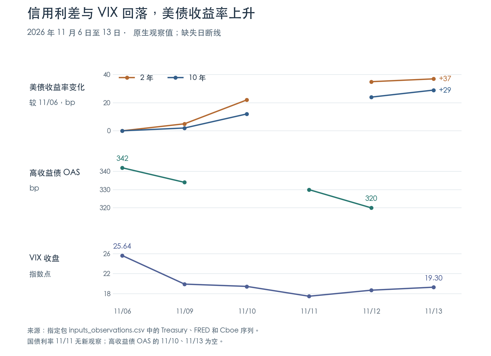

+++
title = "市场流动性综合分析报告｜2026-11-14"
date = "2026-11-14"
data_as_of = ["2026-11-11", "2026-11-12", "2026-11-13", "2026-11-14"]
data_as_of_note = "Fed资产与准备金截至11月11日，融资及OAS截至12日，市场与RRP截至13日，IORB最新标签14日；主口径与周五对齐估算的起止点及来源日分别保留。"
draft = false
description = "信用与股票修复、隔夜融资较平稳，但期限利率上行与TGA回补限制宽松程度；区分周度准备金及周五对齐现金估算。"
series = "市场流动性综合分析报告"
categories = ["宏观与政策", "市场结构"]
tags = ["流动性", "TGA", "SOFR", "信用利差"]
featured = false
private = false
content_preservation = "verbatim_except_privacy_redactions"
source_sha256 = "02eb43f0f16a9d92b37111dde8579e524d409534d060ea4551c66d996e4f8bcb"
+++

# 市场流动性综合分析报告｜2026-11-14

**信用与股票修复，期限利率上行和 TGA 回补限制了宽松程度。**

## 一、核心判断

**本周风险偏好修复已经获得信用和股票的共同支持，利率市场却在提高中长期资金成本。** 截至 11 月 12 日，高收益债期权调整利差（HY OAS）收至 **320 bp**，五日收窄 **28 bp**，投资级（IG）利差收至 **89 bp**、收窄 **4 bp**。截至 13 日，标普 500 期权隐含波动率指数 VIX 回落 **6.34 点**至 **19.30**，SPY、QQQ、RSP、IWM 的五日收益均转正。与此同时，两年期、十年期国债收益率分别上升 **37 bp、29 bp**，长期国债 ETF TLT 下跌 **3.10%**。对风险资产的评价，需要同时考虑信用补偿下降与期限利率上升。

现金端的改善持续到周度观察，但后续 TGA 回补构成抵消。11 月 11 日准备金为 **2,960.603**，五日增加 **30.515**。同日主口径的五日 Q1 为 **+34.909**，二十日仍为 **−23.034**。延伸至周五的独立对齐估算中，五日 Q1 转为 **−12.267**。两组读数的起点、终点和实际来源日均有差异，周四 TGA 增加以及滚动窗口移动共同造成了方向变化。

这使本期判断落在“**信用修复、股票反弹、隔夜融资较平稳，但期限利率与财政现金仍有约束**”。下一步最有辨识力的证据，是信用利差能否在利率上行中继续保持改善，以及下一笔实际准备金能否经受 TGA 回补。股票周收益转正已经发生，持续性还需要周末前回落和较低量能之后的表现来确认。

## 二、宏观流动性｜准备金继续回升，财政现金贡献随窗口改变

**Q1 是本项目采用的混合频率流动性代理**，定义为同一窗口内的 **Fed 总资产变化 − 隔夜逆回购（ON RRP）余额变化 − 财政部一般账户（TGA）余额变化**。按这个定义，TGA 支出使账户余额下降时产生正贡献，TGA 回补时产生负贡献。实际银行准备金另有独立观测，其变动还受到 Fed 其他资产负债项目影响。公式、原生输入与计算口径见核验说明。

| 余额指标 | 最新观察日 | 最新值 | 5D 变化（起点） | 20D 变化（起点） |
| --- | --- | ---: | ---: | ---: |
| Fed 总资产 | 11-11 | 6,758.867 | +10.722（11-04） | +3.228（10-14） |
| 银行准备金 | 11-11 | 2,960.603 | +30.515（11-04） | −61.537（10-14） |
| ON RRP | 11-13 | 0.325 | +0.175（11-06） | +0.225（10-16） |
| TGA | 11-12 | 933.127 | +10.375（11-05） | −1.563（10-15） |

上表使用各指标自身的最新观察日，其变化不能直接拼成同一时段的 Q1。准备金较 11 月 4 日上升，但仍较 10 月 14 日低 61.537。RRP 余额为 0.325，在本期数十亿美元规模的现金变动中贡献较小。Fed 总资产五日增加 10.722，本包没有资产分项，无法进一步识别增加来自何种业务。

**主口径的计算终点为 11 月 11 日。** Fed 资产当日有新观察，RRP、TGA 在该日沿用 **11 月 10 日**数值。五日和二十日分别从 11 月 4 日、10 月 14 日起算。

| 主口径窗口 | Fed 资产贡献 | RRP 贡献 | TGA 贡献 | Q1 合计 |
| --- | ---: | ---: | ---: | ---: |
| 单日，11-10 → 11-11 | +10.722 | 0.000 | 0.000 | **+10.722** |
| 5D，11-04 → 11-11 | +10.722 | +0.073 | +24.114 | **+34.909** |
| 20D，10-14 → 11-11 | +3.228 | +0.049 | −26.311 | **−23.034** |

五日正贡献中，TGA 下降占约 **69.1%**，Fed 资产增加贡献约 **30.7%**。同期准备金增加 30.515，比代理净额少 4.394，方向一致。二十日中 TGA 比起点增加 26.311，超过 Fed 资产及 RRP 的正贡献，Q1 仍为负。周三单日脉冲全部来自周度 Fed 资产更新在交易网格上的记录，真实变动时点分布受到周度频率限制。

11 月 4 日的尾随五日 Q1 为 +81.845，到 11 日降至 +34.909，滚动读数减少 **46.936**；本次五日窗口本身仍累计为正。这一比较说明近期正贡献减弱。二十日读数同期从 −47.767 改善至 −23.034，但其跨期变化也包含旧脉冲移出窗口的影响。

**周五对齐估算的终点为 11 月 13 日。** Fed 资产沿用 11 日，TGA 沿用 12 日，RRP 使用 13 日观察。下表全部采用这个视图自身的起止点。

| 对齐估算窗口 | Fed 资产贡献 | RRP 贡献 | TGA 贡献 | Q1 合计 |
| --- | ---: | ---: | ---: | ---: |
| 单日，11-12 → 11-13 | 0.000 | −0.075 | 0.000 | **−0.075** |
| 5D，11-06 → 11-13 | +10.722 | −0.175 | −22.814 | **−12.267** |
| 20D，10-16 → 11-13 | +3.228 | −0.225 | +15.365 | **+18.368** |

方向翻转的具体来源可以追到 TGA。11 月 10 日余额为 **912.134**，12 日升至 **933.127**，增加 **20.993**；同一段 RRP 增加 0.098，12 日对齐脉冲合计为 **−21.091**。周五再增加的 RRP 贡献 −0.075。五日估算使用的 TGA 起点是 11 月 6 日 **910.313**，因此全窗 TGA 回补 22.814，超过 Fed 资产的正贡献。

二十日估算转正还涉及比较起点。它从 10 月 16 日 TGA 的 **948.492** 起算，到 11 月 12 日的 933.127 仍是净下降。按同一条对齐历史，从周三移到周五，二十日 Q1 从 −23.034 升至 +18.368，而新进入的两日脉冲合计为 **−21.166**。改善来自窗口同时移出了 10 月 15 日、16 日合计 **−62.568** 的旧脉冲。由此，二十日估算转正提供的是当前窗口的净额信息，周末前新增现金贡献实际偏负。

## 三、融资条件｜周度回购溢价收窄，周内低点之后略有回升

11 月 12 日，担保隔夜融资利率 SOFR 为 **3.90%**，与同日准备金利率 IORB 持平。三方一般抵押回购利率 TGCR、广义一般抵押回购利率 BGCR 均为 **3.87%**，低于 IORB **3 bp**。有效联邦基金利率 EFFR 为 **3.88%**，继续低于 IORB 2 bp。

| 11-12 观察 | 利率 | 相对 IORB | 利差变化 5D / 20D | 成交额（十亿美元） | 成交额变化 5D / 20D |
| --- | ---: | ---: | ---: | ---: | ---: |
| SOFR | 3.90% | 0 bp | −2 / +1 bp | 3,138 | −118 / +113 |
| TGCR | 3.87% | −3 bp | −3 / 0 bp | 1,220 | −20 / +31 |
| BGCR | 3.87% | −3 bp | −3 / 0 bp | 1,254 | −25 / +31 |
| EFFR | 3.88% | −2 bp | 0 / 0 bp | 99 | −12 / −19 |
| OBFR（隔夜银行融资成交额） | — | — | — | 241 | +9 / +9 |

5D 起点为 **11 月 5 日**，20D 起点为 **10 月 15 日**。回购利差五日收窄，EFFR 相对 IORB 稳定，未见这几项基准共同向上偏离管理利率。成交额较五日前减少，不能仅据量降判断借款困难或需求转弱，各项回购统计的范围还有重叠。

周内路径略有不同。SOFR−IORB 在 11 月 9 日为 **−2 bp**，10 日为 **−1 bp**，12 日回到 **0 bp**。回购成本从低位回升与周四 TGA 回补发生在相近时段，包内证据只足以确认并行变化。要判断财政现金是否进一步压紧融资，需要后续连续观察、实际准备金和更多交易分布。IORB 的最新标签为周六 14 日，表内利差使用 12 日的同日利率。

## 四、利率与美债｜收益率快速上行，短端升幅更大

| 指标 | 11-13 水平 | 5D 变化（自 11-06） | 20D 变化（自 10-16） |
| --- | ---: | ---: | ---: |
| 13 周国库券银行贴现率 | 4.13% | +12 bp | +5 bp |
| 2 年期国债收益率 | 4.88% | +37 bp | +14 bp |
| 10 年期国债收益率 | 5.15% | +29 bp | +6 bp |
| 10 年减 2 年期限利差 | +27 bp | −8 bp | −8 bp |
| 2 年收益率 20 日实现波动率 | 117.01 年化 bp | +31.06 年化 bp | +26.34 年化 bp |
| 10 年收益率 20 日实现波动率 | 103.92 年化 bp | +17.29 年化 bp | +17.67 年化 bp |

**两年、十年收益率均上行，两年期升幅更大，形成这两个期限之间的熊市趋平。** 隔夜基准回落与中长期国债利率上涨说明，融资条件随期限分化。收益率上行提高了相应期限的折现率；其对企业最终融资成本的影响，还要与信用利差变化合并考察。

13 周券贴现率与 SOFR 的同日之差截至 **11 月 12 日**为 **+24 bp**，五日扩大 16 bp、二十日扩大 3 bp。当日国库券贴现率为 4.14%，SOFR 为 3.90%。这组利差有自己的截点，并同时包含期限和计息基础差异。其扩大与短期国库券相对隔夜利率上行一致。

价格端也显示久期压力。11 月 6 日至 13 日，TLT 下跌 **3.10%**，中期国债 ETF IEF 下跌 **1.98%**；TLT/IEF 比率下降 **1.14%**，最新二十日 Z 值为 **−2.08**。两年、十年收益率变动的实现波动率也分别升至 117.01、103.92 年化 bp。该波动率按对齐交易网格计算，11 月 11 日缺少新的国债利率观察，沿用值会形成零变动。仅凭本包名义收益率，尚无法量化政策预期、通胀补偿、期限溢价各自解释了多少升幅。

## 五、信用与市场压力｜利差修复和波动回落有共同证据

| 期权调整利差（OAS） | 11-12 | 5D 变化（自 11-05） | 20D 变化（自 10-15） |
| --- | ---: | ---: | ---: |
| 投资级（IG） | 89 bp | −4 bp | +5 bp |
| BBB 级 | 111 bp | −5 bp | +6 bp |
| 高收益（HY） | 320 bp | −28 bp | −3 bp |
| HY 减 IG | 231 bp | −24 bp | −8 bp |

OAS 衡量扣除嵌入期权影响后的利差。五日内三类评级利差均收窄，高收益债收窄幅度最大，HY 与 IG 的差距缩小 24 bp。拉长至二十日，HY 略低于起点，IG 和 BBB 仍略高于起点，修复程度存在评级差异。这支持信用风险补偿下降的判断，同时保留较长窗口的分化。

VIX 从 11 月 6 日 **25.64**降至 13 日 **19.30**，五日下降 **6.34 点**，二十日下降 **0.69 点**。周内 11 日低至 17.49，之后两个收盘日回升 1.81 点。周末时，前一周的高波动已经明显缓解，最新方向却是从周中低点回升。

图中信用序列从 11 月 6 日的 342 bp 起算，正文信用表的五日起点为 11 月 5 日的 348 bp。两个窗口共用 12 日终点，图内变化为 −22 bp，表内为 −28 bp。

HYG/LQD 比率五日上涨 **1.29%**，二十日上涨 **0.81%**，最新二十日 Z 值为 **+2.14**。但高收益债 ETF HYG 五日仍下跌 **0.38%**，投资级债 ETF LQD 下跌 **1.65%**。国债利率上行期间，两只 ETF 的不同久期、成分和信用暴露都会影响相对表现。现券 OAS 的收窄为信用修复提供独立的观测指标，ETF 比率本身无法把这些效应完全分解。周五现券 OAS 尚无新观察，判断只覆盖到周四。

## 六、股票广度与风险偏好｜反弹覆盖四类组合，周末前仍有回吐

| ETF | 11-13 调整收盘（美元/份） | 周五单日 | 5D（11-06 → 11-13） | 20D（10-16 → 11-13） |
| --- | ---: | ---: | ---: | ---: |
| SPY，标普 500 市值加权 | 754.37 | −0.36% | +2.59% | −1.16% |
| QQQ，纳斯达克 100 | 679.89 | −1.20% | +3.63% | −4.21% |
| RSP，标普 500 等权 | 221.16 | +0.20% | +2.37% | +3.30% |
| IWM，罗素 2000 小盘 | 277.54 | −0.32% | +1.41% | +2.63% |

四只 ETF 五日全部上涨，且信用利差同步修复，风险偏好改善的覆盖范围较广。QQQ 五日领先 SPY，QQQ/SPY 比率上升 **1.00%**，RSP/SPY 比率则小幅下降 **0.22%**。本周反弹更偏向此前较弱的纳斯达克 100 组合。

二十日结果保留另一层信息。RSP、IWM 仍有正收益，SPY、QQQ 仍低于起点。RSP/SPY 比率二十日上涨 **4.52%**，QQQ/SPY 下降 **3.09%**，相应二十日 Z 值为 **+0.91、−0.86**。这些比率表明组合相对表现，包内没有逐股涨跌家数或个股站上均线比例，无法据此估计整个股票池的上涨覆盖率。

周五只有 RSP 上涨。以周三 11 日收盘为起点，到周五 SPY 回落 **0.72%**、QQQ 回落 **1.52%**、IWM 回落 **1.96%**。这一后半周回吐与 VIX 从低位回升相呼应。因此，一周修复与最后两个交易日的减速需要同时保留。

规模指标 `SIZE_RET_SPREAD_20D` 是本包定义的 **IWM 减 SPY 每日简单收益差的二十日之和**，当期为 **+3.81 个百分点**，较五行前微降约 0.05 个百分点。若比较两只 ETF 的二十日端点复合收益，IWM 领先 **3.79 个百分点**。前者适合追踪该指标自身，后者对应区间持有回报差。

周五 SPY 成交 **38,890,362 股**，为自身二十日均量的 **0.83 倍**。IWM 相对量比为 **0.915**，按“IWM 自身量比 ÷ SPY 自身量比”定义还原，其成交约为自身二十日均量的 **0.76 倍**。反弹末端两者成交均低于近期均量，量能尚未提供进一步增强的确认。成交统计不包含投资者净申购方向。

## 七、跨资产确认｜美元走强，黄金和原油代理回落

| 代理 | 11-13 收盘或归一值 | 5D 回报（自 11-06） | 20D 回报（自 10-16） |
| --- | ---: | ---: | ---: |
| UUP 美元代理（归一指数） | 105.857 | +1.27% | +2.01% |
| GLD 黄金 ETF（美元/份） | 355.45 | −4.58% | −6.95% |
| USO 原油 ETF（美元/份） | 145.58 | −1.91% | −10.00% |

美元代理在两个窗口均上涨，黄金和原油 ETF 在两个窗口均下跌。结合信用与股票修复、国债价格下跌，跨资产表现体现了风险补偿缓解与利率压力同时存在。黄金下跌和美元走强与名义利率上行方向相容，但本包缺少实际利率和通胀补偿分解，不能识别其中的具体因果权重。USO 二十日跌幅较大，包内也缺少原油供需、期货期限结构与基金持仓变化，无法单独确认需求收缩或通胀回落。

UUP 归一指数使用本包 **2024 年 11 月 25 日**调整收盘 **27.8677**作为基数 100，105.857 是按该基数计算的代理水平。GLD 和 USO 按 ETF 每份价格计，USO 的表现还受到期货展期和基金运作影响。表中回报均由本包端点价格复算。

本文所载观点与意见仅代表作者个人立场，仅供一般性的信息与教育参考之用，不构成任何形式的投资建议、理财建议、交易建议或买卖证券的推荐。读者不应将本文的任何内容视为购买或出售任何金融工具的邀请或要约。
