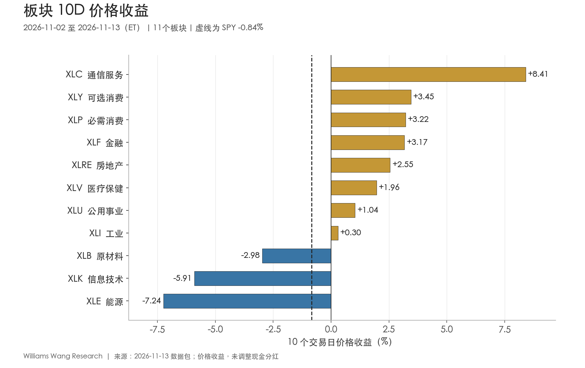
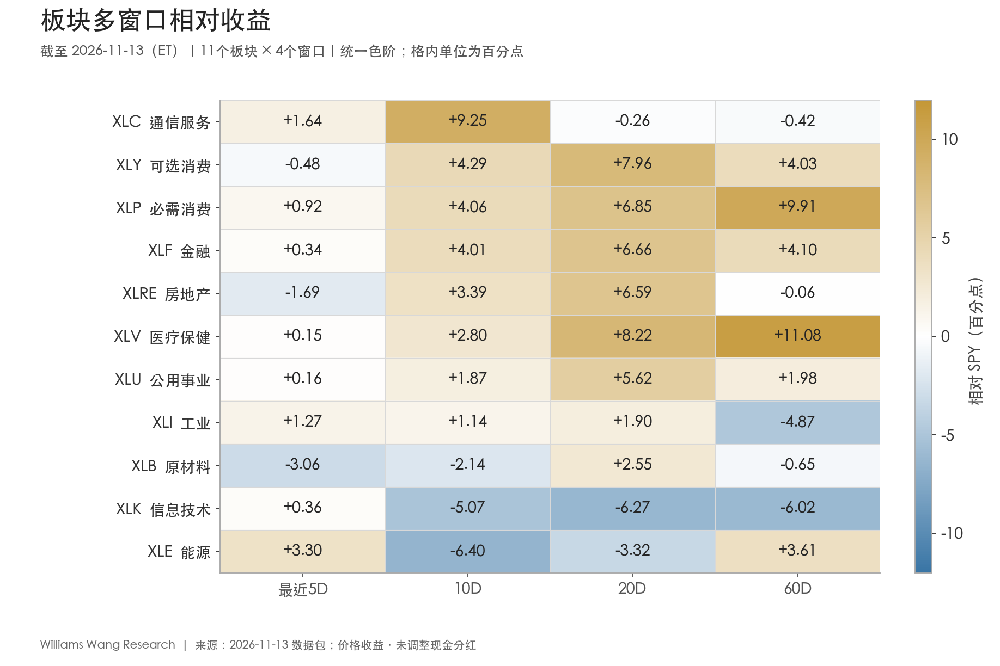
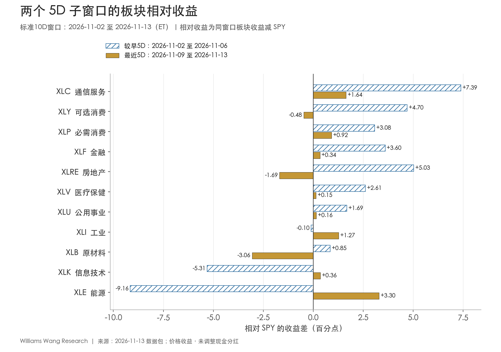

+++
title = "市场板块轮动双周分析报告｜截至 2026-11-13（ET）"
date = "2026-11-14"
data_as_of = ["2026-11-11", "2026-11-12", "2026-11-13"]
data_as_of_note = "权益观察期11月2日至13日ET；多数利率、VIX和信用利差截至12日，WTI现货截至11日，部分利差和通胀补偿截至13日；保留各项实际观察日。"
draft = false
description = "通信领涨、第二周上涨面修复，实际利率与美元同步上行；区分中期回撤、风险溢价缓和及贴现率压力，并保留拆股口径限制。"
series = "市场板块轮动双周复盘"
categories = ["市场结构", "宏观与政策"]
tags = ["板块轮动", "SPY", "ETF", "市场广度"]
featured = false
private = false
content_preservation = "verbatim"
source_sha256 = "d68f80bba855e64c8b84f96094b43feae91a737091891233fc2b490b4a275729"
+++

# 市场板块轮动双周分析报告｜截至 2026-11-13（ET）

**通信领涨、上涨面修复，实际利率与美元同步上行**

观察期为 **2026 年 11 月 2—13 日**，共 10 个交易日。制作时间为 2026 年 11 月 14 日 08:03:50（Asia/Singapore）。市场日期按美东时间理解。ETF 收益采用未调整现金分红的收盘到收盘价格收益。

## 一、本报告期结论

**通信服务成为本期领涨板块，第二周上涨面明显恢复。** XLC 完整 10D 上涨 **8.41%**，由对照期第 11 升至第 1。可选消费 XLY、必需消费 XLP 分别上涨 **3.45%、3.22%**，分列第 2、3。最近 5D 有 **10/11** 个板块上涨，较前 5D 的 6 个增加四个，板块平均收益由 **−1.23%** 回升至 **+2.01%**。不过，通信的 20D、60D 价格收益仍分别为 **−1.80%、−2.15%**，领先集中在最近两周。

**等权市场恢复好于小盘，能源和科技仍未收复第一周跌幅。** RSP 本期上涨 **1.12%**，SPY、QQQ、IWM 分别下跌 **0.84%、2.34%、1.27%**。能源和科技最近 5D 分别反弹 **5.05%、2.10%**，完整 10D 仍下跌 **7.24%、5.91%**，期末也低于 20 日均线。原材料连续两段下跌，是第二周唯一录得负收益的板块。

**风险定价修复与利率压力并存。** 11 月 6 日至 12 日，HY OAS 收窄 **22 bp**，VIX 下降 **6.94 点**。同一段实际观察期，10 年期实际收益率上升 **23 bp**。最近 5D 美元 UUP 上涨 **1.84%**，长债 TLT 下跌 **2.90%**，黄金 GLD 下跌 **4.68%**。这组变化支持风险溢价缓和与贴现率压力同时存在的判断，增长、通胀和行业盈利各自的贡献仍缺乏识别。

| 权益代理 | 较早5D | 最近5D | 完整10D | 20D | 60D |
| --- | ---: | ---: | ---: | ---: | ---: |
| SPY | −2.54% | +1.75% | −0.84% | −1.54% | −1.73% |
| QQQ | −4.78% | +2.56% | −2.34% | −4.76% | −5.15% |
| RSP | −1.04% | +2.19% | +1.12% | +3.33% | +0.22% |
| IWM | −2.00% | +0.75% | −1.27% | +2.17% | −7.35% |

较早 5D 为 11 月 2—6 日，最近 5D 为 11 月 9—13 日。11 月 13 日 SPY、QQQ 分别下跌 **1.02%、2.02%**，RSP 基本持平。包内 VIX、信用利差和多数利率仅更新到 12 日，因此期末权益回撤后的风险定价仍待下一份数据确认。

## 二、轮动证据与市场广度

完整 10D 收益以 **10 月 30 日收盘** 为基准，最近 5D 以 **11 月 6 日收盘** 为基准。排名对照期为 **10 月 19—30 日**，基准日为 10 月 16 日。上份报告截止 11 月 6 日，与本期共享 11 月 2—6 日五个交易日。下表的对照期和本期相互不重叠，均由本期包内价格计算。

| 区间 | 上涨板块 | 跑赢SPY | 期末高于20日均线 | 板块平均收益 | SPY收益 |
| --- | ---: | ---: | ---: | ---: | ---: |
| 对照10D：10/19—10/30 | 9/11 | 9/11 | 8/11 | +1.11% | −0.71% |
| 本期10D：11/02—11/13 | 8/11 | 8/11 | 8/11 | +0.72% | −0.84% |
| 较早5D：11/02—11/06 | 6/11 | 8/11 | 7/11 | −1.23% | −2.54% |
| 最近5D：11/09—11/13 | 10/11 | 8/11 | 8/11 | +2.01% | +1.75% |

**广度恢复体现在绝对收益与均线参与面。** 最近 5D 的上涨数量从 6 个增至 10 个，跑赢 SPY 的数量却仍为 8 个，因为 SPY 自身已从下跌转为上涨。可选消费与房地产均上涨，但涨幅低于基准。期末均线上方板块从 7 个增至 8 个，通信与工业进入，原材料退出。与本期起点相比，数量仍为 8 个，内部成员已发生变化。

本期最高与最低板块收益相差 **15.65 个百分点**，横截面标准差为 **4.32 个百分点**。11 板块平均收益为 **+0.72%**，中位数为 **+1.96%**。剔除领涨的通信，剩余 10 板块均值约 **−0.04%**，说明等权均值转正对通信的涨幅较敏感。同时，8 个板块确实上涨，不能用平均数一个指标概括参与面。板块 ETF 等权统计与 SPY 的市值权重不同，权重贡献还需成分数据核验。

**排名更替覆盖头部与部分原先领先板块。** 本期与对照期排名相关系数为 **−0.20**，前三名重合 **0/3**。本期前三为通信、可选消费、必需消费，对照期前三为医疗、原材料、公用事业。名次变动绝对值至少五位的有四个，分别为通信 **+10**、医疗 **−5**、原材料 **−7**、能源 **−6**。这些是描述性统计，未使用历史校准的轮动强度阈值。

20D 有 **8/11** 跑赢 SPY、8/11 绝对上涨，60D 则均为 **6/11**。长窗口领先的覆盖面低于最近 10D，部分反弹仍在修复前期回撤。

## 三、Leadership 与 laggards

下表按本期价格收益排序，相对收益列单位为百分点，均线状态取 11 月 13 日收盘。

| 板块 | 对照期→本期名次 | 10D价格收益 | 10D相对SPY | 20D相对SPY | 60D相对SPY | 高于20日均线 |
| --- | ---: | ---: | ---: | ---: | ---: | --- |
| XLC 通信服务 | 11→1 | +8.41% | +9.25 | −0.26 | −0.42 | 是 |
| XLY 可选消费 | 4→2 | +3.45% | +4.29 | +7.96 | +4.03 | 是 |
| XLP 必需消费 | 7→3 | +3.22% | +4.06 | +6.85 | +9.91 | 是 |
| XLF 金融 | 8→4 | +3.17% | +4.01 | +6.66 | +4.10 | 是 |
| XLRE 房地产 | 6→5 | +2.55% | +3.39 | +6.59 | −0.06 | 是 |
| XLV 医疗保健 | 1→6 | +1.96% | +2.80 | +8.22 | +11.08 | 是 |
| XLU 公用事业 | 3→7 | +1.04% | +1.87 | +5.62 | +1.98 | 是 |
| XLI 工业 | 9→8 | +0.30% | +1.14 | +1.90 | −4.87 | 是 |
| XLB 原材料 | 2→9 | −2.98% | −2.14 | +2.55 | −0.65 | 否 |
| XLK 信息技术 | 10→10 | −5.91% | −5.07 | −6.27 | −6.02 | 否 |
| XLE 能源 | 5→11 | −7.24% | −6.40 | −3.32 | +3.61 | 否 |

**通信两周持续上涨，中期仍处在回撤修复阶段。** XLC 较早 5D 上涨 **4.85%**，最近 5D 再涨 **3.39%**，相对 SPY 分别领先 **7.39、1.64 个百分点**。其 20D、60D 相对收益仍为 **−0.26、−0.42 个百分点**。价格回到 20 日均线上方，为近期修复增加了一项证据，完整中期区间的领先尚未出现。

**可选消费维持正收益，最新一周相对节奏放缓。** XLY 完整 10D 上涨 **3.45%**，20D 与 60D 分别上涨 **6.42%、2.30%**。最近 5D 上涨 **1.26%**，落后同期上涨 1.75% 的 SPY 约 **0.48 个百分点**。其四个窗口绝对收益均为正，但最新窗口的相对优势减弱。

**必需消费、金融、医疗和公用事业在四个窗口均跑赢 SPY。** XLP 与 XLF 最近 5D 分别上涨 **2.67%、2.08%**，高于较早 5D 的 **0.54%、1.06%**。医疗本期名次从第 1 降至第 6，但两段均上涨，60D 价格收益仍有 **+9.35%**，相对 SPY **+11.08 个百分点**。公用事业由较早 5D 下跌 **0.85%** 转为最近 5D 上涨 **1.90%**，60D 价格收益仅 **+0.25%**，多窗口相对为正的绝对涨幅并不均匀。

**房地产涨幅集中于第一周，工业反弹主要发生在第二周。** XLRE 先涨 **2.49%**，再涨 **0.06%**，最近 5D 落后 SPY **1.69 个百分点**。其 60D 相对收益约 **−0.06 个百分点**，在分红未调整的口径下宜视作接近基准。XLI 由前段下跌 **2.64%** 转为后段上涨 **3.02%**，完整 10D 仅上涨 **0.30%**，60D 仍下跌 **6.60%**。工业回到 20 日均线上方，较长区间的损失仍然较大。

**原材料持续落后，能源和科技开始反弹。** XLB 连续两段分别下跌 **1.69%、1.31%**，从对照期第 2 降至第 9。其 20D 尚上涨 **1.01%**，与近期走弱构成时间尺度分歧。能源、科技最近 5D 已跑赢 SPY，但能源 20D 仍下跌 **4.86%**，科技 20D、60D 分别下跌 **7.81%、7.76%**。能源 60D 仍上涨 **1.88%**，60D 窗口的起点与前期涨幅解释了其与科技的差异。

四个窗口相互嵌套。热力图反映同一组价格在不同区间的表现，不能当作四份独立预测证据。

## 四、两个 5D 子窗口中的持续与反转

| 板块 | 较早5D收益 | 最近5D收益 | 较早5D相对SPY（百分点） | 最近5D相对SPY（百分点） |
| --- | ---: | ---: | ---: | ---: |
| XLC 通信服务 | +4.85% | +3.39% | +7.39 | +1.64 |
| XLY 可选消费 | +2.16% | +1.26% | +4.70 | −0.48 |
| XLP 必需消费 | +0.54% | +2.67% | +3.08 | +0.92 |
| XLF 金融 | +1.06% | +2.08% | +3.60 | +0.34 |
| XLRE 房地产 | +2.49% | +0.06% | +5.03 | −1.69 |
| XLV 医疗保健 | +0.07% | +1.89% | +2.61 | +0.15 |
| XLU 公用事业 | −0.85% | +1.90% | +1.69 | +0.16 |
| XLI 工业 | −2.64% | +3.02% | −0.10 | +1.27 |
| XLB 原材料 | −1.69% | −1.31% | +0.85 | −3.06 |
| XLK 信息技术 | −7.85% | +2.10% | −5.31 | +0.36 |
| XLE 能源 | −11.70% | +5.05% | −9.16 | +3.30 |

通信、必需消费、金融、医疗和公用事业在两段均跑赢 SPY。工业、科技和能源由相对落后转为相对领先，可选消费、房地产、原材料则反向变化。后两类共涉及六个板块，体现出反弹内部的节奏切换。全部 11 板块中，有八个最近 5D 的绝对收益高于较早 5D。

**最近一周的修复先集中在周初，后半周再度分化。** 11 月 9 日，11 个板块全部上涨，SPY 上涨 **2.19%**、QQQ 上涨 **3.32%**。11 月 12 日仅能源一个板块上涨，13 日有六个板块上涨，但科技下跌 **2.80%**、原材料下跌 **2.24%**。这使最近 5D 的正收益与期末回撤同时存在。

能源最近 5D 上涨 **5.05%**，抵消了部分前段 **11.70%** 的跌幅，复合后完整 10D 仍为 **−7.24%**。两段价格收益应复合计算，修复幅度也要结合此前跌幅评估。科技最新一周虽跑赢 SPY **0.36 个百分点**，20D 和 60D 相对差距仍分别为 **−6.27、−6.02 个百分点**。

## 五、外部上下文与时间顺序

**11 月 6 日的就业报告。** BLS 公布 10 月非农就业增加 **16.5 万人**，失业率为 **4.1%**。该信息位于本期第一周末。就业仍扩张，与随后信用利差收窄相容，但本包缺少预期差、资金流和成分股贡献，无法据此确认板块涨幅的宏观归因。[BLS，2026-11-06 就业报告](https://www.bls.gov/news.release/archives/empsit_11062026.htm)

**11 月 10 日的 CPI。** 10 月整体 CPI 经季调环比上涨 **0.4%**，核心 CPI 环比上涨 **0.3%**。BLS 说明，由于 2025 年 10 月调查数据缺失，多数系列无法发布对应的 2026 年 10 月同比变化，本文保留这一缺口。包内同日 2 年期、10 年期收益率分别较前一观察日上升 **17、10 bp**，10 年期实际收益率上升 **12 bp**。这是同日变化的描述，缺少市场预期和盘中数据，尚不足以量化 CPI 的单独影响。[BLS，2026-11-10 CPI 原文](https://www.bls.gov/news.release/archives/cpi_11102026.htm)

**11 月 13 日的 PPI。** 最终需求 PPI 经季调环比上涨 **0.3%**，未季调同比上涨 **6.5%**。剔除食品、能源和贸易服务的指标环比上涨 **0.5%**、同比上涨 **4.9%**。该排除口径与仅剔除食品能源的指标不同。PPI 发布于报告截止日，晚于包内最新利率、OAS 和 VIX 观察值，无法用这些滞后一日的数值衡量发布后的市场反应。[BLS，2026-11-13 PPI 原文](https://www.bls.gov/news.release/archives/ppi_11132026.htm)

通胀环比继续上升、实际利率走高，同时信用利差收窄、权益上涨面恢复，解释证据混杂。本报告保留增长、贴现率、风险溢价与行业差异多条可能渠道。具体公司盈利或政策事件对通信等板块的贡献，仍需成分股层面的研究。

## 六、风格与跨资产背景

以下价差与周期／防御分组采用本数据包的分析口径，属于描述性代理，未验证预测能力。各项均为同窗口价格收益差，单位为百分点。周期组为 XLY、XLF、XLI、XLB、XLE 的等权均值，防御组为 XLP、XLU、XLV 的等权均值。

| 价差代理 | 最近5D | 10D | 20D | 60D |
| --- | ---: | ---: | ---: | ---: |
| 成长−价值（SPYG−SPYV） | −1.36 | −3.03 | −7.95 | −7.26 |
| 大盘成长−价值（IWF−IWD） | −0.42 | −5.16 | −9.21 | −9.51 |
| 等权−市值加权（RSP−SPY） | +0.44 | +1.96 | +4.87 | +1.95 |
| 小盘−大盘（IWM−SPY） | −1.00 | −0.43 | +3.71 | −5.62 |
| 低波动−市场（USMV−SPY） | +1.09 | +1.97 | +4.35 | +5.14 |
| 周期−防御（板块等权） | −0.13 | −2.73 | −3.74 | −6.41 |
| 高收益−投资级债（HYG−LQD） | +1.27 | +0.72 | +1.03 | −0.28 |
| 长债−中期债（TLT−IEF） | −1.05 | −1.15 | −0.15 | −0.43 |

**价值和低波动领先，等权与小盘分化。** 成长相对价值的两组代理在四个窗口均为负，最近 5D SPYG−SPYV 为 **−1.36 个百分点**，IWF−IWD 为 **−0.42 个百分点**。USMV 最近 5D 上涨 **2.84%**，相对 SPY 领先 **1.09 个百分点**。RSP 完整 10D 上涨 **1.12%**并高于 20 日均线，IWM 完整 10D 下跌 **1.27%**，60D 下跌 **7.35%**，最近 5D 也落后 SPY **1.00 个百分点**。当前修复对小盘的覆盖有限。

**周期相对防御的差距在第二周收窄。** 完整 10D 周期组平均下跌 **0.66%**，防御组上涨 **2.07%**，差 **−2.73 个百分点**。最近 5D 两组分别上涨 **2.02%、2.16%**，差距仅 **−0.13 个百分点**。如果将能源从周期组中剔除，完整 10D 周期组仍落后防御组 **1.09 个百分点**，本期防御领先不完全依赖能源一项。组内行业构成影响这些均值，ETF 价差未经风险因子中性化。

### MTUM、QUAL 的拆股口径

原始价格中，MTUM 从 10 月 30 日 **284.10 美元**降至 11 月 2 日 **68.785 美元**，QUAL 从 **222.49** 降至 **55.5025 美元**。SEC 收录的 iShares 说明列明两者均为 **1 股拆为 4 股**，拆股后交易自 **11 月 5 日**开始。包内单位断点较公告交易生效日早三个日历日，因此跨断点的指标需要保留口径限制。[iShares 2026-10-05 拆股说明，交易生效于 11 月 5 日](https://www.sec.gov/Archives/edgar/data/1100663/000119312526414100/R2.htm)

最近 5D 的起点为 11 月 6 日，两个端点都已处于拆股后，MTUM 上涨 **5.10%**、QUAL 上涨 **1.51%**。对 10D、20D、60D，以下仅作端点份额统一估算，采用 `4 × 期末价 / 期初价 − 1`，再减同窗口 SPY 收益。原始读数同时保留。表中单位为百分点。

| 窗口 | MTUM包内原始相对 | MTUM同份额端点相对 | QUAL包内原始相对 | QUAL同份额端点相对 |
| --- | ---: | ---: | ---: | ---: |
| 5D | +3.35 | +3.35 | −0.24 | −0.24 |
| 10D | −75.36 | −3.97 | −74.08 | +1.16 |
| 20D | −75.41 | −6.24 | −73.65 | +0.79 |
| 60D | −76.11 | −9.63 | −73.17 | +2.14 |

5D 两列一致，因为该段无需跨拆股换算。统一份额后，MTUM 10D 价格收益约 **−4.81%**，落后 SPY **3.97 个百分点**，短期反弹尚未抹去完整区间损失。QUAL 10D 价格收益约 **+0.32%**，领先 SPY **1.16 个百分点**。这些端点估算未验证跨断点的逐日路径，均线、波动率和回撤仍需连续同口径行情复核。11 个板块的名次与广度不含这两只风格 ETF。

### 商品与美元

| ETF价格收益 | 最近5D | 10D | 20D | 60D |
| --- | ---: | ---: | ---: | ---: |
| UUP 美元 | +1.84% | +1.66% | +1.94% | +5.63% |
| GLD 黄金 | −4.68% | +0.03% | −6.68% | −14.30% |
| USO 原油期货 | −1.76% | −13.76% | −9.97% | +8.22% |
| DBC 广义商品 | −0.65% | −8.36% | −9.06% | −1.00% |

美元上行、实际收益率走高与黄金回落在最近一周方向相容。GLD 前 5D 上涨 **4.94%**、后 5D 下跌 **4.68%**，复合后完整 10D 仅 **+0.03%**。接近持平的区间收益掩盖了较大的路径变化。

原油期货 ETF USO 完整 10D 下跌 **13.76%**，广义商品 DBC 下跌 **8.36%**。以 10 月 30 日为基准，统一截到现货最后观察日 **11 月 11 日**，WTI 现货下跌 **16.68%**，USO 下跌 **16.21%**。若只看 11 月 6—11 日，现货和 USO 分别下跌 **5.03%、4.55%**，同期能源股票 XLE 反而上涨 **2.49%**。因此，能源股票第二周的反弹与同期原油下行形成分歧，其原因仍需要盈利、估值与持仓证据。期货 ETF 的展期与定价口径也会影响与现货的差值。

## 七、Rates / credit / volatility

宏观变化从 10 月 30 日或 11 月 6 日起，计算到各行实际最新观察日。收益率、利差和通胀补偿的水平用百分比表示，变化用 bp 表示，1 bp 等于 0.01 个百分点。VIX 使用指数点，WTI 使用美元/桶。

| 指标 | 10/30基准 | 最新值 | 实际观察日 | 本期变化 | 11/06后变化 |
| --- | ---: | ---: | --- | ---: | ---: |
| 2年美债 | 4.56% | 4.86% | 11-12 | +30 bp | +35 bp |
| 10年美债 | 4.94% | 5.10% | 11-12 | +16 bp | +24 bp |
| 30年美债 | 5.31% | 5.43% | 11-12 | +12 bp | +17 bp |
| 10Y−2Y（单独序列） | 0.38% | 0.27% | 11-13 | −11 bp | −8 bp |
| 10Y−3M | 0.78% | 0.83% | 11-13 | +5 bp | +16 bp |
| 10年实际收益率 | 2.60% | 2.86% | 11-12 | +26 bp | +23 bp |
| 10年通胀补偿 | 2.34% | 2.24% | 11-13 | −10 bp | +1 bp |
| HY OAS | 3.44% | 3.20% | 11-12 | −24 bp | −22 bp |
| IG OAS | 0.94% | 0.89% | 11-12 | −5 bp | −4 bp |
| VIX | 19.42 点 | 18.70 点 | 11-12 | −0.72 点 | −6.94 点 |
| WTI现货 | 107.56 美元/桶 | 89.62 美元/桶 | 11-11 | −17.94 美元/桶 | −4.75 美元/桶 |

**同日对齐后，收益率上行以实际利率贡献为主。** 截至 11 月 12 日，10 年名义收益率较 10 月 30 日上升 **16 bp**，实际收益率上升 **26 bp**，通胀补偿下降 **10 bp**。若只看 11 月 6—12 日，名义收益率上升 **24 bp**，实际收益率上升 **23 bp**，通胀补偿上升 **1 bp**。这是按可比日期作的算术分解，TIPS 流动性和风险溢价仍影响其经济含义。

2 年期与 10 年期在共同终点分别为 **4.86%、5.10%**，10Y−2Y 为 **24 bp**，较基准日收窄 **14 bp**。单独更新至 13 日的 T10Y2Y 为 **27 bp**，对应本期变化 **−11 bp**，因此两种终点应分开引用。最近 5D TLT 下跌 **2.90%**、IEF 下跌 **1.85%**，长久期表现更弱，与利率上行方向相容。

**信用利差收窄与信用债价格下跌同时出现。** HY OAS 由 **344** 降至 **320 bp**，IG OAS 由 **94** 降至 **89 bp**，但 HYG 与 LQD 完整 10D 分别下跌 **0.72%、1.44%**。利率上行与两只 ETF 的久期差异会影响价格，因此 HYG−LQD 的 **+0.72 个百分点**只能作为跨资产代理，OAS 提供更直接的信用利差证据。

VIX 在 11 月 5 日升至 **28.18**，6 日为 **25.64**，12 日降至 **18.70**，低于本期基准值 19.42。11 月 12 日仍仅一个板块上涨，13 日科技再度下跌，表明风险指标回落与权益日间路径仍可能分化。包内尚无 13 日 VIX 和 OAS，无法判断期末回撤后的更新幅度。

## 八、下一报告期观察点

- **通信的中期确认。** 跟踪 XLC 能否在继续取得正收益的同时，收复 20D 和 60D 的负相对收益。其本期排名跃升较大，继续领涨需要新数据支持。
- **能源、科技与原材料的不同路径。** 能源和科技已在最近 5D 跑赢，后续观察绝对反弹、均线与中期相对收益是否同步改善。原材料仍连续下跌，应关注是否加入恢复队列。
- **广度与规模。** 最近 5D 有 10 个板块上涨，期末有 8 个板块高于 20 日均线。若这些数量下降、IWM 继续落后而 RSP 相对优势收缩，第二周修复的持续性将减弱。
- **利率与风险溢价。** 观察实际利率继续上升时，信用利差和 VIX 能否保持改善，并补齐 11 月 13 日及之后数据。若风险溢价重新扩大，贴现率与风险两方面的压力可能同时增加。

以上为研究观察条件，不涉及交易或仓位安排。

## 免责声明

本报告仅用于信息交流与研究复盘，不构成任何证券、基金、衍生品或其他金融产品的投资建议、交易指令或收益承诺。数据及公开资料可能存在滞后、修订、复权口径差异或错误。历史表现与相对强弱不保证未来结果。读者应独立核实并结合自身情况作出判断，投资决策、仓位及实际执行由读者自行负责。
