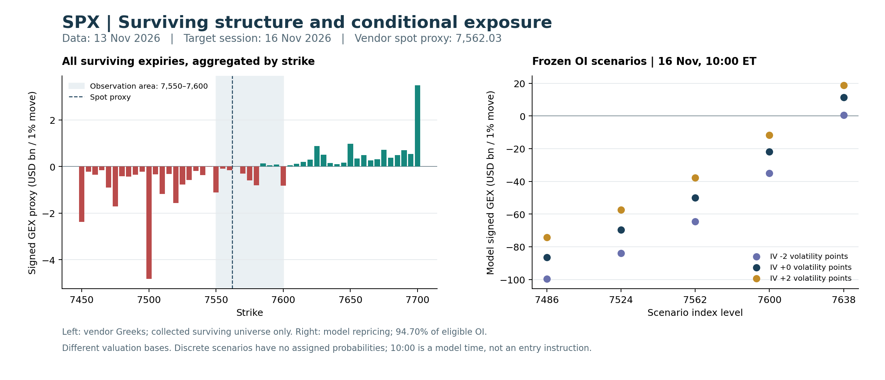

+++
title = "SPX期权持仓与Greeks结构分析-261113"
date = "2026-11-14"
data_as_of = ["2026-11-12", "2026-11-13"]
data_as_of_note = "D为11月13日、P为11月12日，目标日11月16日；P估值20:47:03 ET、D估值16:00 ET，月度Q使用滚动28日实际到期，来源与时钟差异依原文保留。"
draft = false
description = "周五到期层移除后负Gamma代理与月度左尾仍需关注；周一重定位7550–7600，区分下侧延续与上侧修复，保留均衡方向及近端质量限制。"
series = "SPX期权分析报告"
categories = ["衍生品", "市场结构"]
tags = ["SPX", "Greeks", "GEX", "期权", "风险分布"]
featured = false
private = false
content_preservation = "verbatim"
source_sha256 = "3ec5a1f1e9879e9876fc8e9b9eddc37e6d894513b9d213e703e16a5a6ef2a1e8"
+++



# SPX期权持仓与Greeks结构分析-261113

## 1. 一句话结论

11 月 13 日到期层移除后，存续 Gamma 库存代理仍明显偏负、月度左尾定价加重，11 月 16 日应先在 **7,550–7,600** 重新定位，重点区分下侧 **7,520–7,500** 延续与上侧 **7,625–7,650** 修复；最大反证是价格上移情景足以使冻结持仓模型转正，因此方向仍保持均衡，负 Gamma 不构成直接看空信号。

**盘后研究 B 级｜结构事实可复核，机制置信中低、方向置信低｜具体合约估值未纳入本次盘后研究｜目标日执行另行复核。** B 的原因是目标日附近 IV 局部报价质量不足，以及部分假日到期时钟需要修正，详见第 8、10 节。

## 2. T+1 Action Summary

| 项目 | 11 月 16 日条件准备 |
| --- | --- |
| Base stance | 若开盘仍在 7,550–7,600，则观察价格能否恢复 7,580–7,600，或跌离 7,550；离开核心且不能回归时，取消核心内判断。 |
| Earliest evaluation | 先核对截止后至周一开盘的消息及 08:30 ET 制造业调查，再按实际开盘位置评估；12:00 ET 央行讲话前后重新核对价格与 IV。若 gap 已越首个复核区，先重建地图。 |
| Base activation | 若 7,550 附近承接且修复至 7,580–7,600，可准备比较看涨单买与看涨借记价差；只有剩余空间和报价支持才继续，重新跌离 7,550 时取消修复分支。 |
| Downside branch | 若跌离 7,550、反抽不能恢复，先复核 7,520–7,500，再看 7,475–7,450；可比较看跌单买与看跌借记价差，恢复核心或已越首区时重评。 |
| Upside branch | 若恢复 7,600 并向 7,625 延伸，复核 7,638 情景附近及 7,650，再观察 7,700；模型反馈可能转弱，重新失守 7,580–7,600 时取消延伸判断。 |
| Otherwise | 若核心内反复、消息与价格反应抵消，或现时报价无法支持剩余空间，则以观察为主；新证据出现后重新立论，不自动建立卖区间结构。 |

## 3. Executive Summary

- **终点走弱，旧核心下移。** 现指代理由 7,592.95 降至 7,562.03，下降 30.92 点、0.407%。终点已低于前日报告的 7,575–7,605 工作核心，但仍高于其首个下侧复核位 7,550；仅凭终点不能确认盘中触发或交易收益。
- **负代理不仅来自周五到期层。** 同一存续合约组的 signed GEX 从 −7.032 增至负值幅度更大的 −27.726 十亿美元/1%；周一到期层自身为 −2.162，11/20 的 AM 与 PM 合计为 −18.149。后者是短期负敏感度的重要来源。
- **上下分支不对称，却没有经验证的方向概率。** 7,500 聚合 signed 节点为 −4.827，7,625、7,650、7,700 分别为 +0.876、+0.966、+3.477 十亿美元/1%。同一冻结 OI 模型下，周一 10:00、IV 不变时，价格 −1% 对应 −86.413，+1% 则对应 +11.450；这些是条件暴露，不是损益或情景胜率。
- **报价归因主要显示远期移动与认购/认沽抵消。** 研究样本认购均值 −33.077 点、认沽 +19.768 点，合并后仅 +1.359 点。配对远期下降约 78.5–79.3 点，显著大于现指代理下降 30.92 点，必须保留基差与异步时钟解释。
- **中段 IV 上移，最短端不能据此定价排序。** 12/11、12/14 同实际到期 ATM 分别上升 1.049、1.005 vp；11/16–19 节点仅作诊断。正式曲面整体审计通过，不能消除这些局部限制。
- **月度左尾增加，但低于上周极端背景。** 跌幅超过 5% 的风险中性终值概率为 11.016%，较前日增加 1.518 个百分点，位于过去 60 日中 35 个合格观察的约第 97 百分位；同时比 11/06 低 2.969 个百分点。风险重定价有增量，不宜描述为持续单向恶化。
- **下周一仍有明确事件窗口。** 08:30 ET 纽约州制造业调查、12:00 ET 美联储主席开场讲话均需重评；周二经济数据、周三会议纪要及周五月度到期会影响较晚到期的选择。短端局部质量和持有时点比“多留几天一定更安全”更重要。

## 4. What Changed vs. T-1 and Prior Playbook Review

以下变化分别使用已提供的同源现指代理、共同合约组、同到期 IV 或明确的滚动月度槽位，不能拼成同一时钟下的因果链。

| 实质变化 | 11/12 → 11/13 | 比较基础与含义 |
| --- | --- | --- |
| 现指与波动率背景 | 7,592.95 → 7,562.03；VIX 18.70 → 19.30 | 现指是原始链代理；VIX 为包内当日备用来源。价格偏弱、波动率指标走高，但没有完成事件因果识别。 |
| 同一存续合约组 signed GEX | −7.032 → −27.726，变化 −20.694 十亿美元/1% | 15,000 个共同合约；PM 变化 −7.231、AM 变化 −13.463。含价格、IV、时间、报告 OI 与供应商模型变化。 |
| 周五到期与周一存续分离 | 11/13 gross GEX 29.526 十亿美元/1% 的到期层退出；周一层 gross 11.176、signed −2.162 | 两层不能机械相减为资金流；旧展示图中 7,560 的大负节点主要来自已到期层。 |
| 较长同到期 ATM | 12/11：13.963% → 15.012%；12/14：13.670% → 14.675% | 同到期、两日局部权限可描述，变化含期限缩短及估值钟差异。 |
| 当日报价变化均值 | 研究组 +1.359 点，前一相邻区间 +0.259 点 | 合约构成在变化；共同研究合约复核见下文，不能作组合收益比较。 |
| 月度左尾与中央区间 | 跌幅＞5%：9.498% → 11.016%；下侧第5百分位：−7.595% → −8.260% | 两日均为28日，但实际到期从12/10滚至12/11，锚从7,592.95移至7,562.03；属于可描述的滚动定价比较。 |

**前日观察地图复核。** 前日报告将 7,575–7,605 设为事件后工作核心，失守后先看 7,550。本日代理终点 7,562.03 落在旧核心下方、7,550 上方，因此应撤去“仍在旧核心”的描述，并将下一日核心重定位为 7,550–7,600。材料未提供对齐的完整标的分时、当时结构/报价及实际成交记录，盘中触及顺序、完整触发和交易损益均不作确认。

### 期权报价变化归因：远期移动主导侧向差异

归因解释 11/12→11/13 同一 SPXW PM 合约的中间价变化，起点为 7–60 DTE，不含 AM 与 0DTE。全配对样本 9,275 份，占前日起点合格样本9,617份的96.44%；未配对部分涉及IV反解、报价、价差或标准化价差范围限制。研究子样本 5,348 份，按起点标准化价差和 forward delta 过滤。每份多头合约等权，单位为**指数点/合约**，美元换算为点数×100，未使用 OI 或组合权重。

| 分组 | 合约数 | 报价变化 | Delta | Gamma | Theta | Vega | 其余三项合计 | 残差均值 / 绝对值95分位 |
| --- | --- | --- | --- | --- | --- | --- | --- | --- |
| 研究子样本 | 5,348 | +1.359 | -0.223 | +2.990 | -1.433 | +0.042 | +0.038 | -0.055 / 0.304 |
| 起点真实 τ＜21 日 | 2,262 | +1.716 | +0.152 | +3.875 | -1.797 | -0.445 | -0.008 | -0.061 / 0.435 |
| 其中：认购 | 759 | -33.765 | -36.943 | +5.240 | -1.992 | -0.186 | +0.102 | +0.014 / 0.366 |
| 其中：认沽 | 1,503 | +19.634 | +18.884 | +3.186 | -1.698 | -0.576 | -0.063 | -0.099 / 0.458 |
| 起点真实 τ≥21 日 | 3,086 | +1.097 | -0.498 | +2.341 | -1.167 | +0.399 | +0.072 | -0.050 / 0.191 |
| 其中：认购 | 1,104 | -32.604 | -35.428 | +3.035 | -1.212 | +0.965 | +0.070 | -0.033 / 0.238 |
| 其中：认沽 | 1,982 | +19.869 | +18.959 | +1.954 | -1.142 | +0.084 | +0.073 | -0.060 / 0.162 |
| 全部研究认购 | 1,863 | -33.077 | -36.045 | +3.933 | -1.530 | +0.496 | +0.083 | -0.014 / 0.294 |
| 全部研究认沽 | 3,485 | +19.768 | +18.927 | +2.485 | -1.382 | -0.201 | +0.015 | -0.077 / 0.313 |

表内“其余三项”是 Vanna、Volga 和折现贡献之和；研究组分别为 +0.0068、+0.0067、+0.0249 点。期限组互斥，期限×认购/认沽的四组也构成互斥分区；它们与总组、认购/认沽汇总重叠，不能重复相加。各组数量超过 30 只是工程样本提示。

**均值接近零掩盖了方向项。** 研究组 Delta 均值仅 −0.223 点，但平均绝对 Delta 贡献达 24.890 点；认购 −36.045、认沽 +18.927 的贡献相互抵消。全配对样本的报价变化均值为 −10.248 点，与研究组的 +1.359 点方向不同，说明样本筛选和价内外构成非常重要。研究组 Gamma +2.990、Theta −1.433、Vega +0.042，不能据合并均值把本日归为普遍的“买波动获利”。

**期限之间的 IV 与时间贡献也不同。** 起点不足21日组 Vega −0.445 与 Theta −1.797 同向拖累，合计 −2.242 点，不存在正 Vega 抵消 Theta 的比例；21日及以上组 Vega +0.399、Theta −1.167，Theta 绝对均值/正 Vega 均值为 2.925，合计仍为 −0.768 点。后者认购比例为 1.256、合计 −0.247 点，认沽比例为 13.626、合计 −1.058 点。这些是组均值之间的关系，既不是盈利贡献占比，也不是各合约比例的平均。

先核对远期与现指，才能解释 Delta。25 个配对到期的远期均下降 78.48–79.32 点，现指代理均下降 30.92 点，其余 −47.56 至 −48.40 点来自“远期减现指代理”的变化。例如 11/19 到期：

\[
\Delta F=-78.946=(-30.920)+(-48.026)\ \text{点}。
\]

前日估值标记为 11/12 20:47:03 ET，本日为 11/13 16:00 ET；前日夜间现指是否同步未独立确认。这一恒等式定位了额外变化所在，不能辨认利率、分红、陈旧现指或其他时钟差异的因果贡献。认购负 Delta 与认沽正 Delta 的归因方向可解释，幅度却不能直接视作现金指数仅下跌 30.92 点的结果。

### 历史位置与共同合约复核

下表比较的是**不同日期各自的相邻报价变化区间**，不是从参考日至本日累计持有的收益；5日和20日参照严格使用 11/06、10/16。

| 分组 | 11/13 均值（数量） | 11/12 均值（数量） | 相对11/06变化（当日数量） | 相对10/16变化（当日数量） |
| --- | --- | --- | --- | --- |
| 研究子样本 | +1.359（5,348） | +0.259（5,135） | +12.162（6,034） | -5.535（5,024） |
| 起点真实 τ＜21 日 | +1.716（2,262） | -0.004（2,077） | +15.106（2,514） | -7.115（1,892） |
| 起点真实 τ≥21 日 | +1.097（3,086） | +0.438（3,058） | +10.052（3,520） | -4.627（3,132） |
| 全部研究认购 | -33.077（1,863） | +1.541（1,838） | -35.160（2,917） | +3.408（1,803） |
| 全部研究认沽 | +19.768（3,485） | -0.456（3,297） | +42.629（3,117） | -11.409（3,221） |

研究组认购占比从 35.79% 降至 34.84%，平均剩余期限从 27.268 日降至 26.577 日。固定身份的共同研究合约为 4,843 份，覆盖本日研究组 90.56%、前日 94.31%：报价变化均值由 +0.302 升至 +1.096 点，差 +0.794，小于滚动研究组的 +1.100，但方向一致。共同合约中，Gamma 均值变化 +2.892、Vega −1.939、Theta +0.297、Delta −0.508 点；样本变化没有推翻“方向项抵消、Gamma 增量部分被 Vega 和时间消耗抵消”的解释，但影响幅度，且固定身份仍未消除到期递减。

本日研究组加入交叉与曲率项及折现后，RMSE 从 0.299 降至 0.159 点，残差绝对值95分位仍为 0.304 点；不足21日组为 0.435 点，高于较长组 0.191 点。因此残差均值较小不代表逐合约精确，拟合改善也仅属事后解释。最近20个交易日诊断序列没有缺日；本模块没有获配60/120日百分位，不能借用月度分布排名。

**对下一日的增量：** 本日认沽上涨更多由远期方向与凸性解释，不能单凭其价格上涨就继续追买高 IV；短期限的时间与 IV 拖累尤其需要核价。反证将来自更新远期、实际现指和同合约 IV 是否仍支持同一机制，而不是研究组均值的正负。

## 5. T 日盘面、字段时点与 Event-Risk Overlay

### 截止前已知信息与目标日风险窗口

| 时点（ET） | 截止时可知内容 | 对研究的通道与限制 |
| --- | --- | --- |
| 11/13 08:30，收盘前 | 10月PPI最终需求环比+0.3%、同比+6.5%；剔除食品、能源与贸易服务环比+0.5%、同比+4.9%。[BLS原始发布](https://www.bls.gov/news.release/archives/ppi_11132026.htm) | 通胀与利率定价仍需跟踪；没有同步分时和预期调查，不把当天价格变化全部归因于该结果。 |
| 11/13 10:50，收盘前 | 官方日历列有Bowman监管主题讨论；本次未核入讲话全文。 [美联储11月日历](https://www.federalreserve.gov/newsevents/2026-november.htm) | 只确认日程，不补写政策倾向或市场反应。 |
| 11/13 19:00，截止之后 | Jefferson关于生产率的讲话已列入日历；截止时尚未发生。 [美联储11月日历](https://www.federalreserve.gov/newsevents/2026-november.htm) | 周一前需补看结果，本报告不纳入其后发布内容。 |
| 11/16 05:00、12:00 | Barr讨论AI与金融稳定；Warsh在生产率与就业会议作开场讲话。 [美联储11月日历](https://www.federalreserve.gov/newsevents/2026-november.htm) | 不能仅凭讲话标题断定利率立场；12:00窗口可能影响盘中IV及方向结构。 |
| 11/16 08:30、11:00 | 纽约州制造业调查、消费者信用获取调查。 [纽约联储经济日历](https://www.newyorkfed.org/research/calendars/nationalecon_cal) | 结果未知。开盘前重定位与午间复核分别处理，不能预填结果。 |
| 11/17至11/20 | 11/17 08:30零售销售、进出口价格，09:15工业产出；11/18 14:00会议纪要；11/20月度到期。 [纽约联储日历](https://www.newyorkfed.org/research/calendars/nationalecon_cal)、[美联储日历](https://www.federalreserve.gov/newsevents/2026-november.htm)、[Cboe到期日历入口](https://www.cboe.com/about/hours/us-options) | 若选择较晚到期，须辨认跨越哪些事件。较晚到期不代表建议持仓跨夜。 |

收盘后至截止前，本次未核得需要单独重写结构判断的重大事件结果；这不等于保证该窗口没有新闻。官方日历的逐条首次公告时间未完整归档，以上作为已列明的待复核风险窗口，不能据本次检索声称完成历史逐分钟信息复原。

## 6. Decision Rationale — Analytical Bridge

### Thesis 1：下侧先观察，方向仍等待价格证据

**Claim：** 7,550 下方需要优先核对 7,520–7,500，而非假设到期移除后自然稳定。**Evidence：** 存续 signed GEX −27.726，11/20 AM/PM合计 −18.149；7,500聚合负节点 −4.827 十亿美元/1%。**Mechanism / Assumptions：** 在认购正、认沽负的库存代理和对冲反馈假设下，负敏感度可能放大已有位移；OI无法识别真实dealer头寸。**Next-session implication：** 跌离7,550且反抽失败时才研究下侧方向结构，重点看剩余至7,520–7,500的空间。**Falsifier：** 恢复7,580–7,600，或更新结构显示该负暴露显著弱化。**Confidence：** 节点事实较高，机制中低，方向低。

### Thesis 2：上侧修复会改变反馈，不能沿用固定看空叙事

**Claim：** 7,600上方进入另一套复核顺序。**Evidence：** 7,625、7,650、7,700聚合节点为正；周一10:00同模型、IV不变时，价格+0.5%仍为 −21.839，+1%已为 +11.450 十亿美元/1%。**Mechanism / Assumptions：** 价格移动改变各合约Gamma权重，可能削弱原负反馈；模型未预测新OI。**Next-session implication：** 恢复7,600后先7,625，再7,638情景附近及7,650；继续上移时比较收益封顶与剩余空间。**Falsifier：** 修复不能持续并重新跌回7,580–7,600下方，或新持仓结构不再相符。**Confidence：** 条件算术可复核，精确转折位置与路径未验证。

### Thesis 3：左尾定价升温支持谨慎选结构，不能直接推出“保护便宜”

**Claim：** 月度下侧风险定价值得保留，但不能用其为周一网格赋概率。**Evidence：** 跌幅＞5%的Q概率11.016%，60日/120日位置约97/93百分位；中央90%下侧幅度8.260%，上侧5.438%。**Mechanism / Assumptions：** 分布含风险补偿、现指/远期锚和尾部估计假设，期限是12/11终值。**Next-session implication：** 若下侧分支成立，比较看跌单买的开放凸性与借记价差的支出/封顶取舍，重新核对卖出翼的报价。**Falsifier：** 更新分布、期限偏度或价格路径不支持下侧判断，尤其不能忽略相对11/06左尾已缓和。**Confidence：** 当前描述中等，方向和交易价值未验证。

### Thesis 4：期限与时钟比全局“通过”标签更能约束准备

**Claim：** 不能凭11/16 ATM数值较低就优先周一到期，也不能把7日曲线凸起全部归为事件溢价。**Evidence：** 11/16–19仅诊断，11/20当前局部可用但滚动7日比较的前日节点受限；11/27与12/24到期钟未匹配提前收市。**Mechanism / Assumptions：** 报价拟合、时间消耗、事件覆盖和老化共同影响曲线。**Next-session implication：** 先选与预期持有时长相称的到期，再按实际报价、事件和退出时点比较；不得凭近端模型数字排成本效率。**Falsifier：** 新的合格局部报价与修正后的上游时钟提供可比证据。**Confidence：** 对限制的判断较高，对相对定价结论保持未定。

## 7. Conflicting Evidence, Confidence and What Changes the View

| 支持某判断的证据 | 削弱或约束 | 处理方式 / 改变观点所需信息 |
| --- | --- | --- |
| 存续signed GEX更负，下侧节点集中 | 上侧有正节点；冻结OI上移情景可以转正 | 只保留条件式防守顺序；实际恢复7,600并向7,625延伸时，撤去单向下行前提。 |
| 月度左尾概率与下侧幅度上升 | 非负终值质量仍为61.135%，收益中位数+0.986%；左尾低于11/06 | 中心与尾部不是同一指标。保留左偏定价背景，不给周一贴看空胜率。 |
| 中段ATM与模型参考IV上升 | 不足21日研究组Vega均值为负 | 固定合约归因与固定Δ/期限截面对象、权重不同，且P日夜间锚有变化；不是同口径市场意见相反。 |
| 当前IV比例变化方差年率下降 | IV水平与月度标的终值标准差上升 | 前者是IV动态强度，后两者分别是价格水平和月度终值离散度；不能互相否定。 |
| 全局曲面通过审计 | 11/16–19局部报价/形状不足，假日时钟另有限制 | 以逐到期用途限制和外部时钟核对约束正文；全局通过不等于每个期限可用于估值。 |
| 全1–60日DEX为正 | 近端DEX为负，且signed Gamma仍为负 | 期限和Greek对象不同；不把总DEX当成周一确定买盘。 |

先核对对象、到期、时点与现指/远期锚，再判断质量和共同来源。本日结构、正式IV、报价归因与月度分布共享原始期权快照，不能按四份独立证据“多数投票”；假设调整与敏感性也不增加独立票数。这里的路径论证仅有机制依据，尚未证明预测或收益优势。

价格恢复关键区域而推翻下侧假设，属于**方向论点失效**；方向仍成立但IV、支出或剩余空间变化，属于**候选需重新估值**；报价、账户或成交条件未满足，属于**执行条件不足**。三者分开处理。

## 8. IV Term Structure, Skew and Surface

### 质量与比较基础

本日正式IV整体状态为完整、正式曲面审计通过，范围为SPXW PM。29个到期中，19个采用约束拟合、9个采用形状修复、1个回退旧法；总体报价区间拟合比例80.86%、观察支持比例87.64%、拟合call价格单调性通过率96.55%，凸性、密度非负与日历检查均为100%。这些是工程诊断，不是预测准确率；模型支持比例12.36%也不是坏数据比例。

| 实际到期 | 当前方法 | 当前报价区间内拟合比例 | 形状 / 当前用途 | 额外限制 |
| --- | --- | --- | --- | --- |
| 11/16 | 约束拟合 | 44.62% | 形状通过；仅诊断 | 相对价值未获证实 |
| 11/17 | 旧法回退 | 33.78% | 形状检查未全过；仅诊断 | 相对价值未获证实 |
| 11/18 | 约束拟合 | 29.91% | 形状通过；仅诊断 | 相对价值未获证实 |
| 11/19 | 约束拟合 | 31.14% | 形状通过；仅诊断 | 相对价值未获证实 |
| 11/20 | 约束拟合 | 89.73% | 形状通过；局部模型参考 | 相对价值未获证实 |
| 11/27 | 形状修复 | 97.25% | 形状通过；局部模型参考 | 提前收市到期钟待修正 |
| 12/14 | 约束拟合 | 87.50% | 形状通过；局部模型参考 | 相对价值未获证实 |

**外部时钟限制：** Cboe列示11/27与12/24常规交易提前至13:00 ET结束，而本包正式IV仍使用这些到期日16:00 ET估值终点。报告保留原始τ和值，不在报告层改钟重拟合；对应同到期节点、14日与45日插值的精确时间和相对定价需降格使用。该问题不抹去12/11、12/14的合格同到期比较，也不自动否定使用12/11到期的月度分布。[Cboe 2026期权交易时段](https://www.cboe.com/about/hours/us-options)

前日使用**11/12日常正式包**，没有另选离线回放；模型、配置、分类器、范围和forward delta节点约定相容。P日估值为20:47:03 ET，D日为16:00 ET，间隔约19.216小时。以下D−P不是两个同步现金收盘之间的纯市场冲击。常规ATM指K=F；固定Δ不等于固定行权价。

### 常规 ATM：优先列同实际到期

| 实际到期 | P→D 的τ（日，原包） | P ATM | D ATM | Δ（vp） | 事件 / 结算 | 比较基础与质量 |
| --- | --- | --- | --- | --- | --- | --- |
| 11/16 PM | 3.8007 → 3.0000 | 12.035% | 11.762% | -0.273 | 周一到期；制造业调查、央行讲话 | 仅诊断：局部报价/形状不足 |
| 11/17 PM | 4.8007 → 4.0000 | 12.874% | 13.909% | +1.035 | 零售销售、工业产出 | 仅诊断：局部报价/形状不足 |
| 11/18 PM | 5.8007 → 5.0000 | 14.368% | 15.707% | +1.339 | 会议纪要 | 仅诊断：局部报价/形状不足 |
| 11/19 PM | 6.8007 → 6.0000 | 14.548% | 15.883% | +1.335 | 纪要后的期限 | 仅诊断：局部报价/形状不足 |
| 11/20 PM | 7.8007 → 7.0000 | 14.708% | 16.170% | +1.463 | 月度到期；此行仅 PM | 同到期描述；两日局部权限已核 |
| 11/27 PM | 14.8007 → 14.0000 | 13.144% | 14.400% | +1.255 | 提前收市 | 原钟描述值；提前收市限制 |
| 12/11 PM | 28.8007 → 28.0000 | 13.963% | 15.012% | +1.049 | 月度分布实际到期 | 同到期描述；两日局部权限已核 |
| 12/14 PM | 31.8007 → 31.0000 | 13.670% | 14.675% | +1.005 | 约30日背景槽位 | 同到期描述；两日局部权限已核 |

12/11同到期ATM上升1.049 vp、12/14上升1.005 vp，是较清楚的中段水平上移证据；11/20同到期上升1.463 vp，支持近周水平抬升，但尚不能分离事件方差。11/16数值下降0.273 vp只作诊断，不能据此确认目标日期权变便宜。

### 选定期限 smile：水平、倾斜与曲率分别看

Downside skew25＝25Δ put IV−ATM；BF25＝两侧25Δ IV均值−ATM。前者表示下侧倾斜，后者是曲率概括，均用波动率百分点vp；BF25不是蝶式组合价格或利润。

| 期限/用途/行类型 | 到期日 / τ（日） | 10Δ put | 25Δ put | ATM | 25Δ call | 10Δ call | Downside skew25 | BF25 | 比较基础 / 方法 / 质量 |
| --- | --- | --- | --- | --- | --- | --- | --- | --- | --- |
| 约7日 / P 水平 | 11/19 / 6.8007 | 20.585% | 17.129% | 14.548% | 12.688% | 11.536% | 2.581 vp | 0.361 vp | 滚动期限槽位、固定Δ；旧法回退；仅诊断 |
| 约7日 / D 水平 | 11/20 / 7.0000 | 21.971% | 18.805% | 16.170% | 14.033% | 12.659% | 2.635 vp | 0.249 vp | 滚动期限槽位、固定Δ；约束拟合；局部参考 |
| 约7日 / Δ D−P | 11/19 → 11/20 | +1.386 vp | +1.676 vp | +1.622 vp | +1.345 vp | +1.123 vp | +0.054 vp | -0.112 vp | 滚动期限槽位、固定Δ；仅诊断，不判断市场形状变化 |
| 约14日 / P 水平 | 11/27 / 14.8007 | 19.859% | 15.808% | 13.144% | 11.374% | 10.508% | 2.663 vp | 0.447 vp | 同实际到期、固定Δ；约束拟合；局部参考；提前收市钟限制 |
| 约14日 / D 水平 | 11/27 / 14.0000 | 21.412% | 17.410% | 14.400% | 12.291% | 11.103% | 3.010 vp | 0.450 vp | 同实际到期、固定Δ；形状修复；局部参考；提前收市钟限制 |
| 约14日 / Δ D−P | 11/27 → 11/27 | +1.553 vp | +1.602 vp | +1.255 vp | +0.916 vp | +0.596 vp | +0.346 vp | +0.004 vp | 同实际到期、固定Δ；描述性模型比较；提前收市钟限制 |
| 约30日 / P 水平 | 12/11 / 28.8007 | 22.292% | 17.206% | 13.963% | 12.114% | 11.358% | 3.244 vp | 0.698 vp | 滚动期限槽位、固定Δ；约束拟合；局部参考 |
| 约30日 / D 水平 | 12/14 / 31.0000 | 23.612% | 18.316% | 14.675% | 12.438% | 11.492% | 3.641 vp | 0.702 vp | 滚动期限槽位、固定Δ；约束拟合；局部参考 |
| 约30日 / Δ D−P | 12/11 → 12/14 | +1.320 vp | +1.110 vp | +0.712 vp | +0.323 vp | +0.134 vp | +0.398 vp | +0.004 vp | 滚动期限槽位、固定Δ；描述性模型比较 |

**水平：** 约14日同11/27节点ATM上升1.255 vp；约30日滚动槽位从12/11转至12/14，ATM上升0.712 vp。前者附提前收市钟限制，后者包含实际τ从28.8007变为31日，不能当作固定到期涨幅。

**倾斜：** 原钟模型中，约14日下侧倾斜增加0.346 vp，约30日槽位增加0.398 vp；put25升幅分别大于ATM，而call25升幅较小，说明并非仅有平行抬升。7日槽位的前日11/19局部质量受限，+0.054 vp只能列诊断差，不能确认近周skew变陡。

**曲率：** 约14日和30日BF25只增加约0.004 vp，经济意义未证实；7日槽位 −0.112 vp仍只作诊断，不能据此判断蝶式结构便宜。历史比较同时含到期老化、节点行权价位置变化、滚动与时钟差异，不能从这些差值直接得到收益优势。

### SPX短端候选期限：保留当前值和缺失原因

候选实际到期为11/16、17、18、19，目标日分别剩0、1、2、3个日历日。下表全部为局部诊断值；11/17、18的前日完整smile未随比较包提供，保留缺失。前表可有它们的前日ATM，仍不意味着两翼历史齐全。

| 期限/用途/行类型 | 到期日 / τ（日） | 10Δ put | 25Δ put | ATM | 25Δ call | 10Δ call | Downside skew25 | BF25 | 比较基础 / 方法 / 质量 |
| --- | --- | --- | --- | --- | --- | --- | --- | --- | --- |
| 11/16候选 / P 水平 | 11/16 / 3.8007 | 16.300% | 13.853% | 12.035% | 10.729% | 10.093% | 1.818 vp | 0.256 vp | 同实际到期、固定Δ；约束拟合；局部参考 |
| 11/16候选 / D 水平 | 11/16 / 3.0000 | 15.165% | 13.338% | 11.762% | 10.603% | 9.641% | 1.577 vp | 0.209 vp | 同实际到期、固定Δ；约束拟合；仅诊断 |
| 11/16候选 / Δ D−P | 11/16 → 11/16 | -1.135 vp | -0.515 vp | -0.273 vp | -0.126 vp | -0.452 vp | -0.242 vp | -0.048 vp | 同实际到期、固定Δ；仅诊断，不判断市场形状变化 |
| 11/17候选 / P 水平 | 未提供 | 不可比：缺P节点 | 不可比：缺P节点 | 不可比：缺P节点 | 不可比：缺P节点 | 不可比：缺P节点 | 不可比：缺P节点 | 不可比：缺P节点 | 前日未提供同到期完整smile；缺P，禁止补翼 |
| 11/17候选 / D 水平 | 11/17 / 4.0000 | 17.911% | 15.650% | 13.909% | 12.696% | 12.009% | 1.742 vp | 0.265 vp | 前日未提供同到期完整smile；旧法回退；仅诊断 |
| 11/17候选 / Δ D−P | 缺P → 11/17 | 不可比：缺P节点 | 不可比：缺P节点 | 不可比：缺P节点 | 不可比：缺P节点 | 不可比：缺P节点 | 不可比：缺P节点 | 不可比：缺P节点 | 前日未提供同到期完整smile；缺P，禁止补翼 |
| 11/18候选 / P 水平 | 未提供 | 不可比：缺P节点 | 不可比：缺P节点 | 不可比：缺P节点 | 不可比：缺P节点 | 不可比：缺P节点 | 不可比：缺P节点 | 不可比：缺P节点 | 前日未提供同到期完整smile；缺P，禁止补翼 |
| 11/18候选 / D 水平 | 11/18 / 5.0000 | 21.430% | 18.161% | 15.707% | 13.723% | 12.420% | 2.453 vp | 0.235 vp | 前日未提供同到期完整smile；约束拟合；仅诊断 |
| 11/18候选 / Δ D−P | 缺P → 11/18 | 不可比：缺P节点 | 不可比：缺P节点 | 不可比：缺P节点 | 不可比：缺P节点 | 不可比：缺P节点 | 不可比：缺P节点 | 不可比：缺P节点 | 前日未提供同到期完整smile；缺P，禁止补翼 |
| 11/19候选 / P 水平 | 11/19 / 6.8007 | 20.585% | 17.129% | 14.548% | 12.688% | 11.536% | 2.581 vp | 0.361 vp | 同实际到期、固定Δ；旧法回退；仅诊断 |
| 11/19候选 / D 水平 | 11/19 / 6.0000 | 21.394% | 18.378% | 15.883% | 13.926% | 12.539% | 2.495 vp | 0.269 vp | 同实际到期、固定Δ；约束拟合；仅诊断 |
| 11/19候选 / Δ D−P | 11/19 → 11/19 | +0.809 vp | +1.249 vp | +1.335 vp | +1.237 vp | +1.003 vp | -0.085 vp | -0.091 vp | 同实际到期、固定Δ；仅诊断，不判断市场形状变化 |

### 固定期限 ATM 背景与来源权重

下表沿用管线“固定期限”定义，来源实际τ及上端总方差插值权重w同时列明；原包的近期限节点选择可能直接使用邻近实际τ，不能重新包装成严格连续期限插值。报告没有重新插值或补翼。

| 名义期限（日） | P ATM | D ATM | Δ（vp） | P来源到期 / 权重 | D来源到期 / 权重 | 用途 |
| --- | --- | --- | --- | --- | --- | --- |
| 3 | 12.481% | 11.762% | -0.720 | 11/13–11/16；τ 0.8007–3.8007；w=0.7331 | 11/16–11/16；τ 3.0000–3.0000；w=0.0000 | 仅诊断 |
| 7 | 14.548% | 16.170% | +1.622 | 11/19–11/19；τ 6.8007–6.8007；w=0.0000 | 11/20–11/20；τ 7.0000–7.0000；w=0.0000 | 前日短端受限；仅诊断 |
| 14 | 13.334% | 14.400% | +1.066 | 11/25–11/27；τ 12.8007–14.8007；w=0.5997 | 11/27–11/27；τ 14.0000–14.0000；w=0.0000 | 11/27提前收市钟限制 |
| 30 | 13.839% | 14.780% | +0.941 | 12/11–12/14；τ 28.8007–31.8007；w=0.3998 | 12/11–12/14；τ 28.0000–31.0000；w=0.6667 | 两日局部参考；描述性比较 |
| 45 | 13.860% | 14.781% | +0.922 | 12/24–12/31；τ 41.8007–48.8007；w=0.4570 | 12/24–12/31；τ 41.0000–48.0000；w=0.5714 | 12/24当前报价受限，且提前收市钟限制 |

30日常规ATM为14.780%，较前日+0.941 vp。与RV20代理21.62%或VIX19.30%的差异只能作为不同窗口、不同对象的背景；不能把包内简化“便宜”标签升级成可获利风险溢价。

### 波动率联动与变化强度

**定义与单位。** 模型参考IV采用特殊参考位置 (K=F\exp(-\sigma^2\tau/2))，与上述常规K=F的ATM分栏。收益–IV联动是风险中性定价口径下，标的收益与**IV比例变化**的协方差年率；负值表示模型中的反向联动，不是dealer Gamma。变化强度是IV比例变化的方差年率，单位为每年，不是SPX收益方差。30日漂移是IV比例变化的定价年率诊断，正值表示该模型局部漂移为正，不能读成次日IV预测。表中IV水平为百分数，其差为vp；其余列均为相应年率及年率差。

| 期限（日） | 指标 | D水平 | Δ1日：11/12 | Δ5日：11/06 | Δ20日：10/16 |
| --- | --- | --- | --- | --- | --- |
| 14 | 模型参考 IV（%） | 14.650 | +1.161 | -6.906 | +0.548 |
| 14 | 收益–IV 联动年率 | -0.189 | -0.024 | +0.121 | +0.014 |
| 14 | IV比例变化方差年率 | 2.108 | -0.848 | +0.192 | -1.590 |
| 30 | 模型参考 IV（%） | 15.071 | +1.023 | -4.951 | +0.659 |
| 30 | 收益–IV 联动年率 | -0.143 | -0.020 | +0.077 | +0.008 |
| 30 | IV比例变化方差年率 | 1.691 | -0.104 | +0.380 | -0.569 |
| 30 | IV比例漂移年率 | 0.397 | -0.199 | +1.474 | +0.239 |
| 45 | 模型参考 IV（%） | 15.206 | +0.922 | -4.728 | +0.870 |
| 45 | 收益–IV 联动年率 | -0.127 | -0.016 | +0.062 | -0.001 |
| 45 | IV比例变化方差年率 | 1.197 | -0.140 | +0.277 | -0.294 |

**当前与来源。** 14/30/45日模型参考IV均高于前日，分别+1.161、+1.023、+0.922 vp；联动年率更负，但IV比例变化方差年率分别下降28.69%、5.82%、10.45%。这支持“IV水平上移并伴随较强反向联动”，不支持“所有波动风险指标都同步加速”。30日漂移从0.596降至0.397，仍为正；14/45日没有该项定义，不填零。

**历史位置。** 三个期限的参考IV仍分别低于11/06 6.906、4.951、4.728 vp，却高于10/16 0.548、0.659、0.870 vp。因此单日反弹与较上周回落同时成立，不能由两个端点声称连续上升。20日诊断序列用于历史对照，不能替代21次有效变化的已实现矩门槛。

**与过去已实现样本的对照。** 14日只有20/21次有效变化，历史矩与差值不可用；30、45日各有21/21次。30日历史IV方差年率0.991、收益–IV联动−0.185，与当前定价诊断的算术差分别+0.701、+0.042；45日历史值0.692、−0.156，差分别+0.505、+0.029。历史采用固定合约log IV变化并按252年化，定价诊断采用不同对象与估计口径；这些跨口径差既不能称为纯风险溢价，也不能证明保护昂贵。

**对原判断的补充与反证。** 中段参考IV上移与同到期ATM升温相容；它不否定短期固定合约组Vega均值为负，也不替代月度标的终值分布。若周一实际IV回落、远期/现指同步关系改变，或局部报价改善后呈现不同形状，应重建期权表达，不能继续照搬本日参数。

### 期权隐含月度分布（风险中性口径）

当前采用12/11 PM实际到期，28日，收益相对11/13的现指代理7,562.03，未年化、未计实际分红。数据权限允许描述市场定价分布。Q下中央90%终值区间为 **6,937.41–7,973.28**，对应 **−8.260%至+5.438%**；它不是现实置信区间、次日区间或盘中触及概率。

前日是12/10到期、锚7,592.95，两日月度报价均标记16:00 ET；本日与Greeks同一来源，前日月度来自收盘补充源。以下前日变化属于滚动28日槽位，混有到期更换、价格锚、carry和截面变化，没有同实际到期的月度分布对照。

| 互斥收益区间 | P概率 | D概率 | 变化（百分点） |
| --- | --- | --- | --- |
| ＜−10% | 2.882% | 3.398% | +0.516 |
| −10%至−5% | 6.616% | 7.618% | +1.002 |
| −5%至−2% | 11.455% | 12.060% | +0.606 |
| −2%至0 | 15.671% | 15.789% | +0.118 |
| ≥0 | 63.376% | 61.135% | -2.241 |
| 合计 | 100.000% | 100.000% | 0.000 |

合计按未舍入值计算；各行显示值相加可能有0.001个百分点的舍入差。

**当前分布不是单一“看涨/看跌比例”。** 本日全部四个负收益区间质量都增加，非负质量由63.376%降至61.135%，因此本次是下跌总概率与深左尾同时上升；不能套用“下跌总概率下降但尾部变厚”的别日解释。收益中位数仍为+0.986%，均值仅+0.019%，均值受远期约束；正中位数与较长左尾可以同时存在。中央区间下侧幅度增加0.665个百分点，上侧缩小0.065个百分点，总宽度扩大0.601个百分点，下侧减上侧扩大0.730个百分点，主要变化在下侧。

**历史位置：保留两个窗口。** 主窗口为过去60个交易日（8/20–11/12）中的35个合格观察，最早有效日8/21；辅助窗口为过去120个交易日（5/26–11/12）中的57个合格观察，最早有效日5/29。两窗排除当日，使用同运行口径、实际DTE、锚、时段和权限筛选。下表的百分位是**指标自身历史位置**，不是未来收益概率；收益第5百分位排序的是其对应的收益阈值。

| 月度终值指标 | D水平 | Δ1日（百分点） | 60日中位数 | 60日位置（N=35） | 120日中位数 | 120日位置（N=57） |
| --- | --- | --- | --- | --- | --- | --- |
| 到期收益低于0的概率 | 38.865% | +2.241 | 37.874% | 约第71 | 37.820% | 约第70 |
| 到期跌幅超过2%的概率 | 23.076% | +2.123 | 19.787% | 约第97 | 20.203% | 约第95 |
| 到期跌幅超过5%的概率 | 11.016% | +1.518 | 7.549% | 约第97 | 7.790% | 约第93 |
| 到期跌幅超过10%的概率 | 3.398% | +0.516 | 1.880% | 约第97 | 1.929% | 约第96 |
| 到期涨幅超过2%的概率 | 36.512% | -1.998 | 34.133% | 约第71 | 34.532% | 约第67 |
| 到期涨幅超过5%的概率 | 6.997% | -0.447 | 5.338% | 约第83 | 5.521% | 约第75 |
| 到期涨幅超过10%的概率 | 0.188% | -0.033 | 0.200% | 约第43 | 0.197% | 约第46 |
| 收益第5百分位 | -8.260% | -0.665 | -6.360% | 约第3 | -6.459% | 约第5 |
| 收益中位数 | 0.986% | -0.161 | 0.902% | 约第60 | 0.932% | 约第54 |
| 收益第95百分位 | 5.438% | -0.065 | 5.085% | 约第77 | 5.121% | 约第74 |
| 月度收益标准差（未年化） | 4.958% | +0.182 | 4.016% | 约第89 | 4.086% | 约第91 |
| 中央90%区间宽度 | 13.698% | +0.601 | 11.339% | 约第89 | 11.671% | 约第89 |
| 中央90%区间下侧幅度（相对锚） | 8.260% | +0.665 | 6.360% | 约第97 | 6.459% | 约第95 |
| 中央90%区间上侧幅度（相对锚） | 5.438% | -0.065 | 5.085% | 约第77 | 5.121% | 约第74 |
| 中央90%下侧幅度减上侧幅度 | 2.822% | +0.730 | 1.448% | 约第97 | 1.476% | 约第95 |

跌幅超过2%、5%、10%的概率在60日窗口均约第97百分位，120日窗口分别约95、93、96；左尾偏重不是仅依赖某一个窗口。收益第5百分位处在约第3/5百分位，意味着其收益阈值较低、下侧更宽，不能把低排名解释为低风险。右侧+2%和+5%概率仍高于历史中位数，+10%概率则约处中部；这不是整个右侧质量消失。月度标准差4.958%是未年化量，不与年化IV直接比较大小。

| 指标 | 相对11/06（5交易日）变化 | 相对10/16（20交易日）变化 |
| --- | --- | --- |
| 到期收益低于0的概率 | +3.250 个百分点 | +3.043 个百分点 |
| 到期跌幅超过5%的概率 | -2.969 个百分点 | +1.573 个百分点 |
| 到期跌幅超过10%的概率 | -2.408 个百分点 | +0.417 个百分点 |
| 收益第5百分位 | +2.637 个百分点 | -0.721 个百分点 |
| 收益中位数 | -0.785 个百分点 | -0.174 个百分点 |
| 月度收益标准差（未年化） | -1.552 个百分点 | -0.079 个百分点 |

**变化与反证。** 跌幅超过5%的概率虽较前日增加1.518个百分点，但较11/06下降2.969个百分点；第5百分位较11/06提高2.637个百分点，标准差下降1.552个百分点，说明当前仍未回到上周更宽的分布。相对10/16，下侧概率与左侧幅度增加，但标准差略降0.079个百分点，反映形状变化并非所有尺度同向扩大。5/20日对照使用指定交易日，仍是相同实际DTE/锚类型的滚动槽位，不是固定合约纯冲击。

60日的35个观察中34个为历史重建、1个为日常派生归档；120日的57个中56个为重建、1个为日常归档。日快照高度相关，不等于35或57个独立月度事件，也未构成历史实时预测验证。历史位置不证明期权贵贱。

**尾部和敏感性。** −10%、−5%、−2%对应约6,805.83、7,183.93、7,410.79点，均在本次观察行权价跨度内；整体拟合与外推仍会影响它们。外推概率质量为0.244%，却贡献11.727%的方差，不能因质量小而忽略尾部。固定“网格1点”和“最低bid 1点”两个单项扰动均合格，基准未更换：跌幅＞5%概率范围11.0156%–11.0257%，＞10%为3.3980%–3.4028%；标准差4.9431%–4.9580%，第5百分位−8.2652%至−8.2597%。本次单日1.518个百分点的＞5%变化大于这两项扰动造成的数值变化，但该检验未覆盖其他尾部模型、时钟或carry假设，不能称稳健性或预测验证。

额外假设调整将均值从+0.019%移至+0.264%、跌幅＞5%的概率从11.016%降至9.914%。这种右移首先来自调整假设本身，未提供独立看多证据，也不作为情景权重。

**对原结构的增量：** 月度结果约束了将当前核心理解为稳定卖波动区间的倾向，同时提醒下侧保护可能已有相当风险定价。7,500相对当前锚仅约−0.82%，7,450约−1.48%，均不等于固定−2%阈值；包内未给出这些具体点位的精确终值概率或历史排名，本报告不补造。

## 9. Key Expiry / Strike / Dealer Node

### 覆盖与到期分层

采集期限窗口为0–60个日历DTE，原始15,960份合约、报告OI 14,291,924。旧汇总过滤口径为12,748行、OI 8,470,747，占原始59.27%；这一比例不能当作新版存续地图的覆盖率。新版地图保留下一日开盘后仍可交易的15,282份合约，合格存续OI 13,390,097的覆盖为100%，没有因Gamma缺失额外剔除，形成7,641个到期/合约族/行权价节点。完整CSV覆盖已采集合格存续快照gross GEX的100%；7335.17–7788.89展示窗口只含其中64.54%。这不是全部上市期权的完整市场。

存续gross GEX为330.642、signed代理为−27.726，单位均为**十亿美元/标的变动1%**。认购正、认沽负只是库存代理符号；长认沽的数学Gamma仍为正。11/13到期层已从下一日地图移除，11/16层在周一成为0DTE。

| 到期 | 合约族 / 结算 | 报告OI | gross GEX | signed GEX代理 |
| --- | --- | --- | --- | --- |
| 11/16 | SPXW PM | 218,850 | 11.176 | -2.162 |
| 11/18 | SPXW PM | 152,589 | 10.076 | -4.182 |
| 11/20 | SPX AM | 2,098,686 | 55.702 | -14.459 |
| 11/20 | SPXW PM | 559,468 | 14.767 | -3.690 |
| 12/18 | SPX AM | 6,695,134 | 154.958 | -3.209 |
| 12/18 | SPXW PM | 356,543 | 5.850 | -1.034 |
| 12/31 | SPXW PM | 1,217,661 | 21.707 | +7.607 |

11/20的AM与PM两行互斥，可合计gross70.469、signed−18.149；不能再与同日combined行重复相加。12/18 gross合计160.808，占存续gross约48.64%，但其signed仅−4.242；12/31为+7.607，抵消部分短期限负值。总量的正负和最大gross期限分别回答不同问题。

全1–60日DEX名义敞口+206.127十亿美元，Vanna在IV上升1个波动率点冲击下对应Delta名义敞口变化+17.619十亿美元，Charm按项目下一交易日时间约定对应+13.182十亿美元；11/16层DEX却为−7.741十亿美元，11/20合计−23.818十亿美元。期限混合使总DEX不能代表近端方向。Vanna、Charm也不是必然买盘，实际对冲还取决于未知库存及其他敏感度，Charm不能从正号推出确定的日内买卖流。

### 工作区域与存续节点

下表从完整存续CSV按行权价聚合，不使用含11/13到期层的旧selected图。两类GEX均为十亿美元/1%。

| 行权价 | 相对7,562.03 | gross GEX | signed GEX代理 | 研究用途 |
| --- | --- | --- | --- | --- |
| 7,450 | -1.48% | 5.760 | -2.371 | 深一层下侧复核 |
| 7,500 | -0.82% | 15.221 | -4.827 | 负节点集中区 |
| 7,520 | -0.56% | 2.784 | -1.565 | 11/18 PM负节点附近 |
| 7,550 | -0.16% | 8.180 | -1.120 | 工作核心下沿 |
| 7,560 | -0.03% | 1.373 | -0.165 | 当日到期层移除后残余较小 |
| 7,580 | 0.24% | 2.117 | -0.808 | 核心中部负节点 |
| 7,600 | 0.50% | 18.436 | -0.829 | 上沿大gross、净负 |
| 7,625 | 0.83% | 3.757 | +0.876 | 上侧正节点 |
| 7,650 | 1.16% | 11.090 | +0.966 | 修复第二复核区 |
| 7,700 | 1.82% | 20.855 | +3.476 | 较远的正节点集中区 |

7,550–7,600是围绕当前锚和邻近节点设定的**观察工作区**，不是统计区间或确定支撑压力。7,520–7,500连接11/18 PM与11/20 AM/PM的负节点；7,625–7,650以上有正节点，但不保证价格受阻。周一0DTE的7,600自身signed为+0.153、全存续同位却为−0.829，说明只看单到期容易改变结论。周五旧图7,560的巨大负节点不能原样搬到周一。

图左为完整存续地图在邻近行权价上的聚合值；图右为同模型、同样本的给定情景。左右估值基础不同，绝对值不能相减成资金流。

### 冻结 OI：负代理对价格和 IV 都敏感

保持最近可得的各合约OI数量及signed约定不变，改变价格、时间和IV，重估存续合约Gamma暴露。冻结的是数量和样本假设，不是价格、IV或Greeks，也不表示OI已确认为11/13最终值。模型纳入12,265份合约、94.70%的存续合格OI，10,598份使用同范围远期、1,667份采用利率回退；供应商单合约IV作为情景输入，并不代替整张曲面审计。

以下均为11/16 **10:00 ET情景估值钟**，不是建议入场时间；单位为signed GEX十亿美元/1%。

| 相对D锚价格变化 | 情景指数 | IV −2 vp | IV不变 | IV +2 vp |
| --- | --- | --- | --- | --- |
| -1.00% | 7,486.41 | -99.74 | -86.41 | -74.18 |
| -0.50% | 7,524.22 | -83.85 | -69.62 | -57.33 |
| 0.00% | 7,562.03 | -64.61 | -49.91 | -37.88 |
| 0.50% | 7,599.84 | -35.04 | -21.84 | -11.83 |
| 1.00% | 7,637.65 | +0.40 | +11.45 | +18.68 |

IV不变时，价格从7,562.03下移至7,524.22，负代理由−49.915扩大至−69.619；上移至7,599.84则减至−21.839，至7,637.65转为+11.450。相同现指下，IV上升2vp会使负Gamma暴露的绝对值减小，但不能据此断言风险下降；IV本身、持仓收益及尾部风险不是同一量。

不动价、不动IV时，模型从10:00的−49.915到12:00的−50.268、15:00的−50.988，说明时间本身也会改变暴露。网格没有给出任何概率；7,637.65只是一个已计算情景，不能插值声称精确Gamma flip。上述暴露既不是盈亏，也不是实际对冲额；本日供应商地图−27.726与模型基准不同，不能直接相减解释为新增空头。

## 10. Next-Day Observation Map and Research Grade

Base是研究优先顺序，不是最大概率。价格触及节点不等于确认突破；本报告没有加入未经校准的固定分钟等待或K线数量规则。

| 场景 / 开盘位置 | EOD依据 | 观察条件 | 研究含义 | 首个复核区 | 失效 / 重建条件 |
| --- | --- | --- | --- | --- | --- |
| 核心内：7,550–7,600 | 锚7,562.03；核心内多个净负节点 | 看7,550承接与7,580–7,600恢复能否持续，同时核对消息、现指和实际IV | 先辨认方向；没有扩张时不建立卖区间前提 | 下7,520–7,500；上7,600/7,625 | 离开核心不能回归，或新结构与原图明显不同 |
| 下侧延续 | 7,520–7,500负节点集中，下移模型更负 | 跌离7,550后反抽不能恢复，且实际报价与剩余空间相称 | 比较看跌单买/借记价差；不把整个隔夜跌幅计作可赚空间 | 7,520–7,500；再7,475–7,450 | 收复核心，或确认时已越首区、支出不合适 |
| 上侧修复 | 7,625以上正节点；上移情景可转正 | 恢复7,600并延伸至7,625，回撤不迅速失去修复区 | 比较看涨单买/借记价差；反馈转弱可能减小延伸空间 | 7,625；7,638情景附近–7,650；再7,700 | 重新跌回7,580–7,600下方，或最新模型未呈相应改变 |
| gap已越节点 | 周末和盘前信息使旧锚失去入场意义 | 若低开越7,520–7,500，或高开越7,625–7,650，先按新位置重算观察顺序 | 放弃沿用旧空间；先评估下一节点距离及事件状态 | 依实际位置重新选取，不预设追价目标 | 跳空跨越多层、剩余空间不足或节点已经迁移 |
| 事件 / IV改变 | 周一08:30与12:00窗口；短端局部质量不足 | 结果公布后同看利率、现指、远期、两腿报价和期限IV | 方向可以未变，但合约期限与结构需重估 | 实际所处区域及下一复核区 | 原事件解释被推翻、偏度变化或报价不支持成本关系 |

**研究等级为B，原因限定如下。**

| 实质盘后缺口 | 影响的判断 | 替代办法 | 剩余影响 |
| --- | --- | --- | --- |
| 11/16–19局部报价拟合不足，11/17形状也未全过 | 目标日与随后1–3日的波动率水平、翼部关系及期限成本效率 | 数值仅诊断；采用合格11/20、12/11、12/14作有限背景，目标日重查实际报价 | 无法在盘后给最短到期与较晚到期排贵贱，不能精确确认近周事件溢价 |
| 11/27、12/24正式IV到期钟仍为16:00，与13:00提前收市不符 | 对应期限和14/45日插值的精确时间及相对定价 | 保留原值和时钟限制；同12/11、12/14节点及月度12/11终值提供替代描述 | 数值影响尚未量化，需要上游统一处理；报告层不改τ、不重建曲面 |

日期、来源身份、核心单位、存续节点、共同合约和月度比较可核；局部不足不阻断整篇研究。14日历史矩不足限制其定价与历史差；30/45日有效历史已如实保留。XSP主动关闭、方向证据弱、没有固定腿或未来报价未产生，均不作为B的理由；本次评级也不用于比较跨版本机会好坏。

## 11. Option Structure and Next-Session Preparation

| 市场条件 | 可比较的期权结构 | 期限 / 事件权衡 | 触发后选腿与核价要点 | 放弃或重建条件 |
| --- | --- | --- | --- | --- |
| 跌离7,550后的下侧延续有价格证据 | 看跌单买 / 看跌借记价差 | 单买保留更远下行凸性但承担时间与IV回落；价差减小支出并封顶。周一到期时间消耗快，较晚到期可能跨越周二数据、周三纪要 | 从实际确认位置测量至下一复核区的剩余空间；查看两腿买卖价、局部偏度及预期退出时间 | 已跌过7,520–7,500、剩余空间不足；收复核心；翼部报价无法支撑比较 |
| 恢复7,600并向7,625以上延伸 | 看涨单买 / 看涨借记价差 | 上侧正节点和模型转正可能削弱延伸，价差封顶需与目标空间协调；较晚到期的额外时间不能直接视为更划算 | 重新选取与实际距离、剩余时间相称的执行价；比较真实净支出与提前退出情景，先核查12:00事件窗口 | 已高开越7,650、缺乏继续空间，或修复失败重新跌回核心 |

核心内反复时，暂无独立期权结构优先项。上述只是收益结构准备，没有固定合约、建仓限价或利润数字；确认前已发生的移动不计入后续新建仓收益。选择到期日晚于周一，也不表示建议隔夜持有。

## 12. Base / Risk / Observe-Only Scenarios

| 分支 | 研究安排 | 取消条件 |
| --- | --- | --- |
| Base：先重定位核心 | 7,550–7,600内先看承接和修复；恢复7,580–7,600后再评估7,625 | 离开核心不能恢复，或新消息/结构改变工作区 |
| Risk：下侧延续 | 7,550不能恢复时先7,520–7,500，再7,475–7,450；优先核对真实剩余空间 | 收复核心、已越复核区或报价使结构不再适配 |
| 反向修复 | 7,600恢复并向7,625延伸时，复核7,638附近–7,650及更远7,700 | 重新失守7,580–7,600，或更新结构否定原反馈假设 |
| Observe-only | 核心内反复、事件信号抵消、期限质量未改善或没有合适剩余空间 | 仅在新的价格、事件和可比报价证据出现后重开研究 |

没有可优先研究的结构、缺少实际执行条件、原方向条件失效分别记录。区间假设失效不自动反手；月度终值概率不为这些次日分支赋权。

## 13. Tracking Variables, Target-Session Checks and Limitations

下一日重点跟踪五项：**（1）** 实际开盘相对7,550–7,600，以及7,520–7,500和7,625–7,650的剩余距离；**（2）** 周一0DTE与11/20 AM/PM负代理是否重估或被新OI改变；**（3）** 现指与同到期远期是否同步，基差变化能否解释本日较大的Delta归因；**（4）** 11/16–19实际报价及两翼质量，IV回落/抬升是否改变单买与价差的支出；**（5）** 截止后讲话、周一08:30/12:00事件及周二之后持有期覆盖。

本报告属于基于所列数据与假设的研究材料，不保证预测或收益；实际投资、仓位与执行由使用者决定。
