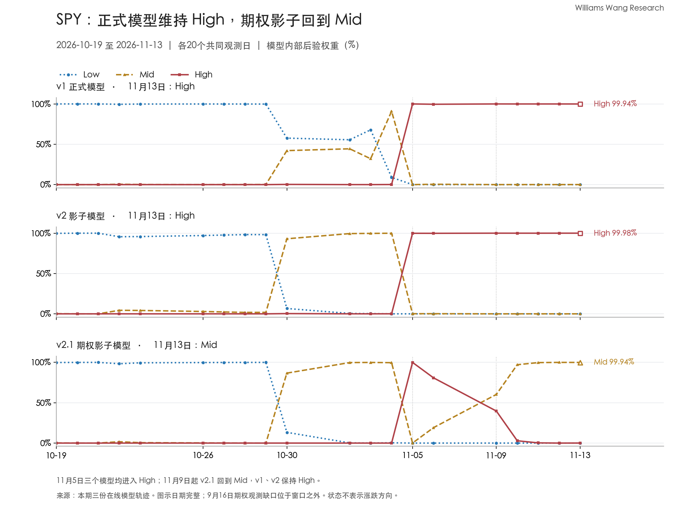

+++
title = "SPY 周度反弹，正式模型仍处高波动状态｜2026年11月13日"
date = "2026-11-15"
data_as_of = ["2026-11-13"]
data_as_of_note = "报告及数据截止11月13日美股收盘，整理日期11月15日；v1为正式锚，v2及v2.1为影子对照，窗口与历史缺口依原文保留。"
draft = false
description = "SPY周度反弹、VIX回落，但正式v1与v2仍为High；v2.1连续五个观测日为Mid，保留实现波动偏高和模型分歧。"
series = "SPY HMM模型分析"
categories = ["市场结构"]
tags = ["SPY", "HMM", "市场状态", "VIX"]
featured = false
private = false
content_preservation = "verbatim"
source_sha256 = "7183b3b3e15505b838588d47e31d3236af2c7c9a9ba35a2875cdc2c82f4d48a4"
+++

# SPY 周度反弹，正式模型仍处高波动状态｜2026年11月13日

**Williams Wang Research｜标普500市场观察**  
报告及数据截止日：**2026年11月13日美股收盘**；整理日期：2026年11月15日。

## 一、核心结论

1. **正式判断仍是 High，且已持续多个观测日。** v1 自11月5日起连续 **7个观测日**处于 High，最新 High 后验权重为 **99.94%**。normal、t1d、t2d 三种设定均为 High，当前分类对这些替代设定较为稳定。这里的99.94%是模型内部状态权重，不能解读为未来下跌或发生危机的概率。[^1][^2]

2. **周度价格反弹和 VIX 回落已经发生，但短期实现波动仍高于中期。** SPY 近一周上涨 **2.59%**，VIX 同期下降 **6.34点、24.73%**；20日年化实现波动率仍为 **22.29%**，高于60日的 **14.92%**，相差 **7.38个百分点**。价格方向改善与较高的波动水平可以并存，当前资料不足以确认市场已回到低波动状态。[^1]

3. **模型分歧已从共同进入 High，转为对波动是否缓和的不同判断。** v2 与 v1 同日进入 High，最新 High 权重为 **99.98%**；v2.1 在11月5日至6日也曾处于 High，但从11月9日起连续 **5个观测日**回到 Mid，最新 Mid 权重为 **99.94%**。这是一项有持续记录的同日分歧，值得跟踪；它仍不足以证明期权影子模型能够领先预测正式模型的切换。[^2]

4. **下期重点是检验降温迹象能否扩展到正式模型和实现波动。** VIX 周度下降、v2.1 转为 Mid，为压力缓和提供了观察线索；v1、v2 继续高度集中于 High，以及20日实现波动仍明显高于60日，则构成当前的主要反证。宜保留这两组信息，不把单一指标的改善等同于风险全面解除。

## 二、SPY 市场与风险画像

### 一周上涨，月度和三个月累计表现仍为负

SPY 收于 **754.37美元**。近一周收益为 **+2.59%**，近一月为 **-2.26%**，近三个月为 **-2.13%**，年初至今为 **+11.28%**。因此，本期较准确的价格描述是“短窗口反弹，较长窗口仍承压”。周度上涨不足以说明已经收复此前全部跌幅，也不能从这些汇总收益判断反弹集中于哪一个交易日。[^1]

| 市场指标 | 本期数值 | 口径与解释 |
| --- | ---: | --- |
| SPY 收盘价 | 754.37美元 | 截至2026-11-13 |
| 近一周收益 | +2.59% | 采用包内周度窗口 |
| 近一月收益 | -2.26% | 月度累计表现仍为负 |
| 近三个月收益 | -2.13% | 不等于期间最大回撤 |
| 年初至今收益 | +11.28% | 不代表期间没有下跌 |
| 20日实现波动率 | 22.29% | 年化，历史短窗口统计 |
| 60日实现波动率 | 14.92% | 年化，历史较长窗口统计 |
| 近三个月最大回撤 | -5.92% | 窗口内最深峰谷回撤 |
| 年初至今最大回撤 | -8.88% | 年内窗口最深峰谷回撤 |
| VIX | 19.30 | 同为11月13日截止 |
| VIX 近一周变化 | -6.34点／-24.73% | 周度明显回落 |
| VIX 近一月变化 | +2.84点／+17.25% | 月度仍高于窗口起点 |

最大回撤描述相应窗口中曾经发生的最深峰谷跌幅，**不是当前价格距高点的跌幅**。包内没有当前回撤、高点日期或完整日度价格路径，不能据此判断当前是否已回到前高、是否在某一天见底，或反弹修复了多少峰谷损失。

### 实现波动仍偏高，反弹不等于波幅收窄

按未舍入值计算，20日实现波动率比60日高 **7.38个百分点**，约为后者的 **1.49倍**。这表明较短历史窗口的波动强度仍明显高于较长窗口，与正式模型的 High 分类相容。正收益回答的是价格累计向哪个方向变化，实现波动回答的是期间收益的离散程度；较强反弹本身也可能发生在较高波动环境中。

这里仍需区分“当前水平高”和“正在继续升高”。本包只提供实现波动率的最新截面，没有完整逐日轨迹，因此不能确认20日波动率这一周是上升还是下降，更不能把20日高于60日直接解释为波动正在加速。两个回看窗口相互重叠，其差距也不是两份相互独立的风险证据。

### VIX 回落是明确的周度变化，但不是模型退出 High 的充分条件

VIX 一周下降6.34点至19.30，说明包内周度窗口的隐含波动指标明显回落；但近一月仍增加2.84点，不能将“周度回落”扩写为“月度已经全面恢复”或“每天持续下降”。[^1]

Cboe 将 VIX 定义为由 SPX 期权价格构建、反映未来约30天预期波动的指标；本报告中的 SPY 实现波动率则回看过去的价格变化。两者的标的、时间方向和构造不同。[^3]

同日 VIX 比 SPY 20日年化实现波动率低约 **2.99个波动率点**。这一差额提供了“未来波动定价低于近期历史波动水平”的对照，但不能直接解释为期权便宜、波动率风险溢价为负或存在可执行套利。包内没有完整期权曲面、匹配期限的预期实现方差与交易成本，无法完成这些判断。

## 三、HMM 信号与状态演化

### v1 在11月4日转为 Mid，次日进入 High

以本期轨迹回看，v1 的上一段 Low 自8月28日延续至11月3日，共47个观测日。10月30日 Low 权重已降至57.61%，但此后并非单向退出 Low：11月2日为55.58%，11月3日又回到67.92%。直到11月4日，Mid 权重升至 **90.91%**，硬标签才切换为 Mid。[^2]

11月5日，v1 的 High 权重升至 **99.98%**，随后一直保持 High，至11月13日累计7个观测日。11月9日至13日的5个观测日中，High 权重均高于99.93%，平均为 **99.96%**。这说明本周的高波动分类具有连续性，不能只解释为最新一天的孤立输出。

下表集中展示11月4日以来的 High 权重及标签。所有比较均使用共同日期，数值来自本期轨迹；极小值采用阈值形式。

| 共同观测日 | v1 High 权重 | v2 High 权重 | v2.1 High 权重 | 标签依次为 v1／v2／v2.1 |
| --- | ---: | ---: | ---: | --- |
| 2026-11-04 | 0.12% | 0.07% | <0.001% | Mid／Mid／Mid |
| 2026-11-05 | 99.98% | 99.84% | 99.96% | High／High／High |
| 2026-11-06 | 99.58% | 99.81% | 80.89% | High／High／High |
| 2026-11-09 | 99.98% | 99.99% | 39.72% | High／High／Mid |
| 2026-11-10 | 99.95% | 99.97% | 2.85% | High／High／Mid |
| 2026-11-11 | 99.96% | 99.96% | 0.25% | High／High／Mid |
| 2026-11-12 | 99.95% | 99.99% | 0.003% | High／High／Mid |
| 2026-11-13 | 99.94% | 99.98% | 0.06% | High／High／Mid |

v1 最新 High 权重较11月6日增加 **0.36个百分点**，但较11月12日小幅下降约 **0.02个百分点**。其主要特征是持续处于高位，不能描述为权重每天上升。后验已经接近上限时，微小变化也不宜被解读为同比例的风险增减。

### 替代设定均确认 High，但这只检验了有限的设定敏感性

| v1 设定 | 截止日 | 状态 | Low 权重 | Mid 权重 | High 权重 |
| --- | --- | --- | ---: | ---: | ---: |
| normal | 2026-11-13 | High | <0.001% | 0.06% | 99.94% |
| t1d | 2026-11-13 | High | <0.001% | 0.02% | 99.98% |
| t2d | 2026-11-13 | High | <0.001% | 0.01% | 99.99% |

三种设定的标签一致，且 High 权重均超过99.9%。包内近期变化摘要也显示三者 High 权重均增加。因此，在这些已提供的替代设定范围内，正式模型的 High 判断具有一致性。[^1]

不过，替代设定不等于独立实验，也没有验证所有模型选择、特征定义和历史时期。不能由此将99%以上的后验权重升级为99%以上的外部预测准确率；包内也没有未来收益或损失的条件分布，无法给出高波动状态对应的具体下跌概率、幅度或持续时间。

## 四、模型分歧与不确定性

### 同日差异主要发生在 High 与 Mid 之间

| 模型 | 分析角色 | 最新日期 | 状态 | Low 权重 | Mid 权重 | High 权重 |
| --- | --- | --- | --- | ---: | ---: | ---: |
| v1 | 正式分析锚 | 2026-11-13 | High | <0.001% | 0.06% | 99.94% |
| v2 | 影子对照 | 2026-11-13 | High | <0.001% | 0.02% | 99.98% |
| v2.1 | 期权影子对照 | 2026-11-13 | Mid | <0.001% | 99.94% | 0.06% |

三个模型最新日期一致，Low 权重均低于0.001%。因此，当前分歧主要是是否仍处于 High，尚没有任何一个模型回到 Low 的同日证据。v1 和 v2 的一致也不能通过“二比一投票”消除 v2.1 的不同判断，正式分析锚仍按本期契约采用 v1。[^1]

*图：10月19日至11月13日，每个模型各20个共同观测日，统一采用0%—100%刻度。竖虚线对应11月5日三个模型进入 High，以及11月9日 v2.1 回到 Mid；连线仅连接已有观测，不表示周末新增数据。来源：本期三份模型轨迹。[^2]*

### v2.1 已出现持续降级，但不是已验证的领先信号

v2.1 从11月6日的 High 权重 **80.89%**，降到11月9日的 **39.72%**，当天 Mid 权重升至 **60.28%**并成为最大项。随后 Mid 持续主导，至11月13日已连续5个观测日，最新 Mid 权重为99.94%。因此，这次差异已经超出一个观测日的短暂切换。[^2]

从11月6日到13日，v2.1 的 High 权重合计下降 **80.83个百分点**。但它并非每日单调下降：11月12日约为0.003%，13日回升至约0.06%。最新小幅回升没有改变 Mid 标签，不应因基数极小而用相对倍数夸大其风险含义。

v2.1 的这一变化与 VIX 周度回落在描述上相容，**尚不能证明两者存在独立的互相验证关系**。模型可能使用相关信息；没有逐项特征与完整期权证据，不能识别是哪一输入促成了分类改变，也不能把它具体归因于期限结构、偏斜、交易商对冲或某个宏观事件。

判断它是否领先，需要观察未来正式模型与实际波动如何变化，并在更多转换样本中评价误报、漏报和时滞。本次先后顺序只是一条历史路径。v1、v2 也可能随后转为 Mid，或者 v2.1 再回到 High；目前证据没有排除任一方向。

### 缺口不影响本期共同窗口，但限制更长历史的连续性判断

v2.1 仍缺少 **2026年9月16日**的期权观测，最新截止日对齐不能证明整段历史完整。本文图示的10月19日至11月13日、以及11月以来的状态比较窗口，三个模型的日期均完整对应，没有为缺口插值或补标签。缺口应限制涉及9月16日的连续路径表述，不需要据此否定本期共同日期的有效比较。[^1][^2]

## 五、条件情景与下期观察

当前可将市场描述为：**价格和部分波动信号已有缓和，正式模型仍保留高波动分类。** 下期的判断应依赖新增观测如何改变这一组合，而不预设哪个模型一定正确。以下情景没有附加经校准的发生概率。

| 条件情景 | 需要观察的变化 | 对本期判断的影响 |
| --- | --- | --- |
| 降温扩展到正式模型 | v1 的 High 权重持续下降、Mid 转为主导，替代设定逐步一致；v2.1 维持 Mid；后续实现波动读数下降 | 对退出 High 的支持增强，但需区分短暂切换与持续变化 |
| 价格反弹而 High 延续 | SPY 继续改善，但 v1、v2 仍为 High，20日实现波动仍明显高于60日 | 支持“较高波动中的反弹”；价格方向改善不足以独立证明波动状态降低 |
| 波动压力重新增强 | v2.1 的 High 权重再次持续上升并主导，VIX 与实际价格波幅也重新扩大 | 削弱当前的降温解释；同样不能直接推出价格必然下跌 |
| 模型分歧维持 | v1、v2 保持 High，v2.1 持续 Mid，而价格与波动指标提供混合证据 | 保留两种解释，继续以 v1 为正式锚；补充原始特征和期权结构以判断差异来源 |

最有辨识力的观察是：正式模型是否连续降低 High 权重、20日实现波动是否确实下降，以及 v2.1 能否保持 Mid。包内只有实现波动的最新截面，下一期需要新的可比读数，才能把“水平仍高”与“方向正在回落”同时判断。VIX 若重新上行，也应区分单日变化与多日持续，而非套用单一固定点位。

对组合研究而言，本期仍有理由保留较高波幅的压力情景。单看近一周正收益，可能忽略仍高的历史波动；单看正式 High 标签，也可能漏掉 VIX 和期权影子模型已经显示的缓和。当前数据没有组合暴露、持仓相关性、流动性及成本信息，不能据此推导具体仓位、杠杆或对冲规模。

**免责声明：** 本文仅供一般性信息、教育及研究讨论，不构成投资、理财、交易建议或买卖证券的推荐。模型状态与条件情景不保证未来结果，具体投资判断、仓位安排及执行由读者自行决定。
