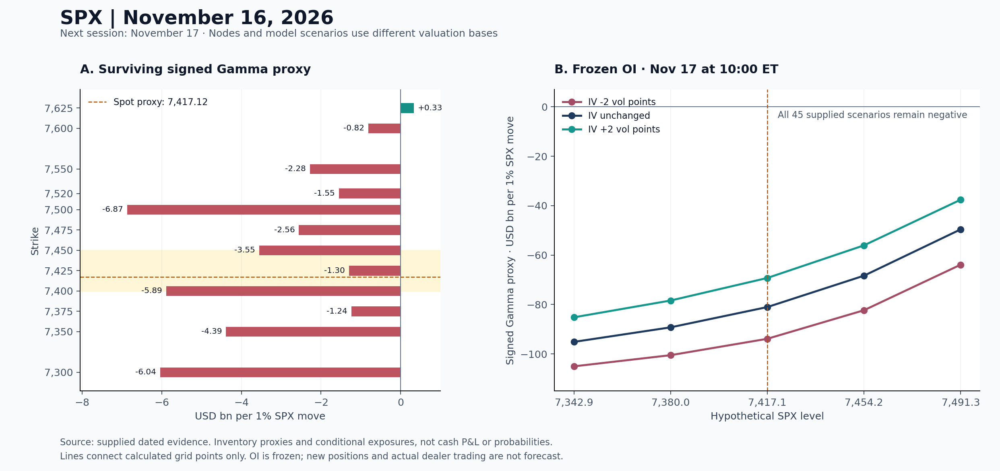

+++
title = "SPX期权持仓与Greeks结构分析-261116"
date = "2026-11-17"
data_as_of = ["2026-11-13", "2026-11-16"]
data_as_of_note = "D为11月16日、P为11月13日，目标日11月17日；P采用同方法离线回放供比较，D估值21:18:10 ET、月度Q采用16:00 ET收盘兼容截面，保留异步时钟及滚动28日到期限制。"
draft = false
description = "大跌后存续负Gamma代理扩大，围绕7400–7450重新定位并条件式优先检验下侧；保留快速修复反证、月度双侧扩张及短端报价质量限制。"
series = "SPX期权分析报告"
categories = ["衍生品", "市场结构"]
tags = ["SPX", "Greeks", "GEX", "期权", "风险分布"]
featured = false
private = false
content_preservation = "verbatim"
source_sha256 = "88640bb00943c90d1bceea88abf532a44d28051b8cb87051b3385a006cd460b4"
+++



# SPX期权持仓与Greeks结构分析-261116

## 1. 一句话结论

11 月 16 日大跌后，下一交易日存续 Gamma 库存代理显著偏负，11 月 17 日应围绕 **7,400–7,450** 重新定位并优先检验下侧延续，最大反证是事件后迅速收复 **7,450–7,475**；月度两侧分布都在扩张，负 Gamma 或深左尾增厚均不等于继续下跌的概率。

**盘后研究 B 级｜结构事实可复核，机制置信中等、方向置信低；条件式偏下侧观察｜具体合约估值未纳入本次盘后研究｜目标日执行另行复核。** 实质缺口在于 11/18–19 的局部 IV 报价质量不足，且短期限报价归因残差较大；它们限制事件前后的期限、成本与细项比较，详见第 4、8、10 节。

## 2. T+1 Action Summary

| 项目 | 11 月 17 日条件准备 |
| --- | --- |
| Base stance | 若开盘仍在7,400–7,450，先看7,400能否守住以及7,425–7,450能否恢复；核心内反复时保持观察，离开且不能回归时转入对应分支。 |
| Earliest evaluation | 先复核08:30 ET零售和进出口价格、09:15 ET工业生产，再按实际开盘位置及报价定位；开盘或新消息已越首个复核区时重建，不将10:00情景格点当作入场时刻。 |
| Base activation | 若7,400失守、反抽不能恢复，且现时价格与IV仍支持延续，则比较看跌单买和看跌借记价差；先复核7,375–7,350，恢复核心或已越首区时取消原准备。 |
| Downside branch | 若7,350下方继续出现无法修复的价格走势，下一层复核7,300；只从确认后的价格评估剩余空间，快速收回7,400或新地图改变时重建，不追计已经发生的跌幅。 |
| Upside branch | 若恢复7,450且能进一步穿过7,475，复核7,500–7,520，可比较看涨单买与看涨借记价差；该区仍有负代理集中，重新失守7,425–7,400时取消修复论点。 |
| Otherwise | 若事件反应相互抵消、核心内反复、报价不足以支持剩余空间，或gap已越主要节点，则以观察为主；不因IV抬升自动转为卖波动，也不因修复失败自动反手。 |

这张准备表把旧核心下移后的研究顺序限定为“先重新定位，再判断延续或修复”。7,400–7,450来自当前现指附近的存续节点，不是统计置信区间；触及某个点位也不等于方向确认。真正进入结构比较时，必须使用确认后的价格、剩余时间和组合报价，不能把盘前已经完成的移动算作随后可获得的收益。

## 3. Executive Summary

- **价格已越过上一期主要下侧观察区域。** 包内同源收盘参考从7,561.67降至7,416.59，下降145.08点、1.919%；VIX从19.30升至22.91。上一期7,550–7,600核心及7,475–7,450延伸区均在本日终点上方，旧地图需要重建。
- **负敏感度并非只来自已经到期的合约。** 14,776份共同存续合约的signed GEX由−25.564降至−66.701十亿美元/1%，其中PM部分变化−33.310。全存续快照为−73.203，含新增进入采集窗口的期限，不能把两种分母混接。
- **反弹能够减轻负暴露，但本日给定网格尚未转正。** 冻结OI模型在11/17 10:00、IV不变时，价格−1%对应−95.157，+1%仍为−49.616十亿美元/1%；45个给定情景全部为负。这约束了“反弹即恢复稳定区间”的解释，也不证明价格必然下行。
- **报价变化呈现方向与IV共同作用，细项解释的精度有限。** 研究认购均值−43.759点、认沽+38.277点；研究组Vega为+9.048点，Theta为−6.183点。研究组残差均值−2.141点，短组残差绝对值95分位10.046点，因此不能将所有涨跌精确分配给已列因素。
- **月度分布是两侧扩张，左侧更长。** 跌幅超过5%的风险中性终值概率为12.859%，较前日增加1.843个百分点，过去60日36个合格观察中约第97百分位；但下跌总概率降至37.194%，收益中位数上移。下跌频率定价与下跌严重程度的定价发生分化。
- **高阶敏感度的突出异常在27–33日组，必须先看期限构成。** 该组Vanna的z为+5.32、Vega差的z为+3.35；12/18到期从前日35个日历日进入本日32日，贡献该组约99.08%的Vanna与99.49%的Vega差。不能将期限组跳升写成新增资金或独立方向信号。
- **期限选择有明确事件分界。** 11/17 PM到期在当天约16:20 ET的NVIDIA业绩发布之前；11/18及以后到期跨过该事件，11/18还包含14:00 ET会议纪要。事件日程已核实，但相邻短端曲面的局部质量不足，当前只能准备条件比较，不能认定某个期限便宜。[NVIDIA日程](https://nvidianews.nvidia.com/news/nvidia-sets-conference-call-for-third-quarter-financial-results-6928873)、[美联储日历](https://www.federalreserve.gov/newsevents/2026-November.htm)。

## 4. What Changed vs. T-1 and Prior Playbook Review

以下比较分别采用同源现指、共同存续合约、同到期IV或明确标注的滚动月度槽位。前日到本日横跨周末，剩余期限和模型估值钟均发生变化。

| 实质变化 | 11/13 → 11/16 | 比较基础及影响 |
| --- | --- | --- |
| 现指、VIX与波动背景 | 收盘参考7,561.67 → 7,416.59；VIX 19.30 → 22.91 | 收盘参考同源；现指下降1.919%、VIX上升3.61点，说明价格与风险定价同时调整，不能据此识别具体新闻的因果贡献。 |
| 同一存续合约组signed GEX | −25.564 → −66.701，变化−41.137十亿美元/1% | 14,776份共同合约；PM变化−33.310、AM变化−7.827，包含价格、IV、时间、报告OI及供应商模型影响。 |
| 近端与月度到期集中 | 11/17层signed为−4.289；11/20 AM与PM合计−28.046十亿美元/1% | 11/16到期层已退出下一日地图；周五到期层仍是存续负敏感度的重要来源。 |
| 可描述的同到期ATM | 11/20：16.170% → 23.752%；12/16：14.858% → 17.567% | 同方法回放对比，分别增加7.582与2.709 vp，含期限递减、周末和时点差异。 |
| 报价变化研究组 | 前一相邻区间+1.359点，本区间+6.978点 | 不是累计持仓收益，两个区间的经过时间及合约构成不同；Vega增量明显，但残差也扩大。 |
| 月度终值分布 | 下跌总概率38.865% → 37.194%；跌幅＞5%概率11.016% → 12.859% | 12/11滚至12/14到期，两日均28日；收益锚7,562.03 → 7,417.12，不能解读为固定到期的纯冲击。 |

这些变化足以撤去“仍在旧核心附近”的研究前提，并提高对下一日价格离开节点后反馈敏感性的重视。共同合约的负代理扩大比原始OI增长更能控制样本变化，但仍未分离价格重估与持仓变化；这里以11/17开盘仍存续为共同筛选条件，前日数值并非上一份报告的全部存续分母。11/20、12/16的ATM上移可以用于重新比较保护成本；短端未通过局部权限的数值不能跟随它们一起升级为可靠的相对价格结论。

**上一期地图复核。** 11/13报告的核心为7,550–7,600，下侧依次复核7,520–7,500、7,475–7,450。本日收盘参考7,416.59已低于上述区域，说明旧地图在终点层面失效；这不确认盘中是否按预设顺序触发，也不证明按旧图可获得145.08点移动。输入没有完整对齐的分时、当时结构和实际交易记录，盘中路径及交易损益不作推定。前一报告的研究评级与本期口径不同，不用评级字母变化评价机会好坏。

### 期权报价变化归因：方向项仍大，IV上移抵消了部分时间消耗

配对范围为11/13→11/16的同一SPXW PM合约，起点7–60日，不含AM与0DTE。全配对样本8,753份，占前日起点合格9,220份的94.93%；未配对467份涉及价差、报价、IV反解与范围筛选。研究子样本5,360份，限制起点标准化价差绝对值不超过2、远期Delta绝对值不超过0.8，**每份多头合约等权**。下表单位为指数点/合约，换算美元须乘100，不使用OI、用户组合或做市商库存权重。

| 分组 | 合约数 | 报价变化 | Delta | Gamma | Theta | Vega | 交叉、曲率及折现 | 残差均值 / 绝对值95分位 |
| --- | --- | --- | --- | --- | --- | --- | --- | --- |
| 研究组 | 5,360 | +6.978 | -0.900 | +6.775 | -6.183 | +9.048 | +0.379 | -2.141 / 6.594 |
| 起点τ＜21日 | 2,112 | +8.195 | -0.558 | +8.765 | -7.773 | +10.827 | +0.672 | -3.739 / 10.046 |
| 短组认购 | 795 | -42.802 | -54.058 | +11.039 | -8.275 | +12.278 | -1.008 | -2.779 / 7.223 |
| 短组认沽 | 1,317 | +38.979 | +31.737 | +7.393 | -7.469 | +9.950 | +1.686 | -4.318 / 10.961 |
| 起点τ≥21日 | 3,248 | +6.187 | -1.122 | +5.481 | -5.150 | +7.891 | +0.188 | -1.102 / 2.405 |
| 长组认购 | 1,250 | -44.368 | -53.454 | +6.832 | -5.322 | +8.883 | -0.495 | -0.813 / 2.291 |
| 长组认沽 | 1,998 | +37.815 | +31.618 | +4.636 | -5.043 | +7.270 | +0.616 | -1.282 / 2.443 |
| 全部研究认购 | 2,045 | -43.759 | -53.689 | +8.468 | -6.470 | +10.203 | -0.694 | -1.577 / 5.869 |
| 全部研究认沽 | 3,315 | +38.277 | +31.665 | +5.731 | -6.007 | +8.335 | +1.041 | -2.488 / 6.864 |

研究认购的Delta贡献−53.689点、认沽+31.665点，在总组中抵消为−0.900点，但研究组平均绝对Delta贡献达40.068点；合并均值小不代表方向项不重要。较短组Gamma、Vega及Theta的绝对幅度均高于较长组，说明方向与凸性、IV及时间在共同影响已观察报价，下一日买方研究必须同时核价。期限两组互斥，四个期限×方向交叉组也互斥；它们与研究总组及call/put汇总重叠，不能重复相加，各组超过30份仅是工程样本提示。

**正Vega与负Theta的抵消是实质信息。** 研究组两者合计+2.864点，Theta绝对均值/正Vega均值为0.683；短组为+3.054点、0.718，长组为+2.741点、0.653。短组认购/认沽比例分别0.674/0.751、长组0.599/0.694，合计贡献分别+4.003/+2.481和+3.561/+2.227点。这些是均值之间的抵消关系，不是盈利贡献占比或单份合约比例的平均。本区间横跨约3.221个日历日，不能把较大的Theta金额直接称为每日损耗加快。

**先看远期与现指的桥接，再解释Delta。** 25个配对到期的远期下降119.23–120.14点，现指代理下降144.91点，差异对应“远期减现指代理”上升24.77–25.68点。例如11/20到期：

\[
\Delta F=-119.233=(-144.910)+25.677\quad\text{点}。
\]

两者方向相同，支持认购负Delta、认沽正Delta的归因符号，但幅度不能直接用现金指数跌幅替代。估值钟从11/13 16:00变为11/16 21:18:10 ET，现指与夜间报价同步性未独立验证；这个恒等式不能识别利率、分红、陈旧现指或时段差异各自的因果贡献。

**残差要求收窄结论。** 全样本实际均值−2.181点，与研究组+6.978点方向不同，说明价内外构成影响很大。研究组残差均值−2.141、绝对值95分位6.594点；短组对应−3.739和10.046点，明显大于长组−1.102和2.405点。加入交叉项、曲率项及折现后，研究组RMSE由2.837升至3.156点，短组由4.044升至4.754点，长组则由1.626降至1.320点；本日不能声称增加项全面改善拟合，更不能把未解释部分命名为跳跃收益。

### 历史位置与共同合约：构成影响幅度，未消除本日IV贡献上移

下表是不同日期各自相邻报价变化区间的均值比较；5日、20日前严格采用11/09、10/19，均非从参考日至本日的累计持有收益。

| 分组 | 11/16均值（数量） | 11/13均值（数量） | 相对11/09均值变化（参照数量） | 相对10/19均值变化（参照数量） |
| --- | --- | --- | --- | --- |
| 研究组 | +6.978（5,360） | +1.359（5,348） | +9.510（6,636） | +11.170（5,508） |
| 起点τ＜21日 | +8.195（2,112） | +1.716（2,262） | +7.193（2,989） | +12.683（2,242） |
| 起点τ≥21日 | +6.187（3,248） | +1.097（3,086） | +11.616（3,647） | +10.176（3,266） |
| 全部研究认购 | -43.759（2,045） | -33.077（1,863） | -108.506（2,997） | -55.107（2,243） |
| 全部研究认沽 | +38.277（3,315） | +19.768（3,485） | +96.220（3,639） | +53.146（3,265） |

研究组认购占比从34.84%升至38.15%，平均剩余期限26.577日变为26.716日，平均绝对对数价差从0.04859降至0.04682，因此滚动组+5.619点的变化含样本效应。固定身份的4,797份共同研究合约覆盖本日89.50%、前日89.70%，其报价变化均值由−1.005升至+12.783点，差+13.788点，明显大于滚动组变化；Delta贡献变化也从滚动组−0.677变为共同组+7.406点，不能把合并方向项的变化当成稳定结论。两种口径的Vega贡献变化仍分别为+9.006和+8.945点，这为“本区间IV上移在报价中更重要”提供了较一致的描述，但并未隔离因果、经过时间或到期递减。

共同组合的Gamma变化+3.978、Theta变化−4.707点，也保留了凸性与时间抵消的特征；共同组合本日残差绝对值95分位仍为6.473点。连续诊断记录最近20个交易日无缺日，本模块没有60/120日历史百分位。其对下一日的用途是确定核价时优先检查远期、IV与时间成本；它不能推出继续买认沽或继续买波动具有收益优势。

## 5. T 日盘面、字段时点与 Event-Risk Overlay

### 截止前信息与下一交易日已知日程

| 时间（ET）及状态 | 已核实内容 | 研究通道与未知项 |
| --- | --- | --- |
| 11/16 08:30；收盘前 | 纽约州制造业总体指数25.5降至7.8，仍为正；价格增速放缓但保持较高水平。[纽约联储调查](https://www.newyorkfed.org/medialibrary/media/survey/empire/empire2026/2026_11_empire-state-manufacturing-survey.pdf) | 增长与价格信号并不完全同向；不能单独解释SPX全天跌幅。 |
| 11/16 12:00；收盘前 | 美联储主席讲话讨论新技术的生产率机会及失望情景，并明确不是预测。[美联储讲话](https://www.federalreserve.gov/newsevents/speech/warsh20261116a.htm) | AI资本开支与估值风险是关注通道，不把情景论述改写为政策决定或市场必跌预告。 |
| 11/16收盘后至21:37:56 | 本次核实资料未形成可单独量化的新增盘后冲击记录 | 不等于断言这段时间没有新闻；本报告不为夜间报价变化补造单一动因。 |
| 11/17 08:30；结果未知 | 10月零售销售、10月进出口价格。[Census日程](https://www.census.gov/retail/release_schedule.html)、[BLS日程](https://www.bls.gov/schedule/2026/) | 可能改变增长、通胀和利率定价；先检查实际发布及价格反应，再重新定位开盘地图。 |
| 11/17 09:10、09:15；结果未知 | Waller就支付议题讲话；工业生产与产能利用率发布。[美联储日历](https://www.federalreserve.gov/newsevents/2026-November.htm)、[G.17日程](https://www.federalreserve.gov/releases/g17/) | 讲话议题不等于货币政策信号；工业数据在现货开盘前15分钟，可能使旧开盘假设失效。 |
| 11/17 10:00；结果未知 | 月度零售库存发布。[Census日程](https://www.census.gov/retail/release_schedule.html) | 作为开盘后补充增长信息；不因模型恰有10:00情景格点就认定存在执行优势。 |
| 11/17约16:20、17:00；结果未知 | NVIDIA计划公布季度业绩，随后举行电话会；安排于10/28公告并在11/12再次确认。[公司日程](https://nvidianews.nvidia.com/news/nvidia-sets-conference-call-for-third-quarter-financial-results-6928873)、[公司11/12公告](https://investor.nvidia.com/news/press-release-details/2026/NVIDIA-Announces-CEO-Transition/default.aspx) | 11/17 PM合约先到期，11/18以后合约跨过事件；不预设业绩方向，也未分离其对SPX的事件方差。 |
| 11/18 14:00；结果未知 | 10/27–28会议纪要计划发布。[美联储日历](https://www.federalreserve.gov/newsevents/2026-November.htm) | 影响11/18及以后到期的事件负担；提前退出和跨事件持有需要不同核价。 |
| 11/20；已知到期结构 | 本包显示月度到期周，AM与PM各有集中持仓 | 结算层先后退出可能改变节点；不能假定到期日价格必向最大OI或某个点位靠拢。 |

日程对本次期权准备最直接的影响是把11/17日内与随后跨财报、纪要的风险分开。若只研究11/17日内交易，较晚到期并不自动意味着隔夜持有，却仍会把未来事件价格计入当前权利金。新闻检索用于核对公开事实与日程，没有把11/17及之后尚未公布的结果放回截止前；部分日历页面没有可独立验证的精确首次发布时间，不宣称完成全市场实时新闻归因。

## 6. Decision Rationale — Analytical Bridge

**Thesis 1：观察核心应下移，负Gamma代理对应的顺势放大风险更值得重视。** 证据是现指收盘落在7,416.59、共同存续合约signed GEX变化−41.137十亿美元/1%，以及7,400/7,450聚合节点均为负。机制解释以call正、put负的库存代理约定为条件：价格移动后，对冲敏感性可能更强，但真实库存和对冲流未被观察。下一日若7,400失守且反抽不能收回，先研究7,375–7,350的延续；若恢复7,450–7,475并伴随现时IV回落，应削弱下侧优先。事实置信较高，方向机制置信中低，尚无样本外收益验证。

**Thesis 2：反弹能减轻负暴露，却不足以据本包恢复卖区间前提。** 冻结OI、IV不变的10:00模型中，价格从−1%移到+1%时signed GEX由−95.157改善到−49.616十亿美元/1%，但45个实际给定情景均未转正。这个条件实验支持把上侧当作修复过程研究，不能给出精确Gamma翻转点。若次日更新地图出现实质转正、事件后波动收敛且价格持续回归，才需要另建区间论点；单纯触及7,500或VIX回落并不充分。机制置信中等，适用范围只在给定价格、时间、IV网格与固定样本内。

**Thesis 3：月度风险分布支持更充分的双向压力准备，不支持一票看空。** 下跌总概率减少1.671个百分点，但跌幅超过5%和10%的概率分别增加1.843和1.205个百分点；上涨超过5%的概率也增加6.869个百分点。机制上，温和负收益区域的质量减少可以与两侧扩张共存，收益锚与到期滚动同样影响比较。下一日研究应同时准备下侧保护和急速修复反证，不能用12.859%的月度概率给明日7,300或任何情景格点赋权。若后续同口径尾部回落、区间收窄，这一压力准备可下调；当下它只代表风险中性终值定价。

**Thesis 4：结构选择的瓶颈是事件覆盖与可核价性。** 11/17与11/20当前局部节点可作有条件参考，11/18–19仍仅诊断；11/17 PM先于当晚财报到期，11/18又有会议纪要。较晚到期有更多时间，但同时支付更多事件敞口，较短到期则要求更及时的价格移动，不能仅按年化IV高低判断优劣。条件形成后比较单买与借记价差，并按到首个复核区的剩余空间选择封顶范围；若事件反应已完成、空间过小或两腿报价质量不足，应放弃该候选。事件日程置信较高，具体成本排序尚无足够证据。

## 7. Conflicting Evidence, Confidence and What Changes the View

| 表面冲突 | 支持与削弱证据 | 处理方式及下一项观察 |
| --- | --- | --- |
| 负Gamma扩大，却仍可能反弹 | 共同组负值扩大；价格上移的冻结情景会减轻负暴露 | Gamma代理解释反馈敏感性，不能决定方向；用实际价格能否恢复7,450–7,475及更新地图区分。 |
| 月度下跌总概率下降，却深左尾增加 | 低于0概率37.194%；低于−5%概率12.859%；两侧区间都扩张 | 对象均为月度终值，但关注的是不同区间；保留五段分解，不用均值或单一阈值概括。 |
| 30日组Vanna异常大，是否等于强买盘 | z为+5.32；12/18层刚进入27–33日组，且贡献约99.08% | 先解释期限构成和持仓加权敏感度，再核对实际IV变化；不从正号推定真实dealer买入。 |
| IV上移与45日IV变化强度下降 | 45日模型参考IV增加2.274vp，IV比例变化方差年率下降0.061 | 水平与变化强度是不同对象；更不能拿后者代替月度标的终值方差。 |
| 全局曲面通过，但短端比较受限 | 全局审计完整；11/18、11/19局部拟合报价覆盖47.24%、32.02%，11/20 AM形状失败 | 保留可用的11/20 PM及较长期限；限制短端事件相对价值排序，等待真实报价或更合格局部证据。 |
| 滚动研究组与共同合约方向项不同 | Delta均值变化分别−0.677与+7.406点；Vega增量分别+9.006与+8.945点 | 样本构成实质影响幅度和方向项；只保留较一致的IV贡献描述，仍披露残差和异步时钟。 |

这张表把真正需要改变观点的条件与仅需重新核价的条件分开：恢复上方区域并改变现时结构会削弱下侧论点；IV重定价可能只要求换期限或放弃候选；无法取得合格报价则影响执行可行性。不同来源时间、期限或同源派生结果不进行多数投票，也不平均成综合概率。当前的路径判断属于“有机制依据，尚未证明预测或收益优势”，事实可复核不等于方向准确率高。

## 8. IV Term Structure, Skew and Surface

### 质量摘要与历史来源

本期正式曲面整体审计通过，但使用权限仍按实际到期分别判断。**前日采用同方法离线回放**，原11/13日常包存在方法断点；回放仅用于11/13→11/16比较，不是当时已发布的结果，也未修改既有报告。两日估值钟分别为11/13 16:00与11/16 21:18:10 ET，实际方法、期限选择和节点定义通过包内一致性核验，不能把旧时钟版本的分数与本期直接相减。

| 范围 | 本期质量证据 | 允许与受限用途 |
| --- | --- | --- |
| 整体正式曲面 | 33个到期；拟合落入bid/ask比例81.41%，日历检查100%，价格单调性/凸性/非负密度检查各96.97% | 支持整体结构研究；检查率不是预测准确率，不能替代逐到期权限。 |
| 11/17 PM | 局部报价拟合覆盖69.23%，形状检查通过；前日仅33.78% | 当前可作有条件模型参考；P→D比较受前日较严格权限约束，仅诊断。 |
| 11/18、11/19 PM | 局部覆盖47.24%、32.02%，形状通过但报价拟合不足 | 只列诊断值，不能认定该两日事件溢价或策略相对便宜。 |
| 11/20 PM | 局部覆盖60.61%，形状通过；前日89.73% | 可描述同到期变化；仍须用真实组合报价评估成本，模型参考不等于可成交价格。 |
| 11/23、11/30、12/14、12/16、12/31 PM | 局部覆盖60.00%、93.85%、88.24%、87.29%、94.75%，形状通过 | 可描述相关期限及节点；11/23使用局部形状修复，不能单凭高覆盖推定收益优势。 |
| 11/20 AM、12/23 PM | AM覆盖24.93%且价格单调性、凸性和密度检查失败；12/23 PM覆盖34.72% | 均仅诊断。AM持仓节点仍可单独研究，但不借PM曲面替它定价；12/23不用于本次期限推荐。 |

最短目标日11/17的当前局部质量已有支持，但其历史变化受前日约束；11/18–19则当前仍有实质缺口。因而本报告保留短端数值用于发现需要复核的位置，同时将可描述的变化主要建立在11/20 PM和较长期限上。曲面通过并不证明所有到期可公平比较，也不能据拟合失败未经归因就认定供应商报价错误。

### 常规ATM期限结构：优先比较同一实际到期

常规ATM定义为行权价等于远期，使用已给出的局部总方差插值节点。下表IV为年化百分比，变化为波动率百分点（vp）；所有行均为PM到期，τ按实际估值时间至相应PM到期时刻计算。

| 实际到期 | τ（日）：前日→本日 | 前日ATM | 本日ATM | 变化（vp） | 比较基础、结算与质量 |
| --- | --- | --- | --- | --- | --- |
| 11-20 | 7.000 → 3.779 | 16.170% | 23.752% | +7.582 | 同实际到期；PM；局部约束拟合；可描述 |
| 11-23 | 10.000 → 6.779 | 14.718% | 19.965% | +5.247 | 同实际到期；PM；局部形状修复；可描述 |
| 11-30 | 17.000 → 13.779 | 13.885% | 17.706% | +3.822 | 同实际到期；PM；局部约束拟合；可描述 |
| 12-14 | 31.000 → 27.779 | 14.675% | 17.470% | +2.796 | 同实际到期；PM；局部约束拟合；可描述 |
| 12-16 | 33.000 → 29.779 | 14.858% | 17.567% | +2.709 | 同实际到期；PM；局部约束拟合；可描述 |
| 12-31 | 48.000 → 44.779 | 14.718% | 16.976% | +2.258 | 同实际到期；PM；局部约束拟合；可描述 |

11/20同到期ATM上升7.582vp，幅度大于12/16的2.709vp和12/31的2.258vp，提供了短端更明显抬升的描述性证据。11/23采用修复节点，本日约19.965%，低于11/20的23.752%，可提示期限与事件成本值得分别核价，但不能据两点曲线差就提取已识别的事件方差。以上均含周末老化、估值钟差异及现价重估，不是纯市场冲击，更不是明日IV预测。

### 选定期限smile：水平、倾斜与曲率分开

P、D两行的五个IV节点单位为%；Downside skew25和BF25始终为vp；变化行所有列均为vp。Downside skew25是25Δ put减ATM；BF25是两侧25Δ IV平均减ATM，不是蝶式组合价格。下面三个期限背景槽位使用包内已核定的滚动固定Delta比较，固定Delta并不固定行权价。

| 期限/用途/行类型 | 到期日 / τ（日） | 10Δ put | 25Δ put | ATM | 25Δ call | 10Δ call | Downside skew25 | BF25 | 比较基础 / 方法 / 质量 |
| --- | --- | --- | --- | --- | --- | --- | --- | --- | --- |
| 7日槽位 / P水平 | 11-20 / 7.000 | 21.971 | 18.805 | 16.170 | 14.033 | 12.659 | 2.635 | 0.249 | 约束拟合；局部有条件参考 |
| 7日槽位 / D水平 | 11-23 / 6.779 | 26.565 | 22.741 | 19.965 | 17.933 | 16.495 | 2.777 | 0.373 | 形状修复；局部有条件参考 |
| 7日槽位 / Δ D−P | 11-20 → 11-23 | +4.594 | +3.936 | +3.795 | +3.900 | +3.836 | +0.142 | +0.124 | 滚动槽位固定Δ；可描述 |
| 14日槽位 / P水平 | 11-27 / 13.875 | 21.508 | 17.488 | 14.464 | 12.346 | 11.153 | 3.023 | 0.452 | 形状修复；局部有条件参考 |
| 14日槽位 / D水平 | 11-30 / 13.779 | 26.151 | 21.064 | 17.706 | 15.258 | 13.847 | 3.357 | 0.454 | 约束拟合；局部有条件参考 |
| 14日槽位 / Δ D−P | 11-27 → 11-30 | +4.643 | +3.576 | +3.242 | +2.912 | +2.694 | +0.334 | +0.002 | 滚动槽位固定Δ；可描述 |
| 30日槽位 / P水平 | 12-14 / 31.000 | 23.612 | 18.316 | 14.675 | 12.438 | 11.492 | 3.641 | 0.702 | 约束拟合；局部有条件参考 |
| 30日槽位 / D水平 | 12-16 / 29.779 | 27.955 | 21.733 | 17.567 | 14.815 | 13.581 | 4.165 | 0.707 | 约束拟合；局部有条件参考 |
| 30日槽位 / Δ D−P | 12-14 → 12-16 | +4.343 | +3.417 | +2.893 | +2.378 | +2.089 | +0.524 | +0.004 | 滚动槽位固定Δ；可描述 |

7日、14日、30日槽位ATM分别增加3.795、3.242、2.893vp；14日和30日左翼的增幅较右翼更大，Downside skew25分别增加0.334和0.524vp。两者BF25只增加约0.002和0.004vp，因此主要增量在水平与下侧倾斜，曲率差的经济意义尚未证实；7日BF25增加0.124vp也不能直接解释为蝶式更贵。到期分别由11/20滚至11/23、11/27滚至11/30、12/14滚至12/16，τ也不同；11/27使用13:00提前收市时钟。该表可用于确定需要比较哪一侧保护成本，不能据滚动差给候选实际到期补造历史或推定卖出左翼有优势。

### SPX短端候选实际到期：保留受限数值与变化

下表继续使用相同列单位；四组都按同一实际到期固定Delta配对。11/17当前可作局部参考，但跨日比较受前日质量限制；11/18–19两日较严格权限也仅为诊断。

| 期限/用途/行类型 | 到期日 / τ（日） | 10Δ put | 25Δ put | ATM | 25Δ call | 10Δ call | Downside skew25 | BF25 | 比较基础 / 方法 / 质量 |
| --- | --- | --- | --- | --- | --- | --- | --- | --- | --- |
| 11-17候选 / P水平 | 11-17 / 4.000 | 17.911 | 15.650 | 13.909 | 12.696 | 12.009 | 1.742 | 0.265 | 约束拟合；仅诊断 |
| 11-17候选 / D水平 | 11-17 / 0.779 | 28.328 | 26.240 | 24.463 | 23.138 | 22.619 | 1.776 | 0.226 | 约束拟合；局部有条件参考 |
| 11-17候选 / Δ D−P | 11-17 → 11-17 | +10.417 | +10.589 | +10.555 | +10.442 | +10.610 | +0.035 | -0.039 | 同到期固定Δ；仅诊断 |
| 11-18候选 / P水平 | 11-18 / 5.000 | 21.430 | 18.161 | 15.707 | 13.723 | 12.420 | 2.453 | 0.235 | 约束拟合；仅诊断 |
| 11-18候选 / D水平 | 11-18 / 1.779 | 30.038 | 27.202 | 25.172 | 23.727 | 22.737 | 2.031 | 0.293 | 约束拟合；仅诊断 |
| 11-18候选 / Δ D−P | 11-18 → 11-18 | +8.608 | +9.042 | +9.465 | +10.004 | +10.317 | -0.423 | +0.058 | 同到期固定Δ；仅诊断 |
| 11-19候选 / P水平 | 11-19 / 6.000 | 21.394 | 18.378 | 15.883 | 13.926 | 12.539 | 2.495 | 0.269 | 约束拟合；仅诊断 |
| 11-19候选 / D水平 | 11-19 / 2.779 | 31.296 | 27.195 | 24.473 | 22.507 | 21.029 | 2.723 | 0.378 | 约束拟合；仅诊断 |
| 11-19候选 / Δ D−P | 11-19 → 11-19 | +9.902 | +8.818 | +8.590 | +8.581 | +8.490 | +0.227 | +0.109 | 同到期固定Δ；仅诊断 |
| 11-20候选 / P水平 | 11-20 / 7.000 | 21.971 | 18.805 | 16.170 | 14.033 | 12.659 | 2.635 | 0.249 | 约束拟合；局部有条件参考 |
| 11-20候选 / D水平 | 11-20 / 3.779 | 30.677 | 26.641 | 23.752 | 21.608 | 20.231 | 2.889 | 0.372 | 约束拟合；局部有条件参考 |
| 11-20候选 / Δ D−P | 11-20 → 11-20 | +8.707 | +7.837 | +7.582 | +7.575 | +7.571 | +0.254 | +0.123 | 同到期固定Δ；可描述 |

11/17 ATM的数值从13.909%变为24.463%，11/18从15.707%变为25.172%，11/19从15.883%变为24.473%；这三组差值只作诊断，不能据此确认市场smile的变化幅度。11/20可描述的同到期比较显示ATM上移7.582vp、下侧倾斜增加0.254vp、BF25增加0.123vp，支持事件周短端保护需重新核价，却不支持指定哪种结构最优。11/18表面高于11/17的ATM数值，与跨财报的日程有形式上的对应，但其局部报价质量不足，不能把该差称为已经识别的财报溢价；11/17在财报之前到期也不表示白天不会提前反映事件风险。

### 波动率联动与变化强度

本小节的**模型参考IV**定义在模型坐标x=0，即\(K=F\exp(-\sigma^2\tau/2)\)，与前述\(K=F\)的常规ATM分开。联动是风险中性定价口径下“标的收益与IV比例变化”的协方差年率，负值表示反向联动；变化强度是IV比例变化的方差年率，非负，数值更大表示该对象变化更强。30日漂移为IV比例变化的年率诊断，正负表示该模型定价口径中的漂移方向；它不是标的预期收益或下一日IV变化预测。

| 期限（日） | 指标及单位 | 本日 | 较11/13变化 | 较11/09变化 | 较10/19变化 |
| --- | --- | --- | --- | --- | --- |
| 14 | 模型参考IV（%）；变化为vp | 18.144 | +3.493 | +2.175 | +4.188 |
| 14 | 收益–IV比例变化协方差年率 | -0.222 | -0.034 | -0.031 | -0.044 |
| 14 | IV比例变化方差年率 | 2.437 | +0.330 | -0.149 | -0.592 |
| 30 | 模型参考IV（%）；变化为vp | 17.790 | +2.719 | +2.072 | +3.772 |
| 30 | 收益–IV比例变化协方差年率 | -0.168 | -0.025 | -0.027 | -0.035 |
| 30 | IV比例变化方差年率 | 1.736 | +0.044 | +0.259 | -0.314 |
| 30 | IV比例漂移年率 | -0.472 | -0.869 | -0.450 | -0.469 |
| 45 | 模型参考IV（%）；变化为vp | 17.479 | +2.274 | +1.546 | +3.518 |
| 45 | 收益–IV比例变化协方差年率 | -0.145 | -0.018 | -0.020 | -0.034 |
| 45 | IV比例变化方差年率 | 1.136 | -0.061 | -0.025 | -0.289 |

三个期限参考IV较前日均上移，收益与IV的反向联动也均更强，但变化强度没有一致上升：14日方差年率增加15.65%，30日增加2.61%，45日下降5.13%。较11/09、10/19看，14日变化强度反而更低；30日较11/09高、较10/19低，说明单日抬升不能升级为持续趋势。30日漂移由+0.397变为−0.472，也不提供直接买卖波动率信号；下一日应检验短端IV与实际现指、远期是否仍呈同一联动，不能用负协方差替代做市商负Gamma。

过去已实现代理采用固定合约log IV变化，按252年化；它与当前比例IV变化的定价估计具有不同估计器、期限及信息基础。14日仅20个有效变化，未满足21期门槛；30日和45日各21期满足最低历史覆盖。

| 期限 | 对象 | 定价口径估计 | 历史代理 | 算术差 | 有效覆盖及权限 |
| --- | --- | --- | --- | --- | --- |
| 14 | IV比例变化方差年率 | 2.437 | 不可用 | 不可用 | 20/21；缺1期 |
| 14 | 收益–IV协方差年率 | -0.222 | 不可用 | 不可用 | 20/21；缺1期 |
| 30 | IV比例变化方差年率 | 1.736 | 1.064 | +0.671 | 21/21；跨口径诊断 |
| 30 | 收益–IV协方差年率 | -0.168 | -0.200 | +0.031 | 21/21；跨口径诊断 |
| 45 | IV比例变化方差年率 | 1.136 | 0.736 | +0.400 | 21/21；跨口径诊断 |
| 45 | 收益–IV协方差年率 | -0.145 | -0.168 | +0.023 | 21/21；跨口径诊断 |

30日、45日定价方差率比历史代理分别高0.671和0.400，可描述当前定价与过去波动状态的差异；协方差差值为正，意味着当前定价估计反而比各自历史代理没那么负，这与“较前日更负”并不矛盾。该比较可以促使研究者核对保护成本与历史状态，却未识别可获利风险溢价；14日缺失的差值不填零、不用20日序列替代。整个诊断仍来自盘后供应商截面，不是同步可执行报价验证。

### 期权隐含月度分布（风险中性口径）

本期为**12/14 SPXW PM终值、实际28日、11/16 16:00 ET收盘兼容截面**；收益相对现指代理7,417.12，未年化、未计实际分红。Q下中央90%终值区间为**6,707.17–7,913.30**，对应−9.572%至+6.690%；中央80%区间为6,959.03–7,832.09。均值+0.263%、中位数+1.434%、月度标准差5.804%；中央区间不是现实置信区间，也不是盘中触及区间。

前日为12/11实际到期、同样28日，收益锚7,562.03；当前为12/14到期、锚7,417.12。两日都获准作描述性定价比较，但数据包未提供月度模块的同一实际到期对照，不能将滚动差视为固定到期的纯市场重定价。

| 终值收益区间 | 11/13概率 | 11/16概率 | 变化（百分点） |
| --- | --- | --- | --- |
| ＜−10% | 3.398% | 4.604% | +1.205 |
| −10%至−5% | 7.618% | 8.256% | +0.638 |
| −5%至−2% | 12.060% | 11.479% | -0.581 |
| −2%至0 | 15.789% | 12.856% | -2.933 |
| ≥0 | 61.135% | 62.806% | +1.671 |

五段互斥终值区间以未舍入值相加为100%，变化相加为0；表中尾数差来自四舍五入。本日温和下跌的−2%至0区间减少2.933个百分点，低于−10%和−10%至−5%两段分别增加1.205和0.638个百分点，因此“下跌总概率下降”与“深左尾增厚”完全可以同时成立。非负区间增加1.671个百分点也不等于现实看多概率提高；它适合指导双向压力与尾部保护研究，不能为下一日方向或场景地图分配概率。

**历史位置必须同时看中心、两侧质量与区间宽度。** 60个交易日主窗口为8/21–11/13，共36个合格观察，其中34个为历史重建、2个为日常派生记录；120日辅助窗口为5/27–11/13，共58个合格观察，实际样本始于5/29，其中56个为重建、2个为日常派生。两窗均排除当日；至少20个有效观察才显示排名，是项目披露门槛而非显著性标准。

| 指标 | 当前（%） | 较11/13（百分点） | 较11/09（百分点） | 60日：中位数% / 百分位（n=36） | 120日：中位数% / 百分位（n=58） |
| --- | --- | --- | --- | --- | --- |
| 到期收益低于0的概率 | 37.194 | -1.671 | -0.392 | 37.919 / 约第36 | 37.830 / 约第40 |
| 到期跌幅超过2%的概率 | 24.338 | +1.262 | +1.933 | 19.812 / 约第97 | 20.205 / 约第97 |
| 到期跌幅超过5%的概率 | 12.859 | +1.843 | +2.426 | 7.557 / 约第97 | 7.798 / 约第98 |
| 到期跌幅超过10%的概率 | 4.604 | +1.205 | +1.423 | 1.882 / 约第97 | 1.929 / 约第98 |
| 到期涨幅超过2%的概率 | 43.993 | +7.480 | +5.027 | 34.174 / 约第97 | 34.586 / 约第97 |
| 到期涨幅超过5%的概率 | 13.865 | +6.869 | +5.511 | 5.354 / 约第97 | 5.524 / 约第98 |
| 到期涨幅超过10%的概率 | 0.409 | +0.221 | +0.074 | 0.199 / 约第97 | 0.197 / 约第97 |
| 收益第5百分位 | -9.572 | -1.312 | -1.555 | -6.377 / 约第3 | -6.467 / 约第2 |
| 收益中位数 | 1.434 | +0.448 | +0.299 | 0.908 / 约第97 | 0.953 / 约第95 |
| 收益第95百分位 | 6.690 | +1.251 | +0.948 | 5.089 / 约第97 | 5.123 / 约第98 |
| 月度收益标准差（未年化） | 5.804 | +0.846 | +0.865 | 4.017 / 约第97 | 4.100 / 约第98 |
| 中央90%区间宽度 | 16.261 | +2.563 | +2.503 | 11.340 / 约第97 | 11.714 / 约第98 |
| 中央90%区间下侧幅度（相对锚） | 9.572 | +1.312 | +1.555 | 6.377 / 约第97 | 6.467 / 约第98 |
| 中央90%区间上侧幅度（相对锚） | 6.690 | +1.251 | +0.948 | 5.089 / 约第97 | 5.123 / 约第98 |
| 中央90%下侧幅度减上侧幅度 | 2.882 | +0.061 | +0.607 | 1.456 / 约第97 | 1.517 / 约第97 |

下跌总概率低于两窗中位数、处于约第36/40百分位，但跌幅超过5%和10%的概率分别约处于第97/98百分位，收益第5百分位对应的阈值则落在约第3/2百分位，表示下侧阈值更深。收益中位数、上侧阈值及上涨超过5%的概率也偏高，说明不能把这次扩张概括成整条分布向左平移。60日与120日对尾部扩张的判断大体一致，中位收益排名97与95的差异保留为近期和较长背景差别，不作平均；这些排名是定价指标位置，不是未来跌幅概率，也不证明尾部保护值得买或卖。

中央90%区间宽度从13.698%增至16.261%，扩张2.563个百分点；下侧幅度从8.260%增至9.572%，上侧从5.438%增至6.690%，两侧均扩张，下侧减上侧仅再扩大0.061个百分点至2.882个百分点。这里两侧幅度均相对收益锚的零点，非相对中位数，也不是尾部概率。较11/09，跌幅超过5%的概率增加2.426个百分点、标准差增加0.865个百分点，支持本日并非只相对上周五显得突出；但不能凭两个端点宣称每日连续增加。

**20个交易日前的精确参照日为10/19，月度模块没有合格可比观察，因此全部20日变化保持不可用。** 不以第20条有效记录替代。历史重建不是严格当时可得的预测记录，且相邻日快照的月度期限重叠，36或58个观察并非同等数量的独立月度事件。

固定阈值−2%、−5%、−10%分别对应7,268.78、7,046.26、6,675.41，均位于观察行权价3,800–8,200内；仍受整体拟合和外推影响。例如下一日观察位7,350相对月度锚仅约−0.905%，不能挪用“跌幅超过5%”的概率或排名。外推区域的概率质量为**0.383%**，贡献的方差占比却达**10.032%**，不能因前者小就认定尾部模型无关紧要。

| 有限敏感性检查 | 基准 | 三个合格案例的范围 |
| --- | --- | --- |
| 跌幅超过5%的Q概率 | 12.859% | 12.859%–12.867% |
| 跌幅超过10%的Q概率 | 4.604% | 4.604%–4.609% |
| 收益第5百分位阈值 | −9.572% | −9.578%至−9.572% |
| 收益第95百分位阈值 | +6.690% | +6.688%至+6.690% |
| 未年化月度标准差 | 5.804% | 5.776%–5.804% |

基准、网格改为1点、最低bid改为1点三个案例均合格，未改变基准选择，也没有失败案例被排除。有限扰动下的变化小于本日相对前日的主要变化，因此本次结论不主要依赖这两项设置；但它只覆盖网格和报价筛选，未覆盖全部尾部假设、时点同步性或实际分布识别，不能称为置信区间、完整稳健性证明或预测验证。

假设调整对照仍只用于研究：其均值为+0.599%，跌幅超过5%的概率11.458%，均值上移和左尾减少首先来自额外经济假设及调整结构，不能作为第二票看多证据。本期主要判断已由Q分段、历史和敏感性说明，不据该对照提高方向置信度。

## 9. Key Expiry / Strike / Dealer Node

本节的signed GEX采用call为正、put为负的库存代理；长put自身的数学Gamma仍为正。GEX单位统一为**十亿美元/标的变动1%**，表示敏感度暴露，不是盈亏、资金流或实际对冲成交额。Dealer一词仅指该约定下的研究代理。

采集窗口为0–60个日历日：原始17,426份合约、OI 16,072,970；常规过滤表为13,220份、OI 8,982,035，原始OI保留约55.88%。全存续地图另从下一日开盘仍可交易的合格快照合约建立，含16,920份合约、8,460个到期×家族×行权价节点，合格存续OI覆盖100%，地图覆盖该样本gross GEX的100%。它不代表全部上市期限；局部展示窗口7,194.61–7,639.63只覆盖全存续gross GEX的50.66%。

**DEX需与库存符号分开解释。** 采集范围内剔除当日到期层后，供应商Delta名义敞口合计为−572.903十亿美元，按各合约Delta×现指×100×OI相加；负号来自认沽Delta为负，不能直接视为做市商净空头。它说明这套OI加权合约敏感度中认沽一侧占优，与负signed GEX同时出现，但并不是独立验证方向的第二票。后文正Vanna和负Charm分别描述IV与时间改变时的Delta敞口变化，因此可以与当前负DEX并存；只有明确实际头寸方向后，才能进一步讨论真实对冲买卖。

11/16 PM到期层的报告OI为452,501、gross GEX为32.071十亿美元/1%，已经从下一交易日地图移除；其高阶重估不可用不填零。11/17层在目标日变为0DTE。下表按互斥AM/PM行展示，不再加上同日期合计而重复计数。

| 实际到期 | 结算 | 报告OI | gross GEX（十亿美元/1%） | signed GEX（十亿美元/1%） |
| --- | --- | --- | --- | --- |
| 2026-11-17 | PM | 180,685 | 6.133 | -4.289 |
| 2026-11-18 | PM | 184,936 | 8.779 | -6.169 |
| 2026-11-19 | PM | 112,840 | 4.475 | -2.794 |
| 2026-11-20 | AM | 2,141,271 | 46.080 | -18.919 |
| 2026-11-20 | PM | 633,398 | 15.167 | -9.127 |
| 2026-12-18 | AM | 6,694,153 | 132.473 | -6.576 |
| 2026-12-18 | PM | 360,097 | 5.848 | -2.579 |
| 2027-01-15 | AM | 2,010,319 | 32.578 | -5.434 |
| 2027-01-15 | PM | 110,815 | 2.843 | -1.069 |

11/20 AM与PM合计signed GEX为−28.046，是下一交易日仍存在的重要短端负敏感度；11/17、11/18分别为−4.289、−6.169，不能因周一合约到期就认为短端影响已消失。12/18两类合约gross合计138.321，占全存续gross约44.32%，但signed合计仅−9.155，说明gross集中不等于同等强度的负方向代理。1/15从前日采集窗口外进入本日60日边界，其存量与共同合约变化须分开，不能写成当日净流入；AM/PM也不能相互替代结算或定价。

### 关键行权价：先聚合存续期限，再观察局部来源

| 行权价 | 距7,417.12（%） | 聚合signed GEX（十亿美元/1%） | 研究用途 |
| --- | --- | --- | --- |
| 7,300 | -1.579 | -6.039 | 更低一级重建区 |
| 7,350 | -0.905 | -4.386 | 下侧延伸复核 |
| 7,375 | -0.568 | -1.240 | 失守7400后的近端复核 |
| 7,400 | -0.231 | -5.889 | 工作核心下沿 |
| 7,425 | +0.106 | -1.298 | 核心内近端节点 |
| 7,450 | +0.443 | -3.549 | 核心上沿与修复门槛 |
| 7,475 | +0.780 | -2.558 | 修复首区 |
| 7,500 | +1.117 | -6.865 | 上侧大负节点 |
| 7,520 | +1.387 | -1.551 | 11/18 PM集中区 |
| 7,550 | +1.792 | -2.279 | 进一步修复复核 |
| 7,600 | +2.466 | -0.816 | 局部正节点不能代表全到期转正 |
| 7,625 | +2.803 | +0.333 | 聚合值小幅为正，远离当前核心 |

现指代理位于7,400与7,425之间，7,400–7,450因此是本次重新定位的工作核心；下侧7,375–7,350及7,300、上侧7,475与7,500–7,520是分支复核区。7,500聚合signed为−6.865，其中11/20 AM单项−3.448；7,520又有11/18 PM单项−1.181，所以上行穿过这些节点需要重新检查而不能视为进入稳定支撑。11/20 AM在7,600的单项为+0.509，但全存续聚合仍为−0.816，证明局部正节点不能替代总体判断；集中位置不是必然支撑、阻力或吸引点。

### 同口径二阶敞口历史：异常主要集中在月度到期进入的期限组

Vanna为IV上下各0.5vp两端的Delta名义敞口差，正值表示在该有限冲击下IV上移对应Delta敞口增加；Charm为下一交易日参考时点相对当前的Delta名义敞口变化，负值表示时间推进对应敞口下降。本包Volga采用有限冲击量，表中以相同IV冲击两端的模型Vega差表示，已将原始每1.0 sigma单位除以100，改为每1vp的Vega单位；它不是现金损益或供应商Vega金额。

| 期限组 | Vanna：十亿美元 | z | Charm：十亿美元 | z | Volga：Vega差（百万美元/1vp） | z |
| --- | --- | --- | --- | --- | --- | --- |
| 0–3日组 | +0.234 | +0.78 | -2.741 | -1.05 | +1.050 | -0.67 |
| 5–9日组 | +0.331 | +0.51 | -0.346 | -0.45 | +1.600 | -0.75 |
| 27–33日组 | +8.408 | +5.32 | -1.092 | -1.88 | +115.403 | +3.35 |
| 1–60日合计 | +16.066 | +1.93 | -2.998 | -1.24 | +240.437 | +1.69 |

27–33日组的Vanna +8.408十亿美元、z=+5.32，以及Vega差115.403百万美元/1vp、z=+3.35最突出；其他期限组相应z明显较低。12/18层从35日滚入32日，本日贡献该组Vanna约99.08%、Vega差约99.49%，所以异常同时反映巨大到期层进入分组，不能称为突然出现的买盘；5–9日组亦受11/20从7日滚出至4日影响。下一日若IV显著变化，应优先检查该月度层的Delta/Vega敏感性如何重估；全体Charm为−2.998十亿美元提示时间方向与正Vanna可相互抵消，但这不是必然发生的净对冲流。

每项历史均为**2026-07-10至2026-11-16的最近90条有效日观察，含当日，使用总体标准差**，并非固定90个连续交易日。期限组沿用供应商原始DTE，模型τ按修正时钟计算；历史夜间采集的分组偏移未被报告层擅自改写。10/14因缺少原供应商IV而保留缺口，未填零、插值或混用模型恢复IV；历史利率回退细节不能完全复原，因此不是严格当时可得回测。z分数描述项目敞口偏离其历史均值的程度，不能解释成触价概率、独立交易信号，亦不与月度60/120日排名混接。

### 冻结OI敏感性：当前网格内尚无转正情景

这里保持最近可得的各合约OI数量及signed约定不变，改变价格、时间和IV，重估存续合约Gamma暴露。冻结的是数量和样本，非价格、IV或Greeks；最近可得不等于已确认的当日最终OI。模型覆盖14,851份合约、95.08%的相应合格OI，使用同范围远期carry，假定逐合约固定行权价IV随平行冲击调整。

下表为**11/17 10:00 ET的假设估值格点**，不是入场时间安排；单位十亿美元/1%。

| 价格情景 | 指数点位 | IV −2vp | IV不变 | IV +2vp |
| --- | --- | --- | --- | --- |
| -1.000% | 7,342.95 | -105.051 | -95.157 | -85.213 |
| -0.500% | 7,380.03 | -100.529 | -89.267 | -78.412 |
| +0.000% | 7,417.12 | -93.902 | -81.066 | -69.288 |
| +0.500% | 7,454.21 | -82.348 | -68.365 | -56.088 |
| +1.000% | 7,491.29 | -63.909 | -49.616 | -37.608 |

IV不变时，价格上移确实使负暴露减轻，但+1%的7,491.29点仍对应−49.616；价格不变时，IV −2vp、0、+2vp分别对应−93.902、−81.066、−69.288，表明“IV下降必然使结构更稳定”也不成立。保持价格与IV不变，10:00、12:00、15:00的signed GEX依次为−81.066、−81.863、−82.571，时间也会改变敏感性。所有45个给定格点范围为−105.151至−37.608，均未转正；结论仅限该网格，不能外推精确翻转位、给情景赋概率或预测真实新增头寸。

图中左侧是已采集存续快照按行权价聚合的节点，右侧是相同冻结模型在10:00的条件网格。二者估值基础与覆盖不同，不能将图间差额解读为流量；连线只帮助阅读已计算格点，不意味着区间内已重算。两图共同用于决定开盘后先复核哪些区域，以及何时需要重建结构。

## 10. Next-Day Observation Map and Research Grade

| 场景/开盘位置 | EOD依据 | 观察条件 | 研究含义 | 首个复核区 | 失效/重建条件 |
| --- | --- | --- | --- | --- | --- |
| 7,400–7,450核心内 | 收盘7,416.59，邻近负节点分布 | 事件后价格对7,400和7,425–7,450的接受/拒绝，与现时IV相互核对 | 暂不预设区间稳定；先辨别离开方向 | 下7,400，上7,425–7,450 | 价格离开且不回归，或当前节点与昨夜明显不同 |
| 下侧延续 | 7,400、7,350、7,300均有负代理集中 | 失守7,400后反抽不能恢复，后续价格继续扩展；不得仅凭触及确认 | 保留看跌单买与借记价差的条件比较 | 7,375–7,350，其后7,300 | 收复核心、实际剩余空间不足，或已跨越首区 |
| 上侧修复 | 价格上移可减轻模型负暴露，但未转正 | 恢复7,450，进一步穿过7,475；检查IV是否回落及新节点 | 看涨方向仅作为反证成立后的修复研究 | 7,500–7,520，其后7,550 | 重新失守7,425–7,400，或事件反应反转 |
| gap已越节点 | 盘前08:30和09:15事件可能改变起点 | 实际开盘已在7,350以下或7,500以上，或首区早已被越过 | 原空间计算作废，重新定位现指、期限及节点 | 从新价格附近的合格地图确定 | 不沿用旧表补造“尚可获得”的移动 |
| 事件/IV重定价 | 当晚财报、次日纪要；短端局部质量不齐 | 现时报价、期限差、事件信息与昨夜假设明显变化 | 原方向可能保留，但候选需重新估值或取消 | 所研究结构的剩余目标与退出区 | 报价不可用、成本抵消剩余空间、或结构论点本身被推翻 |

这张地图的用途是给开盘位置和事件反应提供可复核分支，而不是生成统一分钟数、固定Delta或机械确认规则。首个复核区是停下来重新检查的区域，不是保证到达的利润目标；例如已开在7,350以下，不能再把7,400到7,350的移动算入新仓位。需要的独立证据是当时现指、实际期权报价、更新结构及已发布事件结果；没有这些材料时，保持观察是完整结论。

**B级的实质理由如下。** 第一，11/18–19局部报价拟合不足，影响“是否值得为跨财报、纪要的期限付费”这一关键比较；替代办法是仅列诊断、保留11/17与11/20 PM的有条件参考，并等待实际报价核价，剩余影响是不能完成相邻短端的成本排序。第二，横跨周末的大幅移动后，短组归因残差绝对值95分位约10.046点，增加项后整体RMSE反而变差；替代办法是保留方向项和IV上移的粗粒度描述、共同合约对照及长组证据，剩余影响是不能精确拆出短端报价变化的全部来源。基础日期、全存续地图、来源和条件情景仍足够可用，因此不构成C；XSP主动关闭、无固定腿、尚无11/17实时报价及未证明alpha均不是降级理由。

## 11. Option Structure and Next-Session Preparation

| 市场条件 | 可比较的期权结构 | 期限/事件权衡 | 触发后选腿与核价要点 | 放弃或重建条件 |
| --- | --- | --- | --- | --- |
| 7,400下方延续得到新证据支持 | 看跌单买 vs 看跌借记价差 | 单买保留下侧延伸，但承担权利金与时间损耗；价差封顶并可能降低净支出，不能预先认定更好 | 从真实入场价算到7,375–7,350或新复核区的剩余空间；检查两腿报价、买卖差及可能的IV回落 | 已越首区、迅速恢复核心、报价成本吞噬有限空间 |
| 恢复7,450–7,475且反证成立 | 看涨单买 vs 看涨借记价差 | 修复首区7,500–7,520仍有负代理集中；封顶范围须与实际可研究移动匹配 | 比较单买的上行保留与价差的封顶成本；若上移已完成，不用前夜低点解释新仓位吸引力 | 重新失守核心、修复已达主要复核区，或IV/事件改变原收益结构 |
| 同一日内方向论点下选择到期 | 11/17到期 vs 合格的较晚PM到期 | 11/17在约16:20财报前结束，剩余时间短；较晚到期有更多时间但含财报和部分纪要风险，11/18–19模型质量受限 | 使用同一入场时点、预定退出时点、价格与IV情景比较实际组合报价；较晚到期不自动意味着隔夜持有 | 无法明确退出时点，依赖受限曲面得出价差优劣，或事件结果已改变论点 |

本表只保留与本日证据有关的三个比较。已观察到的IV上移和Vega贡献为正，不意味着下一日仍适合买方；同样，历史尾部排名高也不足以建立卖尾部或卖区间优势。没有当时的两腿报价与退出条件，不给固定执行价、参考支出、利润数字或结构排名；实际账户预算亦未被假设为研究包默认值。

## 12. Base / Risk / Observe-Only Scenarios

**Base：重新定位后优先检查下侧延续。** 7,400–7,450是工作核心；若跌离7,400且反抽不能修复，先复核7,375–7,350，其后才是7,300。Base表示研究顺序，不代表最高概率；收复核心、事件改变或首区已被越过均会取消原有准备。

**Risk：事件后快速修复。** 若恢复7,450–7,475，关注7,500–7,520并重估负暴露是否减轻。月度右侧质量增加、正Vanna及反弹情景中的负暴露改善都允许这一反证存在，但不是相互独立的多票看多证据；重新失守核心则取消修复分支。

**Observe-only：没有合适的新增研究起点。** 核心内反复、gap已经完成主要移动、局部报价不足或事件反应难以区分时，暂不保留可立即比较的候选。缺少交易条件与原结构论点失效是两回事；取消一条路径不自动授权另一条方向，也不自动转向卖区间。

## 13. Tracking Variables, Target-Session Checks and Limitations

下一交易日只需优先跟踪真正能改变判断的几项：

1. **事件后的现指位置。** 08:30、09:15数据公布后及现货开盘，7,400–7,450是否仍是合理核心；若首个复核区已被越过，应立即重建，而非沿用昨夜移动空间。
2. **存续结构与期限构成。** 更新11/17、11/18与11/20 AM/PM的暴露，确认12/18大到期层在27–33日组的占比；价格上移是否真的改变聚合signed符号，需要新地图验证。
3. **实际报价与事件覆盖。** 对同一入场、退出假设核对买卖差、两腿成本、11/17与跨财报期限的定价；11/18–19局部诊断限制解除前，不以模型差判断相对便宜。
4. **方向、IV与远期是否仍同向解释。** 若现指、远期基差和IV出现与本期相反的组合，先重估归因和结构；不能把昨夜的联动当成盘中已经证实的状态。
5. **月度分布下一次合格更新。** 跟踪深左尾、上侧质量和区间宽度是否同时收窄，继续按实际到期与收益锚比较。7,300等具体观察位没有本包预计算的精确月度概率，不自行补数。

**本报告属于基于所列数据与假设的研究材料，不保证预测或收益；实际投资、仓位与执行由使用者决定。**
