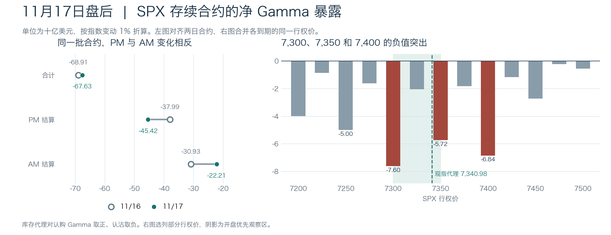

+++
title = "SPX期权持仓与Greeks结构分析-261117"
date = "2026-11-18"
data_as_of = ["2026-11-16", "2026-11-17"]
data_as_of_note = "D 为 11 月 17 日，P 为 11 月 16 日，目标交易日为 11 月 18 日。11 月 17 日月度报价为 16:00 ET，主要期权链供应商时点为 20:45:47 ET，研究截止为 21:05:33 ET。"
draft = false
description = "11 月 17 日盘后 SPX 存续合约呈负 Gamma 库存代理。报告对比 AM 与 PM 持仓变化、短端 IV 和月度两侧尾部，并给出 7,300–7,350 区间的次日观察条件。"
series = "SPX期权分析报告"
categories = ["衍生品", "市场结构"]
tags = ["SPX", "Greeks", "GEX", "期权", "风险分布"]
featured = false
private = false
content_preservation = "verbatim"
source_sha256 = "1d2911aff8e0a7caaa075142b10578a1a0fb78788273989e5c73e265107b4f96"
+++



# SPX期权持仓与Greeks结构分析-261117

**提示词 v1.17 · 美东交易日 2026-11-17（D）· 前一交易日 11-16（P）· 目标交易日 11-18（N）**

11 月 17 日月度期权报价的市场时点为 **16:00 ET**，主要期权链的供应商时点为 **20:45:47 ET**，后者于 21:00:44 ET 采集。收盘补充报价最后于 21:05:33 ET 取得，构成本次研究截止时间，对应 11 月 18 日 02:05:33 UTC、新加坡时间 10:05:33。文中未另注的钟点均为美东时间。

## 1. 一句话结论

11 月 17 日 SPX 收在 **7,340.53**，仍可交易至次日的合约整体呈负 Gamma 库存代理，11 月 18 日先观察 **7,300–7,350** 的哪一侧能在回试后站稳，若事件后持续收复 **7,400** 且短端 IV 回落，这一核心区便失去参考价值。

**盘后研究 B 级｜存续位置与符号置信度高，对冲机制中等，次日方向低｜具体合约估值未纳入本次盘后研究｜目标日执行另行复核。** 评级的实质限制是 11 月 19 日短端曲面不足以和 18 日对比纪要前后的保护成本。

## 2. T+1 Action Summary

| 项目 | 11 月 18 日观察及失效条件 |
| --- | --- |
| Base stance | 若开盘仍在7,300–7,350，先看哪一侧经回试后能守住。持续离开核心时切换分支。 |
| Earliest evaluation | 先看08:30 ET住宅数据后的开盘位置与短端报价。若跳空已越首个复核区，先重画地图。14:00纪要另起一次评估。 |
| Base activation | 若价格在核心内往返，记录7,325两侧的交易位置。只有边界突破或收复经回试、且尚有剩余空间时，才比较相应方向的期权结构。 |
| Downside branch | 若跌穿7,300、回抽未能收复，先看7,275–7,250，再看7,200。快速收回7,300或确认时已越首区，则取消原准备。 |
| Upside branch | 若收复7,350且回试守住，先看7,375、再看7,400。站稳7,400才看7,425–7,450，重新失守7,350则取消修复分支。 |
| Otherwise | 若财报后的波动、盘前数据或纪要使价格与IV信号冲突，或组合价差吞掉剩余空间，则保持观察，等新报价和新节点再评估。 |

17 日现金收盘距 7,350 只有 9.47 点，距 7,300 有 40.53 点。18 日若开在上边界之外，先辨别回试能否守住，再量到下一节点还有多少空间。两个边界来自存续持仓的集中位置，价格可以穿越它们。

## 3. Executive Summary

- **先看 7,300 如何失而复得。** 17 日开在昨日的 7,400–7,450 核心内，最低到 7,288.34，收盘重新高于 7,300，却仍低于 7,350。昨日下侧观察区已经走过，18 日需要从新位置评估。
- **共同合约的总量掩盖了结算组分化。** 同一批 16,414 份合约的带符号 Gamma 从 −68.914 变为 −67.632 十亿美元／指数变动 1%。PM 组负值加深 7.432，AM 组负值收窄 8.713。两层相互抵消，总变化本身给不出次日方向。
- **短端 IV 升高，且真正可作两日描述的近端集中在 11/20 PM。** 其平值 IV 升 4.723 个波动率百分点（vp），25Δ 认沽相对平值的溢价扩大 0.806 vp。11/19 的拟合价格只有 22.87% 落入报价区间，跨纪要的隔日期限成本仍待核价。
- **过去一天，IV 上升抵消了一部分持有成本，却没给出统一的多头收益。** 同合约中间价归因中，研究认购均值跌 19.461 点，认沽涨 26.402 点。短期限组时间损耗抵消正 Vega 均值的 46.8%，长期限组为 22.0%。
- **月度收盘同时提高两侧大幅移动的定价。** 12/15 到期、跌幅超过 5% 的风险中性权重升至 14.806%，涨幅超过 5% 的权重升至 17.528%。前者增加 1.946 个百分点，后者增加 3.662 个百分点。下侧尾部仍更长，单看一侧会漏掉本期变化。
- **18 日有两次需要重新定位的时点。** 房屋开工与许可定于 08:30，10 月 FOMC 会议纪要定于 14:00。纪要发布距当天 PM 到期仅两小时，确认时已经走过的行情会直接压缩单买或借记价差的剩余空间。[美国人口普查局日程](https://www.census.gov/economic-indicators/calendar-listview-2026.html) · [美联储日历](https://www.federalreserve.gov/newsevents/2026-November.htm)

## 4. What Changed vs. T-1 and Prior Playbook Review

| 实质变化 | 11 月 16 日 → 17 日 | 可比基础及含义 |
| --- | --- | --- |
| 现指与波动率 | 现指代理 7,417.12 → 7,340.98，−76.14 点（−1.027%）。VIX 22.91 → 25.46 | 指数变化采用两天各自期权链现指中位数，VIX 采用同一备用行情源。 |
| 共同存续 Gamma | 合计 −68.914 → −67.632，PM −37.986 → −45.417，AM −30.928 → −22.215 | 两日均能存续至 11/18 开盘的同一组合约。单位为十亿美元／1%。 |
| Delta 名义敞口（DEX） | 排除 0DTE 的全链由 −572.903 → −939.097 十亿美元 | 有符号 Delta × 现指 × 乘数 × OI，衡量方向敏感度。它与 Gamma 的分母及冲击单位不同。 |
| 同到期隐含波动率 | 11/20 PM 平值 23.752% → 28.475%，两周附近的 12/01 PM 为 17.788% → 20.368% | 两日正式曲面均允许有条件描述这两个到期。较近端升幅更大。 |
| 同合约报价变化的组均值 | 滚动研究子集 +6.978 → +6.618 点。两段都在样本的合约则为 +2.316 → +10.259 点 | 两个相邻报价区间的比较。前一区间跨周末，样本进出和持有时间均有影响。 |
| 月度终值定价 | 跌幅超过 5% 的权重 12.859% → 14.806%，中央 90% 区间宽度 16.261% → 18.088% | 同为 28 天，实际到期由 12/14 滚至 12/15，锚由 7,417.12 降至 7,340.98。 |

对 18 日最有用的变化是到期结构的分化。16 日整张次日存续图为 −73.203，内含当时尚未退出的 11/17 到期层 −4.289。先剔除这一层，旧图才与 18 日的开盘有相同目标。随后共同合约的 PM、AM 变动几乎抵消。现指、时间、IV、供应商报告的持仓量（OI）及 Greeks 均能改变这些数值，无法从中分离新开仓。

**昨日判断的复盘。** 16 日报告以 7,400–7,450 为核心，若失守 7,400 且反抽未能恢复，先看 7,375–7,350，再看 7,300。17 日现金开盘 7,411.02，最高 7,415.37，最低 7,288.34，收盘 7,340.53，较前收跌 76.06 点。**收盘层面**，原核心下移、下侧两个观察区都进入当天价格范围。**盘中层面**，可以确认指数开在核心内、低点跌穿 7,300、收在其上方，全天没有触及上侧修复门槛 7,450。日线无法检验跌破后的反抽质量、当时的短端 IV 或组合价差。**执行层面**，未提供入场、退出或成交记录，实际是否触发及盈亏均未知。[Yahoo Finance 指数历史行情](https://finance.yahoo.com/quote/%5ESPX/history/?p=%5ESPX) · [美联社当日收盘记录](https://apnews.com/article/ff6caef4d9289cf7f1e6ee48a706eddc)

### 期权报价变化归因

本日报价归因与波动率诊断为部分可用（partial）。同合约中间价可以对照，但现指与盘口缺少独立同步证明，14 天的历史波动率窗口也少一次观察。两次估值从 16 日 21:18:10 至 17 日 20:45:47，相隔 23 小时 27 分 37 秒。起始为 7–60 天的 SPXW PM 合约，9,430 份中配对 9,386 份（99.53%）。排除原因分别为价内外程度超界 26 份、价差过宽 17 份、标准化价内外程度超界 1 份。研究子集另要求起点标准化价内外程度绝对值不超过 2、远期 Delta 绝对值不超过 0.8。下表为每份多头合约的等权平均指数点，1 点对应 100 美元。短、长按起始实际剩余日数分组。

| 组别（可重叠） | 份数 | 中间价变化 | Delta | Gamma | Theta | Vega | 残差均值 | 绝对残差95分位 | 基础 → 完整 RMSE |
| --- | --- | --- | --- | --- | --- | --- | --- | --- | --- |
| 全部配对 | 9,386 | +5.837 | +0.413 | +1.370 | −1.886 | +6.170 | −0.332 | 1.115 | 0.762 → 0.505 |
| 研究子集 | 6,069 | +6.618 | +0.087 | +1.755 | −2.284 | +7.422 | −0.370 | 1.123 | 0.706 → 0.509 |
| 起始不足21天 | 2,441 | +5.193 | −0.014 | +2.235 | −3.062 | +6.538 | −0.562 | 1.462 | 0.792 → 0.726 |
| 　短组认购 | 1,083 | −19.916 | −25.579 | +2.524 | −3.028 | +6.926 | −0.407 | 1.347 | 0.945 → 0.622 |
| 　短组认沽 | 1,358 | +25.217 | +20.374 | +2.005 | −3.090 | +6.229 | −0.685 | 1.488 | 0.644 → 0.800 |
| 起始至少21天 | 3,628 | +7.577 | +0.155 | +1.432 | −1.761 | +8.016 | −0.241 | 0.499 | 0.642 → 0.281 |
| 　长组认购 | 1,535 | −19.140 | −27.018 | +1.669 | −1.755 | +8.458 | −0.190 | 0.474 | 0.702 → 0.244 |
| 　长组认沽 | 2,093 | +27.170 | +20.084 | +1.259 | −1.766 | +7.692 | −0.278 | 0.525 | 0.595 → 0.305 |
| 全部研究认购 | 2,618 | −19.461 | −26.423 | +2.023 | −2.282 | +7.824 | −0.280 | 0.969 | 0.811 → 0.441 |
| 全部研究认沽 | 3,451 | +26.402 | +20.198 | +1.552 | −2.287 | +7.116 | −0.438 | 1.163 | 0.615 → 0.555 |

认购和认沽的 Delta 项方向相反，合并后只剩 +0.087 点。单份绝对 Delta 贡献再取均值达 22.883 点。整体正 Vega 为 +7.422 点，Theta 为 −2.284 点，合计 +5.137 点。短组两项合计 +3.476，长组 +6.255。细分到短认购、短认沽，损耗抵消的正 Vega 分别为 43.7%、49.6%，长认购、长认沽为 20.8%、23.0%。这些是两项组均值的比率，读者可用它们判断哪一组更受退出时钟制约，不能将它们套到一份新期权或把重叠组相加。

完整研究组另有 Vanna −0.108、Volga +0.138、贴现 −0.022 点。加上均值残差 −0.370 点后与观察值 +6.618 点相符。与仅含 Delta、Gamma、Theta、Vega 的展开相比，完整模型的研究组均方根误差（RMSE）由 0.706 降到 0.509 点，上一区间完整误差为 3.156 点。短认沽却由 0.644 增至 0.800 点。残差没有被识别为跳跃损益，过去一次拟合更贴近中间价也不能决定未来成交表现。

**现指与远期的桥接。** 26 个到期的隐含远期均与现指同向下行，跌幅约 64.05–64.86 点，低于现指代理的 76.14 点。以 11/23 为例，远期 7,432.379 → 7,368.248，变动 −64.131 点，由现指 −76.140 点与远期减现指的基差扩大 +12.009 点组成。归因使用各到期自己的远期。供应商没有独立证明现指与期权盘口同步，基差变化无法逐项归给股息、利率或报价时差。

**样本变化有多大。** 研究子集从 5,360 增至 6,069 份，认购占比 38.15% → 43.14%，平均剩余期限 26.72 → 27.78 天，绝对对数价内外程度均值 0.04682 → 0.04734。滚动研究组的报价变化均值下降 0.360 点，其中 Delta、Gamma、Theta、Vega 的组均值变化约为 +0.987、−5.020、+3.899、−1.626 点。共同的 4,807 份合约占本期 79.21%、前期 89.68%，报价变化均值反而升 7.943 点，四项变化分别为 +9.189、−4.645、+3.709、−1.182 点。固定身份后 Delta 的差别最大，跨周末和合约老化仍然存在。

研究组相对 11/10（6,125 份）和 10/20（5,821 份）的**单段**报价变化均值分别高 12.991 和 7.765 点，其中 Vega 分项分别高 11.653 和 8.497 点。这些是连续观察序列中的指定日期比较，不是五日或二十日累计收益。此次配对不覆盖 0DTE 或 AM 结算，不能用它解释所有库存变化或预估纪要发布后的组合利润。

## 5. T 日盘面、字段时点与 Event-Risk Overlay

| 已知或待发生 | 时间（ET） | 与本期观察的关系 |
| --- | --- | --- |
| 已发布 · 10 月零售和进出口价格 | 11/17 08:30 | 季调名义零售及餐饮销售约 7,482 亿美元，环比 +0.2%，90% 抽样误差 ±0.4 个百分点。进口、出口价格均环比 +1.1%。[人口普查局零售公告](https://www.census.gov/retail/marts/www/marts_current.pdf?release=20261117) · [劳工统计局](https://www.bls.gov/news.release/archives/ximpim_11172026.htm) |
| 已发布 · 10 月工业产出 | 11/17 09:15 | 工业产出环比 −0.4%，其中制造业 +0.3%、公用事业 −4.3%。需求与利率信号要按分项解读。[美联储工业产出公告](https://www.federalreserve.gov/releases/g17/20261117/default.htm) |
| 已发布 · 英伟达财报 | 11/17 16:20，SEC 于 16:20:51 收件 | 2027 财年三季度营业收入 1,158 亿美元，同比 +103%。发布时间处在月度收盘报价与主要链更新时间之间。[英伟达业绩公告](https://investor.nvidia.com/news/press-release-details/2026/NVIDIA-Announces-Financial-Results-for-Third-Quarter-Fiscal-2027/default.aspx) · [原始新闻稿时标](https://www.globenewswire.com/news-release/2026/11/17/3405200/0/en/nvidia-announces-financial-results-for-third-quarter-fiscal-2027.html) · [SEC 收件记录](https://www.sec.gov/Archives/edgar/data/1045810/000104581026000088/0001045810-26-000088-index.htm) |
| 已排程 · 新住宅建设 | 11/18 08:30 | 住宅开工和许可在开盘前公布，届时先核对利率、现指与开盘区间。[人口普查局日程](https://www.census.gov/economic-indicators/calendar-listview-2026.html) |
| 已排程 · FOMC 纪要、20 年期国债拍卖 | 11/18 14:00 发布 10/27–28 会议纪要。拍卖仅核实为当日 | 纪要后 0DTE 余时缩短。拍卖观察长端收益率，季度安排表未用于确认具体钟点。[美联储日历](https://www.federalreserve.gov/newsevents/2026-November.htm) · [财政部季度日程](https://home.treasury.gov/system/files/221/TentativeAuctionScheduleQ42026.pdf) |

16:00 和 20:45:47 两组市场时标之间相差 4 小时 45 分 47 秒，英伟达在其间披露了新信息。月度截面早于财报，主要链虽带财报后的供应商时间，也缺少相同合约、口径及报价质量的公告前后即时对照。因此无法把短端 IV 的升幅单独归因于财报。18 日的日历只纳入截至研究截止已知的发布时间。

## 6. Decision Rationale — Analytical Bridge

**一、7,300–7,350 是开盘定位的起点。** 7,300 和 7,350 的跨到期带符号 Gamma 分别为 −7.603、−5.716 十亿美元／1%，17 日现金收盘位于两者之间。若实际中介持仓符号与库存代理一致，套保调整可能放大离开该区的价格变动。18 日若失去 7,300 后反抽不复，先看 7,275–7,250。若 7,350 回试守住，先看 7,375。区间内往返，或开盘直接越过下一层，均需改变观察顺序。节点读数置信度高，对冲机制中等，对哪一侧先突破的判断置信度低。

**二、PM、AM 分化使净额不足以判断次日更稳定。** 同一批合约的 PM 负值加深 7.432，AM 负值收窄 8.713 十亿美元／1%。保持最近可得的各合约 OI 数量及符号约定不变，改变价格、时间和 IV，重估存续合约的 Gamma 暴露，便得到“冻结 OI”情景。在模型 10:00、IV 不变时，现指下移 0.5% 与上移 0.5% 对应 −81.952 和 −60.535。若跌破边界后 IV 与价格不再同向验证压力，或事件后 7,400 得以维持，重估各期限。两日同组事实置信度高，条件敏感度中等，格点没有发生概率。

**三、目标日剩余时间会改变保护工具的取舍。** 11/20 PM 的 25Δ 认沽升 5.529 vp，平值升 4.723 vp。过去一天，不足 21 天组的平均正 Vega 被时间损耗抵消近一半。纪要前仍需承担事件重定价，纪要发布后，11/18 到期合约只剩两小时，接近平值的头寸尤其受时间损耗影响。方向经回试成立且距目标仍有空间时，才比较单买与借记价差。若届时 IV 回落、组合价差过宽或已到首个节点，放弃该比较。历史报价解释中等，18 日成交成本及 11/19 相对定价低置信。

**四、月度尾部风险值得保留两侧压力情景。** 收盘期权给出的 28 日中央 90% 收益区间为 −10.789% 至 +7.299%，相对前日两端均外扩。现指下移与到期滚动也改变点数坐标，且估值钟早于财报。可据此检查“只防继续下跌”会漏掉的上行尾部，同时保留更长左尾的压力测试。若纪要后曲面和价格形成新的方向证据，应以新截面调整日内分支。月度描述置信中等，传导到次日路径的置信度低。

## 7. Conflicting Evidence, Confidence and What Changes the View

| 看似相互冲突的证据 | 分歧来自哪里 | 什么新观察会改变处理 |
| --- | --- | --- |
| 全链 DEX 更负，净 Gamma 的共同合约负值却略减 | Delta 衡量当下方向敏感度，Gamma 衡量 Delta 对价格的小幅变化。PM 和 AM 的 Gamma 变动又相反 | 以目标日现指和各期限新 Greeks 重估。若持续收复 7,400 且短 IV 回落，重建下侧压力假设。 |
| 平值 IV 普遍上升，30、45 天的模型 IV 变化强度反而下降 | IV 水平与 IV 比例变化的方差率不同，14 天强度近乎不变 | 看新报价是否继续分化。若两翼溢价回落，重新比较单买与价差的成本。 |
| 月度左右两尾变宽，18 日仍以核心区开盘定位 | 月度描述 16:00 截面的 12/15 终值。库存图描述 20:45 的存续敏感度。同属 SPX 期权，且中间隔着财报 | 08:30 数据后先用开盘价格重新定位，14:00 后再看 IV。月度尾部不能给 7,300 赋予次日触及概率。 |
| 滚动报价变化均值下降，共同合约均值却上升 | 合约构成与区间经过时间均有变化，末日也不同 | 检查同合约和认购／认沽分组。两段报价解释均保留，未获得 0DTE 的可移植参数。 |

方向假设被推翻、结构需要核价、暂时无法执行是三种不同的结果。价格收复失守边界会撤销相应路径。相同路径下 IV 或剩余时间改变，只需重估期权结构。报价不同步或盘口过宽时，研究判断可以保留，执行应等待。此处的路径判断有对冲机制依据，尚未经过独立样本外检验，没有可报告的胜率或预期收益。

## 8. IV Term Structure, Skew and Surface

### 正式曲面与逐到期质量

前日采用 **11 月 16 日日常正式包**。它与 11 月 17 日的模型方法、配置、合约分类、主族 SPXW PM、未作权利金调整的远期 Delta 及节点定义一致，原始快照身份已核对。两日估值时点分别为 21:18:10 和 20:45:47。11/17 的完整正式曲面通过审计，32 条到期曲线中 28 条选用约束拟合、4 条选用形状修复。整体拟合价格落入买卖区间的比例为 83.24%，所检验的认购价格对行权价单调性、凸性、密度非负与日历一致性均通过。实际使用权限仍取决于对应到期。

| 到期 | 结算 | 11/16 拟合落入买卖区间／用途 | 11/17 拟合落入买卖区间／用途 |
| --- | --- | --- | --- |
| 11/18 | PM | 47.24% · 约束／仅诊断 | 76.12% · 约束／条件参考 |
| 11/19 | PM | 32.02% · 约束／仅诊断 | 22.87% · 约束／仅诊断 |
| 11/20 | PM | 60.61% · 约束／条件参考 | 58.88% · 约束／条件参考 |
| 11/23 | PM | 60.00% · 修复／条件参考 | 31.62% · 约束／仅诊断 |
| 11/24 | PM | 85.51% · 修复／条件参考 | 44.59% · 约束／仅诊断 |
| 11/25 | PM | 84.98% · 修复／条件参考 | 85.97% · 约束／条件参考 |
| 11/27 | PM | 91.38% · 修复／条件参考 | 95.42% · 修复／条件参考 |
| 11/30 | PM | 93.85% · 约束／条件参考 | 97.62% · 修复／条件参考 |
| 12/01 | PM | 81.08% · 约束／条件参考 | 91.96% · 约束／条件参考 |
| 12/16 | PM | 87.29% · 约束／条件参考 | 90.30% · 约束／条件参考 |
| 12/17 | PM | 78.95% · 约束／条件参考 | 89.31% · 约束／条件参考 |
| 12/31 | PM | 94.75% · 约束／条件参考 | 95.07% · 约束／条件参考 |
| 27/01/08 | PM | 91.20% · 约束／条件参考 | 91.20% · 约束／条件参考 |
| 11/20 | AM | 24.93% · 约束／仅诊断 | 51.11% · 约束／仅诊断 |

11/18 当晚能作有条件的模型参考，但其前日只有 47.24% 的拟合价落入买卖区间，跨日差仍只作诊断。11/19 当期进一步降至 22.87%，直接限制“多付一天时间价值能买到多少纪要后保护”的比较。11/20 PM 两日均可描述，同一天的 AM 只有 51.11%，不能拿来替 PM 的周五报价。表中的比例衡量报价符合度，与次日判断正确率无关。

### ATM 期限结构

先比较相同实际到期。下表均为 SPXW 下午结算，τ 是按实际市场时钟到该合约结算参考时点的日数。年化 IV 用百分比，其差用波动率百分点（vp），1 vp 对应 IV 从 20% 移至 21%。

| 共同到期 | 实际剩余日 P → D | 11/16 ATM | 11/17 ATM | 变化 vp | 同到期方法／权限 | 事件与结算 |
| --- | --- | --- | --- | --- | --- | --- |
| 11/18 PM | 1.779 → 0.802 | 25.172% | 31.312% | +6.140 | 约束→约束／仅诊断 | 住房数据、14:00纪要、当日到期 |
| 11/19 PM | 2.779 → 1.802 | 24.473% | 30.068% | +5.595 | 约束→约束／仅诊断 | 含纪要后一个交易日 |
| 11/20 PM | 3.779 → 2.802 | 23.752% | 28.475% | +4.723 | 约束→约束／可描述 | 周五到期，独立于同日AM |
| 11/25 PM | 8.779 → 7.802 | 19.996% | 22.938% | +2.943 | 修复→约束／可描述 | 感恩节前 |
| 11/27 PM | 10.654 → 9.677 | 18.933% | 21.724% | +2.791 | 修复→修复／可描述 | 提前收市，13:00到期 |
| 12/01 PM | 14.779 → 13.802 | 17.788% | 20.368% | +2.580 | 约束→约束／可描述 | 约两周背景 |
| 12/17 PM | 30.779 → 29.802 | 17.628% | 19.770% | +2.141 | 约束→约束／可描述 | 约一月背景 |
| 12/31 PM | 44.779 → 43.802 | 16.976% | 18.811% | +1.835 | 约束→约束／可描述 | 较远端背景 |

在两日质量都允许描述的到期中，11/20 周五平值 IV 上升 4.723 vp，到 12/01、12/17、12/31 依次缩至 2.580、2.141、1.835 vp。近端比远端升得更多，适合在事件后检查这条斜率是否保留。与 11/27 提前到期相对应，τ 已扣掉三小时。即使比较同一天到期，也包含少一天期限、不同的盘后估值钟和新的市场信息。

| 固定期限，PM | 11/16 来源到期（τ，上端权重） | 11/17 来源到期（τ，上端权重） | ATM 水平 P → D | 变化 vp |
| --- | --- | --- | --- | --- |
| 3天 | 11/19 (2.779日，0) | 11/20 (2.802日，0) | 24.473% → 28.475% | +4.002 |
| 7天 | 11/23 (6.779日，0) | 11/24 (6.802日，0) | 19.965% → 23.012% | +3.047 |
| 14天 | 11/30 (13.779日，0) | 12/01 (13.802日，0) | 17.706% → 20.368% | +2.661 |
| 30天 | 12/16 (29.779日，0) | 12/17 (29.802日，0) | 17.567% → 19.770% | +2.202 |
| 45天 | 12/31 (44.779日，0) | 12/31 / 01/08 (43.802 / 51.802日，0.1498) | 16.976% → 18.771% | +1.794 |

换成固定期限，3 天到底用哪一张合约会随着交易日改变，11/16 对应 11/19，11/17 对应 11/20。前者的报价质量限制了 3 天变化，7 天也只可作诊断。14、30 天的本日槽位各自采用一个实际到期，表中权重 0 表示直接用该到期。45 天在本日改用 12/31 与 2027 年 01/08 的总方差插值，上端权重约 14.98%。因此 45 天的 +1.794 vp 与同一 12/31 合约的 +1.835 vp 回答不同问题，仅作为远端背景。

### 期限槽位的微笑曲线

10Δ、25Δ 表示按远期 Delta 选择两翼。平值取行权价等于远期的节点。本报告的 **下侧 skew25** 为 25Δ 认沽 IV 减平值 IV，**BF25** 为 25Δ 两翼 IV 的平均数减平值 IV。后两者的水平和所有 Δ 行均用 vp。程序在观察支撑内按远期 Delta 插值两翼，平值按零对数价差处的总方差求得。7、14、30 天均按两日一致的最近剩余期限规则取各自的实际到期。

| 期限／行类型 | 到期 / τ（日） | 10Δ put | 25Δ put | ATM | 25Δ call | 10Δ call | 下侧 skew25 | BF25 | 比较基础／方法／质量 |
| --- | --- | --- | --- | --- | --- | --- | --- | --- | --- |
| 7天 · P 水平 | 11/23 / 6.779 | 26.565% | 22.741% | 19.965% | 17.933% | 16.495% | 2.777 | 0.373 | 修复／条件参考 60.00% |
| 7天 · D 水平 | 11/24 / 6.802 | 32.376% | 26.613% | 23.012% | 20.490% | 18.977% | 3.601 | 0.540 | 约束／仅诊断 44.59% |
| 7天 · Δ D−P | 11/23 → 11/24 | +5.811 | +3.872 | +3.047 | +2.557 | +2.482 | +0.824 | +0.167 | 滚动槽位／仅诊断 |
| 14天 · P 水平 | 11/30 / 13.779 | 26.151% | 21.064% | 17.706% | 15.258% | 13.847% | 3.357 | 0.454 | 约束／条件参考 93.85% |
| 14天 · D 水平 | 12/01 / 13.802 | 30.498% | 24.395% | 20.368% | 17.513% | 15.941% | 4.027 | 0.586 | 约束／条件参考 91.96% |
| 14天 · Δ D−P | 11/30 → 12/01 | +4.347 | +3.331 | +2.661 | +2.255 | +2.094 | +0.670 | +0.132 | 滚动槽位／可描述 |
| 30天 · P 水平 | 12/16 / 29.779 | 27.955% | 21.733% | 17.567% | 14.815% | 13.581% | 4.165 | 0.707 | 约束／条件参考 87.29% |
| 30天 · D 水平 | 12/17 / 29.802 | 31.232% | 24.401% | 19.770% | 16.542% | 15.049% | 4.632 | 0.702 | 约束／条件参考 89.31% |
| 30天 · Δ D−P | 12/16 → 12/17 | +3.278 | +2.668 | +2.202 | +1.726 | +1.468 | +0.466 | −0.005 | 滚动槽位／可描述 |

先看水平，14 天与 30 天槽位分别升 2.661、2.202 vp。再看倾斜，25Δ 认沽相对平值的溢价分别扩大 0.670、0.466 vp，近两周下翼上调更明显。曲率方面，14 天 BF25 升 0.132 vp，30 天仅变 −0.005 vp，后者不足以主张两翼相对便宜。7 天虽能算出升幅与倾斜，11/24 局部符合度仅 44.59%。这些槽位换了实际到期，固定 Delta 也会换行权价。可用于选定需要复核的那段曲线，不能据此指定交易腿。

### 短端候选实际到期的微笑曲线

三个候选均为 SPXW PM，使用相同实际到期与固定 Delta。11/18、11/19、11/20 各自独立。此处“候选”指要观察的期限。

| 期限／行类型 | 到期 / τ（日） | 10Δ put | 25Δ put | ATM | 25Δ call | 10Δ call | 下侧 skew25 | BF25 | 比较基础／方法／质量 |
| --- | --- | --- | --- | --- | --- | --- | --- | --- | --- |
| 11/18候选 · P 水平 | 11/18 / 1.779 | 30.038% | 27.202% | 25.172% | 23.727% | 22.737% | 2.031 | 0.293 | 约束／仅诊断 47.24% |
| 11/18候选 · D 水平 | 11/18 / 0.802 | 36.405% | 33.364% | 31.312% | 30.285% | 30.099% | 2.052 | 0.512 | 约束／条件参考 76.12% |
| 11/18候选 · Δ D−P | 11/18 → 11/18 | +6.367 | +6.162 | +6.140 | +6.558 | +7.362 | +0.021 | +0.220 | 同到期／仅诊断 |
| 11/19候选 · P 水平 | 11/19 / 2.779 | 31.296% | 27.195% | 24.473% | 22.507% | 21.029% | 2.723 | 0.378 | 约束／仅诊断 32.02% |
| 11/19候选 · D 水平 | 11/19 / 1.802 | 38.538% | 33.306% | 30.068% | 28.432% | 27.294% | 3.239 | 0.802 | 约束／仅诊断 22.87% |
| 11/19候选 · Δ D−P | 11/19 → 11/19 | +7.241 | +6.111 | +5.595 | +5.926 | +6.265 | +0.516 | +0.423 | 同到期／仅诊断 |
| 11/20候选 · P 水平 | 11/20 / 3.779 | 30.677% | 26.641% | 23.752% | 21.608% | 20.231% | 2.889 | 0.372 | 约束／条件参考 60.61% |
| 11/20候选 · D 水平 | 11/20 / 2.802 | 37.939% | 32.170% | 28.475% | 26.381% | 25.133% | 3.695 | 0.801 | 约束／条件参考 58.88% |
| 11/20候选 · Δ D−P | 11/20 → 11/20 | +7.262 | +5.529 | +4.723 | +4.773 | +4.903 | +0.806 | +0.428 | 同到期／可描述 |

11/18 的核心变化是平值整体抬升 6.140 vp，25Δ 下侧倾斜只变 +0.021 vp，BF25 为 +0.220 vp。前日局部覆盖不足，使这些差值只有诊断意义。11/19 的三个变化为 +5.595、+0.516、+0.423 vp，两日局部报价均弱。11/20 PM 的两日局部质量均允许描述，平值升 4.723 vp，下侧倾斜由 2.889 增至 3.695 vp，BF25 由 0.372 增至 0.801 vp。10Δ 认沽／认购分别升 7.262／4.903 vp，周五到期的深下翼重定价较大。差值在舍入前计算。实际合约少了约 0.978 天，固定 Delta 会移到新的行权价。这种下翼相对平值抬高的形状，仍需与 18 日两腿的实际权利金和买卖价差对照。

### 波动率联动与变化强度

另一组局部定价诊断把参考 IV 定义在标准化坐标为零处，其行权价满足 $K=F\exp(-\sigma^2\tau/2)$，其中 $F$ 为远期、$\sigma$ 为年化 IV、$\tau$ 为年数，和上一组 $K=F$ 的平值 IV 分栏。**收益–IV 联动**是定价口径下标的收益与 IV 比例变化的年化协方差率，负值表示两者在该模型中反向联动。**IV 变化强度**是 IV 比例变化的年化方差率，值越大表示模型对 IV 自身波动的定价越强。表内参考 IV 的差用 vp，其余用各自的年率单位。

| 期限 | 诊断量 | 11/17 水平 | 较 11/16 | 较 11/10 | 较 10/20 |
| --- | --- | --- | --- | --- | --- |
| 14天 | 模型参考 IV | 20.697% | +2.553 | +5.891 | +7.535 |
| 14天 | 收益–IV 协方差率 | −0.256 | −0.033 | −0.086 | −0.122 |
| 14天 | IV 比例变化方差率 | 2.442 | +0.005 | +0.183 | −0.704 |
| 30天 | 模型参考 IV | 20.020% | +2.230 | +5.059 | +6.767 |
| 30天 | 收益–IV 协方差率 | −0.191 | −0.022 | −0.060 | −0.084 |
| 30天 | IV 比例变化方差率 | 1.516 | −0.219 | +0.049 | −0.535 |
| 45天 | 模型参考 IV | 19.368% | +1.889 | +4.152 | +6.065 |
| 45天 | 收益–IV 协方差率 | −0.160 | −0.015 | −0.043 | −0.068 |
| 45天 | IV 比例变化方差率 | 1.068 | −0.067 | −0.096 | −0.401 |

14、30、45 天的参考 IV 较 11/16 均上升，收益与 IV 的协方差率均更负。IV 自身的变化强度却分化，14 天方差率只增加 0.00481，相对变化 +0.20%，30 天、45 天则分别下降 12.63%、5.92%。因而“平值 IV 已上升”不足以支持“从两周至六周的 IV 波动都在加剧”。5、20 个交易日端点对比也未证明中间每天同向。此系列没有与月度分布相同的 60／120 日历史百分位。

**30 天漂移与历史对照。** 30 天模型给出的 IV 比例漂移年率由 −0.472 变为 −0.902，较 11/10、10/20 分别变 −1.209、−1.024。它刻画定价假设下 IV 比例变化的漂移，无法直接给出次日 IV。历史代理从同一合约的对数 IV 变动取样，须满 21 个有效交易日变化、按 252 年化。14 天只有 20/21，不计算其历史矩之差。30 天为 21/21，历史方差率 1.11938、协方差率 −0.20723，定价值减历史代理分别为 +0.39695、+0.01644。45 天为 21/21，对应历史值 0.78036、−0.17436，差为 +0.28803、+0.01398。两组使用的信息、期限及估计方式不同，无法由差值识别可赚取的风险溢价。若事件后观察到价格修复而短端 IV 下行，首先复核的是当时的保护成本。

### 期权隐含月度分布（风险中性口径）

风险中性分布描述同一组期权价格赋予不同**到期终值**的定价权重，基于平滑的期权报价及尾部外推。取 25–31 天中离 28 天最近的实际 SPXW PM 到期。本期与前期均为 28 天，都采用 16:00 收盘兼容报价。各日收益均为“到期指数／当日现指代理 − 1”的非年化价格收益，不含股息再投资。

| 估值日／到期 | 现指代理 | 到期收益均值／中位数 | 中央 90% 指数区间 | 中央 90% 收益区间 | 月度标准差 |
| --- | ---: | --- | --- | --- | ---: |
| 11/16 → 12/14 PM | 7,417.12 | +0.263%／+1.434% | 6,707.17–7,913.30 | −9.572% 至 +6.690% | 5.804% |
| 11/17 → 12/15 PM | 7,340.98 | +0.206%／+1.564% | 6,548.98–7,876.81 | −10.789% 至 +7.299% | 6.466% |

本期中央 80% 指数区间为 6,823.81–7,789.71。与昨日相比，中央 90% 相对现指的下侧幅度扩大 1.217 个百分点、上侧扩大 0.610 个百分点。尽管上侧收益阈值更高，**它对应的指数点数从 7,913.30 降至 7,876.81**，原因之一是现指锚下移。两天选用不同到期，当日又有盘后财报，不能把区间移动全归为对同一合约的重新定价。

| 互斥的到期收益区间 | 11/16 权重 | 11/17 权重 | 变动（百分点） |
| --- | --- | --- | --- |
| 低于 −10% | 4.604% | 5.768% | +1.165 |
| −10% 至 −5% | 8.256% | 9.037% | +0.781 |
| −5% 至 −2% | 11.479% | 11.284% | −0.195 |
| −2% 至 0 | 12.856% | 11.653% | −1.203 |
| 零及以上 | 62.806% | 62.257% | −0.548 |

总下跌权重只增加 0.548 个百分点，零到跌 2% 的一段却减少 1.203 个百分点，−5% 至 −2% 的一段也略降。互斥区间里更深左侧的权重增加，使“下跌总权重变化不大”和“深跌保护受到重视”同时成立。右侧也发生内部重分布，非负总权重降至 62.257%，而上涨超过 5% 的权重增加 3.662 个百分点。月度压力测试应保持两侧，且这些区间提供的只有终点权重。

| 28日终值指标 | 11/16 | 11/17 | 变动（百分点） | 60日中位数／约第几百分位 | 120日中位数／约第几百分位 |
| --- | --- | --- | --- | --- | --- |
| 到期收益低于0的概率 | 37.194% | 37.743% | +0.548 | 37.847% ／ 44 | 37.820% ／ 47 |
| 到期跌幅超过2%的概率 | 24.338% | 26.089% | +1.751 | 19.869% ／ 100 | 20.207% ／ 100 |
| 到期跌幅超过5%的概率 | 12.859% | 14.806% | +1.946 | 7.576% ／ 100 | 7.806% ／ 100 |
| 到期跌幅超过10%的概率 | 4.604% | 5.768% | +1.165 | 1.890% ／ 97 | 1.930% ／ 98 |
| 到期涨幅超过2%的概率 | 43.993% | 45.992% | +1.999 | 34.289% ／ 97 | 34.640% ／ 97 |
| 到期涨幅超过5%的概率 | 13.865% | 17.528% | +3.662 | 5.387% ／ 100 | 5.526% ／ 100 |
| 到期涨幅超过10%的概率 | 0.409% | 0.855% | +0.446 | 0.204% ／ 100 | 0.197% ／ 100 |
| 收益第5百分位 | −9.572% | −10.789% | −1.217 | −6.400% ／ 3 | −6.476% ／ 2 |
| 收益中位数 | 1.434% | 1.564% | +0.130 | 0.919% ／ 97 | 0.975% ／ 97 |
| 收益第95百分位 | 6.690% | 7.299% | +0.610 | 5.094% ／ 100 | 5.124% ／ 100 |
| 月度收益标准差（未年化） | 5.804% | 6.466% | +0.662 | 4.026% ／ 97 | 4.114% ／ 98 |
| 中央90%区间宽度 | 16.261% | 18.088% | +1.826 | 11.383% ／ 100 | 11.757% ／ 100 |
| 中央90%区间下侧幅度（相对锚） | 9.572% | 10.789% | +1.217 | 6.400% ／ 97 | 6.476% ／ 98 |
| 中央90%区间上侧幅度（相对锚） | 6.690% | 7.299% | +0.610 | 5.094% ／ 100 | 5.124% ／ 100 |
| 中央90%下侧幅度减上侧幅度 | 2.882% | 3.490% | +0.607 | 1.462% ／ 97 | 1.558% ／ 98 |

过去 60 个交易日（08/24–11/16）有 36 个合格观察，其中 33 个历史重建、3 个日常派生。120 日窗口为 05/28–11/16，有效日期自 05/29 开始，共 59 个（56 个重建、3 个日常派生）。两窗都排除 11/17，以至少 20 个合格值为本项目历史排名披露门槛。表内最后两列以各自中位数和本期所在的近似百分位表示。**跌幅超过 5% 的定价权重为 14.806%，在两个窗口都约处第 100 百分位。下跌总权重 37.743% 却只约处第 44、47 百分位。** 收益第 5 百分位的读法相反，本次 −10.789% 在历史相应收益阈值中约排第 3、2 百分位，意味着同样 5% 左尾对应更深跌幅。较长窗口与近期窗口给出相近的尾部结论。

每日快照的 28 日期限大量重叠，这 36 和 59 条记录不等于独立月度事件。历史重建也不能保证每项当时即可取得。指定的 11/10 和 10/20 均缺合格的同口径月度观察，五日和二十日变化留缺。7,194.16、6,973.93、6,606.88 分别对应当前锚下方 2%、5%、10%，落在实际观察行权价 3,600–8,200 内。日内参考位 7,300 距此锚约 −0.558%，数据没有给出该点位的精确终值概率，更无 18 日触价概率。

**尾部及数值敏感性。** 观察行权价外的外推部分占概率质量 0.442%，却占方差约 9.905%。基准、网格改为 1 点、最低买价改为 1 点三个固定案例均合格。三案中下跌超过 5% 的权重为 14.8055%–14.8061%，下跌超过 10% 为 5.7685%–5.7691%，第 5、95 百分位收益在 −10.7894% 至 −10.7887%、+7.2978% 至 +7.2992% 之间。月度标准差在三案中为 6.4637%–6.4664%。这两项微扰的差异远小于本日变化，但未更换尾部分布族，也未检验财报后价格。另一个依赖效用及等值分红假设的研究对照把均值推至 +0.623%、跌逾 5% 的权重降至 13.124%。它与基础分布同源，不能增加独立的上行证据。

## 9. Key Expiry / Strike / Dealer Node

**先确定分母。** 本次采集 0–60 天，原始 17,700 份合约、OI 16,113,928 张。旧筛选视图保留 13,494 份、8,927,395 张 OI，占原始 55.40%。另按次日开盘仍可交易筛选，获得 17,160 份、8,580 个“到期 × 合约族 × 结算 × 行权价”节点，覆盖此次快照合格 OI 和总 Gamma 的 100%。展示窗口 7,120.75–7,561.21 仅占存续总 Gamma 的 46.78%。11/17 到期层自身有 371,480 张 OI、21.872 十亿美元／1% 总 Gamma，已从 18 日地图一次性移除。

把供应商 Gamma 按 OI、乘数与现指换算为**指数变动 1% 对应的 Delta 名义敏感度**，存续总量（gross GEX）为 **279.574 十亿美元／1%**。若按项目约定令认购为正、认沽为负，得到库存代理（signed GEX）为 **−67.632**。认沽期权本身的数学 Gamma 对多头仍为正。真实中介的净持仓方向、对冲时点及成交金额均未观察到。前日整张存续图总量为 312.119，比较市场变化时使用第 4 节同组，而非直接把整图差额视作流量。

| 实际到期与结算 | 存续 OI（张） | 总量 Gamma | 带符号 Gamma | 与目标日的联系 |
| --- | --- | --- | --- | --- |
| 11/18 PM | 234,874 | 8.710 | −6.032 | 目标日0DTE，含14:00纪要 |
| 11/19 PM | 132,549 | 4.705 | −3.247 | 纪要后多一个交易日 |
| 11/20 AM | 2,084,318 | 38.197 | −15.120 | 周五主到期，分开看结算时钟 |
| 11/20 PM | 682,211 | 14.676 | −9.843 | 周五主到期，分开看结算时钟 |
| 11/27 PM | 376,286 | 9.373 | −5.012 | 感恩节次日提前收市 |
| 12/18 AM | 6,722,411 | 115.233 | −2.234 | 12月主到期，高阶暴露集中 |
| 12/18 PM | 356,630 | 5.618 | −2.841 | 12月主到期，高阶暴露集中 |
| 01/15 AM | 2,020,829 | 29.051 | −4.861 | 2027年1月较长期限 |
| 01/15 PM | 114,653 | 2.776 | −1.133 | 2027年1月较长期限 |

11/18 PM 将成为目标日 0DTE，其 −6.032 十亿美元／1% 对当日事件最直接。周五 11/20 的 AM、PM 合计总量 52.873、带符号量 −24.963，构成附近主要负暴露。12/18 的总量高达 120.851，约占全存续的 43.23%，净值却只有 −5.075，双边大持仓在同到期净额中相互抵消。表中各族分别列示，同日合并行未重复相加。AM 周五早间结算与 PM 周五下午结算的价格风险时间不同。

跨所有存续到期相加，7,300、7,350、7,400 的带符号 Gamma 为 −7.603、−5.716、−6.838 十亿美元／1%。其间 7,325 为 −2.051，7,375 为 −1.831。下方 7,275、7,250、7,200 分别为 −1.621、−4.999、−3.986，上方 7,425、7,450 为 −1.165、−2.714。这给出了开盘后各方向的复核顺序。单看到期时，11/20 AM 的 7,400 为 −2.407，7,300 为 −1.650，12/18 AM 相同两点为 −1.303、−1.265。11/20 AM 的 7,500 甚至为 **+1.345**，全部到期同一行权价却是 **−0.552**。选择不同到期可以得到不同符号，因此这些点位既非确定支撑压力，也无法证明做市商必然如何交易。

### 高阶敞口由哪些期限主导

以下三项为本项目按 OI 加权的有限冲击代理。Vanna 是 IV 上下各移动 0.5 vp 后的 Delta 名义敞口之差，Charm 是推进到下一交易日参考时点的同类变化。Volga 取两端 Black–Scholes Vega 的差额，本表从每 1.0 单位波动率的 Vega 换算到每 1 vp（除以 100），单位是百万美元／vp。各列斜线后为历史标准分 $z=(当日值-均值)/总体标准差$。

| 原始期限分组 | Vanna 十亿美元 / z | Charm 十亿美元 / z | Volga 百万美元每1 vp / z |
| --- | --- | --- | --- |
| 不超过3天（分组含0DTE） | −0.532 / −0.68 | +1.100 / −0.25 | +4.547 / +0.95 |
| 7±2天 | +0.274 / +0.44 | −0.650 / −0.52 | +1.473 / −0.75 |
| 30±3天 | +7.579 / +4.25 | −1.495 / −2.26 | +102.130 / +2.73 |
| 全部排除0DTE | +13.004 / +1.54 | −1.938 / −1.09 | +204.125 / +0.87 |

与各组自身历史比较，偏离最大的是 27–33 天。Vanna 为 +7.579 十亿美元（z=+4.25），Charm 为 −1.495（−2.26），Volga 为 +102.130 百万美元／vp（+2.73）。12/18 由前日 32 天变 31 天，两天都在组内，本日约贡献该组三项净值的 98.5%、97.5%、99.2%。与 16 日的 +8.408、−1.092、+115.403 相比，Vanna 和 Vega 差有所回落，时间项更负。若 IV 升高，该组 Delta 名义代理受 Vanna 的扰动为正。时间推进的 Charm 方向相反。因此，即使月度尾部加宽，也不能简单推成“下一天必有同向对冲”。

短端的构成变化不同。11/20 从 4 天进入 3 天组，其 Vanna、Charm 分别为 −0.560、+2.447 十亿美元。整个不超过 3 天组的 Vanna 由 +0.234 变为 −0.532，Charm 从 −2.741 变为 +1.100，后者虽为正，仍低于自身历史均值，z=−0.25。前日与当日的期限组使用原有 DTE 分类，0DTE 名义上计入短组，已经到期、无有效时长的合约没有可用的高阶敏感度。各组与“全部排除 0DTE”相互重叠。

每项有 90 个有效日，实际覆盖 07/13–11/17、含当日，标准差分母用总体样本数。10/14 缺原供应商 IV，保留缺口并向前取足观察。历史采用保留的日度利率重建，原运行的利率取用时间和回退情况无法完全还原。这个 z 描述本项目的敞口异常程度，与第 8 节排除当日的月度历史百分位口径不同。

### 冻结持仓后的条件敏感性

固定最近可得的 OI、合约范围、持有成本及符号，逐格改变现指、时间和 IV，在固定行权价上作平行 IV 冲击。14,574 份合约在全部指定冲击下都合格，占可参与 OI 的 91.15%，远期来自相同合约范围。下表为模型 10:00 ET 的带符号 Gamma，单位十亿美元／指数变动 1%。

| 10:00 ET 假设现指变动 | 情景指数 | IV −2 vp | IV 不变 | IV +2 vp |
| --- | --- | --- | --- | --- |
| −1.0% | 7,267.57 | −96.490 | −87.057 | −77.941 |
| −0.5% | 7,304.28 | −92.501 | −81.952 | −71.989 |
| +0.0% | 7,340.98 | −85.431 | −73.795 | −63.047 |
| +0.5% | 7,377.68 | −73.161 | −60.535 | −49.180 |
| +1.0% | 7,414.39 | −51.351 | −38.733 | −28.021 |

现指不变时，若 IV 从基准下调 2 vp，负值由 −73.795 加深至 −85.431。上调 2 vp 则收窄至 −63.047。仅推进时间、现指和 IV 不变，12:00 为 −75.339，15:00 为 −79.299。价格向上移动在这组给定条件中会减轻负值，45 个给定格点却全部为负，范围 −96.814 至 −28.021。18 日若已跌至 7,250，现指已超出这组模型格点的下界 7,267.57，只能回到实际节点与新报价重估。该情景按模型重估且覆盖较窄，与供应商盘后图的绝对值不宜直接相减。没有据此计算转号点、发生概率或损益。

## 10. Next-Day Observation Map and Research Grade

| 场景／开盘位置 | 盘后依据 | 观察条件 | 研究含义 | 首个复核区 | 失效／重建 |
| --- | --- | --- | --- | --- | --- |
| 核心内 · 7,300–7,350 | 现金收于 7,340.53，两端负暴露集中 | 看 7,325 两侧活动，以及首次离开边界后回试能否守住 | 保留两侧。核心内反复时以观察为主 | 先看被测试的一侧 | 事件或缺口把价格带出核心后，按新位置评估 |
| 下侧延续 · 7,300 下方 | 17 日一度失守后收回。7,250 有较大负节点 | 回抽无法收复 7,300，同时核对短端认沽报价和 IV 反应 | 有剩余跌幅时比较单买与借记价差 | 7,275–7,250，其后才是 7,200 | 很快收回 7,300，或确认时已达首区，取消原准备 |
| 上侧修复 · 7,350 上方 | 起点距上缘近，7,400 仍聚集显著负暴露 | 站回 7,350 后回试守住，核对短端 IV 是否回落 | 比较有限上行与继续穿越上方节点两种情形 | 7,375，再到 7,400 | 失守 7,350 则本轮修复假设撤销。越过 7,400 再定 7,425–7,450 |
| 跳空越过首区 | 两侧最先参考的空间有限，冻结网格仅至约 7,268–7,414 | 先核对实际开盘和可交易盘口，确认哪些节点已在身后 | 以最近仍有意义的节点重画，不沿用昨晚的支出与目标 | 例如低开已越 7,250，再评估 7,200。高开已越 7,400，再评估 7,425–7,450 | 新位置无充分节点或报价即保持观察 |
| 价格在原区，事件或 IV 已变 | 08:30 住宅指标、14:00 纪要。近端期限覆盖有分化 | 比较事件前后同到期的现指、平值及两翼买卖盘，核对余时 | 路径可暂留，期限与保护成本要重新研究 | 当前所处边界与最近尚未越过的节点 | 盘口过宽、剩余空间太小或事件已改变边界，放弃该比较 |

**评级 B。** 存续地图完整，次日 0DTE、共同合约与冻结 OI 的情景均可复核。11/18 当前曲面可作条件参考，而 11/19 仅有 22.87% 拟合落入买卖区间，7 天槽位的当前 11/24 节点也只有 44.59%。这使 11/18 到期与“延长一天、保留纪要后退出时间”的成本权衡缺少可靠对照。11/20 PM 的曲面有条件可用，但多含一个交易日和周五到期风险，无法替代 11/19。由此保留下侧和上侧的观察能力，暂停相邻期限的相对价格排序。

## 11. Option Structure and Next-Session Preparation

| 市场条件 | 可比较的期权结构 | 期限／事件取舍 | 确认后要核对什么 | 放弃或重建条件 |
| --- | --- | --- | --- | --- |
| 跌破 7,300 且回抽未复 | 单买认沽／看跌借记价差 | 单买保留继续下行的敞口。价差卖出更低一翼，可降低支出并封顶 | 从当时指数算到 7,275–7,250 的剩余空间。比较两腿可成交价、下翼溢价、到首区前的时间损耗 | 已到首区、快速收回 7,300，或净支出与剩余移动不相称 |
| 修复 7,350 且回试守住 | 单买认购／看涨借记价差 | 若预期仅到 7,375–7,400，封顶与节省支出可一起评估。若存在继续修复空间，单买保留上侧 | 对照现时 IV 回落幅度、两腿买卖盘及到首区的空间，从可行退出时点倒推 | 失守 7,350，或确认时 7,400 已过，需要重新确定观察区 |
| 同一方向，比较是否保留纪要后的时间 | 11/18 PM 到期／较后 PM 到期 | 当天到期在 14:00 后约余两小时。较后到期有更多选择，也多一段时间价值与事件敞口 | 记录当时现指、各到期同侧报价、剩余时间和预计退出时点，特别复核 11/19 两翼 | 缺可比报价、价差过大或无法在假设时点退出时，暂缓期限比较 |

本日短端认沽翼变陡，使“卖出较低一翼究竟节省多少净支出”成为真正值得核价的问题。它仍要与被封顶的下行空间对照。较晚到期仅是 N 日日内研究可比较的合约，并不预设隔夜持有。两侧都从**条件确认后的价格、时间和组合成本**出发，确认前的跌幅、反弹及时间价值变化不计入未来持仓。

## 12. Base / Risk / Observe-Only Scenarios

**Base · 核心内重新定位。** 18 日若仍开在 7,300–7,350，先观察 7,325 附近的双向活动，直至边界被跨过且回试给出新信息。17 日跌破 7,300 后又收回，是必须保留上侧分支的直接理由。此处 Base 表示观察优先顺序，未估计该场景最可能发生。

**Risk · 两侧越界分别处理。** 下方 7,300 失守且回试不复，核对 7,275–7,250 的剩余空间。上方恢复 7,350 并守住，先核对 7,375 和 7,400。上侧若持续越过 7,400 且短 IV 回落，应取消旧核心定位。下侧若快速收回 7,300，则取消该次破位假设。任何一边被取消，另一边仍要取得自己的确认。

**Observe-only · 缺少可比较的条件。** 若始终在核心内往返，暂时没有独立的方向结构值得优先准备。若方向已有确认，但目标已越过、报价过宽或余时不足，可以保留结构判断，停止该次期权比较。若盘前或纪要后现指、IV、节点同时改变，则原地图失效，需要重新定位。负 Gamma 和高 IV 本身均不足以建立卖出区间波动的依据。

## 13. Tracking Variables, Target-Session Checks and Limitations

1. **开盘先核对坐标。** 记录 08:30 房屋数据后的现金开盘位置、利率与近期 IV，分清 7,300／7,350 是尚待验证的边界，还是已经走过的行情。若首个节点已过，改量到下一节点的剩余空间。
2. **只有同步报价能回答期限成本问题。** 同时看 11/18、11/19、11/20 PM 的买价、卖价、标的时间、25Δ 两翼与平值 IV。重点核实 11/19 是否恢复足够报价支持。方向论点成立时，仍需从当时净支出、可成交数量、费用及退出余时判断该结构是否值得比较。
3. **14:00 纪要后重新看两侧。** 将新现指与原边界、短 IV 与事件前同到期报价对照。检验利率和波动率反应是否延续、价格是否守住回试，尤其留意 0DTE 距 16:00 的剩余时间。盘后记录没有预先设定可靠的等待分钟数。
4. **保留三个不同的证据边界。** 库存代理对中介持仓符号与 OI 假设敏感，冻结模型只涵盖给定网格和部分合约。月度风险中性权重仅描述到期终值，且早于英伟达公告。实际盘中报价、触发、账户限制与成交表现需要目标日资料。本次 XSP 具体合约研究按配置关闭。汇总包版本为 v7，底层盘后研究包沿用 schema v1／提示词标识 1.9，本报告按 v1.17 编制。

本报告属于基于所列数据与假设的研究材料，不保证预测或收益；实际投资、仓位与执行由使用者决定。
