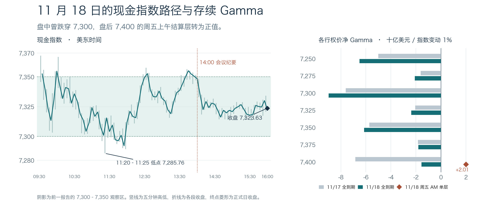

+++
title = "SPX期权持仓与Greeks结构分析-261118"
date = "2026-11-19"
data_as_of = ["2026-11-17", "2026-11-18"]
data_as_of_note = "主比较为 11 月 17 日与 18 日。18 日月度报价取 16:00 ET，主要期权链的估值时点为 22:12:07 ET，目标交易日为 11 月 19 日。"
draft = false
description = "11 月 18 日 SPX 收于 7,323.63，共同存续合约的负 Gamma 加深，7,400 的周五 AM 层转正。报告跟踪 7,300–7,350 的两侧条件和短端 IV 变化。"
series = "SPX期权分析报告"
categories = ["衍生品", "市场结构"]
tags = ["SPX", "Greeks", "GEX", "期权", "风险分布"]
featured = false
private = false
content_preservation = "verbatim"
source_sha256 = "8fd6196e620e29a4fe2922e100248f8e9a9cbb675a8638dde0533b28b66d43ff"
+++

# SPX期权持仓与Greeks结构分析-261118

## 1. 一句话结论

SPX 收于 **7,323.63**，11 月 19 日先看 **7,300–7,350** 哪一侧能在回试后站稳，同一批存续合约的负 Gamma 加深，所以下破后的延伸值得跟踪，但 **7,400 的周五 AM 层已由负转正**，若价格收复并守住该位，原核心区就需重画。

**盘后研究 B 级｜存续结构置信度高，对冲机制中等，次日方向低｜具体合约估值未纳入本次盘后研究｜目标日执行另行复核。** 评级受最近到期的跨日比较和周五上午结算层的局部报价质量约束。

## 2. T+1 Action Summary

| 项目 | 11 月 19 日观察及失效条件 |
| --- | --- |
| Base stance | 若开在 7,300–7,350，先看 7,325 附近价格能否向一侧延伸。边界内往返时保持观察。 |
| Earliest evaluation | 07:00 财报、08:30 数据公布后，按常规开盘和短端实际报价重新定位。新股首笔交易出现后再核一次，不预设开盘即成交。 |
| Base activation | 若离开核心且回试仍守在同一侧，同时距首个复核区尚有空间，再比较相应方向的期权结构。回到核心则撤销该次准备。 |
| Downside branch | 失守 7,300 且反抽未复，先看 7,275–7,250，进一步才看 7,200。迅速收回 7,300 或已越过首区则重估。 |
| Upside branch | 收复 7,350 且回试守住，先看 7,375，再评估 7,400。失守 7,350 撤销修复分支，越过并守住 7,400 再看 7,425–7,450。 |
| Otherwise | 跳空已越首区、临近事件时盘口失去可比性、或余时与空间不足，均以观察为主，待新位置和新报价成立后再评估。 |

从现金收盘算，到下边界有 23.63 点，到上边界有 26.37 点，两侧起步距离相近。19 日的重要区别是开盘前已有财报和经济数据，AI 新股首笔交易的时间却未确定。若开盘已在 7,275 附近，原先从 7,300 跌向首区的空间已被用掉，准备工作应从眼前的价格重新开始。

## 3. Executive Summary

- **盘中低点早于会议纪要。** 18 日现金指数开在 7,350 之上，上午最低 7,285.76，未触及前一日报告的 7,275。14:00 纪要发布后指数从上边界附近回落，此后始终处在 7,300–7,350 内。两端都曾受试，收盘仍靠近中点。[现金指数五分钟行情](https://query1.finance.yahoo.com/v8/finance/chart/%5EGSPC?period1=1795012200&period2=1795035660&interval=5m&includePrePost=false) · [美联储发布时间](https://www.federalreserve.gov/newsevents/pressreleases/monetary20261118a.htm)
- **剔除到期影响后，负 Gamma 加深。** 两日都存在且能存续至周四开盘的 16,624 份合约，带符号 Gamma 从 −61.601 降至 −67.321 十亿美元／指数变动 1%，其中 PM 层贡献了降幅的约 83%。这一差异决定比较分母，也决定了应如何读下方 7,300 和 7,250 的集中。
- **上方 7,400 要分结算时段看。** 11/20 AM 单层由 −2.407 变为 +2.006，同一行权价全部到期合计仍为 −1.547。周四若先收复 7,350，应依次在 7,375、7,400 核对价格与 IV 是否支持继续上行。
- **指数小跌，研究样本里的认沽均价也跌。** 短认沽的方向项贡献 +5.374 点，IV 与时间合计贡献 −11.168 点，实际中间价均值跌 5.058 点。周五 PM 同到期的平值 IV 降 1.925 个波动率百分点（vp），25Δ 认沽相对平值的溢价也收窄。下破后保护能否升值，取决于当时的余时、报价和后续位移。
- **月度定价更偏向温和回撤，最深一档反而减轻。** 滚动 28 天的风险中性终值权重中，跌逾 5% 升至 14.984%，跌逾 10% 降至 5.518%，中央 90% 区间宽度收窄 0.222 个百分点。周四的 7,300 距期权锚仅约 0.32%，月度数字不能给它的日内触及概率。
- **周四的定价有两个起点。** 沃尔玛盘前财报和 08:30 经济数据先影响开盘，Anthropic 拟上市，首笔价格可能更晚才出现。比较当日到期与周五 PM 时，应记录确认发生在哪个事件之后。[沃尔玛财报预告](https://corporate.walmart.com/news/2026/11/Walmart-To-Host-Q3-Earnings-Call-Nov-19-2026) · [纽约联储经济日历](https://www.newyorkfed.org/research/calendars/i-nov26.html) · [发行人公告](https://www.anthropic.com/news/anthropic-prices-initial-public-offering)

## 4. What Changed vs. T-1 and Prior Playbook Review

| 实质变化 | 11 月 17 日 → 18 日 | 比较基础与用途 |
| --- | --- | --- |
| 现金指数与 VIX | SPX 7,340.53 → 7,323.63（−0.230%），VIX 25.46 → 24.56 | 两日现金收盘同源，VIX 用同一收盘序列。下跌日的波动率定价也可回落。 |
| 同一批存续合约 | 带符号 Gamma −61.601 → −67.321，PM 变化 −4.740，AM 变化 −0.980 | 两日都能留到周四开盘的合约。单位为十亿美元／指数变动 1%。 |
| 7,400 层次分化 | 全到期 −6.838 → −1.547，11/20 AM 单层 −2.407 → +2.006 | 整个行权价含到期退出，同日同结算的周五 AM 更能定位变化。 |
| 周五 PM 同到期曲面 | ATM 28.475% → 26.550%，下侧 skew25 缩 0.748 vp，BF25 缩 0.412 vp | 两日都有可描述的局部报价，同时包含剩余期限缩短。 |
| 两段报价变化 | 固定 5,639 份合约，平均中间价变化从 +5.417 转为 −7.719 点 | 比较 11/16→17 与 11/17→18 两个报价区间。认购与认沽一起纳入等权计算。 |
| 月度回撤定价 | 跌逾 5% 的权重 +0.179 个百分点，跌逾 10% 的权重 −0.251 个百分点 | 两日均取 16:00、剩余 28 天，实际到期由 12/15 换成 12/16，价格锚随日移动。 |

如果直接对比各自的全存续图，净 Gamma 由 −67.632 变为 −67.321，反而看起来略向零靠拢。旧图还含有 11 月 18 日到期、净额为 −6.032 的一层。先从旧图移去这层，再比较相同合约，才能看出周四开盘面对的库存代理更负。相同合约的 PM 层由 −39.386 变为 −44.125，AM 层由 −22.215 变为 −23.195，两个时段的变化同向。点位、IV、余时、OI 和供应商 Greeks 都参与了变化，无法从差额中分出新开仓。

### 上期观察区的收盘、路径与执行复盘

**收盘结果。** 17 日报告以 7,300–7,350 为核心，下方先看 7,275–7,250，上方先看 7,375。18 日现金指数开、高、低、收分别为 **7,355.69、7,367.68、7,285.76、7,323.63**。开盘高于上边界，收盘回到中点 7,325 附近。两侧的第一个外部点位 7,375、7,275 均未触及。[现金指数日线](https://finance.yahoo.com/quote/%5EGSPC/history/?ltr=1)

**盘中路径。** 以五分钟区间的起始时间记时。09:30 区间已见全日高点，09:35 区间收于 7,339.43。11:15 区间首次跌破 7,300，11:20 区间低至 7,285.76，却已收回 7,315.45。11:35 和 11:40 的区间收盘又回到 7,300 下方，11:55 区间收回 7,311.81。纪要前最后一段收于 7,348.35，14:00 和 14:05 两段依次收于 7,334.91、7,322.51，约十分钟内回落 25.84 点。14:00 以后的高低范围为 7,313.49–7,348.30。由此可核对上下边界的先后，但不能把上午低点归因于下午的发布。[现金指数五分钟行情](https://query1.finance.yahoo.com/v8/finance/chart/%5EGSPC?period1=1795012200&period2=1795035660&interval=5m&includePrePost=false) · [美联储发布记录](https://www.federalreserve.gov/newsevents/pressreleases/monetary20261118a.htm)

左图浅色竖线表示五分钟高低，折线取各段末价，16:00 菱形使用正式现金收盘。右图每根横条都是该日全部存续到期之和，橙色菱形只取 7,400 的 11/20 AM，已包含在当日横条中。**执行层面**，这些事后补核的指数行情没有同钟两腿价差，也没有账户持仓和成交记录。能复盘的是标的路径，实际入场、退出及损益均未知。

### 期权报价变化归因

本期报价归因与波动率诊断部分可用。配对的历史报价可以拆解，现指与买卖价的独立同步记录不足，14 天的历史波动率窗口也差一个观察。11/17 20:45:47 至 11/18 22:12:07 相隔 25 小时 26 分 20 秒。起始剩余 7–60 天的 SPXW 下午结算合约有 9,820 份，其中 9,622 份配对（97.98%）。198 份无法配对，涉及标准化价内外程度超界 96、价差过宽 76、报价无效或过小 13、IV 反解或范围筛选 13。研究子集进一步要求起始标准化价内外程度绝对值不超过 2、远期 Delta 绝对值不超过 0.8。下表为每份多头合约的等权均值，单位为指数点，1 点对应 100 美元。两期限组按起始实际剩余日数分界，同一分组内部互斥，不同分组之间有重叠。

| 组别（可重叠） | 份数 | 中间价变化 | Delta | Gamma | Theta | Vega | 残差均值 | 绝对残差95分位 | 基础 → 完整 RMSE |
| --- | --- | --- | --- | --- | --- | --- | --- | --- | --- |
| 全部配对 | 9,622 | −6.644 | +0.025 | +0.086 | −2.349 | −4.968 | +0.258 | 0.762 | 0.638 → 0.360 |
| 研究子集 | 6,420 | −8.334 | −0.046 | +0.107 | −2.812 | −5.956 | +0.251 | 0.736 | 0.493 → 0.344 |
| 起始不足21天 | 2,658 | −10.068 | −0.108 | +0.132 | −3.733 | −6.964 | +0.439 | 0.952 | 0.720 → 0.510 |
| 　短组认购 | 1,210 | −16.062 | −6.667 | +0.148 | −3.667 | −6.467 | +0.396 | 0.916 | 0.708 → 0.464 |
| 　短组认沽 | 1,448 | −5.058 | +5.374 | +0.119 | −3.788 | −7.380 | +0.476 | 0.986 | 0.730 → 0.545 |
| 起始至少21天 | 3,762 | −7.110 | −0.003 | +0.090 | −2.161 | −5.244 | +0.117 | 0.243 | 0.219 → 0.136 |
| 　长组认购 | 1,652 | −13.154 | −6.920 | +0.102 | −2.117 | −4.418 | +0.096 | 0.221 | 0.196 → 0.116 |
| 　长组认沽 | 2,110 | −2.378 | +5.413 | +0.080 | −2.196 | −5.891 | +0.134 | 0.260 | 0.235 → 0.149 |
| 全部研究认购 | 2,862 | −14.384 | −6.813 | +0.121 | −2.772 | −5.285 | +0.223 | 0.652 | 0.483 → 0.314 |
| 全部研究认沽 | 3,558 | −3.469 | +5.397 | +0.096 | −2.844 | −6.497 | +0.273 | 0.767 | 0.500 → 0.366 |

短认沽的正 Delta 只抵回一部分时间和 IV 损耗，长认沽的方向项也为正，但均价仍跌 2.378 点。研究子集的 Vega 与 Theta 合计 −8.768 点，短组 −10.697，长组 −7.406。两项各组均为负，只有 Vega 为正时才有意义的“时间损耗抵消比例”在此无定义。研究组另有 Vanna −0.015、Volga +0.088、折现 +0.050 点。纳入交叉项后的均方根残差（RMSE）从 0.493 降至 0.344 点，绝对残差的 95 分位仍有 0.736 点。这衡量已发生报价变化的拟合误差，不能预测明天同样一份认沽的盈亏。

**方向项为何看起来很小。** 研究子集的 Delta 平均绝对贡献为 6.028 点，略高于 Vega 的 5.961 点，但认购和认沽方向相反，合并后的 Delta 只有 −0.046 点。25 个共同到期的远期均下移约 16.35–16.84 点，幅度略小于现指代理的 −17.73 点。以 11/24 为例，远期 7,368.530 → 7,352.091，变化 −16.439 等于现指变化 −17.730 加远期对现指基差变化 +1.291 点。两次盘口与现指缺少独立同步时标，这个恒等式不足以把差额归因于利率或分红。

**与此前报价区间比较。** 滚动研究组由 6,069 份增至 6,420 份，每份平均中间价变化从 +6.618 转为 −8.334 点，差 −14.952 点，其中 Vega 项的变化为 −13.378 点。认购占比从 43.14% 升至 44.58%，平均起始余期从 27.78 降至 27.18 天，平均绝对对数价内外程度由 0.0473 升至 0.0482。固定两期都在组内的 5,639 份后，两段均值之差仍有 −13.136 点，其中 Vega −13.500、Delta +1.772、Gamma −1.598、Theta −0.518，绝对残差 95 分位由 0.996 降至 0.759 点。因此，样本进出不能完全解释这次转向，合约老化仍然存在。相对 11/11（5,549 份）及 10/21（4,637 份）的滚动组，本期均价变化又分别低 6.886、7.820 点，对应 Vega 项分别低 3.778、6.966 点。上述 7–60 天结果不直接覆盖周四 0DTE。

## 5. T 日盘面、字段时点与 Event-Risk Overlay

**收盘前已知。** 08:30 发布的十月住宅开工为年率 130.9 万户，环比 +9.9%，其 90% 误差范围为 ±16.8 个百分点，包含零。许可为年率 129.5 万户，环比 −7.4%。当日 20 年期美债拍卖规模 160 亿美元，最高中标收益率 5.459%，结果文件给出日期，具体发布分钟未独立核实。14:00 公布的 10 月 27–28 日会议纪要显示，几乎所有与会者按其基准展望判断仍可能需要进一步加息，有两位与会者提到，若后续通胀数据不利，下次会议可考虑超过 25 bp 的加息。这是十月讨论的记录，周三没有新的利率决定。[人口普查局住宅开工与许可](https://www.census.gov/construction/nrc/pdf/newresconst_202610.pdf) · [财政部拍卖结果](https://www.treasurydirect.gov/instit/annceresult/press/preanre/2026/R_20261118_2.pdf) · [联储会议纪要](https://www.federalreserve.gov/monetarypolicy/fomcminutes20261028.htm) · [发布时间](https://www.federalreserve.gov/newsevents/pressreleases/monetary20261118a.htm)

**收盘后至截止。** Anthropic 公布 IPO 每股 83 美元、发售 9.80 亿股（含原股东售股），拟于 19 日以 ANT 在 Nasdaq 开始交易。美联社至迟于 17:24 已公开报道，发行人公告未列首发分钟。16:00 月度截面在这条可核实的盘后报道之前，22:12 链时点在其后。两个截面既不同时也不覆盖相同合约集合，无法借此识别 IPO 对指数期权的价格贡献。[发行人定价公告](https://www.anthropic.com/news/anthropic-prices-initial-public-offering) · [美联社带时间报道](https://apnews.com/article/70b660ddf900d90bbf484ecdf1fb441c)

**19 日已知日程。** 沃尔玛计划 07:00 发布季报、08:00 电话会，08:30 有初请失业金和费城联储制造业调查。联储日历列 09:25 副主席 Jefferson 参加经济冲击讨论，14:15 理事 Barr 讨论人工智能。财政部季度日历还列有 10 年期 TIPS 续拍。上述结果及 ANT 首笔成交时刻和价格在研究截止时均待观察。新股首先通过同业定价和风险偏好影响指数研究，没有对其指数成份身份作假设。[沃尔玛预告](https://corporate.walmart.com/news/2026/11/Walmart-To-Host-Q3-Earnings-Call-Nov-19-2026) · [纽约联储日历](https://www.newyorkfed.org/research/calendars/i-nov26.html) · [美联储活动日历](https://www.federalreserve.gov/newsevents/2026-November.htm) · [财政部季度拍卖日历](https://home.treasury.gov/system/files/221/TentativeAuctionScheduleQ42026.pdf)

## 6. Decision Rationale — Analytical Bridge

1. **7,300–7,350 仍适合作为开盘定位区。** 现金收在 7,323.63，下、上两端存续净 Gamma 分别为 −8.971、−6.142 十亿美元／1%。若库存的符号假设大致成立，离开集中区后，对冲需要可能沿价格变化放大。周四只有在边界回试后仍在区外、且距首区尚有空间时，才有下一段可研究的移动。迅速回到核心，或开盘已越过首区，都应取消原起点。节点事实可信度高，传导机制中等，方向低。
2. **7,400 的含义取决于期限。** 周五 AM 单层已转正，12/18 AM 在同一行权价仍为 −1.080，周四 PM 为 +0.186。若从 7,350 修复并走过 7,375，要分别检查近到期和远到期，尤其留意短端 IV 有无同步变化。失守 7,350 便撤销这次修复判断，站稳 7,400 则重画核心。分层事实置信度高，精确转号位置没有估计。
3. **选看跌结构前，先看方向收益能否覆盖重新定价。** 18 日短认沽在有利方向上仍平均跌 5.058 点。若次日继续失守 7,300，单买与借记价差应按当时保护成本和到 7,275–7,250 的余量比较。若指数位移明显扩大、近端 IV 重新上升，18 日 Vega 和 Theta 主导的组合需要重估。已发生报价归因可信度较高，应用到周四当日到期的收益缺乏验证。
4. **月度左侧增加的权重集中在一般回撤。** 跌逾 5% 和跌逾 10% 两个阈值反向移动，表明不能用单一“尾部升温”概括它们。月度结果可以约束保护压力测试，周四两侧分支继续保留。盘前数据、上市首笔或现指锚有明显变化时，先看新的期限与盘口，再判断这种形态是否延续。月度描述置信度中等，转换为次日方向的依据弱。

## 7. Conflicting Evidence, Confidence and What Changes the View

| 支持原判断的证据 | 表面冲突或反证 | 如何处理，以及什么会改变判断 |
| --- | --- | --- |
| 共同存续合约更负，7,300 下方对冲反馈有放大可能 | 两张完整地图直接相减却略向零 | 统一至能留到 19 日的同一组合约。新现指若持续站上 7,400 且短 IV 回落，应放弃原核心区。 |
| 7,400 全到期合计仍负 | 周五上午结算层为正，15:00 的一个高现指、高 IV 格点也转正 | 将实际收盘后分层与目标日下午模型分开。冲过 7,375 后，以新的周五 AM、PM 报价复核。 |
| 现金指数下跌有利于认沽方向项 | 同期认沽中间价均值仍跌 | 确认方向只解决 Delta 问题。若 IV、余时或两翼相对报价有变，调整结构比较，即使原点位仍有效。 |
| 周五 PM 保护溢价下降，月度分布宽度收窄 | 月度跌逾 5% 权重上升，盘后又有大型 IPO 定价 | 先分 16:00 与 22:12、两天与 28 天，再分 IV 水平和终值区间。短端和月度依赖期权价格，同源结果不能按票数提高方向置信度。 |

真正推翻方向分支的是价格在回试后重回原区，或新的持仓位置已改变原有条件。若点位判断仍成立，但余时或 IV 大变，需要重新估值。若盘口过宽、报价缺乏可比性，则只能暂缓具体结构比较。三种情形对研究的影响不同，负 Gamma 的条件机制本身没有经过次日路径或收益检验。

## 8. IV Term Structure, Skew and Surface

### 先看哪些期限能比较

18 日正式 IV 曲面通过全局质量检查。31 个到期组中 22 个选用带形状约束的拟合，9 个选用修复曲线。局部模型价格有 83.33% 落在买卖报价区间，日历、单调性、凸性和密度非负检查均通过。17 日采用当日原始正式日包，两日的供应商、模型方法、配置、合约分类、PM 范围和固定远期 Delta 节点均已核对。下表单列实际使用的到期与结算时段。“条件参考”允许描述局部模型水平，“仅诊断”表示数值能读出，但报价对该结论的支持不足。

| 到期 | 结算 | 11/17 拟合落入买卖区间／用途 | 11/18 拟合落入买卖区间／用途 |
| --- | --- | --- | --- |
| 11/19 | PM | 22.87% · 约束／仅诊断 | 56.15% · 约束／条件参考 |
| 11/20 | PM | 58.88% · 约束／条件参考 | 57.41% · 约束／条件参考 |
| 11/23 | PM | 31.62% · 约束／仅诊断 | 28.79% · 约束／仅诊断 |
| 11/24 | PM | 44.59% · 约束／仅诊断 | 51.92% · 修复／仅诊断 |
| 11/25 | PM | 85.97% · 约束／条件参考 | 64.44% · 修复／条件参考 |
| 11/27 | PM | 95.42% · 修复／条件参考 | 91.90% · 修复／条件参考 |
| 12/01 | PM | 91.96% · 约束／条件参考 | 88.21% · 修复／条件参考 |
| 12/02 | PM | 91.50% · 修复／条件参考 | 87.32% · 修复／条件参考 |
| 12/03 | PM | 89.69% · 约束／条件参考 | 90.34% · 约束／条件参考 |
| 12/17 | PM | 89.31% · 约束／条件参考 | 90.65% · 约束／条件参考 |
| 12/18 | PM | 94.30% · 约束／条件参考 | 94.47% · 约束／条件参考 |
| 12/21 | PM | 88.29% · 约束／条件参考 | 89.17% · 约束／条件参考 |
| 12/31 | PM | 95.07% · 约束／条件参考 | 95.06% · 约束／条件参考 |
| 2027/01/08 | PM | 91.20% · 约束／条件参考 | 91.16% · 约束／条件参考 |
| 11/20 | AM | 51.11% · 约束／仅诊断 | 47.34% · 约束／仅诊断 |

11/19 PM 在 18 日已从 22.87% 改善至 56.15%，当前形状可以条件性参考，两日变化仍须服从较弱的 17 日。11/20 PM 两日都可作描述，适合研究周五保护如何重定价。周五 AM 当前仅 47.34%，不能借用同日 PM 对它背书。11/23 的 28.79% 还会限制含这个长端的三天插值。全局质量通过并没有消除这几个差别。

### 相同到期的平值水平与固定天数的期限结构

常规平值（ATM）以该到期远期价格为基准，行权价等于远期。IV 水平为年化百分比，日变动用波动率百分点（vp），差值在原精度上计算后取整。τ 为从各自供应商估值钟到项目约定到期时点的实际日数。

| 共同到期 | 实际剩余日 P → D | 11/17 ATM | 11/18 ATM | 变化 vp | 同到期方法／权限 | 事件与结算 |
| --- | --- | --- | --- | --- | --- | --- |
| 11/19 PM | 1.802 → 0.742 | 30.068% | 28.339% | −1.728 | 约束→约束／仅诊断 | 目标日0DTE，盘前数据与IPO首日 |
| 11/20 PM | 2.802 → 1.742 | 28.475% | 26.550% | −1.925 | 约束→约束／可描述 | 周五月度到期，AM与PM分列 |
| 11/23 PM | 5.802 → 4.742 | 22.989% | 20.113% | −2.876 | 约束→约束／仅诊断 | 3天插值的长端 |
| 11/25 PM | 7.802 → 6.742 | 22.938% | 21.135% | −1.803 | 约束→修复／可描述 | 感恩节前，7天槽位来源 |
| 11/27 PM | 9.677 → 8.617 | 21.724% | 19.980% | −1.744 | 修复→修复／可描述 | 提前至13:00到期 |
| 12/02 PM | 14.802 → 13.742 | 20.435% | 19.221% | −1.214 | 修复→修复／可描述 | 两周附近 |
| 12/18 PM | 30.802 → 29.742 | 19.784% | 19.237% | −0.547 | 约束→约束／可描述 | 月度到期，约30天 |
| 12/31 PM | 43.802 → 42.742 | 18.811% | 18.337% | −0.474 | 约束→约束／可描述 | 年末期限 |
| 11/20 AM | 1.843 → 0.783 | 32.277% | 34.320% | +2.044 | 约束→约束／仅诊断 | 周五月度到期，AM与PM分列 |

11/20 PM 的平值 IV 下降 1.925 vp，11/25、11/27 也分别下降 1.803、1.744 vp，远至 12/18 PM 的降幅只有 0.547 vp。在有两日局部支持的期限中，回落更集中于近端。11/20 AM 表面上升 2.044 vp，但两个截面均仅诊断，且余期以周四 17:00 计。这个反向差值不足以判断上午保护比下午贵了多少。即使到期相同，两次估值之间也少了约 1.060 天。

| 固定期限，PM | 11/17 来源到期（τ，上端权重） | 11/18 来源到期（τ，上端权重） | ATM 水平 P → D | 变化 vp |
| --- | --- | --- | --- | --- |
| 3天 | 11/20 (2.802日，0) | 11/20 / 11/23 (1.742 / 4.742日，0.4195) | 28.475% → 22.489% | −5.986 |
| 7天 | 11/24 (6.802日，0) | 11/25 / 11/27 (6.742 / 8.617日，0.1378) | 23.012% → 20.944% | −2.068 |
| 14天 | 12/01 (13.802日，0) | 12/02 / 12/03 (13.742 / 14.742日，0.2584) | 20.368% → 19.260% | −1.108 |
| 30天 | 12/17 (29.802日，0) | 12/18 / 12/21 (29.742 / 32.742日，0.0861) | 19.770% → 19.195% | −0.574 |
| 45天 | 12/31 / 01/08 (43.802 / 51.802日，0.1498) | 12/31 / 01/08 (42.742 / 50.742日，0.2823) | 18.771% → 18.279% | −0.492 |

固定天数表对相邻到期的总方差插值，括号末数为上端权重，单一观察源的权重标 0。三天读数降 5.986 vp，但本期插值把约 41.95% 权重放在低质量的 11/23。七天读数降 2.068 vp，前一期来自仅诊断的 11/24，本期又使用 11/27 的 13:00 提前到期。两者只作诊断。14、30、45 天变化分别为 −1.108、−0.574、−0.492 vp，可用于比较期限间的回落幅度。固定天数会更换合约或权重，不能拿三天的 −5.986 与同一份周五 PM 的 −1.925 混作同一笔重估。

### 微笑曲线的斜率与曲率

以下均为 SPXW PM，固定远期 Delta、未按权利金调整。五个节点由左至右为 10Δ 认沽、25Δ 认沽、常规 ATM、25Δ 认购、10Δ 认购。**下侧 skew25** 等于 25Δ 认沽 IV 减 ATM，正值表示认沽翼有溢价。**BF25** 等于两侧 25Δ IV 均值减 ATM，衡量两翼相对中点的曲率。两项水平和所有变化行以 vp 表示，五节点的水平行用年化百分比。第一张表按最接近目标天数的实际到期滚动，第二张表固定周四和周五这两个实际到期。

| 期限／行类型 | 到期 / τ（日） | 10Δ put | 25Δ put | ATM | 25Δ call | 10Δ call | 下侧 skew25 | BF25 | 比较基础／方法／质量 |
| --- | --- | --- | --- | --- | --- | --- | --- | --- | --- |
| 7天 · P 水平 | 11/24 / 6.802 | 32.376% | 26.613% | 23.012% | 20.490% | 18.977% | 3.601 | 0.540 | 约束／仅诊断 44.59% |
| 7天 · D 水平 | 11/25 / 6.742 | 27.585% | 23.928% | 21.135% | 18.888% | 17.510% | 2.793 | 0.273 | 修复／条件参考 64.44% |
| 7天 · Δ D−P | 11/24 → 11/25 | −4.790 | −2.685 | −1.877 | −1.603 | −1.468 | −0.808 | −0.267 | 滚动槽位／仅诊断 |
| 14天 · P 水平 | 12/01 / 13.802 | 30.498% | 24.395% | 20.368% | 17.513% | 15.941% | 4.027 | 0.586 | 约束／条件参考 91.96% |
| 14天 · D 水平 | 12/02 / 13.742 | 27.301% | 22.643% | 19.221% | 16.561% | 15.185% | 3.423 | 0.382 | 修复／条件参考 87.32% |
| 14天 · Δ D−P | 12/01 → 12/02 | −3.197 | −1.752 | −1.147 | −0.952 | −0.756 | −0.604 | −0.205 | 滚动槽位／可描述 |
| 30天 · P 水平 | 12/17 / 29.802 | 31.232% | 24.401% | 19.770% | 16.542% | 15.049% | 4.632 | 0.702 | 约束／条件参考 89.31% |
| 30天 · D 水平 | 12/18 / 29.742 | 29.331% | 23.378% | 19.237% | 16.290% | 14.992% | 4.141 | 0.597 | 约束／条件参考 94.47% |
| 30天 · Δ D−P | 12/17 → 12/18 | −1.902 | −1.023 | −0.532 | −0.251 | −0.057 | −0.491 | −0.105 | 滚动槽位／可描述 |

14 天附近的 ATM、下侧 skew25、BF25 分别收窄 1.147、0.604、0.205 vp，30 天附近分别收窄 0.532、0.491、0.105 vp。两周左侧 10Δ 认沽 IV 降 3.197 vp，右侧 10Δ 认购降 0.756 vp，保护翼的回落更明显。七天槽由 11/24 滚至 11/25，前日局部仅诊断，列出的算术差不用于认定市场形状变化。其余槽也更换了实际到期，固定 Delta 会随远期与 IV 改变对应行权价。小幅曲率变化没有经过可成交价差检验。

| 期限／行类型 | 到期 / τ（日） | 10Δ put | 25Δ put | ATM | 25Δ call | 10Δ call | 下侧 skew25 | BF25 | 比较基础／方法／质量 |
| --- | --- | --- | --- | --- | --- | --- | --- | --- | --- |
| 11/19候选 · P 水平 | 11/19 / 1.802 | 38.538% | 33.306% | 30.068% | 28.432% | 27.294% | 3.239 | 0.802 | 约束／仅诊断 22.87% |
| 11/19候选 · D 水平 | 11/19 / 0.742 | 32.730% | 30.283% | 28.339% | 26.670% | 25.572% | 1.943 | 0.137 | 约束／条件参考 56.15% |
| 11/19候选 · Δ D−P | 11/19 → 11/19 | −5.807 | −3.024 | −1.728 | −1.762 | −1.722 | −1.295 | −0.665 | 同到期／仅诊断 |
| 11/20候选 · P 水平 | 11/20 / 2.802 | 37.939% | 32.170% | 28.475% | 26.381% | 25.133% | 3.695 | 0.801 | 约束／条件参考 58.88% |
| 11/20候选 · D 水平 | 11/20 / 1.742 | 33.310% | 29.498% | 26.550% | 24.379% | 22.899% | 2.948 | 0.388 | 约束／条件参考 57.41% |
| 11/20候选 · Δ D−P | 11/20 → 11/20 | −4.629 | −2.672 | −1.925 | −2.002 | −2.234 | −0.748 | −0.412 | 同到期／可描述 |

就同一份周五 PM 到期而言，ATM 降 1.925 vp，25Δ 认沽溢价从 3.695 缩至 2.948 vp，BF25 从 0.801 降至 0.388 vp。10Δ 认沽降 4.629 vp，明显多于 10Δ 认购的 2.234 vp。周四若研究保护，可同时核对认沽下翼的实时报价，计算卖出下翼能抵消多少支出。11/19 PM 自身当前 ATM 为 28.339%，但因前截面不足，其 1.295 vp 的斜率降幅和 0.665 vp 的曲率降幅仅作诊断。两次估值错开约 25.44 小时，又跨过纪要，不能从中剥离一条纯事件冲击，或得出单买与价差的成本排名。

### 波动率联动与变化强度

模型参考 IV 取标准化位置为零，对应行权价 K = F × exp(−σ²τ/2)，这里 τ 以年计。它与上述 K = F 的常规 ATM 分开比较。下表的协方差率衡量风险中性定价口径下标的收益与 **IV 比例变化** 的年化联动，负值表示两者倾向反向。方差率描述 **IV 比例变化本身** 的年化强度。30 天的漂移另计，正负号表示该定价模型下 IV 比例变化的年化漂移方向。表中模型参考 IV 的差为 vp，其余差值均沿用相应年化率单位。

| 期限 | 诊断量 | 11/18 水平 | 较 11/17 | 较 11/11 | 较 10/21 |
| --- | --- | --- | --- | --- | --- |
| 14天 | 模型参考 IV | 19.450% | −1.247 | +6.308 | +5.658 |
| 14天 | 收益–IV 协方差率 | −0.220 | +0.036 | −0.074 | −0.081 |
| 14天 | IV 比例变化方差率 | 1.319 | −1.123 | −1.598 | −1.952 |
| 30天 | 模型参考 IV | 19.416% | −0.604 | +5.605 | +5.743 |
| 30天 | 收益–IV 协方差率 | −0.175 | +0.016 | −0.060 | −0.066 |
| 30天 | IV 比例变化方差率 | 1.194 | −0.322 | −0.428 | −0.779 |
| 45天 | 模型参考 IV | 18.854% | −0.514 | +4.706 | +5.082 |
| 45天 | 收益–IV 协方差率 | −0.148 | +0.012 | −0.043 | −0.053 |
| 45天 | IV 比例变化方差率 | 0.921 | −0.147 | −0.362 | −0.439 |

三个期限的定价协方差都仍为负，但 18 日比 17 日更接近零。14、30、45 天 IV 比例变化的方差率一日分别下降 45.99%、21.23%、13.79%，近端降幅最大。这与周五同到期 IV 回落和认沽 Vega 为负的报价归因相容。参考 IV 比前一日低，却均高于 5 和 20 个交易日前，不能据此声称其已连续下行。这些量描述期权定价中的联动，与做市商实际头寸和 SPX 自身收益方差分别计量。

30 天 IV 比例漂移从 −0.902 变为 **−0.451／年**，一日变化 +0.451，相对 11/11、10/21 分别低 1.204、0.441。它只衡量当前截面的定价形状。历史参照使用固定合约的对数 IV 变化，以 21 个交易日变化、252 日年化计算。14 天只有 20/21，历史矩及差额留空。30 天和 45 天均为 21/21，历史方差率分别为 1.144、0.797，定价值减历史代理为 +0.050、+0.124。历史协方差为 −0.206、−0.173，对应差额 +0.031、+0.025。估计量和信息集不同，差额不识别可获取的风险溢价，历史窗口也不能替代目标日的新报价。

### 期权隐含月度分布（风险中性口径）

下表的 Q 权重来自收盘兼容的 SPXW PM 期权，描述**到期终值**。收益用到期指数除以当日现指代理再减一，不含分红、不年化。两天都剩 28 个日历日，两日锚和实际到期不同，缺同一实际到期的两日分布对照。

| 终值定价摘要 | 11/17 16:00 | 11/18 16:00 |
| --- | --- | --- |
| 实际到期／现指代理 | 12/15 PM／7,340.98 | 12/16 PM／7,323.25 |
| 平均收益／收益中位数 | +0.206%／+1.564% | +0.159%／+1.369% |
| 月度收益标准差 | 6.466% | 6.314% |
| 中央 90% 的指数区间 | 6,548.98–7,876.81 | 6,552.48–7,860.81 |
| 中央 90% 的收益区间 | −10.789% 至 +7.299% | −10.525% 至 +7.340% |

18 日 Q 口径的中央 80% 终值区间为 **6,807.88–7,768.95**。虽然收益中位数回落 0.195 个百分点，中央 90% 宽度却从 18.088% 收窄至 17.865%。以零收益为起点，左端幅度 10.525%，右端幅度 7.340%，两者之差由 3.490 缩为 3.185 个百分点。中心稍向下、最深左侧收窄和两侧仍不对称可以同时成立。这些区间适用于 12/16 收盘的定价压力测试，无法直接移到周四日内。

| 互斥的到期收益区间 | 11/17 权重 | 11/18 权重 | 变动（百分点） |
| --- | --- | --- | --- |
| 低于 −10% | 5.768% | 5.518% | −0.251 |
| −10% 至 −5% | 9.037% | 9.466% | +0.429 |
| −5% 至 −2% | 11.284% | 11.707% | +0.423 |
| −2% 至 0 | 11.653% | 12.237% | +0.584 |
| 零及以上 | 62.257% | 61.072% | −1.185 |

从零到 −10% 的三个区间分别增加约 0.584、0.423、0.429 个百分点，低于 −10% 的区间减少 0.251 个百分点，合计使负收益权重增加 1.185 个百分点。研究中等回撤的保护需求与研究极深尾部，应分别看对应档。表内为互斥权重，以未舍入值计算合计 100%，变动合计为零。此前上行超过 2% 与 5% 的定价权重较高，本日均回落，但上涨超过 10% 的极端右侧略增，进一步限制了单边解释。

| 28日终值指标 | 11/17 | 11/18 | 变动（百分点） | 60日中位数／约第几百分位 | 120日中位数／约第几百分位 |
| --- | --- | --- | --- | --- | --- |
| 到期收益低于0的概率 | 37.743% | 38.928% | +1.185 | 37.786% ／ 75 | 37.786% ／ 73 |
| 到期跌幅超过2%的概率 | 26.089% | 26.691% | +0.601 | 19.954% ／ 100 | 20.214% ／ 100 |
| 到期跌幅超过5%的概率 | 14.806% | 14.984% | +0.179 | 7.626% ／ 100 | 7.902% ／ 100 |
| 到期跌幅超过10%的概率 | 5.768% | 5.518% | −0.251 | 1.907% ／ 94 | 1.942% ／ 97 |
| 到期涨幅超过2%的概率 | 45.992% | 44.256% | −1.736 | 34.447% ／ 94 | 34.663% ／ 95 |
| 到期涨幅超过5%的概率 | 17.528% | 16.998% | −0.530 | 5.466% ／ 97 | 5.529% ／ 98 |
| 到期涨幅超过10%的概率 | 0.855% | 0.925% | +0.070 | 0.211% ／ 100 | 0.199% ／ 100 |
| 收益第5百分位 | −10.789% | −10.525% | +0.264 | −6.414% ／ 6 | −6.482% ／ 3 |
| 收益中位数 | 1.564% | 1.369% | −0.195 | 0.927% ／ 89 | 0.979% ／ 90 |
| 收益第95百分位 | 7.299% | 7.340% | +0.041 | 5.108% ／ 100 | 5.133% ／ 100 |
| 月度收益标准差（未年化） | 6.466% | 6.314% | −0.153 | 4.052% ／ 94 | 4.131% ／ 97 |
| 中央90%区间宽度 | 18.088% | 17.865% | −0.222 | 11.431% ／ 94 | 11.799% ／ 97 |
| 中央90%区间下侧幅度（相对锚） | 10.789% | 10.525% | −0.264 | 6.414% ／ 94 | 6.482% ／ 97 |
| 中央90%区间上侧幅度（相对锚） | 7.299% | 7.340% | +0.041 | 5.108% ／ 100 | 5.133% ／ 100 |
| 中央90%下侧幅度减上侧幅度 | 3.490% | 3.185% | −0.305 | 1.517% ／ 94 | 1.573% ／ 97 |

过去 60 个交易日（8/25–11/17）的 36 个合格观察中，跌逾 5% 的当日权重 14.984% 约在第 100 百分位，中位数 7.626%。120 日窗口（5/29–11/17）有 60 个合格观察，对应约第 100 百分位、中位数 7.902%。跌逾 10% 虽一日减少，在两个窗口仍分别约在第 94、97 百分位。第 5 百分位收益本身约在第 6、3 百分位，表示下侧收益阈值仍深。中央宽度亦同时高于两窗中位数。这里的排名给出市场近期为尾部赋予多大权重的参照，不能判定保护价格是否划算。

两个窗口都排除 18 日，分别含 32、56 个同口径历史重建和各 4 个日常归档。60 日窗第一条合格记录为 8/27。各窗至少 20 个合格观察才展示排名，日期接近的 28 天终值窗口大量重叠，历史重建也非严格的当时可得记录。月度模块在指定的 11/11、10/21 缺可比观察，5、20 个交易日前的变化均不可用。上述排名、11/17 的日变动与第 4 节的连续报价历史有不同分母。

**尾部与锚的检验。** 以 7,323.25 为锚，−2%、−5%、−10% 对应 7,176.79、6,957.09、6,590.93，均在观察行权价 3,600–8,200 内。7,300 只低约 0.317%，包中没有其精确终值权重或历史排名。167 份计价报价中，模型价格落入买卖区间的比例为 92.81%，原始月度截面中 3 条报价无效。外推部分只有 0.400% 的概率质量，却贡献约 9.291% 的方差。保留基准，单独将计算网格间距改为 1 点或最低买价改为 1 点，连同基准共 3 个合格结果。跌逾 5% 的权重为 14.9833%–14.9916%，跌逾 10% 为 5.5179%–5.5199%，月度标准差为 6.2924%–6.3138%。当日两档权重的变化均大于这两项扰动，但这里没有检验其他尾部分布假设，也没有得到统计置信区间。

**远期与折现。** 18 日 1 月期国债为 4.10%，首次发布时间没有独立记录。收盘兼容模型采用 11/17 的 4.09%，观察滞后 1 日，利率资料于 11/18 22:28:26 取得。按平坦短端、实际日数／365 的单利近似，折现因子为 0.996872。86 对认购认沽平价给出远期 7,334.868，跨行权价估计的第 10–90 百分位为 7,334.461–7,334.957。由现指／折现因子减远期反推的到期等值现金分红为 11.359 点，利率上下移 25 bp 后为 9.953–12.766 点。它依赖模型与现指代理，无独立的预期分红曲线。采用额外经济假设的调整对照会把平均收益推至 +0.556%、跌逾 5% 权重压至 13.347%，两者来自同一批期权，只用来展示假设的影响。

## 9. Key Expiry / Strike / Dealer Node

### 持仓分母与到期拆分

原始 60 天收集范围有 18,018 条合约，供应商报告总 OI 从 16,113,928 增至 16,390,262 张。认购增加 127,752 张至 6,744,905，认沽增加 148,582 张至 9,645,357，OI 的 put/call 比由 1.435 降至 1.430。同期总成交量从 5,513,760 降至 4,903,860 张（−11.06%），成交量 put/call 比由 1.301 降至 1.210。OI 与成交量各有自己的计量时点，都不直接给出交易方或开平仓方向。

常规报价筛选后的子集有 13,774 条、9,054,221 张 OI，约占原始 OI 的 55.24%。以下结构判断另用**到 11/19 开盘仍可交易的全部合资格合约**。共 17,452 条，按到期、合约族、结算时段和行权价汇总为 8,726 个节点，覆盖该分母 100% 的 OI 和总量 Gamma。显示区间 7,103.55–7,542.95 只有全图 48.04% 的总量 Gamma。11/18 PM 的 440,161 张 OI、21.474 十亿美元／1% 的总量 Gamma 已随到期退出，不能从存续图再扣一次。

本文用 Gamma 名义敏感度衡量指数变动 1% 对 Delta 名义敞口的局部影响，单位为 **十亿美元／指数变动 1%**。总量 Gamma 将两翼大小相加，带符号 Gamma 则采用认购为正、认沽为负的库存代理。多头认沽自身的数学 Gamma 为正。两张全存续图的总量由 279.574 升至 283.798，带符号值由 −67.632 变为 −67.321。按全链排除 0DTE 的 Delta 名义敞口（Delta × 现指 × 100 × OI）由 −939.097 降至 −943.973 十亿美元，其单位是方向敞口金额。以上三个量都没有观察到真实做市商头寸或对冲成交。

| 实际到期与结算 | 存续 OI（张） | 总量 Gamma | 带符号 Gamma | 与目标日的联系 |
| --- | --- | --- | --- | --- |
| 11/19 PM | 178,661 | 7.309 | −3.835 | 周四0DTE，16:00到期 |
| 11/20 AM | 2,083,674 | 36.197 | −11.672 | 周五主到期，AM与PM单列 |
| 11/20 PM | 749,355 | 17.029 | −10.164 | 周五主到期，AM与PM单列 |
| 11/23 PM | 127,943 | 4.739 | −2.593 | 下周首个PM到期 |
| 11/27 PM | 398,905 | 9.497 | −4.758 | 提前收市，13:00到期 |
| 12/18 AM | 6,811,239 | 117.019 | −5.673 | 12月主到期，高阶暴露集中 |
| 12/18 PM | 367,958 | 5.935 | −3.160 | 12月主到期，高阶暴露集中 |
| 01/15 AM | 2,047,598 | 30.286 | −5.850 | 2027年1月较长期限 |
| 01/15 PM | 133,522 | 3.540 | −1.826 | 2027年1月较长期限 |

周四 PM 自身总量 7.309、净额 −3.835。周五 AM 与 PM 两层各计一次，合计总量 **53.226**、净额 **−21.836**，占全存续总量 18.75%。12/18 AM 与 PM 总量合计 **122.954**、净额 **−8.833**，占 43.32%。因此，周四在靠近关键位时要先核最近两次结算，估计更长期的 IV 冲击时则应单看 12 月。把全期总量最大的到期当成次日方向最强的一层，会忽略不同期限认购、认沽的抵消。

| 行权价／观察区 | 全部存续净 Gamma，11/17 → 11/18 | 18 日的分层含义 |
| --- | --- | --- |
| 7,200 / 7,250 / 7,275 | −3.986 → −4.398 / −4.999 → −6.511 / −1.621 → −2.085 | 7,250 的集中明显强于 7,275，11/20 AM 在 7,250 单层为 −1.558。 |
| 7,300 | −7.603 → −8.971 | 11/20 AM −2.418、12/18 AM −1.438、11/20 PM −1.255，涉及多个结算层。 |
| 7,325 / 7,350 | −2.051 → −2.366 / −5.716 → −6.142 | 核心中点与上边界分开看，7,350 的周五 AM 单层为 −2.590。 |
| 7,375 / 7,400 | −1.831 → −1.804 / −6.838 → −1.547 | 7,400 的周五 AM 从 −2.407 变为 +2.006，12/18 AM 当前仍有 −1.080。 |
| 7,425 / 7,450 | −1.165 → −0.501 / −2.714 → −0.666 | 本期上方两处负值均减轻，只有回试守住 7,400 后才进入此分支。 |

7,300 与 7,250 位于现指下侧，负值比 7,375 或 7,400 集中。这为破位后重新估计对冲敏感度提供理由，却没给上下哪侧先触及的概率。单个行权价是所有存续到期的净额，周五 AM 是其中一部分。各日整图之差也包含退出的合约。开盘位置或新 OI 改变时，应重算当日的集中位置。

### 高阶敏感度与历史位置

Vanna 表示 IV 上下各移 0.5 vp 时，两端 Delta 名义敞口之差。Charm 表示由当前估值钟推进至下一交易日参考钟时的 Delta 名义变化。Volga 表示同样的 1 vp 整体冲击下 Vega 的变化，此处已将原始每单位 σ 的 Vega 折为每 1 vp，单位为百万美元。三项均按 OI 和合约乘数加权。z 分数采用 7/14–11/18 最近 90 条有效观察，包含当日，使用总体标准差。10/14 因缺原始供应商 IV 排除，各组各项均有足 90 条。

| 原始期限分组 | Vanna 十亿美元 / z | Charm 十亿美元 / z | Volga 百万美元每1 vp / z |
| --- | --- | --- | --- |
| 不超过3天（分组含0DTE） | −0.502 / −0.61 | +7.145 / +1.00 | +2.506 / −0.01 |
| 7±2天 | +0.096 / +0.26 | −0.739 / −0.55 | +4.679 / −0.41 |
| 30±3天 | +6.875 / +3.55 | −1.677 / −2.36 | +102.054 / +2.59 |
| 全部排除0DTE | +12.166 / +1.42 | +3.333 / −0.43 | +203.371 / +0.84 |

不超过三天组的 Charm 由 +1.100 增至 **+7.145 十亿美元**，对应 z 仅 +1.00。周五一直都在这个组内（余期从 3 天到 2 天），当日周五 AM 的 +9.160 与 PM 的 −1.191 合为 +7.970，再由周四 PM 的 −0.825 部分抵消。分组定义包含 0DTE，18 日盘后已到期合约没有有效高阶值。排除 0DTE 的 1–60 天组 Charm 从 −1.938 变为 +3.333，仍比自身历史均值低 0.43 个标准差。这里的正值指模型随时钟推进的变化，无法据此预报周四有同额净买入。

30±3 天组三项的历史位置更突出。12/18 从 31 天变为 30 天，合并两种结算后的 Vanna +6.715 十亿美元、Charm −1.620 十亿美元、Volga +101.258 百万美元／vp，约占各组相应净值的 98%、97%、99%。该组 Vanna 的 z 为 +3.55，而其绝对值较前一日的 +7.579 十亿美元有所回落。历史位置与当日增减是两个问题。历史计算未完全复原每次原始利率取得时间与回退值，分数用于同方法描述，不用于估算交易胜率。

### 冻结 OI 时，价格和 IV 怎样改变净 Gamma

以 7,323.25 为模型起点，在各情景都能估值、且能存续至目标日开盘的同一批 14,817 份合约上固定 18 日的持仓量，覆盖合资格 OI 的 90.57%。沿用同结算范围远期和持有成本，按固定行权价的 IV 平行移动，用期权估值模型重新计算 Gamma。下面给出 11/19 **10:00** 的带符号值，单位十亿美元／指数变动 1%。

| 10:00 ET 假设现指变动 | 情景指数 | IV −2 vp | IV 不变 | IV +2 vp |
| --- | --- | --- | --- | --- |
| −1.0% | 7,250.02 | −97.692 | −87.587 | −77.737 |
| −0.5% | 7,286.63 | −92.271 | −81.201 | −70.678 |
| +0.0% | 7,323.25 | −82.134 | −70.082 | −58.902 |
| +0.5% | 7,359.87 | −61.565 | −48.793 | −37.449 |
| +1.0% | 7,396.48 | −21.690 | −11.931 | −3.646 |

同样假设 IV 不变，10:00 指数跌 1% 时净值为 −87.587，涨 1% 时为 −11.931。若指数和 IV 都不变，模型净值从 10:00 的 −70.082 变为 12:00 的 −72.332、15:00 的 −73.846。最接近上方 7,400 的情景价为 **7,396.48**，即便把 IV 上调 2 vp，在 10:00、12:00 仍为 −3.646、−3.533，到 15:00 才变为 +0.745。15:00 同一价格若 IV 不变则为 −7.203。45 个时点、现指、IV 组合中，其余 44 个仍负，样本最低 −99.789。格点没有概率权重，不能将 1/45 当成转正概率，也不足以推断精确的 Gamma 转号点。实际 OI、逐行权价 IV 和新成交都可能改变结果。

## 10. Next-Day Observation Map and Research Grade

| 场景／开盘位置 | 盘后依据 | 观察条件与来源 | 研究含义 | 首个复核区 | 失效／重建条件 |
| --- | --- | --- | --- | --- | --- |
| 开在 7,300–7,350 内 | 现金收 7,323.63，两端均有负 Gamma 集中 | 看现金指数位于 7,325 哪一侧，以及边界回试后的短端报价 | 核心内往返时保留两条分支 | 7,300 或 7,350 | 持续离开一边后切换到对应分支 |
| 失守 7,300 | 该点全到期 −8.971，7,250 为 −6.511 | 现金反抽仍未收复，再看周四、周五 PM 认沽与现时 IV | 衡量还有多少下行空间足以抵消费用和时间损耗 | 7,275–7,250 | 收回 7,300 即取消。只有进一步延伸才检查 7,200 |
| 收复 7,350 | 7,375、7,400 的净负值减轻，周五 AM 在 7,400 已转正 | 回试守住 7,350，再核 7,375 附近的现指、短端 IV 与 AM／PM 分层 | 研究修复能延伸多远，在 7,400 重新估计敏感度 | 7,375，继而 7,400 | 失守 7,350 撤销。守住 7,400、短 IV 回落则重建至 7,425–7,450 |
| 跳空越过上述首区 | 财报、08:30 数据、IPO 首日可能改变现金开盘位置 | 从真实开盘或首笔消息后的指数、盘口重定位置 | 原路径中已走过的区段剔除 | 当时最近的仍未跨过的节点 | 没有新的有效空间或边界可回试，维持观察 |
| 事件后价格／IV 关系改变 | 盘后链、月度收盘异时，11/19 跨日微笑仅诊断 | 消息公布或 ANT 首笔后，重新取得同一时刻的标的、两翼及两腿报价 | 原点位暂可保留，保护成本、可用期限另行比较 | 消息后首次可比的周四／周五 PM 盘口 | 报价过宽、移动已完成，或新图不支持原位置，撤销候选 |

这张地图给出的先后顺序来自点位和结算层，不含固定等待分钟数或经回测校准的触发规则。若周四开在 7,255，即使此前确实跌穿 7,300，也不能把从 7,300 到 7,255 的 45 点算入确认之后的潜在空间。反过来，若开在 7,390，也要先问离 7,400 还剩多少，不能沿用昨晚完整的修复距离。

**盘后研究等级 B。** 两个缺口实质影响周四的保护成本判断。第一，11/19 PM 当日局部已改善，可观察 18 日截面，但 17 日只有 22.87% 拟合在报价之内，无法可靠分辨目标日到期在纪要前后究竟重定价多少。第二，7,400 最关键的周五 AM 层在两日均仅诊断，不能据此判断该层与周五 PM 的相对成本。替代证据为两日均获局部支持的周五 PM、全存续分层及冻结持仓情景，足以保留两侧地图，仍不足以挑出周四、周五上午和周五下午三个时钟之间更划算的保护。评级评价盘后研究的完整性。

## 11. Option Structure and Next-Session Preparation

| 市场条件 | 可比较的期权结构 | 期限与事件权衡 | 条件出现后的选腿与核价 | 应放弃或重建时 |
| --- | --- | --- | --- | --- |
| 7,300 失守且回抽未复 | 单买认沽、认沽借记价差 | 周四 PM 时间衰减快，周五 PM 还有周五事件与额外时间价值 | 量到 7,275–7,250 的剩余距离，按可买入长腿的卖方报价与可卖出下翼的买方报价，核对净支出、收益上限及预计退出时点 | 收回 7,300，或首区已走完而保护支出仍高 |
| 7,350 收复且回试守住 | 单买认购、认购借记价差 | 7,375 至 7,400 间距离有限，卖出上翼降支出也封顶 | 用当前指数至下一复核区的距离与当时两腿实价比较，7,400 分层变化时重估 | 下穿 7,350，或触及 7,400 后出现不同的 IV 与节点组合 |
| 同一方向已成立，需比较持有时钟 | 周四 PM 与周五 PM 的同类结构 | 核实开盘前数据与 IPO 首笔哪个已经发生。周五 AM 的最后可交易代理及开盘结算风险需独立处理 | 统一方向、实际入场和预计退出时点，对比剩余期限、净支出、组合盘口与费用 | 两次报价不同步、时间已不足，或首笔交易改变行业联动 |

单买保留超越首区的收益空间，也承担整个权利金和 IV 下行风险。借记价差能用卖翼降低净支出，却会截掉超越短腿后的部分收益。周五 PM 期限较长也可能更贵，只有同一时刻的可执行组合价格才能比较。按 19 日条件确认后的实际支出和剩余持有期才能估算新建仓结果，目标日较晚的到期选择也不预设隔夜持仓。

## 12. Base / Risk / Observe-Only Scenarios

**基准。** 开盘仍在 7,300–7,350 时，从 7,325 及实际报价重新定位。边界内反复时保持观察。18 日两侧均有短暂穿越，且负 Gamma 对价格方向没有独立识别力，缺乏直接建立区间卖方论点的依据。

**下行与修复。** 7,300 失守且反抽未复，依次检查 7,275–7,250、7,200。迅速收回 7,300 则撤销。若 7,350 收复后回试守住，检查 7,375、7,400。守住 7,400 后才扩展至 7,425–7,450，重新跌回 7,350 则取消。每次撤销后均需从新位置重新确认另一侧条件。

**只观察。** 跳空已越首区、事件后短端报价仍在快速调整，或剩余时间与空间不足时，当下没有可比较的具体结构。若新价格和新库存已让原区失去意义，撤下原图。如果只是盘口无法核价，可继续跟踪原结构判断。两个动作应分开记录。

## 13. Tracking Variables, Target-Session Checks and Limitations

1. **07:00 至现金开盘。** 记录财报、08:30 数据和 09:25 联储活动前后的实际指数位置。以 7,323.63 对照现金盘，以同钟远期和 IV 对照期权。若开盘已越首区，先重定复核区，不回算错过的位移。
2. **边界回试与新股实际开始交易时。** 核对 7,300 或 7,350 是否收复／失守，距 7,275–7,250 或 7,375–7,400 还剩多少，再检查相关权重股是否同步。若只有新股大幅波动、指数和短端 IV 无相应变化，就下调该事件对指数分支的解释权重。本期没有可配对的 SPY 基线，跨资产确认仍待新数据。
3. **短端报价与退出。** 周四 PM、周五 AM、周五 PM 分结算时段查买卖价、两翼、剩余时间与相同退出时点。18 日的局部曲面不足以补齐周五 AM 的相对价格，16:00 的月度分布也无法回答盘中触价。拟议入场、持仓、费用与成交需要当时证据，本文未估计方向胜率或实际交易收益。

本报告属于基于所列数据与假设的研究材料，不保证预测或收益；实际投资、仓位与执行由使用者决定。
