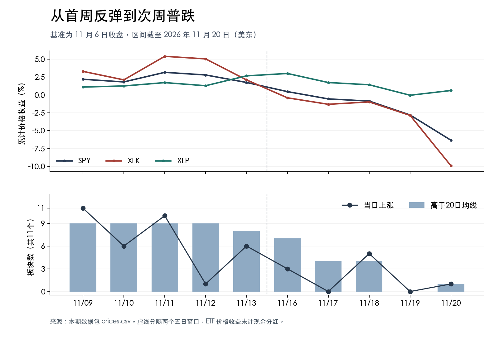

+++
title = "市场板块轮动双周分析报告｜截至 2026-11-20（美东）"
date = "2026-11-21"
data_as_of = ["2026-11-17", "2026-11-19", "2026-11-20"]
data_as_of_note = "权益观察期为 11 月 9—20 日（美东）。多数利率、信用利差和 VIX 截至 19 日，部分曲线利差及通胀补偿截至 20 日，WTI 现货截至 17 日。"
draft = false
description = "第二周 11 个板块全部下跌，必需消费守住两周涨幅。报告对比板块排名、上涨广度和信用利差的变化。"
series = "市场板块轮动双周复盘"
categories = ["市场结构", "宏观与政策"]
tags = ["板块轮动", "SPY", "ETF", "市场广度"]
featured = false
private = false
content_preservation = "verbatim"
source_sha256 = "dd6ac747e6fa355b551cb6997dd181f174d7f9f847efb05012ed690752cf19d0"
+++

# 市场板块轮动双周分析报告｜截至 2026-11-20（美东）

**第二周全线下跌，必需消费守住两周涨幅**

观察期为 **11 月 9—20 日**，以 11 月 6 日收盘为基准，共 10 个美股交易日。报告制作时间为 2026 年 11 月 21 日 14:04（新加坡）。下文收益均为未计现金分红的收盘价收益，相对收益以百分点计。

## 一、本期判断

**9 个板块跑赢 SPY，只有必需消费取得正收益。** SPY 两周下跌 **6.34%**。排名第一的必需消费（XLP）上涨 **0.62%**，也是期末唯一收在 20 日均线上方的板块。公用事业（XLU）和能源（XLE）分别下跌 **0.86%、2.13%**，仍排在第二、第三。11 个板块的收益中位数为 **−4.19%**。本期相对领先主要体现为下跌时的抗跌能力。

**跌势在第二周扩散，科技跌得最深。** 第一周有 10 个板块上涨，第二周 11 个板块全部下跌，SPY 从上涨 **1.75%** 转为下跌 **7.95%**。科技（XLK）第二周下跌 **11.78%**，是当周唯一跑输 SPY 的板块。到 11 月 20 日，QQQ 当日下跌 **5.67%**，等权标普 ETF（RSP）也下跌 **1.98%**。成长和科技承受了更大的压力，等权市场也卷入了回撤。

**信用和国债更能解释两周之间的变化。** 从 11 月 13 日至 19 日，高收益债利差扩大 **29 bp**，VIX 上升 **9.14 点**，10 年美债收益率回落 **11 bp**。同期股票继续下跌，结合第二周的长债反弹，这组价格更符合投资者降低风险敞口的解释。信用利差和 VIX 的最后观察日早于周五的大跌，最剧烈交易日的风险定价仍待补齐。

| 权益 ETF | 前五日 | 后五日 | 两周 | 20 日 | 60 日 |
| --- | ---: | ---: | ---: | ---: | ---: |
| SPY | +1.75% | −7.95% | −6.34% | −9.23% | −10.54% |
| QQQ | +2.56% | −9.77% | −7.46% | −13.62% | −15.62% |
| RSP | +2.19% | −6.03% | −3.98% | −4.20% | −6.33% |
| IWM | +0.75% | −6.95% | −6.26% | −6.94% | −14.41% |

## 二、上涨广度与排名变化

第一周和第二周，跑赢 SPY 的板块从 8 个增至 10 个，上涨板块却从 10 个降至零。两周合计，11 个板块等权平均下跌 **4.08%**。20 日和 60 日窗口各有 **9/11** 跑赢 SPY，取得正收益的都只有 **2/11**。当基准本身持续下跌，跑赢数量衡量的是跌幅差异，绝对涨跌和均线位置更能回答有多少板块守住了价格。

| 观察窗口 | 上涨数 | 跑赢 SPY 数 | 期末高于20日均线数 | 11板块平均收益 | SPY |
| --- | ---: | ---: | ---: | ---: | ---: |
| 对照十日（10/26—11/06） | 7 | 9 | 7 | −0.42% | −3.08% |
| 本期十日（11/09—11/20） | 1 | 9 | 1 | −4.08% | −6.34% |
| 前五日（11/09—11/13） | 10 | 8 | 8 | +2.01% | +1.75% |
| 后五日（11/16—11/20） | 0 | 10 | 1 | −5.96% | −7.95% |

本期头尾收益差为 **10.55 个百分点**，横截面标准差为 **2.67 个百分点**。与紧邻且不重叠的 **10 月 26 日—11 月 6 日**相比，排名的 Spearman 相关系数为 **0.05**，前三名从可选消费、房地产、医疗变为必需消费、公用事业、能源，重合 **0/3**。有两个板块变动至少五位，能源由第 11 升至第 3，可选消费由第 1 降至第 9。能源的排名跃升发生在价格下跌期间。

## 三、板块排名与中期表现

下表按本期 10 日价格收益排序。名次变化比较两个独立的十日窗口，相对列均为相同窗口内板块收益减 SPY 收益。

| 板块 | 对照→本期名次 | 前五日 | 后五日 | 两周 | 两周相对 | 20日相对 | 60日相对 |
| --- | ---: | ---: | ---: | ---: | ---: | ---: | ---: |
| 必需消费 XLP | 5→1 | +2.67% | −1.99% | +0.62% | +6.97 | +11.72 | +16.87 |
| 公用事业 XLU | 6→2 | +1.90% | −2.71% | −0.86% | +5.48 | +9.54 | +9.41 |
| 能源 XLE | 11→3 | +5.05% | −6.84% | −2.13% | +4.21 | −3.49 | +7.68 |
| 房地产 XLRE | 2→4 | +0.06% | −4.09% | −4.03% | +2.31 | +8.97 | +5.62 |
| 工业 XLI | 9→5 | +3.02% | −6.87% | −4.06% | +2.29 | +4.22 | −2.00 |
| 医疗保健 XLV | 3→6 | +1.89% | −5.97% | −4.19% | +2.15 | +8.09 | +13.84 |
| 金融 XLF | 4→7 | +2.08% | −6.40% | −4.45% | +1.90 | +6.85 | +4.82 |
| 通信服务 XLC | 8→8 | +3.39% | −7.64% | −4.51% | +1.84 | +4.04 | +0.33 |
| 可选消费 XLY | 1→9 | +1.26% | −5.78% | −4.59% | +1.75 | +8.67 | +7.59 |
| 原材料 XLB | 7→10 | −1.31% | −5.53% | −6.77% | −0.43 | +3.44 | +1.36 |
| 信息技术 XLK | 10→11 | +2.10% | −11.78% | −9.92% | −3.58 | −9.44 | −10.45 |

**必需消费在本期及较长窗口均守住绝对涨幅。** XLP 的 20 日、60 日价格收益分别为 **+2.49%、+6.32%**。公用事业同样有防御性，但其 60 日价格收益为 **−1.13%**，同期仍跑赢 SPY **9.41 个百分点**。医疗（XLV）的 60 日价格收益为 **+3.30%**，本期却下跌 **4.19%**，防御组内部的差别仍大。

**能源和科技处于两端，排名背后的路径不同。** 能源第一周上涨 **5.05%**，第二周下跌 **6.84%**，复合后两周下跌 **2.13%**。其 20 日收益为 **−12.72%**，落后 SPY **3.49 个百分点**，本期第三名尚缺中期支持。科技则在 5、10、20、60 日四个窗口均跑输 SPY，60 日绝对跌幅为 **21.00%**。原材料是另一个两周累计跑输 SPY 的板块，第二周跌幅已经小于基准。

## 四、从第一周反弹到第二周普跌

11 月 11 日，SPY 较期初累计上涨 **3.16%**，科技上涨 **5.40%**。到 13 日，仍有 8 个板块在 20 日均线上方。此后 SPY 连跌五个交易日，17 日和 19 日均无板块收涨。19 日收盘时，11 个板块已全部跌至各自 20 日均线或以下。20 日 SPY 再跌 **3.64%**，科技跌 **7.27%**，必需消费逆势上涨 **0.67%**，成为唯一重返均线上方的板块。

两段五日中，必需消费、公用事业、能源、工业、医疗、金融和通信均跑赢 SPY。第二周，房地产、可选消费和原材料从落后转为领先，但三者仍各下跌约 **4%—6%**。相反，科技从第一周领先 SPY **0.36 个百分点**转为第二周落后 **3.83 个百分点**。十个板块在第二周比指数抗跌，加上 RSP 同期跑赢 SPY **1.92 个百分点**，与大盘权重股表现更弱的解释一致。精确到个股的指数拖累仍需要同期权重和成分股收益。

## 五、报告期内的外部事件

**11 月 10 日，美国劳工统计局公布 10 月 CPI。** 经季调的整体 CPI 环比上涨 **0.4%**，低于 9 月的 0.6%，核心 CPI 环比上涨 **0.3%**。11 月 6—13 日，包内 10 年实际收益率由 2.63% 升至 2.91%，股票同期仍然反弹。这为第一周的贴现率变化提供背景。第二周股债的方向已经改变，单次通胀发布对整段股市回撤的解释有限。[美国劳工统计局 CPI 公告](https://www.bls.gov/news.release/archives/cpi_11102026.htm)

**11 月 17 日，英伟达公布截至 10 月 25 日的季度业绩。** 公司收入为 **1,158 亿美元**，同比增长 **103%**，其中数据中心收入 **1,076 亿美元**，同比增长 **110%**。包内科技 ETF 在 18 日收盘上涨 **0.34%**，19 日和 20 日又分别下跌 **1.90%、7.27%**。这段路径体现了单家公司收入增长与板块定价的分歧。衡量业绩或指引对板块的贡献，还需要发布前预期、个股反应和权重。[英伟达 FY2027 第三季度业绩](https://investor.nvidia.com/news/press-release-details/2026/NVIDIA-Announces-Financial-Results-for-Third-Quarter-Fiscal-2027/default.aspx)

**11 月 18 日，美联储发布 10 月 27—28 日会议纪要。** 多数与会者预计近期通胀仍高，多人关注 AI 投资对需求和成本的影响，部分与会者也讨论了融资条件收紧可能抑制相关支出。纪要记录的是 10 月会议时的判断。到 11 月 19 日，名义国债收益率已较 13 日回落，信用利差则扩大。就第二周而言，股价和信用价格显示的风险压力比同期实际利率变化更明显，各事件的边际影响无法从收盘价单独识别。[美联储发布公告](https://www.federalreserve.gov/newsevents/pressreleases/monetary20261118a.htm) · [会议纪要全文](https://www.federalreserve.gov/monetarypolicy/fomcminutes20261028.htm)

## 六、风格、美元与商品

| 价格收益差（百分点） | 后五日 | 两周 | 20 日 | 60 日 |
| --- | ---: | ---: | ---: | ---: |
| SPYG−SPYV（成长−价值） | −4.37 | −5.71 | −8.97 | −12.03 |
| IWF−IWD（大盘成长−价值） | −4.47 | −4.96 | −11.07 | −13.95 |
| RSP−SPY（等权−市值加权） | +1.92 | +2.37 | +5.03 | +4.22 |
| IWM−SPY（小盘−大盘） | +1.00 | +0.08 | +2.29 | −3.87 |
| USMV−SPY（低波动−市场） | +2.28 | +3.35 | +4.62 | +6.84 |
| 周期组−防御组 | −2.72 | −2.92 | −5.85 | −9.48 |

两组成长 ETF 相对价值 ETF 在四个窗口均落后。等权、低波动在四个窗口均跑赢市值加权 SPY，但 RSP 与 USMV 本期实际分别下跌 **3.98%、2.99%**。小盘 IWM 本期下跌 **6.26%**，与 SPY 的差距仅 **0.08 个百分点**，60 日仍落后 **3.87 个百分点**。证据更支持价值、低波动的相对抗跌，小盘股的持续领先仍待观察。

周期组由可选消费、金融、工业、原材料和能源等权组成，防御组由必需消费、公用事业、医疗等权组成，按本包定义。两组本期分别下跌 **4.40%、1.48%**。剔除能源后，周期组落后幅度由 **2.92** 扩至 **3.49 个百分点**。防御优势在能源排名大幅提升的情况下仍然存在。

**动量和质量的可比窗口。** MTUM 和 QUAL 已于 11 月 5 日开始按一拆四后的份额交易。本期 5 日及 10 日的起点均晚于生效日，可直接计算。MTUM 本期仅领先 SPY **0.03 个百分点**，最近五日落后 **2.91 个百分点**。QUAL 本期和最近五日分别领先 **0.70、0.91 个百分点**。包内两只 ETF 在 11 月 2 日已出现约四倍的价格单位断点。跨断点的 20 日、60 日若以四倍期末价统一端点份额估算，MTUM 相对 SPY 分别为 **−7.48、−10.22 个百分点**，QUAL 为 **+2.35、+2.92 个百分点**。这些是端点敏感性估算，逐日序列的调整时点仍待独立行情核实。11 个板块的排名和广度不涉及这两只风格 ETF。[iShares 拆股说明](https://www.sec.gov/Archives/edgar/data/1100663/000119312526414100/R2.htm)

本期美元 ETF（UUP）上涨 **2.33%**，黄金（GLD）下跌 **13.53%**，其中第二周黄金下跌 **9.28%**。美元走强与金价走弱方向一致，但第二周实际利率也略有回落，单靠实际利率难以解释金价跌幅。原油期货 ETF（USO）两周下跌 **5.79%**，广义商品 ETF（DBC）下跌 **5.42%**。统一截到现货最后观察日 11 月 17 日，WTI 较 6 日下跌 **5.13%**，USO 同期下跌 **5.38%**。能源股排名改善期间，原油现货和期货 ETF 均在下跌。

## 七、利率、信用与波动率

下表列出三个时点。两项变化分别以 11 月 6 日、13 日为起点，终点取该行实际最后观察日。利率和利差水平以 % 计，变动以基点（bp）计。

| 指标 | 11/06 | 11/13 | 最新值 | 观察日 | 较11/06 | 较11/13 |
| --- | ---: | ---: | ---: | ---: | ---: | ---: |
| 2年美债 | 4.51 | 4.88 | 4.76 | 11/19 | +25 bp | −12 bp |
| 10年美债 | 4.86 | 5.15 | 5.04 | 11/19 | +18 bp | −11 bp |
| 30年美债 | 5.26 | 5.47 | 5.40 | 11/19 | +14 bp | −7 bp |
| 10Y−2Y | 0.35 | 0.27 | 0.29 | 11/20 | −6 bp | +2 bp |
| 10Y−3M | 0.67 | 0.83 | 0.60 | 11/20 | −7 bp | −23 bp |
| 10年实际利率 | 2.63 | 2.91 | 2.88 | 11/19 | +25 bp | −3 bp |
| 10年通胀补偿 | 2.23 | 2.24 | 2.15 | 11/20 | −8 bp | −9 bp |
| 高收益债 OAS | 3.42 | 3.23 | 3.52 | 11/19 | +10 bp | +29 bp |
| 投资级债 OAS | 0.93 | 0.89 | 0.94 | 11/19 | +1 bp | +5 bp |
| VIX（点） | 25.64 | 19.30 | 28.44 | 11/19 | +2.80 | +9.14 |
| WTI（美元/桶） | 94.37 | 91.96 | 89.53 | 11/17 | −4.84 | −2.43 |

**利率经历先升后降。** 按 11 月 19 日同日数据，10 年名义利率比 6 日高 **18 bp**，其中实际利率上升 **25 bp**、通胀补偿下降 **7 bp**。从 13 日至 19 日则相反，名义利率回落 **11 bp**，其中实际利率下降 **3 bp**、通胀补偿下降 **8 bp**。2 年与 10 年国债在 19 日的利差为 **28 bp**，20 日单独发布的曲线序列为 **29 bp**。后五日 TLT 上涨 **2.48%**、IEF 上涨 **1.64%**，与第二周名义收益率回落一致。

**信用压力集中在第二周。** 高收益债 OAS 第一周由 **342 bp** 收窄至 **323 bp**，随后扩大至 **352 bp**。只看两周净变化 **+10 bp** 会低估第二周的恶化幅度。投资级利差同期由 **89 bp** 扩至 **94 bp**，幅度较小。第二周 HYG 下跌 **0.70%**，LQD 上涨 **0.90%**，两者相差 **−1.60 个百分点**。ETF 价差同时包含久期差异，OAS 提供了独立的利差观察口径。VIX 先由 **25.64** 回落至 **19.30**，再升至 **28.44**。上述 OAS 和 VIX 读数止于 19 日。

## 八、下一期观察

- **下跌是否收窄。** 以 11 月 20 日仅一个板块在 20 日均线上方为起点，跟踪下一段五日能否同时出现多个板块价格上涨、重新站上均线。单看跑赢 SPY 的数量，容易把跌幅较小误读为反弹。
- **科技是否停止扩大相对跌幅。** 同时观察 XLK 的绝对收益与相对 SPY 的差值，以及 QQQ 和 RSP 的表现。若等权市场恢复、科技仍落后，压力仍偏向成长权重。若两者同步走弱，调整的覆盖面会更广。
- **信用是否确认周五的价格压力。** 待 20 日及之后的 OAS、VIX 齐备，比较其与 19 日读数。若信用利差收窄，同时板块均线广度回升，才有跨市场证据支持风险压力缓解。

##  
## 免责声明

本报告仅供研究与信息交流，不构成对任何证券、基金或衍生品的投资建议、交易指令或收益承诺。数据可能存在滞后、修订或复权差异。历史表现不能保证未来结果。读者应独立核实资料，结合自身目标与风险承受能力作出投资决策，并自行承担相应风险。
